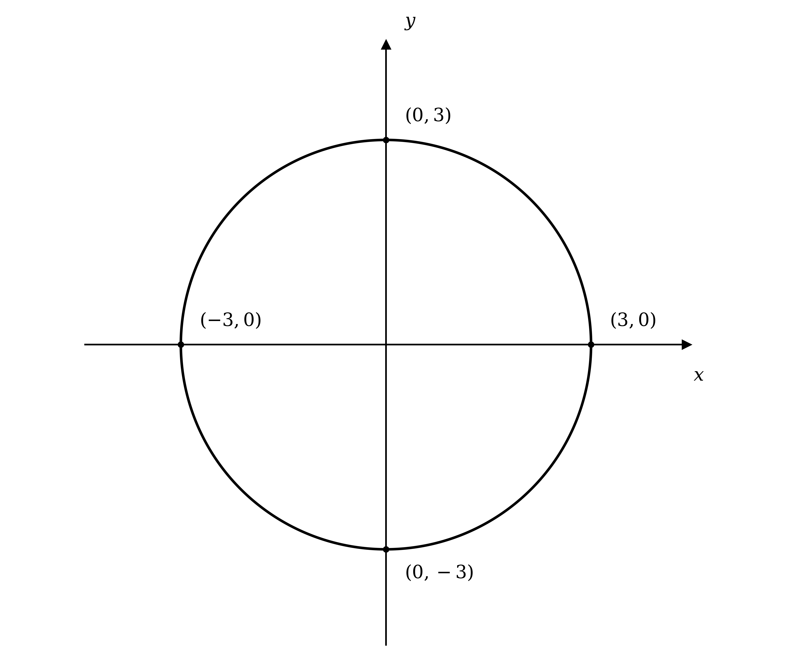
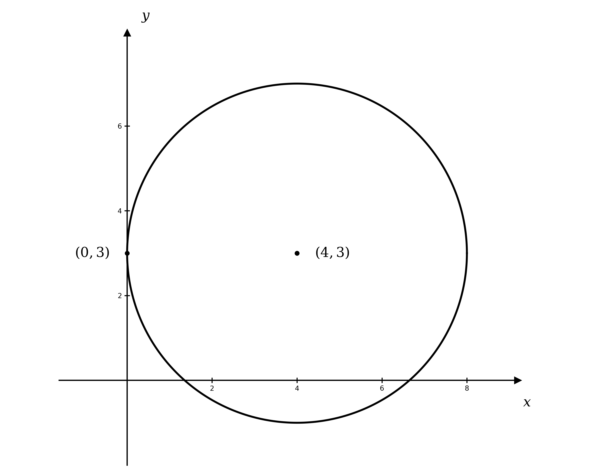
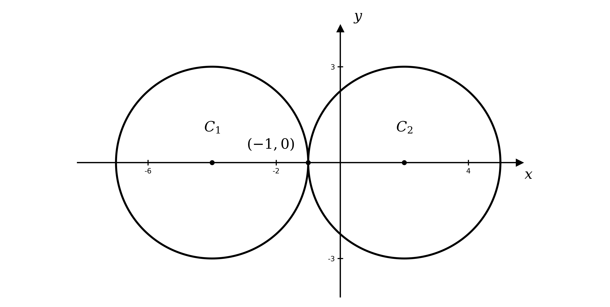
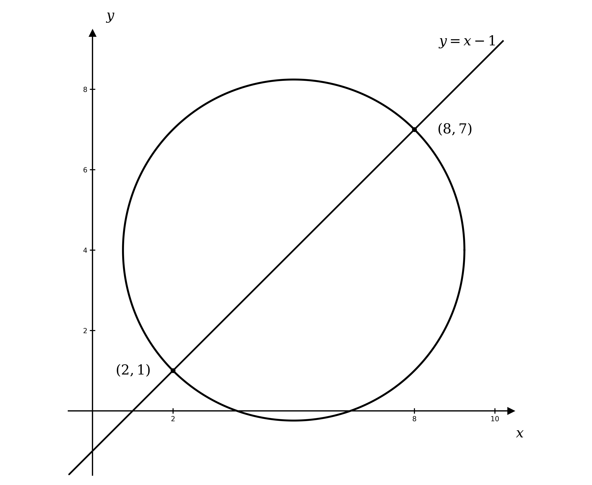
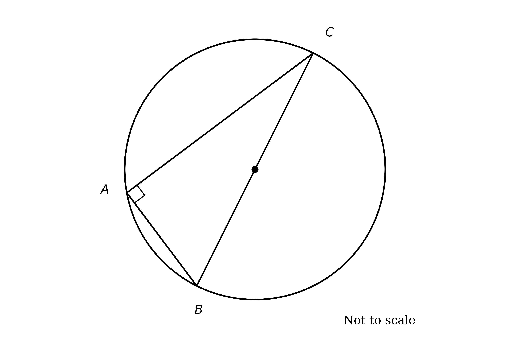
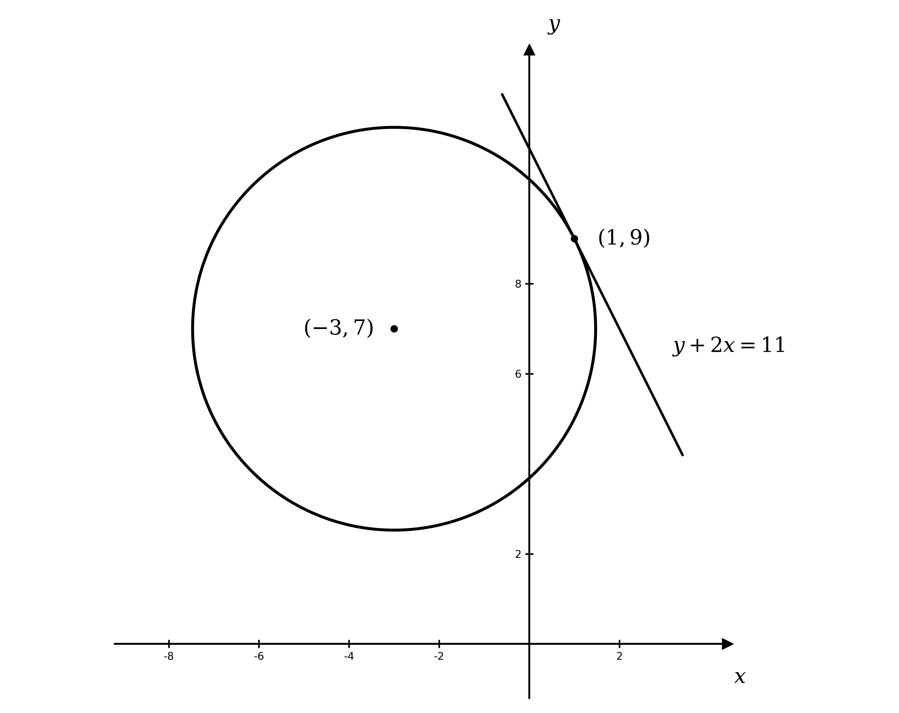
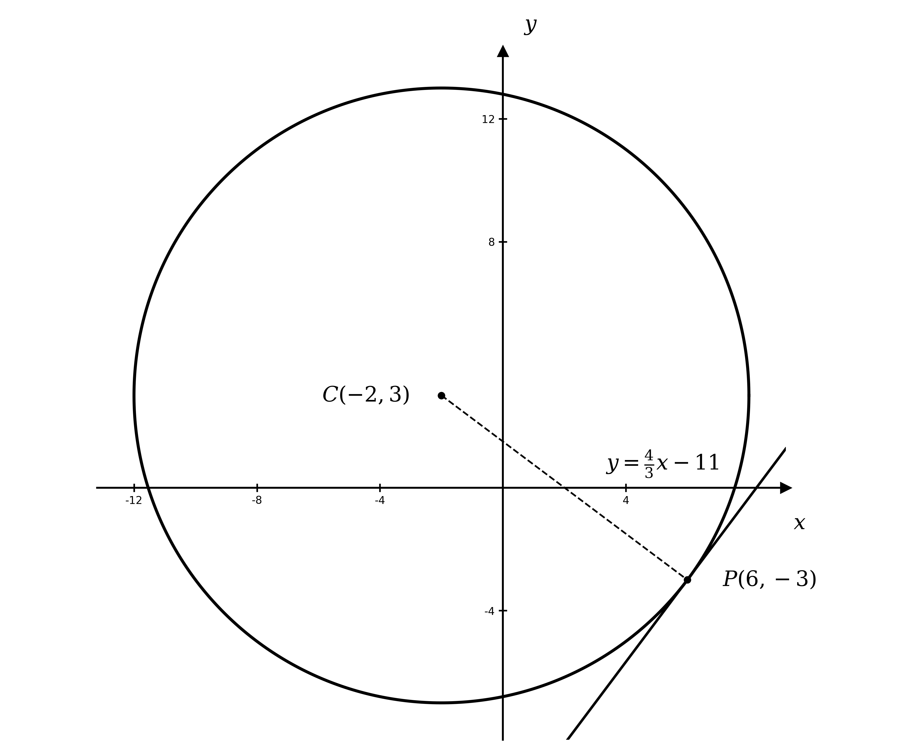
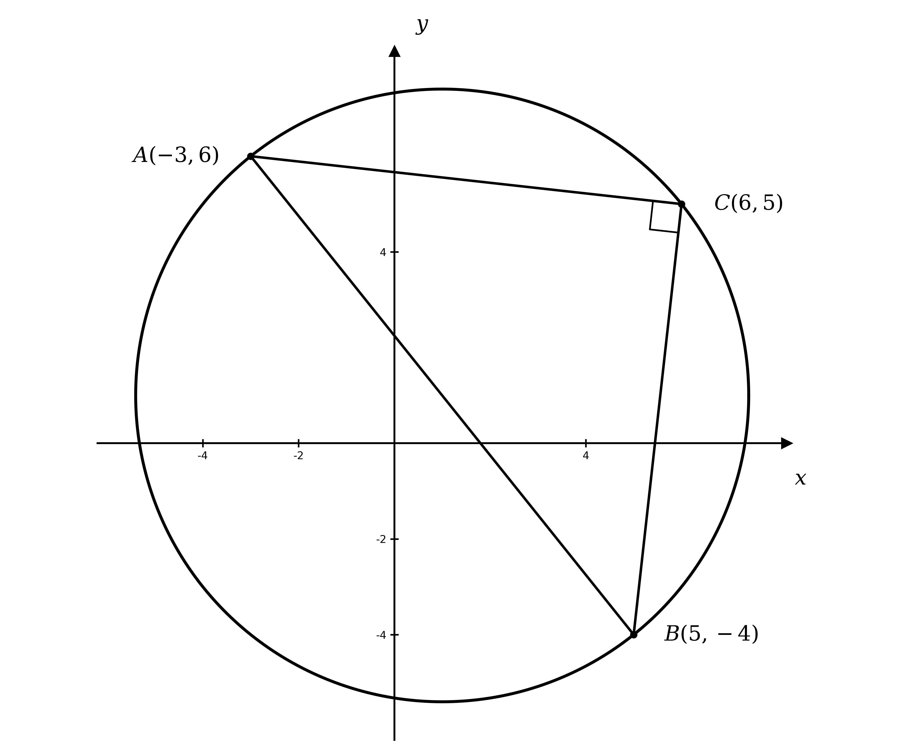
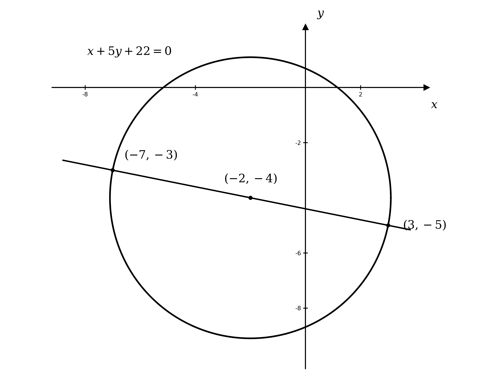

# Mark Schemes — Circles
**Coordinate Geometry** · Cambridge (CIE) AS maths (9709)

## Exam Questions (32 questions)

### Q1
Draw one circle, then add three lines to show the three cases

A line that misses the circle gives $0$ intersections

A tangent touches the circle at exactly $1$ point

A line that passes through the circle gives $2$ intersections

**[B1 B1]**

> **[mark-scheme]**
> **B1**: Sketch showing a tangent (1 intersection) and a line that misses the circle (0 intersections).
> 
> **B1**: Sketch showing a line that cuts the circle at 2 points, with all three cases clearly labelled.

### Q2
(i)

Halve the coefficient of $x$, then subtract the square of that number

$x^{2} + 4 x = ( x + 2 )^{2} - 4$

**[B1]**

(ii)

Halve the coefficient of $y$, then subtract the square of that number

$y^{2} - 6 y = ( y - 3 )^{2} - 9$

**[B1]**

> **[mark-scheme]**
> **B1**: Correct completed-square form $( x + 2 )^{2} - 4$.
> 
> **B1**: Correct completed-square form $( y - 3 )^{2} - 9$.
(i)

Replace $x^{2} + 4 x$ and $y^{2} - 6 y$ with the completed-square forms from part (a)

$( x + 2 )^{2} - 4 + ( y - 3 )^{2} - 9 + 4 = 0$

**[M1]**

Collect the constant terms $( - 4 - 9 + 4 = - 9 )$ and move them to the right-hand side

$( x + 2 )^{2} + ( y - 3 )^{2} = 9$

**[A1]**

(ii)

Compare with $( x - a )^{2} + ( y - b )^{2} = r^{2}$

$\text{centre} ( - 2 , 3 ) ,  \text{radius} = 3$

**[B1 B1]**

> **[mark-scheme]**
> **M1**: Substituting the completed-square expressions from part (a) into the equation.
> 
> **A1**: Correctly reaching the given form $( x + 2 )^{2} + ( y - 3 )^{2} = 9$ with all steps shown.
> 
> **B1**: Correct centre $( - 2 , 3 )$.
> 
> **B1**: Correct radius $3$, obtained from $r^{2} = 9$.

### Q3
The equation of a circle with centre $( a , b )$ and radius $r$ is $( x - a )^{2} + ( y - b )^{2} = r^{2}$

(i)

Substitute $a = 0$, $b = 0$ and $r = 4$

$x^{2} + y^{2} = 16$

**[B1]**

(ii)

Substitute $a = 3$, $b = - 4$ and $r = 2$

$( x - 3 )^{2} + ( y + 4 )^{2} = 4$

**[B1]**

(iii)

Substitute $a = - 5$, $b = 0$ and $r = 5$

$( x + 5 )^{2} + y^{2} = 25$

**[B1]**

> **[mark-scheme]**
> **B1**: Correct equation for circle (i). Accept $4^{2}$ in place of $16$.
> 
> **B1**: Correct equation for circle (ii). The centre coordinates appear inside the brackets with the opposite sign.
> 
> **B1**: Correct equation for circle (iii). Accept $5^{2}$ in place of $25$.

### Q4
The circle $( x - a )^{2} + ( y - b )^{2} = r^{2}$ has centre $( a , b )$ and radius $r$

(i)

Here $r^{2} = 5^{2}$

$\text{centre} ( 0 , 0 ) ,  \text{radius} = 5$

**[B1]**

(ii)

The bracket $( x + 3 )$ gives $a = - 3$, and $r^{2} = 49$

$\text{centre} ( - 3 , 2 ) ,  \text{radius} = 7$

**[B1]**

(iii)

The bracket $( y + 4 )$ gives $b = - 4$, and $r^{2} = 144$

$\text{centre} ( 0 , - 4 ) ,  \text{radius} = 12$

**[B1]**

> **[mark-scheme]**
> **B1**: Correct centre and radius for circle (i).
> 
> **B1**: Correct centre and radius for circle (ii). The $+ 3$ inside the bracket gives an $x$-coordinate of $- 3$.
> 
> **B1**: Correct centre and radius for circle (iii). The radius is $\sqrt{144} = 12$, not $144$.

### Q5
(i)

$x^{2} + y^{2} = 9$ has centre $( 0 , 0 )$ and radius $3$

The circle crosses both axes at $\pm 3$

**[B1 B1]**

(ii)

$( x - 4 )^{2} + ( y - 3 )^{2} = 4^{2}$ has centre $( 4 , 3 )$ and radius $4$

As the radius equals the $x$-coordinate of the centre, the circle touches the $y$-axis at $( 0 , 3 )$; as the radius is greater than the $y$-coordinate of the centre, the circle extends below the $x$-axis

**[B1 B1]**

> **[mark-scheme]**
> **B1**: Circle (i) drawn as a circle centred at the origin.
> 
> **B1**: Circle (i) with radius 3, crossing the axes at $( \pm 3 , 0 )$ and $( 0 , \pm 3 )$.
> 
> **B1**: Circle (ii) drawn centred at $( 4 , 3 )$.
> 
> **B1**: Circle (ii) with radius 4, touching the $y$-axis at $( 0 , 3 )$ and extending below the $x$-axis.

### Q6
The centre of the circle is the midpoint of the diameter

`\left( \dfrac{1 + 9}{2}, \; \dfrac{0 + 4}{2} \right)`

**[M1]**

$\text{centre} ( 5 , 2 )$

**[A1]**

The radius is half the length of the diameter

$r = \frac{1}{2} \sqrt{(9-1)^{2}+(4-0)^{2}} = \frac{1}{2} \sqrt{80}$

**[M1]**

Simplify the surd, using $\sqrt{80} = \sqrt{16\times5} = 4 \sqrt{5}$

$r = 2 \sqrt{5}$

**[A1]**

> **[mark-scheme]**
> **M1**: Using the midpoint formula on the two endpoints of the diameter.
> 
> **A1**: Correct centre $( 5 , 2 )$.
> 
> **M1**: Finding the radius as half the distance between the two points, or as the distance from the centre to one endpoint.
> 
> **A1**: Correct radius as an exact simplified surd $2 \sqrt{5}$. A decimal answer is not accepted.

### Q7
Write down the centre and radius of each circle

$C_{1} \text{: centre} ( - 4 , 0 ) ,  \text{radius} 3$

$C_{2} \text{: centre} ( 2 , 0 ) ,  \text{radius} 3$

**[B1]**

Both centres lie on the $x$-axis, so the distance between them is the difference of the $x$-coordinates

$d = 2 - ( - 4 ) = 6$

**[M1]**

The sum of the radii is $3 + 3 = 6$, which is equal to the distance between the centres, so the circles touch externally at a single point

**Final answer:** **The circles intersect exactly once, at **$( - 1 , 0 )$

**[A1]**

> **[mark-scheme]**
> **B1**: Correct centre and radius of both circles.
> 
> **M1**: Finding the distance between the two centres (here the difference of the $x$-coordinates, as both centres lie on the $x$-axis).
> 
> **A1**: Concluding that the circles intersect exactly once, justified by the distance between the centres being equal to the sum of the radii (touching externally). Accept a clear supporting diagram and/or the point of contact $( - 1 , 0 )$.

### Q8
To find the points of intersection, substitute $y = x - 1$ into the equation of the circle

`(x - 5)^2 + \left((x - 1) - 4\right)^2 = 18`

**[M1]**

Expand and collect the terms into a three-term quadratic

$2 x^{2} - 20 x + 50 = 18$

$x^{2} - 10 x + 16 = 0$

**[A1]**

Factorise and solve

$( x - 2 ) ( x - 8 ) = 0$

$x = 2  \text{or}  x = 8$

**[M1]**

Substitute each $x$-value into $y = x - 1$ to find the matching $y$-coordinate

$x = 2 \Rightarrow y = 1 ,  x = 8 \Rightarrow y = 7$

**[A1]**

Write the points of intersection as coordinate pairs

**Final answer:** $( 2 , 1 )$** and **$( 8 , 7 )$

**[A1]**

> **[mark-scheme]**
> **M1**: Substituting $y = x - 1$ into the equation of the circle.
> 
> **A1**: Correct three-term quadratic, in any equivalent form (e.g. $x^{2} - 10 x + 16 = 0$).
> 
> **M1**: Solving the three-term quadratic by factorising, the quadratic formula or completing the square.
> 
> **A1**: Both $x$-coordinates correct.
> 
> **A1**: Both points of intersection given as coordinate pairs.

### Q9
Group the $x$ terms and the $y$ terms together

$x^{2} + x + y^{2} - 3 y + 2 = 0$

Complete the square on the $x$ terms and on the $y$ terms

`\left(x + \dfrac{1}{2}\right)^2 - \dfrac{1}{4} + \left(y - \dfrac{3}{2}\right)^2 - \dfrac{9}{4} + 2 = 0`

**[M1]**

Collect the constants `\left(-\dfrac{1}{4} - \dfrac{9}{4} + 2 = -\dfrac{1}{2}\right)` and move them to the right-hand side

`\left(x + \dfrac{1}{2}\right)^2 + \left(y - \dfrac{3}{2}\right)^2 = \dfrac{1}{2}`

**[A1]**

Compare with $( x - a )^{2} + ( y - b )^{2} = r^{2}$, taking the positive square root for the radius

`\text{centre } \left(-\dfrac{1}{2}, \, \dfrac{3}{2}\right)`

**[B1]**

$\text{radius} = \frac{1}{\sqrt{2}} = \frac{\sqrt{2}}{2}$

**[B1]**

> **[mark-scheme]**
> **M1**: Grouping the $x$ terms and the $y$ terms, then completing the square on each.
> 
> **A1**: Correct centre–radius form `\left(x + \tfrac{1}{2}\right)^2 + \left(y - \tfrac{3}{2}\right)^2 = \tfrac{1}{2}`.
> 
> **B1**: Correct centre `\left(-\tfrac{1}{2}, \, \tfrac{3}{2}\right)`.
> 
> **B1**: Correct radius as an exact surd, $\frac{1}{\sqrt{2}}$ or $\frac{\sqrt{2}}{2}$. A decimal is not accepted.

### Q10
Complete the square to find the centre of the circle, grouping the $x$ and $y$ terms first

$x^{2} - 10 x + y^{2} - 4 y + 19 = 0$

$( x - 5 )^{2} + ( y - 2 )^{2} = 10$

**[M1]**

$\text{centre} ( 5 , 2 )$

**[A1]**

The tangent is perpendicular to the radius, so the radius at $P$ has gradient $\frac{1}{3}$ (the negative reciprocal of $- 3$)

**[M1]**

The two points $P$ lie on the diameter through the centre with this gradient; find its equation

$y - 2 = \frac{1}{3} ( x - 5 )  \Rightarrow  y = \frac{1}{3} x + \frac{1}{3}$

**[A1]**

To find the points of contact, substitute this line into the equation of the circle

`(x - 5)^2 + \left(\dfrac{1}{3}x + \dfrac{1}{3} - 2\right)^2 = 10 \quad \Rightarrow \quad x^2 - 10x + 16 = 0`

**[M1]**

Factorise and solve

$( x - 2 ) ( x - 8 ) = 0  \Rightarrow  x = 2  \text{or}  x = 8$

**[A1]**

Find each $y$-coordinate from $y = \frac{1}{3} x + \frac{1}{3}$

**Final answer:** $( 2 , 1 )$** and **$( 8 , 3 )$

**[A1]**

> **[mark-scheme]**
> **M1**: Completing the square to find the centre.
> 
> **A1**: Correct centre $( 5 , 2 )$.
> 
> **M1**: Using tangent `\perp` radius to find the radius gradient $\frac{1}{3}$.
> 
> **A1**: Correct equation of the diameter line through the centre, $y = \frac{1}{3} x + \frac{1}{3}$.
> 
> **M1**: Substituting the line into the circle to form a three-term quadratic.
> 
> **A1**: Correct $x$-values $x = 2$ and $x = 8$.
> 
> **A1**: Both points correct, $( 2 , 1 )$ and $( 8 , 3 )$.

### Q11
As $B C$ is a diameter and $A$ lies on the circle, the angle in the semicircle gives `\angle BAC = 90°`, so $A B^{2} + A C^{2} = B C^{2}$

**[M1]**

Write each squared length in terms of the coordinates

$A B^{2} = ( 0 + 2 )^{2} + ( 6 - 3 )^{2} = 13$

$A C^{2} = ( k + 2 )^{2} + ( - 1 - 3 )^{2} = ( k + 2 )^{2} + 16$

$B C^{2} = ( k - 0 )^{2} + ( - 1 - 6 )^{2} = k^{2} + 49$

**[M1]**

Substitute into $A B^{2} + A C^{2} = B C^{2}$ and simplify

$13 + ( k + 2 )^{2} + 16 = k^{2} + 49$

$k^{2} + 4 k + 33 = k^{2} + 49  \Rightarrow  4 k = 16$

**[A1]**

$k = 4$

**[A1]**

> **[mark-scheme]**
> **M1**: Using the angle in a semicircle: `\angle BAC = 90°`, so $A B^{2} + A C^{2} = B C^{2}$ (or `AB \perp AC` via gradients).
> 
> **M1**: Correct expressions for the three squared lengths in terms of $k$.
> 
> **A1**: Correct simplified equation, e.g. $4 k = 16$.
> 
> **A1**: Correct value $k = 4$.

### Q12
To find where the line meets the circle, rearrange the line to $y = c - x$ and substitute into the equation of the circle

$x^{2} + ( c - x )^{2} - 6 x + 10 ( c - x ) - 16 = 0$

**[M1]**

Expand and collect into a three-term quadratic in $x$

$2 x^{2} - ( 2 c + 16 ) x + ( c^{2} + 10 c - 16 ) = 0$

**[A1]**

For the line to meet the circle at two distinct points, this quadratic must have two distinct real roots, so the discriminant is strictly positive

$( 2 c + 16 )^{2} - 4 ( 2 ) ( c^{2} + 10 c - 16 ) > 0$

**[M1]**

Expand and simplify the discriminant

$4 c^{2} + 64 c + 256 - 8 c^{2} - 80 c + 128 > 0$

$- 4 c^{2} - 16 c + 384 > 0$

**[A1]**

Divide by $- 4$, reversing the inequality

$c^{2} + 4 c - 96 < 0$

**[M1]**

Factorise to find the critical values

$( c + 12 ) ( c - 8 ) < 0  \Rightarrow  c = - 12  \text{or}  c = 8$

**[A1]**

The expression is negative between its roots, so the range is

$- 12 < c < 8$

**[A1]**

> **[mark-scheme]**
> **M1**: Substituting $y = c - x$ into the equation of the circle.
> 
> **A1**: Correct three-term quadratic in $x$ with $c$ in the coefficients.
> 
> **M1**: Using the discriminant $b^{2} - 4 a c > 0$ for two distinct points (a strict inequality, because the two points are distinct).
> 
> **A1**: Correct simplified discriminant condition, e.g. $- 4 c^{2} - 16 c + 384 > 0$.
> 
> **M1**: Dividing by $- 4$ and reversing the inequality to $c^{2} + 4 c - 96 < 0$.
> 
> **A1**: Factorising to $( c + 12 ) ( c - 8 ) < 0$, giving critical values $c = - 12$ and $c = 8$.
> 
> **A1**: Correct range $- 12 < c < 8$. The inequality must be strict.

### Q13
The centre is the midpoint of the diameter $A B$

`\left( \dfrac{2 + (-5)}{2}, \; \dfrac{-21 + 3}{2} \right) = \left(-\dfrac{3}{2}, \, -9\right)`

**[M1 A1]**

The radius is the distance from the centre to $A ( 2 , - 21 )$

`r = \sqrt{\left(2 + \dfrac{3}{2}\right)^2 + (-21 + 9)^2} = \sqrt{\left(\dfrac{7}{2}\right)^2 + (-12)^2} = \sqrt{\dfrac{625}{4}} = \dfrac{25}{2}`

**[M1 A1]**

Write in centre–radius form (squaring the radius), then expand and multiply through by $4$

`\left(x + \dfrac{3}{2}\right)^2 + (y + 9)^2 = \dfrac{625}{4}`

$4 x^{2} + 12 x + 9 + 4 y^{2} + 72 y + 324 = 625$

**[M1]**

Collect all terms on one side and divide by $4$ to give integer coefficients

$x^{2} + y^{2} + 3 x + 18 y - 73 = 0$

**[A1]**

> **[mark-scheme]**
> **M1**: Finding the centre as the midpoint of the diameter.
> 
> **A1**: Correct centre `\left(-\tfrac{3}{2}, \, -9\right)`.
> 
> **M1**: Finding the radius as the distance from the centre to an endpoint.
> 
> **A1**: Correct radius $r = \frac{25}{2}$ (so $r^{2} = \frac{625}{4}$).
> 
> **M1**: Expanding the centre–radius form and clearing fractions.
> 
> **A1**: Correct integer equation $x^{2} + y^{2} + 3 x + 18 y - 73 = 0$. The diameter form $( x - 2 ) ( x + 5 ) + ( y + 21 ) ( y - 3 ) = 0$ leading to the same equation earns full marks.

### Q14
The points $A$ and $B$ lie on $C_{1}$ and on the line, so substitute $y = 3 x + 1$ into the equation of $C_{1}$

$x^{2} + ( 3 x + 1 )^{2} - 16 x - 10 ( 3 x + 1 ) + 39 = 0$

**[M1]**

$10 x^{2} - 40 x + 30 = 0  \Rightarrow  x^{2} - 4 x + 3 = 0$

**[A1]**

Solve for the two $x$-values and find $A$ and $B$

$( x - 1 ) ( x - 3 ) = 0  \Rightarrow  A = ( 1 , 4 ) ,  B = ( 3 , 10 )$

**[A1]**

$C_{2}$ passes through $A$, $B$ and $D ( - 13 , 2 )$; its centre lies on the perpendicular bisector of each chord (the perpendicular bisector of any chord passes through the centre). For $A D$, use the midpoint $( - 6 , 3 )$ and the perpendicular gradient

$m_{AD} = \frac{1}{7}  \Rightarrow  \text{perp gradient} = - 7$

**[M1]**

$y - 3 = - 7 ( x + 6 )  \Rightarrow  y = - 7 x - 39$

**[A1]**

For $B D$, use the midpoint $( - 5 , 6 )$ and the perpendicular gradient

$m_{BD} = \frac{1}{2}  \Rightarrow  \text{perp gradient} = - 2$

**[M1]**

$y - 6 = - 2 ( x + 5 )  \Rightarrow  y = - 2 x - 4$

**[A1]**

The centre is where the two perpendicular bisectors meet

$- 7 x - 39 = - 2 x - 4  \Rightarrow  x = - 7 ,  y = 10$

**[M1]**

$\text{centre} ( - 7 , 10 )$

**[A1]**

Find $r^{2}$ as the squared distance from the centre to $( - 13 , 2 )$

$r^{2} = ( - 13 + 7 )^{2} + ( 2 - 10 )^{2} = 36 + 64 = 100$

**[M1]**

$( x + 7 )^{2} + ( y - 10 )^{2} = 100$

**[A1]**

> **[mark-scheme]**
> **M1**: Substituting the chord line $y = 3 x + 1$ into the equation of $C_{1}$.
> 
> **A1**: Correct three-term quadratic $x^{2} - 4 x + 3 = 0$.
> 
> **A1**: Correct intersection points $A = ( 1 , 4 )$ and $B = ( 3 , 10 )$.
> 
> **M1**: Forming the perpendicular bisector of one chord (midpoint and perpendicular gradient).
> 
> **A1**: Correct first perpendicular bisector, e.g. $y = - 7 x - 39$.
> 
> **M1**: Forming the perpendicular bisector of a second chord.
> 
> **A1**: Correct second perpendicular bisector, e.g. $y = - 2 x - 4$.
> 
> **M1**: Solving the two bisectors simultaneously for the centre.
> 
> **A1**: Correct centre $( - 7 , 10 )$.
> 
> **M1**: Finding $r^{2}$ as the squared distance from the centre to $( - 13 , 2 )$ (or $A$ or $B$).
> 
> **A1**: Correct equation $( x + 7 )^{2} + ( y - 10 )^{2} = 100$ (or $x^{2} + y^{2} + 14 x - 20 y + 49 = 0$).

### Q15
Find the squared length of each side of triangle $A B C$

$A B^{2} = ( 7 - 4 )^{2} + ( 2 - 6 )^{2} = 9 + 16 = 25$

$A C^{2} = ( 12 - 4 )^{2} + ( 12 - 6 )^{2} = 64 + 36 = 100$

$B C^{2} = ( 12 - 7 )^{2} + ( 12 - 2 )^{2} = 25 + 100 = 125$

**[M1]**

Since $A B^{2} + A C^{2} = 25 + 100 = 125 = B C^{2}$, there is a right angle at $A$, so by the angle in a semicircle $B C$ is a diameter

**[A1]**

The centre is the midpoint of the diameter $B C$

`\left( \dfrac{7 + 12}{2}, \; \dfrac{2 + 12}{2} \right) = \left(\dfrac{19}{2}, \, 7\right)`

**[M1 A1]**

The radius is half the diameter $B C$, where $B C = \sqrt{125}$

$r = \frac{1}{2} \sqrt{125} = \frac{5\sqrt{5}}{2}$

**[M1 A1]**

Substitute the centre and square the radius in $( x - a )^{2} + ( y - b )^{2} = r^{2}$

`\left(x - \dfrac{19}{2}\right)^2 + (y - 7)^2 = \dfrac{125}{4}`

**[A1]**

> **[mark-scheme]**
> **M1**: Finding the squared length of all three sides.
> 
> **A1**: Showing $A B^{2} + A C^{2} = B C^{2}$, so there is a right angle at $A$ and $B C$ is a diameter.
> 
> **M1**: Finding the centre as the midpoint of $B C$.
> 
> **A1**: Correct centre `\left(\tfrac{19}{2}, \, 7\right)`.
> 
> **M1**: Finding the radius as half of $B C$ (or the distance from the centre to any point).
> 
> **A1**: Correct radius $r = \frac{5\sqrt{5}}{2}$ (so $r^{2} = \frac{125}{4}$).
> 
> **A1**: Correct equation `\left(x - \tfrac{19}{2}\right)^2 + (y - 7)^2 = \tfrac{125}{4}`.

### Q16
Each tangent passes through $( 5 , 0 )$, so has the form $y = m ( x - 5 )$; rearrange this as $x = \frac{1}{m} y + 5$

$x = \frac{1}{m} y + 5$

**[M1]**

To find where the line meets the circle, substitute into $x^{2} + y^{2} + 4 x + 12 y + 23 = 0$

`\left(\dfrac{1}{m}y + 5\right)^2 + y^2 + 4\left(\dfrac{1}{m}y + 5\right) + 12y + 23 = 0`

**[M1]**

Collect into a three-term quadratic in $y$

`\left(\dfrac{1}{m^2} + 1\right)y^2 + \left(\dfrac{14}{m} + 12\right)y + 68 = 0`

**[A1]**

Each line is a tangent (touches the circle exactly once), so set the discriminant to zero

`\left(\dfrac{14}{m} + 12\right)^2 - 4\left(\dfrac{1}{m^2} + 1\right)(68) = 0`

**[M1]**

Writing $u = \frac{1}{m}$ and simplifying gives a quadratic in $u$

$76 u^{2} - 336 u + 128 = 0  \Rightarrow  19 u^{2} - 84 u + 32 = 0$

**[A1]**

Solve for $u = \frac{1}{m}$, then find $m$

$u = \frac{84\pm68}{38} = 4  \text{or}  \frac{8}{19}  \Rightarrow  m = \frac{1}{4}  \text{or}  \frac{19}{8}$

**[M1 A1]**

Substitute each gradient and $( 5 , 0 )$ into $y = m ( x - 5 )$

**Final answer:** $y = \frac{1}{4} x - \frac{5}{4}$** and **$y = \frac{19}{8} x - \frac{95}{8}$

**[A1]**

> **[mark-scheme]**
> **M1**: Writing a line through $( 5 , 0 )$ with gradient $m$ (e.g. $y = m ( x - 5 )$, or $x = \frac{1}{m} y + 5$).
> 
> **M1**: Substituting the line into the equation of the circle.
> 
> **A1**: Correct three-term quadratic in $y$.
> 
> **M1**: Setting the discriminant $b^{2} - 4 a c = 0$ for a tangent.
> 
> **A1**: Correct quadratic in $\frac{1}{m}$ (e.g. $19 u^{2} - 84 u + 32 = 0$).
> 
> **M1**: Solving for the two gradients.
> 
> **A1**: Both gradients correct, $m = \frac{1}{4}$ and $m = \frac{19}{8}$.
> 
> **A1**: Both tangent equations correct, $y = \frac{1}{4} x - \frac{5}{4}$ and $y = \frac{19}{8} x - \frac{95}{8}$.

### Q17
(i)

To find where the line and circle meet, rearrange the line to $y = - 2 x + 11$ and substitute into the equation of the circle

$x^{2} + ( - 2 x + 11 )^{2} + 6 x - 14 ( - 2 x + 11 ) = - 38$

**[M1]**

Expand and collect the terms into a three-term quadratic

$5 x^{2} - 10 x + 5 = 0  \Rightarrow  x^{2} - 2 x + 1 = 0$

**[A1]**

Factorise; a repeated root means the line and circle meet at only one point

$( x - 1 )^{2} = 0$

$\text{Repeated root at} x = 1 , \text{so the line is a tangent (one point of contact)}$

**[A1]**

(ii)

Substitute $x = 1$ into $y = - 2 x + 11$

$y = - 2 ( 1 ) + 11 = 9$

$( 1 , 9 )$

**[A1]**

> **[mark-scheme]**
> **M1**: Substituting the rearranged line $y = - 2 x + 11$ into the equation of the circle.
> 
> **A1**: Correct three-term quadratic (e.g. $x^{2} - 2 x + 1 = 0$).
> 
> **A1**: Factorising to $( x - 1 )^{2} = 0$ and stating that the repeated root means the line meets the circle at exactly one point (is a tangent). A conclusion in words is required.
> 
> **A1**: Correct point of intersection $( 1 , 9 )$.

### Q18
The circle has centre $( 7 , 6 )$ and radius $5$

$R$ is where the circle touches the horizontal side $A C$ (the line $y = 1$), directly below the centre

$R = ( 7 , 1 )$

**[B1]**

$Q$ is where the circle touches the vertical side $B C$ (the line $x = 12$), directly right of the centre

$Q = ( 12 , 6 )$

**[B1]**

> **[mark-scheme]**
> **B1**: Correct $R = ( 7 , 1 )$ (the point of contact on $y = 1$, a radius directly below the centre).
> 
> **B1**: Correct $Q = ( 12 , 6 )$ (the point of contact on $x = 12$, a radius directly right of the centre).

Find the equation of side $A B$, using the gradient from $A ( - 8 , 1 )$ to $B ( 12 , 16 )$

$m_{AB} = \frac{16-1}{12-(-8)} = \frac{15}{20} = \frac{3}{4}$

$y = \frac{3}{4} x + 7$

**[M1]**

$P$ is where this tangent touches the circle, so substitute into the equation of the circle

`(x - 7)^2 + \left(\dfrac{3}{4}x + 7 - 6\right)^2 = 25`

**[M1]**

Expand and simplify to a three-term quadratic

$x^{2} - 8 x + 16 = 0  \Rightarrow  ( x - 4 )^{2} = 0$

**[A1]**

The repeated root gives the point of contact; solve for $x$, then find $y$

$x = 4 ,  y = \frac{3}{4} ( 4 ) + 7 = 10$

**[M1]**

$P = ( 4 , 10 )$

**[A1]**

> **[mark-scheme]**
> **M1**: Finding the equation of side $A B$ (gradient $\frac{3}{4}$ through $A$ or $B$).
> 
> **M1**: Substituting the line $A B$ into the equation of the circle.
> 
> **A1**: Correct three-term quadratic reducing to $( x - 4 )^{2} = 0$.
> 
> **M1**: Using the repeated root to find $x = 4$ and the corresponding $y$.
> 
> **A1**: Correct point $P = ( 4 , 10 )$.

### Q19
Group the $x$ terms and the $y$ terms together

$x^{2} + 5 x + y^{2} - 2 y - 5 = 0$

Complete the square on the $x$ terms and on the $y$ terms

`\left(x + \dfrac{5}{2}\right)^2 - \dfrac{25}{4} + (y - 1)^2 - 1 - 5 = 0`

**[M1]**

Collect the constants and move them to the right-hand side

`\left(x + \dfrac{5}{2}\right)^2 + (y - 1)^2 = \dfrac{49}{4}`

**[A1]**

> **[mark-scheme]**
> **M1**: Grouping the $x$ terms and the $y$ terms, then completing the square on each.
> 
> **A1**: Correctly reaching `\left(x + \tfrac{5}{2}\right)^2 + (y - 1)^2 = \tfrac{49}{4}`, i.e. $a = - \frac{5}{2}$, $b = 1$, $r = \frac{7}{2}$. All steps must be shown.
Compare with $( x - a )^{2} + ( y - b )^{2} = r^{2}$, taking the positive square root for the radius

`\text{centre } \left(-\dfrac{5}{2}, \, 1\right), \quad \text{radius } = \dfrac{7}{2}`

**[B1 B1]**

> **[mark-scheme]**
> **B1**: Correct centre `\left(-\tfrac{5}{2}, \, 1\right)`.
> 
> **B1**: Correct radius $\frac{7}{2}$ (accept $3 . 5$), from $r^{2} = \frac{49}{4}$.

### Q20
The radius is the distance from the centre $( - 2 , 3 )$ to $P ( 6 , - 3 )$

$r = \sqrt{(6-(-2))^{2}+(-3-3)^{2}}$

**[M1]**

$r = \sqrt{64+36} = \sqrt{100} = 10$

**[A1]**

Substitute the centre $( - 2 , 3 )$ into $( x - a )^{2} + ( y - b )^{2} = r^{2}$, squaring the radius

$( x + 2 )^{2} + ( y - 3 )^{2} = 10^{2}$

**[M1]**

$( x + 2 )^{2} + ( y - 3 )^{2} = 100$

**[A1]**

> **[mark-scheme]**
> **M1**: Using the distance from the centre to $P$ to find the radius.
> 
> **A1**: Correct radius $r = 10$.
> 
> **M1**: Substituting the centre into the circle equation and squaring the radius.
> 
> **A1**: Correct equation of the circle (accept an equivalent expanded form).
The tangent is perpendicular to the radius at $P$, so first find the gradient of the radius $C P$

$m_{CP} = \frac{-3-3}{6-(-2)} = \frac{-6}{8} = - \frac{3}{4}$

**[B1]**

The tangent gradient is the negative reciprocal, using $m_{1} m_{2} = - 1$

$m_{\text{tangent}} = \frac{4}{3}$

**[M1]**

Use $y - y_{1} = m ( x - x_{1} )$ through $P ( 6 , - 3 )$

$y + 3 = \frac{4}{3} ( x - 6 )$

$y = \frac{4}{3} x - 11$

**[A1]**

> **[mark-scheme]**
> **B1**: Correct gradient of the radius $C P$, equal to $- \frac{3}{4}$.
> 
> **M1**: Using $m_{1} m_{2} = - 1$ to find the perpendicular (tangent) gradient $\frac{4}{3}$.
> 
> **A1**: Correct equation of the tangent, e.g. $y = \frac{4}{3} x - 11$ or $4 x - 3 y = 33$.

### Q21
The centre is the midpoint of the diameter $A B$

`\left( \dfrac{-3 + 3}{2}, \; \dfrac{1 + (-7)}{2} \right)`

**[M1]**

$\text{centre} ( 0 , - 3 )$

**[A1]**

The radius is the distance from the centre $( 0 , - 3 )$ to $B ( 3 , - 7 )$

$r = \sqrt{(3-0)^{2}+(-7-(-3))^{2}}$

**[M1]**

$r = \sqrt{9+16} = \sqrt{25} = 5$

**[A1]**

Substitute the centre into $( x - a )^{2} + ( y - b )^{2} = r^{2}$, squaring the radius

$x^{2} + ( y + 3 )^{2} = 25$

**[A1]**

> **[mark-scheme]**
> **M1**: Using the midpoint formula on the endpoints of the diameter.
> 
> **A1**: Correct centre $( 0 , - 3 )$.
> 
> **M1**: Finding the radius as the distance from the centre to an endpoint (or as $\frac{1}{2}$ of the diameter length).
> 
> **A1**: Correct radius $r = 5$.
> 
> **A1**: Correct equation of the circle. Accept $5^{2}$ in place of $25$.

### Q22
Find the squared length of each side using $d^{2} = ( x_{2} - x_{1} )^{2} + ( y_{2} - y_{1} )^{2}$

$A B^{2} = ( 5 - ( - 3 ) )^{2} + ( - 4 - 6 )^{2} = 64 + 100 = 164$

$B C^{2} = ( 6 - 5 )^{2} + ( 5 - ( - 4 ) )^{2} = 1 + 81 = 82$

$A C^{2} = ( 6 - ( - 3 ) )^{2} + ( 5 - 6 )^{2} = 81 + 1 = 82$

**[M1]**

Since $B C^{2} + A C^{2} = 82 + 82 = 164 = A B^{2}$, the converse of Pythagoras' theorem gives a right angle at $C$

`BC^2 + AC^2 = AB^2, \text{ so } \angle ACB = 90°`

**[A1]**

> **[mark-scheme]**
> **M1**: Finding the squared length of all three sides.
> 
> **A1**: Showing $B C^{2} + A C^{2} = A B^{2}$ and concluding `\angle ACB = 90°`.
The angle in a semicircle is a right angle

`\angle ACB = 90° \text{ is subtended by } AB, \text{ so } AB \text{ is a diameter of the circle}`

**[B1]**

> **[mark-scheme]**
> **B1**: Deducing that $A B$ is a diameter, because the right angle at $C$ is the angle in a semicircle (subtended by $A B$).
As $A B$ is a diameter, the centre is the midpoint of $A B$

`\left( \dfrac{-3 + 5}{2}, \; \dfrac{6 + (-4)}{2} \right)`

**[M1]**

$\text{centre} ( 1 , 1 )$

**[A1]**

The radius is the distance from the centre $( 1 , 1 )$ to $C ( 6 , 5 )$

$r = \sqrt{(6-1)^{2}+(5-1)^{2}} = \sqrt{25+16} = \sqrt{41}$

**[M1]**

Substitute the centre and square the radius in $( x - a )^{2} + ( y - b )^{2} = r^{2}$

$( x - 1 )^{2} + ( y - 1 )^{2} = 41$

**[A1]**

> **[mark-scheme]**
> **M1**: Finding the centre as the midpoint of the diameter $A B$.
> 
> **A1**: Correct centre $( 1 , 1 )$.
> 
> **M1**: Finding the radius as the distance from the centre to any of $A$, $B$ or $C$.
> 
> **A1**: Correct equation $( x - 1 )^{2} + ( y - 1 )^{2} = 41$ (radius $\sqrt{41}$, so $r^{2} = 41$).

### Q23
Both tangents pass through $( 0 , 14 )$, so each has $y$-intercept $14$

* *$y = m x + 14$

**[B1]**

To find where a line through $( 0 , 14 )$ meets the circle, substitute $y = m x + 14$ into $x^{2} + y^{2} + 14 x - 6 y + 41 = 0$

$x^{2} + ( m x + 14 )^{2} + 14 x - 6 ( m x + 14 ) + 41 = 0$

**[M1]**

Collect into a three-term quadratic in $x$

$( 1 + m^{2} ) x^{2} + ( 22 m + 14 ) x + 153 = 0$

**[A1]**

Each line is a tangent (touches the circle exactly once), so set the discriminant to zero

$( 22 m + 14 )^{2} - 4 ( 1 + m^{2} ) ( 153 ) = 0$

**[M1]**

Expand and simplify to a quadratic in $m$

$- 128 m^{2} + 616 m - 416 = 0  \Rightarrow  16 m^{2} - 77 m + 52 = 0$

**[A1]**

Solve for the two gradients

$m = \frac{77\pm\sqrt{77^{2}-4(16)(52)}}{2(16)} = \frac{77\pm51}{32}$

$m = 4  \text{or}  m = \frac{13}{16}$

**[M1]**

**Final answer:** $y = 4 x + 14$** and **$y = \frac{13}{16} x + 14$

**[A1]**

> **[mark-scheme]**
> **B1**: Recognising that both tangents pass through $( 0 , 14 )$, so $c = 14$ and $y = m x + 14$.
> 
> **M1**: Substituting $y = m x + 14$ into the equation of the circle.
> 
> **A1**: Correct three-term quadratic in $x$, i.e. $( 1 + m^{2} ) x^{2} + ( 22 m + 14 ) x + 153 = 0$.
> 
> **M1**: Setting the discriminant $b^{2} - 4 a c = 0$ for a tangent.
> 
> **A1**: Correct quadratic in $m$, e.g. $16 m^{2} - 77 m + 52 = 0$.
> 
> **M1**: Solving the quadratic in $m$ for both gradients.
> 
> **A1**: Both tangent equations correct, $y = 4 x + 14$ and $y = \frac{13}{16} x + 14$.

### Q24
To find the points of intersection, rearrange the line to $x = - 5 y - 22$ and substitute into the equation of the circle

$( - 5 y - 22 )^{2} + y^{2} + 4 ( - 5 y - 22 ) + 8 y - 6 = 0$

**[M1]**

Expand and collect the terms into a three-term quadratic

$26 y^{2} + 208 y + 390 = 0  \Rightarrow  y^{2} + 8 y + 15 = 0$

**[A1]**

Factorise and solve

$( y + 3 ) ( y + 5 ) = 0  \Rightarrow  y = - 3  \text{or}  y = - 5$

**[M1]**

Substitute each $y$-value into $x = - 5 y - 22$

$y = - 3 \Rightarrow x = - 7 ,  y = - 5 \Rightarrow x = 3$

**Final answer:** $( - 7 , - 3 )$** and **$( 3 , - 5 )$

**[A1]**

> **[mark-scheme]**
> **M1**: Substituting the rearranged line $x = - 5 y - 22$ into the equation of the circle.
> 
> **A1**: Correct three-term quadratic (e.g. $y^{2} + 8 y + 15 = 0$).
> 
> **M1**: Solving the three-term quadratic by factorising, the quadratic formula or completing the square.
> 
> **A1**: Both points correct, given as coordinate pairs $( - 7 , - 3 )$ and $( 3 , - 5 )$.

### Q25
Rearrange the line to $y = - 7 x - 6$, then substitute into the equation of the circle

$( x - 2 )^{2} + ( - 7 x - 6 - 5 )^{2} = 25$

**[M1]**

Expand and collect the terms into a three-term quadratic

$x^{2} - 4 x + 4 + 49 x^{2} + 154 x + 121 = 25$

$50 x^{2} + 150 x + 100 = 0  \Rightarrow  x^{2} + 3 x + 2 = 0$

**[A1]**

Factorise and solve

$( x + 1 ) ( x + 2 ) = 0  \Rightarrow  x = - 1  \text{or}  x = - 2$

**[M1]**

Substitute each $x$-value into $y = - 7 x - 6$

$x = - 1 \Rightarrow y = 1 ,  x = - 2 \Rightarrow y = 8$

**Final answer:** $( - 1 , 1 )$** and **$( - 2 , 8 )$

**[A1]**

> **[mark-scheme]**
> **M1**: Substituting the rearranged line $y = - 7 x - 6$ into the equation of the circle.
> 
> **A1**: Correct three-term quadratic (e.g. $x^{2} + 3 x + 2 = 0$).
> 
> **M1**: Solving the three-term quadratic by factorising, the quadratic formula or completing the square.
> 
> **A1**: Both points correct, given as coordinate pairs $( - 1 , 1 )$ and $( - 2 , 8 )$.

### Q26
Group the $x$ terms and the $y$ terms together

$x^{2} + 2 x + y^{2} - 6 y + 9 = 0$

Complete the square on the $x$ terms and on the $y$ terms

$( x + 1 )^{2} - 1 + ( y - 3 )^{2} - 9 + 9 = 0$

**[M1]**

Collect the constants $( - 1 - 9 + 9 = - 1 )$ and move them to the right-hand side

$( x + 1 )^{2} + ( y - 3 )^{2} = 1$

**[A1]**

> **[mark-scheme]**
> **M1**: Grouping the $x$ terms and the $y$ terms, then completing the square on each.
> 
> **A1**: Correctly reaching the given form $( x + 1 )^{2} + ( y - 3 )^{2} = 1$, with $a = - 1$, $b = 3$, $r = 1$. All steps must be shown.
Compare $( x + 1 )^{2} + ( y - 3 )^{2} = 1$ with $( x - a )^{2} + ( y - b )^{2} = r^{2}$

$\text{centre} ( - 1 , 3 ) ,  \text{radius} = 1$

**[B1 B1]**

> **[mark-scheme]**
> **B1**: Correct centre $( - 1 , 3 )$.
> 
> **B1**: Correct radius $1$.

### Q27
The radius is the distance from the centre $( 6 , - 5 )$ to the point $( 1 , 7 )$ on the circle

$r = \sqrt{(1-6)^{2}+(7-(-5))^{2}}$

**[M1]**

$r = \sqrt{(-5)^{2}+12^{2}} = \sqrt{25+144} = \sqrt{169} = 13$

**[A1]**

Substitute the centre $( 6 , - 5 )$ into $( x - a )^{2} + ( y - b )^{2} = r^{2}$, squaring the radius

$( x - 6 )^{2} + ( y + 5 )^{2} = 13^{2}$

**[M1]**

$( x - 6 )^{2} + ( y + 5 )^{2} = 169$

**[A1]**

> **[mark-scheme]**
> **M1**: Using the distance between the centre and the given point to find the radius.
> 
> **A1**: Correct radius $r = 13$.
> 
> **M1**: Substituting the centre $( 6 , - 5 )$ into the circle equation and squaring the radius.
> 
> **A1**: Correct equation of the circle. Accept $13^{2}$ in place of $169$; the centre appears in the brackets with the opposite sign.

### Q28
The radius is the distance from the centre $( - 4 , 1 )$ to $P ( 0 , 3 )$

$r = \sqrt{(0-(-4))^{2}+(3-1)^{2}}$

**[M1]**

$r = \sqrt{16+4} = \sqrt{20} = 2 \sqrt{5}$

**[A1]**

Substitute the centre $( - 4 , 1 )$ into $( x - a )^{2} + ( y - b )^{2} = r^{2}$, squaring the radius

$( x + 4 )^{2} + ( y - 1 )^{2} = ( 2 \sqrt{5} )^{2}$

**[M1]**

$( x + 4 )^{2} + ( y - 1 )^{2} = 20$

**[A1]**

> **[mark-scheme]**
> **M1**: Using the distance from the centre to $P$ to find the radius.
> 
> **A1**: Correct radius $r = 2 \sqrt{5}$ (or $r^{2} = 20$).
> 
> **M1**: Substituting the centre into the circle equation and squaring the radius.
> 
> **A1**: Correct equation of the circle (accept an equivalent expanded form).
The tangent is perpendicular to the radius at the point of contact, so first find the gradient of the radius $C P$

$m_{CP} = \frac{3-1}{0-(-4)} = \frac{2}{4} = \frac{1}{2}$

**[B1]**

The tangent gradient is the negative reciprocal, using $m_{1} m_{2} = - 1$

$m_{\text{tangent}} = - 2$

**[M1]**

Use $y - y_{1} = m ( x - x_{1} )$ through $P ( 0 , 3 )$

$y - 3 = - 2 ( x - 0 )$

$y = 3 - 2 x$

**[A1]**

> **[mark-scheme]**
> **B1**: Correct gradient of the radius $C P$, equal to $\frac{1}{2}$.
> 
> **M1**: Using $m_{1} m_{2} = - 1$ to find the perpendicular (tangent) gradient $- 2$.
> 
> **A1**: Correct equation of the tangent, e.g. $y = 3 - 2 x$ or $2 x + y = 3$.

### Q29
Both lines pass through the origin $( 0 , 0 )$

**Final answer:** **Substituting into **$y = m x + c$** gives **$c = 0$**, so each line has the form **$y = m x$

**[B1]**

> **[mark-scheme]**
> **B1**: Explaining that a line through the origin has $y$-intercept $0$, so $c = 0$ in $y = m x + c$, leaving $y = m x$.
Find the points of intersection by substituting $y = m x$ into the equation of the circle, written as $x^{2} + y^{2} - 12 x + 14 y + 68 = 0$

$x^{2} + m^{2} x^{2} - 12 x + 14 m x + 68 = 0$

**[M1]**

Collect into a three-term quadratic in $x$

$( 1 + m^{2} ) x^{2} + ( 14 m - 12 ) x + 68 = 0$

**[A1]**

Each line is a tangent (touches the circle exactly once), so this quadratic has a repeated root and the discriminant is zero

$( 14 m - 12 )^{2} - 4 ( 1 + m^{2} ) ( 68 ) = 0$

**[M1]**

Expand and simplify

$196 m^{2} - 336 m + 144 - 272 - 272 m^{2} = 0$

$- 76 m^{2} - 336 m - 128 = 0$

Divide through by $- 4$ to reach the required equation

$19 m^{2} + 84 m + 32 = 0$

**[A1]**

> **[mark-scheme]**
> **M1**: Substituting $y = m x$ into the equation of the circle.
> 
> **A1**: Correct three-term quadratic in $x$ with coefficients in $m$, i.e. $( 1 + m^{2} ) x^{2} + ( 14 m - 12 ) x + 68 = 0$.
> 
> **M1**: Setting the discriminant $b^{2} - 4 a c = 0$ for a tangent (repeated root).
> 
> **A1**: Correctly simplifying to the given equation $19 m^{2} + 84 m + 32 = 0$. All steps must be shown.
Solve $19 m^{2} + 84 m + 32 = 0$ using the quadratic formula

$m = \frac{-84\pm\sqrt{84^{2}-4(19)(32)}}{2(19)} = \frac{-84\pm68}{38}$

**[M1]**

$m = - 4  \text{or}  m = - \frac{8}{19}$

**Final answer:** $y = - 4 x$** and **$y = - \frac{8}{19} x$

**[A1]**

> **[mark-scheme]**
> **M1**: Solving $19 m^{2} + 84 m + 32 = 0$ for $m$ by the formula, factorising or completing the square.
> 
> **A1**: Both tangent equations correct, $y = - 4 x$ and $y = - \frac{8}{19} x$.

### Q30
Find the squared length of each side using $d^{2} = ( x_{2} - x_{1} )^{2} + ( y_{2} - y_{1} )^{2}$

$A B^{2} = ( 5 - 3 )^{2} + ( 3 - 5 )^{2} = 4 + 4 = 8$

$B C^{2} = ( 9 - 5 )^{2} + ( 7 - 3 )^{2} = 16 + 16 = 32$

$A C^{2} = ( 9 - 3 )^{2} + ( 7 - 5 )^{2} = 36 + 4 = 40$

**[M1]**

Since $A B^{2} + B C^{2} = 8 + 32 = 40 = A C^{2}$, the converse of Pythagoras' theorem gives a right angle at $B$

`AB^2 + BC^2 = AC^2, \text{ so } \angle ABC = 90°`

**[A1]**

> **[mark-scheme]**
> **M1**: Finding the squared length of all three sides.
> 
> **A1**: Showing $A B^{2} + B C^{2} = A C^{2}$ and concluding there is a right angle at $B$.
The angle in a semicircle is a right angle

`\angle ABC = 90° \text{ is subtended by } AC, \text{ so } AC \text{ must be a diameter}`

**[B1]**

> **[mark-scheme]**
> **B1**: Explaining that the right angle at $B$ is the angle in a semicircle, so the hypotenuse $A C$ (the chord opposite the right angle) must be a diameter.
As $A C$ is a diameter, the centre is the midpoint of $A C$

`\left( \dfrac{3 + 9}{2}, \; \dfrac{5 + 7}{2} \right)`

**[M1]**

$\text{centre} ( 6 , 6 )$

**[A1]**

The radius is the distance from the centre $( 6 , 6 )$ to $C ( 9 , 7 )$

$r = \sqrt{(9-6)^{2}+(7-6)^{2}} = \sqrt{9+1} = \sqrt{10}$

**[M1]**

Substitute the centre and square the radius in $( x - a )^{2} + ( y - b )^{2} = r^{2}$

$( x - 6 )^{2} + ( y - 6 )^{2} = 10$

**[A1]**

> **[mark-scheme]**
> **M1**: Finding the centre as the midpoint of $A C$.
> 
> **A1**: Correct centre $( 6 , 6 )$.
> 
> **M1**: Finding the radius as the distance from the centre to any of $A$, $B$ or $C$.
> 
> **A1**: Correct equation $( x - 6 )^{2} + ( y - 6 )^{2} = 10$ (radius $\sqrt{10}$, so $r^{2} = 10$).

### Q31
Circle $C_{1}$ has centre $( - 7 , 0 )$ and radius $2$, so it touches $C_{2}$ at the point $2$ to the right of its centre

$A = ( - 7 + 2 ,  0 ) = ( - 5 , 0 )$

**[M1 A1]**

Write $C_{3}$ in centre–radius form by completing the square, grouping the $x$ terms

$x^{2} - 10 x + y^{2} + 16 = 0  \Rightarrow  ( x - 5 )^{2} + y^{2} = 9$

So $C_{3}$ has centre $( 5 , 0 )$ and radius $3$, and touches $C_{2}$ at the point $3$ to the left of its centre

$B = ( 5 - 3 ,  0 ) = ( 2 , 0 )$

**[M1 A1]**

The points $A$ and $B$ are the two ends of the horizontal diameter of $C_{2}$, so its centre is the midpoint of $A B$

`\left( \dfrac{-5 + 2}{2}, \; 0 \right)`

**[M1]**

$\text{centre} C_{2} = ( - 1 . 5 ,  0 )$

**[A1]**

> **[mark-scheme]**
> **M1**: Using the centre and radius of $C_{1}$ to locate the contact point $A$.
> 
> **A1**: Correct $A = ( - 5 , 0 )$.
> 
> **M1**: Completing the square on $C_{3}$ to find its centre $( 5 , 0 )$ and radius $3$, and locating $B$.
> 
> **A1**: Correct $B = ( 2 , 0 )$.
> 
> **M1**: Finding the centre of $C_{2}$ as the midpoint of $A B$.
> 
> **A1**: Correct centre `\left(-1.5, \, 0\right)` (or `\left(-\tfrac{3}{2}, 0\right)`).

### Q32
(i)

Rearrange the line to $y = - x - 7$, then substitute into the equation of the circle

$( x - 1 )^{2} + ( - x - 7 - 2 )^{2} = 50$

**[M1]**

Expand and collect the terms into a three-term quadratic

$x^{2} - 2 x + 1 + x^{2} + 18 x + 81 = 50$

$2 x^{2} + 16 x + 32 = 0  \Rightarrow  x^{2} + 8 x + 16 = 0$

**[A1]**

Factorise; a repeated root means the line and circle meet at only one point

$( x + 4 )^{2} = 0$

$\text{Repeated root at} x = - 4 , \text{so the line is a tangent (one point of contact)}$

**[A1]**

(ii)

Substitute $x = - 4$ into $y = - x - 7$

$y = - ( - 4 ) - 7 = - 3$

$( - 4 , - 3 )$

**[A1]**

> **[mark-scheme]**
> **M1**: Substituting the rearranged line $y = - x - 7$ into the equation of the circle.
> 
> **A1**: Correct three-term quadratic (e.g. $x^{2} + 8 x + 16 = 0$).
> 
> **A1**: Factorising to $( x + 4 )^{2} = 0$ and stating that the repeated root means the line meets the circle at exactly one point (is a tangent). A conclusion in words is required.
> 
> **A1**: Correct point of intersection $( - 4 , - 3 )$.
