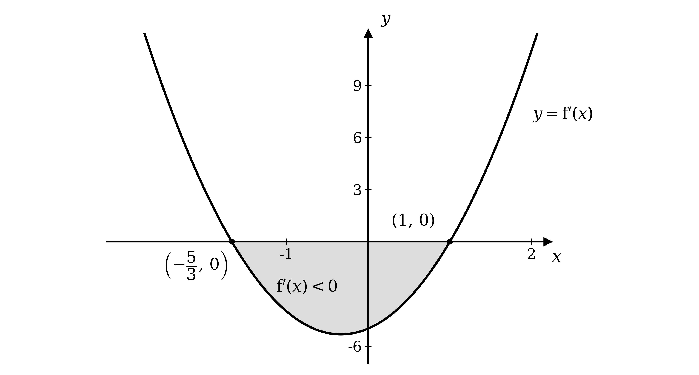
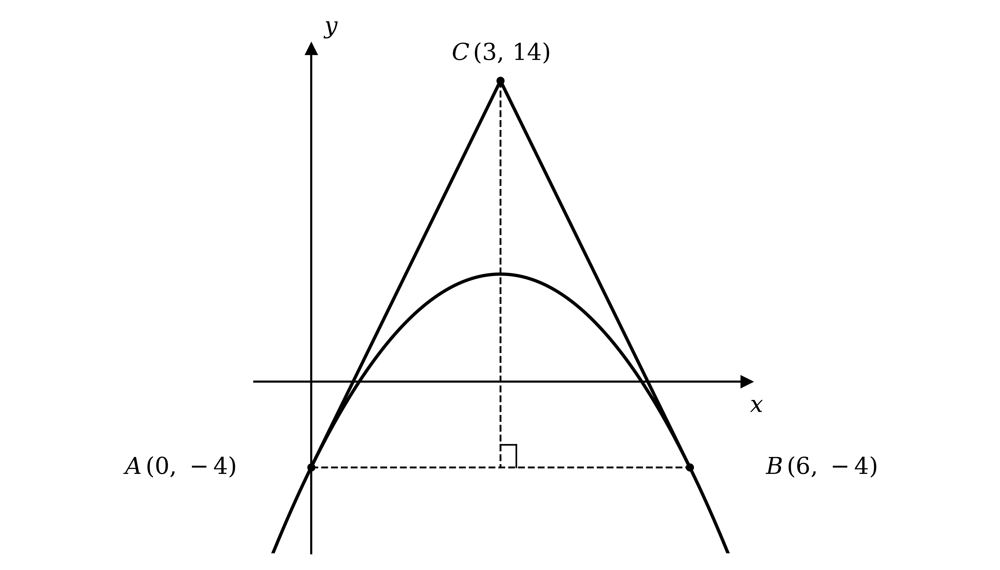
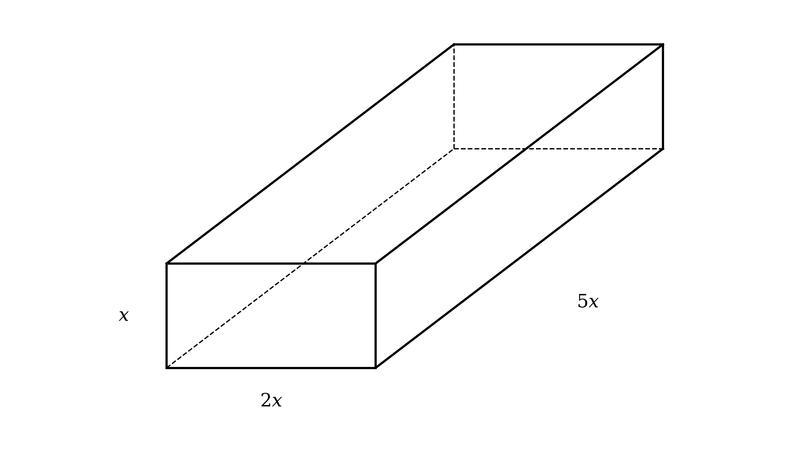
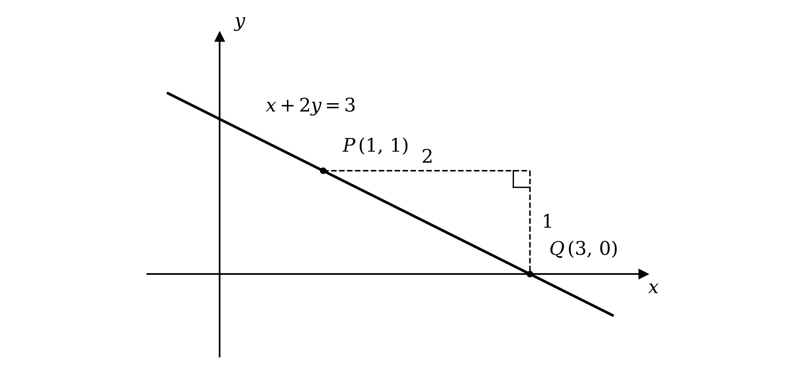

# Mark Schemes — Applications of Differentiation
**Differentiation** · Cambridge (CIE) AS maths (9709)

## Exam Questions (52 questions)

### Q1
(i)

The volume of a cube is the cube of its side length

$V = x^{3}$

**[B1]**

A cube has six identical square faces, each of area $x^{2}$

$S = 6 x^{2}$

**[B1]**

(ii)

The derivative you want is $\frac{\text{d}x}{\text{d}V}$, but it is the volume that is easy to differentiate, so start by differentiating $V$ with respect to $x$

$\frac{\text{d}V}{\text{d}x} = 3 x^{2}$

**[M1]**

Turning a derivative upside down gives the derivative of the inverse relationship, so take the reciprocal to reach the required result

$\frac{\text{d}x}{\text{d}V} = \frac{1}{3x^{2}}$

**[A1]**

Now differentiate the surface area with respect to $x$ using the power rule

$\frac{\text{d}S}{\text{d}x} = 12 x$

**[B1]**

> **[mark-scheme]**
> **B1**: The correct formula for the volume, $V = x^{3}$.
> 
> **B1**: The correct formula for the surface area, $S = 6 x^{2}$.
> 
> **M1**: Differentiating $V$ with respect to $x$ to obtain $\frac{\text{d}V}{\text{d}x} = 3 x^{2}$.
> 
> **A1**: Reaching the given result by taking the reciprocal, `\dfrac{\text{d}x}{\text{d}V} = \dfrac{1}{\left(\dfrac{\text{d}V}{\text{d}x}\right)} = \dfrac{1}{3x^{2}}`. The reciprocal step must be visible, because the answer is given.
> 
> **B1**: The correct derivative, $\frac{\text{d}S}{\text{d}x} = 12 x$. This mark follows through from your formula for $S$.
(i)

A rate of change is negative whenever the quantity is getting smaller, and here the volume falls by 0.6 cm³ every second

**Final answer:** $\frac{\text{d}V}{\text{d}t} = - 0 . 6$**, because the volume is decreasing**

**[B1]**

(ii)

Applying the chain rule twice links the rate you want to the three rates already known, because the $\text{d} x$ and $\text{d} V$ terms cancel in turn

$\frac{\text{d}S}{\text{d}t} = \frac{\text{d}S}{\text{d}x} \times \frac{\text{d}x}{\text{d}V} \times \frac{\text{d}V}{\text{d}t}$

**[B1]**

(iii)

Substitute the three results from part (a) and part (b)(i)

$\frac{\text{d}S}{\text{d}t} = 12 x \times \frac{1}{3x^{2}} \times ( - 0 . 6 )$

**[M1]**

Cancel the $x$ terms in the first product, since $\frac{12x}{3x^{2}} = \frac{4}{x}$

$\frac{\text{d}S}{\text{d}t} = \frac{4}{x} \times ( - 0 . 6 )$

Write the result as a single exact fraction

$\frac{\text{d}S}{\text{d}t} = - \frac{12}{5x}$

**[A1]**

The word "hence" signals using this expression, so substitute the side length $x = 5$

$\frac{\text{d}S}{\text{d}t} = - \frac{12}{5(5)} = - \frac{12}{25}$

The sign is negative, confirming that the surface area is shrinking, and its size gives the rate of decrease

**Final answer:** $\frac{\text{d}S}{\text{d}t} = - 0 . 48$**, so the surface area is decreasing at **$0 . 48 \text{cm}^{2} \text{s}^{-1}$

**[A1]**

> **[mark-scheme]**
> **B1**: Explaining that the rate is negative because the volume is decreasing, giving $\frac{\text{d}V}{\text{d}t} = - 0 . 6$. The reason must be stated, not just the value.
> 
> **B1**: The correct chain rule, $\frac{\text{d}S}{\text{d}t} = \frac{\text{d}S}{\text{d}x} \times \frac{\text{d}x}{\text{d}V} \times \frac{\text{d}V}{\text{d}t}$.
> 
> **M1**: Substituting all three of your results into your chain rule.
> 
> **A1**: The correct expression, $\frac{\text{d}S}{\text{d}t} = - \frac{12}{5x}$. Accept any exact equivalent, such as $- \frac{2.4}{x}$.
> 
> **A1**: The correct rate, $- 0 . 48$, with the surface area identified as decreasing. Units are not required: writing $\text{cm}^{2} \text{s}^{-1}$ is good practice, but missing or incorrect units are condoned. Quoting the rate of decrease as the positive value $0 . 48$ is also accepted, provided you make clear that the area is decreasing.

### Q2
(i)

The side length grows by a constant 0.1 cm every second, and that rate of change of $x$ with respect to time is exactly what $\frac{\text{d}x}{\text{d}t}$ means

$\frac{\text{d}x}{\text{d}t} = 0 . 1$

**[B1]**

(ii)

The volume of a cube is the cube of its side length

$V = x^{3}$

**[B1]**

Differentiate the volume with respect to $x$ using the power rule

$\frac{\text{d}V}{\text{d}x} = 3 x^{2}$

**[B1]**

> **[mark-scheme]**
> **B1**: The value $\frac{\text{d}x}{\text{d}t} = 0 . 1$. The rate is given in the question, so no working is needed.
> 
> **B1**: The correct formula for the volume, $V = x^{3}$.
> 
> **B1**: The correct derivative, $\frac{\text{d}V}{\text{d}x} = 3 x^{2}$. This mark follows through from your formula for $V$.
The chain rule links the rate you want with the two rates already found in part (a), because the $\text{d} x$ terms cancel

$\frac{\text{d}V}{\text{d}t} = \frac{\text{d}V}{\text{d}x} \times \frac{\text{d}x}{\text{d}t}$

**[M1]**

Substitute the two results from part (a)

$\frac{\text{d}V}{\text{d}t} = 3 x^{2} \times 0 . 1$

Simplify to give the expression in terms of $x$

$\frac{\text{d}V}{\text{d}t} = 0 . 3 x^{2}$

**[A1]**

The word "hence" signals using this expression, so substitute the side length $x = 4$

$\frac{\text{d}V}{\text{d}t} = 0 . 3 ( 4 )^{2} = 0 . 3 \times 16$

$\frac{\text{d}V}{\text{d}t} = 4 . 8 \text{cm}^{3} \text{s}^{-1}$

**[A1]**

> **[mark-scheme]**
> **M1**: Correct use of the chain rule, $\frac{\text{d}V}{\text{d}t} = \frac{\text{d}V}{\text{d}x} \times \frac{\text{d}x}{\text{d}t}$, using your two results from part (a).
> 
> **A1**: The correct expression, $\frac{\text{d}V}{\text{d}t} = 0 . 3 x^{2}$.
> 
> **A1**: The correct rate of increase, $4 . 8$. Units are not required for this mark: writing $\text{cm}^{3} \text{s}^{-1}$ is good practice, but missing or incorrect units are condoned.

### Q3
Differentiate term by term: multiply each term by its power of $x$ and reduce that power by 1, remembering that the constant $+ 1$ differentiates to zero

$\frac{\text{d}y}{\text{d}x} = ( 3 ) ( 3 ) x^{3-1} + ( 2 ) ( 6 ) x^{2-1} - 5$

**[M1]**

Simplify each term to give the first derivative

$\frac{\text{d}y}{\text{d}x} = 9 x^{2} + 12 x - 5$

**[A1]**

To find the second derivative, differentiate the first derivative using exactly the same rule again

$\frac{\text{d}^{2}y}{\text{d}x^{2}} = ( 2 ) ( 9 ) x^{2-1} + 12$

Simplify to give the second derivative

$\frac{\text{d}^{2}y}{\text{d}x^{2}} = 18 x + 12$

**[A1]**

> **[mark-scheme]**
> **M1**: Correct use of the power rule on at least one term, multiplying by the power of $x$ and reducing that power by 1.
> 
> **A1**: Fully correct first derivative, $\frac{\text{d}y}{\text{d}x} = 9 x^{2} + 12 x - 5$.
> 
> **A1**: Fully correct second derivative, $\frac{\text{d}^{2}y}{\text{d}x^{2}} = 18 x + 12$. This mark follows through from differentiating your first derivative correctly.
(i)

Substitute $x = \frac{1}{3}$ into the first derivative from part (a)

`\dfrac{\text{d}y}{\text{d}x} = 9\left(\dfrac{1}{3}\right)^{2} + 12\left(\dfrac{1}{3}\right) - 5 = 1 + 4 - 5`

Substitute $x = \frac{1}{3}$ into the second derivative in the same way

`\dfrac{\text{d}^{2}y}{\text{d}x^{2}} = 18\left(\dfrac{1}{3}\right) + 12 = 6 + 12`

**[M1]**

State both values

**Final answer:** $\frac{\text{d}y}{\text{d}x} = 0$** and **$\frac{\text{d}^{2}y}{\text{d}x^{2}} = 18$

**[A1]**

(ii)

The first derivative is zero here, and that is exactly the condition for a stationary point

**Final answer:** **There is a stationary point at **$x = \frac{1}{3}$

**[B1]**

At a stationary point a positive second derivative means the curve is turning upwards, so the point is a minimum

**Final answer:** $\frac{\text{d}^{2}y}{\text{d}x^{2}} = 18 > 0$**, so it is a minimum point**

**[B1]**

> **[mark-scheme]**
> **M1**: Substituting $x = \frac{1}{3}$ into both of your derivative expressions from part (a).
> 
> **A1**: Both correct values, $\frac{\text{d}y}{\text{d}x} = 0$ and $\frac{\text{d}^{2}y}{\text{d}x^{2}} = 18$.
> 
> **B1**: Identifying that there is a stationary point (or turning point) at $x = \frac{1}{3}$, because $\frac{\text{d}y}{\text{d}x} = 0$ there.
> 
> **B1**: Concluding that the point is a minimum, because $\frac{\text{d}^{2}y}{\text{d}x^{2}} = 18 > 0$. You must show the substitution, state that your value is positive, and write the word "minimum". Quoting the sign on its own does not score. This mark follows through from your second derivative, provided your value is positive.

### Q4
The stationary points are where the gradient is zero, so start by differentiating to find the gradient function

`\dfrac{\text{d}y}{\text{d}x} = (3)\left(\dfrac{1}{3}\right)x^{3-1} + (2)\left(\dfrac{5}{2}\right)x^{2-1} - 6`

**[M1]**

Simplify each term, noting that the fractions cancel neatly and the constant $+ 2$ differentiates to zero

$\frac{\text{d}y}{\text{d}x} = x^{2} + 5 x - 6$

**[A1]**

At a stationary point $\frac{\text{d}y}{\text{d}x} = 0$, so set the gradient function equal to zero

$x^{2} + 5 x - 6 = 0$

Factorise the quadratic

$( x + 6 ) ( x - 1 ) = 0$

**[M1]**

Set each factor equal to zero and solve for $x$

**Final answer:** $x = - 6$** or **$x = 1$

**[A1]**

> **[mark-scheme]**
> **M1**: Correct use of the power rule on at least one term, multiplying by the power of $x$ and reducing that power by 1.
> 
> **A1**: Fully correct gradient function, $\frac{\text{d}y}{\text{d}x} = x^{2} + 5 x - 6$.
> 
> **M1**: Setting your $\frac{\text{d}y}{\text{d}x} = 0$ and attempting to solve the resulting quadratic, either by factorising or by correct use of the quadratic formula.
> 
> **A1**: Both $x$-coordinates, $x = - 6$ and $x = 1$, with no extra values given. Only the $x$-coordinates are asked for, so you do not need to find the corresponding $y$-values.

### Q5
Differentiate term by term: multiply each term by its power of $x$, then reduce that power by 1

$\frac{\text{d}y}{\text{d}x} = ( 2 ) ( 3 ) x^{2-1} - ( 1 ) ( 2 ) x^{1-1}$

**[M1]**

Simplify each term, using $x^{0} = 1$

$\frac{\text{d}y}{\text{d}x} = 6 x - 2$

**[A1]**

> **[mark-scheme]**
> **M1**: Correct use of the power rule on at least one term, multiplying by the power of $x$ and reducing that power by 1.
> 
> **A1**: Fully correct expression, with both terms correct. Accept any equivalent form, such as $2 ( 3 x - 1 )$.
The gradient at a point is the value of $\frac{\text{d}y}{\text{d}x}$ at that point, so use the result from part (a), $\frac{\text{d}y}{\text{d}x} = 6 x - 2$, and substitute each $x$-value into it

(i)

Substitute $x = 3$ into the gradient function

$\frac{\text{d}y}{\text{d}x} = 6 ( 3 ) - 2 = 18 - 2$

$\frac{\text{d}y}{\text{d}x} = 16$

**[B1]**

(ii)

Substitute $x = - 2$ into the gradient function

$\frac{\text{d}y}{\text{d}x} = 6 ( - 2 ) - 2 = - 12 - 2$

$\frac{\text{d}y}{\text{d}x} = - 14$

**[B1]**

> **[mark-scheme]**
> **B1**: A gradient of $16$ at $x = 3$.
> 
> **B1**: A gradient of $- 14$ at $x = - 2$. Take care with the negative: $6 \times ( - 2 ) = - 12$, so the gradient is negative here.

### Q6
A maximum point must lie on the curve, be stationary, and have a negative second derivative, so check each in turn. First substitute $x = 2$ into the equation of the curve to confirm the point lies on it

$y = 2 ( 2 )^{2} - \frac{2}{3} ( 2 )^{3} - \frac{5}{3} = 8 - \frac{16}{3} - \frac{5}{3}$

Combine the two fractions, then subtract

$y = 8 - \frac{21}{3} = 8 - 7 = 1$

**[B1]**

Differentiate to find the gradient function, then substitute $x = 2$ to test whether the point is stationary

$\frac{\text{d}y}{\text{d}x} = 4 x - 2 x^{2}$

$\frac{\text{d}y}{\text{d}x} = 4 ( 2 ) - 2 ( 2 )^{2} = 8 - 8$

**[M1]**

The gradient is zero, so the point is a stationary point

$\frac{\text{d}y}{\text{d}x} = 0$

**[A1]**

To classify the stationary point, differentiate again and substitute $x = 2$

$\frac{\text{d}^{2}y}{\text{d}x^{2}} = 4 - 4 x$

$\frac{\text{d}^{2}y}{\text{d}x^{2}} = 4 - 4 ( 2 )$

**[M1]**

The second derivative is negative at this point, which means the stationary point is a maximum

$\frac{\text{d}^{2}y}{\text{d}x^{2}} = - 4 < 0$

All three conditions hold, so the required result follows

**Final answer:** $( 2 , 1 )$** is a maximum point of the curve**

**[A1]**

> **[exam-tip]**
> Verifying that the point lies on the curve is essential here: showing only that $\frac{\text{d}y}{\text{d}x} = 0$ and $\frac{\text{d}^{2}y}{\text{d}x^{2}} < 0$ at $x = 2$ proves that a maximum occurs at $x = 2$, but not that it is at $( 2 , 1 )$.

> **[mark-scheme]**
> **B1**: Showing that $y = 1$ when $x = 2$, so the point lies on the curve. You must show the fraction arithmetic: going straight from $2 ( 2 )^{2} - \frac{2}{3} ( 2 )^{3} - \frac{5}{3}$ to $1$ is not enough, because the answer is given.
> 
> **M1**: Correct use of the power rule to differentiate, followed by substituting $x = 2$ into your gradient function.
> 
> **A1**: Obtaining $\frac{\text{d}y}{\text{d}x} = 0$ and stating that the point is therefore stationary.
> 
> **M1**: Differentiating your gradient function again and substituting $x = 2$ into the result.
> 
> **A1**: Obtaining $\frac{\text{d}^{2}y}{\text{d}x^{2}} = - 4$, writing the comparison $- 4 < 0$, and concluding that $( 2 , 1 )$ is a maximum point. Writing only that the second derivative is "negative", without the comparison and the word "maximum", does not score. Because the result is given, any incorrect working seen along the way loses this mark even if your final line matches.

### Q7
(i)

The side length grows by a constant 2 mm every second, and that rate of change of $s$ with respect to time is exactly what $\frac{\text{d}s}{\text{d}t}$ means

$\frac{\text{d}s}{\text{d}t} = 2$

**[B1]**

(ii)

The area of a square is the square of its side length

$A = s^{2}$

**[B1]**

Differentiate the area with respect to $s$ using the power rule

$\frac{\text{d}A}{\text{d}s} = 2 s$

**[B1]**

> **[mark-scheme]**
> **B1**: The value $\frac{\text{d}s}{\text{d}t} = 2$. The rate is given in the question, so no working is needed.
> 
> **B1**: The correct formula for the area, $A = s^{2}$.
> 
> **B1**: The correct derivative, $\frac{\text{d}A}{\text{d}s} = 2 s$. This mark follows through from your formula for $A$.
The chain rule links the rate you want with the two rates already found in part (a), because the $\text{d} s$ terms cancel

$\frac{\text{d}A}{\text{d}t} = \frac{\text{d}A}{\text{d}s} \times \frac{\text{d}s}{\text{d}t}$

**[M1]**

Substitute the two results from part (a)

$\frac{\text{d}A}{\text{d}t} = 2 s \times 2$

Simplify to give the expression in terms of $s$

$\frac{\text{d}A}{\text{d}t} = 4 s$

**[A1]**

The word "hence" signals using this expression, so substitute $s = 10$ to find the rate at that instant

$\frac{\text{d}A}{\text{d}t} = 4 ( 10 )$

$\frac{\text{d}A}{\text{d}t} = 40 \text{mm}^{2} \text{s}^{-1}$

**[A1]**

> **[mark-scheme]**
> **M1**: Correct use of the chain rule, $\frac{\text{d}A}{\text{d}t} = \frac{\text{d}A}{\text{d}s} \times \frac{\text{d}s}{\text{d}t}$, using your two results from part (a).
> 
> **A1**: The correct expression, $\frac{\text{d}A}{\text{d}t} = 4 s$.
> 
> **A1**: The correct rate of increase, $40$. Units are not required for this mark: writing $\text{mm}^{2} \text{s}^{-1}$ is good practice, but missing or incorrect units are condoned.

### Q8
(i)

Differentiate term by term: multiply each term by its power of $x$ and reduce that power by 1, remembering that the constant $- 1$ differentiates to zero

$\frac{\text{d}y}{\text{d}x} = ( 3 ) ( 2 ) x^{3-1} - ( 2 ) ( 3 ) x^{2-1}$

**[M1]**

Simplify each term to give the gradient function

$\frac{\text{d}y}{\text{d}x} = 6 x^{2} - 6 x$

**[A1]**

The gradient of the tangent at a point is the value of $\frac{\text{d}y}{\text{d}x}$ at that point, so substitute $x = 2$

$\frac{\text{d}y}{\text{d}x} = 6 ( 2 )^{2} - 6 ( 2 ) = 24 - 12$

$\text{gradient} = 12$

**[A1]**

(ii)

A straight line through $( x_{1} , y_{1} )$ with gradient $m$ has equation $y - y_{1} = m ( x - x_{1} )$, so use the point $( 2 , 3 )$ with the gradient of $12$ from part (i)

$y - 3 = 12 ( x - 2 )$

**[M1]**

Expand the bracket and rearrange to make $y$ the subject

$y - 3 = 12 x - 24$

$y = 12 x - 21$

**[A1]**

> **[mark-scheme]**
> **M1**: Correct use of the power rule on at least one term, multiplying by the power of $x$ and reducing that power by 1.
> 
> **A1**: Fully correct gradient function, $\frac{\text{d}y}{\text{d}x} = 6 x^{2} - 6 x$.
> 
> **A1**: The correct gradient of $12$, from substituting $x = 2$ into your gradient function.
> 
> **M1**: Correct use of $y - y_{1} = m ( x - x_{1} )$ with the point $( 2 , 3 )$ and your gradient, or substituting the point into $y = m x + c$ to find $c$. This mark follows through from your gradient in part (i).
> 
> **A1**: The correct equation, $y = 12 x - 21$. Any exact equivalent is accepted, such as $12 x - y - 21 = 0$.

### Q9
Differentiate to find the gradient function

$\text{f} ' ( x ) = 4 x - 16$

**[M1]**

A function is increasing wherever its gradient is positive, so set the gradient function greater than zero

$4 x - 16 > 0$

**[M1]**

Solve the linear inequality by collecting the constant on the right

$4 x > 16$

Divide both sides by $4$

$x > 4$

**[A1]**

> **[mark-scheme]**
> **M1**: Correct use of the power rule to differentiate, with the power of at least one term reduced by 1.
> 
> **M1**: Setting your $\text{f} ' ( x ) > 0$ (or $\text{f} ' ( x ) = 0$) and attempting to solve for $x$.
> 
> **A1**: The correct set of values, $x > 4$. The strict inequality is the exact form, but $x \geq 4$ is condoned and scores just as well.

### Q10
Differentiate term by term: multiply each term by its power of $x$ and reduce that power by 1

`\dfrac{\text{d}y}{\text{d}x} = 3 - (2)\left(\dfrac{1}{2}\right)x^{2-1}`

Simplify to give the gradient function

$\frac{\text{d}y}{\text{d}x} = 3 - x$

The gradient of the tangent at a point is the value of $\frac{\text{d}y}{\text{d}x}$ at that point, so substitute $x = 5$

$\frac{\text{d}y}{\text{d}x} = 3 - 5$

**[M1]**

State the gradient of the tangent

$\text{gradient of tangent} = - 2$

**[A1]**

> **[mark-scheme]**
> **M1**: Correct use of the power rule to differentiate, followed by substituting $x = 5$ into your gradient function.
> 
> **A1**: The correct gradient of $- 2$.
(i)

The normal is perpendicular to the tangent, so its gradient is the negative reciprocal of the tangent's gradient found in part (a)

$m_{\text{normal}} = - \frac{1}{-2}$

$\text{gradient of normal} = \frac{1}{2}$

**[B1]**

(ii)

The equation of a line needs a point on it, and only the $x$-coordinate is given, so find the $y$-coordinate by substituting $x = 5$ into the equation of the curve

$y = 3 ( 5 ) - \frac{1}{2} ( 5 )^{2} = 15 - \frac{25}{2} = \frac{5}{2}$

Use $y - y_{1} = m ( x - x_{1} )$ with the point `\left(5, \dfrac{5}{2}\right)` and the normal's gradient of $\frac{1}{2}$

$y - \frac{5}{2} = \frac{1}{2} ( x - 5 )$

**[M1]**

Expand the bracket and rearrange to make $y$ the subject

$y - \frac{5}{2} = \frac{1}{2} x - \frac{5}{2}$

$y = \frac{1}{2} x$

**[A1]**

> **[mark-scheme]**
> **B1**: The gradient of the normal, $\frac{1}{2}$, from taking the negative reciprocal of your tangent gradient. You do not need to quote $m_{1} m_{2} = - 1$ or write the word "perpendicular"; showing $- \frac{1}{-2}$ is enough. This mark follows through from your gradient in part (a).
> 
> **M1**: Finding the $y$-coordinate at $x = 5$ and using it with your normal gradient to form a straight-line equation, either $y - y_{1} = m ( x - x_{1} )$ or substituting into $y = m x + c$ to find $c$. There is no separate mark for the $y$-coordinate itself; it is part of this method mark, so an arithmetic slip in $y$ still earns the M1 but loses the A1.
> 
> **A1**: The correct equation, $y = \frac{1}{2} x$. Accept any exact equivalent, such as $2 y = x$ or $2 y - x = 0$.

### Q11
(i)

Differentiate term by term: multiply each term by its power of $x$, then reduce that power by 1

$\text{f} ' ( x ) = ( 3 ) x^{3-1} + ( 2 ) x^{2-1} - ( 1 ) ( 5 ) x^{1-1}$

**[M1]**

Simplify each term, using $x^{0} = 1$

$\text{f} ' ( x ) = 3 x^{2} + 2 x - 5$

**[A1]**

(ii)

Set the gradient function from part (i) equal to zero

$3 x^{2} + 2 x - 5 = 0$

Factorise the quadratic

$( 3 x + 5 ) ( x - 1 ) = 0$

**[M1]**

Set each factor equal to zero and solve for $x$

**Final answer:** $x = - \frac{5}{3}$** or **$x = 1$

**[A1]**

(iii)

A function is decreasing where its gradient is negative, so solve the inequality $\text{f} ' ( x ) < 0$

$3 x^{2} + 2 x - 5 < 0$

**[M1]**

The coefficient of $x^{2}$ is positive, so the parabola opens upwards and lies below the $x$-axis only between the two values found in part (ii)

$- \frac{5}{3} < x < 1$

**[A1]**

> **[mark-scheme]**
> **M1**: Correct use of the power rule on at least one term of $\text{f} ( x )$, multiplying by the power of $x$ and reducing that power by 1.
> 
> **A1**: Fully correct gradient function, $\text{f} ' ( x ) = 3 x^{2} + 2 x - 5$.
> 
> **M1**: A correct method for solving $\text{f} ' ( x ) = 0$, either factorising to $( 3 x + 5 ) ( x - 1 ) = 0$ or correct use of the quadratic formula.
> 
> **A1**: Both critical values, $x = - \frac{5}{3}$ and $x = 1$.
> 
> **M1**: Setting your $\text{f} ' ( x ) < 0$ and selecting the region between the critical values, because the parabola opens upwards.
> 
> **A1**: The correct set of values, $- \frac{5}{3} < x < 1$. This mark follows through from your critical values, provided your method is correct. The strict inequalities are the exact form, but the non-strict version $- \frac{5}{3} \leq x \leq 1$ is condoned and scores just as well, as does the split form $x > - \frac{5}{3}$ and $x < 1$. A bare comma-separated list of the two values is not enough.

### Q12
The rate of increase of the radius is $\frac{\text{d}r}{\text{d}t}$, and "directly proportional to the temperature" means this rate is a fixed multiple of $T$

$\frac{\text{d}r}{\text{d}t} \propto T$

**[B1]**

Replace the proportionality sign with the constant of proportionality to turn it into an equation

$\frac{\text{d}r}{\text{d}t} = k T$

**[B1]**

> **[mark-scheme]**
> **B1**: Recognising the direct proportion, $\frac{\text{d}r}{\text{d}t} \propto T$. This mark is implied if you write the correct equation straight away.
> 
> **B1**: The correct equation, $\frac{\text{d}r}{\text{d}t} = k T$.
The radius is increasing at $0 . 4 \text{cm s}^{-1}$, so $\frac{\text{d}r}{\text{d}t} = 0 . 4$ at the moment when $T = 20$. Substitute both values into the equation from part (a)

$0 . 4 = k ( 20 )$

**[M1]**

Write the equation with the constant on the right

$0 . 4 = 20 k$

**[A1]**

Divide both sides by $20$ to find $k$

$k = 0 . 02$

**[A1]**

> **[mark-scheme]**
> **M1**: Substituting both $T = 20$ and $\frac{\text{d}r}{\text{d}t} = 0 . 4$ into your equation from part (a).
> 
> **A1**: The correct equation, $0 . 4 = 20 k$.
> 
> **A1**: The correct value, $k = 0 . 02$. Accept the exact equivalent $\frac{1}{50}$.

### Q13
Differentiate term by term to find the gradient function

$\frac{\text{d}y}{\text{d}x} = 3 x^{2} - 12 x + 9$

**[M1]**

Differentiate the gradient function again to find the second derivative

$\frac{\text{d}^{2}y}{\text{d}x^{2}} = 6 x - 12$

**[A1]**

Substitute $x = 2$ into the gradient function

$\frac{\text{d}y}{\text{d}x} = 3 ( 2 )^{2} - 12 ( 2 ) + 9 = 12 - 24 + 9$

Substitute $x = 2$ into the second derivative

$\frac{\text{d}^{2}y}{\text{d}x^{2}} = 6 ( 2 ) - 12 = 12 - 12$

**[M1]**

State both values

**Final answer:** $\frac{\text{d}y}{\text{d}x} = - 3$** and **$\frac{\text{d}^{2}y}{\text{d}x^{2}} = 0$

**[A1]**

> **[mark-scheme]**
> **M1**: Correct use of the power rule on at least one term, multiplying by the power of $x$ and reducing that power by 1.
> 
> **A1**: Both derivative expressions correct, $\frac{\text{d}y}{\text{d}x} = 3 x^{2} - 12 x + 9$ and $\frac{\text{d}^{2}y}{\text{d}x^{2}} = 6 x - 12$.
> 
> **M1**: Substituting $x = 2$ into both of your derivative expressions.
> 
> **A1**: Both correct values, $\frac{\text{d}y}{\text{d}x} = - 3$ and $\frac{\text{d}^{2}y}{\text{d}x^{2}} = 0$.
A point is stationary only when the gradient there is zero, so compare that condition with the gradient found in part (a)

**Final answer:** $\frac{\text{d}y}{\text{d}x} = - 3 \neq 0$**, so the point is not a stationary point**

**[B1]**

> **[mark-scheme]**
> **B1**: Stating that $\frac{\text{d}y}{\text{d}x}$ is not zero at $x = 2$, and concluding that the point is therefore not stationary. Saying that the gradient is not zero is enough on its own, but quoting your value of $- 3$ from part (a) makes the explanation secure.

### Q14
A tangent needs a point and a gradient, so start with the two points. Substitute each $x$-coordinate into the curve

$\text{At} A :   y = 5 - ( 0 - 3 )^{2} = - 4   \Rightarrow   A ( 0 , - 4 )$

$\text{At} B :   y = 5 - ( 6 - 3 )^{2} = - 4   \Rightarrow   B ( 6 , - 4 )$

**[M1 A1]**

The gradient of a tangent is given by the derivative. Expand the bracket first, so that the power rule applies term by term

`y = 5 - \left(x^{2} - 6x + 9\right) = -x^{2} + 6x - 4`

$\frac{\text{d}y}{\text{d}x} = - 2 x + 6$

**[M1]**

Substitute $A$'s $x$-coordinate to get the gradient there, then form the straight line through $A$ with that gradient

$\text{At} A :   \frac{\text{d}y}{\text{d}x} = - 2 ( 0 ) + 6 = 6$

$y - ( - 4 ) = 6 ( x - 0 )   \Rightarrow   y = 6 x - 4$

**[M1]**

Repeat at $B$

$\text{At} B :   \frac{\text{d}y}{\text{d}x} = - 2 ( 6 ) + 6 = - 6$

$y - ( - 4 ) = - 6 ( x - 6 )   \Rightarrow   y = - 6 x + 32$

**[M1]**

$C$ lies on both tangents, so its coordinates satisfy both equations at once. Set the two right-hand sides equal

$6 x - 4 = - 6 x + 32$

$12 x = 36   \Rightarrow   x = 3$

**[M1]**

Substitute back into either tangent to get the matching $y$-coordinate

$y = 6 ( 3 ) - 4 = 14$

$C ( 3 , 14 )$

**[A1]**

> **[exam-tip]**
> There is a shortcut worth full marks if you justify it. $A$ and $B$ have the same $y$-coordinate, so they sit symmetrically either side of the curve's axis of symmetry $x = 3$; the tangents at $A$ and $B$ are mirror images, and mirror images meet on the mirror line. That gives $x_{C} = \frac{0+6}{2} = 3$ straight away, without ever finding the tangent at $B$, and substituting into $y = 6 x - 4$ gives $y_{C} = 14$. You must write the reason, "by symmetry", rather than simply asserting $x = 3$. Even so, the simultaneous route above is the one to learn: it works for any two points on any curve, whereas this shortcut exists only because $5 - ( 0 - 3 )^{2}$ and $5 - ( 6 - 3 )^{2}$ happen to be equal.

> **[mark-scheme]**
> **M1**: Substituting $x = 0$ and $x = 6$ into the curve equation to find the $y$-coordinates of $A$ and $B$.
> 
> **A1**: Both points correct, $A ( 0 , - 4 )$ and $B ( 6 , - 4 )$.
> 
> **M1**: Differentiating to obtain $\frac{\text{d}y}{\text{d}x} = - 2 x + 6$, or the equivalent $- 2 ( x - 3 )$. Expanding the bracket first is the simplest way in.
> 
> **M1**: Substituting $x = 0$ into your $\frac{\text{d}y}{\text{d}x}$ and forming the equation of the tangent at $A$.
> 
> **M1**: Substituting $x = 6$ into your $\frac{\text{d}y}{\text{d}x}$ and forming the equation of the tangent at $B$.
> 
> **M1**: Solving your two tangent equations simultaneously.
> 
> **A1**: $C ( 3 , 14 )$.
$A$ and $B$ share the $y$-coordinate $- 4$, so $A B$ is horizontal. That makes it the natural base, and the height is then the vertical distance from $C$ down to it

Read both lengths off as differences of coordinates

$\text{base} A B = 6 - 0 = 6$

$\text{height} = 14 - ( - 4 ) = 18$

**[M1]**

Apply the formula for the area of a triangle

$\text{Area} = \frac{1}{2} \times \text{base} \times \text{height} = \frac{1}{2} ( 6 ) ( 18 )$

$\text{Area} = 54$

**[A1]**

> **[mark-scheme]**
> **M1**: A complete method for the area, such as $\frac{1}{2} \times \text{base} \times \text{height}$ with base $A B = 6$ and perpendicular height $14 - ( - 4 ) = 18$. Follow through on your coordinates from part (a).
> 
> **A1**: 54.

### Q15

The block stays mathematically similar as it melts, so the sides keep the ratio $1 : 2 : 5$ and the single variable $x$ describes the whole solid. The surface area is falling, so its rate is negative

$\frac{\text{d}A}{\text{d}t} = - k$

**[M1]**

Write the volume in terms of $x$ and differentiate

$V = x ( 2 x ) ( 5 x ) = 10 x^{3}   \Rightarrow   \frac{\text{d}V}{\text{d}x} = 30 x^{2}$

**[M1]**

A cuboid has three pairs of identical faces, so add the three distinct face areas and double

`A = 2\left(2x^{2} + 5x^{2} + 10x^{2}\right) = 34x^{2} \;\;\Rightarrow\;\; \dfrac{\text{d}A}{\text{d}x} = 68x`

**[M1]**

There is no direct link between the area's rate and the volume's rate, so $x$ has to bridge them. That needs three factors rather than the usual two, and the middle one is a reciprocal

$\frac{\text{d}V}{\text{d}t} = \frac{\text{d}V}{\text{d}x} \times \frac{\text{d}x}{\text{d}A} \times \frac{\text{d}A}{\text{d}t}$*, where *$\frac{\text{d}x}{\text{d}A} = \frac{1}{68x}$

**[M1]**

Substitute all three

$\frac{\text{d}V}{\text{d}t} = 30 x^{2} \times \frac{1}{68x} \times ( - k ) = - \frac{30kx}{68} = - \frac{15kx}{34}$

The negative sign says the volume is falling. The rate of *melting* is how fast that volume is lost, which is a positive quantity, so it is the size of this rate

$\text{rate of melting} = \frac{15kx}{34} \text{m}^{3} \text{s}^{-1}$

**[A1]**

> **[mark-scheme]**
> **M1**: Recognising that the area is decreasing, so $\frac{\text{d}A}{\text{d}t} = - k$.
> 
> **M1**: $V = 10 x^{3}$ and $\frac{\text{d}V}{\text{d}x} = 30 x^{2}$.
> 
> **M1**: $A = 34 x^{2}$ and $\frac{\text{d}A}{\text{d}x} = 68 x$.
> 
> **M1**: A correct chain linking the three rates, $\frac{\text{d}V}{\text{d}t} = \frac{\text{d}V}{\text{d}x} \times \frac{\text{d}x}{\text{d}A} \times \frac{\text{d}A}{\text{d}t}$, with $\frac{\text{d}x}{\text{d}A}$ used as the reciprocal of $\frac{\text{d}A}{\text{d}x}$.
> 
> **A1**: Reaching $\frac{15kx}{34}$, with the negative sign correctly accounted for. Because the result is given, any incorrect working loses this mark.
The rate of melting grows with $x$, so the biggest usable block is the one sitting exactly on the limit. Take the expression from part (a) and put it at the threshold

$\frac{15(0.2)x}{34} = 0 . 05$

**[M1]**

Simplify the left-hand side, then multiply out

$\frac{3x}{34} = 0 . 05   \Rightarrow   3 x = 34 \times 0 . 05 = 1 . 7$

$x = \frac{1.7}{3} = \frac{34}{60}$

**[M1]**

Cancel the common factor of 2 to put the fraction in its lowest terms

$x = \frac{17}{30}$

**[A1]**

> **[mark-scheme]**
> **M1**: Substituting $k = 0 . 2$ into your part (a) expression and setting it against $0 . 05$.
> 
> **M1**: Solving for $x$, reaching $\frac{34}{60}$, $\frac{1.7}{3}$ or any correct unsimplified equivalent.
> 
> **A1**: $x = \frac{17}{30}$. The fraction must be in its lowest terms; $\frac{34}{60}$ alone does not score, and nor does the decimal `0.5\dot{6}`.

### Q16
The radius is given directly as a function of time, so its rate of change comes straight from differentiating it

$\frac{\text{d}r}{\text{d}t} = 0 . 2 t$

**[M1]**

The bubble is a sphere, and its volume depends on the radius

$V = \frac{4}{3} π r^{3}   \Rightarrow   \frac{\text{d}V}{\text{d}r} = 4 π r^{2}$

**[M1]**

The chain rule links the volume's rate of expansion to the two rates now known

$\frac{\text{d}V}{\text{d}t} = \frac{\text{d}V}{\text{d}r} \times \frac{\text{d}r}{\text{d}t} = 4 π r^{2} \times 0 . 2 t$

**[M1]**

The bubble bursts at the instant this expansion rate reaches the given threshold, so set the two equal and replace $r$ by its formula

`4\pi\left(0.3 + 0.1t^{2}\right)^{2}\left(0.2t\right) = 4t`

Both sides carry a factor of $t$. The bubble is expanding, so $t > 0$ and dividing by $t$ is safe. That leaves no $t$ outside the bracket at all

`0.8\pi\left(0.3 + 0.1t^{2}\right)^{2} = 4 \;\;\Rightarrow\;\; \left(0.3 + 0.1t^{2}\right)^{2} = \dfrac{5}{\pi}`

**[M1]**

Expand the bracket, then multiply through by 100 to clear the decimals

$0 . 09 + 0 . 06 t^{2} + 0 . 01 t^{4} = \frac{5}{π}$

$t^{4} + 6 t^{2} + 9 = \frac{500}{π}$

The left-hand side is a perfect square, which avoids having to treat this as a quadratic in $t^{2}$

`\left(t^{2} + 3\right)^{2} = \dfrac{500}{\pi}`

**[A1]**

Take the square root. Only the positive root is worth taking, since $t^{2} + 3$ is positive

$t^{2} = \sqrt{\frac{500}{π}} - 3 = 9 . 6156 \dots$

**Final answer:** $t = 3 . 1 \text{s}$** (1 d.p.)**

**[A1]**

> **[mark-scheme]**
> **M1**: Differentiating the given radius function to obtain $\frac{\text{d}r}{\text{d}t} = 0 . 2 t$.
> 
> **M1**: Using the volume of a sphere and differentiating, $\frac{\text{d}V}{\text{d}r} = 4 π r^{2}$.
> 
> **M1**: Correct use of the chain rule, $\frac{\text{d}V}{\text{d}t} = \frac{\text{d}V}{\text{d}r} \times \frac{\text{d}r}{\text{d}t}$.
> 
> **M1**: Setting your $\frac{\text{d}V}{\text{d}t}$ equal to $4 t$, substituting for $r$, and cancelling the $t$.
> 
> **A1**: Reaching a correct solvable equation, such as `\left(0.3 + 0.1t^{2}\right)^{2} = \dfrac{5}{\pi}` or `\left(t^{2}+3\right)^{2} = \dfrac{500}{\pi}`.
> 
> **A1**: $t = 3 . 1$. Accept answers which round to $3 . 1$.

### Q17

The rate given is a volume per unit time, and the pot is filling, so it is positive

$\frac{\text{d}V}{\text{d}t} = 0 . 3$

Find the volume of the full pot

$V_{\text{pot}} = \frac{1}{3} π ( 2 )^{2} ( 6 ) = 8 π$

**[M1]**

The pot stands on its base, so its vertex points upwards and the salt fills the wide end first. The salt is therefore not a cone, and has no formula of its own. What *is* a cone is the empty gap above it, of height $6 - h$ and radius $r$, and that gap is similar to the whole pot

$\frac{6}{2} = \frac{6-h}{r}   \Rightarrow   r = \frac{1}{3} ( 6 - h )$

**[M1]**

So the salt's volume is the whole pot with that empty cone taken away

`V = 8\pi - \dfrac{1}{3}\pi\left[\dfrac{1}{3}(6-h)\right]^{2}(6 - h) = 8\pi - \dfrac{\pi}{27}(6 - h)^{3}`

**[M1]**

Differentiate with respect to the depth

$\frac{\text{d}V}{\text{d}h} = \frac{π}{9} ( 6 - h )^{2}$

**[A1]**

The chain rule links the rate wanted to the two rates now known

$\frac{\text{d}V}{\text{d}t} = \frac{\text{d}V}{\text{d}h} \times \frac{\text{d}h}{\text{d}t}   \Rightarrow   0 . 3 = \frac{π}{9} ( 6 - h )^{2} \times \frac{\text{d}h}{\text{d}t}$

$\frac{\text{d}h}{\text{d}t} = \frac{27}{10π(6-h)^{2}}$

**[M1]**

The instant is given by volume, not depth, so the depth has to be found first. Half full means half of $8 π$

$4 π = 8 π - \frac{π}{27} ( 6 - h )^{3}   \Rightarrow   ( 6 - h )^{3} = 108$

Take the cube root rather than expanding the bracket

`6 - h = \sqrt[3]{108} = 4.7622\ldots`

**[M1]**

Substitute that straight into the rate, keeping it unrounded

`\dfrac{\text{d}h}{\text{d}t} = \dfrac{27}{10\pi\left(4.7622\ldots\right)^{2}}`

**Final answer:** $\frac{\text{d}h}{\text{d}t} = 0 . 0379 \text{cm s}^{-1}$** (3 s.f.)**

**[A1]**

> **[mark-scheme]**
> **M1**: Recognising $\frac{\text{d}V}{\text{d}t} = 0 . 3$ and finding the pot's total volume, $8 π$.
> 
> **M1**: Using similar triangles on the empty cone above the salt to obtain $r = \frac{1}{3} ( 6 - h )$.
> 
> **M1**: Forming the salt's volume by subtraction, $V = 8 π - \frac{π}{27} ( 6 - h )^{3}$.
> 
> **A1**: $\frac{\text{d}V}{\text{d}h} = \frac{π}{9} ( 6 - h )^{2}$.
> 
> **M1**: Correct use of the chain rule, $\frac{\text{d}V}{\text{d}t} = \frac{\text{d}V}{\text{d}h} \times \frac{\text{d}h}{\text{d}t}$.
> 
> **M1**: Using "half full by volume" to set $V = 4 π$ and solving for the depth, $h = 1 . 24$ or $6 - h = 4 . 76$.
> 
> **A1**: $0 . 0379$. Accept answers which round to $0 . 0379$. Units are not required.

### Q18
The angle is strictly less than 360°, so the sector is only part of the circle it is cut from, never the whole of it. Its area is therefore strictly less than the area of that full circle

$A < π r^{2}$

**[M1]**

Divide by $π$, then take the square root. The radius is a length, so only the positive root applies and the direction of the inequality is unchanged

$r^{2} > \frac{A}{π}$

**Final answer:** $r > \sqrt{\frac{A}{π}}$**, since the sector's area **$A$** is fixed and must be less than **$π r^{2}$

**[A1]**

> **[mark-scheme]**
> **M1**: Stating that the sector's area is less than that of the full circle, $A < π r^{2}$, or the equivalent $π r^{2} > A$.
> 
> **A1**: Rearranging correctly to $r > \sqrt{\frac{A}{π}}$, together with a clear reason. The reason is the mark: an unexplained rearrangement does not answer an "explain why" question.
The perimeter runs along both straight edges and then round the curved arc. Each straight edge is a radius, and the arc is the fraction $\frac{θ}{360}$ of the full circumference

`P = 2r + 2\pi r\left(\dfrac{\theta}{360}\right)`

The target contains no $θ$, so it has to go. The fixed area gives a second equation linking $θ$ to $r$, since the sector is the same fraction of the circle's area

`A = \pi r^{2}\left(\dfrac{\theta}{360}\right) \;\;\Rightarrow\;\; \theta = \dfrac{360A}{\pi r^{2}}`

**[M1]**

Substitute that into the perimeter. The $360$ and the $π$ both cancel, and one power of $r$ cancels with the $r^{2}$

$P = 2 r + \frac{2πr}{360} \times \frac{360A}{πr^{2}} = 2 r + \frac{2A}{r}$

$P = 2 r + \frac{2A}{r}$

**[A1]**

> **[mark-scheme]**
> **M1**: Writing the perimeter as two radii plus the arc, and using the fixed area to get $θ$ in terms of $A$ and $r$.
> 
> **A1**: Substituting and simplifying to the given result with no errors. Because the result is given, any incorrect working loses this mark.
$A$ is fixed, so $P$ depends on $r$ alone. Write the fraction as a negative power so the power rule applies, then differentiate with respect to $r$

$P = 2 r + 2 A r^{-1}$

$\frac{\text{d}P}{\text{d}r} = 2 - 2 A r^{-2}$

**[M1 A1]**

The minimum is a stationary point, so set the derivative to zero

$2 - \frac{2A}{r^{2}} = 0   \Rightarrow   r^{2} = A$

The radius is positive, so take the positive root

$r = \sqrt{A}$

**[M1]**

The question insists on a proof, so differentiate a second time and check the sign at that radius

$\frac{\text{d}^{2}P}{\text{d}r^{2}} = 4 A r^{-3} = \frac{4A}{r^{3}}$

Both $A$ and $r$ are positive, so this is positive for every permitted radius, and the stationary point is therefore a minimum

`\dfrac{\text{d}^{2}P}{\text{d}r^{2}} = 4A\left(\sqrt{A}\right)^{-3} = 4A^{-\frac{1}{2}} > 0 \;\;\Rightarrow\;\; \text{minimum}`

**[M1]**

Substitute the minimising radius back into the perimeter. The second term simplifies because $\frac{2A}{\sqrt{A}} = 2 \sqrt{A}$

$P_{\text{min}} = 2 \sqrt{A} + \frac{2A}{\sqrt{A}} = 2 \sqrt{A} + 2 \sqrt{A} = 4 \sqrt{A}$

A square of area $A$ has side $\sqrt{A}$, so its perimeter is four of those sides

$P_{\text{square}} = 4 \times \sqrt{A} = 4 \sqrt{A}$

$P_{\text{min}} = P_{\text{square}} = 4 \sqrt{A}$

**[A1]**

> **[mark-scheme]**
> **M1**: Differentiating your $P$ with respect to $r$, treating $A$ as a constant.
> 
> **A1**: $\frac{\text{d}P}{\text{d}r} = 2 - 2 A r^{-2}$, or any equivalent such as $2 - \frac{2A}{r^{2}}$.
> 
> **M1**: Setting your derivative to zero and solving to obtain $r = \sqrt{A}$.
> 
> **M1**: Using the second derivative and stating its sign to prove a minimum, or using a valid sign test instead.
> 
> **A1**: Reaching $P_{\text{min}} = 4 \sqrt{A}$ and identifying it as the perimeter of a square of side $\sqrt{A}$. Because the result is given, any incorrect working loses this mark.

### Q19
Rewrite the fraction as a power of $x$, then differentiate

$\text{f} ( x ) = 4 x + 3 x^{-1}   \Rightarrow   \text{f} ' ( x ) = 4 - 3 x^{-2}$

**[M1]**

A function is decreasing wherever its gradient is negative, so set the gradient function less than zero

$4 - \frac{3}{x^{2}} < 0$

Multiply through by $\frac{x^{2}}{4}$. This is safe because $x^{2}$ is positive for every $x \neq 0$, so the inequality sign does not flip

$x^{2} - \frac{3}{4} < 0$

**[M1]**

The gradient is zero at the critical values, found by solving the corresponding equation

$x^{2} = \frac{3}{4}   \Rightarrow   x = \pm \frac{\sqrt{3}}{2}$

**[A1]**

The coefficient of $x^{2}$ is positive, so this parabola lies below the axis only between those values. The function is undefined at $x = 0$, so that point must be cut out of the interval

**Final answer:** $- \frac{\sqrt{3}}{2} < x < 0$** or **$0 < x < \frac{\sqrt{3}}{2}$

**[A1]**

> **[exam-tip]**
> Multiplying an inequality by $x^{2}$ is safe here because $x^{2}$ is positive for every permitted value of $x$. Multiplying by $x$ itself would not be, since its sign is unknown.

> **[mark-scheme]**
> **M1**: Rewriting $\frac{3}{x}$ as $3 x^{-1}$ and differentiating to obtain $\text{f} ' ( x ) = 4 - 3 x^{-2}$.
> 
> **M1**: Setting your $\text{f} ' ( x ) < 0$ and multiplying through by $x^{2}$ to clear the fraction.
> 
> **A1**: Both critical values, $x = \pm \frac{\sqrt{3}}{2}$. Leave them exact; the decimal $0 . 866$ is not accepted.
> 
> **A1**: The correct set of values, $- \frac{\sqrt{3}}{2} < x < 0$ or $0 < x < \frac{\sqrt{3}}{2}$. The strict form is exact, and non-strict inequalities at the outer endpoints $\pm \frac{\sqrt{3}}{2}$ are condoned and score just as well. But $x = 0$ must still be excluded, since $\text{f}$ is undefined there: writing a single interval such as $- \frac{\sqrt{3}}{2} < x < \frac{\sqrt{3}}{2}$ does not score.

### Q20
Dropping a vertical from $P$ to the $x$-axis makes a right-angled triangle with $O$, whose horizontal side is $x$ and whose vertical side is $y$. Pythagoras then gives the square of the distance

$O P^{2} = x^{2} + y^{2}$

**[M1]**

The target is in terms of $x$ alone, and $P$ lies on the curve, so use its equation to replace $y$

`OP^{2} = x^{2} + \left(3 - \dfrac{1}{4}x^{2}\right)^{2}`

**[M1]**

Expand the bracket, remembering the middle term of the square

$O P^{2} = x^{2} + 9 - \frac{3}{2} x^{2} + \frac{1}{16} x^{4}$

Collect the two $x^{2}$ terms

$O P^{2} = 9 - \frac{1}{2} x^{2} + \frac{1}{16} x^{4}$

**[A1]**

> **[mark-scheme]**
> **M1**: Using Pythagoras or the distance formula to write $O P^{2} = x^{2} + y^{2}$.
> 
> **M1**: Substituting $y = 3 - \frac{1}{4} x^{2}$ to eliminate $y$.
> 
> **A1**: Expanding and simplifying to reach the given result with no errors. Because the result is given, any incorrect working loses this mark.
$O P$ is never negative, and squaring keeps quantities in the same order, so $O P$ is smallest exactly where $O P^{2}$ is smallest. That means part (a)'s quartic can be minimised instead of the square root, which is why it was worth forming

$O P^{2} = 9 - \frac{1}{2} x^{2} + \frac{1}{16} x^{4}$

Differentiate it with respect to $x$

`\dfrac{\text{d}\left(OP^{2}\right)}{\text{d}x} = -x + \dfrac{1}{4}x^{3}`

**[M1 A1]**

A minimum is a stationary point, so set the derivative to zero. Take out the common factor of $x$ rather than dividing by it, so that no solution is lost

`-x + \dfrac{1}{4}x^{3} = 0 \;\;\Rightarrow\;\; x\left(\dfrac{x^{2}}{4} - 1\right) = 0`

**[M1]**

Each factor gives solutions

$x = 0$* or *$x^{2} = 4   \Rightarrow   x = \pm 2$

**[A1]**

There are three stationary points, so they must be told apart. Differentiate a second time

`\dfrac{\text{d}^{2}\left(OP^{2}\right)}{\text{d}x^{2}} = -1 + \dfrac{3}{4}x^{2}`

**[M1]**

Test each stationary value in turn

`\text{At } x = 0: \;\; \dfrac{\text{d}^{2}\left(OP^{2}\right)}{\text{d}x^{2}} = -1 < 0 \;\;\Rightarrow\;\; \text{maximum}`

`\text{At } x = \pm 2: \;\; \dfrac{\text{d}^{2}\left(OP^{2}\right)}{\text{d}x^{2}} = -1 + 3 = 2 > 0 \;\;\Rightarrow\;\; \text{minimum}`

**[A1]**

The curve is symmetric about the $y$-axis, so $x = 2$ and $x = - 2$ are mirror images and give the same distance. Substitute either into part (a)'s expression

$O P^{2} = 9 - \frac{1}{2} ( 2 )^{2} + \frac{1}{16} ( 2 )^{4} = 9 - 2 + 1 = 8$

**[M1]**

Take the square root to turn the squared distance back into a distance

$O P_{\text{min}} = \sqrt{8} = 2 \sqrt{2}$

**[A1]**

> **[mark-scheme]**
> **M1**: Differentiating your $O P^{2}$ with respect to $x$.
> 
> **A1**: `\dfrac{\text{d}\left(OP^{2}\right)}{\text{d}x} = -x + \dfrac{1}{4}x^{3}`.
> 
> **M1**: Setting your derivative equal to zero and factorising, or otherwise solving.
> 
> **A1**: All three stationary values, $x = 0$ and $x = \pm 2$.
> 
> **M1**: Finding the second derivative, `\dfrac{\text{d}^{2}\left(OP^{2}\right)}{\text{d}x^{2}} = -1 + \dfrac{3}{4}x^{2}`, or using a valid sign test instead.
> 
> **A1**: Classifying correctly, with the substitution and the comparison to zero both shown: $x = 0$ gives a maximum and $x = \pm 2$ gives a minimum.
> 
> **M1**: Substituting your minimising value into $O P^{2}$.
> 
> **A1**: $O P_{\text{min}} = 2 \sqrt{2}$. Accept $\sqrt{8}$ or $2 . 83$.

### Q21
The power rule needs a power of $x$. A root is a power of $\frac{1}{2}$, and a root in a denominator makes that power negative

$\text{f} ( x ) = \frac{1}{\sqrt{x}} = x^{-\frac{1}{2}}$

Differentiate, multiplying by the power and reducing it by 1

$\text{f} ' ( x ) = - \frac{1}{2} x^{-\frac{1}{2}-1} = - \frac{1}{2} x^{-\frac{3}{2}}$

**[M1 A1]**

Call the point `P\left(x_{P}, y_{P}\right)`. The tangent's gradient there is `\text{f}'\left(x_{P}\right)`, and a normal is perpendicular to its tangent, so invert that gradient and change its sign

`m_{\text{normal}} = -\dfrac{1}{\text{f}'\left(x_{P}\right)} = -\dfrac{1}{-\frac{1}{2}x_{P}^{-\frac{3}{2}}} = 2x_{P}^{\frac{3}{2}}`

**[M1]**

The normal also passes through the origin, which gives a second way to write the same gradient: the rise over the run between $O ( 0 , 0 )$ and $P$

$m_{\text{normal}} = \frac{y_{P}-0}{x_{P}-0} = \frac{y_{P}}{x_{P}}$

Two expressions for one gradient must be equal, and that is what produces an equation to solve

$2 x_{P}^{\frac{3}{2}} = \frac{y_{P}}{x_{P}}$

**[M1]**

$P$ lies on the curve, so its coordinates satisfy $y = \text{f} ( x )$. Replacing $y_{P}$ leaves $x_{P}$ as the only unknown

$2 x_{P}^{\frac{3}{2}} = \frac{x_{P}^{-\frac{1}{2}}}{x_{P}} = x_{P}^{-\frac{3}{2}}$

Divide both sides by $x_{P}^{\frac{3}{2}}$, subtracting the powers

$2 = x_{P}^{-\frac{3}{2}-\frac{3}{2}} = x_{P}^{-3}$

**[M1]**

A negative power is a reciprocal, so invert both sides and then take the cube root

`x_{P}^{3} = \dfrac{1}{2} \;\;\Rightarrow\;\; x_{P} = \left(2^{-1}\right)^{\frac{1}{3}} = 2^{-\frac{1}{3}}`

Substitute back into the curve for the $y$-coordinate, multiplying the powers

`y_{P} = \left(2^{-\frac{1}{3}}\right)^{-\frac{1}{2}} = 2^{\frac{1}{6}}`

**Final answer:** `P\left(2^{-\frac{1}{3}}, \; 2^{\frac{1}{6}}\right)`**, so **$a = - \frac{1}{3}$** and **$b = \frac{1}{6}$

**[A1]**

> **[mark-scheme]**
> **M1**: Rewriting $\frac{1}{\sqrt{x}}$ as $x^{-\frac{1}{2}}$ and differentiating, with the power reduced by 1.
> 
> **A1**: $\text{f} ' ( x ) = - \frac{1}{2} x^{-\frac{3}{2}}$, or any equivalent surd form.
> 
> **M1**: Using the perpendicular relationship to write the normal's gradient as `-\dfrac{1}{\text{f}'\left(x_{P}\right)}`, giving $2 x_{P}^{\frac{3}{2}}$.
> 
> **M1**: Using the fact that the normal passes through the origin to write its gradient as $\frac{y_{P}}{x_{P}}$, and equating the two expressions.
> 
> **M1**: Substituting $y_{P} = x_{P}^{-\frac{1}{2}}$ and solving for $x_{P}$, reaching $x_{P}^{3} = \frac{1}{2}$ or $x_{P}^{-3} = 2$.
> 
> **A1**: `P\left(2^{-\frac{1}{3}}, 2^{\frac{1}{6}}\right)`, with $a = - \frac{1}{3}$ and $b = \frac{1}{6}$.
The normal passes through the origin, so it has no intercept and takes the form $y = m x$. Its gradient is the rise over the run from $O$ to $P$, and part (a) has already supplied both coordinates

`m = \dfrac{y_{P}}{x_{P}} = \dfrac{2^{\frac{1}{6}}}{2^{-\frac{1}{3}}} = 2^{\frac{1}{6}-\left(-\frac{1}{3}\right)} = 2^{\frac{1}{2}}`

$y = \sqrt{2} x$

**[B1]**

> **[mark-scheme]**
> **B1**: $y = \sqrt{2} x$, or the equivalent $y = 2^{\frac{1}{2}} x$.
The tangent and the normal at $P$ are perpendicular, so invert the normal's gradient from part (b) and change the sign

$m = - \frac{1}{\sqrt{2}}$

**[M1]**

Form the straight line through $P$ with that gradient, taking the coordinates from part (a)

`y - 2^{\frac{1}{6}} = -\dfrac{1}{\sqrt{2}}\left(x - 2^{-\frac{1}{3}}\right)`

Expand the bracket. Writing $\frac{1}{\sqrt{2}}$ as $2^{-\frac{1}{2}}$ keeps every number a power of 2, so the indices can simply be added

$y - 2^{\frac{1}{6}} = - 2^{-\frac{1}{2}} x + 2^{-\frac{1}{2}} \times 2^{-\frac{1}{3}} = - 2^{-\frac{1}{2}} x + 2^{-\frac{5}{6}}$

**[M1]**

The target has no fractions and no negative powers. Look at the coefficient of $y$ that is being aimed for: multiplying through by $2^{\frac{5}{6}}$ clears everything in one step

$2^{\frac{5}{6}} y - 2^{\frac{5}{6}} \times 2^{\frac{1}{6}} = - 2^{\frac{5}{6}} \times 2^{-\frac{1}{2}} x + 2^{\frac{5}{6}} \times 2^{-\frac{5}{6}}$

**[M1]**

Add the indices in each product

$2^{\frac{5}{6}} y - 2^{1} = - 2^{\frac{1}{3}} x + 2^{0}$

$2^{\frac{5}{6}} y - 2 = - 2^{\frac{1}{3}} x + 1$

Collect the $x$ and $y$ terms on the left and the constants on the right

`\left(2^{\frac{1}{3}}\right)x + \left(2^{\frac{5}{6}}\right)y = 3`

**[A1]**

> **[mark-scheme]**
> **M1**: Using the perpendicular relationship to get the tangent's gradient from the normal's, $m = - \frac{1}{\sqrt{2}}$ or $- 2^{-\frac{1}{2}}$. Differentiating again to get `\text{f}'\left(2^{-\frac{1}{3}}\right)` directly is equally acceptable.
> 
> **M1**: Forming the equation of the tangent through $P$ with your gradient.
> 
> **M1**: Multiplying through to clear the fractional powers, by $2^{\frac{5}{6}}$ or by any combination that does the same job.
> 
> **A1**: Reaching `\left(2^{\frac{1}{3}}\right)x + \left(2^{\frac{5}{6}}\right)y = 3` with no errors. Because the result is given, any incorrect working loses this mark.

### Q22
The power rule needs powers of $x$, so rewrite the root as a power of $\frac{1}{2}$

$\text{f} ( x ) = 7 - 2 x^{2} + x^{\frac{1}{2}}$

Differentiate term by term, multiplying by each power and reducing it by 1. The constant 7 has no $x$ in it, so it differentiates to zero

$\text{f} ' ( x ) = - 4 x + \frac{1}{2} x^{\frac{1}{2}-1}$

$\text{f} ' ( x ) = - 4 x + \frac{1}{2} x^{-\frac{1}{2}}$

**[M1 A1]**

Differentiate a second time, applying the same rule to the result. The term $- 4 x$ is linear, so it leaves the constant $- 4$

`\text{f}''(x) = -4 + \dfrac{1}{2}\left(-\dfrac{1}{2}\right)x^{-\frac{1}{2}-1}`

$\text{f} ' ' ( x ) = - 4 - \frac{1}{4} x^{-\frac{3}{2}}$

**[A1]**

> **[mark-scheme]**
> **M1**: Rewriting $\sqrt{x}$ as $x^{\frac{1}{2}}$ and differentiating, with the power of at least one term reduced by 1.
> 
> **A1**: $\text{f} ' ( x ) = - 4 x + \frac{1}{2} x^{-\frac{1}{2}}$, or any equivalent such as $- 4 x + \frac{1}{2\sqrt{x}}$.
> 
> **A1**: $\text{f} ' ' ( x ) = - 4 - \frac{1}{4} x^{-\frac{3}{2}}$, or any equivalent surd form.
A stationary point is where the gradient is zero, so set the first derivative equal to zero

$- 4 x + \frac{1}{2} x^{-\frac{1}{2}} = 0$

Move the negative term across, writing the negative power back as a surd so the equation can be cleared

$4 x = \frac{1}{2\sqrt{x}}$

**[M1]**

Multiply both sides by $\sqrt{x}$ and divide by 4

$x \sqrt{x} = \frac{1}{8}$

A number multiplied by its own square root is that number to the power $\frac{3}{2}$

$x^{\frac{3}{2}} = \frac{1}{8}$

Raise both sides to the power $\frac{2}{3}$, which undoes the $\frac{3}{2}$

`x = \left(\dfrac{1}{8}\right)^{\frac{2}{3}} = \dfrac{1}{4}`

**[A1]**

Substitute this back into the original function to get the matching $y$-coordinate

`\text{f}\left(\dfrac{1}{4}\right) = 7 - 2\left(\dfrac{1}{4}\right)^{2} + \sqrt{\dfrac{1}{4}} = 7 - \dfrac{1}{8} + \dfrac{1}{2}`

`P\left(\dfrac{1}{4}, \; \dfrac{59}{8}\right)`

**[A1]**

The sign of the second derivative at a stationary point settles its nature, so substitute the $x$-coordinate into $\text{f} ' ' ( x )$ from part (a)

`\text{f}''\left(\dfrac{1}{4}\right) = -4 - \dfrac{1}{4}\left(\dfrac{1}{4}\right)^{-\frac{3}{2}} = -4 - \dfrac{1}{4}(8)`

A negative second derivative means the gradient is falling through the point, so the curve turns downwards there

**Final answer:** `\text{f}''\left(\dfrac{1}{4}\right) = -6 < 0`**, so **$P$** is a maximum**

**[A1]**

> **[mark-scheme]**
> **M1**: Setting your $\text{f} ' ( x ) = 0$ and rearranging to clear the negative power, reaching $4 x = \frac{1}{2\sqrt{x}}$ or any equivalent.
> 
> **A1**: $x = \frac{1}{4}$.
> 
> **A1**: $y = \frac{59}{8}$, so `P\left(\dfrac{1}{4}, \dfrac{59}{8}\right)`. Accept $7 . 375$.
> 
> **A1**: A complete nature argument: substituting into $\text{f} ' ' ( x )$, showing `\text{f}''\left(\dfrac{1}{4}\right) = -6 < 0`, and concluding that $P$ is a maximum.

### Q23
The power rule needs powers of $x$, so rewrite both terms. A root is a power of $\frac{1}{2}$, and a root in a denominator gives a negative power

$\text{f} ( x ) = x^{\frac{1}{2}} - 7 x^{-\frac{1}{2}}$

**[M1]**

Differentiate term by term, multiplying by each power and reducing it by 1

`\text{f}'(x) = \dfrac{1}{2}x^{\frac{1}{2}-1} - 7\left(-\dfrac{1}{2}\right)x^{-\frac{1}{2}-1}`

**[M1]**

Simplify. The second term turns positive, because multiplying by $- \frac{1}{2}$ gives two negatives

$\text{f} ' ( x ) = \frac{1}{2} x^{-\frac{1}{2}} + \frac{7}{2} x^{-\frac{3}{2}}$

**[A1]**

Writing the negative powers back as surds makes the sign of each term clear

`\text{f}'(x) = \dfrac{1}{2\sqrt{x}} + \dfrac{7}{2\left(\sqrt{x}\right)^{3}}`

**Final answer:** **The domain is **$x > 0$**, so **$\sqrt{x}$** is positive. Both denominators are therefore positive, making both terms positive, and a sum of two positive terms is positive**

**Final answer:** $\text{f} ' ( x ) > 0$** for all **$x > 0$**, so f is an increasing function**

**[A1]**

> **[exam-tip]**
> Unlike most "show that f is increasing" questions, there is no quadratic here, so no discriminant and no completing the square. Both terms of $\text{f} ' ( x )$ are positive on their own once you know $x > 0$, and a sum of positive terms is positive. The given domain is doing the work.
> 
> The sign of the second term is the step to watch. Differentiating $- 7 x^{-\frac{1}{2}}$ multiplies it by $- \frac{1}{2}$, and the two negatives give $+ \frac{7}{2} x^{-\frac{3}{2}}$. If that term comes out negative, the argument collapses.

> **[mark-scheme]**
> **M1**: Rewriting both terms as powers of $x$, in particular $\frac{7}{\sqrt{x}} = 7 x^{-\frac{1}{2}}$.
> 
> **M1**: Differentiating, with the power of at least one term reduced by 1. Reducing $- \frac{1}{2}$ gives $- \frac{3}{2}$.
> 
> **A1**: Fully correct derivative, $\text{f} ' ( x ) = \frac{1}{2} x^{-\frac{1}{2}} + \frac{7}{2} x^{-\frac{3}{2}}$, or any equivalent surd form.
> 
> **A1**: A complete argument concluding that $\text{f} ' ( x ) > 0$ for all $x > 0$, and therefore that $\text{f}$ is increasing. You must say why both terms are positive, namely that $\sqrt{x} > 0$ on the given domain. Because the result is given, any incorrect working loses this mark.

### Q24

The rate given is a volume per unit time, and the pot is filling, so it is positive

$\frac{\text{d}V}{\text{d}t} = 72$

The question supplies the volume rule. Writing $a$ for the side of the square surface of the soil at depth $h$, the base area is $a^{2}$

$V = \frac{1}{3} a^{2} h$

**[M1]**

That has two variables, and only the depth is wanted, so one must go. The pot stands on its vertex, so the soil forms a pyramid mathematically similar to the pot itself, and its side and depth stay in the pot's fixed ratio. Work in centimetres throughout, so the height of 1 m becomes 100 cm

$\frac{a}{h} = \frac{40}{100}   \Rightarrow   a = 0 . 4 h$

**[M1]**

Substitute this so the volume depends on $h$ alone, then differentiate

`V = \dfrac{1}{3}\left(0.4h\right)^{2}h = \dfrac{0.16h^{3}}{3} = \dfrac{4h^{3}}{75}`

$\frac{\text{d}V}{\text{d}h} = \frac{12h^{2}}{75} = \frac{4h^{2}}{25}$

**[M1]**

The chain rule links the rate wanted to the two rates now known

$\frac{\text{d}V}{\text{d}t} = \frac{\text{d}V}{\text{d}h} \times \frac{\text{d}h}{\text{d}t}   \Rightarrow   72 = \frac{4h^{2}}{25} \times \frac{\text{d}h}{\text{d}t}$

**[M1]**

Rearrange to make the wanted rate the subject

$\frac{\text{d}h}{\text{d}t} = \frac{72\times25}{4h^{2}} = \frac{450}{h^{2}}$

**[A1]**

Substitute the given depth

$\frac{\text{d}h}{\text{d}t} = \frac{450}{60^{2}} = \frac{450}{3600}$

$\frac{\text{d}h}{\text{d}t} = \frac{1}{8} = 0 . 125 \text{cm s}^{-1}$

**[A1]**

> **[mark-scheme]**
> **M1**: Recognising $\frac{\text{d}V}{\text{d}t} = 72$ and using the given rule to write $V = \frac{1}{3} a^{2} h$.
> 
> **M1**: Using similar solids to obtain $a = 0 . 4 h$, or equivalently $h = 2 . 5 a$, with the units made consistent.
> 
> **M1**: Substituting to obtain $V$ in terms of $h$ only, and differentiating to reach $\frac{\text{d}V}{\text{d}h} = \frac{4h^{2}}{25}$.
> 
> **M1**: Correct use of the chain rule, $\frac{\text{d}V}{\text{d}t} = \frac{\text{d}V}{\text{d}h} \times \frac{\text{d}h}{\text{d}t}$.
> 
> **A1**: A correct expression for the rate, $\frac{\text{d}h}{\text{d}t} = \frac{450}{h^{2}}$, or any equivalent.
> 
> **A1**: The correct rate, $\frac{1}{8}$ or $0 . 125$. Units are not required.

### Q25

"Directly proportional" becomes an equation once a constant is introduced. The liquid is leaking, so the volume is falling and the rate is negative

$\frac{\text{d}V}{\text{d}t} = - k h$* for a positive constant *$k$

**[M1]**

That constant has to be found, we can use the information about when the bowl is full to find it

A hemispherical bowl is full when the liquid reaches the brim, so the depth is then the bowl's own radius, $h = R$. Losing volume at a rate of $π$ makes the rate $- π$

$- k R = - π   \Rightarrow   k = \frac{π}{R}$

**[M1]**

So the rate of volume loss is known in terms of the depth

$\frac{\text{d}V}{\text{d}t} = - \frac{πh}{R}$

**[A1]**

Now the other rate. Expand the given formula so the power rule applies term by term, then differentiate with respect to the depth

`V = \dfrac{1}{3}\pi\left(3Rh^{2} - h^{3}\right) = \pi Rh^{2} - \dfrac{1}{3}\pi h^{3}`

$\frac{\text{d}V}{\text{d}h} = 2 π R h - π h^{2}$

**[M1]**

Factorise, since the target is a product

`\dfrac{\text{d}V}{\text{d}h} = \pi h\left(2R - h\right)`

**[A1]**

The chain rule links the two rates through the depth

`\dfrac{\text{d}V}{\text{d}t} = \dfrac{\text{d}V}{\text{d}h} \times \dfrac{\text{d}h}{\text{d}t} \;\;\Rightarrow\;\; -\dfrac{\pi h}{R} = \pi h\left(2R - h\right) \times \dfrac{\text{d}h}{\text{d}t}`

**[M1]**

Make the wanted rate the subject. The $π$ and the $h$ both cancel, which is what leaves the clean form

`\dfrac{\text{d}h}{\text{d}t} = \dfrac{-1}{R\left(2R - h\right)}`

Negating the bracket absorbs the minus sign and gives the form asked for

`\dfrac{\text{d}h}{\text{d}t} = \dfrac{1}{R\left(h - 2R\right)}`

**Final answer:** **so the rate of change of depth is inversely proportional to **`R\left(h - 2R\right)`

**[A1]**

> **[mark-scheme]**
> **M1**: Translating the proportionality into an equation with a constant, $\frac{\text{d}V}{\text{d}t} = - k h$, with the sign showing that volume is being lost.
> 
> **M1**: Using $h = R$ when the bowl is full, together with a rate of loss of $π$, to find your constant.
> 
> **A1**: $\frac{\text{d}V}{\text{d}t} = - \frac{πh}{R}$.
> 
> **M1**: Expanding the given formula and differentiating with respect to $h$.
> 
> **A1**: $\frac{\text{d}V}{\text{d}h} = 2 π R h - π h^{2}$, or the factorised $π h ( 2 R - h )$.
> 
> **M1**: Correct use of the chain rule, $\frac{\text{d}V}{\text{d}t} = \frac{\text{d}V}{\text{d}h} \times \frac{\text{d}h}{\text{d}t}$.
> 
> **A1**: Reaching $\frac{\text{d}h}{\text{d}t} = \frac{1}{R(h-2R)}$ and stating the conclusion that this is inversely proportional to $R ( h - 2 R )$. Because the result is given, any incorrect working loses this mark.

### Q26
The rate given is a volume per unit time, and melting means the volume is falling, so this rate is negative

$\frac{\text{d}V}{\text{d}t} = - 0 . 4$

**[M1]**

The lolly stays mathematically similar, so its length remains $8 r$ throughout. That keeps the volume in terms of $r$ alone

$V = π r^{2} ( 8 r ) = 8 π r^{3}   \Rightarrow   \frac{\text{d}V}{\text{d}r} = 24 π r^{2}$

The chain rule will need $\frac{\text{d}r}{\text{d}V}$, which is the reciprocal of this

$\frac{\text{d}r}{\text{d}V} = \frac{1}{24πr^{2}}$

**[M1]**

The surface area is the two circular ends plus the curved surface, again in terms of $r$ alone

$A = 2 π r^{2} + 2 π r ( 8 r ) = 2 π r^{2} + 16 π r^{2} = 18 π r^{2}$

$\frac{\text{d}A}{\text{d}r} = 36 π r$

**[M1]**

Applying the chain rule twice links the rate wanted to the three rates now known, because the $\text{d} r$ and $\text{d} V$ terms cancel in turn

$\frac{\text{d}A}{\text{d}t} = \frac{\text{d}A}{\text{d}r} \times \frac{\text{d}r}{\text{d}V} \times \frac{\text{d}V}{\text{d}t}$

**[M1]**

Substitute all three, cancelling the $π$ and one power of $r$

$\frac{\text{d}A}{\text{d}t} = 36 π r \times \frac{1}{24πr^{2}} \times ( - 0 . 4 ) = \frac{3}{2r} \times ( - 0 . 4 )$

Write the result as a single exact fraction

$\frac{\text{d}A}{\text{d}t} = - \frac{3}{5r}$

**[A1]**

Substitute the radius at the instant asked about

$\frac{\text{d}A}{\text{d}t} = - \frac{3}{5(0.3)} = - \frac{3}{1.5} = - 2$

The sign is negative, confirming the surface area is shrinking, and its size gives the rate

**Final answer:** **The surface area is decreasing at **$2 \text{cm}^{2} \text{s}^{-1}$

**[A1]**

> **[mark-scheme]**
> **M1**: Recognising that $\frac{\text{d}V}{\text{d}t} = - 0 . 4$, negative because the lolly is melting.
> 
> **M1**: Using $V = 8 π r^{3}$ to obtain $\frac{\text{d}V}{\text{d}r} = 24 π r^{2}$, and taking the reciprocal.
> 
> **M1**: Using $A = 18 π r^{2}$ to obtain $\frac{\text{d}A}{\text{d}r} = 36 π r$. The surface area needs both circular ends and the curved surface: $2 π r^{2} + 2 π r ( 8 r )$.
> 
> **M1**: Correct use of the chain rule, $\frac{\text{d}A}{\text{d}t} = \frac{\text{d}A}{\text{d}r} \times \frac{\text{d}r}{\text{d}V} \times \frac{\text{d}V}{\text{d}t}$.
> 
> **A1**: The correct expression, $\frac{\text{d}A}{\text{d}t} = - \frac{3}{5r}$. Accept any exact equivalent, such as $- \frac{0.6}{r}$.
> 
> **A1**: The correct rate of $2$, with the surface area identified as decreasing. Giving $\frac{\text{d}A}{\text{d}t} = - 2$ is equally acceptable. Units are not required.

### Q27

The volume falls at a rate proportional to the depth, so that rate is a fixed multiple of $h$. It is negative because the liquid is leaking away

$\frac{\text{d}V}{\text{d}t} \propto h   \Rightarrow   \frac{\text{d}V}{\text{d}t} = - k h$

**[M1]**

Expand the given formula so that the power rule can be applied term by term, treating $R$ as a constant

$V = \frac{1}{3} π h^{2} ( 3 R - h ) = π R h^{2} - \frac{1}{3} π h^{3}$

**[M1]**

Differentiate with respect to $h$

$\frac{\text{d}V}{\text{d}h} = 2 π R h - π h^{2}$

**[M1]**

The chain rule links the rate wanted to the two now known

`\dfrac{\text{d}V}{\text{d}t} = \dfrac{\text{d}V}{\text{d}h} \times \dfrac{\text{d}h}{\text{d}t} \;\;\Rightarrow\;\; -kh = \left(2\pi Rh - \pi h^{2}\right)\dfrac{\text{d}h}{\text{d}t}`

**[M1]**

Make the wanted rate the subject, then factorise the denominator to reveal a common factor of $h$

`\dfrac{\text{d}h}{\text{d}t} = \dfrac{-kh}{2\pi Rh - \pi h^{2}} = \dfrac{-kh}{\pi h\left(2R - h\right)}`

The $h$ in the numerator cancels with the one in the denominator

`\dfrac{\text{d}h}{\text{d}t} = \dfrac{-k}{\pi\left(2R - h\right)}`

**[A1]**

The rate of change is negative, which confirms the depth is falling, and its size is the rate of decrease required

**Final answer:** **The depth is decreasing by **`\dfrac{k}{\pi\left(2R - h\right)}`

**[A1]**

> **[mark-scheme]**
> **M1**: Turning the proportionality into an equation, $\frac{\text{d}V}{\text{d}t} = - k h$, with the negative sign justified because the liquid is leaking away.
> 
> **M1**: Expanding the given formula to $V = π R h^{2} - \frac{1}{3} π h^{3}$.
> 
> **M1**: Differentiating with respect to $h$, treating $R$ as a constant, to obtain $\frac{\text{d}V}{\text{d}h} = 2 π R h - π h^{2}$.
> 
> **M1**: Correct use of the chain rule, $\frac{\text{d}V}{\text{d}t} = \frac{\text{d}V}{\text{d}h} \times \frac{\text{d}h}{\text{d}t}$.
> 
> **A1**: Factorising the denominator as $π h ( 2 R - h )$ and cancelling the $h$ to reach $\frac{\text{d}h}{\text{d}t} = \frac{-k}{π(2R-h)}$. Because the result is given, the cancelling must be visible.
> 
> **A1**: Concluding that the depth is decreasing by $\frac{k}{π(2R-h)}$, linking the negative sign of $\frac{\text{d}h}{\text{d}t}$ to the depth falling.

### Q28
The power rule needs powers of $x$, so rewrite both fractions

$\text{f} ( x ) = 460 - \frac{1}{300} x^{3} - 8100 x^{-1}$

**[M1]**

Differentiate term by term, remembering that the constant 460 differentiates to zero

$\text{f} ' ( x ) = - \frac{3}{300} x^{2} + 8100 x^{-2}$

**[M1]**

Simplify the first coefficient, since $\frac{3}{300} = \frac{1}{100}$

$\text{f} ' ( x ) = - \frac{x^{2}}{100} + 8100 x^{-2}$

**[A1]**

> **[mark-scheme]**
> **M1**: Rewriting both terms as powers of $x$, in particular $\frac{8100}{x} = 8100 x^{-1}$.
> 
> **M1**: Differentiating, with the power of at least one term reduced by 1.
> 
> **A1**: Fully correct derivative, $\text{f} ' ( x ) = - \frac{x^{2}}{100} + 8100 x^{-2}$. Accept any equivalent form, such as $- \frac{x^{2}}{100} + \frac{8100}{x^{2}}$.
$A$ is the maximum point, so it is a stationary point and the gradient there is zero. Set the derivative from part (a) equal to zero

$- \frac{x^{2}}{100} + \frac{8100}{x^{2}} = 0$

**[M1]**

Move the second term across, then multiply both sides by $x^{2}$ to clear the fraction

$\frac{x^{2}}{100} = \frac{8100}{x^{2}}   \Rightarrow   x^{4} = 8100 \times 100 = 810000$

A fourth root is just a square root taken twice, which keeps the numbers manageable

`x = \sqrt[4]{810000} = \sqrt{\sqrt{810000}} = \sqrt{900} = \pm 30`

**[M1]**

The question restricts the curve to $x > 0$, so the negative value is rejected

$x = 30$

**[A1]**

The question asks for coordinates, so substitute this back into $\text{f} ( x )$ to find the $y$-value

$y = \text{f} ( 30 ) = 460 - \frac{(30)^{3}}{300} - \frac{8100}{30} = 460 - 90 - 270$

$A  ( 30 , 100 )$

**[A1]**

> **[mark-scheme]**
> **M1**: Setting your $\text{f} ' ( x ) = 0$.
> 
> **M1**: Rearranging to reach $x^{4} = 810000$ and attempting the fourth root.
> 
> **A1**: The correct value $x = 30$, with $- 30$ rejected. The condition $x > 0$ is given in the question, so both values must not be offered.
> 
> **A1**: The correct coordinates, $A  ( 30 , 100 )$. The question asks for coordinates, so stopping at $x = 30$ scores no final mark.

### Q29
The fencing forms the outside of the large triangle, of base $4 x$ and equal sides $2 y$, together with the three internal lines, of lengths $2 x$, $y$ and $y$. Adding these gives the total

$P = ( 4 x + 4 y ) + ( 2 x + 2 y ) = 6 x + 6 y$

Both $x$ and $y$ are lengths, so both must be positive. Rearranging for $y$ and requiring it to be positive bounds $x$ above

**Final answer:** $y = \frac{P}{6} - x > 0   \Rightarrow   x < \frac{P}{6}$**, and **$x > 0$** as it is a length**

**[B1]**

> **[exam-tip]**
> The fencing relation $P = 6 x + 6 y$ is the key. Count the outside of the large triangle, $4 x + 4 y$, and the three internal dividing lines, $2 x + 2 y$.

> **[mark-scheme]**
> **B1**: A complete explanation. Both halves are needed: $x > 0$ because it is a length, and $x < \frac{P}{6}$ because $y = \frac{P}{6} - x$ must also be positive.

Use the fencing relation from part (a) to write $y$ in terms of $x$ and $P$, which removes $y$ from the problem

$y = \frac{P}{6} - x$

**[M1]**

Each small triangle has base $2 x$ and equal sides $y$. Dropping a perpendicular to the base splits it into two right-angled triangles with base $x$, so Pythagoras gives the height

$h = \sqrt{y^{2}-x^{2}}$

**[M1]**

The bed is four such triangles, each of area $\frac{1}{2} \times 2 x \times h$

$A = 4 \times \frac{1}{2} ( 2 x ) \sqrt{y^{2}-x^{2}} = 4 x \sqrt{y^{2}-x^{2}}$

Squaring clears the root, which is why the question asks for $A^{2}$

`A^{2} = 16x^{2}\left(y^{2} - x^{2}\right)`

**[M1]**

Substitute $y = \frac{P}{6} - x$ and expand. The $x^{2}$ terms cancel

`y^{2} - x^{2} = \left(\dfrac{P^{2}}{36} - \dfrac{Px}{3} + x^{2}\right) - x^{2} = \dfrac{P^{2}}{36} - \dfrac{Px}{3}`

Multiply through by $16 x^{2}$ to reach the required result

$A^{2} = \frac{16P^{2}x^{2}}{36} - \frac{16Px^{3}}{3} = \frac{4}{9} P^{2} x^{2} - \frac{16}{3} P x^{3}$

**[A1]**

> **[mark-scheme]**
> **M1**: Using the fencing to obtain $y = \frac{P}{6} - x$.
> 
> **M1**: Correct use of Pythagoras for the height of one triangle, $h = \sqrt{y^{2}-x^{2}}$. The perpendicular bisects the base, so the half-base is $x$, not $2 x$.
> 
> **M1**: Forming the total area $A = 4 x \sqrt{y^{2}-x^{2}}$ and squaring it.
> 
> **A1**: Substituting for $y$ and simplifying to reach the given result. Because the answer is given, the expansion and the cancelling of the $x^{2}$ terms must be visible.
The area is largest exactly where $A^{2}$ is largest, because $A$ is positive, so it is enough to maximise the expression from part (b). Differentiate it with respect to $x$, treating $P$ as a constant

`\dfrac{\text{d}\left(A^{2}\right)}{\text{d}x} = \dfrac{8}{9}P^{2}x - 16Px^{2}`

**[M1]**

Set the derivative to zero and factorise. The solution $x = 0$ is rejected, since part (a) requires $x > 0$

`\dfrac{8}{9}P^{2}x - 16Px^{2} = 0 \;\;\Rightarrow\;\; 8Px\left(\dfrac{P}{9} - 2x\right) = 0`

$x = \frac{P}{18}$

**[M1]**

Check that this is a maximum using the second derivative. Since $P$ is a length it cannot be negative, so the sign is unambiguous

`\dfrac{\text{d}^{2}\left(A^{2}\right)}{\text{d}x^{2}} = \dfrac{8}{9}P^{2} - 32Px`

`\dfrac{8}{9}P^{2} - 32P\left(\dfrac{P}{18}\right) = \dfrac{8}{9}P^{2} - \dfrac{16}{9}P^{2} = -\dfrac{8}{9}P^{2} < 0`

Substitute $x = \frac{P}{18}$ back into the expression for $A^{2}$

`A^{2} = \dfrac{4}{9}P^{2}\left(\dfrac{P}{18}\right)^{2} - \dfrac{16}{3}P\left(\dfrac{P}{18}\right)^{3} = \dfrac{4P^{4}}{2916} - \dfrac{16P^{4}}{17496}`

**[M1]**

Write both fractions over 2187 and subtract, then take the square root, noting that $\sqrt{2187} = 27 \sqrt{3}$

$A^{2} = \frac{3P^{4}}{2187} - \frac{2P^{4}}{2187} = \frac{P^{4}}{2187}   \Rightarrow   A = \frac{P^{2}}{27\sqrt{3}}$

Rationalise the denominator to give the area in its neatest exact form

$A_{\mathrm{max}} = \frac{\sqrt{3}}{81} P^{2} \text{m}^{2}$

**[A1]**

> **[exam-tip]**
> Maximising $A^{2}$ instead of $A$ is valid because $A$ is positive, so both are largest at the same value of $x$. That is exactly why part (b) gives you $A^{2}$: it avoids differentiating a square root.

> **[mark-scheme]**
> **M1**: Differentiating your $A^{2}$ with respect to $x$, treating $P$ as a constant.
> 
> **M1**: Setting the derivative to zero and solving to obtain $x = \frac{P}{18}$, rejecting $x = 0$.
> 
> **M1**: Substituting your $x$ back into the expression for $A^{2}$.
> 
> **A1**: The correct maximum area, $A = \frac{\sqrt{3}}{81} P^{2}$. Accept any exact equivalent, such as $\frac{P^{2}}{27\sqrt{3}}$. The question asks for the area, so stopping at $A^{2} = \frac{P^{4}}{2187}$ scores no final mark.
At the maximum $x = \frac{P}{18}$, so compare the base of each triangle with its equal sides

$2 x = \frac{P}{9}$

$y = \frac{P}{6} - \frac{P}{18} = \frac{3P-P}{18} = \frac{P}{9}$

The base and the two equal sides are all the same length, so each of the four triangles is equilateral, and so is the bed they form

**Final answer:** **The bed is an equilateral triangle**

**[B1]**

> **[mark-scheme]**
> **B1**: Stating that the bed is an equilateral triangle. Accept "each of the four triangles is equilateral", or a statement that all the sides are equal.

### Q30
The power rule applies to separate terms, so expand the bracket first

$\text{f} ( x ) = 7 x^{2} - 2 x^{3} - 10 x$

Differentiate term by term, then write the result in descending powers

$\text{f} ' ( x ) = 14 x - 6 x^{2} - 10 = - 6 x^{2} + 14 x - 10$

**[M1]**

A function is decreasing wherever its gradient is negative, so the task is to show that $\text{f} ' ( x ) < 0$ for every real $x$. The gradient function is a quadratic, and its discriminant reveals whether it ever meets the $x$-axis

$b^{2} - 4 a c = ( 14 )^{2} - 4 ( - 6 ) ( - 10 ) = 196 - 240$

$b^{2} - 4 a c = - 44 < 0$

**[M1]**

A negative discriminant means $\text{f} ' ( x ) = 0$ has no real roots, so the parabola never crosses the $x$-axis and keeps the same sign everywhere. The coefficient of $x^{2}$ is negative, so that parabola opens downwards, which places it entirely below the axis

**Final answer:** $\text{f} ' ( x ) < 0$** for all **$x \in ℝ$**, so f is a decreasing function**

**[A1]**

> **[exam-tip]**
> Both halves of the argument are required. A negative discriminant on its own is not enough, because a quadratic with no real roots could equally well be always positive. You must also state that the coefficient of $x^{2}$ is negative, so the parabola opens downwards, or check one value such as $\text{f} ' ( 0 ) = - 10 < 0$.
> 
> Completing the square is equally acceptable: `\text{f}'(x) = -6\left(x - \dfrac{7}{6}\right)^{2} - \dfrac{11}{6}`, which is at most $- \frac{11}{6}$ and so always negative.

> **[mark-scheme]**
> **M1**: Expanding the bracket and differentiating to obtain $\text{f} ' ( x ) = - 6 x^{2} + 14 x - 10$, or any correct equivalent ordering.
> 
> **M1**: Finding the discriminant of your $\text{f} ' ( x )$, or completing the square on it.
> 
> **A1**: A complete argument concluding that $\text{f} ' ( x ) < 0$ for all $x$, and therefore that $\text{f}$ is decreasing. Because the result is given, any incorrect working loses this mark.

### Q31
The balloon bursts if the volume grows faster than the stated maximum, so the critical case is when the volume is growing at exactly that rate

$\frac{\text{d}V}{\text{d}t} = 16$

Here the radius is given as a function of time, so its rate of change comes from differentiating that function

$r ( t ) = \frac{t}{π} + \frac{1}{2}   \Rightarrow   \frac{\text{d}r}{\text{d}t} = \frac{1}{π}$

**[M1]**

The balloon is a sphere, so write its volume in terms of the radius and differentiate

$V = \frac{4}{3} π r^{3}   \Rightarrow   \frac{\text{d}V}{\text{d}r} = 4 π r^{2}$

**[M1]**

The chain rule links the three rates, and the $π$ terms cancel

`\dfrac{\text{d}V}{\text{d}t} = \dfrac{\text{d}V}{\text{d}r} \times \dfrac{\text{d}r}{\text{d}t} \;\;\Rightarrow\;\; 16 = 4\pi r^{2}\left(\dfrac{1}{\pi}\right) = 4r^{2}`

**[M1]**

Solve for the radius at which the balloon is on the point of bursting. A radius cannot be negative, so the negative root is rejected

$r^{2} = 4   \Rightarrow   r = \pm 2   \Rightarrow   r = 2$

**[A1]**

The question asks for a time, so put this radius back into the function that gives the radius at time $t$

$2 = \frac{t}{π} + \frac{1}{2}$

**[M1]**

Subtract $\frac{1}{2}$ from both sides, then multiply by $π$

$\frac{3}{2} = \frac{t}{π}$

**Final answer:** $t = \frac{3}{2} π$** seconds**

**[A1]**

> **[mark-scheme]**
> **M1**: Differentiating the given $r ( t )$ to obtain $\frac{\text{d}r}{\text{d}t} = \frac{1}{π}$.
> 
> **M1**: Using the volume of a sphere, $V = \frac{4}{3} π r^{3}$, and differentiating it to obtain $\frac{\text{d}V}{\text{d}r} = 4 π r^{2}$.
> 
> **M1**: Correct use of the chain rule, $\frac{\text{d}V}{\text{d}t} = \frac{\text{d}V}{\text{d}r} \times \frac{\text{d}r}{\text{d}t}$, setting it equal to 16.
> 
> **A1**: The correct radius, $r = 2$, with $- 2$ rejected because a radius cannot be negative.
> 
> **M1**: Substituting your radius into $r ( t ) = \frac{t}{π} + \frac{1}{2}$.
> 
> **A1**: Reaching the given result $t = \frac{3}{2} π$. Because the answer is given, every step must be visible.

### Q32
The power rule needs powers of $x$, so rewrite both terms. Splitting $\sqrt{3x}$ into $\sqrt{3} \times \sqrt{x}$ moves the constant out of the root

$y = \frac{9}{\sqrt{3}} x^{-\frac{1}{2}} - 3 x^{-1}$

**[M1]**

Differentiate term by term, multiplying by each power and reducing it by 1

$\frac{\text{d}y}{\text{d}x} = - \frac{9}{2\sqrt{3}} x^{-\frac{1}{2}-1} + 3 x^{-1-1}$

**[M1]**

Simplify the powers

$\frac{\text{d}y}{\text{d}x} = - \frac{9}{2\sqrt{3}} x^{-\frac{3}{2}} + 3 x^{-2}$

**[A1]**

The gradient of the curve at $P$ is the value of $\frac{\text{d}y}{\text{d}x}$ there, so substitute $x = 3$. The surds cancel, leaving a clean fraction

$m = - \frac{9}{2\sqrt{3}} ( 3 )^{-\frac{3}{2}} + 3 ( 3 )^{-2} = - \frac{1}{2} + \frac{1}{3}$

$m = - \frac{1}{6}$

**[A1]**

The normal is perpendicular to the tangent, so its gradient is the negative reciprocal of $- \frac{1}{6}$, which is $6$. Use that with the point $P  ( 3 , 2 )$

$y - 2 = 6 ( x - 3 )$

$y = 6 x - 16$

**[M1]**

The point $Q$ is on the $x$-axis, where $y = 0$, so substitute this into the equation of the normal

$0 = 6 x - 16   \Rightarrow   x = \frac{16}{6} = \frac{8}{3}$

`Q\left(\dfrac{8}{3}, 0\right)`

**[A1]**

> **[mark-scheme]**
> **M1**: Rewriting both terms as powers of $x$, in particular $\frac{9}{\sqrt{3x}} = \frac{9}{\sqrt{3}} x^{-\frac{1}{2}}$. Accept the equivalent $3 \sqrt{3}  x^{-\frac{1}{2}}$.
> 
> **M1**: Differentiating, with the power of at least one term reduced by 1.
> 
> **A1**: Fully correct derivative, $\frac{\text{d}y}{\text{d}x} = - \frac{9}{2\sqrt{3}} x^{-\frac{3}{2}} + 3 x^{-2}$, or any equivalent form.
> 
> **A1**: The correct gradient of the curve, $m = - \frac{1}{6}$.
> 
> **M1**: Taking the negative reciprocal to obtain the normal's gradient of $6$, and using it with $P  ( 3 , 2 )$ to form a straight-line equation.
> 
> **A1**: The correct coordinates, `Q\left(\dfrac{8}{3}, 0\right)`. Both coordinates are needed; $\frac{8}{3}$ is a recurring decimal, so leave it as an exact fraction. The question asks for the coordinates of $Q$, so stopping at the equation of the normal scores no final mark.

### Q33
The power rule needs a power of $x$, and $\sqrt{2x}$ is not one as it stands. Split the root so that the constant comes outside

$\sqrt{2x} = \sqrt{2} \times \sqrt{x} = \sqrt{2}  x^{\frac{1}{2}}$

Now differentiate term by term

$\frac{\text{d}y}{\text{d}x} = 6 x - 6 + \frac{\sqrt{2}}{2} x^{\frac{1}{2}-1}$

**[M1]**

Simplify the last term, noting that $\frac{\sqrt{2}}{2} = \frac{1}{\sqrt{2}}$

$\frac{\text{d}y}{\text{d}x} = 6 x - 6 + \frac{1}{\sqrt{2}} x^{-\frac{1}{2}}$

**[A1]**

The gradient of the tangent at $P$ is the value of $\frac{\text{d}y}{\text{d}x}$ there, so substitute $x = 2$. The two surds cancel neatly

$m = 6 ( 2 ) - 6 + \frac{1}{\sqrt{2}} ( 2 )^{-\frac{1}{2}} = 12 - 6 + \frac{1}{2}$

$m = \frac{13}{2}$

**[A1]**

Use $y - y_{1} = m ( x - x_{1} )$ with the point $P  ( 2 , 2 )$ and this gradient

$y - 2 = \frac{13}{2} ( x - 2 )$

**[M1]**

Expand the bracket and rearrange to make $y$ the subject

$y - 2 = \frac{13}{2} x - 13$

$y = \frac{13}{2} x - 11$

**[A1]**

> **[mark-scheme]**
> **M1**: Rewriting $\sqrt{2x}$ as $\sqrt{2}  x^{\frac{1}{2}}$ and differentiating, with the power of at least one term reduced by 1.
> 
> **A1**: Fully correct derivative, $\frac{\text{d}y}{\text{d}x} = 6 x - 6 + \frac{1}{\sqrt{2}} x^{-\frac{1}{2}}$. Accept any equivalent form, such as $6 x - 6 + \frac{\sqrt{2}}{2\sqrt{x}}$ or $6 x - 6 + \frac{1}{\sqrt{2x}}$.
> 
> **A1**: The correct gradient, $m = \frac{13}{2}$. Accept $6 . 5$.
> 
> **M1**: Correct use of $y - y_{1} = m ( x - x_{1} )$ with the point $P  ( 2 , 2 )$ and your gradient, or substituting into $y = m x + c$ to find $c$.
> 
> **A1**: The correct equation, $y = \frac{13}{2} x - 11$. Any exact equivalent is accepted, such as $2 y = 13 x - 22$ or $y = 6 . 5 x - 11$.

### Q34
The power rule needs powers of $x$, so rewrite both terms. For the cube root, take the cube root of the 27 and of the $x$ separately

`\sqrt[3]{\dfrac{27}{x}} = \dfrac{\sqrt[3]{27}}{\sqrt[3]{x}} = 3x^{-\frac{1}{3}}`

The equation is now a sum of powers of $x$

$y = 4 x^{-1} - 3 x^{-\frac{1}{3}}$

**[M1]**

Differentiate term by term, multiplying by each power and reducing it by 1

`\dfrac{\text{d}y}{\text{d}x} = (-1)(4)x^{-2} - \left(-\dfrac{1}{3}\right)(3)x^{-\frac{4}{3}}`

**[M1]**

In the second term the $3$ and the $\frac{1}{3}$ cancel, and the two negatives give a positive, so its coefficient becomes exactly 1

$\frac{\text{d}y}{\text{d}x} = - 4 x^{-2} + x^{-\frac{4}{3}}$

**[A1]**

> **[mark-scheme]**
> **M1**: Rewriting both terms as powers of $x$, in particular `\sqrt[3]{\dfrac{27}{x}} = 3x^{-\frac{1}{3}}`. The 27 must be cube-rooted to 3.
> 
> **M1**: Differentiating, with the power of at least one term reduced by 1. Reducing a power of $- \frac{1}{3}$ gives $- \frac{4}{3}$, not $\frac{2}{3}$.
> 
> **A1**: Fully correct expression, $\frac{\text{d}y}{\text{d}x} = - 4 x^{-2} + x^{-\frac{4}{3}}$. Accept any equivalent form, such as `-\dfrac{4}{x^{2}} + \dfrac{1}{\sqrt[3]{x^{4}}}`.
The second derivative comes from differentiating the first derivative, so apply the same rule again to your answer from part (a)

`\dfrac{\text{d}^{2}y}{\text{d}x^{2}} = (-2)(-4)x^{-3} + \left(-\dfrac{4}{3}\right)x^{-\frac{4}{3}-1}`

**[M1]**

Simplify each term. The first has two negatives, so it turns positive; the second reduces its power by 1

$\frac{\text{d}^{2}y}{\text{d}x^{2}} = 8 x^{-3} - \frac{4}{3} x^{-\frac{7}{3}}$

**[A1]**

> **[mark-scheme]**
> **M1**: Differentiating your first derivative, with the power of at least one term reduced by 1.
> 
> **A1**: Fully correct expression, $\frac{\text{d}^{2}y}{\text{d}x^{2}} = 8 x^{-3} - \frac{4}{3} x^{-\frac{7}{3}}$. Accept any equivalent form, such as `\dfrac{8}{x^{3}} - \dfrac{4}{3\sqrt[3]{x^{7}}}`.

### Q35
Call the surface area $A \text{cm}^{2}$. The rate given is an area per unit time, and the bubble is growing, so it is positive

$\frac{\text{d}A}{\text{d}t} = 4 π$

The surface area is linked to the radius by the formula given in the question, so differentiate it with respect to $r$

$A = 4 π r^{2}   \Rightarrow   \frac{\text{d}A}{\text{d}r} = 8 π r$

**[M1]**

The rate wanted is $\frac{\text{d}r}{\text{d}t}$, so the derivative needed is $\frac{\text{d}r}{\text{d}A}$, which is the reciprocal of the one just found

$\frac{\text{d}r}{\text{d}A} = \frac{1}{8πr}$

**[M1]**

The chain rule links it to the two rates now known, because the $\text{d} A$ terms cancel

$\frac{\text{d}r}{\text{d}t} = \frac{\text{d}r}{\text{d}A} \times \frac{\text{d}A}{\text{d}t} = \frac{1}{8πr} \times 4 π$

**[M1]**

The $π$ terms cancel, leaving the rate in terms of the radius

$\frac{\text{d}r}{\text{d}t} = \frac{1}{2r} \text{cm s}^{-1}$

**[A1]**

> **[mark-scheme]**
> **M1**: Recognising $\frac{\text{d}A}{\text{d}t} = 4 π$ and differentiating $A = 4 π r^{2}$ to obtain $\frac{\text{d}A}{\text{d}r} = 8 π r$.
> 
> **M1**: Taking the reciprocal to obtain $\frac{\text{d}r}{\text{d}A} = \frac{1}{8πr}$.
> 
> **M1**: Correct use of the chain rule, $\frac{\text{d}r}{\text{d}t} = \frac{\text{d}r}{\text{d}A} \times \frac{\text{d}A}{\text{d}t}$.
> 
> **A1**: The correct expression, $\frac{\text{d}r}{\text{d}t} = \frac{1}{2r}$. Accept the equivalent $0 . 5 r^{-1}$. Units are not required.

### Q36
The stationary points are where the gradient is zero, so start by differentiating

$\frac{\text{d}y}{\text{d}x} = 4 - 2 x - 6 x^{2}$

**[M1]**

At a stationary point $\frac{\text{d}y}{\text{d}x} = 0$. Multiplying through by $- \frac{1}{2}$ turns this into a positive quadratic, which is far easier to factorise

$4 - 2 x - 6 x^{2} = 0   \Rightarrow   3 x^{2} + x - 2 = 0$

Factorise and solve

$( 3 x - 2 ) ( x + 1 ) = 0   \Rightarrow   x = \frac{2}{3}$* or *$x = - 1$

**[M1]**

The question asks for coordinates, so substitute each $x$-value back into the equation of the curve. Writing every term over 27 keeps the first one tidy

$y = 4 ( \frac{2}{3} ) - ( \frac{2}{3} )^{2} - 2 ( \frac{2}{3} )^{3} = \frac{44}{27}$

$y = 4 ( - 1 ) - ( - 1 )^{2} - 2 ( - 1 )^{3} = - 4 - 1 + 2 = - 3$

**[A1]**

The sign of the second derivative classifies each point, so differentiate again and substitute both values

$\frac{\text{d}^{2}y}{\text{d}x^{2}} = - 2 - 12 x$

`\dfrac{\text{d}^{2}y}{\text{d}x^{2}} = -2 - 12\left(\dfrac{2}{3}\right) = -10 < 0`

$\frac{\text{d}^{2}y}{\text{d}x^{2}} = - 2 - 12 ( - 1 ) = 10 > 0$

A negative second derivative gives a maximum and a positive one gives a minimum

**Final answer:** `\left(\dfrac{2}{3}, \dfrac{44}{27}\right)`** is a maximum point and **$( - 1 , - 3 )$** is a minimum point**

**[A1]**

> **[mark-scheme]**
> **M1**: Correct use of the power rule on at least one term, multiplying by the power of $x$ and reducing that power by 1.
> 
> **M1**: Setting your $\frac{\text{d}y}{\text{d}x} = 0$ and attempting to solve the resulting quadratic, either by factorising or by correct use of the quadratic formula.
> 
> **A1**: Both correct coordinate pairs, `\left(\dfrac{2}{3}, \dfrac{44}{27}\right)` and $( - 1 , - 3 )$. The question asks for coordinates, so the $x$-values alone do not score. Leave $\frac{44}{27}$ as an exact fraction.
> 
> **A1**: Both natures correct, with reasons: a maximum at $x = \frac{2}{3}$ because $\frac{\text{d}^{2}y}{\text{d}x^{2}} = - 10 < 0$, and a minimum at $x = - 1$ because $\frac{\text{d}^{2}y}{\text{d}x^{2}} = 10 > 0$. You must show the substitutions, state the signs as comparisons, and write the words "maximum" and "minimum".

### Q37

The rate given is a volume per unit time, and the cone is filling, so it is positive

$\frac{\text{d}V}{\text{d}t} = 0 . 2$

The volume of a cone is $\frac{1}{3} π r^{2} h$, which has two variables. Only the depth is wanted, so use the cone's fixed proportions to write the sand's radius in terms of its depth

$V = \frac{1}{3} π r^{2} h$

**[M1]**

The sand forms a cone mathematically similar to the container, so its radius and depth are always in the same ratio as the container's

$\frac{h}{r} = \frac{9}{3}   \Rightarrow   r = \frac{h}{3}$

**[M1]**

Substitute this into the volume so that it depends on $h$ alone, then differentiate

`V = \dfrac{1}{3}\pi\left(\dfrac{h}{3}\right)^{2}h = \dfrac{\pi h^{3}}{27}`

$\frac{\text{d}V}{\text{d}h} = \frac{3πh^{2}}{27} = \frac{πh^{2}}{9}$

**[M1]**

The chain rule links the rate wanted to the two rates now known

$\frac{\text{d}V}{\text{d}t} = \frac{\text{d}V}{\text{d}h} \times \frac{\text{d}h}{\text{d}t}   \Rightarrow   0 . 2 = \frac{πh^{2}}{9} \times \frac{\text{d}h}{\text{d}t}$

**[M1]**

Rearrange to make the wanted rate the subject

$\frac{\text{d}h}{\text{d}t} = \frac{9}{5πh^{2}}$

**[A1]**

The instant is given by the sand's radius, not its depth, so convert first using $r = \frac{h}{3}$

$1 . 2 = \frac{h}{3}   \Rightarrow   h = 3 . 6$

Substitute this depth into the expression for the rate

$\frac{\text{d}h}{\text{d}t} = \frac{9}{5π(3.6)^{2}}$

**Final answer:** $\frac{\text{d}h}{\text{d}t} = \frac{5}{36π} = 0 . 0442 \text{cm s}^{-1}$** (3 s.f.)**

**[A1]**

> **[exam-tip]**
> The volume of a cone involves both $r$ and $h$, so one of them must be removed before differentiating. The similar triangles are what allow this: the sand always forms a cone with the same proportions as the container.
> 
> Take care at the end. You are given the radius of the sand, but the expression is in terms of the depth, so convert with $h = 3 r$ before substituting.

> **[mark-scheme]**
> **M1**: Recognising $\frac{\text{d}V}{\text{d}t} = 0 . 2$ and using the volume of a cone, $V = \frac{1}{3} π r^{2} h$.
> 
> **M1**: Using similar triangles to obtain $r = \frac{h}{3}$, or equivalently $h = 3 r$.
> 
> **M1**: Substituting to obtain $V$ in terms of $h$ only, and differentiating to reach $\frac{\text{d}V}{\text{d}h} = \frac{πh^{2}}{9}$.
> 
> **M1**: Correct use of the chain rule, $\frac{\text{d}V}{\text{d}t} = \frac{\text{d}V}{\text{d}h} \times \frac{\text{d}h}{\text{d}t}$.
> 
> **A1**: A correct expression for the rate, $\frac{\text{d}h}{\text{d}t} = \frac{9}{5πh^{2}}$, or any equivalent such as $\frac{1.8}{πh^{2}}$.
> 
> **A1**: The correct rate, $\frac{5}{36π}$ or $0 . 0442$. Units are not required.

### Q38
Differentiate to find the gradient function

$\text{f} ' ( x ) = 3 x^{2} - 10 x + 3$

**[M1]**

A function is decreasing wherever its gradient is negative, so set the gradient function less than zero

$3 x^{2} - 10 x + 3 < 0$

**[M1]**

Factorise the quadratic to find where the gradient changes sign

$( 3 x - 1 ) ( x - 3 ) < 0$

**[M1]**

The gradient is zero at the critical values

$x = \frac{1}{3}$* and *$x = 3$

**[A1]**

The coefficient of $x^{2}$ is positive, so the parabola opens upwards and lies below the $x$-axis only between these two values

$\frac{1}{3} < x < 3$

**[A1]**

> **[mark-scheme]**
> **M1**: Correct use of the power rule on at least one term, multiplying by the power of $x$ and reducing that power by 1.
> 
> **M1**: Setting your $\text{f} ' ( x ) < 0$ (or $\text{f} ' ( x ) = 0$).
> 
> **M1**: A correct method for solving the quadratic, either factorising to $( 3 x - 1 ) ( x - 3 )$ or correct use of the quadratic formula.
> 
> **A1**: Both critical values, $x = \frac{1}{3}$ and $x = 3$. Leave $\frac{1}{3}$ as an exact fraction, since it is a recurring decimal.
> 
> **A1**: The correct set of values, $\frac{1}{3} < x < 3$, selecting the region between the critical values because the parabola opens upwards. The strict inequalities are the exact form, but the non-strict version $\frac{1}{3} \leq x \leq 3$ is condoned and scores just as well, as does the split form $x > \frac{1}{3}$ and $x < 3$. A bare comma-separated list of the two values is not enough.

### Q39
The stationary points are where the gradient is zero, so start by differentiating

$\frac{\text{d}y}{\text{d}x} = 3 x^{2} - 12 x + 9$

**[M1]**

At a stationary point $\frac{\text{d}y}{\text{d}x} = 0$, so set the gradient function equal to zero. Taking out the common factor of $3$ first makes the quadratic easier to factorise

`3x^{2} - 12x + 9 = 0 \;\;\Rightarrow\;\; 3\left(x^{2} - 4x + 3\right) = 0`

Factorise the bracket

$3 ( x - 1 ) ( x - 3 ) = 0$

**[M1]**

Set each factor equal to zero and solve for $x$

**Final answer:** $x = 1$** or **$x = 3$

**[A1]**

> **[mark-scheme]**
> **M1**: Correct use of the power rule on at least one term, multiplying by the power of $x$ and reducing that power by 1.
> 
> **M1**: Setting your $\frac{\text{d}y}{\text{d}x} = 0$ and attempting to solve the resulting quadratic, either by factorising or by correct use of the quadratic formula.
> 
> **A1**: Both $x$-coordinates, $x = 1$ and $x = 3$. Only the $x$-coordinates are asked for, so you do not need to find the corresponding $y$-values.
The sign of the second derivative classifies a stationary point, so differentiate the gradient function again

$\frac{\text{d}^{2}y}{\text{d}x^{2}} = 6 x - 12$

Substitute each $x$-value in turn. A negative second derivative means the curve is turning downwards, giving a maximum

$\frac{\text{d}^{2}y}{\text{d}x^{2}} = 6 ( 1 ) - 12 = - 6 < 0$

A positive second derivative means the curve is turning upwards, giving a minimum

$\frac{\text{d}^{2}y}{\text{d}x^{2}} = 6 ( 3 ) - 12 = 6 > 0$

**[M1]**

State the nature of each stationary point

**Final answer:** $x = 1$** is a maximum point and **$x = 3$** is a minimum point**

**[A1]**

> **[mark-scheme]**
> **M1**: Differentiating your gradient function again to obtain $\frac{\text{d}^{2}y}{\text{d}x^{2}} = 6 x - 12$, and substituting both of your $x$-values into it. The substitutions must be visible.
> 
> **A1**: Both natures correct, with reasons: a maximum at $x = 1$ because $\frac{\text{d}^{2}y}{\text{d}x^{2}} = - 6 < 0$, and a minimum at $x = 3$ because $\frac{\text{d}^{2}y}{\text{d}x^{2}} = 6 > 0$. You must state the sign as a comparison and write the words "maximum" and "minimum"; quoting the values on their own does not score. This mark follows through from your $x$-values in part (a).

### Q40
The rate given is a volume per unit time, and melting means the volume is getting smaller, so this rate is negative

$\frac{\text{d}V}{\text{d}t} = - 0 . 8$

**[M1]**

The link between volume and surface area is the side length, so write the volume in terms of $x$ and differentiate

$V = x^{3}   \Rightarrow   \frac{\text{d}V}{\text{d}x} = 3 x^{2}$

The chain rule will need $\frac{\text{d}x}{\text{d}V}$, which is the reciprocal of the derivative just found

$\frac{\text{d}x}{\text{d}V} = \frac{1}{3x^{2}}$

**[M1]**

A cube has six identical square faces, so write the surface area in terms of $x$ and differentiate

$A = 6 x^{2}   \Rightarrow   \frac{\text{d}A}{\text{d}x} = 12 x$

**[M1]**

Applying the chain rule twice links the rate wanted to the three rates now known, because the $\text{d} x$ and $\text{d} V$ terms cancel in turn

$\frac{\text{d}A}{\text{d}t} = \frac{\text{d}A}{\text{d}x} \times \frac{\text{d}x}{\text{d}V} \times \frac{\text{d}V}{\text{d}t}$

**[M1]**

Substitute all three results, cancelling the $x$ terms in the first product

$\frac{\text{d}A}{\text{d}t} = 12 x \times \frac{1}{3x^{2}} \times ( - 0 . 8 ) = \frac{4}{x} \times ( - 0 . 8 )$

Write the result as a single exact fraction

$\frac{\text{d}A}{\text{d}t} = - \frac{16}{5x}$

**[A1]**

Substitute the side length at the instant asked about

$\frac{\text{d}A}{\text{d}t} = - \frac{16}{5(2)} = - 1 . 6$

The sign is negative, confirming the surface area is shrinking, and its size gives the rate of decrease

**Final answer:** **The surface area is decreasing at **$1 . 6 \text{cm}^{2} \text{s}^{-1}$

**[A1]**

> **[mark-scheme]**
> **M1**: Recognising that $\frac{\text{d}V}{\text{d}t} = - 0 . 8$, negative because the cube is melting. The units of the given rate, a volume per second, are what identify it as $\frac{\text{d}V}{\text{d}t}$ rather than any other rate.
> 
> **M1**: Using $V = x^{3}$ to obtain $\frac{\text{d}V}{\text{d}x} = 3 x^{2}$, and taking the reciprocal to get $\frac{\text{d}x}{\text{d}V} = \frac{1}{3x^{2}}$.
> 
> **M1**: Using $A = 6 x^{2}$ to obtain $\frac{\text{d}A}{\text{d}x} = 12 x$. A cube has six faces, so $6 x^{2}$, not $x^{2}$.
> 
> **M1**: Correct use of the chain rule, $\frac{\text{d}A}{\text{d}t} = \frac{\text{d}A}{\text{d}x} \times \frac{\text{d}x}{\text{d}V} \times \frac{\text{d}V}{\text{d}t}$.
> 
> **A1**: The correct expression, $\frac{\text{d}A}{\text{d}t} = - \frac{16}{5x}$. Accept any exact equivalent, such as $- \frac{3.2}{x}$.
> 
> **A1**: The correct rate of $1 . 6$, with the surface area identified as decreasing. Giving $\frac{\text{d}A}{\text{d}t} = - 1 . 6$ is equally acceptable. Units are not required.

### Q41
The area depends on the radius, and the radius depends on time, so the chain rule links them. Start with what the question gives: the radius grows by a constant 1 mm each second

$\frac{\text{d}r}{\text{d}t} = 1$

The area of a circle is $π r^{2}$, so differentiate it with respect to $r$

$A = π r^{2}   \Rightarrow   \frac{\text{d}A}{\text{d}r} = 2 π r$

**[M1]**

The rate wanted is $\frac{\text{d}A}{\text{d}t}$, and the chain rule reaches it from the two rates above because the $\text{d} r$ terms cancel

$\frac{\text{d}A}{\text{d}t} = \frac{\text{d}A}{\text{d}r} \times \frac{\text{d}r}{\text{d}t}$

**[M1]**

Substitute both results

$\frac{\text{d}A}{\text{d}t} = 2 π r \times 1 = 2 π r$

**[A1]**

Now substitute the radius at the instant asked about

$\frac{\text{d}A}{\text{d}t} = 2 π ( 8 )$

The answer is wanted as a multiple of $π$, so leave it in that form rather than evaluating it

$\frac{\text{d}A}{\text{d}t} = 16 π \text{mm}^{2} \text{s}^{-1}$

**[A1]**

> **[mark-scheme]**
> **M1**: Differentiating $A = π r^{2}$ to obtain $\frac{\text{d}A}{\text{d}r} = 2 π r$.
> 
> **M1**: Correct use of the chain rule, $\frac{\text{d}A}{\text{d}t} = \frac{\text{d}A}{\text{d}r} \times \frac{\text{d}r}{\text{d}t}$, with $\frac{\text{d}r}{\text{d}t} = 1$ taken from the question.
> 
> **A1**: The correct expression, $\frac{\text{d}A}{\text{d}t} = 2 π r$.
> 
> **A1**: The correct rate, $16 π$. The question asks for a multiple of $π$, so the decimal $50 . 3$ does not score. Units are not required: writing $\text{mm}^{2} \text{s}^{-1}$ is good practice, but missing or incorrect units are condoned.

### Q42
The rate given is a volume per unit time, and leaking means the volume is falling, so this rate is negative

$\frac{\text{d}V}{\text{d}t} = - 5$

**[M1]**

The formula already links the volume to the depth, so differentiate it with respect to $h$

$\frac{\text{d}V}{\text{d}h} = 16 π h - π h^{2}$

**[M1]**

Substitute the depth at the instant asked about

$\frac{\text{d}V}{\text{d}h} = 16 π ( 3 ) - π ( 3 )^{2} = 48 π - 9 π$

$\frac{\text{d}V}{\text{d}h} = 39 π$

**[A1]**

The rate wanted is $\frac{\text{d}h}{\text{d}t}$, and the chain rule reaches it from the two rates above. The derivative needed is $\frac{\text{d}h}{\text{d}V}$, which is the reciprocal of the one just found

$\frac{\text{d}h}{\text{d}t} = \frac{\text{d}h}{\text{d}V} \times \frac{\text{d}V}{\text{d}t} = \frac{1}{39π} \times ( - 5 )$

**[M1]**

Evaluate, keeping full accuracy until the final rounding

**Final answer:** $\frac{\text{d}h}{\text{d}t} = - 0 . 0408 \text{cm s}^{-1}$** (3 s.f.)**

**[A1]**

> **[mark-scheme]**
> **M1**: Recognising that $\frac{\text{d}V}{\text{d}t} = - 5$, negative because the liquid is leaking out. The units of the given rate, a volume per second, are what identify it as $\frac{\text{d}V}{\text{d}t}$.
> 
> **M1**: Differentiating the given formula to obtain $\frac{\text{d}V}{\text{d}h} = 16 π h - π h^{2}$.
> 
> **A1**: The correct value $39 π$ at $h = 3$. Accept the decimal $122 . 5$ or better.
> 
> **M1**: Correct use of the chain rule, $\frac{\text{d}h}{\text{d}t} = \frac{\text{d}h}{\text{d}V} \times \frac{\text{d}V}{\text{d}t}$, taking $\frac{\text{d}h}{\text{d}V}$ as the reciprocal of your $\frac{\text{d}V}{\text{d}h}$.
> 
> **A1**: The correct rate, $- 0 . 0408$. The exact value $- \frac{5}{39π}$ is also accepted. Units are not required. The negative sign is expected here, since the depth is falling.

### Q43
A function is increasing wherever its gradient is positive, so the task is to show that $\text{f} ' ( x ) > 0$ for every real $x$. Start by differentiating

$\text{f} ' ( x ) = 3 x^{2} - 6 x + 6$

**[M1]**

This is a quadratic, and its sign is not obvious as it stands, so complete the square. Take out the factor of $3$ first

`\text{f}'(x) = 3\left(x^{2} - 2x + 2\right)`

Complete the square inside the bracket, using $x^{2} - 2 x = ( x - 1 )^{2} - 1$

`\text{f}'(x) = 3\left[(x-1)^{2} - 1 + 2\right] = 3(x-1)^{2} + 3`

**[M1]**

A square is never negative, so $( x - 1 )^{2} \geq 0$ for every real $x$, which puts a floor of $3$ under the gradient

$\text{f} ' ( x ) = 3 ( x - 1 )^{2} + 3 \geq 3 > 0$

The gradient is therefore positive everywhere, which is exactly the condition required

**Final answer:** $\text{f} ' ( x ) > 0$** for all **$x \in ℝ$**, so f is an increasing function**

**[A1]**

> **[mark-scheme]**
> **M1**: Correct use of the power rule to differentiate, with the power of at least one term reduced by 1.
> 
> **M1**: Completing the square on your $\text{f} ' ( x )$ to reach $3 ( x - 1 )^{2} + 3$, or finding the discriminant of $\text{f} ' ( x ) = 0$.
> 
> **A1**: A complete argument concluding that $\text{f} ' ( x ) > 0$ for all $x$, and therefore that $\text{f}$ is increasing. You must justify why the expression is always positive by stating $( x - 1 )^{2} \geq 0$, so $3 ( x - 1 )^{2} + 3 \geq 3 > 0$. Because the result is given, any incorrect working loses this mark.
> 
> The discriminant method is equally acceptable: $( - 6 )^{2} - 4 ( 3 ) ( 6 ) = - 36 < 0$, so $\text{f} ' ( x ) = 0$ has no real roots. On its own that is not enough, because a quadratic with no real roots could be always negative. You must also state that the coefficient of $x^{2}$ is positive, or check one value such as $\text{f} ' ( 0 ) = 6 > 0$, to show the curve lies entirely above the $x$-axis.

### Q44
Differentiate term by term: multiply each term by its power of $x$ and reduce that power by 1, remembering that the constant $+ 7$ differentiates to zero

$\frac{\text{d}y}{\text{d}x} = 3 x^{2} - 12$

**[M1 A1]**

Differentiate the gradient function again to find the second derivative

$\frac{\text{d}^{2}y}{\text{d}x^{2}} = 6 x$

**[A1]**

> **[mark-scheme]**
> **M1 A1**: Fully correct first derivative, $\frac{\text{d}y}{\text{d}x} = 3 x^{2} - 12$, from correct use of the power rule.
> 
> **A1**: Fully correct second derivative, $\frac{\text{d}^{2}y}{\text{d}x^{2}} = 6 x$. This mark follows through from differentiating your first derivative correctly.
At a stationary point the gradient is zero, so set the gradient function from part (a) equal to zero

$3 x^{2} - 12 = 0$

Rearrange and take the square root, remembering both signs

$x^{2} = 4   \Rightarrow   x = \pm 2$

**[M1]**

There are two stationary points, so the second derivative decides which is which. A positive second derivative means the curve turns upwards, giving a minimum

$\frac{\text{d}^{2}y}{\text{d}x^{2}} = 6 ( 2 ) = 12 > 0$

**[M1]**

Checking the other value confirms it is the maximum, so $x = 2$ is the one required

$\frac{\text{d}^{2}y}{\text{d}x^{2}} = 6 ( - 2 ) = - 12 < 0$

Substitute $x = 2$ into the equation of the curve to find the $y$-coordinate

$y = 2^{3} - 12 ( 2 ) + 7 = 8 - 24 + 7 = - 9$

State the coordinates of the minimum point

$( 2 , - 9 )$

**[A1]**

> **[exam-tip]**
> You are asked only for the minimum, so the maximum at $x = - 2$ does not need to be stated, but checking it is a sound way to confirm you have chosen the right stationary point.

> **[mark-scheme]**
> **M1**: Setting your $\frac{\text{d}y}{\text{d}x} = 0$ and solving to obtain $x = \pm 2$. Both values are needed, since taking the square root of $4$ gives two solutions.
> 
> **M1**: Substituting into your $\frac{\text{d}^{2}y}{\text{d}x^{2}}$ and using its sign to identify $x = 2$ as the minimum. You must show the substitution and state that the value is positive.
> 
> **A1**: The correct coordinates, $( 2 , - 9 )$. Both coordinates are required, so remember to substitute back into the equation of the curve to find $y$.

### Q45
$A$ and $B$ are stationary points, so they are where the gradient is zero. Start by differentiating

$\frac{\text{d}y}{\text{d}x} = 3 x^{2} + 22 x + 35$

**[M1]**

At a stationary point $\frac{\text{d}y}{\text{d}x} = 0$, so set the gradient function equal to zero and factorise the quadratic

$3 x^{2} + 22 x + 35 = 0   \Rightarrow   ( 3 x + 7 ) ( x + 5 ) = 0$

Set each factor equal to zero and solve

$x = - \frac{7}{3}$* or *$x = - 5$

**[M1]**

Two $x$-values, but which is $A$ and which is $B$? The diagram shows $A$ is a maximum and $B$ is a minimum, so use the second derivative to tell them apart

$\frac{\text{d}^{2}y}{\text{d}x^{2}} = 6 x + 22$

A negative second derivative means a maximum, so $x = - 5$ gives $A$

$\frac{\text{d}^{2}y}{\text{d}x^{2}} = 6 ( - 5 ) + 22 = - 8 < 0$

A positive second derivative means a minimum, so $x = - \frac{7}{3}$ gives $B$

`\dfrac{\text{d}^{2}y}{\text{d}x^{2}} = 6\left(-\dfrac{7}{3}\right) + 22 = 8 > 0`

**[M1]**

Substitute $x = - 5$ into the equation of the curve to find the $y$-coordinate of $A$

$y = ( - 5 )^{3} + 11 ( - 5 )^{2} + 35 ( - 5 ) + 25 = - 125 + 275 - 175 + 25 = 0$

$A  ( - 5 , 0 )$

**[A1]**

Substitute $x = - \frac{7}{3}$ to find the $y$-coordinate of $B$, writing every term over a common denominator of $27$

$y = - \frac{343}{27} + \frac{1617}{27} - \frac{2205}{27} + \frac{675}{27}$

`B\left(-\dfrac{7}{3}, -\dfrac{256}{27}\right)`

**[A1]**

> **[exam-tip]**
> $A$ lying exactly on the $x$-axis is a useful check. The question tells you the curve touches the axis there, so a $y$-coordinate of anything other than $0$ means an error.

> **[mark-scheme]**
> **M1**: Correct use of the power rule to obtain $\frac{\text{d}y}{\text{d}x} = 3 x^{2} + 22 x + 35$.
> 
> **M1**: Setting your $\frac{\text{d}y}{\text{d}x} = 0$ and attempting to solve the quadratic, either by factorising or by correct use of the quadratic formula.
> 
> **M1**: Using the second derivative to identify which stationary point is the maximum and which is the minimum. The question says to use calculus, so matching the points by eye from the diagram does not score.
> 
> **A1**: The correct coordinates of $A$, $( - 5 , 0 )$.
> 
> **A1**: The correct coordinates of $B$, `\left(-\dfrac{7}{3}, -\dfrac{256}{27}\right)`. Accept exact equivalents; $- \frac{256}{27}$ is a recurring decimal, so leave it as a fraction.
A point lies on the curve when its coordinates satisfy the equation, so substitute $x = - 1$

$y = ( - 1 )^{3} + 11 ( - 1 )^{2} + 35 ( - 1 ) + 25 = - 1 + 11 - 35 + 25$

The result is zero, which is the $y$-coordinate given, so the point is on the curve

**Final answer:** $y = 0$**, so **$( - 1 , 0 )$** lies on the curve**

**[B1]**

**Final answer:** **This point is on the **$x$**-axis, and the curve meets the **$x$**-axis only at **$A$** and **$C$**. From part (a) **$A$** is **$( - 5 , 0 )$**, so this is not **$A$**. A cubic cannot turn back and meet the **$x$**-axis a further time, so no other possibility remains**

**Final answer:** $( - 1 , 0 )$** must be the coordinates of **$C$

**[B1]**

> **[mark-scheme]**
> **B1**: Substituting $x = - 1$ into the equation of the curve and obtaining $y = 0$, so the point lies on the curve. Because the result is given, the substitution and the arithmetic must both be visible.
> 
> **B1**: Explaining that the point must be $C$. A complete explanation needs both halves: that the only other point where the curve meets the $x$-axis is $A  ( - 5 , 0 )$ from part (a), and that a cubic cannot cross the $x$-axis again beyond those points. Simply asserting "it must be $C$" does not score.

### Q46
A point lies on a curve when its coordinates satisfy the equation, so substitute the $x$-coordinate of $P$ into the equation of $C$

$y = 2 ( 2 )^{3} - 3 ( 2 )^{2} + 4 ( 2 ) - 3 = 16 - 12 + 8 - 3$

This is exactly the $y$-coordinate of $P$, so the point lies on the curve

**Final answer:** $y = 9$**, so **$P  ( 2 , 9 )$** lies on **$C$

**[B1]**

> **[mark-scheme]**
> **B1**: Substituting $x = 2$ into the equation of $C$, obtaining $y = 9$, and stating that $P$ therefore lies on $C$. Because the result is given, the substitution and the arithmetic must both be visible. Writing down $y = 9$ alone does not score.
Differentiate term by term: multiply each term by its power of $x$ and reduce that power by 1

$\frac{\text{d}y}{\text{d}x} = ( 3 ) ( 2 ) x^{2} - ( 2 ) ( 3 ) x + 4$

**[M1]**

Simplify each term to give the gradient function

$\frac{\text{d}y}{\text{d}x} = 6 x^{2} - 6 x + 4$

**[A1]**

The gradient at $P$ is the value of the gradient function there, so substitute the $x$-coordinate of $P$

$\frac{\text{d}y}{\text{d}x} = 6 ( 2 )^{2} - 6 ( 2 ) + 4 = 24 - 12 + 4$

$\frac{\text{d}y}{\text{d}x} = 16$

**[A1]**

> **[mark-scheme]**
> **M1**: Correct use of the power rule on at least one term, multiplying by the power of $x$ and reducing that power by 1.
> 
> **A1**: Fully correct gradient function, $\frac{\text{d}y}{\text{d}x} = 6 x^{2} - 6 x + 4$.
> 
> **A1**: Substituting $x = 2$ and reaching $16$. Because the result is given, the substitution must be visible.
A straight line through $( x_{1} , y_{1} )$ with gradient $m$ has equation $y - y_{1} = m ( x - x_{1} )$, so use the point $P  ( 2 , 9 )$ with the gradient of $16$ from part (b)

$y - 9 = 16 ( x - 2 )$

**[M1]**

Expand the bracket and rearrange to make $y$ the subject

$y - 9 = 16 x - 32$

$y = 16 x - 23$

**[A1]**

> **[mark-scheme]**
> **M1**: Correct use of $y - y_{1} = m ( x - x_{1} )$ with the point $P  ( 2 , 9 )$ and the gradient $16$, or substituting into $y = m x + c$ to find $c$.
> 
> **A1**: The correct equation, $y = 16 x - 23$. Any exact equivalent is accepted, such as $16 x - y - 23 = 0$.

### Q47
The power rule only applies to powers of $x$, so rewrite the root as a fractional power first

$y = 2 x^{3} - 8 x^{\frac{1}{2}}$

Differentiate term by term: multiply each term by its power of $x$ and reduce that power by 1

`\dfrac{\text{d}y}{\text{d}x} = (3)(2)x^{3-1} - \left(\dfrac{1}{2}\right)(8)x^{\frac{1}{2}-1}`

**[M1]**

Simplify each term

$\frac{\text{d}y}{\text{d}x} = 6 x^{2} - 4 x^{-\frac{1}{2}}$

**[A1]**

> **[mark-scheme]**
> **M1**: Correct use of the power rule on at least one term, multiplying by the power of $x$ and reducing that power by 1. Rewriting $8 \sqrt{x}$ as $8 x^{\frac{1}{2}}$ first is the key step.
> 
> **A1**: Fully correct expression, $\frac{\text{d}y}{\text{d}x} = 6 x^{2} - 4 x^{-\frac{1}{2}}$. Accept any equivalent form, such as $6 x^{2} - \frac{4}{\sqrt{x}}$.
The second derivative is found by differentiating the first derivative, so apply the same rule again to your answer from part (a)

`\dfrac{\text{d}^{2}y}{\text{d}x^{2}} = (2)(6)x^{2-1} - \left(-\dfrac{1}{2}\right)(4)x^{-\frac{1}{2}-1}`

**[M1]**

Simplify, taking care with the second term: the power $- \frac{1}{2}$ is negative, so subtracting a negative multiple turns the term positive

$\frac{\text{d}^{2}y}{\text{d}x^{2}} = 12 x + 2 x^{-\frac{3}{2}}$

**[A1]**

> **[mark-scheme]**
> **M1**: Differentiating your first derivative, with the power of at least one term reduced by 1.
> 
> **A1**: Fully correct expression, $\frac{\text{d}^{2}y}{\text{d}x^{2}} = 12 x + 2 x^{-\frac{3}{2}}$. Accept any equivalent form, such as $12 x + \frac{2}{x\sqrt{x}}$ or $12 x + \frac{2}{\sqrt{x^{3}}}$.

### Q48
The surface area depends on both $r$ and $h$, so the fixed volume is what lets you remove $h$. Start from the volume of a cylinder

$π r^{2} h = 150 π$

Divide both sides by $π r^{2}$ to make $h$ the subject

$h = \frac{150}{r^{2}}$

**[M1]**

A closed cylinder is made from two circular ends and one curved surface, giving $S = 2 π r^{2} + 2 π r h$. Substitute the expression for $h$ into it

`S = 2\pi r^{2} + 2\pi r\left(\dfrac{150}{r^{2}}\right)`

Cancel one factor of $r$ in the second term to reach the required form

$S = 2 π r^{2} + \frac{300π}{r}$

**[A1]**

> **[mark-scheme]**
> **M1**: Using $π r^{2} h = 150 π$ to obtain $h = \frac{150}{r^{2}}$.
> 
> **A1**: Substituting your $h$ into $S = 2 π r^{2} + 2 π r h$ and simplifying to reach the given result. Because the answer is given, the substitution and the cancelling must both be visible.
The power rule needs powers of $r$, so rewrite the fraction as a negative power

$S = 2 π r^{2} + 300 π r^{-1}$

Differentiate with respect to $r$

$\frac{\text{d}S}{\text{d}r} = 4 π r - 300 π r^{-2}$

**[M1]**

The surface area is smallest where its gradient is zero, so set the derivative equal to zero

$4 π r - \frac{300π}{r^{2}} = 0   \Rightarrow   4 π r = \frac{300π}{r^{2}}$

Multiply both sides by $r^{2}$ and divide by $4 π$

$4 r^{3} = 300   \Rightarrow   r^{3} = 75$

**[M1]**

Take the cube root to find the radius that minimises the surface area

`r = \sqrt[3]{75}`

**[A1]**

The question asks for the minimum surface area, not the radius, so substitute this value back into the formula from part (a)

`S = 2\pi\left(\sqrt[3]{75}\right)^{2} + \dfrac{300\pi}{\sqrt[3]{75}}`

Evaluate, keeping full accuracy in the calculator and rounding only at the end

**Final answer:** $S = 335 . 23 \text{cm}^{2}$** (2 d.p.)**

**[A1]**

> **[mark-scheme]**
> **M1**: Differentiating $S$ with respect to $r$, with the power of at least one term reduced by 1. Rewriting $\frac{300π}{r}$ as $300 π r^{-1}$ first is the key step.
> 
> **M1**: Setting your $\frac{\text{d}S}{\text{d}r} = 0$ and rearranging to reach an equation in $r^{3}$.
> 
> **A1**: The correct radius, `r = \sqrt[3]{75}`. Accept the equivalent $75^{\frac{1}{3}}$, or $4 . 217$ to 3 decimal places or better.
> 
> **A1**: The correct minimum surface area, $335 . 23$. Substitute the unrounded radius back into $S$. The exact value is $335 . 2293 \dots$, so rounding the radius early can push the second decimal place the wrong way. The question asks for the surface area, so stopping at the radius scores no final mark.

### Q49
Differentiate to find the gradient function

$\text{f} ' ( x ) = - 18 x + 5$

**[M1]**

A function is increasing wherever its gradient is positive, so set the gradient function greater than zero

$- 18 x + 5 > 0$

**[M1]**

Add $18 x$ to both sides, since collecting the $x$ term on the right keeps the inequality the right way round and avoids the need to divide by a negative

$5 > 18 x$

Divide both sides by $18$, leaving the answer as an exact fraction

$x < \frac{5}{18}$

**[A1]**

> **[exam-tip]**
> Take care with the direction of the inequality. The coefficient of $x$ in $\text{f} ' ( x )$ is negative, so if you divide by $- 18$ you must reverse the inequality sign. Adding $18 x$ to both sides first avoids this.

> **[mark-scheme]**
> **M1**: Correct use of the power rule to differentiate, with the power of at least one term reduced by 1.
> 
> **M1**: Setting your $\text{f} ' ( x ) > 0$ (or $\text{f} ' ( x ) = 0$) and attempting to solve for $x$.
> 
> **A1**: The correct set of values, $x < \frac{5}{18}$. The strict inequality is the exact form, but $x \leq \frac{5}{18}$ is condoned and scores just as well. Leave your answer as the exact fraction: $\frac{5}{18}$ is a recurring decimal, so a rounded value such as $0 . 278$ is not accepted.

### Q50
Call the side length $x$ cm. The volume depends on the side length, and the side length depends on time, so the chain rule links them. The question gives the rate at which the side grows

$\frac{\text{d}x}{\text{d}t} = 0 . 1$

The volume of a cube is the cube of its side length

$V = x^{3}$

**[M1]**

Differentiate the volume with respect to $x$, then substitute the side length at the instant asked about

$\frac{\text{d}V}{\text{d}x} = 3 x^{2} = 3 ( 5 )^{2} = 75$

**[M1]**

The rate wanted is $\frac{\text{d}V}{\text{d}t}$, and the chain rule reaches it from the two rates above because the $\text{d} x$ terms cancel

$\frac{\text{d}V}{\text{d}t} = \frac{\text{d}V}{\text{d}x} \times \frac{\text{d}x}{\text{d}t}$

**[M1]**

Substitute both values

$\frac{\text{d}V}{\text{d}t} = 75 \times 0 . 1$

**[A1]**

State the rate of change of the volume

$\frac{\text{d}V}{\text{d}t} = 7 . 5 \text{cm}^{3} \text{s}^{-1}$

**[A1]**

> **[exam-tip]**
> The side length is only 5 at one instant, so the rate found is the rate at that moment. Substituting $x = 5$ before applying the chain rule, as here, or after forming $\frac{\text{d}V}{\text{d}t} = 0 . 3 x^{2}$ first, are equally acceptable.

> **[mark-scheme]**
> **M1**: Writing the volume of the cube in terms of its side length, $V = x^{3}$.
> 
> **M1**: Differentiating to obtain $\frac{\text{d}V}{\text{d}x} = 3 x^{2}$, and substituting the side length of 5.
> 
> **M1**: Correct use of the chain rule, $\frac{\text{d}V}{\text{d}t} = \frac{\text{d}V}{\text{d}x} \times \frac{\text{d}x}{\text{d}t}$, with $\frac{\text{d}x}{\text{d}t} = 0 . 1$ taken from the question.
> 
> **A1**: Correct substitution into your chain rule, $75 \times 0 . 1$.
> 
> **A1**: The correct rate, $7 . 5$. Units are not required: writing $\text{cm}^{3} \text{s}^{-1}$ is good practice, but missing or incorrect units are condoned.

### Q51
The power rule only applies to powers of $x$, so rewrite the fraction as a negative power first

$y = 3 x^{2} - 6 + 4 x^{-1}$

Differentiate term by term: multiply each term by its power of $x$ and reduce that power by 1, remembering that the constant $- 6$ differentiates to zero

$\frac{\text{d}y}{\text{d}x} = ( 2 ) ( 3 ) x^{1} + ( - 1 ) ( 4 ) x^{-2}$

**[M1]**

Simplify each term

$\frac{\text{d}y}{\text{d}x} = 6 x - 4 x^{-2}$

**[A1]**

> **[mark-scheme]**
> **M1**: Correct use of the power rule on at least one term, multiplying by the power of $x$ and reducing that power by 1. Rewriting $\frac{4}{x}$ as $4 x^{-1}$ first is the key step.
> 
> **A1**: Fully correct expression, $\frac{\text{d}y}{\text{d}x} = 6 x - 4 x^{-2}$. Accept the equivalent form $6 x - \frac{4}{x^{2}}$.
The gradient of the curve at $P$ is the value of $\frac{\text{d}y}{\text{d}x}$ there, so substitute the $x$-coordinate of $P$, which is $1$

$\frac{\text{d}y}{\text{d}x} = 6 ( 1 ) - 4 ( 1 )^{-2} = 6 - 4 = 2$

**[M1]**

The normal is perpendicular to the tangent, so its gradient is the negative reciprocal of $2$. Use that gradient with the point $P  ( 1 , 1 )$ in $y - y_{1} = m ( x - x_{1} )$

$y - 1 = - \frac{1}{2} ( x - 1 )$

**[M1]**

Multiply through by $2$ to clear the fraction

$2 y - 2 = - ( x - 1 ) = - x + 1$

Collect the $x$ and $y$ terms on the left to reach the required form

$x + 2 y = 3$

**[A1]**

> **[mark-scheme]**
> **M1**: Substituting $x = 1$ into your $\frac{\text{d}y}{\text{d}x}$ to obtain the gradient of the tangent, $2$.
> 
> **M1**: Taking the negative reciprocal to get the normal's gradient of $- \frac{1}{2}$, and using it with $P  ( 1 , 1 )$ to form a straight-line equation.
> 
> **A1**: Rearranging correctly to reach the given result $x + 2 y = 3$. Because the answer is given, the rearrangement must be visible, so the working must show how the fraction is cleared.
Every point on the $x$-axis has $y = 0$, so substitute this into the equation of the normal to locate $Q$

$x + 2 ( 0 ) = 3   \Rightarrow   x = 3$

So $Q$ is the point $( 3 , 0 )$. Find the distance between $P  ( 1 , 1 )$ and $Q  ( 3 , 0 )$ using Pythagoras

$P Q = \sqrt{(3-1)^{2}+(0-1)^{2}} = \sqrt{4+1}$

**[M1]**

An exact value is asked for, so leave the answer in surd form rather than rounding

$P Q = \sqrt{5}$

**[A1]**

> **[mark-scheme]**
> **M1**: Setting $y = 0$ in the equation of the normal to find $Q  ( 3 , 0 )$, and using the distance formula with $P$ and your $Q$.
> 
> **A1**: The exact length, $P Q = \sqrt{5}$. The question asks for an exact value, so a decimal such as $2 . 24$ does not score.

### Q52
The radius grows at a rate proportional to the temperature, and "directly proportional" means that rate is a fixed multiple of $T$

$\frac{\text{d}r}{\text{d}t} \propto T   \Rightarrow   \frac{\text{d}r}{\text{d}t} = k T$

**[M1]**

The volume wanted is that of a sphere, so write it in terms of $r$ and differentiate with respect to $r$

$V = \frac{4}{3} π r^{3}   \Rightarrow   \frac{\text{d}V}{\text{d}r} = 4 π r^{2}$

**[M1]**

The rate wanted is $\frac{\text{d}V}{\text{d}t}$, and the chain rule reaches it from the two rates above because the $\text{d} r$ terms cancel

$\frac{\text{d}V}{\text{d}t} = \frac{\text{d}V}{\text{d}r} \times \frac{\text{d}r}{\text{d}t}$

**[M1]**

Substitute both results

$\frac{\text{d}V}{\text{d}t} = 4 π r^{2} \times k T$

**[A1]**

Tidy the expression, which is now in terms of $r$ and $T$ as required

**Final answer:** $\frac{\text{d}V}{\text{d}t} = 4 π k T r^{2}$**, where **$k$** is a constant**

**[A1]**

> **[mark-scheme]**
> **M1**: Turning the direct proportion into an equation, $\frac{\text{d}r}{\text{d}t} = k T$, introducing a constant of proportionality.
> 
> **M1**: Using the volume of a sphere, $V = \frac{4}{3} π r^{3}$, and differentiating it to obtain $\frac{\text{d}V}{\text{d}r} = 4 π r^{2}$.
> 
> **M1**: Correct use of the chain rule, $\frac{\text{d}V}{\text{d}t} = \frac{\text{d}V}{\text{d}r} \times \frac{\text{d}r}{\text{d}t}$.
> 
> **A1**: Correct substitution of both of your results into the chain rule.
> 
> **A1**: The correct expression, $\frac{\text{d}V}{\text{d}t} = 4 π k T r^{2}$, or any equivalent ordering such as $4 π k r^{2} T$. You should say that $k$ is a constant, since it is not defined in the question.
The three given values fit straight into the expression from part (a), which lets you pin down the constant $k$

$5 = 4 π k ( 1200 ) ( 2 )^{2}$

**[M1]**

Simplify the right-hand side

$5 = 19200 π k$

Divide by $19200 π$ to find the constant

$k = \frac{5}{19200π} = \frac{1}{3840π}$

**[A1]**

The rate of increase of the radius is $\frac{\text{d}r}{\text{d}t} = k T$, so substitute the constant and the temperature

$\frac{\text{d}r}{\text{d}t} = \frac{1}{3840π} ( 1200 ) = \frac{5}{16π}$

Evaluate, keeping full accuracy until the final rounding

**Final answer:** $\frac{\text{d}r}{\text{d}t} = 0 . 0995 \text{cm s}^{-1}$** (3 s.f.)**

**[A1]**

> **[exam-tip]**
> A shorter route is available and scores equally: since $\frac{\text{d}V}{\text{d}t} = \frac{\text{d}V}{\text{d}r} \times \frac{\text{d}r}{\text{d}t}$, you can write $5 = 4 π ( 2 )^{2} \times \frac{\text{d}r}{\text{d}t}$ and reach $\frac{\text{d}r}{\text{d}t} = \frac{5}{16π}$ without ever finding $k$ or using the temperature.

> **[mark-scheme]**
> **M1**: Substituting $T = 1200$, $r = 2$ and $\frac{\text{d}V}{\text{d}t} = 5$ into your expression from part (a).
> 
> **A1**: The correct constant, $k = \frac{1}{3840π}$, or the equivalent $\frac{5}{19200π}$.
> 
> **A1**: The correct rate, $0 . 0995$. The exact value is $\frac{5}{16π}$, which is also accepted. Units are not required.
