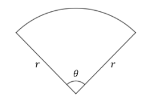
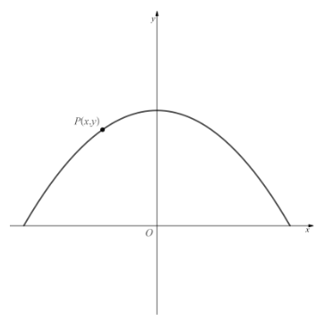

# Exam Questions — Applications of Differentiation
**Differentiation** · Cambridge (CIE) AS maths (9709)
> Source: [https://www.savemyexams.com/as/maths/cie/20/pure-1/topic-questions/](https://www.savemyexams.com/as/maths/cie/20/pure-1/topic-questions/) · 52 questions across 1 sets

## Exam Questions (52 questions)

### Q1 — easy — 10 marks

**Q1** [5 marks]

(i) Find an expression for the volume, $V \text{cm}^{3}$, and for the surface area, $S \text{cm}^{2}$, of a cube, in terms of the side length of the cube, $x$ cm.

(ii) Show that $\frac{\text{d}x}{\text{d}V} = \frac{1}{3x^{2}}$ and find an expression for $\frac{\text{d}S}{\text{d}x}$.

**Q1** [5 marks]

The volume of a cube is decreasing at a constant rate of $0 . 6 \text{cm}^{3} \text{s}^{-1}$.

(i) Explain why $\frac{\text{d}V}{\text{d}t}$, where $t$ is the time in seconds, has the value $- 0 . 6$.

(ii) Use the chain rule to find an expression for $\frac{\text{d}S}{\text{d}t}$ in terms of $\frac{\text{d}S}{\text{d}x}$, $\frac{\text{d}x}{\text{d}V}$ and $\frac{\text{d}V}{\text{d}t}$.

(iii) Hence write $\frac{\text{d}S}{\text{d}t}$ in terms of $x$, and find the rate at which the surface area of the cube is decreasing at the instant when its side length is 5 cm.

### Q2 — easy — 6 marks

**Q2** [3 marks]

The side length, $x$ cm, of a cube is increasing at a constant rate of $0 . 1 \text{cm s}^{-1}$.

(i) State the value of $\frac{\text{d}x}{\text{d}t}$, where $t$ is the time in seconds.

(ii) Find an expression for the volume, $V \text{cm}^{3}$, of the cube in terms of $x$, and find $\frac{\text{d}V}{\text{d}x}$.

**Q2** [3 marks]

Use the chain rule to find an expression for $\frac{\text{d}V}{\text{d}t}$ in terms of $x$, and hence find the rate of increase of the volume when the side length of the cube is 4 cm.

### Q3 — easy — 7 marks

**Q3** [3 marks]

A curve has equation $y = 3 x^{3} + 6 x^{2} - 5 x + 1$.

Find $\frac{\text{d}y}{\text{d}x}$ and $\frac{\text{d}^{2}y}{\text{d}x^{2}}$.

**Q3** [4 marks]

(i) Find the value of $\frac{\text{d}y}{\text{d}x}$ and of $\frac{\text{d}^{2}y}{\text{d}x^{2}}$ when $x = \frac{1}{3}$.

(ii) State what these values tell you about the curve at the point where $x = \frac{1}{3}$.

### Q4 — easy — 4 marks

**Q4** [4 marks]

A curve has equation $y = \frac{1}{3} x^{3} + \frac{5}{2} x^{2} - 6 x + 2$.

Find the $x$-coordinates of the stationary points of the curve.

### Q5 — easy — 4 marks

**Q5** [2 marks]

Find an expression for $\frac{\text{d}y}{\text{d}x}$ when $y = 3 x^{2} - 2 x$.

**Q5** [2 marks]

Find the gradient of $y = 3 x^{2} - 2 x$ at the points where

(i) $x = 3$,

(ii) $x = - 2$.

### Q6 — easy — 5 marks

**Q6** [5 marks]

A curve has equation $y = 2 x^{2} - \frac{2}{3} x^{3} - \frac{5}{3}$.

Show that the point $( 2 , 1 )$ is a maximum point of the curve.

### Q7 — easy — 6 marks

**Q7** [3 marks]

In a computer animation, the side length, $s$ mm, of a square is increasing at a constant rate of $2 \text{mm s}^{-1}$.

(i) State the value of $\frac{\text{d}s}{\text{d}t}$, where $t$ is the time in seconds.

(ii) Find an expression for the area, $A \text{mm}^{2}$, of the square in terms of $s$, and find $\frac{\text{d}A}{\text{d}s}$.

**Q7** [3 marks]

Use the chain rule to find an expression for $\frac{\text{d}A}{\text{d}t}$ in terms of $s$, and hence find the rate of increase of the area when $s = 10$.

### Q8 — easy — 5 marks

**Q8** [5 marks]

A curve has equation $y = 2 x^{3} - 3 x^{2} - 1$.

(i) Find the gradient of the tangent to the curve at the point $( 2 , 3 )$.

(ii) Hence find the equation of the tangent to the curve at this point.

### Q9 — easy — 3 marks

**Q9** [3 marks]

The function $\text{f}$ is defined by $\text{f} ( x ) = 2 x^{2} - 16 x$ for $x \in ℝ$.

Find the set of values of $x$ for which $\text{f}$ is an increasing function.

### Q10 — easy — 5 marks

**Q10** [2 marks]

A curve has equation $y = 3 x - \frac{1}{2} x^{2}$.

Find the gradient of the tangent to the curve at the point where $x = 5$.

**Q10** [3 marks]

(i) Find the gradient of the normal to the curve at the point where $x = 5$.

(ii) Hence find the equation of the normal to the curve at this point.

### Q11 — easy — 6 marks

**Q11** [6 marks]

The function $\text{f}$ is defined by $\text{f} ( x ) = x^{3} + x^{2} - 5 x$ for $x \in ℝ$.

(i) Find an expression for $\text{f} ' ( x )$.

(ii) Solve the equation $\text{f} ' ( x ) = 0$.

(iii) Hence, or otherwise, find the set of values of $x$ for which $\text{f}$ is a decreasing function.

### Q12 — easy — 5 marks

**Q12** [2 marks]

The rate at which the radius, $r$ cm, of a sphere increases over time, $t$ seconds, is directly proportional to the temperature, $T$ °C, of its immediate surroundings.

State an equation linking $\frac{\text{d}r}{\text{d}t}$, $T$ and the constant of proportionality, $k$.

**Q12** [3 marks]

When the surrounding temperature is 20 °C, the radius of the sphere is increasing at a rate of $0 . 4 \text{cm s}^{-1}$.

Find the value of $k$.

### Q13 — easy — 5 marks

**Q13** [4 marks]

A curve has equation $y = x^{3} - 6 x^{2} + 9 x + 4$.

Find the value of $\frac{\text{d}y}{\text{d}x}$ and of $\frac{\text{d}^{2}y}{\text{d}x^{2}}$ at the point where $x = 2$.

**Q13** [1 mark]

Explain why the point where $x = 2$ is not a stationary point of the curve.

### Q14 — very_hard — 9 marks

**Q14** [7 marks]

A curve has equation $y = 5 - ( x - 3 )^{2}$.

$A$ is the point on the curve with $x$-coordinate 0, and $B$ is the point on the curve with $x$-coordinate 6.

$C$ is the point of intersection of the tangents to the curve at $A$ and $B$.

Find the coordinates of point $C$.

**Q14** [2 marks]

Calculate the area of triangle $A B C$.

### Q15 — very_hard — 8 marks

**Q15** [5 marks]

A large block of ice used by sculptors is in the shape of a cuboid with dimensions $x$ m by $2 x$ m by $5 x$ m. The block melts uniformly, with its surface area decreasing at a constant rate of $k$$\text{m}^{2} \text{s}^{-1}$. You may assume that as the block melts, the shape remains mathematically similar to the original cuboid.

Show that the rate of melting, by volume, is given by

$\frac{15kx}{34} \text{m}^{3} \text{s}^{-1}$

**Q15** [3 marks]

In the case when $k = 0 . 2$, the block of ice remains solid enough to be sculpted as long as the rate of melting, by volume, does not exceed $0 . 05 \text{m}^{3} \text{s}^{-1}$.

Find the value of $x$ for the largest block of ice that can be used for ice sculpting under such conditions, giving your answer as a fraction in its lowest terms.

### Q16 — very_hard — 6 marks

**Q16** [6 marks]

An expanding spherical air bubble has radius $r$ cm at time $t$ seconds, determined by the function

$r ( t ) = 0 . 3 + 0 . 1 t^{2}$

The bubble will burst if the rate of expansion of its volume exceeds $4 t \text{cm}^{3} \text{s}^{-1}$.

Find, to one decimal place, the length of time the bubble expands for.

### Q17 — very_hard — 7 marks

**Q17** [7 marks]

A small conical pot, stood on its base, is being filled with salt via a small hole at its vertex. The cone has a height of 6 cm and a radius of 2 cm.

Salt is being poured into the pot at a constant rate of $0 . 3 \text{cm}^{3} \text{s}^{-1}$.

Find, to three significant figures, the rate of change in depth of the salt at the instant when the pot is half full by volume.

### Q18 — very_hard — 9 marks

**Q18** [2 marks]

The top of a patio table is to be made in the shape of a sector of a circle with radius $r$ and central angle $θ$, where $θ$ is strictly between 0° and 360°.

Although $r$ and $θ$ may be varied, it is necessary that the table have a fixed area of $A \text{m}^{2}$.

Explain why $r > \sqrt{\frac{A}{π}}$.

**Q18** [2 marks]

Show that the perimeter, $P$, of the table top is given by the formula

$P = 2 r + \frac{2A}{r}$

**Q18** [5 marks]

Show that the minimum possible value for $P$ is equal to the perimeter of a square with area $A$. Be sure to prove that your value is a minimum.

### Q19 — hard — 4 marks

**Q19** [4 marks]

The function $\text{f}$ is defined by $\text{f} ( x ) = 4 x + \frac{3}{x}$ for $x \in ℝ$, $x \neq 0$.

Find the set of values of $x$ for which $\text{f}$ is a decreasing function.

### Q20 — very_hard — 11 marks

**Q20** [3 marks]

The diagram below shows the part of the curve with equation $y = 3 - \frac{1}{4} x^{2}$ for which $y > 0$. The marked point $P ( x , y )$ lies on the curve. $O$ is the origin.

Show that $O P^{2} = 9 - \frac{1}{2} x^{2} + \frac{1}{16} x^{4}$.

**Q20** [8 marks]

Find the minimum distance from $O$ to the curve, using calculus to prove that your answer is indeed a minimum.

### Q21 — very_hard — 11 marks

**Q21** [6 marks]

A curve is described by the equation $y = \text{f} ( x )$, where

$\text{f} ( x ) = \frac{1}{\sqrt{x}} ,   x > 0$

$P$ is the point on the curve such that the normal to the curve at $P$ also passes through the origin.

Find the coordinates of point $P$. Give your answer in the form `\left(2^{a}, 2^{b}\right)`, where $a$ and $b$ are rational numbers to be found.

**Q21** [1 mark]

Write down the equation of the normal to the curve at $P$.

**Q21** [4 marks]

Show that an equation of the tangent to the curve at $P$ is

`\left(2^{\frac{1}{3}}\right)x + \left(2^{\frac{5}{6}}\right)y = 3`

### Q22 — hard — 7 marks

**Q22** [3 marks]

A curve is described by the equation $y = \text{f} ( x )$, where $\text{f} ( x ) = 7 - 2 x^{2} + \sqrt{x}$, `x \geqslant 0`.

Find $\text{f} ' ( x )$ and $\text{f} ' ' ( x )$.

**Q22** [4 marks]

$P$ is the stationary point on the curve.

Find the coordinates of $P$ and determine its nature.

### Q23 — hard — 4 marks

**Q23** [4 marks]

The function $\text{f}$ is defined by $\text{f} ( x ) = \sqrt{x} - \frac{7}{\sqrt{x}}$ for $x > 0$.

Show that $\text{f}$ is an increasing function.

### Q24 — hard — 6 marks

**Q24** [6 marks]

A plant pot in the shape of a square-based pyramid, stood on its vertex, is being filled with soil at a rate of $72 \text{cm}^{3} \text{s}^{-1}$.

The plant pot has a height of 1 m and a base length of 40 cm.

Find the rate at which the depth of soil is increasing at the moment when the depth is 60 cm.

(The volume of a pyramid is a third of the area of the base times the height.)

### Q25 — very_hard — 7 marks

**Q25** [7 marks]

The volume of liquid in a hemispherical bowl is given by the formula

`V = \dfrac{1}{3}\pi h^{2}\left(3R - h\right)`

where $R$ is the radius of the bowl and $h$ is the depth of liquid, that is, the height between the bottom of the bowl and the level of the liquid.

In a particular case, liquid is leaking through a small hole in the bottom of a bowl at a rate directly proportional to the depth of liquid.

When the bowl is full, the rate of volume loss is equal to $π$.

Show that the rate of change of the depth of the liquid is inversely proportional to `R\left(h - 2R\right)`.

### Q26 — hard — 6 marks

**Q26** [6 marks]

An ice lolly which is in the shape of a cylinder of radius $r$ cm and length $8 r$ cm is melting at a constant rate of $0 . 4 \text{cm}^{3} \text{s}^{-1}$.

Assuming that the ice lolly remains in the shape of a cylinder (mathematically similar to the original cylinder) whilst it melts, find the rate at which its surface area is decreasing at the point when its radius is 0.3 cm.

### Q27 — hard — 6 marks

**Q27** [6 marks]

The volume of liquid in a hemispherical bowl is given by the formula

`V = \dfrac{1}{3}\pi h^{2}\left(3R - h\right)`

where $R$ is the radius of the bowl and $h$ is the depth of liquid (that is, the height between the bottom of the bowl and the level of the liquid).

In a particular case, a bowl is leaking liquid through a small hole in the bottom at a rate directly proportional to the depth of liquid.

Show that the depth of liquid in the bowl is decreasing by

`\dfrac{k}{\pi\left(2R - h\right)}`

where $k$ is a constant.

### Q28 — hard — 7 marks

**Q28** [3 marks]

The diagram below shows a part of the curve with equation $y = \text{f} ( x )$, where

$\text{f} ( x ) = 460 - \frac{x^{3}}{300} - \frac{8100}{x} ,  x > 0$

Point $A$ is the maximum point of the curve.

Find $\text{f} ' ( x )$.

**Q28** [4 marks]

Use your answer to part (a) to find the coordinates of point $A$.

### Q29 — hard — 10 marks

**Q29** [1 mark]

A garden bed is to be divided by fencing into four identical isosceles triangles, arranged as shown in the diagram below:

The base of each triangle is $2 x$ metres, and the equal sides are each $y$ metres in length.

Although $x$ and $y$ can vary, the total amount of fencing to be used is fixed at $P$ metres.

Explain why $0 < x < \frac{P}{6}$.

**Q29** [4 marks]

Show that

$A^{2} = \frac{4}{9} P^{2} x^{2} - \frac{16}{3} P x^{3}$

where $A$ is the total area of the garden bed.

**Q29** [4 marks]

Using your answer to (b) find, in terms of $P$, the maximum possible area of the garden bed.

**Q29** [1 mark]

Describe the shape of the bed when the area has its maximum value.

### Q30 — medium — 3 marks

**Q30** [3 marks]

The function $\text{f}$ is defined by `\text{f}(x) = 7x^{2} - 2x\left(x^{2} + 5\right)` for $x \in ℝ$.

Show that $\text{f}$ is a decreasing function.

### Q31 — hard — 6 marks

**Q31** [6 marks]

The material used to make a spherical balloon is designed so that it can be inflated at a maximum rate of $16 \text{cm}^{3} \text{s}^{-1}$ without bursting.

Given that the radius of the balloon is determined by the function $r ( t ) = \frac{t}{π} + \frac{1}{2}$, $t \geq 0$,

show that the maximum time the balloon can be inflated for, without bursting, is $\frac{3}{2} π$ seconds.

### Q32 — hard — 6 marks

**Q32** [6 marks]

The curve $C$ has equation $y = \frac{9}{\sqrt{3x}} - \frac{3}{x}$. The point $P  ( 3 , 2 )$ lies on $C$.

The normal to $C$ at $P$ intersects the $x$-axis at the point $Q$.

Find the coordinates of $Q$.

### Q33 — hard — 5 marks

**Q33** [5 marks]

The curve $C$ has equation $y = 3 x^{2} - 6 x + \sqrt{2x}$. The point $P  ( 2 , 2 )$ lies on $C$.

Find the equation of the tangent to the curve at $P$.

### Q34 — medium — 5 marks

**Q34** [3 marks]

Given that $y = \frac{4}{x} - \sqrt[3]{\frac{27}{x}}$, find

$\frac{\text{d}y}{\text{d}x}$

**Q34** [2 marks]

$\frac{\text{d}^{2}y}{\text{d}x^{2}}$

### Q35 — hard — 4 marks

**Q35** [4 marks]

A spherical air bubble's surface area is increasing at a constant rate of $4 π \text{cm}^{2} \text{s}^{-1}$.

Find an expression for the rate at which the radius is increasing per second.

(The surface area of a sphere is $4 π r^{2}$.)

### Q36 — hard — 4 marks

**Q36** [4 marks]

A curve has equation $y = 4 x - x^{2} - 2 x^{3}$.

Find the coordinates of the stationary points of the curve, and determine their nature.

### Q37 — hard — 6 marks

**Q37** [6 marks]

A cone, stood on its vertex, of radius 3 cm and height 9 cm, is being filled with sand at a constant rate of $0 . 2 \text{cm}^{3} \text{s}^{-1}$.

Find the rate of change of the depth of sand in the cone at the instant the radius of the sand is 1.2 cm.

### Q38 — medium — 5 marks

**Q38** [5 marks]

The function $\text{f}$ is defined by $\text{f} ( x ) = x^{3} - 5 x^{2} + 3 x - 2$ for $x \in ℝ$.

Find the set of values of $x$ for which $\text{f}$ is a decreasing function.

### Q39 — medium — 5 marks

**Q39** [3 marks]

A curve has equation $y = x^{3} - 6 x^{2} + 9 x - 1$.

Find the $x$-coordinates of the stationary points of the curve.

**Q39** [2 marks]

Determine the nature of the stationary points found in part (a).

### Q40 — medium — 6 marks

**Q40** [6 marks]

An ice cube, of side length $x$ cm, is melting at a constant rate of $0 . 8 \text{cm}^{3} \text{s}^{-1}$.

Assuming that the ice cube remains in the shape of a cube whilst it melts, find the rate at which its surface area is decreasing at the point when its side length is 2 cm.

### Q41 — medium — 4 marks

**Q41** [4 marks]

In a computer animation, the radius of a circle increases at a constant rate of $1 \text{mm s}^{-1}$.

Find the rate, per second, at which the area of the circle is increasing at the time when the radius is 8 millimetres. Give your answer as a multiple of $π$.

### Q42 — medium — 5 marks

**Q42** [5 marks]

A bowl is in the shape of a hemisphere of radius 8 cm.

The volume of liquid in the bowl is given by the formula

$V = 8 π h^{2} - \frac{1}{3} π h^{3}$

where $h$ cm is the depth of the liquid (that is, the height between the bottom of the bowl and the level of the liquid).

Liquid is leaking through a small hole in the bottom of the bowl at a constant rate of $5 \text{cm}^{3} \text{s}^{-1}$.

Find the rate of change of the depth of liquid in the bowl at the instant the depth of liquid is 3 cm.

### Q43 — medium — 3 marks

**Q43** [3 marks]

The function $\text{f}$ is defined by $\text{f} ( x ) = x^{3} - 3 x^{2} + 6 x - 7$ for $x \in ℝ$.

Show that $\text{f}$ is an increasing function.

### Q44 — medium — 6 marks

**Q44** [3 marks]

A curve has equation $y = x^{3} - 12 x + 7$.

Find expressions for $\frac{\text{d}y}{\text{d}x}$ and $\frac{\text{d}^{2}y}{\text{d}x^{2}}$.

**Q44** [3 marks]

Determine the coordinates of the minimum point of the curve.

### Q45 — medium — 7 marks

**Q45** [5 marks]

The diagram below shows part of the curve with equation $y = x^{3} + 11 x^{2} + 35 x + 25$.

The curve touches the $x$-axis at $A$ and cuts the $x$-axis at $C$.

The points $A$ and $B$ are stationary points on the curve.

Using calculus, and showing all your working, find the coordinates of $A$ and $B$.

**Q45** [2 marks]

Show that $( - 1 , 0 )$ is a point on the curve and explain why those must be the coordinates of point $C$.

### Q46 — medium — 6 marks

**Q46** [1 mark]

The curve $C$ has equation $y = 2 x^{3} - 3 x^{2} + 4 x - 3$.

Show that the point $P  ( 2 , 9 )$ lies on $C$.

**Q46** [3 marks]

Show that the value of $\frac{\text{d}y}{\text{d}x}$ at $P$ is 16.

**Q46** [2 marks]

Find the equation of the tangent to $C$ at $P$.

### Q47 — medium — 4 marks

**Q47** [2 marks]

Given that $y = 2 x^{3} - 8 \sqrt{x}$, find

$\frac{\text{d}y}{\text{d}x}$

**Q47** [2 marks]

$\frac{\text{d}^{2}y}{\text{d}x^{2}}$

### Q48 — medium — 6 marks

**Q48** [2 marks]

A company manufactures food tins in the shape of cylinders which must have a constant volume of $150 π \text{cm}^{3}$. To lessen material costs the company would like to minimise the surface area of the tins.

By first expressing the height $h$ of the tin in terms of its radius $r$, show that the surface area of the cylinder is given by $S = 2 π r^{2} + \frac{300π}{r}$.

**Q48** [4 marks]

Use calculus to find the minimum value for the surface area of the tins. Give your answer correct to 2 decimal places.

### Q49 — easy — 3 marks

**Q49** [3 marks]

The function $\text{f}$ is defined by $\text{f} ( x ) = - 9 x^{2} + 5 x - 3$ for $x \in ℝ$.

Find the set of values of $x$ for which $\text{f}$ is an increasing function.

### Q50 — medium — 5 marks

**Q50** [5 marks]

The side length of a cube increases at a rate of $0 . 1 \text{cm s}^{-1}$.

Find the rate of change of the volume of the cube at the instant the side length is 5 cm.

You may assume that the cube remains cubical at all times.

### Q51 — medium — 7 marks

**Q51** [2 marks]

The curve $C$ has equation $y = 3 x^{2} - 6 + \frac{4}{x}$. The point $P  ( 1 , 1 )$ lies on $C$.

Find an expression for $\frac{\text{d}y}{\text{d}x}$.

**Q51** [3 marks]

Show that the equation of the normal to $C$ at $P$ is $x + 2 y = 3$.

**Q51** [2 marks]

This normal cuts the $x$-axis at the point $Q$.

Find the length of $P Q$, giving your answer as an exact value.

### Q52 — medium — 8 marks

**Q52** [5 marks]

In the production process of a glass sphere, hot glass is blown such that the radius, $r$ cm, increases over time, $t$ seconds, in direct proportion to the temperature $T$ °C of the glass.

Find an expression, in terms of $r$ and $T$, for the rate of change of the volume, $V \text{cm}^{3}$, of a glass sphere.

**Q52** [3 marks]

When the temperature of the glass is 1200 °C, a glass sphere has a radius of 2 cm and its volume is increasing at a rate of $5 \text{cm}^{3} \text{s}^{-1}$.

Find the rate of increase of the radius at this time.
