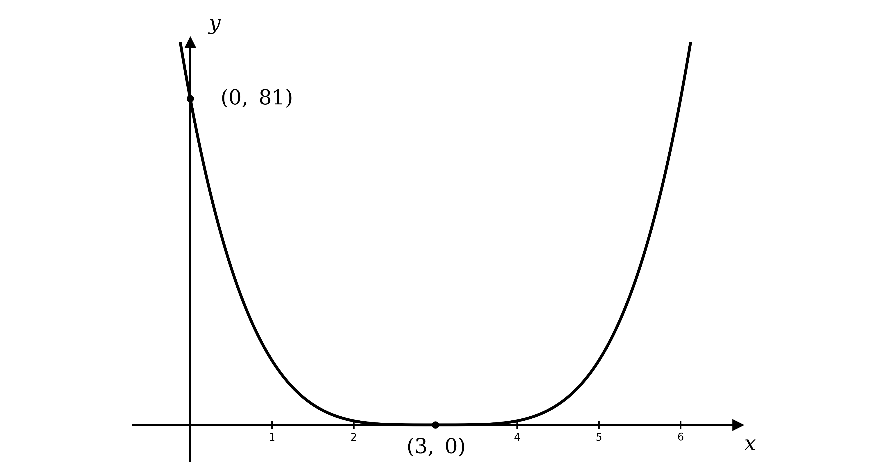
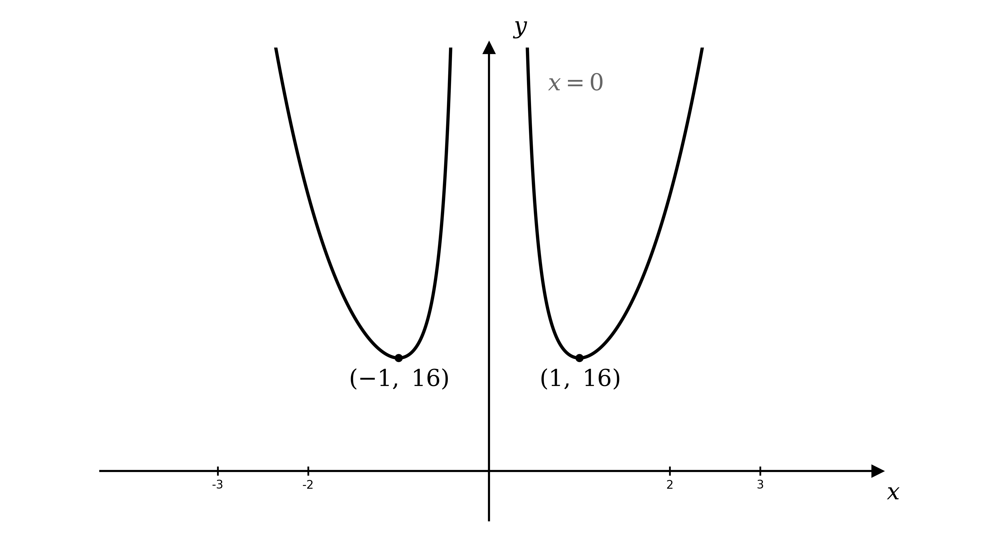
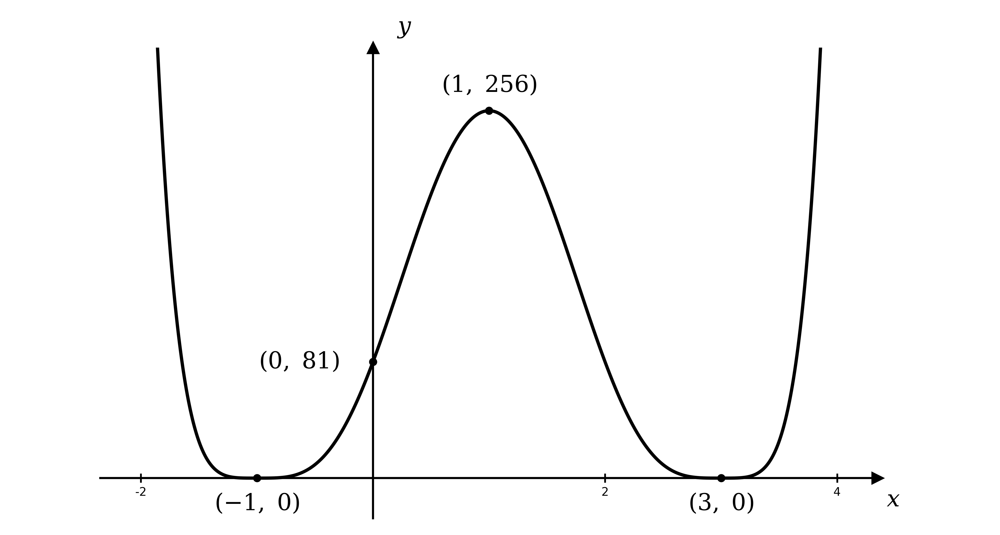
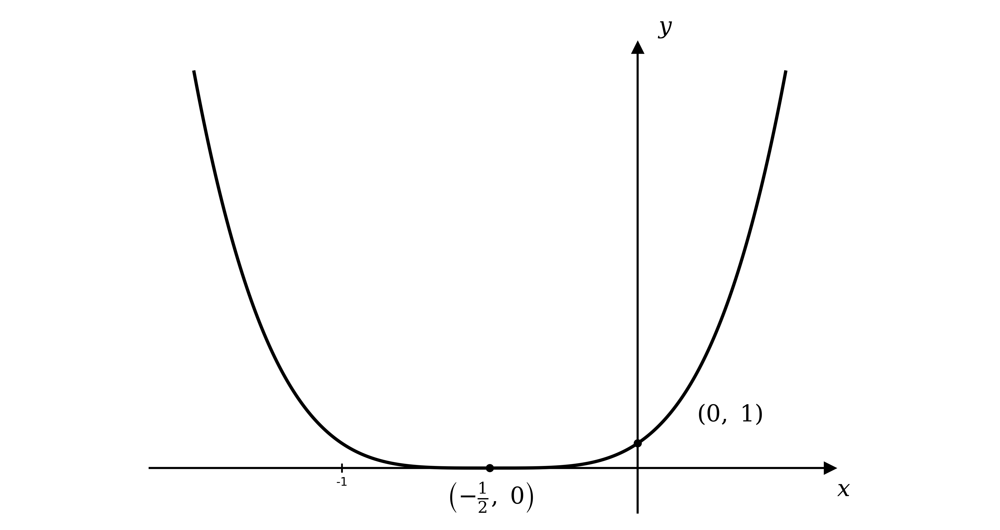

# Mark Schemes — Differentiation
**Differentiation** · Cambridge (CIE) AS maths (9709)

## Exam Questions (40 questions)

### Q1
(i)

Expand the brackets and collect like terms

$( x + 3 ) ( x - 2 ) = x^{2} - 2 x + 3 x - 6$

$x^{2} + x - 6$

**[B1]**

(ii)

"Hence" means differentiate the expanded form from part (i) term by term

`\dfrac{\text{d}}{\text{d}x}\left(x^{2} + x - 6\right) = 2x + 1`

**[M1 A1]**

> **[mark-scheme]**
> **B1**: Correct expansion, $x^{2} + x - 6$.
> 
> **M1**: Differentiating your expanded quadratic (power decreased by 1 in at least one term).
> 
> **A1**: Fully correct derivative, $2 x + 1$.

### Q2
Let the inner bracket be $u$, so $y$ becomes a power of $u$

$u = x - 3  \Rightarrow  y = u^{4}$

**[B1]**

Differentiate each part and combine using the chain rule $\frac{\text{d}y}{\text{d}x} = \frac{\text{d}y}{\text{d}u} \times \frac{\text{d}u}{\text{d}x}$

$\frac{\text{d}y}{\text{d}x} = 4 u^{3} \times 1 = 4 u^{3}$

**[M1]**

Substitute $u = x - 3$ back to give the answer in terms of $x$

$\frac{\text{d}y}{\text{d}x} = 4 ( x - 3 )^{3}$

**[A1]**

> **[mark-scheme]**
> **B1**: A suitable substitution, $u = x - 3$, giving $y = u^{4}$.
> 
> **M1**: Correct use of the chain rule, $\frac{\text{d}y}{\text{d}u} \times \frac{\text{d}u}{\text{d}x}$ with $\frac{\text{d}y}{\text{d}u} = 4 u^{3}$.
> 
> **A1**: Fully correct derivative in terms of $x$, $\frac{\text{d}y}{\text{d}x} = 4 ( x - 3 )^{3}$. Accept unsimplified or expanded equivalents.
(i)

Stationary points occur where the gradient is zero, so set $\frac{\text{d}y}{\text{d}x} = 0$

$4 ( x - 3 )^{3} = 0  \Rightarrow  x = 3$

**[M1]**

Substitute $x = 3$ into $y = ( x - 3 )^{4}$ to find the $y$-coordinate

$( 3 ,  0 )$

**[A1]**

(ii)

Test the gradient just below the point, at $x = 2$

$\frac{\text{d}y}{\text{d}x} = 4 ( 2 - 3 )^{3} = - 4$

Test the gradient just above the point, at $x = 4$

$\frac{\text{d}y}{\text{d}x} = 4 ( 4 - 3 )^{3} = 4$

The gradient changes from negative to positive, so the curve turns upward

**Final answer:** $( 3 ,  0 )$** is a minimum point**

**[B1]**

> **[mark-scheme]**
> **M1**: Setting $\frac{\text{d}y}{\text{d}x} = 0$ and solving to obtain $x = 3$.
> 
> **A1**: Correct stationary point $( 3 , 0 )$.
> 
> **B1**: Minimum correctly identified, justified by $\frac{\text{d}y}{\text{d}x}$ changing from negative to positive across $x = 3$.
The curve $y = ( x - 3 )^{4}$ is a positive quartic, so it opens upward with a single lowest point

**[B1]**

The repeated factor means the curve touches the $x$-axis at its minimum $( 3 , 0 )$ from part (b)

**[B1]**

Find the $y$-intercept by substituting $x = 0$

$y = ( 0 - 3 )^{4} = 81$

$( 0 ,  81 )$

**[B1]**

> **[mark-scheme]**
> **B1**: Correct shape — a positive quartic opening upward with a single minimum.
> 
> **B1**: Minimum labelled at $( 3 , 0 )$, where the curve touches (does not cross) the $x$-axis.
> 
> **B1**: $y$-intercept labelled at $( 0 , 81 )$.

### Q3
Differentiate each term with the power rule, multiplying by the power and reducing the power by $1$

`\dfrac{\text{d}y}{\text{d}x} = 2\cdot\tfrac{1}{2}x^{-\frac{1}{2}} + 3\cdot(-1)x^{-2}`

$\frac{\text{d}y}{\text{d}x} = x^{-\frac{1}{2}} - 3 x^{-2}$

**[B1 B1]**

> **[mark-scheme]**
> **B1**: Correct derivative of $2 x^{\frac{1}{2}}$, giving $x^{-\frac{1}{2}}$.
> 
> **B1**: Correct derivative of $3 x^{-1}$, giving $- 3 x^{-2}$. Accept equivalent forms, such as $\frac{1}{\sqrt{x}} - \frac{3}{x^{2}}$, and accept unsimplified answers.

### Q4
Apply the power rule `\dfrac{\text{d}}{\text{d}x}\left(ax^{n}\right) = anx^{n-1}` to each term

(i)

For the linear term, the gradient of $y = 5 x$ is simply its coefficient

$\frac{\text{d}y}{\text{d}x} = 5$

**[B1]**

(ii)

Multiply by the power $3$, then reduce the power by $1$

$\frac{\text{d}y}{\text{d}x} = 6 x^{2}$

**[B1]**

(iii)

The same rule applies to the fractional power $n = \frac{1}{2}$

$\frac{\text{d}y}{\text{d}x} = \frac{1}{2} x^{-\frac{1}{2}} = \frac{1}{2\sqrt{x}}$

**[B1]**

> **[mark-scheme]**
> **B1**: Correct derivative of $5 x$, giving $5$.
> 
> **B1**: Correct derivative of $2 x^{3}$, giving $6 x^{2}$.
> 
> **B1**: Correct derivative of $x^{\frac{1}{2}}$, giving $\frac{1}{2} x^{-\frac{1}{2}}$. Accept any equivalent form, such as $\frac{1}{2\sqrt{x}}$, and accept unsimplified answers.

### Q5
Let the expression inside the bracket be the new variable

$u = x - 7$

**[B1]**

Replacing $x - 7$ with $u$ writes $y$ as a single power of $u$

**Final answer:** $y = u^{3}$** where **$n = 3$

**[B1]**

> **[mark-scheme]**
> **B1**: A suitable substitution is defined, $u = x - 7$.
> 
> **B1**: The function is written as $y = u^{3}$, identifying $n = 3$ as a positive integer.
Differentiate the power of $u$ and the inner function separately

$\frac{\text{d}y}{\text{d}u} = 3 u^{2}$

$\frac{\text{d}u}{\text{d}x} = 1$

**[B1]**

Combine them using the chain rule

$\frac{\text{d}y}{\text{d}x} = \frac{\text{d}y}{\text{d}u} \times \frac{\text{d}u}{\text{d}x} = 3 u^{2} \times 1$

**[M1]**

Substitute $u = x - 7$ back to give the answer in terms of $x$

$\frac{\text{d}y}{\text{d}x} = 3 ( x - 7 )^{2}$

**[A1]**

> **[mark-scheme]**
> **B1**: Correct component derivatives, $\frac{\text{d}y}{\text{d}u} = 3 u^{2}$ and $\frac{\text{d}u}{\text{d}x} = 1$ (at least one correct, accept unsimplified).
> 
> **M1**: Correct use of the chain rule, multiplying your $\frac{\text{d}y}{\text{d}u}$ by your $\frac{\text{d}u}{\text{d}x}$.
> 
> **A1**: Fully correct derivative in terms of $x$, $\frac{\text{d}y}{\text{d}x} = 3 ( x - 7 )^{2}$. Accept any equivalent form, including unsimplified or expanded.

### Q6
Differentiate the curve to obtain the gradient function

$\frac{\text{d}y}{\text{d}x} = 6 x^{2} - 18 x + 12$

**[M1 A1]**

The gradient is zero at the required points, so set $\frac{\text{d}y}{\text{d}x} = 0$ and divide through by $6$

$6 x^{2} - 18 x + 12 = 0  \Rightarrow  x^{2} - 3 x + 2 = 0$

Factorise and solve for $x$

$( x - 1 ) ( x - 2 ) = 0$

$x = 1$* or *$x = 2$

**[M1]**

Substitute each $x$ back into $y = 2 x^{3} - 9 x^{2} + 12 x$ to find the $y$-coordinates

$x = 1 :  y = 2 - 9 + 12 = 5$

$x = 2 :  y = 16 - 36 + 24 = 4$

**Final answer:** $( 1 ,  5 )$** and **$( 2 ,  4 )$

**[A1]**

> **[mark-scheme]**
> **M1**: Attempt to differentiate (powers decreased by 1).
> 
> **A1**: Correct derivative, $\frac{\text{d}y}{\text{d}x} = 6 x^{2} - 18 x + 12$.
> 
> **M1**: Setting your $\frac{\text{d}y}{\text{d}x} = 0$ and solving the resulting quadratic for $x$.
> 
> **A1**: Both correct coordinates, $( 1 , 5 )$ and $( 2 , 4 )$.

### Q7
The line $y = k$ is horizontal, so its gradient is zero

$\text{gradient} = 0$

**[B1]**

> **[mark-scheme]**
> **B1**: Gradient of $0$, since $y = k$ is a horizontal line.
Differentiate each function, then substitute $x = 8$ into the derivative

(i)

Differentiate $3 x^{2}$, then evaluate at $x = 8$

$\text{f} ' ( x ) = 6 x$

$\text{f} ' ( 8 ) = 6 ( 8 ) = 48$

**[B1]**

(ii)

Differentiate $4 x^{3} - 2 x$ term by term, then evaluate at $x = 8$

$\text{f} ' ( x ) = 12 x^{2} - 2$

$\text{f} ' ( 8 ) = 12 ( 8 )^{2} - 2 = 766$

**[B1]**

(iii)

Differentiate $3 x^{\frac{1}{3}}$ using the power rule, then evaluate at $x = 8$

`\text{f}'(x) = 3 \cdot \tfrac{1}{3}x^{-\frac{2}{3}} = x^{-\frac{2}{3}}`

`\text{f}'(8) = 8^{-\frac{2}{3}} = \dfrac{1}{\left(\sqrt[3]{8}\right)^{2}} = \dfrac{1}{4}`

**[B1]**

> **[mark-scheme]**
> **B1**: Correct gradient for (i), $\text{f} ' ( 8 ) = 48$.
> 
> **B1**: Correct gradient for (ii), $\text{f} ' ( 8 ) = 766$.
> 
> **B1**: Correct gradient for (iii), $\text{f} ' ( 8 ) = \frac{1}{4}$. Accept any exact equivalent, such as $8^{-\frac{2}{3}}$ or $0 . 25$.

### Q8
The denominator is a single term, so split the fraction into two separate terms

$\text{f} ( x ) = \frac{2x^{\frac{1}{3}}}{x} + \frac{3x^{\frac{2}{3}}}{x}$

**[M1]**

Divide each term by $x = x^{1}$ by subtracting $1$ from each power

$\text{f} ( x ) = 2 x^{-\frac{2}{3}} + 3 x^{-\frac{1}{3}}$

**[A1 A1]**

> **[mark-scheme]**
> **M1**: Splitting the single-term denominator, writing $\text{f} ( x )$ as two separate terms over $x$.
> 
> **A1**: Correct first term, $2 x^{-\frac{2}{3}}$ (so $a = 2$, $b = - \frac{2}{3}$).
> 
> **A1**: Correct second term, $3 x^{-\frac{1}{3}}$ (so $c = 3$, $d = - \frac{1}{3}$).
Differentiate each power term from part (a), multiplying by the power and reducing it by $1$

`\text{f}'(x) = 2\left(-\tfrac{2}{3}\right)x^{-\frac{5}{3}} + 3\left(-\tfrac{1}{3}\right)x^{-\frac{4}{3}}`

**[M1]**

Simplify the coefficients

$\text{f} ' ( x ) = - \frac{4}{3} x^{-\frac{5}{3}} - x^{-\frac{4}{3}}$

**[A1 A1]**

> **[mark-scheme]**
> **M1**: Attempt to differentiate your part (a) answer (decrease the power by 1 in at least one term).
> 
> **A1**: Correct first term, $- \frac{4}{3} x^{-\frac{5}{3}}$.
> 
> **A1**: Correct second term, $- x^{-\frac{4}{3}}$. Accept unsimplified or equivalent forms; ignore subsequent working.

### Q9
The gradient at any point is given by $\frac{\text{d}y}{\text{d}x}$, so differentiate the curve

$\frac{\text{d}y}{\text{d}x} = 10 x - 16$

**[M1]**

A gradient of $4$ means setting the derivative equal to $4$

$10 x - 16 = 4$

**[M1]**

Solve the linear equation for $x$

$x = 2$

**[A1]**

> **[mark-scheme]**
> **M1**: Differentiating to obtain $\frac{\text{d}y}{\text{d}x} = 10 x - 16$.
> 
> **M1**: Setting your $\frac{\text{d}y}{\text{d}x}$ equal to $4$.
> 
> **A1**: Correct value, $x = 2$.

### Q10
Rewrite each term as a single power of $x$ so the power rule applies directly

$y = x^{\frac{3}{2}} + 2 x^{-\frac{1}{2}}$

Differentiate each term, multiplying by the power and reducing it by $1$

`\dfrac{\text{d}y}{\text{d}x} = \tfrac{3}{2}x^{\frac{1}{2}} + 2\left(-\tfrac{1}{2}\right)x^{-\frac{3}{2}}`

**[M1]**

Simplify the coefficients

$\frac{\text{d}y}{\text{d}x} = \frac{3}{2} x^{\frac{1}{2}} - x^{-\frac{3}{2}}$

**[A1 A1]**

> **[mark-scheme]**
> **M1**: Attempt to differentiate, decreasing the power by 1 in at least one term (after rewriting in index form).
> 
> **A1**: Correct first term, $\frac{3}{2} x^{\frac{1}{2}}$.
> 
> **A1**: Correct second term, $- x^{-\frac{3}{2}}$. Accept unsimplified or equivalent forms, such as $\frac{3}{2} \sqrt{x} - \frac{1}{x\sqrt{x}}$.

### Q11
Differentiate each term; $x \sqrt{2}$ has constant coefficient $\sqrt{2}$, and $π$ is a constant (so it differentiates to $0$)

$\frac{\text{d}y}{\text{d}x} = - \frac{15}{4} x^{2} + \frac{6}{5} x - \sqrt{2}$

**[M1 A1]**

> **[mark-scheme]**
> **M1**: Attempt to differentiate, decreasing the power by 1 in at least one term.
> 
> **A1**: Fully correct derivative, $- \frac{15}{4} x^{2} + \frac{6}{5} x - \sqrt{2}$.
Differentiate each power term, multiplying by the power and reducing it by $1$

`\dfrac{\text{d}y}{\text{d}x} = \dfrac{3}{2}\left(\dfrac{4}{5}\right)x^{-\frac{1}{5}} - \dfrac{10}{3}\left(-\dfrac{4}{5}\right)x^{-\frac{9}{5}}`

$\frac{\text{d}y}{\text{d}x} = \frac{6}{5} x^{-\frac{1}{5}} + \frac{8}{3} x^{-\frac{9}{5}}$

**[M1 A1]**

> **[mark-scheme]**
> **M1**: Attempt to differentiate, decreasing the power by 1 in at least one term.
> 
> **A1**: Fully correct derivative, $\frac{6}{5} x^{-\frac{1}{5}} + \frac{8}{3} x^{-\frac{9}{5}}$. Accept unsimplified equivalents.

### Q12
Rewrite each term as a power of $x$, noting $x \sqrt{x} = x^{\frac{3}{2}}$ so $\frac{1}{x\sqrt{x}} = x^{-\frac{3}{2}}$

`y = \left(x^{-1} - x^{-\frac{3}{2}}\right)^{2}`

Expand the square using $( a - b )^{2} = a^{2} - 2 a b + b^{2}$

`y = \left(x^{-1}\right)^{2} - 2\left(x^{-1}\right)\left(x^{-\frac{3}{2}}\right) + \left(x^{-\frac{3}{2}}\right)^{2} = x^{-2} - 2x^{-\frac{5}{2}} + x^{-3}`

**[M1 A1]**

Differentiate each term, multiplying by the power and reducing it by $1$

`\dfrac{\text{d}y}{\text{d}x} = -2x^{-3} - 2\left(-\dfrac{5}{2}\right)x^{-\frac{7}{2}} - 3x^{-4}`

$\frac{\text{d}y}{\text{d}x} = - 2 x^{-3} + 5 x^{-\frac{7}{2}} - 3 x^{-4}$

**[M1 A1]**

> **[mark-scheme]**
> **M1**: Expanding the square to a sum of powers of $x$.
> 
> **A1**: Correct expansion, $x^{-2} - 2 x^{-\frac{5}{2}} + x^{-3}$.
> 
> **M1**: Differentiating your expansion (power decreased by 1 in at least one term).
> 
> **A1**: Fully correct derivative, $- 2 x^{-3} + 5 x^{-\frac{7}{2}} - 3 x^{-4}$. Accept unsimplified equivalents.

### Q13
Factor $x$ out of the numerator, then factorise the remaining quadratic so the $( 2 x + 1 )$ factor is visible

$2 x^{3} - 5 x^{2} - 3 x = x ( 2 x^{2} - 5 x - 3 ) = x ( 2 x + 1 ) ( x - 3 )$

Cancel the common factor $( 2 x + 1 )$ with the denominator, then expand

$y = \frac{x(2x+1)(x-3)}{2x+1} = x ( x - 3 ) = x^{2} - 3 x$

**[M1 A1]**

Differentiate the simplified quadratic

$\frac{\text{d}y}{\text{d}x} = 2 x - 3$

**[A1]**

> **[mark-scheme]**
> **M1**: Factorising the numerator to $x ( 2 x + 1 ) ( x - 3 )$ (or dividing by $2 x + 1$).
> 
> **A1**: Correct simplification, $y = x^{2} - 3 x$.
> 
> **A1**: Correct derivative, $2 x - 3$.
Rewrite $\frac{4}{\sqrt{x}}$ as a power, so the bracket is a sum of powers of $x$

`y = \left(x^{\frac{1}{2}} + 3 - 4x^{-\frac{1}{2}}\right)^{2}`

Expand the square, squaring each term and adding twice each pairwise product

$y = x + 9 + 16 x^{-1} + 6 x^{\frac{1}{2}} - 8 - 24 x^{-\frac{1}{2}}$

Collect the constant terms $9 - 8 = 1$

$y = x + 6 x^{\frac{1}{2}} - 24 x^{-\frac{1}{2}} + 16 x^{-1} + 1$

**[M1 A1]**

Differentiate each term, multiplying by the power and reducing it by $1$

$\frac{\text{d}y}{\text{d}x} = 1 + 3 x^{-\frac{1}{2}} + 12 x^{-\frac{3}{2}} - 16 x^{-2}$

**[M1 A1]**

> **[mark-scheme]**
> **M1**: Expanding the square to a sum of powers of $x$.
> 
> **A1**: Correct expansion, $x + 6 x^{\frac{1}{2}} - 24 x^{-\frac{1}{2}} + 16 x^{-1} + 1$.
> 
> **M1**: Differentiating your expansion (power decreased by 1 in at least one term).
> 
> **A1**: Fully correct derivative, $1 + 3 x^{-\frac{1}{2}} + 12 x^{-\frac{3}{2}} - 16 x^{-2}$.

### Q14
Rewrite each term as a power of $x$, using `x\sqrt{x} = x \cdot x^{\frac{1}{2}} = x^{\frac{3}{2}}` and $\frac{48}{\sqrt{x}} = 48 x^{-\frac{1}{2}}$

$y = x^{\frac{3}{2}} + 48 x^{-\frac{1}{2}}$

Differentiate each term, multiplying by the power and reducing it by $1$

$\frac{\text{d}y}{\text{d}x} = \frac{3}{2} x^{\frac{1}{2}} - 24 x^{-\frac{3}{2}}$

**[M1 A1]**

Set the gradient to zero and factor out $x^{-\frac{3}{2}}$

`\tfrac{3}{2}x^{\frac{1}{2}} - 24x^{-\frac{3}{2}} = 0 \quad\Rightarrow\quad \tfrac{3}{2}x^{-\frac{3}{2}}\left(x^{2} - 16\right) = 0`

Solve for $x$, taking only the positive root since $x > 0$

$x^{2} = 16  \Rightarrow  x = 4$

**[M1 A1]**

Substitute $x = 4$ into the curve to find the $y$-coordinate

$y = 4 \sqrt{4} + \frac{48}{\sqrt{4}} = 8 + 24 = 32$

$( 4 ,  32 )$

**[A1]**

> **[mark-scheme]**
> **M1**: Attempt to differentiate (power decreased by 1 in at least one term).
> 
> **A1**: Correct derivative, $\frac{3}{2} x^{\frac{1}{2}} - 24 x^{-\frac{3}{2}}$.
> 
> **M1**: Setting your $\frac{\text{d}y}{\text{d}x} = 0$ and solving for $x$.
> 
> **A1**: Correct $x = 4$, with $x = - 4$ rejected since $x > 0$.
> 
> **A1**: Correct point, $( 4 ,  32 )$.

### Q15
Differentiate; $\text{f} ' ( x ) = 0$ is a quadratic in $x$

$\text{f} ' ( x ) = 6 x^{2} + 2 p x + 3$

**[M1]**

For this quadratic to have at least one real solution, its discriminant must be non-negative

$( 2 p )^{2} - 4 ( 6 ) ( 3 ) \geq 0$

**[M1]**

Simplify the inequality

$4 p^{2} - 72 \geq 0  \Rightarrow  p^{2} \geq 18$

**[A1]**

The critical values are $p = \pm \sqrt{18} = \pm 3 \sqrt{2}$, and $p^{2} \geq 18$ holds outside them

$p = \pm 3 \sqrt{2}$

**[M1]**

State the range of values

**Final answer:** $p \leq - 3 \sqrt{2}$** or **$p \geq 3 \sqrt{2}$

**[A1]**

> **[mark-scheme]**
> **M1**: Correct derivative, $\text{f} ' ( x ) = 6 x^{2} + 2 p x + 3$.
> 
> **M1**: Using the discriminant with $\geq 0$ for at least one real solution.
> 
> **A1**: Correct inequality, $4 p^{2} - 72 \geq 0$ (or $p^{2} \geq 18$).
> 
> **M1**: Solving the quadratic inequality, with critical values $p = \pm 3 \sqrt{2}$.
> 
> **A1**: Correct range, $p \leq - 3 \sqrt{2}$ or $p \geq 3 \sqrt{2}$. Accept equivalent exact forms such as $\pm \sqrt{18}$.

### Q16
Let the inner bracket be $u$, so $y$ becomes a power of $u$

$u = \frac{1}{\sqrt{x}} + 3 x^{2} = x^{-\frac{1}{2}} + 3 x^{2}  \Rightarrow  y = u^{3}$

**[B1]**

Differentiate each part

$\frac{\text{d}u}{\text{d}x} = - \frac{1}{2} x^{-\frac{3}{2}} + 6 x$

$\frac{\text{d}y}{\text{d}u} = 3 u^{2}$

**[B1]**

Combine using the chain rule

`\dfrac{\text{d}y}{\text{d}x} = \left(6x - \tfrac{1}{2}x^{-\frac{3}{2}}\right)(3u^{2})`

**[M1]**

Substitute $u = \frac{1}{\sqrt{x}} + 3 x^{2}$ back

`\dfrac{\text{d}y}{\text{d}x} = 3\left(6x - \dfrac{1}{2x\sqrt{x}}\right)\left(\dfrac{1}{\sqrt{x}} + 3x^{2}\right)^{2}`

**[A1]**

> **[mark-scheme]**
> **B1**: A suitable substitution, $u = x^{-\frac{1}{2}} + 3 x^{2}$, giving $y = u^{3}$.
> 
> **B1**: Correct component derivatives, $\frac{\text{d}u}{\text{d}x} = - \frac{1}{2} x^{-\frac{3}{2}} + 6 x$ and $\frac{\text{d}y}{\text{d}u} = 3 u^{2}$.
> 
> **M1**: Correct use of the chain rule, multiplying the two derivatives.
> 
> **A1**: Fully correct derivative in terms of $x$. Accept unsimplified or equivalent forms.
First rewrite the inner denominator as powers of $x$

$\sqrt{x} + \frac{1}{\sqrt{x}} = x^{\frac{1}{2}} + x^{-\frac{1}{2}}$

Take the reciprocal (index $- 1$), then the outer square root (index $\frac{1}{2}$), multiplying the indices

`y = \sqrt{\left(x^{\frac{1}{2}} + x^{-\frac{1}{2}}\right)^{-1}} = \left(x^{\frac{1}{2}} + x^{-\frac{1}{2}}\right)^{-\frac{1}{2}}`

Let the inner bracket be $u$, so $y$ becomes a power of $u$

$u = x^{\frac{1}{2}} + x^{-\frac{1}{2}}  \Rightarrow  y = u^{-\frac{1}{2}}$

**[B1]**

Differentiate each part

$\frac{\text{d}u}{\text{d}x} = \frac{1}{2} x^{-\frac{1}{2}} - \frac{1}{2} x^{-\frac{3}{2}}$

$\frac{\text{d}y}{\text{d}u} = - \frac{1}{2} u^{-\frac{3}{2}}$

**[B1]**

Combine using the chain rule and simplify the constant

`\dfrac{\text{d}y}{\text{d}x} = \left(\tfrac{1}{2}x^{-\frac{1}{2}} - \tfrac{1}{2}x^{-\frac{3}{2}}\right)\left(-\tfrac{1}{2}u^{-\frac{3}{2}}\right) = \tfrac{1}{4}\left(x^{-\frac{3}{2}} - x^{-\frac{1}{2}}\right)u^{-\frac{3}{2}}`

**[M1]**

Substitute $u = x^{\frac{1}{2}} + x^{-\frac{1}{2}}$ back

`\dfrac{\text{d}y}{\text{d}x} = \tfrac{1}{4}\left(x^{-\frac{3}{2}} - x^{-\frac{1}{2}}\right)\left(x^{\frac{1}{2}} + x^{-\frac{1}{2}}\right)^{-\frac{3}{2}}`

**[A1]**

> **[mark-scheme]**
> **B1**: Rewriting $y$ as `\left(x^{\frac{1}{2}} + x^{-\frac{1}{2}}\right)^{-\frac{1}{2}}` with a suitable substitution.
> 
> **B1**: Correct component derivatives, $\frac{\text{d}u}{\text{d}x} = \frac{1}{2} x^{-\frac{1}{2}} - \frac{1}{2} x^{-\frac{3}{2}}$ and $\frac{\text{d}y}{\text{d}u} = - \frac{1}{2} u^{-\frac{3}{2}}$.
> 
> **M1**: Correct use of the chain rule, multiplying the two derivatives.
> 
> **A1**: Fully correct derivative. Accept equivalent forms, including the simplified $\frac{1-x}{4x(x+1)} \sqrt{\frac{\sqrt{x}}{x+1}}$.

### Q17
Make $y$ the subject: rearrange for $\sqrt{y}$, then square both sides

$\sqrt{y} = \frac{-1+\sqrt{x}}{x}  \Rightarrow  y = \frac{(-1+\sqrt{x})^{2}}{x^{2}}$

Expand the numerator, writing $\sqrt{x} = x^{\frac{1}{2}}$

$y = \frac{1-2\sqrt{x}+x}{x^{2}} = \frac{1-2x^{\frac{1}{2}}+x}{x^{2}}$

Divide each term by $x^{2}$, subtracting the powers

$y = \frac{1}{x^{2}} - \frac{2x^{\frac{1}{2}}}{x^{2}} + \frac{x}{x^{2}} = x^{-2} - 2 x^{-\frac{3}{2}} + x^{-1}$

**[M1 A1]**

Differentiate each term, multiplying by the power and reducing it by $1$

$\frac{\text{d}y}{\text{d}x} = - 2 x^{-3} + 3 x^{-\frac{5}{2}} - x^{-2}$

**[A1]**

> **[mark-scheme]**
> **M1**: Making $y$ the subject and expanding to a sum of powers of $x$.
> 
> **A1**: Correct form, $y = x^{-2} - 2 x^{-\frac{3}{2}} + x^{-1}$.
> 
> **A1**: Fully correct derivative, $- 2 x^{-3} + 3 x^{-\frac{5}{2}} - x^{-2}$. Accept unsimplified equivalents.

### Q18
Differentiate and set $\text{f} ' ( x ) = 0$

$\text{f} ' ( x ) = n x^{n-1} - 1 = 0  \Rightarrow  x^{n-1} = \frac{1}{n}$

**[M1 A1]**

Taking the $( n - 1 )$th root gives the general solution

`x = \left(\dfrac{1}{n}\right)^{\frac{1}{n-1}}`

Work through the first few values of $n$, solving $x^{n-1} = \frac{1}{n}$ each time; an even power gives two roots (from $\pm$), an odd power gives one

| $n$ | $x^{n-1} = \frac{1}{n}$ | Solve for $x$ | Real roots |
|---|---|---|---|
| $2$ | $x^{1} = \frac{1}{2}$ | $x = \frac{1}{2}$ | $1$ |
| $3$ | $x^{2} = \frac{1}{3}$ | $x = \pm \frac{1}{\sqrt{3}}$ | $2$ |
| $4$ | $x^{3} = \frac{1}{4}$ | `x = \tfrac{1}{\sqrt[3]{4}}` | $1$ |
| $5$ | $x^{4} = \frac{1}{5}$ | `x = \pm\tfrac{1}{\sqrt[4]{5}}` | $2$ |

**[M1]**

The count follows the parity of $n - 1$: when $n$ is even $n - 1$ is odd (one root), and when $n$ is odd $n - 1$ is even (two roots)

**Final answer:** $n$** even: one real solution; **$n$** odd: two real solutions**

**[A1]**

> **[mark-scheme]**
> **M1**: Differentiating and setting $\text{f} ' ( x ) = 0$ (power decreased by 1).
> 
> **A1**: Correct rearrangement, $x^{n-1} = \frac{1}{n}$.
> 
> **M1**: Solving $x^{n-1} = \frac{1}{n}$ for several values of $n$ (or reasoning from the parity of $n - 1$) to find the number of real roots in each case.
> 
> **A1**: Correct relationship — one real solution when $n$ is even, two real solutions when $n$ is odd.

### Q19
Let the inner bracket be $u$, so $y$ becomes a power of $u$

$u = \frac{1}{x} + x = x^{-1} + x  \Rightarrow  y = u^{4}$

**[B1]**

Differentiate each part and combine with the chain rule $\frac{\text{d}y}{\text{d}x} = \frac{\text{d}y}{\text{d}u} \times \frac{\text{d}u}{\text{d}x}$

`\dfrac{\text{d}y}{\text{d}x} = 4u^{3}\left(1 - x^{-2}\right)`

**[M1]**

Substitute $u = \frac{1}{x} + x$ back

`\dfrac{\text{d}y}{\text{d}x} = 4\left(\dfrac{1}{x} + x\right)^{3}\left(1 - \dfrac{1}{x^{2}}\right)`

**[A1]**

> **[mark-scheme]**
> **B1**: A suitable substitution, $u = \frac{1}{x} + x$, giving $y = u^{4}$.
> 
> **M1**: Correct use of the chain rule, $4 u^{3} \times ( 1 - x^{-2} )$.
> 
> **A1**: Fully correct derivative, `4\left(\dfrac{1}{x} + x\right)^{3}\left(1 - \dfrac{1}{x^{2}}\right)`.
Stationary points occur where $\frac{\text{d}y}{\text{d}x} = 0$; set each factor to zero in turn

`4\left(\dfrac{1 + x^{2}}{x}\right)^{3}\left(\dfrac{x^{2} - 1}{x^{2}}\right) = 0`

$1 + x^{2} = 0$ has no real solution, so solve $x^{2} - 1 = 0$

$x^{2} - 1 = 0  \Rightarrow  x = \pm 1$

**[M1]**

Find each $y$-coordinate

$x = 1 :  y = ( 1 + 1 )^{4} = 16$

$x = - 1 :  y = ( - 1 - 1 )^{4} = 16$

**Final answer:** $( 1 ,  16 )$** and **$( - 1 ,  16 )$

**[A1]**

There is an asymptote at $x = 0$ ($x \neq 0$), so test the gradient sign either side of each stationary point

| $x$ | $- 2$ | $- \frac{1}{2}$ | $\frac{1}{2}$ | $2$ |
|---|---|---|---|---|
| $\frac{\text{d}y}{\text{d}x}$ | $-$ | $+$ | $-$ | $+$ |

**[M1]**

Both show the gradient changing from negative to positive

**Final answer:** $( 1 , 16 )$** and **$( - 1 , 16 )$** are both minimum points**

**[A1]**

> **[mark-scheme]**
> **M1**: Setting $\frac{\text{d}y}{\text{d}x} = 0$ and solving to obtain $x = \pm 1$ (rejecting $1 + x^{2} = 0$).
> 
> **A1**: Both correct stationary points, $( 1 , 16 )$ and $( - 1 , 16 )$.
> 
> **M1**: Testing the sign of $\frac{\text{d}y}{\text{d}x}$ either side of each stationary point.
> 
> **A1**: Both correctly identified as minimum points.
Since $x \neq 0$, the curve has a vertical asymptote at $x = 0$, forming two upward branches, one on each side

**[B1]**

Mark the minima at $( - 1 , 16 )$ and $( 1 , 16 )$ from part (b)

**[B1]**

Show the asymptote $x = 0$ as a dashed line, with the curve rising steeply toward it and as $x \rightarrow \pm \infty$

**[B1]**

> **[mark-scheme]**
> **B1**: Correct shape — two upward branches, one on each side of the $y$-axis.
> 
> **B1**: Minima labelled at $( - 1 , 16 )$ and $( 1 , 16 )$.
> 
> **B1**: Vertical asymptote $x = 0$ shown (dashed).

### Q20
The point $( - 1 , 4 )$ lies on the curve, so substitute it in

$4 = a ( - 1 )^{2} + b ( - 1 ) + c  \Rightarrow  a - b + c = 4$* (1)*

The point $( 2 , 7 )$ also lies on the curve

$7 = a ( 2 )^{2} + b ( 2 ) + c  \Rightarrow  4 a + 2 b + c = 7$* (2)*

**[M1 A1]**

Differentiate; the gradient at $( 2 , 7 )$ is $7$

$\frac{\text{d}y}{\text{d}x} = 2 a x + b  \Rightarrow  4 a + b = 7$* (3)*

**[M1]**

Subtract $( 1 ) - ( 2 )$ to eliminate $c$, giving $a + b = 1$, then combine with $( 3 )$

$a + b = 1$* and *$4 a + b = 7$

$a = 2 ,  b = - 1$

**[A1]**

Substitute $a = 2$ and $b = - 1$ into $( 1 )$ to find $c$

$2 - ( - 1 ) + c = 4$

$a = 2 ,  b = - 1 ,  c = 1$

**[A1]**

> **[mark-scheme]**
> **M1**: Substituting both points into $y = a x^{2} + b x + c$ to form two equations.
> 
> **A1**: Both correct equations, $a - b + c = 4$ and $4 a + 2 b + c = 7$.
> 
> **M1**: Differentiating to $2 a x + b$ and using the gradient condition to form $4 a + b = 7$.
> 
> **A1**: Correct values $a = 2$ and $b = - 1$ from solving simultaneously.
> 
> **A1**: Correct value, $c = 1$.

### Q21
Expand the bracket and write each term as a power of $x$

$y = \frac{1}{\sqrt{x}} + \frac{1}{x\sqrt{x}} = x^{-\frac{1}{2}} + x^{-\frac{3}{2}}$

Differentiate each term, multiplying by the power and reducing it by $1$

`\dfrac{\text{d}y}{\text{d}x} = -\tfrac{1}{2}x^{-\frac{3}{2}} + \left(-\tfrac{3}{2}\right)x^{-\frac{5}{2}}`

**[M1]**

Simplify

$\frac{\text{d}y}{\text{d}x} = - \frac{1}{2} x^{-\frac{3}{2}} - \frac{3}{2} x^{-\frac{5}{2}}$

**[A1 A1]**

> **[mark-scheme]**
> **M1**: Expanding to a sum of powers of $x$ and differentiating (power decreased by 1 in at least one term).
> 
> **A1**: Correct first term, $- \frac{1}{2} x^{-\frac{3}{2}}$.
> 
> **A1**: Correct second term, $- \frac{3}{2} x^{-\frac{5}{2}}$. Accept unsimplified or equivalent forms.

### Q22
Differentiate the curve, treating $b$ as a constant

$\frac{\text{d}y}{\text{d}x} = 12 x^{2} + 2 b x + 3$

**[M1]**

One point of zero gradient means $\frac{\text{d}y}{\text{d}x} = 0$ has exactly one solution, so its discriminant is zero

$( 2 b )^{2} - 4 ( 12 ) ( 3 ) = 0$

**[M1]**

Simplify to an equation in $b$

$4 b^{2} - 144 = 0  \Rightarrow  b^{2} = 36$

**[A1]**

Take the square root, keeping both possible values

$b = \pm 6$

**[A1]**

> **[mark-scheme]**
> **M1**: Correct derivative, $\frac{\text{d}y}{\text{d}x} = 12 x^{2} + 2 b x + 3$.
> 
> **M1**: Setting the discriminant of $\frac{\text{d}y}{\text{d}x} = 0$ equal to zero for a single repeated root.
> 
> **A1**: Correct equation, $b^{2} = 36$ (or $4 b^{2} - 144 = 0$).
> 
> **A1**: Both values, $b = 6$ and $b = - 6$.

### Q23
Let the inner bracket be $u$, so $y$ becomes a power of $u$

$u = \frac{1}{x} + 2 x = x^{-1} + 2 x  \Rightarrow  y = u^{4}$

**[B1]**

Differentiate each part

$\frac{\text{d}u}{\text{d}x} = - x^{-2} + 2$

$\frac{\text{d}y}{\text{d}u} = 4 u^{3}$

**[B1]**

Combine using the chain rule $\frac{\text{d}y}{\text{d}x} = \frac{\text{d}y}{\text{d}u} \times \frac{\text{d}u}{\text{d}x}$

`\dfrac{\text{d}y}{\text{d}x} = 4u^{3}\left(2 - x^{-2}\right)`

**[M1]**

Substitute $u = \frac{1}{x} + 2 x$ back

`\dfrac{\text{d}y}{\text{d}x} = 4\left(\dfrac{1}{x} + 2x\right)^{3}\left(2 - \dfrac{1}{x^{2}}\right)`

**[A1]**

> **[mark-scheme]**
> **B1**: A suitable substitution, $u = \frac{1}{x} + 2 x$, giving $y = u^{4}$.
> 
> **B1**: Correct component derivatives, $\frac{\text{d}u}{\text{d}x} = 2 - x^{-2}$ and $\frac{\text{d}y}{\text{d}u} = 4 u^{3}$.
> 
> **M1**: Correct use of the chain rule, multiplying the two derivatives.
> 
> **A1**: Fully correct derivative in terms of $x$. Accept unsimplified or equivalent forms.
Rewrite as a power, then let the inner bracket be $u$

$y = ( x^{3} - 1 )^{-2}$

$u = x^{3} - 1  \Rightarrow  y = u^{-2}$

**[B1]**

Differentiate each part

$\frac{\text{d}u}{\text{d}x} = 3 x^{2}$

$\frac{\text{d}y}{\text{d}u} = - 2 u^{-3}$

**[B1]**

Combine using the chain rule

$\frac{\text{d}y}{\text{d}x} = - 2 u^{-3} ( 3 x^{2} ) = - 6 x^{2} u^{-3}$

**[M1]**

Substitute $u = x^{3} - 1$ back

`\dfrac{\text{d}y}{\text{d}x} = \dfrac{-6x^{2}}{\left(x^{3} - 1\right)^{3}}`

**[A1]**

> **[mark-scheme]**
> **B1**: Rewriting as $( x^{3} - 1 )^{-2}$ with a suitable substitution $u = x^{3} - 1$.
> 
> **B1**: Correct component derivatives, $\frac{\text{d}u}{\text{d}x} = 3 x^{2}$ and $\frac{\text{d}y}{\text{d}u} = - 2 u^{-3}$.
> 
> **M1**: Correct use of the chain rule, multiplying the two derivatives.
> 
> **A1**: Fully correct derivative, `\dfrac{-6x^{2}}{\left(x^{3} - 1\right)^{3}}`. Accept equivalent forms, such as $- 6 x^{2} ( x^{3} - 1 )^{-3}$.

### Q24
Differentiate the curve to obtain the gradient function

$\frac{\text{d}y}{\text{d}x} = 2 a x + b$

At $( - 2 , 0 )$ the gradient is $8$, and at $( 1 , - 3 )$ it is $- 10$ — substitute each $x$-value

$- 4 a + b = 8$

$2 a + b = - 10$

**[M1 A1]**

Subtract the equations to eliminate $b$, then solve

$- 6 a = 18  \Rightarrow  a = - 3  \Rightarrow  b = - 4$

**[A1]**

Substitute $a = - 3$, $b = - 4$ and the point $( - 2 , 0 )$ into the curve to find $c$

$0 = ( - 3 ) ( - 2 )^{2} + ( - 4 ) ( - 2 ) + c = - 12 + 8 + c$

**[M1]**

Solve for $c$

$a = - 3 ,  b = - 4 ,  c = 4$

**[A1]**

> **[mark-scheme]**
> **M1**: Differentiating to $2 a x + b$ and substituting both $x$-coordinates with their gradients.
> 
> **A1**: Both correct equations, $- 4 a + b = 8$ and $2 a + b = - 10$.
> 
> **A1**: Correct values $a = - 3$ and $b = - 4$ from solving simultaneously.
> 
> **M1**: Substituting your $a$, $b$ and a point on the curve into $y = a x^{2} + b x + c$.
> 
> **A1**: Correct value, $c = 4$.

### Q25
Let the inner quadratic be $u$, so $y$ becomes a power of $u$

$u = x^{2} - 2 x - 3  \Rightarrow  y = u^{4}$

**[B1]**

Differentiate each part and combine with the chain rule $\frac{\text{d}y}{\text{d}x} = \frac{\text{d}y}{\text{d}u} \times \frac{\text{d}u}{\text{d}x}$

$\frac{\text{d}y}{\text{d}x} = 4 u^{3} ( 2 x - 2 )$

**[M1]**

Substitute $u = x^{2} - 2 x - 3$ back and take out the factor $2$

$\frac{\text{d}y}{\text{d}x} = 8 ( x^{2} - 2 x - 3 )^{3} ( x - 1 )$

**[A1]**

> **[mark-scheme]**
> **B1**: A suitable substitution, $u = x^{2} - 2 x - 3$, giving $y = u^{4}$.
> 
> **M1**: Correct use of the chain rule, $4 u^{3} \times ( 2 x - 2 )$.
> 
> **A1**: Fully correct derivative, $8 ( x^{2} - 2 x - 3 )^{3} ( x - 1 )$. Accept the unfactored $4 ( x^{2} - 2 x - 3 )^{3} ( 2 x - 2 )$.
Stationary points occur where $\frac{\text{d}y}{\text{d}x} = 0$; factorising the quadratic makes the roots clear

$8 ( x - 3 )^{3} ( x + 1 )^{3} ( x - 1 ) = 0  \Rightarrow  x = - 1 ,  1 ,  3$

**[M1]**

Find each $y$-coordinate from $y = ( x^{2} - 2 x - 3 )^{4}$

$x = - 1 :  y = 0$

$x = 3 :  y = 0$

$x = 1 :  y = ( - 4 )^{4} = 256$

$( - 1 ,  0 ) ,  ( 3 ,  0 ) ,  ( 1 ,  256 )$

**[A1]**

Test the sign of $\frac{\text{d}y}{\text{d}x}$ across each point, using $x = - 2 , 0 , 2 , 4$

| $x$ | $- 2$ | $0$ | $2$ | $4$ |
|---|---|---|---|---|
| $\frac{\text{d}y}{\text{d}x}$ | $-$ | $+$ | $-$ | $+$ |

**[M1]**

Interpret the sign changes at each stationary point

**Final answer:** $( - 1 , 0 )$** and **$( 3 , 0 )$** are minimum points; **$( 1 , 256 )$** is a maximum point**

**[A1]**

> **[mark-scheme]**
> **M1**: Setting $\frac{\text{d}y}{\text{d}x} = 0$ and solving to obtain $x = - 1 , 1 , 3$.
> 
> **A1**: All three correct stationary points, $( - 1 , 0 )$, $( 3 , 0 )$ and $( 1 , 256 )$.
> 
> **M1**: Testing the sign of $\frac{\text{d}y}{\text{d}x}$ either side of each stationary point.
> 
> **A1**: Correct natures — minima at $( - 1 , 0 )$ and $( 3 , 0 )$, maximum at $( 1 , 256 )$.
As a positive even power, $y \geq 0$ everywhere, giving a W-shape that touches the $x$-axis at the two minima $( - 1 , 0 )$ and $( 3 , 0 )$

**[B1]**

Between them is the local maximum $( 1 , 256 )$ from part (b)

**[B1]**

Find the $y$-intercept by substituting $x = 0$

$y = ( 0 - 0 - 3 )^{4} = ( - 3 )^{4} = 81$

$( 0 ,  81 )$

**[B1]**

> **[mark-scheme]**
> **B1**: Correct W-shape, touching (not crossing) the $x$-axis at the two minima $( - 1 , 0 )$ and $( 3 , 0 )$.
> 
> **B1**: Local maximum labelled at $( 1 , 256 )$.
> 
> **B1**: $y$-intercept labelled at $( 0 , 81 )$.

### Q26
Differentiate $\text{f} ( x )$ term by term

$\text{f} ' ( x ) = 3 x^{2} - 8 x + 6$

**[M1 A1]**

$\text{f} ' ( x ) = 0$ is a quadratic; it has real solutions only if its discriminant is non-negative, so evaluate $b^{2} - 4 a c$

$b^{2} - 4 a c = ( - 8 )^{2} - 4 ( 3 ) ( 6 ) = 64 - 72 = - 8$

**[M1]**

The discriminant is negative, so the quadratic has no real roots

**Final answer:** $b^{2} - 4 a c = - 8 < 0$**, so there are no real solutions**

**[A1]**

> **[mark-scheme]**
> **M1**: Attempt to differentiate (power decreased by 1 in at least one term).
> 
> **A1**: Correct derivative, $\text{f} ' ( x ) = 3 x^{2} - 8 x + 6$.
> 
> **M1**: Applying the discriminant $b^{2} - 4 a c$ to $\text{f} ' ( x ) = 0$.
> 
> **A1**: Correct discriminant $- 8$, stated to be negative, concluding there are no real solutions.

### Q27
Differentiate each term, multiplying by the power and reducing it by $1$

`\dfrac{\text{d}y}{\text{d}x} = \tfrac{3}{8}\left(\tfrac{4}{3}\right)x^{\frac{1}{3}} - 12\left(\tfrac{1}{3}\right)x^{-\frac{2}{3}} = \tfrac{1}{2}x^{\frac{1}{3}} - 4x^{-\frac{2}{3}}`

**[M1 A1]**

Factor out the lower power $x^{-\frac{2}{3}}$ to reach the required form

`\dfrac{\text{d}y}{\text{d}x} = x^{-\frac{2}{3}}\left(\tfrac{1}{2}x - 4\right) = \tfrac{1}{2}x^{-\frac{2}{3}}(x - 8)`

$a = \frac{1}{2} ,  b = - 8$

**[A1]**

> **[mark-scheme]**
> **M1**: Attempt to differentiate, decreasing the power by 1 in at least one term.
> 
> **A1**: Correct derivative, $\frac{1}{2} x^{\frac{1}{3}} - 4 x^{-\frac{2}{3}}$.
> 
> **A1**: Correctly factored to $\frac{1}{2} x^{-\frac{2}{3}} ( x - 8 )$, giving $a = \frac{1}{2}$ and $b = - 8$.
The gradient is zero where $\frac{\text{d}y}{\text{d}x} = 0$; since $x^{-\frac{2}{3}} \neq 0$, only the bracket can be zero

$\frac{1}{2} x^{-\frac{2}{3}} ( x - 8 ) = 0  \Rightarrow  x = 8$

**[M1]**

Substitute $x = 8$ into the curve to find the $y$-coordinate

$y = \frac{3}{8} ( 8 )^{\frac{4}{3}} - 12 ( 8 )^{\frac{1}{3}} = 6 - 24 = - 18$

$( 8 ,  - 18 )$

**[A1]**

> **[mark-scheme]**
> **M1**: Setting your $\frac{\text{d}y}{\text{d}x} = 0$ and solving to obtain $x = 8$.
> 
> **A1**: Correct point, $( 8 , - 18 )$.

### Q28
Expand $( 2 x - 1 )^{2}$ first, then multiply by $( x + 1 )$

$y = ( 4 x^{2} - 4 x + 1 ) ( x + 1 ) = 4 x^{3} - 3 x + 1$

**[M1 A1]**

Differentiate the expanded cubic

$\frac{\text{d}y}{\text{d}x} = 12 x^{2} - 3$

**[A1]**

> **[mark-scheme]**
> **M1**: Attempt to expand the product to a polynomial.
> 
> **A1**: Correct expansion, $4 x^{3} - 3 x + 1$.
> 
> **A1**: Correct derivative, $12 x^{2} - 3$.
Multiply out by dividing each term by $x^{5}$; first rewrite $\sqrt{x}$ as a power so every term is a power of $x$

`y = \dfrac{1}{x^{5}}\left(x^{2} + x^{\frac{1}{2}} - 1\right)`

Divide each term in the bracket by $x^{5}$, subtracting the powers using $\frac{x^{a}}{x^{b}} = x^{a-b}$

$y = \frac{x^{2}}{x^{5}} + \frac{x^{\frac{1}{2}}}{x^{5}} - \frac{1}{x^{5}} = x^{2-5} + x^{\frac{1}{2}-5} - x^{-5}$

Simplify each power

$y = x^{-3} + x^{-\frac{9}{2}} - x^{-5}$

**[M1]**

Differentiate each term, multiplying by the power and reducing it by $1$

$\frac{\text{d}y}{\text{d}x} = - 3 x^{-4} - \frac{9}{2} x^{-\frac{11}{2}} + 5 x^{-6}$

**[A1 A1]**

> **[mark-scheme]**
> **M1**: Writing $y$ as a sum of powers of $x$ (rewriting $\sqrt{x} = x^{\frac{1}{2}}$ and dividing each term by $x^{5}$).
> 
> **A1**: At least two terms of the derivative correct.
> 
> **A1**: Fully correct derivative, $- 3 x^{-4} - \frac{9}{2} x^{-\frac{11}{2}} + 5 x^{-6}$. Accept unsimplified or equivalent forms.

### Q29
Differentiate each term; $\sqrt{13}$ is a constant, so it differentiates to $0$

$\frac{\text{d}y}{\text{d}x} = - 9 x^{2} + 10 x - 3$

**[M1 A1]**

> **[mark-scheme]**
> **M1**: Attempt to differentiate, decreasing the power by 1 in at least one term.
> 
> **A1**: Fully correct derivative, $- 9 x^{2} + 10 x - 3$.
Differentiate each power term, multiplying by the power and reducing it by $1$

`\dfrac{\text{d}y}{\text{d}x} = 9\left(\tfrac{1}{3}\right)x^{-\frac{2}{3}} - 6\left(-\tfrac{1}{3}\right)x^{-\frac{4}{3}}`

$\frac{\text{d}y}{\text{d}x} = 3 x^{-\frac{2}{3}} + 2 x^{-\frac{4}{3}}$

**[M1 A1]**

> **[mark-scheme]**
> **M1**: Attempt to differentiate, decreasing the power by 1 in at least one term.
> 
> **A1**: Fully correct derivative, $3 x^{-\frac{2}{3}} + 2 x^{-\frac{4}{3}}$. Accept unsimplified or equivalent forms.

### Q30
Rearrange to make $y$ the subject, taking the positive root since $y > 0$

$4 y^{2} = 3 x^{5}  \Rightarrow  y = \sqrt{\frac{3x^{5}}{4}}$

Split the surd over the numerator and denominator, and write $\sqrt{x^{5}} = x^{\frac{5}{2}}$

$y = \frac{\sqrt{3}\sqrt{x^{5}}}{\sqrt{4}} = \frac{\sqrt{3}}{2} x^{\frac{5}{2}}$

**[M1]**

Differentiate the power of $x$, multiplying by the power and reducing it by $1$

`\dfrac{\text{d}y}{\text{d}x} = \dfrac{\sqrt{3}}{2}\left(\tfrac{5}{2}\right)x^{\frac{3}{2}} = \dfrac{5\sqrt{3}}{4}x^{\frac{3}{2}}`

**[A1]**

> **[mark-scheme]**
> **M1**: Rearranging to $y = \frac{\sqrt{3}}{2} x^{\frac{5}{2}}$ (or equivalent, positive root).
> 
> **A1**: Correct derivative, $\frac{5\sqrt{3}}{4} x^{\frac{3}{2}}$. Accept equivalent exact forms.

### Q31
Differentiate with respect to $x$, treating $c$ as a constant (so $- c x$ differentiates to $- c$)

$\text{f} ' ( x ) = 3 x^{2} - 12 x - c$

**[M1 A1]**

> **[mark-scheme]**
> **M1**: Attempt to differentiate, decreasing the power by 1 in at least one term.
> 
> **A1**: Fully correct derivative, $3 x^{2} - 12 x - c$.
For the quadratic $\text{f} ' ( x ) = 0$ to have exactly one real solution it must have a repeated root, so its discriminant is zero

$b^{2} - 4 a c = ( - 12 )^{2} - 4 ( 3 ) ( - c ) = 144 + 12 c$

Set the discriminant equal to zero and solve for $c$

$144 + 12 c = 0$

$c = - 12$

**[M1 A1]**

> **[mark-scheme]**
> **M1**: Using the discriminant of $\text{f} ' ( x )$, setting $b^{2} - 4 a c = 0$ for a single repeated root.
> 
> **A1**: Correct value, $c = - 12$.

### Q32
Differentiate each term, multiplying by the power and reducing it by $1$

$\frac{\text{d}y}{\text{d}x} = 3 ( 1 ) x^{0} - 4 ( - 2 ) x^{-3}$

$\frac{\text{d}y}{\text{d}x} = 3 + 8 x^{-3}$

**[M1 A1]**

> **[mark-scheme]**
> **M1**: Attempt to differentiate, decreasing the power by 1 in at least one term.
> 
> **A1**: Fully correct derivative, $3 + 8 x^{-3}$. Accept equivalent forms, such as $3 + \frac{8}{x^{3}}$.
A gradient of $2$ means setting $\frac{\text{d}y}{\text{d}x} = 2$

$3 + 8 x^{-3} = 2$

Rearrange to isolate the power of $x$

$8 x^{-3} = - 1  \Rightarrow  x^{3} = - 8$

Take the cube root

`x = \sqrt[3]{-8} = -2`

**[M1]**

Substitute $x = - 2$ into the curve to find the $y$-coordinate

$y = 3 ( - 2 ) - 4 ( - 2 )^{-2} = - 6 - 1 = - 7$

$( - 2 ,  - 7 )$

**[A1]**

> **[mark-scheme]**
> **M1**: Setting your $\frac{\text{d}y}{\text{d}x} = 2$ and solving to obtain $x = - 2$.
> 
> **A1**: Correct point, $( - 2 , - 7 )$.

### Q33
Let the inner bracket be $u$, so $y$ becomes a power of $u$

$u = 2 x + 1  \Rightarrow  y = u^{4}$

**[B1]**

Differentiate each part and combine using the chain rule $\frac{\text{d}y}{\text{d}x} = \frac{\text{d}y}{\text{d}u} \times \frac{\text{d}u}{\text{d}x}$

$\frac{\text{d}y}{\text{d}x} = 4 u^{3} \times 2 = 8 u^{3}$

**[M1]**

Substitute $u = 2 x + 1$ back

$\frac{\text{d}y}{\text{d}x} = 8 ( 2 x + 1 )^{3}$

**[A1]**

> **[mark-scheme]**
> **B1**: A suitable substitution, $u = 2 x + 1$, giving $y = u^{4}$.
> 
> **M1**: Correct use of the chain rule, $\frac{\text{d}y}{\text{d}u} \times \frac{\text{d}u}{\text{d}x}$ with $\frac{\text{d}y}{\text{d}u} = 4 u^{3}$.
> 
> **A1**: Fully correct derivative, $8 ( 2 x + 1 )^{3}$.
Stationary points occur where the gradient is zero, so set $\frac{\text{d}y}{\text{d}x} = 0$

$8 ( 2 x + 1 )^{3} = 0  \Rightarrow  2 x + 1 = 0  \Rightarrow  x = - \frac{1}{2}$

**[M1]**

Substitute $x = - \frac{1}{2}$ into the curve to find the $y$-coordinate

`y = \left(2\left(-\tfrac{1}{2}\right) + 1\right)^{4} = 0`

`\left(-\tfrac{1}{2},\ 0\right)`

**[A1]**

The second derivative $48 ( 2 x + 1 )^{2}$ is $0$ here and so inconclusive, so test the gradient just either side instead

Just below, at $x = - 1$, the gradient is negative

$\frac{\text{d}y}{\text{d}x} = 8 ( 2 ( - 1 ) + 1 )^{3} = - 8$

Just above, at $x = 0$, the gradient is positive

$\frac{\text{d}y}{\text{d}x} = 8 ( 2 ( 0 ) + 1 )^{3} = 8$

The gradient changes from negative to positive, so the curve turns upward

**Final answer:** `\left(-\tfrac{1}{2},\ 0\right)`** is a minimum point**

**[B1]**

> **[mark-scheme]**
> **M1**: Setting $\frac{\text{d}y}{\text{d}x} = 0$ and solving to obtain $x = - \frac{1}{2}$.
> 
> **A1**: Correct stationary point, `\left(-\tfrac{1}{2},\ 0\right)`.
> 
> **B1**: Minimum correctly identified, justified by $\frac{\text{d}y}{\text{d}x}$ changing from negative to positive across $x = - \frac{1}{2}$ (the second-derivative test is inconclusive here).
$y = ( 2 x + 1 )^{4}$ is a positive quartic, so it opens upward with a single lowest point

**[B1]**

It touches the $x$-axis at its minimum `\left(-\tfrac{1}{2},\ 0\right)` from part (b)

**[B1]**

Find the $y$-intercept by substituting $x = 0$

$y = ( 2 ( 0 ) + 1 )^{4} = 1$

$( 0 ,  1 )$

**[B1]**

> **[mark-scheme]**
> **B1**: Correct shape — a positive quartic opening upward with a single minimum.
> 
> **B1**: Minimum labelled at `\left(-\tfrac{1}{2},\ 0\right)`, where the curve touches (does not cross) the $x$-axis.
> 
> **B1**: $y$-intercept labelled at $( 0 , 1 )$.

### Q34
Differentiate each term, multiplying by the power and reducing it by $1$

$\text{f} ' ( x ) = 6 x^{2} - 2 x - 4$

**[M1 A1]**

> **[mark-scheme]**
> **M1**: Attempt to differentiate, decreasing the power by 1 in at least one term.
> 
> **A1**: Fully correct derivative, $6 x^{2} - 2 x - 4$.
Set the derivative equal to zero and divide through by $2$ to simplify

$6 x^{2} - 2 x - 4 = 0  \Rightarrow  3 x^{2} - x - 2 = 0$

Factorise and solve for $x$

$( 3 x + 2 ) ( x - 1 ) = 0$

**Final answer:** $x = - \frac{2}{3}$** or **$x = 1$

**[M1 A1]**

> **[mark-scheme]**
> **M1**: Setting your $\text{f} ' ( x ) = 0$ and attempting to solve the quadratic (factorising or the formula).
> 
> **A1**: Both correct solutions, $x = - \frac{2}{3}$ and $x = 1$.

### Q35
Differentiate term by term; the constant $19$ differentiates to $0$

$\frac{\text{d}y}{\text{d}x} = 8 x - 3$

**[B1]**

> **[mark-scheme]**
> **B1**: Correct derivative, $8 x - 3$.
Differentiate each term, multiplying by the power and reducing it by $1$

$\frac{\text{d}y}{\text{d}x} = 3 x^{2} - 10 x + 14$

**[M1 A1]**

> **[mark-scheme]**
> **M1**: Attempt to differentiate, decreasing the power by 1 in at least one term.
> 
> **A1**: Fully correct derivative, $3 x^{2} - 10 x + 14$.
Differentiate each power term, multiplying by the power and reducing it by $1$

`\dfrac{\text{d}y}{\text{d}x} = 4\left(\tfrac{3}{2}\right)x^{\frac{1}{2}} - 3(-1)x^{-2}`

$\frac{\text{d}y}{\text{d}x} = 6 x^{\frac{1}{2}} + 3 x^{-2}$

**[M1 A1]**

> **[mark-scheme]**
> **M1**: Attempt to differentiate, decreasing the power by 1 in at least one term.
> 
> **A1**: Fully correct derivative, $6 x^{\frac{1}{2}} + 3 x^{-2}$. Accept unsimplified or equivalent forms.

### Q36
Expand the brackets first so the power rule can be applied term by term

$y = ( 2 x + 3 ) ( 3 x - 1 ) = 6 x^{2} + 7 x - 3$

Differentiate the expanded quadratic

$\frac{\text{d}y}{\text{d}x} = 12 x + 7$

**[M1 A1]**

> **[mark-scheme]**
> **M1**: Expanding to a quadratic and differentiating (power decreased by 1 in at least one term).
> 
> **A1**: Fully correct derivative, $12 x + 7$.
Multiply out by combining the powers of $x$ (adding exponents) to remove the brackets

`y = x^{3}\left(\dfrac{1}{x^{3}} - \dfrac{2}{x^{2}} + \dfrac{3}{x}\right) = 1 - 2x + 3x^{2}`

Differentiate the resulting polynomial

$\frac{\text{d}y}{\text{d}x} = 6 x - 2$

**[M1 A1]**

> **[mark-scheme]**
> **M1**: Multiplying out to a polynomial and differentiating (power decreased by 1 in at least one term).
> 
> **A1**: Fully correct derivative, $6 x - 2$.

### Q37
Let the inner bracket be the new variable

$u = 3 x + 11$

**[B1]**

Replacing $3 x + 11$ with $u$ writes $y$ as a single power of $u$, as required

$y = u^{5}$

**[B1]**

> **[mark-scheme]**
> **B1**: A suitable substitution is defined, $u = 3 x + 11$.
> 
> **B1**: The function is written as $y = u^{5}$.
Differentiate the power of $u$ and the inner function separately

$\frac{\text{d}y}{\text{d}u} = 5 u^{4}$

$\frac{\text{d}u}{\text{d}x} = 3$

**[B1]**

Combine them using the chain rule

$\frac{\text{d}y}{\text{d}x} = 5 u^{4} \times 3 = 15 u^{4}$

**[M1]**

Substitute $u = 3 x + 11$ back to give the answer in terms of $x$

$\frac{\text{d}y}{\text{d}x} = 15 ( 3 x + 11 )^{4}$

**[A1]**

> **[mark-scheme]**
> **B1**: Correct component derivatives, $\frac{\text{d}y}{\text{d}u} = 5 u^{4}$ and $\frac{\text{d}u}{\text{d}x} = 3$ (at least one correct).
> 
> **M1**: Correct use of the chain rule, multiplying your $\frac{\text{d}y}{\text{d}u}$ by your $\frac{\text{d}u}{\text{d}x}$.
> 
> **A1**: Fully correct derivative in terms of $x$, $\frac{\text{d}y}{\text{d}x} = 15 ( 3 x + 11 )^{4}$. Accept unsimplified equivalents.

### Q38
Differentiate the curve to obtain the gradient function

$\frac{\text{d}y}{\text{d}x} = 2 a x + b$

**[M1]**

At $( 1 , 3 )$ the gradient is $- 3$, so substitute $x = 1$

$2 a ( 1 ) + b = - 3$

$2 a + b = - 3$

At $( - 1 , 13 )$ the gradient is $- 7$, so substitute $x = - 1$

$2 a ( - 1 ) + b = - 7$

$- 2 a + b = - 7$

**[A1]**

> **[mark-scheme]**
> **M1**: Differentiating to $\frac{\text{d}y}{\text{d}x} = 2 a x + b$ and substituting the $x$-coordinates with their gradients.
> 
> **A1**: Both required equations correctly obtained, $2 a + b = - 3$ and $- 2 a + b = - 7$.
Add the two equations to eliminate $a$

$( 2 a + b ) + ( - 2 a + b ) = - 3 + ( - 7 )  \Rightarrow  2 b = - 10  \Rightarrow  b = - 5$

Substitute $b = - 5$ into $2 a + b = - 3$

$2 a - 5 = - 3  \Rightarrow  a = 1$

**Final answer:** $a = 1$** and **$b = - 5$

**[B1]**

> **[mark-scheme]**
> **B1**: Both correct values, $a = 1$ and $b = - 5$.
The point $( - 1 , 13 )$ lies on the curve, so substitute $x = - 1$, $y = 13$ with $a = 1$ and $b = - 5$

$13 = ( 1 ) ( - 1 )^{2} + ( - 5 ) ( - 1 ) + c = 1 + 5 + c$

**[M1]**

Solve for $c$

$c = 7$

**[A1]**

> **[mark-scheme]**
> **M1**: Substituting a known point on the curve, together with your $a$ and $b$, into $y = a x^{2} + b x + c$.
> 
> **A1**: Correct value, $c = 7$.

### Q39
Multiply both sides by $( x - 3 )$ to make $y$ the subject

$y = ( x^{2} + 1 ) ( x - 3 )$

Expand the brackets, ready to differentiate in part (b)

$y = x^{3} - 3 x^{2} + x - 3$

**[B1]**

> **[mark-scheme]**
> **B1**: $y$ made the subject, $y = ( x^{2} + 1 ) ( x - 3 )$. Accept the expanded form $x^{3} - 3 x^{2} + x - 3$.
Differentiate the expanded form from part (a) term by term

$\frac{\text{d}y}{\text{d}x} = 3 x^{2} - 6 x + 1$

**[B1]**

> **[mark-scheme]**
> **B1**: Correct derivative, $3 x^{2} - 6 x + 1$.
A gradient of $- 2$ means setting $\frac{\text{d}y}{\text{d}x} = - 2$, then simplify to a quadratic

$3 x^{2} - 6 x + 1 = - 2  \Rightarrow  3 x^{2} - 6 x + 3 = 0  \Rightarrow  x^{2} - 2 x + 1 = 0$

Factorise and solve

$( x - 1 )^{2} = 0  \Rightarrow  x = 1$

**[M1]**

Substitute $x = 1$ into the curve to find the $y$-coordinate

$y = ( 1 )^{3} - 3 ( 1 )^{2} + ( 1 ) - 3 = - 4$

$( 1 ,  - 4 )$

**[A1]**

> **[mark-scheme]**
> **M1**: Setting your $\frac{\text{d}y}{\text{d}x} = - 2$ and solving the resulting quadratic to obtain $x = 1$.
> 
> **A1**: Correct point, $( 1 , - 4 )$.

### Q40
Rewrite each term as a power of $x$ so the power rule applies directly

$y = x^{\frac{1}{2}} + x^{-\frac{1}{2}}$

Differentiate each term, multiplying by the power and reducing it by $1$

`\dfrac{\text{d}y}{\text{d}x} = \tfrac{1}{2}x^{-\frac{1}{2}} + \left(-\tfrac{1}{2}\right)x^{-\frac{3}{2}}`

**[M1]**

Simplify

$\frac{\text{d}y}{\text{d}x} = \frac{1}{2} x^{-\frac{1}{2}} - \frac{1}{2} x^{-\frac{3}{2}}$

**[A1 A1]**

> **[mark-scheme]**
> **M1**: Attempt to differentiate, decreasing the power by 1 in at least one term (after writing in index form).
> 
> **A1**: Correct first term, $\frac{1}{2} x^{-\frac{1}{2}}$.
> 
> **A1**: Correct second term, $- \frac{1}{2} x^{-\frac{3}{2}}$. Accept unsimplified or equivalent forms, such as $\frac{1}{2\sqrt{x}} - \frac{1}{2\sqrt{x^{3}}}$.
