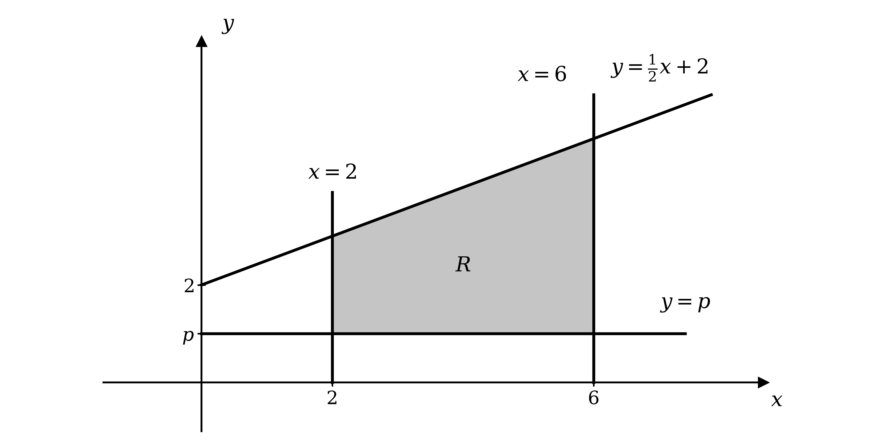

# Mark Schemes — Further Integration
**Integration** · Cambridge (CIE) AS maths (9709)

## Exam Questions (28 questions)

### Q1
(i)

Square both sides and expand the bracket

`y^{2} = \left(2x + 1\right)^{2} = 4x^{2} + 2x + 2x + 1`

Collect the two terms in $x$ to reach the required result

**Final answer:** $y^{2} = 4 x^{2} + 4 x + 1$** as required**

**[B1]**

(ii)

The volume formed by rotating a region through 360° about the $x$-axis is found using

`V = \pi \int_{a}^{b} y^{2} \,\text{d}x`

The region is bounded by $x = 2$ and $x = 4$, so these are the limits, and part (i) has already given $y^{2}$

`V = \pi \int_{2}^{4} \left(4x^{2} + 4x + 1\right) \,\text{d}x`

**[M1]**

Integrate each term by increasing its index by $1$ and dividing by the new index

`= \pi \left[\,\dfrac{4x^{3}}{3} + 2x^{2} + x\,\right]_{2}^{4}`

**[A1]**

Substitute the upper limit and then the lower limit into the integrated expression, and subtract

`= \pi \left[\left(\dfrac{4(4)^{3}}{3} + 2(4)^{2} + 4\right) - \left(\dfrac{4(2)^{3}}{3} + 2(2)^{2} + 2\right)\right]`

**[M1]**

Work out each bracket, writing both as thirds so they can be subtracted

`= \pi \left[\left(\dfrac{256}{3} + 36\right) - \left(\dfrac{32}{3} + 10\right)\right] = \pi \left(\dfrac{364}{3} - \dfrac{62}{3}\right)`

**Final answer:** $\frac{302π}{3}$** cubic units**

**[A1]**

> **[mark-scheme]**
> **B1**: Correct expansion of `\left(2x + 1\right)^{2}` leading to the given result $4 x^{2} + 4 x + 1$. The result is given to you, so your working must show the expansion, for example the middle step $4 x^{2} + 2 x + 2 x + 1$. Simply writing the answer down does not earn this mark.
> 
> **M1**: Correct use of `V = \pi \int y^{2} \,\text{d}x` with the limits $2$ and $4$, integrating $y^{2}$ rather than $y$. A missing $π$ at this stage is condoned.
> 
> **A1**: Fully correct integrated expression $\frac{4x^{3}}{3} + 2 x^{2} + x$.
> 
> **M1**: Correct substitution of the limits $4$ and $2$ into your integrated expression, with the value at the lower limit subtracted from the value at the upper limit.
> 
> **A1**: Correct volume $\frac{302π}{3}$ cubic units. Your final answer must include $π$. Answers which round to $316$ are also accepted.

### Q2
The shaded region lies above the $x$-axis between the two points where the curve crosses it, and the diagram gives these as $x = 1$ and $x = 6$, so they are the limits

`\text{Area} = \int_{1}^{6} \left(7x - x^{2} - 6\right) \,\text{d}x`

Integrate each term by increasing its index by $1$ and dividing by the new index

`= \left[\,\dfrac{7x^{2}}{2} - \dfrac{x^{3}}{3} - 6x\,\right]_{1}^{6}`

**[M1]**

Substitute the upper limit and then the lower limit into the integrated expression, and subtract

`= \left(\dfrac{7(6)^{2}}{2} - \dfrac{(6)^{3}}{3} - 6(6)\right) - \left(\dfrac{7(1)^{2}}{2} - \dfrac{(1)^{3}}{3} - 6(1)\right)`

**[M1]**

Work out each bracket, taking care with the signs when subtracting the negative lower value

`= \left(126 - 72 - 36\right) - \left(\dfrac{7}{2} - \dfrac{1}{3} - 6\right) = 18 - \left(-\dfrac{17}{6}\right)`

**Final answer:** $\frac{125}{6}$** square units**

**[A1]**

> **[mark-scheme]**
> **M1**: Correct integration of all three terms to give $\frac{7x^{2}}{2} - \frac{x^{3}}{3} - 6 x$.
> 
> **M1**: Correct substitution of the limits $6$ and $1$ into your integrated expression, with the value at the lower limit subtracted from the value at the upper limit. The limits are labelled on the diagram, so you are not required to solve $7 x - x^{2} - 6 = 0$ to find them.
> 
> **A1**: Correct area $\frac{125}{6}$ square units. The question asks for a fraction in its simplest terms, so a decimal answer is not accepted here.

### Q3
Expand the bracket, remembering that the minus sign in front of it changes the sign of every term inside

`x - \left(x^{2} - 8x + 18\right) = x - x^{2} + 8x - 18`

Collect the two terms in $x$

$9 x - x^{2} - 18$

**[B1]**

> **[mark-scheme]**
> **B1**: Correct simplified expression $9 x - x^{2} - 18$. Any equivalent correct ordering is accepted, for example $- x^{2} + 9 x - 18$.
The diagram gives the two points where the line meets the curve as $( 3 , 3 )$ and $( 6 , 6 )$, so the limits are $x = 3$ and $x = 6$

Between these limits the line lies above the curve, so the area is found by integrating (line $-$ curve), which is exactly the expression simplified in part (a)

`\text{Area} = \int_{3}^{6} \left(9x - x^{2} - 18\right) \,\text{d}x`

Integrate each term by increasing its index by $1$ and dividing by the new index

`= \left[\,\dfrac{9x^{2}}{2} - \dfrac{x^{3}}{3} - 18x\,\right]_{3}^{6}`

**[M1 A1]**

Substitute the upper limit and then the lower limit into the integrated expression, and subtract

`= \left(\dfrac{9(6)^{2}}{2} - \dfrac{(6)^{3}}{3} - 18(6)\right) - \left(\dfrac{9(3)^{2}}{2} - \dfrac{(3)^{3}}{3} - 18(3)\right)`

**[M1]**

Work out each bracket, taking care with the signs when subtracting the negative lower value

`= \left(162 - 72 - 108\right) - \left(\dfrac{81}{2} - 9 - 54\right) = -18 - \left(-\dfrac{45}{2}\right)`

**Final answer:** $\frac{9}{2}$** square units**

**[A1]**

> **[mark-scheme]**
> **M1**: A clear attempt to integrate, with the index of at least one term increased by $1$.
> 
> **A1**: Fully correct integrated expression $\frac{9x^{2}}{2} - \frac{x^{3}}{3} - 18 x$.
> 
> **M1**: Correct substitution of the limits $6$ and $3$ into your integrated expression, with the value at the lower limit subtracted from the value at the upper limit.
> 
> **A1**: Correct area $\frac{9}{2}$ square units. Your integrand must be (line $-$ curve). Integrating (curve $-$ line) gives $- \frac{9}{2}$, which does not earn this mark, since an area must be positive. The question asks for a fraction in its simplest terms, so a decimal answer is not accepted here.

### Q4
The rotation is about the $y$-axis, so the volume formula integrates $x^{2}$ with respect to $y$

`V = \pi \int_{a}^{b} x^{2} \,\text{d}y`

This means the equation of the curve has to be rearranged to give $x^{2}$ in terms of $y$

$y = x^{2} + 2 \Rightarrow x^{2} = y - 2$

**[M1]**

The region is bounded by the lines $y = 6$ and $y = 11$, so these are the limits

`V = \pi \int_{6}^{11} \left(y - 2\right) \,\text{d}y`

**[M1]**

Integrate with respect to $y$, increasing the index of each term by $1$ and dividing by the new index

`= \pi \left[\,\dfrac{y^{2}}{2} - 2y\,\right]_{6}^{11}`

**[A1]**

Substitute the upper limit and then the lower limit into the integrated expression, and subtract

`= \pi \left[\left(\dfrac{(11)^{2}}{2} - 2(11)\right) - \left(\dfrac{(6)^{2}}{2} - 2(6)\right)\right]`

**[M1]**

Work out each bracket

`= \pi \left[\left(\dfrac{121}{2} - 22\right) - \left(18 - 12\right)\right] = \pi \left(\dfrac{77}{2} - 6\right)`

**Final answer:** $\frac{65π}{2}$** cubic units**

**[A1]**

> **[mark-scheme]**
> **M1**: Correct rearrangement of the equation of the curve to give $x^{2} = y - 2$.
> 
> **M1**: Correct use of `V = \pi \int x^{2} \,\text{d}y` with the limits $6$ and $11$. A missing $π$ at this stage is condoned. Because the rotation is about the $y$-axis you must integrate $x^{2}$ with respect to $y$. Integrating $y^{2}$ with respect to $x$, or integrating before rearranging, earns no further marks.
> 
> **A1**: Fully correct integrated expression $\frac{y^{2}}{2} - 2 y$.
> 
> **M1**: Correct substitution of the limits $11$ and $6$ into your integrated expression, with the value at the lower limit subtracted from the value at the upper limit.
> 
> **A1**: Correct volume $\frac{65π}{2}$ cubic units. Your final answer must include $π$. Answers which round to $102$ are also accepted.

### Q5
The area between a curve and the $x$-axis is found by integrating the equation of the curve, and the two vertical lines give the limits

`\int_{1}^{2} \left(9 - x^{2}\right) \,\text{d}x`

**[B1 B1]**

> **[mark-scheme]**
> **B1**: Correct integrand $9 - x^{2}$, written with $\text{d} x$.
> 
> **B1**: Correct limits, with $1$ at the bottom of the integral sign and $2$ at the top.
> 
> You do not need to evaluate the integral to earn these marks.
To evaluate the integral, integrate each term by increasing its index by $1$ and dividing by the new index

`\int_{1}^{2} \left(9 - x^{2}\right) \,\text{d}x = \left[\,9x - \dfrac{x^{3}}{3}\,\right]_{1}^{2}`

**[M1]**

Substitute the upper limit and then the lower limit into the integrated expression, and subtract

`= \left(9(2) - \dfrac{(2)^{3}}{3}\right) - \left(9(1) - \dfrac{(1)^{3}}{3}\right)`

**[M1]**

Work out each bracket, writing both as thirds so they can be subtracted

`= \left(18 - \dfrac{8}{3}\right) - \left(9 - \dfrac{1}{3}\right) = \dfrac{46}{3} - \dfrac{26}{3}`

**Final answer:** $\frac{20}{3}$** square units**

**[A1]**

> **[mark-scheme]**
> **M1**: Correct integration of both terms to give $9 x - \frac{x^{3}}{3}$.
> 
> **M1**: Correct substitution of the limits $2$ and $1$ into your integrated expression, with the value at the lower limit subtracted from the value at the upper limit.
> 
> **A1**: Correct area $\frac{20}{3}$ square units. Answers which round to $6 . 67$ are also accepted.

### Q6
The diagram gives the points where the curve crosses the $x$-axis as $x = 2$ and $x = 6$, so these are the limits

Integrate each term by increasing its index by $1$ and dividing by the new index

`\int_{2}^{6} \left(x^{2} - 8x + 12\right) \,\text{d}x = \left[\,\dfrac{x^{3}}{3} - 4x^{2} + 12x\,\right]_{2}^{6}`

**[M1 A1]**

Substitute the upper limit and then the lower limit into the integrated expression, and subtract

`= \left(\dfrac{(6)^{3}}{3} - 4(6)^{2} + 12(6)\right) - \left(\dfrac{(2)^{3}}{3} - 4(2)^{2} + 12(2)\right)`

**[M1]**

Work out each bracket

`= \left(72 - 144 + 72\right) - \left(\dfrac{8}{3} - 16 + 24\right) = 0 - \dfrac{32}{3} = -\dfrac{32}{3}`

The region lies below the $x$-axis, which is why the integral has come out negative, so take the modulus to make the area positive

`\text{Area of } R = \left|-\dfrac{32}{3}\right|`

**Final answer:** $\frac{32}{3}$** square units**

**[A1]**

> **[mark-scheme]**
> **M1**: A clear attempt to integrate, with the index of at least one term increased by $1$.
> 
> **A1**: Fully correct integrated expression $\frac{x^{3}}{3} - 4 x^{2} + 12 x$.
> 
> **M1**: Correct substitution of the limits $6$ and $2$ into your integrated expression, with the value at the lower limit subtracted from the value at the upper limit.
> 
> **A1**: Correct area $\frac{32}{3}$ square units. Your final answer must be positive, so you also earn this mark if you work out $- \frac{32}{3}$ from the integral and then change it to $+ \frac{32}{3}$. If you leave your answer as $- \frac{32}{3}$ you do not earn this mark. The question asks for a fraction in its simplest form, so a decimal answer is not accepted here.

### Q7
The rotation is about the $y$-axis, so integrate $x^{2}$ with respect to $y$, which means the limits are $y$-values

The right-hand boundary of $R$ switches from one curve to the other where they meet, so find that point first

$x^{2} + 5 = 23 - x^{2} \Rightarrow 2 x^{2} = 18 \Rightarrow x^{2} = 9$

$x = 3 \Rightarrow y = 3^{2} + 5 = 14$

**[M1]**

Rearrange each curve to give $x^{2}$ in terms of $y$

$y = x^{2} + 5 \Rightarrow x^{2} = y - 5$

$y = 23 - x^{2} \Rightarrow x^{2} = 23 - y$

**[M1]**

The bottom of $R$ is the vertex of the first curve at $y = 5$ and the top is the vertex of the second at $y = 23$. The boundary changes at $y = 14$, so split the solid there and add the two pieces

Because the split is horizontal, each piece is integrated with respect to $y$ between its own pair of $y$-values

`V = \pi \int_{5}^{14} \left(y - 5\right) \,\text{d}y + \pi \int_{14}^{23} \left(23 - y\right) \,\text{d}y`

**[M1]**

Integrate each piece with respect to $y$

`= \pi \left[\,\dfrac{y^{2}}{2} - 5y\,\right]_{5}^{14} + \pi \left[\,23y - \dfrac{y^{2}}{2}\,\right]_{14}^{23}`

**[A1]**

Substitute the limits into each bracket and subtract

`= \pi \left[\left(98 - 70\right) - \left(\dfrac{25}{2} - 25\right)\right] + \pi \left[\left(529 - \dfrac{529}{2}\right) - \left(322 - 98\right)\right]`

**[M1]**

Work out each bracket, and the two pieces turn out to be equal

`= \pi \left(28 + \dfrac{25}{2}\right) + \pi \left(\dfrac{529}{2} - 224\right) = \dfrac{81\pi}{2} + \dfrac{81\pi}{2}`

**Final answer:** $81 π$** cubic units**

**[A1]**

> **[exam-tip]**
> The region has to be split at $y = 14$ because its right-hand boundary changes from one curve to the other there. A single integral would use the wrong curve over half the range.

> **[mark-scheme]**
> **M1**: Setting the two curves equal to each other to find where they meet, reaching $x = 3$ and hence $y = 14$.
> 
> **M1**: Correctly rearranging both curves to give $x^{2}$ in terms of $y$, so that $x^{2} = y - 5$ and $x^{2} = 23 - y$.
> 
> **M1**: Setting up two integrals with respect to $y$, split at $y = 14$, with the outer limits $5$ and $23$. A missing $π$ at this stage is condoned.
> 
> **A1**: Both integrated expressions correct.
> 
> **M1**: Correct substitution of the limits into your integrated expressions, with the value at the lower limit subtracted from the value at the upper limit.
> 
> **A1**: Correct volume $81 π$ cubic units. Your final answer must include $π$. Answers which round to $254$ are also accepted.
Both curves are symmetric about the $y$-axis, so $S$ is simply $R$ reflected in that axis

Think about what happens as the combined region turns. After only half a turn, $R$ has swept out one half of the solid and $S$ has swept out the other, so the whole solid from part (a) has already been produced

**Final answer:** **Rotating the combined region through only 180° already produces the whole solid found in part (a), because R sweeps out one half of it and S sweeps out the other**

**[B1]**

Carrying on all the way round to 360° therefore traverses that same solid a second time, so the student's integral counts it twice

**Final answer:** $I = 2 \times 81 π = 162 π$**, which is exactly twice the answer to part (a)**

**[B1]**

> **[mark-scheme]**
> **B1**: A correct explanation using the symmetry: that $S$ is the reflection of $R$ in the $y$-axis, so rotating the combined region through only 180° already sweeps out the whole solid from part (a).
> 
> **B1**: Correct conclusion that $I$ is twice the answer to part (a), $I = 162 π$.
> 
> The question asks you to fully explain your answer, so stating $I = 162 π$ on its own does not earn both marks. The symmetry argument has to be given as well.

### Q8
The diagram shows $R$ lying between $x = - 2$ and $x = 0$, so these are the limits

Integrate each term by increasing its index by $1$ and dividing by the new index

`\int_{-2}^{0} \left(4x - x^{3}\right) \,\text{d}x = \left[\,2x^{2} - \dfrac{x^{4}}{4}\,\right]_{-2}^{0}`

**[M1 A1]**

Substitute the limits, remembering that every term at the upper limit is zero, so only the lower limit contributes

`= 0 - \left(2(-2)^{2} - \dfrac{(-2)^{4}}{4}\right) = 0 - \left(8 - 4\right)`

**[M1]**

$= - 4$

$R$ lies below the $x$-axis, which is why the integral has come out negative, so take the modulus to make the area positive

`\text{Area of } R = \left|-4\right|`

**Final answer:** $4$** square units**

**[A1]**

> **[mark-scheme]**
> **M1**: A clear attempt to integrate, with the index of at least one term increased by $1$.
> 
> **A1**: Fully correct integrated expression $2 x^{2} - \frac{x^{4}}{4}$.
> 
> **M1**: Correct substitution of the limits $0$ and $- 2$ into your integrated expression, with the value at the lower limit subtracted from the value at the upper limit.
> 
> **A1**: Correct area $4$ square units. Because $R$ lies below the $x$-axis the integral gives $- 4$; you still earn this mark if you then change it to $+ 4$, but not if you leave your final answer negative.
The curve is built only from odd powers of $x$, so it has rotational symmetry about the origin, and the hump between $x = 0$ and $x = 2$ is exactly the region $R$ turned upside down

Integrating from $- 2$ to $2$ covers both of them, and because one lies below the axis and the other above it, they carry opposite signs

**Final answer:** **The region from 0 to 2 above the axis has the same area as the region from −2 to 0 below it (as the graph is symmetrical), so the two integrals are equal in size but opposite in sign and cancel to zero**

**[B1]**

> **[mark-scheme]**
> **B1**: Any correct explanation based on the symmetry of the curve: that the area above the $x$-axis between $0$ and $2$ equals the area below it between $- 2$ and $0$, so the two integrals are equal and opposite and cancel out.
> 
> The question says "without doing any additional calculation", so evaluating the integral does not earn this mark even if you reach zero. The reasoning must come from the symmetry.

### Q9
Squaring both sides shows why this really is a semicircle, because rearranging gives the equation of a circle of radius $r$ centred on the origin, and taking the positive square root keeps only its top half

$y = \sqrt{r^{2}-x^{2}} \Rightarrow y^{2} = r^{2} - x^{2} \Rightarrow x^{2} + y^{2} = r^{2}$

Spinning that semicircle through 360° about the $x$-axis sweeps out a whole sphere of radius $r$. The semicircle stretches from $x = - r$ across to $x = r$, so those are the limits

`V = \pi \int_{-r}^{r} y^{2} \,\text{d}x`

**[M1]**

The formula needs $y^{2}$, not $y$, and squaring the square root removes it completely, leaving a simple polynomial

`V = \pi \int_{-r}^{r} \left(r^{2} - x^{2}\right) \,\text{d}x`

**[M1]**

Integrate with respect to $x$, treating $r$ as a constant, so $r^{2}$ integrates to $r^{2} x$

`= \pi \left[\,r^{2}x - \dfrac{1}{3}x^{3}\,\right]_{-r}^{r}`

**[A1]**

Substitute the upper limit and then the lower limit into the integrated expression, and subtract

`= \pi \left(\left(r^{2}(r) - \dfrac{1}{3}(r)^{3}\right) - \left(r^{2}(-r) - \dfrac{1}{3}(-r)^{3}\right)\right)`

**[M1]**

Work out each bracket, taking care with the signs of the odd powers at the negative limit

`= \pi \left(\left(r^{3} - \dfrac{1}{3}r^{3}\right) - \left(-r^{3} + \dfrac{1}{3}r^{3}\right)\right) = \pi \left(\dfrac{2}{3}r^{3} - \left(-\dfrac{2}{3}r^{3}\right)\right)`

Subtracting the negative adds the two thirds together, giving the required formula

**Final answer:** $V = \frac{4}{3} π r^{3}$** as required**

**[A1]**

> **[mark-scheme]**
> **M1**: Correct use of `V = \pi \int y^{2} \,\text{d}x` with the limits $- r$ and $r$. The semicircle stretches from $x = - r$ to $x = r$, so those are the limits. A missing $π$ at this stage is condoned.
> 
> **M1**: Correctly squaring $y = \sqrt{r^{2}-x^{2}}$ to give $y^{2} = r^{2} - x^{2}$, so that the square root disappears. Integrating $y$ rather than $y^{2}$ earns no further marks.
> 
> **A1**: Fully correct integrated expression $r^{2} x - \frac{1}{3} x^{3}$. Treat $r$ as a constant throughout, since $x$ is the only variable being integrated.
> 
> **M1**: Correct substitution of the limits $r$ and $- r$ into your integrated expression, with the value at the lower limit subtracted from the value at the upper limit.
> 
> **A1**: Correct simplification to the given result $V = \frac{4}{3} π r^{3}$. The result is given to you, so every step of your working must be shown.
> 
> The semicircle is symmetric about the $y$-axis, so you can also use `V = 2\pi \int_{0}^{r} \left(r^{2} - x^{2}\right) \,\text{d}x`, which avoids the negative limit and gives the same result.

### Q10
The curves meet where their $y$-values are equal, so set the two equations equal to each other

$12 x - x^{2} - 27 = x^{2} - 14 x + 45$

Collect every term on one side

$2 x^{2} - 26 x + 72 = 0$

Take out the common factor of $2$, then factorise

`2\left(x^{2} - 13x + 36\right) = 0 \Rightarrow 2\left(x - 4\right)\left(x - 9\right) = 0`

**[M1]**

$x = 4$* and *$x = 9$

**[A1]**

$R$ is trapped between the two curves, so its area is the area under the upper curve minus the area under the lower curve, and the diagram shows $y = 12 x - x^{2} - 27$ on top all the way across

Write each of those two areas as its own integral

`\text{Area of } R = \int_{4}^{9} \left(12x - x^{2} - 27\right) \,\text{d}x - \int_{4}^{9} \left(x^{2} - 14x + 45\right) \,\text{d}x`

**[M1]**

The two integrals share the same limits, so they can be combined into a single integral

`= \int_{4}^{9} \left(\left(12x - x^{2} - 27\right) - \left(x^{2} - 14x + 45\right)\right) \,\text{d}x`

Remove the brackets, remembering that the minus sign changes the sign of every term in the second one, and collect

`= \int_{4}^{9} \left(-2x^{2} + 26x - 72\right) \,\text{d}x`

**[A1]**

Take the factor of $- 2$ outside the integral to keep the fractions manageable

`= -2 \int_{4}^{9} \left(x^{2} - 13x + 36\right) \,\text{d}x`

Integrate each term by increasing its index by $1$ and dividing by the new index

`= -2 \left[\,\dfrac{1}{3}x^{3} - \dfrac{13}{2}x^{2} + 36x\,\right]_{4}^{9}`

**[M1 A1]**

Substitute the upper limit and then the lower limit into the integrated expression, and subtract

`= -2 \left[\left(\dfrac{1}{3}(9)^{3} - \dfrac{13}{2}(9)^{2} + 36(9)\right) - \left(\dfrac{1}{3}(4)^{3} - \dfrac{13}{2}(4)^{2} + 36(4)\right)\right]`

**[M1]**

Work out each bracket

`= -2 \left(\dfrac{81}{2} - \dfrac{184}{3}\right) = -2 \times \left(-\dfrac{125}{6}\right)`

**Final answer:** $\frac{125}{3}$** square units**

**[A1]**

> **[exam-tip]**
> Part of $R$ lies below the $x$-axis, but that does not matter here and there is no modulus to take. Subtracting (upper $-$ lower) gives the height of the region at each value of $x$ whichever side of the axis it sits on. To see why, imagine sliding both curves upwards by the same amount $p$ until the whole region sat above the axis: the integral would become `\int \left(\left(y_{1} + p\right) - \left(y_{2} + p\right)\right) \,\text{d}x`, and the $p$ cancels, leaving exactly the integral you already had.

> **[mark-scheme]**
> **M1**: Setting the two equations equal to each other and rearranging to $2 x^{2} - 26 x + 72 = 0$, or the equivalent $x^{2} - 13 x + 36 = 0$, then attempting to solve.
> 
> **A1**: Both correct values $x = 4$ and $x = 9$.
> 
> **M1**: Correct subtraction of the two areas in the right order, taking the integral of the upper curve minus the integral of the lower curve, with the limits $4$ and $9$. Going straight to the combined form `\int \left(\text{upper} - \text{lower}\right) \,\text{d}x` is also accepted.
> 
> **A1**: Correct integrand $- 2 x^{2} + 26 x - 72$, or the equivalent `-2\left(x^{2} - 13x + 36\right)`.
> 
> **M1**: A clear attempt to integrate, with the index of at least one term increased by $1$.
> 
> **A1**: Fully correct integrated expression $\frac{1}{3} x^{3} - \frac{13}{2} x^{2} + 36 x$, or the equivalent without the $- 2$ taken outside.
> 
> **M1**: Correct substitution of the limits $9$ and $4$ into your integrated expression, with the value at the lower limit subtracted from the value at the upper limit.
> 
> **A1**: Correct area $\frac{125}{3}$ square units. Answers which round to $41 . 7$ are also accepted.

### Q11
Rearrange the sloping line into the form $y = m x + c$ so that it can be sketched

$2 y = x + 4 \Rightarrow y = \frac{1}{2} x + 2$

This line has gradient $\frac{1}{2}$ and crosses the $y$-axis at $2$. The lines $x = 2$ and $x = 6$ are vertical, and $y = p$ is horizontal, and because $0 < p < 2$ it must be drawn below the point where the sloping line crosses the $y$-axis

The region is enclosed between the two vertical lines, below the sloping line and above $y = p$

**[B1 B1 B1]**

> **[mark-scheme]**
> **B1**: The line $2 y = x + 4$ drawn correctly, rearranged to $y = \frac{1}{2} x + 2$ so that it crosses the $y$-axis at $2$.
> 
> **B1**: The lines $x = 2$, $x = 6$ and $y = p$ all drawn, with $y = p$ placed below $y = 2$ to match the condition $0 < p < 2$.
> 
> **B1**: The correct enclosed region shaded, bounded above by the sloping line, below by $y = p$, and on either side by $x = 2$ and $x = 6$.
> 
> All four boundaries are included in the region, so draw them as solid lines. Your sketch does not need to be to scale, but the position of $y = p$ relative to $y = 2$ does matter.

As the region spins about the $x$-axis, the sloping line sweeps out the outside of the solid while the line $y = p$ sweeps out a cylinder through its middle. So the volume is the outer solid with that cylinder removed, which means subtracting $p^{2}$ from the square of the outer radius

`V = \pi \int_{2}^{6} \left(\left(\dfrac{1}{2}x + 2\right)^{2} - p^{2}\right) \,\text{d}x`

**[M1]**

Expand the squared bracket before integrating

`\left(\dfrac{1}{2}x + 2\right)^{2} = \dfrac{1}{4}x^{2} + 2x + 4`

`V = \pi \int_{2}^{6} \left(\dfrac{1}{4}x^{2} + 2x + 4 - p^{2}\right) \,\text{d}x`

**[A1]**

Integrate with respect to $x$, treating $p$ as a constant, so $p^{2}$ integrates to $p^{2} x$

`= \pi \left[\,\dfrac{x^{3}}{12} + x^{2} + 4x - p^{2}x\,\right]_{2}^{6}`

**[M1]**

Substitute the upper limit and then the lower limit, and subtract

`= \pi \left[\left(18 + 36 + 24 - 6p^{2}\right) - \left(\dfrac{2}{3} + 4 + 8 - 2p^{2}\right)\right]`

Work out each bracket and collect the terms in $p^{2}$

`= \pi \left(78 - \dfrac{38}{3} - 6p^{2} + 2p^{2}\right)`

**Final answer:** `\left(\dfrac{196}{3} - 4p^{2}\right)\pi`** cubic units**

**[A1]**

> **[mark-scheme]**
> **M1**: Correct use of `V = \pi \int \left(\text{outer}^{2} - \text{inner}^{2}\right) \,\text{d}x` with the limits $2$ and $6$, that is, subtracting $p^{2}$ from the square of the sloping line. A missing $π$ at this stage is condoned.
> 
> **A1**: Correct expansion to $\frac{1}{4} x^{2} + 2 x + 4$ within the integral.
> 
> **M1**: A clear attempt to integrate, treating $p$ as a constant so that $p^{2}$ integrates to $p^{2} x$.
> 
> **A1**: Correct volume `\left(\dfrac{196}{3} - 4p^{2}\right)\pi` cubic units. Any equivalent form is accepted, for example $\frac{196π}{3} - 4 p^{2} π$.

(i)

The 'hole' is the space swept out by the line $y = p$, the part that was subtracted in part (b). It is found with the same volume formula, using $p$ as the radius

`V_{\text{hole}} = \pi \int_{2}^{6} p^{2} \,\text{d}x = \pi p^{2} \left[\,x\,\right]_{2}^{6} = \pi p^{2} \left(6 - 2\right)`

**[M1]**

**Final answer:** $4 p^{2} π$** cubic units**

**[A1]**

This is just the volume of a cylinder with radius $p$ and height $4$, which is a useful check

(ii)

Set the volume of the solid from part (b) equal to the volume of the hole, and $π$ cancels from both sides

`\left(\dfrac{196}{3} - 4p^{2}\right)\pi = 4p^{2}\pi \Rightarrow \dfrac{196}{3} - 4p^{2} = 4p^{2}`

**[M1]**

Collect the terms in $p^{2}$, then divide by $8$

$\frac{196}{3} = 8 p^{2} \Rightarrow p^{2} = \frac{196}{24} = \frac{49}{6}$

Take the square root

$p = \pm \sqrt{\frac{49}{6}} = \pm \frac{7}{\sqrt{6}} = \pm 2 . 857 \dots$

Both of these lie outside the interval the question allows

**Final answer:** **Neither value satisfies 0 < p < 2, so there are no values of p in the given interval for which the two volumes are equal as required**

**[A1]**

> **[mark-scheme]**
> **M1**: Correct use of `V = \pi \int p^{2} \,\text{d}x` with the limits $2$ and $6$, treating $p$ as a constant.
> 
> **A1**: Correct volume of the hole, $4 p^{2} π$ cubic units. Recognising it directly as a cylinder of radius $p$ and height $4$, giving $π p^{2} \times 4$, is equally acceptable and earns both marks.
> 
> **M1**: Setting your answer to part (b) equal to your answer to part (c)(i) and rearranging to find $p^{2}$.
> 
> **A1**: Correct $p = \pm 2 . 857 \dots$ (or exactly $\pm \frac{7\sqrt{6}}{6}$), together with the conclusion that neither lies in $0 < p < 2$, so no such $p$ exists. The result is given to you, so the rejection must be stated explicitly. Finding the values alone does not complete the argument.

### Q12
The limits are the points where the curve crosses the $x$-axis, so start by factorising the cubic to find its roots

The four terms pair up neatly, with $x^{2}$ common to the first two and $- 1$ common to the last two

`x^{3} - 2x^{2} - x + 2 = x^{2}\left(x - 2\right) - 1\left(x - 2\right)`

Now `\left(x - 2\right)` is a common factor of both halves

`= \left(x - 2\right)\left(x^{2} - 1\right)`

The second bracket is a difference of two squares

`= \left(x - 2\right)\left(x - 1\right)\left(x + 1\right)`

**[M1]**

Setting each factor to zero gives the roots

$x = - 1$*, *$x = 1$* and *$x = 2$

**[A1]**

The diagram shows the two shaded regions lying on opposite sides of the $x$-axis, so they must be integrated separately, because a single integral from $- 1$ to $2$ would let the negative part cancel some of the positive part

For the first region, integrate from $x = - 1$ to $x = 1$

`I_{1} = \int_{-1}^{1} \left(x^{3} - 2x^{2} - x + 2\right) \,\text{d}x = \left[\,\dfrac{1}{4}x^{4} - \dfrac{2}{3}x^{3} - \dfrac{1}{2}x^{2} + 2x\,\right]_{-1}^{1}`

**[M1 A1]**

Substitute the upper limit and then the lower limit, and subtract

`= \dfrac{13}{12} - \left(-\dfrac{19}{12}\right) = \dfrac{32}{12} = \dfrac{8}{3}`

**[M1]**

For the second region, integrate the same expression from $x = 1$ to $x = 2$

`I_{2} = \left[\,\dfrac{1}{4}x^{4} - \dfrac{2}{3}x^{3} - \dfrac{1}{2}x^{2} + 2x\,\right]_{1}^{2} = \dfrac{2}{3} - \dfrac{13}{12} = -\dfrac{5}{12}`

**[A1]**

$I_{2}$ has come out negative because that region lies below the $x$-axis, so take its modulus before combining, because it is the two areas that add, not the two integrals

`\text{Total area} = I_{1} + \left|I_{2}\right| = \dfrac{8}{3} + \dfrac{5}{12} = \dfrac{32}{12} + \dfrac{5}{12}`

**[M1]**

**Final answer:** $\frac{37}{12}$** square units**

**[A1]**

> **[mark-scheme]**
> **M1**: A clear attempt to factorise the cubic. Grouping the terms in pairs is the quickest route, `x^{2}\left(x - 2\right) - 1\left(x - 2\right)`, but any correct factorisation is accepted.
> 
> **A1**: All three correct roots $x = - 1$, $x = 1$ and $x = 2$.
> 
> **M1**: A clear attempt to integrate, with the index of at least one term increased by $1$.
> 
> **A1**: Fully correct integrated expression $\frac{1}{4} x^{4} - \frac{2}{3} x^{3} - \frac{1}{2} x^{2} + 2 x$.
> 
> **M1**: Correct substitution of limits into your integrated expression, with the value at the lower limit subtracted from the value at the upper limit. This mark is available from either region.
> 
> **A1**: Both integrals correct, $I_{1} = \frac{8}{3}$ and $I_{2} = - \frac{5}{12}$.
> 
> **M1**: Combining the two results as areas, taking the modulus of the negative one before adding. Adding the two integrals as they stand gives $\frac{8}{3} - \frac{5}{12} = \frac{27}{12}$, which is the difference of the integrals, not the total area.
> 
> **A1**: Correct total area $\frac{37}{12}$ square units. Answers which round to $3 . 08$ are also accepted.
> 
> Integrating straight through from $- 1$ to $2$ in one go is the main trap, because the region below the axis would cancel part of the region above it.

### Q13
The shaded region is bounded above by the line and below by the $x$-axis, but at each end the curve rises above the $x$-axis and cuts a piece out of it

So find the area under the line first, then subtract the two pieces the curve takes away

Start by finding where the curve crosses the $x$-axis, since those are the ends of the two pieces

`3x^{2} - 8x - 16 = 0 \Rightarrow \left(3x + 4\right)\left(x - 4\right) = 0`

**[M1]**

$x = - \frac{4}{3}$* and *$x = 4$

**[A1]**

Next find where the line meets the curve, by substituting the curve's equation into the line's

`4\left(3x^{2} - 8x - 16\right) = 4x + 17`

Expand and rearrange so that the quadratic equals zero

$12 x^{2} - 36 x - 81 = 0$

Divide through by $3$ to make the numbers smaller, then factorise

`4x^{2} - 12x - 27 = 0 \Rightarrow \left(2x + 3\right)\left(2x - 9\right) = 0`

**[M1]**

$x = - \frac{3}{2}$* and *$x = \frac{9}{2}$

**[A1]**

Substitute each into the equation of the line, $y = x + \frac{17}{4}$, to get the height at each end

$y = - \frac{3}{2} + \frac{17}{4} = \frac{11}{4}$

$y = \frac{9}{2} + \frac{17}{4} = \frac{35}{4}$

**[A1]**

With all four values known, the decomposition can be drawn: the shaded region is equal to a trapezium, subtract the two sections that are "cut-out", labelled $I_{1}$ and $I_{2}$

The area under the line between these two points is a trapezium, whose parallel sides are the two heights just found and whose width is the distance between them

`\text{Width} = \dfrac{9}{2} - \left(-\dfrac{3}{2}\right) = 6`

`\text{Area of trapezium} = \dfrac{1}{2} \times 6 \times \left(\dfrac{11}{4} + \dfrac{35}{4}\right)`

**[M1]**

$= 3 \times \frac{46}{4} = \frac{69}{2}$

**[A1]**

Now deal with the two pieces the curve cuts out. Integrate the curve once, since the same integrated expression serves for both

`\int \left(3x^{2} - 8x - 16\right) \,\text{d}x = x^{3} - 4x^{2} - 16x`

**[M1]**

The right-hand piece runs from where the curve crosses the axis at $x = 4$ up to the intersection at $x = \frac{9}{2}$

`I_{1} = \left[\,x^{3} - 4x^{2} - 16x\,\right]_{4}^{\frac{9}{2}} = -\dfrac{495}{8} - \left(-64\right) = \dfrac{17}{8}`

The left-hand piece runs from the intersection at $x = - \frac{3}{2}$ across to where the curve crosses the axis at $x = - \frac{4}{3}$

`I_{2} = \left[\,x^{3} - 4x^{2} - 16x\,\right]_{-\frac{3}{2}}^{-\frac{4}{3}} = \dfrac{320}{27} - \dfrac{93}{8} = \dfrac{49}{216}`

**[A1]**

Subtract both pieces from the trapezium, writing everything over a common denominator of $216$

$\text{Shaded area} = \frac{69}{2} - \frac{17}{8} - \frac{49}{216} = \frac{7452}{216} - \frac{459}{216} - \frac{49}{216}$

**[M1]**

$= \frac{6944}{216}$

Divide the numerator and the denominator by $8$ to simplify

**Final answer:** $\frac{868}{27}$** square units**

**[A1]**

> **[mark-scheme]**
> **M1**: Attempting to solve $3 x^{2} - 8 x - 16 = 0$ to find where the curve crosses the $x$-axis.
> 
> **A1**: Both correct, $x = - \frac{4}{3}$ and $x = 4$.
> 
> **M1**: Setting the line equal to the curve and rearranging to a three-term quadratic, then attempting to solve. Multiplying the curve by $4$ (rather than dividing the line by $4$) keeps the numbers whole.
> 
> **A1**: Both correct, $x = - \frac{3}{2}$ and $x = \frac{9}{2}$.
> 
> **A1**: Both correct heights, $y = \frac{11}{4}$ and $y = \frac{35}{4}$.
> 
> **M1**: Correct method for the trapezium under the line: half the width times the sum of the two heights.
> 
> **A1**: Correct trapezium area $\frac{69}{2}$.
> 
> **M1**: A clear attempt to integrate the curve, with the index of at least one term increased by $1$.
> 
> **A1**: Both end-pieces correct, $I_{1} = \frac{17}{8}$ and $I_{2} = \frac{49}{216}$.
> 
> **M1**: Subtracting both end-pieces from your trapezium.
> 
> **A1**: Correct exact area $\frac{868}{27}$ square units. The question asks for the exact area, so a decimal answer is not accepted here.
> 
> The key to this question is reading the diagram carefully. The shaded region is not simply the area between the line and the curve: the $x$-axis forms its lower boundary across the middle, and the curve only cuts into it at the two ends.

### Q14
The bowl is the part of the curve between the two given levels, spun around the $y$-axis, with a flat bottom added at the lower level. A cross-section shows what is being rotated

The rotation is about the $y$-axis, so the volume formula integrates $x^{2}$ with respect to $y$, which means the limits must be the two $y$-values given

`V = \pi \int_{8}^{9} x^{2} \,\text{d}y`

This can only be integrated once $x^{2}$ is written as a function of $y$, so rearrange the equation of the curve

$y = \frac{1}{a} x^{2} \Rightarrow x^{2} = a y$

**[M1]**

Substitute this in, noting that $a$ is a constant, so it can come outside the integral

`V = \pi \int_{8}^{9} ay \,\text{d}y = a\pi \left[\,\dfrac{1}{2}y^{2}\,\right]_{8}^{9}`

**[A1]**

Substitute the upper limit and then the lower limit into the integrated expression, and subtract

`= a\pi \left(\dfrac{(9)^{2}}{2} - \dfrac{(8)^{2}}{2}\right) = a\pi \left(\dfrac{81}{2} - \dfrac{64}{2}\right)`

**[M1]**

**Final answer:** $\frac{17aπ}{2}$** cubic units**

**[A1]**

> **[mark-scheme]**
> **M1**: Correct rearrangement to $x^{2} = a y$, used with `V = \pi \int x^{2} \,\text{d}y` and the limits $8$ and $9$. A missing $π$ at this stage is condoned. Because the rotation is about the $y$-axis, the limits must be $y$-values and you must integrate $x^{2}$ with respect to $y$.
> 
> **A1**: Fully correct integrated expression $\frac{1}{2} a y^{2}$, or any equivalent form.
> 
> **M1**: Correct substitution of the limits $9$ and $8$ into your integrated expression, with the value at the lower limit subtracted from the value at the upper limit.
> 
> **A1**: Correct capacity $\frac{17aπ}{2}$ cubic units. Any equivalent form is accepted, for example $8 . 5 a π$ or $\frac{17}{2} a π$.
Only the limits change, so the same integral can be reused with $3$ and $6$ in place of $8$ and $9$

`V_{\text{new}} = a\pi \left[\,\dfrac{1}{2}y^{2}\,\right]_{3}^{6} = a\pi \left(\dfrac{36}{2} - \dfrac{9}{2}\right) = \dfrac{27a\pi}{2}`

**[M1]**

The increase is the new capacity minus the capacity from part (a), and the question states this increase is $15 π$

$\frac{27aπ}{2} - \frac{17aπ}{2} = 15 π$

**[M1]**

Simplify the left-hand side

$5 a π = 15 π$

Divide both sides by $5 π$

$a = 3$

**[A1]**

> **[mark-scheme]**
> **M1**: Correct capacity with the new limits, $\frac{27aπ}{2}$.
> 
> **M1**: Setting up the equation for the increase: your new capacity minus your answer to part (a), set equal to $15 π$.
> 
> **A1**: Correct value $a = 3$. Note that $π$ cancels from both sides, so the answer does not involve $π$.
The model treats the bowl as being exactly the solid of revolution, so the material the bowl is made from is taken to occupy no space at all

**Final answer:** **The thickness of the walls and the bottom of the bowl can be ignored**

**[B1]**

> **[mark-scheme]**
> **B1**: Any correct statement that the bowl's thickness is ignored, for example that the walls and base are assumed to have no thickness, or that the bowl is assumed to be infinitely thin. A real bowl's walls take up space, so its true capacity would be a little less than this model gives.

### Q15
The top of the shaded region changes from the line to the curve where the two meet, so find that point first

$x + 2 = 10 x - x^{2} - 16$

Rearrange so that the quadratic equals zero, then factorise

`x^{2} - 9x + 18 = 0 \Rightarrow \left(x - 3\right)\left(x - 6\right) = 0`

**[M1]**

$x = 3 \text{or} x = 6$

The diagram shows the boundary changing over at the right-hand crossing, `\left(6, 8\right)`

**[A1]**

The region ends where the curve comes down to the $x$-axis, so set $y = 0$

$10 x - x^{2} - 16 = 0$

Rearrange so that the quadratic equals zero, then factorise

`x^{2} - 10x + 16 = 0 \Rightarrow \left(x - 2\right)\left(x - 8\right) = 0`

**[M1]**

$x = 2 \text{or} x = 8$

The diagram shows the region ending at the right-hand root

**[A1]**

So the region splits at $x = 6$ into two pieces: under the line from $x = 0$ to $x = 6$, and under the curve from $x = 6$ to $x = 8$

The first piece is a trapezium, so it needs no integration: its parallel sides are the heights of the line at $x = 0$ and $x = 6$, and its width is the distance between them

`\text{Area of trapezium} = \dfrac{1}{2} \times 6 \times \left(2 + 8\right) = 30`

**[M1]**

For the second piece, integrate the curve between $x = 6$ and $x = 8$

`I = \int_{6}^{8} \left(10x - x^{2} - 16\right) \,\text{d}x = \left[\,5x^{2} - \dfrac{x^{3}}{3} - 16x\,\right]_{6}^{8}`

**[M1 A1]**

Substitute the upper limit and then the lower limit into the integrated expression, and subtract

`= \left(320 - \dfrac{512}{3} - 128\right) - \left(180 - 72 - 96\right)`

**[M1]**

Work out each bracket

$= \frac{64}{3} - 12 = \frac{28}{3}$

**[A1]**

Both pieces sit above the $x$-axis, so the two areas simply add

$\text{Area} = \frac{28}{3} + 30 = \frac{28}{3} + \frac{90}{3}$

**[M1]**

**Final answer:** $\frac{118}{3}$** square units**

**[A1]**

> **[mark-scheme]**
> **M1**: Setting the line equal to the curve and rearranging to $x^{2} - 9 x + 18 = 0$, then attempting to solve.
> 
> **A1**: Correct $x = 6$ for the point where the boundary changes from the line to the curve. Solving also gives $x = 3$, which is the other point where the line crosses the curve, but between $x = 3$ and $x = 6$ the curve rises above the line and that part is not shaded, so it is not where the boundary changes.
> 
> **M1**: Setting the curve equal to zero and rearranging to $x^{2} - 10 x + 16 = 0$, then attempting to solve.
> 
> **A1**: Correct $x = 8$ for the right-hand end of the region. Solving also gives $x = 2$, which is where the curve first crosses the $x$-axis and is not needed here.
> 
> **M1**: Correct area of the trapezium under the line, `\dfrac{1}{2} \times 6 \times \left(2 + 8\right) = 30`. You can instead integrate the line, `\int_{0}^{6} \left(x + 2\right) \,\text{d}x`, which gives the same $30$, but the trapezium is quicker.
> 
> **M1**: A clear attempt to integrate the curve, with the index of at least one term increased by $1$.
> 
> **A1**: Fully correct integrated expression $5 x^{2} - \frac{x^{3}}{3} - 16 x$.
> 
> **M1**: Correct substitution of the limits $8$ and $6$ into your integrated expression, with the value at the lower limit subtracted from the value at the upper limit.
> 
> **A1**: Correct value of the integral, $\frac{28}{3}$.
> 
> **M1**: Adding the two pieces together. Both lie above the $x$-axis, so their areas add. There is no modulus to take here.
> 
> **A1**: Correct exact area $\frac{118}{3}$ square units. The question asks for the exact area, so a decimal answer is not accepted here.

### Q16
The curves meet where their $y$-values are equal, so set the two equations equal to each other

$x^{3} + 3 = - x^{3} + 2 x + 3$

Collect every term on one side, noting that the $3$s cancel

$2 x^{3} - 2 x = 0$

Factorise, taking out the common factor of $2 x$, then use the difference of two squares

`2x\left(x^{2} - 1\right) = 0 \Rightarrow 2x\left(x - 1\right)\left(x + 1\right) = 0`

**[M1]**

Each factor gives a solution

**Final answer:** $x = - 1$**, **$x = 0$** and **$x = 1$

**[A1]**

> **[mark-scheme]**
> **M1**: Setting the two equations equal to each other, rearranging to $2 x^{3} - 2 x = 0$, and attempting to factorise or solve.
> 
> **A1**: All three correct values $x = - 1$, $x = 0$ and $x = 1$. Dividing through by $2 x$ rather than factorising loses the solution $x = 0$, so factorise instead.

There are two separate shaded regions, meeting at $x = 0$, and the curves swap over there, so each region needs its own integral

The diagram shows $y = x^{3} + 3$ on top between $x = - 1$ and $x = 0$, and $y = - x^{3} + 2 x + 3$ on top between $x = 0$ and $x = 1$. Subtracting (upper $-$ lower) for each region separately keeps both integrals positive, so no modulus is needed

`\text{Total area} = \int_{-1}^{0} \left(\left(x^{3} + 3\right) - \left(-x^{3} + 2x + 3\right)\right) \,\text{d}x + \int_{0}^{1} \left(\left(-x^{3} + 2x + 3\right) - \left(x^{3} + 3\right)\right) \,\text{d}x`

**[M1]**

Simplify each integrand, noting that the $3$s cancel in both

`= \int_{-1}^{0} \left(2x^{3} - 2x\right) \,\text{d}x + \int_{0}^{1} \left(-2x^{3} + 2x\right) \,\text{d}x`

**[A1]**

Integrate each term by increasing its index by $1$ and dividing by the new index

`= \left[\,\dfrac{1}{2}x^{4} - x^{2}\,\right]_{-1}^{0} + \left[\,-\dfrac{1}{2}x^{4} + x^{2}\,\right]_{0}^{1}`

**[M1]**

Substitute the limits into each bracket, remembering that every term at $x = 0$ is zero, so only the other limit contributes to each

`= \left(0 - \left(\dfrac{1}{2} - 1\right)\right) + \left(\left(-\dfrac{1}{2} + 1\right) - 0\right)`

`= \left(0 - \left(-\dfrac{1}{2}\right)\right) + \left(\dfrac{1}{2} - 0\right) = \dfrac{1}{2} + \dfrac{1}{2}`

**[A1]**

Add the two pieces

**Final answer:** $1$** square unit**

**[A1]**

> **[mark-scheme]**
> **M1**: Forming the difference of the two curves for at least one of the two regions, using the correct limits from part (a).
> 
> **A1**: Both integrands correct: $2 x^{3} - 2 x$ for the region from $- 1$ to $0$, and $- 2 x^{3} + 2 x$ for the region from $0$ to $1$.
> 
> **M1**: A clear attempt to integrate, with the index of at least one term increased by $1$, and the limits substituted.
> 
> **A1**: Correct value $\frac{1}{2}$ for each of the two regions.
> 
> **A1**: Correct total area $1$ square unit.
> 
> The curves swap over at $x = 0$, so which one is on top changes between the two regions, and you must subtract them in the opposite order for each. Subtracting in the same order throughout gives $- \frac{1}{2} + \frac{1}{2} = 0$, because the two regions are the same size and cancel each other out. If you do work in one fixed order, take the modulus of each region's value before adding them.

### Q17
The rotation is about the $x$-axis, so integrate $y^{2}$ with respect to $x$, between the two vertical lines that bound the region

`V = \pi \int_{1}^{6} y^{2} \,\text{d}x = \pi \int_{1}^{6} \left(\dfrac{1}{a}x^{2}\right)^{2} \,\text{d}x`

**[M1]**

Square the whole bracket, so that the $\frac{1}{a}$ gets squared as well as the $x^{2}$. Since $a$ is a constant, $\frac{π}{a^{2}}$ can then come outside the integral

`= \pi \int_{1}^{6} \dfrac{1}{a^{2}}x^{4} \,\text{d}x = \dfrac{\pi}{a^{2}} \left[\,\dfrac{1}{5}x^{5}\,\right]_{1}^{6}`

Substitute the upper limit and then the lower limit into the integrated expression, and subtract

`= \dfrac{\pi}{a^{2}} \left(\dfrac{(6)^{5}}{5} - \dfrac{(1)^{5}}{5}\right) = \dfrac{\pi}{a^{2}} \left(\dfrac{7776}{5} - \dfrac{1}{5}\right) = \dfrac{1555\pi}{a^{2}}`

**[A1]**

The question gives the value of this volume, so set the two expressions equal, and $π$ cancels from both sides

$\frac{1555π}{a^{2}} = \frac{311π}{20} \Rightarrow \frac{1555}{a^{2}} = \frac{311}{20}$

Rearrange to make $a^{2}$ the subject, and notice that $1555 \div 311 = 5$

$a^{2} = \frac{1555\times20}{311} = 5 \times 20 = 100$

**[M1]**

Take the square root, which gives two values, but the question states that $a$ is positive

$a = \pm 10$

$a = 10$

**[A1]**

> **[mark-scheme]**
> **M1**: Correct use of `V = \pi \int y^{2} \,\text{d}x` with the limits $1$ and $6$, squaring the equation of the curve to give $\frac{x^{4}}{a^{2}}$. A missing $π$ at this stage is condoned. Take care to square the $\frac{1}{a}$ as well as the $x^{2}$. Squaring only the $x^{2}$ gives $\frac{x^{4}}{a}$ and loses every mark after this one.
> 
> **A1**: Correct volume in terms of $a$, $\frac{1555π}{a^{2}}$.
> 
> **M1**: Setting your volume equal to $\frac{311π}{20}$ and rearranging to find $a^{2}$. Note that $π$ cancels from both sides.
> 
> **A1**: Correct value $a = 10$. Taking the square root gives $a = \pm 10$, but the question states that $a$ is a positive constant, so $a = - 10$ must be rejected. An answer of $\pm 10$ does not earn this mark.

### Q18
Both equations are given in the form $5 y = \dots$, so where the line meets the curve their right-hand sides must be equal, which avoids having to divide by $5$ at this stage

$14 - 3 x = 20 - 2 x - x^{2}$

Rearrange so that the quadratic equals zero

$x^{2} - x - 6 = 0$

**[M1 A1]**

Factorise

`\left(x + 2\right)\left(x - 3\right) = 0 \Rightarrow x = -2 \text{ or } x = 3`

**[A1]**

Substitute each value into the equation of the line to find its $y$-coordinate

$5 y = 14 - 3 ( - 2 ) = 20 \Rightarrow y = 4$

$5 y = 14 - 3 ( 3 ) = 5 \Rightarrow y = 1$

**[M1]**

The diagram places $P$ at the upper left and $Q$ at the lower right

**Final answer:** `P\left(-2, 4\right)`** and **`Q\left(3, 1\right)`

**[A1]**

> **[mark-scheme]**
> **M1**: Setting the two right-hand sides equal to each other and rearranging to a three-term quadratic.
> 
> **A1**: Correct quadratic $x^{2} - x - 6 = 0$.
> 
> **A1**: Both correct values $x = - 2$ and $x = 3$.
> 
> **M1**: Substituting your $x$-values into either equation to find the corresponding $y$-values.
> 
> **A1**: Both correct points, `P\left(-2, 4\right)` and `Q\left(3, 1\right)`. Either equation gives the same $y$-values, since $P$ and $Q$ lie on both graphs, but substituting into the line is quicker. Accept the coordinates written as $x = - 2$, $y = 4$ and $x = 3$, $y = 1$.
$R$ is the gap between the curve above and the line below, running from $x = - 2$ to $x = 3$. So find the area under the curve and take away the area under the line, which needs no integration at all because it is just a trapezium

First rearrange the curve's equation to make $y$ the subject

`5y = 20 - 2x - x^{2} \Rightarrow y = \dfrac{1}{5}\left(20 - 2x - x^{2}\right)`

Integrate the curve between the two intersection points, taking the $\frac{1}{5}$ outside the integral

`I = \int_{-2}^{3} \dfrac{1}{5}\left(20 - 2x - x^{2}\right) \,\text{d}x = \dfrac{1}{5}\int_{-2}^{3} \left(20 - 2x - x^{2}\right) \,\text{d}x`

**[M1]**

Integrate each term by increasing its index by $1$ and dividing by the new index

`= \dfrac{1}{5}\left[\,20x - x^{2} - \dfrac{x^{3}}{3}\,\right]_{-2}^{3}`

**[A1]**

Substitute the upper limit and then the lower limit into the integrated expression, and subtract

`= \dfrac{1}{5}\left[\left(60 - 9 - 9\right) - \left(-40 - 4 + \dfrac{8}{3}\right)\right] = \dfrac{1}{5}\left(42 - \left(-\dfrac{124}{3}\right)\right)`

**[M1]**

$I = \frac{1}{5} \times \frac{250}{3} = \frac{50}{3}$

**[A1]**

The area under the line is a trapezium, whose two parallel sides are the vertical heights at $x = - 2$ and $x = 3$, which are the $y$-coordinates of $P$ and $Q$, and its width is the distance between them

`\text{Area of trapezium} = \dfrac{1}{2} \times 5 \times \left(4 + 1\right) = \dfrac{25}{2}`

**[M1]**

Subtract the trapezium from the area under the curve, writing both as sixths

$\text{Area of} R = \frac{50}{3} - \frac{25}{2} = \frac{100}{6} - \frac{75}{6}$

**Final answer:** $\frac{25}{6}$** square units**

**[A1]**

> **[mark-scheme]**
> **M1**: Rearranging the curve to `y = \dfrac{1}{5}\left(20 - 2x - x^{2}\right)` and forming the integral with the limits $- 2$ and $3$.
> 
> **A1**: Fully correct integrated expression `\dfrac{1}{5}\left(20x - x^{2} - \dfrac{x^{3}}{3}\right)`.
> 
> **M1**: Correct substitution of the limits $3$ and $- 2$ into your integrated expression, with the value at the lower limit subtracted from the value at the upper limit.
> 
> **A1**: Correct area under the curve, $I = \frac{50}{3}$.
> 
> **M1**: Correct area under the line, found as the trapezium `\dfrac{1}{2} \times 5 \times \left(4 + 1\right) = \dfrac{25}{2}`.
> 
> **A1**: Correct exact area $\frac{25}{6}$ square units, so $a = 25$ and $b = 6$. The question asks for an exact fraction, so a decimal answer is not accepted here.
> 
> Alternative method: you can instead integrate (curve $-$ line) directly. Subtracting the equations gives $5 y = 6 + x - x^{2}$, so the area is `\int_{-2}^{3} \dfrac{1}{5}\left(6 + x - x^{2}\right) \,\text{d}x`, which comes to the same $\frac{25}{6}$. You earn the marks in the same order: forming the integral, integrating it, substituting the limits, and reaching the final fraction.

### Q19
The diagram shows the shaded region running from the origin to $x = 2$, so these are the limits, and the region lies above the $x$-axis so the integral will be positive

`\text{Area of } R = \int_{0}^{2} \left(2x + 3x^{2} - 2x^{3}\right) \,\text{d}x`

Integrate each term by increasing its index by $1$ and dividing by the new index

`= \left[\,\dfrac{2x^{2}}{2} + \dfrac{3x^{3}}{3} - \dfrac{2x^{4}}{4}\,\right]_{0}^{2} = \left[\,x^{2} + x^{3} - \dfrac{1}{2}x^{4}\,\right]_{0}^{2}`

**[M1 A1]**

Substitute the limits, remembering that every term at the lower limit is zero, so only the upper limit contributes

`= \left(\left(2\right)^{2} + \left(2\right)^{3} - \dfrac{1}{2}\left(2\right)^{4}\right) - 0`

**[M1]**

Work out each term

$= 4 + 8 - 8$

**Final answer:** $4$** square units**

**[A1]**

> **[mark-scheme]**
> **M1**: A clear attempt to integrate, with the index of at least one term increased by $1$.
> 
> **A1**: Fully correct integrated expression $x^{2} + x^{3} - \frac{1}{2} x^{4}$, or any equivalent form such as $x^{2} + x^{3} - \frac{x^{4}}{2}$.
> 
> **M1**: Correct substitution of the limits $2$ and $0$ into your integrated expression.
> 
> **A1**: Correct area $4$ square units.

### Q20
The hypotenuse runs from the origin to the point `\left(h, r\right)`, so use those two points to find its gradient

$\text{Gradient} = \frac{r-0}{h-0} = \frac{r}{h}$

**[M1]**

The line passes through the origin, so there is no constant term to add

$y = \frac{r}{h} x$

**[A1]**

> **[mark-scheme]**
> **M1**: Correct gradient $\frac{r}{h}$, found from the origin and the point `\left(h, r\right)`.
> 
> **A1**: Correct equation $y = \frac{r}{h} x$. Because the line passes through the origin there is no constant term. Any equivalent form is accepted, for example $y = \frac{rx}{h}$.
Rotating the triangle about the $x$-axis sweeps out a cone lying on its side, with base radius $r$ and perpendicular height $h$. The rotation is about the $x$-axis, so integrate $y^{2}$ with respect to $x$ between the origin and $x = h$, using the line from part (a) for $y$

`V = \pi \int_{0}^{h} y^{2} \,\text{d}x = \pi \int_{0}^{h} \left(\dfrac{r}{h}x\right)^{2} \,\text{d}x`

**[M1]**

Square the bracket. Both $r$ and $h$ are constants, so $\frac{πr^{2}}{h^{2}}$ can come outside the integral, leaving only $x^{2}$ to integrate

`= \int_{0}^{h} \dfrac{\pi r^{2}}{h^{2}}x^{2} \,\text{d}x = \dfrac{\pi r^{2}}{h^{2}} \left[\,\dfrac{1}{3}x^{3}\,\right]_{0}^{h}`

Substitute the limits, noting that the lower limit gives zero

`= \dfrac{\pi r^{2}}{h^{2}} \left(\dfrac{1}{3}h^{3} - 0\right)`

**[M1]**

Cancel $h^{2}$ from the top and bottom, leaving a single power of $h$ and giving the required formula

**Final answer:** $V = \frac{1}{3} π r^{2} h$** as required**

**[A1]**

> **[mark-scheme]**
> **M1**: Correct use of `V = \pi \int y^{2} \,\text{d}x` with $y$ replaced by your answer to part (a), and the limits $0$ and $h$. A missing $π$ at this stage is condoned. You must square the equation of the line.
> 
> **M1**: Correct integration to $\frac{πr^{2}}{h^{2}} \times \frac{1}{3} x^{3}$, with the limits substituted. Treat $r$ and $h$ as constants throughout, since $x$ is the only variable being integrated.
> 
> **A1**: Correct simplification, cancelling $h^{2}$ to reach the given result $V = \frac{1}{3} π r^{2} h$. The result is given to you, so every step of your working must be shown. A final answer with no working earns nothing here.

### Q21
Expand the brackets first, so that the curve can be integrated term by term

`\left(x - 1\right)\left(x + 2\right) = x^{2} + 2x - x - 2 = x^{2} + x - 2`

`y = x\left(x^{2} + x - 2\right) = x^{3} + x^{2} - 2x`

**[B1]**

By inspection of the factorised form, the roots are $x = - 2$, $x = 0$ and $x = 1$. The two shaded regions lie on opposite sides of the $x$-axis, so they must be integrated separately, because a single integral from $- 2$ to $1$ would let the negative part cancel some of the positive part

For the first region, integrate from $x = - 2$ to $x = 0$

`I_{1} = \int_{-2}^{0} \left(x^{3} + x^{2} - 2x\right) \,\text{d}x`

Integrate each term by increasing its index by $1$ and dividing by the new index

`= \left[\,\dfrac{x^{4}}{4} + \dfrac{x^{3}}{3} - x^{2}\,\right]_{-2}^{0}`

**[M1 A1]**

Substitute the limits, remembering that every term at the upper limit is zero, so only the lower limit contributes

`= 0 - \left(\dfrac{(-2)^{4}}{4} + \dfrac{(-2)^{3}}{3} - (-2)^{2}\right)`

**[M1]**

Work out the bracket, taking care with the signs of the odd powers

`= 0 - \left(4 - \dfrac{8}{3} - 4\right) = 0 - \left(-\dfrac{8}{3}\right)`

$I_{1} = \frac{8}{3}$

**[A1]**

For the second region, integrate the same expression from $x = 0$ to $x = 1$

`I_{2} = \left[\,\dfrac{x^{4}}{4} + \dfrac{x^{3}}{3} - x^{2}\,\right]_{0}^{1} = \left(\dfrac{1}{4} + \dfrac{1}{3} - 1\right) - 0`

$I_{2} = - \frac{5}{12}$

**[A1]**

$I_{2}$ has come out negative because that region lies below the $x$-axis, so take its modulus before combining, because it is the two areas that add together, not the two integrals

`\text{Total area} = I_{1} + \left|I_{2}\right| = \dfrac{8}{3} + \left|-\dfrac{5}{12}\right| = \dfrac{8}{3} + \dfrac{5}{12}`

**[M1]**

Write both as twelfths and add

$= \frac{32}{12} + \frac{5}{12}$

**Final answer:** $\frac{37}{12}$** square units**

**[A1]**

> **[mark-scheme]**
> **B1**: Correct expansion of `x\left(x - 1\right)\left(x + 2\right)` to give $x^{3} + x^{2} - 2 x$.
> 
> **M1**: A clear attempt to integrate, with the index of at least one term increased by $1$.
> 
> **A1**: Fully correct integrated expression $\frac{x^{4}}{4} + \frac{x^{3}}{3} - x^{2}$.
> 
> **M1**: Correct substitution of limits into your integrated expression, with the value at the lower limit subtracted from the value at the upper limit. This mark is available from either region.
> 
> **A1**: Correct first integral, $I_{1} = \frac{8}{3}$.
> 
> **A1**: Correct second integral, $I_{2} = - \frac{5}{12}$.
> 
> **M1**: Combining the two results as areas, taking the modulus of the negative one before adding, `\dfrac{8}{3} + \left|-\dfrac{5}{12}\right|`. Adding the two integrals as they stand gives $\frac{8}{3} - \frac{5}{12} = \frac{27}{12}$; that is the difference of the integrals, not the total area, and does not earn this mark.
> 
> **A1**: Correct total area $\frac{37}{12}$ square units. Answers which round to $3 . 08$ are also accepted.
> 
> Integrating straight through from $- 2$ to $1$ in one go is the main trap here, because the region below the axis would cancel part of the region above it, giving $\frac{27}{12}$ rather than the total area.

### Q22
The curves meet where their $y$-values are equal, so set the two equations equal to each other

$x^{2} - 3 x + 4 = 4 - x^{2} + 2 x$

Collect every term on one side, noting that the $4$s cancel

$2 x^{2} - 5 x = 0$

Factorise, taking out the common factor of $x$

`x\left(2x - 5\right) = 0`

**[M1]**

Each factor gives a solution

**Final answer:** $x = 0$** and **$x = \frac{5}{2}$

**[A1]**

> **[mark-scheme]**
> **M1**: Setting the two equations equal to each other and rearranging to $2 x^{2} - 5 x = 0$, then attempting to solve. Factorising or the quadratic formula are both accepted.
> 
> **A1**: Both correct values $x = 0$ and $x = \frac{5}{2}$. Accept $2 . 5$ for $\frac{5}{2}$.
The area trapped between two curves is the area under the upper curve minus the area under the lower curve, taken between the points where they meet, and part (a) gives those as $x = 0$ and $x = \frac{5}{2}$

The diagram shows $y = 4 - x^{2} + 2 x$ lying above $y = x^{2} - 3 x + 4$ across the whole shaded region, so it is the upper curve

Write each of those two areas as its own integral

`\text{Area} = \int_{0}^{\frac{5}{2}} \left(4 - x^{2} + 2x\right) \,\text{d}x - \int_{0}^{\frac{5}{2}} \left(x^{2} - 3x + 4\right) \,\text{d}x`

**[M1]**

The two integrals share the same limits, so they can be combined into a single integral

`= \int_{0}^{\frac{5}{2}} \left(\left(4 - x^{2} + 2x\right) - \left(x^{2} - 3x + 4\right)\right) \,\text{d}x`

Remove the brackets, remembering that the minus sign changes the sign of every term in the second one

`= \int_{0}^{\frac{5}{2}} \left(4 - x^{2} + 2x - x^{2} + 3x - 4\right) \,\text{d}x`

The $4$s cancel, and collecting the remaining terms gives the required integral

**Final answer:** `= \int_{0}^{\frac{5}{2}} \left(5x - 2x^{2}\right) \,\text{d}x`** as required**

**[A1]**

> **[mark-scheme]**
> **M1**: Correct subtraction of the two areas in the right order — the integral of the upper curve minus the integral of the lower curve — with the limits $0$ and $\frac{5}{2}$ from part (a). Going straight to the combined form `\int \left(\text{upper} - \text{lower}\right) \,\text{d}x` is also accepted.
> 
> **A1**: Correct simplification leading to the given integrand $5 x - 2 x^{2}$. The result is given to you, so your working must show the subtraction and the collecting of terms.
> 
> Subtracting the other way round gives $2 x^{2} - 5 x$, which is the negative of the required result, so you must identify the upper curve correctly from the diagram.
Integrate each term of the integral from part (b) by increasing its index by $1$ and dividing by the new index

`\int_{0}^{\frac{5}{2}} \left(5x - 2x^{2}\right) \,\text{d}x = \left[\,\dfrac{5}{2}x^{2} - \dfrac{2}{3}x^{3}\,\right]_{0}^{\frac{5}{2}}`

**[M1 A1]**

Substitute the limits, remembering that every term at the lower limit is zero, so only the upper limit contributes

`= \left(\dfrac{5}{2}\left(\dfrac{5}{2}\right)^{2} - \dfrac{2}{3}\left(\dfrac{5}{2}\right)^{3}\right) - 0`

**[M1]**

The first term is `\dfrac{5}{2} \times \left(\dfrac{5}{2}\right)^{2} = \left(\dfrac{5}{2}\right)^{3}`, so `\left(\dfrac{5}{2}\right)^{3}` is a common factor of both terms

`= \left(\dfrac{5}{2}\right)^{3} - \dfrac{2}{3}\left(\dfrac{5}{2}\right)^{3} = \dfrac{1}{3}\left(\dfrac{5}{2}\right)^{3}`

Work out the cube, then multiply

$= \frac{1}{3} \times \frac{125}{8}$

**Final answer:** $\frac{125}{24}$** square units**

**[A1]**

> **[mark-scheme]**
> **M1**: A clear attempt to integrate, with the index of at least one term increased by $1$.
> 
> **A1**: Fully correct integrated expression $\frac{5}{2} x^{2} - \frac{2}{3} x^{3}$.
> 
> **M1**: Correct substitution of the limits $\frac{5}{2}$ and $0$ into your integrated expression.
> 
> **A1**: Correct area $\frac{125}{24}$ square units. Answers which round to $5 . 21$ are also accepted. Taking `\left(\dfrac{5}{2}\right)^{3}` out as a common factor is a neat shortcut, but working the two terms out separately as $\frac{125}{8} - \frac{125}{12}$ is equally acceptable and gives the same answer.

### Q23
The line and the curve meet where their $y$-values are equal, so set the two equations equal to each other

$x^{2} - 4 x + 5 = 2$

Rearrange so that the quadratic equals zero, then factorise

$x^{2} - 4 x + 3 = 0$

`\left(x - 1\right)\left(x - 3\right) = 0`

**[M1]**

Each bracket gives a solution

**Final answer:** $x = 1$** and **$x = 3$

**[A1]**

> **[mark-scheme]**
> **M1**: Setting the two equations equal to each other and rearranging to $x^{2} - 4 x + 3 = 0$, then attempting to solve. Factorising, completing the square or the quadratic formula are all accepted.
> 
> **A1**: Both correct values $x = 1$ and $x = 3$.
Integrate each term by increasing its index by $1$ and dividing by the new index

`\int_{1}^{3} \left(x^{2} - 4x + 5\right) \,\text{d}x = \left[\,\dfrac{x^{3}}{3} - 2x^{2} + 5x\,\right]_{1}^{3}`

**[M1]**

Substitute the upper limit and then the lower limit into the integrated expression, and subtract

`= \left(\dfrac{(3)^{3}}{3} - 2(3)^{2} + 5(3)\right) - \left(\dfrac{(1)^{3}}{3} - 2(1)^{2} + 5(1)\right)`

Work out each bracket

`= \left(9 - 18 + 15\right) - \left(\dfrac{1}{3} - 2 + 5\right) = 6 - \dfrac{10}{3}`

$\frac{8}{3}$

**[A1]**

> **[mark-scheme]**
> **M1**: Correct integration of all three terms to give $\frac{x^{3}}{3} - 2 x^{2} + 5 x$, with the limits $3$ and $1$ substituted and subtracted.
> 
> **A1**: Correct value $\frac{8}{3}$. Answers which round to $2 . 67$ are also accepted.
Between the intersections found in part (a) the line $y = 2$ lies above the curve, so the shaded region is what is left when the area under the curve is removed from the area under the line

The area under the line $y = 2$ from $x = 1$ to $x = 3$ is just a rectangle, of height $2$ and width $3 - 1 = 2$

$\text{Area under the line} = 2 \times 2 = 4$

**[M1]**

The area under the curve between those same limits is exactly the integral already evaluated in part (b)

$\text{Area of} R = 4 - \frac{8}{3}$

**[M1]**

Write both as thirds and subtract

$= \frac{12}{3} - \frac{8}{3}$

**Final answer:** $\frac{4}{3}$** square units**

**[A1]**

> **[mark-scheme]**
> **M1**: Correct area under the line $y = 2$ between $x = 1$ and $x = 3$, found as the rectangle $2 \times 2 = 4$.
> 
> **M1**: Correct method for the shaded region: your area under the line minus your answer to part (b).
> 
> **A1**: Correct exact area $\frac{4}{3}$ square units. The question asks for the exact area, so a decimal answer is not accepted here.
> 
> Alternative method: you can instead integrate (line $-$ curve) directly, `\int_{1}^{3} \left(2 - \left(x^{2} - 4x + 5\right)\right) \,\text{d}x = \int_{1}^{3} \left(-x^{2} + 4x - 3\right) \,\text{d}x`. You earn the first mark for forming this integral, the second for integrating it and substituting the limits, and the final mark for $\frac{4}{3}$.

### Q24
(i)

The graph crosses the $x$-axis where $y = 0$

$4 - x^{2} = 0 \Rightarrow x^{2} = 4$

Take the square root, remembering that there is a negative root as well as a positive one

**Final answer:** $x = 2$** and **$x = - 2$

**[B1]**

(ii)

The volume formed by rotating a region through 360° about the $x$-axis is found using

`V = \pi \int_{a}^{b} y^{2} \,\text{d}x`

The limits are the two values found in part (i), and $y^{2}$ means the whole equation of the curve squared

`V = \pi \int_{-2}^{2} \left(4 - x^{2}\right)^{2} \,\text{d}x`

**[M1]**

Expand the bracket before integrating, because a squared bracket like this cannot be integrated term by term as it stands

`= \pi \int_{-2}^{2} \left(16 - 8x^{2} + x^{4}\right) \,\text{d}x`

Integrate each term by increasing its index by $1$ and dividing by the new index

`= \pi \left[\,16x - \dfrac{8}{3}x^{3} + \dfrac{1}{5}x^{5}\,\right]_{-2}^{2}`

**[A1]**

Substitute the upper limit and then the lower limit into the integrated expression, and subtract

`= \pi \left[\left(16(2) - \dfrac{8}{3}(2)^{3} + \dfrac{1}{5}(2)^{5}\right) - \left(16(-2) - \dfrac{8}{3}(-2)^{3} + \dfrac{1}{5}(-2)^{5}\right)\right]`

**[M1]**

Work out each bracket, taking care with the signs of the odd powers at the negative limit

`= \pi \left[\left(32 - \dfrac{64}{3} + \dfrac{32}{5}\right) - \left(-32 + \dfrac{64}{3} - \dfrac{32}{5}\right)\right]`

Write everything over a common denominator of $15$

`= \pi \left(64 - \dfrac{128}{3} + \dfrac{64}{5}\right) = \pi \times \dfrac{960 - 640 + 192}{15}`

**Final answer:** $\frac{512π}{15}$** cubic units**

**[A1]**

> **[mark-scheme]**
> **B1**: Both correct values $x = 2$ and $x = - 2$.
> 
> **M1**: Correct use of `V = \pi \int y^{2} \,\text{d}x` with `y^{2} = \left(4 - x^{2}\right)^{2}` and the limits $- 2$ and $2$. A missing $π$ at this stage is condoned. You must square the equation of the curve. Integrating $4 - x^{2}$ without squaring it first earns no further marks.
> 
> **A1**: Correct expansion to $16 - 8 x^{2} + x^{4}$ and correct integration to $16 x - \frac{8}{3} x^{3} + \frac{1}{5} x^{5}$.
> 
> **M1**: Correct substitution of the limits $2$ and $- 2$ into your integrated expression, with the value at the lower limit subtracted from the value at the upper limit.
> 
> **A1**: Correct volume $\frac{512π}{15}$ cubic units. Your final answer must include $π$. Answers which round to $107$ are also accepted.
> 
> The region is symmetric about the $y$-axis, so you can also use `V = 2\pi \int_{0}^{2} \left(4 - x^{2}\right)^{2} \,\text{d}x`, which avoids the negative limit and gives the same volume.

### Q25
The values where $y = 0$ are where the curve crosses the $x$-axis, and the diagram labels these as $( 0 , 0 )$ and $( 4 , 0 )$

**Final answer:** $x = 0$** and **$x = 4$

**[B1]**

> **[mark-scheme]**
> **B1**: Both correct values $x = 0$ and $x = 4$. You can read these straight off the diagram, so no working is required.
Expand the squared bracket

`4 - \left(x - 2\right)^{2} = 4 - \left(x^{2} - 4x + 4\right)`

Remove the bracket, remembering that the minus sign in front of it changes the sign of every term inside

$= 4 - x^{2} + 4 x - 4$

The two $4$s cancel, leaving the required result

**Final answer:** $= 4 x - x^{2}$** as required**

**[B1]**

> **[mark-scheme]**
> **B1**: Correct expansion of `\left(x - 2\right)^{2}` and simplification leading to the given result $4 x - x^{2}$. The result is given to you, so your working must show the expansion. Writing the answer down on its own does not earn this mark.
Integrate each term by increasing its index by $1$ and dividing by the new index

`\int_{0}^{4} \left(4x - x^{2}\right) \,\text{d}x = \left[\,2x^{2} - \dfrac{x^{3}}{3}\,\right]_{0}^{4}`

**[M1]**

Substitute the limits, remembering that every term at the lower limit is $0$, so only the upper limit contributes

`= \left(2(4)^{2} - \dfrac{(4)^{3}}{3}\right) - 0 = 32 - \dfrac{64}{3}`

$\frac{32}{3}$

**[A1]**

> **[mark-scheme]**
> **M1**: Correct integration of both terms to give $2 x^{2} - \frac{x^{3}}{3}$.
> 
> **A1**: Correct value $\frac{32}{3}$. Answers which round to $10 . 7$ are also accepted.
The region $R$ lies between the curve and the $x$-axis from $x = 0$ to $x = 4$, the values found in part (a), so its area is the integral of the curve between those limits. Part (b) rewrote the curve as $4 x - x^{2}$, and part (c) has already evaluated exactly that integral

**Final answer:** $\frac{32}{3}$** square units**

**[B1]**

> **[mark-scheme]**
> **B1**: Correct area $\frac{32}{3}$ square units, following from your answer to part (c). Answers which round to $10 . 7$ are also accepted. No further working is required. The point of this part is recognising that the area of $R$ is the definite integral you have already evaluated.

### Q26
(i)

Both $P$ and $Q$ lie on the curve, so substituting each one into $\text{f} ( x ) = a x^{2} + b$ gives a pair of simultaneous equations in $a$ and $b$

Substitute `P\left(1, 5\right)`

$a ( 1 )^{2} + b = 5 \Rightarrow a + b = 5$

Substitute `Q\left(2, 8\right)`

$a ( 2 )^{2} + b = 8 \Rightarrow 4 a + b = 8$

**[M1]**

Subtract the first equation from the second to eliminate $b$

$3 a = 3 \Rightarrow a = 1$

Substitute back into the first equation to find $b$

$1 + b = 5$

**Final answer:** $a = 1$** and **$b = 4$

**[A1]**

(ii)

Each horizontal line passes through one of the given points, so its equation is just that point's $y$-coordinate

**Final answer:** $y = 5$** and **$y = 8$

**[B1]**

> **[mark-scheme]**
> **M1**: Substituting both points into $a x^{2} + b$ to form the two equations $a + b = 5$ and $4 a + b = 8$, then attempting to solve them simultaneously.
> 
> **A1**: Both correct values $a = 1$ and $b = 4$.
> 
> **B1**: Both correct equations $y = 5$ and $y = 8$. These can be read straight off the given coordinates, so no working is required.
From part (a) the curve is $\text{f} ( x ) = x^{2} + 4$

The rotation is about the $y$-axis, so the volume formula integrates $x^{2}$ with respect to $y$, which also means the limits must be $y$-values, and those are the two horizontal lines from part (a)

`V = \pi \int_{5}^{8} x^{2} \,\text{d}y`

This can only be integrated once $x^{2}$ is written as a function of $y$, so rearrange the equation of the curve

$y = x^{2} + 4 \Rightarrow x^{2} = y - 4$

**[M1]**

`V = \pi \int_{5}^{8} \left(y - 4\right) \,\text{d}y`

Integrate with respect to $y$, increasing the index of each term by $1$ and dividing by the new index

`= \pi \left[\,\dfrac{1}{2}y^{2} - 4y\,\right]_{5}^{8}`

**[A1]**

Substitute the upper limit and then the lower limit into the integrated expression, and subtract

`= \pi \left[\left(\dfrac{1}{2}(8)^{2} - 4(8)\right) - \left(\dfrac{1}{2}(5)^{2} - 4(5)\right)\right]`

**[M1]**

Work out each bracket, taking care with the signs when subtracting the negative lower value

`= \pi \left[\left(32 - 32\right) - \left(\dfrac{25}{2} - 20\right)\right] = \pi \left[0 - \left(-\dfrac{15}{2}\right)\right]`

**Final answer:** $\frac{15π}{2}$** cubic units**

**[A1]**

> **[mark-scheme]**
> **M1**: Correct rearrangement to $x^{2} = y - 4$, used with `V = \pi \int x^{2} \,\text{d}y` and the limits $5$ and $8$. A missing $π$ at this stage is condoned. Because the rotation is about the $y$-axis, the limits must be $y$-values and you must integrate $x^{2}$ with respect to $y$. Integrating before rearranging, or using $x$-values as limits, earns no further marks.
> 
> **A1**: Fully correct integrated expression $\frac{1}{2} y^{2} - 4 y$.
> 
> **M1**: Correct substitution of the limits $8$ and $5$ into your integrated expression, with the value at the lower limit subtracted from the value at the upper limit.
> 
> **A1**: Correct volume $\frac{15π}{2}$ cubic units. Your final answer must include $π$. Answers which round to $23 . 6$ are also accepted.

### Q27
$P$ is where the curve $y = x^{2}$ meets the $x$-axis, which is the origin

$Q$ is where the line meets the curve, so set the two equations equal to each other

$x^{2} = 6 - x$

Rearrange so that the quadratic equals zero, then factorise

`x^{2} + x - 6 = 0 \Rightarrow \left(x + 3\right)\left(x - 2\right) = 0`

**[M1]**

This gives $x = - 3$ and $x = 2$, and the diagram shows $Q$ to the right of the $y$-axis, so $Q$ is the positive root

$R$ is where the line meets the $x$-axis, so set $y = 0$

$6 - x = 0 \Rightarrow x = 6$

$P : x = 0$

$Q : x = 2$

$R : x = 6$

**[A1]**

> **[mark-scheme]**
> **M1**: Setting the line equal to the curve and rearranging to $x^{2} + x - 6 = 0$, then attempting to solve. Factorising, completing the square or the quadratic formula are all accepted.
> 
> **A1**: All three correct values $x = 0$, $x = 2$ and $x = 6$. The negative root $x = - 3$ is not one of the labelled points, because the diagram places $Q$ to the right of the $y$-axis, so it should be rejected.
The curve forms the top of the shaded region from $P$ to $Q$, and the line forms it from $Q$ to $R$, so split the region at $x = 2$ and find the two pieces separately

For the first piece, integrate the curve between $x = 0$ and $x = 2$

`\int_{0}^{2} x^{2} \,\text{d}x = \left[\,\dfrac{x^{3}}{3}\,\right]_{0}^{2} = \dfrac{(2)^{3}}{3} - \dfrac{(0)^{3}}{3}`

**[M1]**

$= \frac{8}{3}$

**[A1]**

The second piece is a right-angled triangle, so it needs no integration: its base runs from $x = 2$ to $x = 6$, and its height is the $y$-coordinate of $Q$

$\text{Area of triangle} = \frac{1}{2} \times 4 \times 4 = 8$

**[M1]**

Add the two pieces, writing both as thirds

$\text{Area} = \frac{8}{3} + 8 = \frac{8}{3} + \frac{24}{3}$

**Final answer:** $\frac{32}{3}$** square units**

**[A1]**

> **[mark-scheme]**
> **M1**: Correct integration of $x^{2}$ to give $\frac{x^{3}}{3}$, with the limits $2$ and $0$ substituted.
> 
> **A1**: Correct area under the curve, $\frac{8}{3}$.
> 
> **M1**: Correct area for the second piece, $\frac{1}{2} \times 4 \times 4 = 8$. You can instead integrate the line, `\int_{2}^{6} \left(6 - x\right) \,\text{d}x`, which gives the same value of $8$, but recognising the triangle is quicker.
> 
> **A1**: Correct total area $\frac{32}{3}$ square units. Answers which round to $10 . 7$ are also accepted. The two pieces must be added, because the region is a single area made of two parts, not a difference between two boundaries.

### Q28
The diagram gives the points where the curve crosses the $x$-axis as $x = 1$ and $x = 3$, so these are the limits

Integrate each term by increasing its index by $1$ and dividing by the new index

`\int_{1}^{3} \left(x^{2} - 4x + 3\right) \,\text{d}x = \left[\,\dfrac{x^{3}}{3} - 2x^{2} + 3x\,\right]_{1}^{3}`

**[M1]**

Substitute the upper limit and then the lower limit into the integrated expression, and subtract

`= \left(\dfrac{(3)^{3}}{3} - 2(3)^{2} + 3(3)\right) - \left(\dfrac{(1)^{3}}{3} - 2(1)^{2} + 3(1)\right)`

**[M1]**

Work out each bracket

`= \left(9 - 18 + 9\right) - \left(\dfrac{1}{3} - 2 + 3\right) = 0 - \dfrac{4}{3} = -\dfrac{4}{3}`

The region lies below the $x$-axis, which is why the integral has come out negative, so take the modulus to make the area positive

`\text{Area of } R = \left|-\dfrac{4}{3}\right|`

**Final answer:** $\frac{4}{3}$** square units**

**[A1]**

> **[mark-scheme]**
> **M1**: Correct integration of all three terms to give $\frac{x^{3}}{3} - 2 x^{2} + 3 x$.
> 
> **M1**: Correct substitution of the limits $3$ and $1$ into your integrated expression, with the value at the lower limit subtracted from the value at the upper limit. The limits are labelled on the diagram, so you are not required to solve $x^{2} - 4 x + 3 = 0$ to find them.
> 
> **A1**: Correct area $\frac{4}{3}$ square units. Because the region is below the $x$-axis the integral gives $- \frac{4}{3}$; you still earn this mark if you then change it to $+ \frac{4}{3}$, but not if you leave your final answer negative. Answers which round to $1 . 33$ are also accepted.
