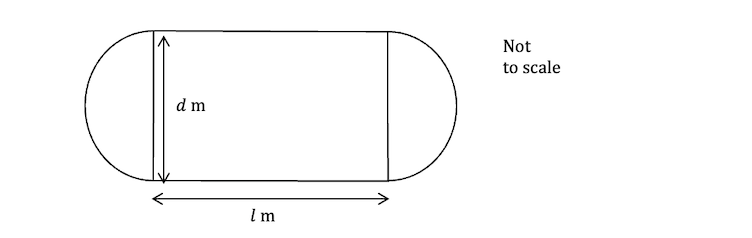
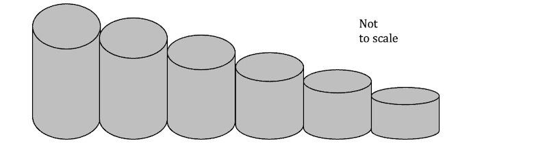
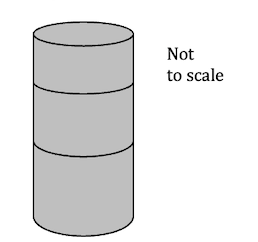

# Exam Questions — Sequences & Series
**Series** · Cambridge (CIE) AS maths (9709)
> Source: [https://www.savemyexams.com/as/maths/cie/20/pure-1/topic-questions/](https://www.savemyexams.com/as/maths/cie/20/pure-1/topic-questions/) · 18 questions across 1 sets

## Exam Questions (18 questions)

### Q1 — hard — 5 marks

**Q1** [4 marks]

A ball is dropped from a height of $A$ metres above a flat horizontal floor. After its first impact it bounces to a height of $x$ metres, and each subsequent bounce height is `25\%` shorter than the previous bounce.

Show that, no matter how many times the ball bounces, the total vertical distance travelled by the ball will not exceed $( A + 8 x )$ metres.

**Q1** [1 mark]

State one assumption that has been made in using this model.

### Q2 — very_hard — 5 marks

**Q2** [5 marks]

The first three terms of an arithmetic progression are $x$, $y$ and $z$ (in that order). The first three terms of a geometric progression are also $x$, $y$ and $z$ (in that order), where $x$, $y$ and $z$ are non-zero constants.

Determine the mathematical relationship that must exist between $x$ and $y$ for this to be true, and fully describe the two progressions that result.

### Q3 — hard — 9 marks

**Q3** [2 marks]

Alex is training for a marathon. In the first week Alex runs $a$ miles, and in each subsequent week runs $d$ more miles than in the previous week. Alex trains for $n$ weeks.

Given that Alex runs $73$ miles in the last week and $702$ miles in total, show that $n ( a + 73 ) = 1404$.

**Q3** [3 marks]

Given that in the week halfway through the training (week $\frac{n}{2}$) Alex runs $37$ miles, show that $n d = 72$.

**Q3** [4 marks]

Find the values of $a$, $d$ and $n$.

### Q4 — very_hard — 7 marks

**Q4** [2 marks]

A training track for cyclists is in the shape of a rectangle with a semicircle at each end, and is made up of several lanes.

The shortest, inner lane has straight runs of $l$ m, with the semicircles at each end having a diameter of $d$ m. Each lane moving outwards increases the diameter by $e$ m compared to the previous lane.

Show that the distances of each lane form an arithmetic progression with first term $( π d + 2 l )$ m and common difference $π e$ m.

**Q4** [3 marks]

There is a total of 12 lanes on the training track. Given that $l$, $d$ and $e$ are integers and that the total distance for all 12 laps is $96 ( 4 π + 5 )$ m, find the value of $l$ and show that $2 d + 11 e = 64$.

**Q4** [2 marks]

It is recommended that lanes are at least $2$ m wide to allow sufficient space between cyclists in different lanes. Find the least value of $e$ and the associated value of $d$.

### Q5 — very_hard — 11 marks

**Q5** [2 marks]

A student is investigating a sequence of values output by a computer program reported to contain a bug. The sequence of values is $3 , 1 , 6 , \frac{1}{2} , 9 , \frac{1}{4} , 12 , \frac{1}{8} , 15 , \frac{1}{16} , \dots$

The bug appears to have made the program output two different sequences interleaved in the same list. Suggest what the two sequences could be.

**Q5** [3 marks]

To fix the bug, the student separates the output into the odd-numbered terms and the even-numbered terms.

(i) Show that the odd-numbered terms form an arithmetic progression, and determine its first term and common difference.

(ii) Find an expression for the sum of the first $m$ terms of this progression.

**Q5** [2 marks]

Find an expression for the sum of the first $n$ even-numbered terms of the sequence of values.

**Q5** [3 marks]

The computer program also outputs the sum of the first 20 terms of the sequence of values. Find the value the computer would output, giving your answer correct to 4 decimal places.

**Q5** [1 mark]

Does the sum to infinity exist for the sequence of values output by the computer program? Give a reason for your answer.

### Q6 — very_hard — 11 marks

**Q6** [4 marks]

The first term of a progression is $x^{2}$ and the second term is $\frac{6x}{7}$.

For the case where the progression is arithmetic with a common difference of $- \frac{1}{7}$, find the possible values of $x$ and the corresponding values of the eighth term of the progression.

**Q6** [7 marks]

For the case where the progression is geometric with a sum to infinity of $7$, and given that $x = 1$ is one possible value of $x$,

(i) find all three possible values of $x$;

(ii) determine the first term and common ratio of each corresponding progression;

(iii) show that all three progressions have the same third term, and determine that term.

### Q7 — medium — 8 marks

**Q7** [4 marks]

The first term of a progression is $- 7 x$ and the second term is $x^{2}$.

For the case where the progression is arithmetic with a common difference of $- 6$, find the possible values of $x$ and the corresponding values of the fifth term of the progression.

**Q7** [4 marks]

For the case where the progression is geometric with a sum to infinity of $- 14$, find the third term of the progression.

### Q8 — hard — 5 marks

**Q8** [2 marks]

A model maker is constructing part of a model building using a series of hollow tubes, stacked next to each other as illustrated below.

Each tube is one-tenth shorter than the one to its left. All the tubes are the same width, as they are all cut from one longer tube.

Show that, no matter how many tubes the model maker uses, the longer tube they are cut from need not be any longer than ten times the height of the tallest tube.

**Q8** [3 marks]

In a different part of the model building, tubes are required to be stacked on top of each other, as shown below.

The tallest tube is the same length as the tallest tube in part (a). Each of the other tubes is $1$ cm shorter than the tube immediately below it. The longer tube that all the tubes are cut from is ten times the height of the tallest tube in the stack, and all of it is used.

Given that the length of the tallest tube is $a$ cm and there are $n$ tubes in the stack, show that $n^{2} - ( 2 a + 1 ) n + 20 a = 0$.

### Q9 — medium — 10 marks

**Q9** [1 mark]

Frankie opens a savings account and deposits \$400 at the start of the first year. Compound interest is paid into the account at the end of each year at an annual rate of 3%.

Show that the amount of money in the account at the end of the first year is \$412.

**Q9** [1 mark]

At the start of the second year, and of each subsequent year, Frankie deposits a further \$400 into the account.

Write down the interest earned during the second year by the \$400 deposited at the start of the second year.

**Q9** [2 marks]

Explain why the amount of money in the account, in dollars, at the end of the second year is given by $( 400 \times 1 . 03 ) \times 1 . 03 + 400 \times 1 . 03$.

**Q9** [2 marks]

Hence show that the amount of money in the account, in dollars, at the end of $n$ years is given by `400\left(1.03 + 1.03^2 + 1.03^3 + \ldots + 1.03^n\right)`.

**Q9** [2 marks]

Show that the sum of the geometric progression $1 . 03 + 1 . 03^{2} + 1 . 03^{3} + \dots + 1 . 03^{n}$ is `\dfrac{103}{3}\left(1.03^n - 1\right)`.

**Q9** [2 marks]

Hence find the amount of money in the account at the end of 12 years, giving your answer correct to the nearest cent.

### Q10 — medium — 9 marks

**Q10** [4 marks]

The first and second terms of a progression are $5 x$ and $x^{2}$, where $x$ is a constant.

For the case where the progression is arithmetic with a common difference of $14$,

(i) show that $x^{2} - 5 x - 14 = 0$;

(ii) find the possible values of $x$ and the corresponding values of the third term of the progression.

**Q10** [5 marks]

For the case where the progression is geometric with a sum to infinity of $10$,

(i) explain why $x$ cannot be equal to $0$;

(ii) show that $\frac{5x}{1-\frac{x}{5}} = 10$;

(iii) find the third term of the progression.

### Q11 — medium — 7 marks

**Q11** [2 marks]

Lloyd is to start training in order to run a marathon.

For the first week of training he will run a total of 2 miles.

Each subsequent week he’ll increase the total number of miles run by 3 miles.

He intends training for 15 weeks.

Calculate how far Lloyd will run during his eighth week of training

**Q11** [2 marks]

Work out how much further Lloyd will run in his last week of training compared to his first.

**Q11** [3 marks]

Find the total number of miles Lloyd will run across all 15 weeks of his training schedule.

### Q12 — medium — 8 marks

**Q12** [4 marks]

Two sequences model the value of a car in successive years, where $u_{n}$ is its value in year $n$ and year 1 is the year in which it is new. In year 1 the car's value is \$25 000. Model 1 is an arithmetic progression and Model 2 is a geometric progression. In both models the value in year 8 is \$7500.

Find the common difference for Model 1 and the common ratio for Model 2, giving your answers to three significant figures where appropriate.

**Q12** [3 marks]

Find the value of the car according to Model 2 in the year Model 1 predicts its value to be \$5000.

**Q12** [1 mark]

State one benefit of Model 2 over Model 1 for estimating the value of older cars.

### Q13 — easy — 6 marks

**Q13** [2 marks]

Lauren is starting a marathon training programme. In the $n$th week of her training she runs a distance of $u_{n}$ miles, where $u_{n} = 4 n - 1$ for `n \geqslant 1`.

Find the distance Lauren runs in each of the first, second and third weeks.

**Q13** [1 mark]

Find the distance Lauren runs in the tenth week.

**Q13** [2 marks]

Lauren's training programme lasts for 10 weeks. Find the total distance Lauren runs during the programme.

**Q13** [1 mark]

State, with reference to the context, why this model may be unrealistic for large values of $n$.

### Q14 — easy — 9 marks

**Q14** [4 marks]

Two models are proposed for the value, in dollars, of a car $n$ years after it was bought new. When new, the car's value is 30 000 dollars.

Under Model A, the value is modelled by an arithmetic progression, with the value after $n$ years given by $u_{n} = 30000 - 5000 n$.

Under Model B, the value is modelled by a geometric progression, with the value after $n$ years given by $u_{n} = 30000 \times ( 0 . 6 )^{n}$.

(i) Find the age of the car when Model A predicts that its value has halved.

(ii) Show that Model B predicts that the car's value halves during the second year.

**Q14** [3 marks]

Determine, showing all necessary working, which model predicts the greater value for the car when it is 5 years old.

**Q14** [2 marks]

(i) State, with reference to the context, one limitation of Model A for large values of $n$.

(ii) Explain why Model B will never predict the value of the car to be \$0.

### Q15 — easy — 6 marks

**Q15** [3 marks]

A ball is dropped and allowed to bounce repeatedly on a flat horizontal floor. The height, $u_{n}$ metres, reached by the ball after the $n$th bounce is modelled by a geometric progression with $n$th term $u_{n} = 2 \times ( 0 . 8 )^{n-1}$ for `n \geqslant 1`.

Write down the height reached after the first bounce and the common ratio of the progression, and find the height reached after the fifth bounce.

**Q15** [3 marks]

(i) Find the sum of the heights the ball reaches on its first ten bounces.

(ii) Explain why the total vertical distance travelled by the ball, from the instant it first impacts the floor to the instant it returns to the floor after the tenth bounce, is twice your answer to part (i).

### Q16 — easy — 7 marks

**Q16** [2 marks]

Bernie is saving to buy a new computer. In the first week he puts \$1 into a money box, \$2 in the second week, \$3 in the third week, and in each subsequent week he puts in \$1 more than in the preceding week.

Find the total amount of money in the money box after 10 weeks.

**Q16** [2 marks]

Show that the total amount of money in the money box, in dollars, at the end of week $n$ is $\frac{n}{2} ( n + 1 )$.

**Q16** [2 marks]

The computer Bernie wishes to buy costs \$250. Determine, showing all necessary working, whether Bernie will have saved enough money after 20 weeks.

**Q16** [1 mark]

State, with reference to the context, one reason why this might not be the best way for Bernie to save money.

### Q17 — easy — 7 marks

**Q17** [1 mark]

A circular training track for cyclists has a lap length of $600$ m. A cyclist trains every day for a fortnight (fourteen days), completing an increasing number of laps each day. On the first day the cyclist completes $5$ laps, and on each subsequent day completes $3$ more laps than on the preceding day.

Write down a formula, in terms of $n$, for the number of laps, $u_{n}$, completed on day $n$.

**Q17** [2 marks]

Find the number of laps completed on the tenth day.

**Q17** [4 marks]

(i) Find the total number of laps completed over the fourteen days of training.

(ii) Find the total distance, in kilometres, covered by the cyclist over the fourteen days.

### Q18 — easy — 5 marks

**Q18** [2 marks]

The first term of a progression is $4$ and the third term is $49$.

For the case where the progression is arithmetic, find the second term and the common difference of the progression.

**Q18** [3 marks]

For the case where the progression is geometric, find the possible second terms and the corresponding common ratios of the progression.
