# Exam Questions — Basic Trigonometry
**Trigonometry** · Cambridge (CIE) AS maths (9709)
> Source: [https://www.savemyexams.com/as/maths/cie/20/pure-1/topic-questions/](https://www.savemyexams.com/as/maths/cie/20/pure-1/topic-questions/) · 38 questions across 1 sets

## Exam Questions (38 questions)

### Q1 — easy — 3 marks

**Q1** [3 marks]

The diagram shows a triangular field $A B C$ in which $A C = 18 . 4$ m, $B C = 31 . 2$ m and angle $A C B = 58 ^{\circ}$.

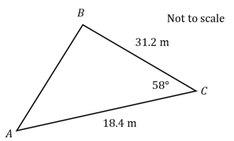

Calculate the area of the field, giving your answer to the nearest square metre.

### Q2 — easy — 2 marks

**Q2** [2 marks]

$A B C$ is a right-angled triangle in which $B C = 15$ cm, $A B = 7$ cm and angle $B A C = 90 ^{\circ}$.

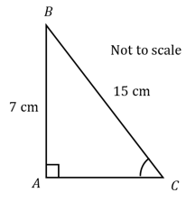

Calculate the size of angle $A C B$, giving your answer correct to 3 significant figures.

### Q3 — easy — 3 marks

**Q3** [3 marks]

$P Q R$ is a triangle with angle $P Q R = 84 ^{\circ}$, $P Q = 7 . 5$ cm and $Q R = 9 . 2$ cm.

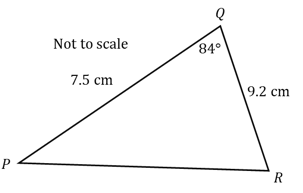

Use the cosine rule to calculate the length of $P R$, giving your answer correct to 3 significant figures.

### Q4 — easy — 3 marks

**Q4** [3 marks]

The area of a triangle $W X Y$ is $75$ cm². $X Y = 14 . 3$ cm and angle $W X Y = 104 ^{\circ}$.

Using the formula $\text{Area} = \frac{1}{2} a b  \text{sin}  C$, calculate the length of $W X$. Give your answer correct to 3 significant figures.

### Q5 — easy — 3 marks

**Q5** [3 marks]

Show that the cosine rule

$a^{2} = b^{2} + c^{2} - 2 b c  \text{cos}  A$

can be rearranged into the form

$\text{cos}  A = \frac{b^{2}+c^{2}-a^{2}}{2bc}$

### Q6 — easy — 3 marks

**Q6** [3 marks]

$P Q R$ is a triangle with angle $P Q R = 39 ^{\circ}$, angle $R P Q = 128 ^{\circ}$ and $P R = 2 . 6$ cm.

Calculate the length of $Q R$, correct to 3 significant figures.

### Q7 — easy — 6 marks

**Q7** [3 marks]

A ladder rests against a vertical wall. The base of the ladder is $1 . 2$ m from the wall and the ladder reaches $6$ m up the wall.

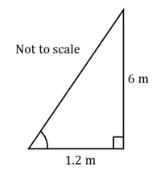

To be safe to climb, the angle between the ladder and the ground must be between $65 ^{\circ}$ and $75 ^{\circ}$.

Determine whether the ladder is safe to climb. You must show your working.

**Q7** [3 marks]

Calculate the length of the ladder, giving your answer to the nearest cm.

### Q8 — easy — 2 marks

**Q8** [2 marks]

The diagram shows a right-angled triangle $P Q R$ with the right angle at $Q$, where $R Q = 1 . 7$ cm and angle $R P Q = 42 ^{\circ}$.

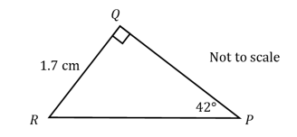

Find the length of $P Q$, giving your answer to 1 decimal place.

### Q9 — easy — 2 marks

**Q9** [2 marks]

$A B C$ is a right-angled triangle in which $A B = 38$ m and angle $C A B = 74 ^{\circ}$.

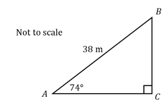

Calculate the length of $A C$, giving your answer correct to 1 decimal place.

### Q10 — easy — 3 marks

**Q10** [3 marks]

In triangle $A B C$, angle $A B C = 54 ^{\circ}$, $A C = 26$ cm and $B C = 18$ cm. Angle $B A C = x ^{\circ}$ is acute.

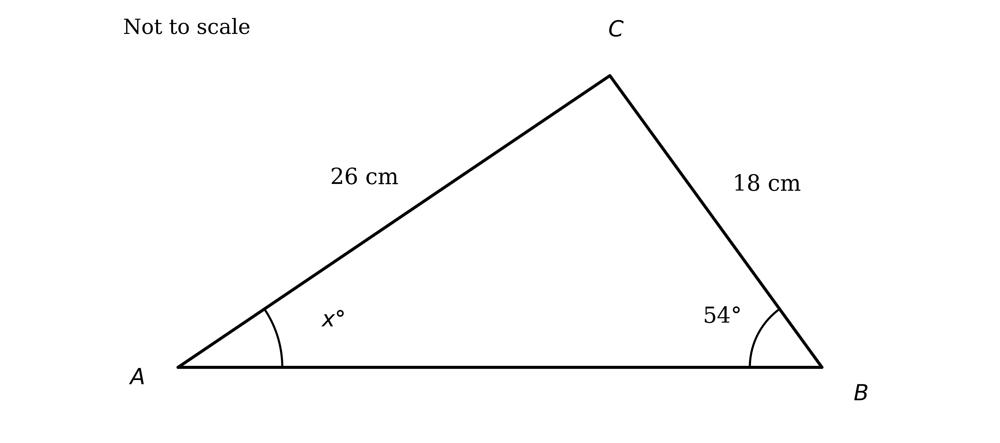

Use the sine rule to calculate $x$, giving your answer to the nearest degree.

### Q11 — easy — 5 marks

**Q11** [5 marks]

The diagram shows a triangle with sides of length $3$ cm, $4$ cm and $5$ cm. The angle $x ^{\circ}$ lies between the sides of length $3$ cm and $5$ cm.

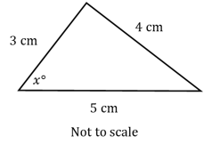

One student uses the cosine rule to find $x ^{\circ}$ to the nearest degree. Another student uses SOH CAH TOA.

(i) Show clearly that both methods give the same value of $x ^{\circ}$.

(ii) State which is the more efficient method in this case, and give a reason.

### Q12 — very_hard — 9 marks

**Q12** [9 marks]

The diagram shows a field $A B C D$ in which unicorns are kept, where $A B$ is parallel to $C D$. $A B = 318$ m, $C D = 235$ m, $A D = 142$ m and angle $D A B = 92 ^{\circ}$.

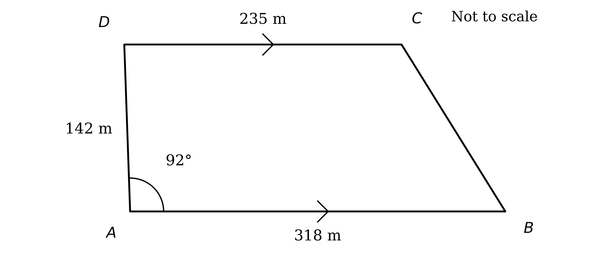

To be happy, each unicorn needs at least $2222$ m² of the field. Calculate the maximum number of unicorns that can happily be kept in the field.

### Q13 — very_hard — 6 marks

**Q13** [6 marks]

Triangle $A B C$ has $A B = 3 x$ cm, $A C = ( x + 5 )$ cm and angle $B A C = 150 ^{\circ}$. The area of the triangle is $7 \frac{1}{4}$ cm².

Find the ratio of the angles of the triangle, to the nearest degree, in its simplest form.

### Q14 — very_hard — 5 marks

**Q14** [3 marks]

Triangles $P S Q$ and $S Q R$ are such that $P S = S Q = Q R$, where $S$ lies on $P R$. $P Q = 15$ cm, $Q R = 2 x$ cm and angle $P S Q = 120 ^{\circ}$.

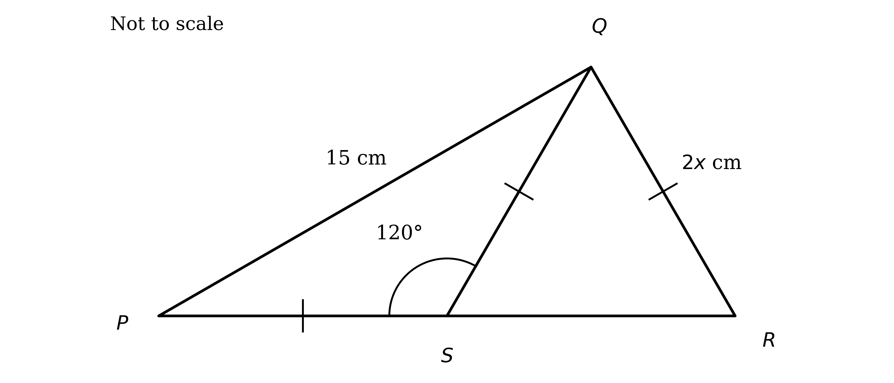

Calculate the exact value of $x$.

**Q14** [2 marks]

Calculate the area of triangle $P Q R$, leaving your answer in surd form.

### Q15 — very_hard — 6 marks

**Q15** [2 marks]

Triangle $A B C$ has $A B = 3 x$ cm, $B C = 5 x$ cm and $A C = 6 x$ cm.

Calculate the size of angle $B A C$, giving your answer to 2 decimal places.

**Q15** [4 marks]

Given that the perimeter of the triangle is $37 . 8$ cm, find the area of the triangle, giving your answer correct to 3 significant figures.

### Q16 — very_hard — 4 marks

**Q16** [4 marks]

An isosceles triangle has two of its side lengths equal to $7 . 3$ cm and $9 . 8$ cm.

Calculate the difference between the two possible smallest angles.

### Q17 — very_hard — 5 marks

**Q17** [5 marks]

Triangle $A B C$ has $A B = x$ cm, $B C = ( 4 - x )$ cm, angle $B A C = θ$ and angle $B C A = 30 ^{\circ}$.

Given that $\text{sin}  θ = \frac{1}{\sqrt{2}}$, show that $x = 4 ( \sqrt{2} - 1 )$.

### Q18 — hard — 6 marks

**Q18** [2 marks]

In triangle $A B C$, $A B = 2 x$ cm, $B C = 10$ cm and $A C = ( 20 - 2 x )$ cm. Angle $A B C = θ$.

Show that $\text{cos}  θ = \frac{4x-15}{2x}$.

**Q18** [4 marks]

Given that $\text{cos}  θ = - \frac{1}{2}$, find the area of the triangle.

### Q19 — hard — 5 marks

**Q19** [5 marks]

An artist is designing a triangular sculpture, made using three equal lengths of metal piping. When laid flat, the sculpture covers $21 . 8$ m².

Calculate the total length of metal piping needed. Give your answer to the nearest cm.

### Q20 — hard — 4 marks

**Q20** [4 marks]

Two different triangles each have $A B = 2 . 8$ cm, $B C = 3 . 5$ cm and angle $A C B = 43 ^{\circ}$.

Find the largest angle in each of the triangles.

### Q21 — medium — 4 marks

**Q21** [2 marks]

A triangle has side lengths $7 . 3$ cm, $9 . 8$ cm and $10 . 6$ cm.

Calculate the size of the largest angle.

**Q21** [2 marks]

A triangle has two sides of length $3$ m and $5$ m, with an angle of $45 ^{\circ}$ between them.

Calculate the length of the third side, giving your answer correct to 3 significant figures.

### Q22 — hard — 4 marks

**Q22** [4 marks]

The diagram shows triangle $P Q R$ with a point $S$ on $P R$. $P Q = 13$ cm, $Q R = 5 . 8$ cm, $Q S = y$ cm, angle $Q S P = 102 ^{\circ}$, angle $Q R S = 37 ^{\circ}$ and angle $Q P S = x ^{\circ}$.

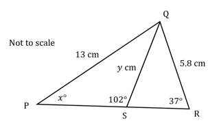

Calculate the values of $x$ and $y$, giving your answers to 3 significant figures.

### Q23 — hard — 9 marks

**Q23** [5 marks]

The diagram shows a quadrilateral field $A B C D$ in which unicorns are kept. $A B = 145$ m, $B C = 98$ m, $C D = 215$ m, $D A = 114$ m and angle $D A B = 102 ^{\circ}$.

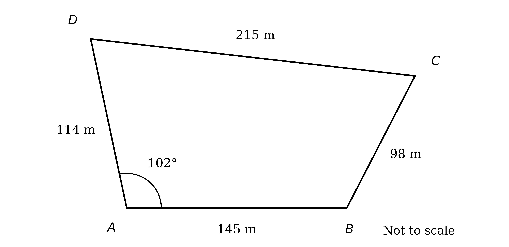

Find the angle between the fences $B C$ and $C D$.

**Q23** [4 marks]

To be happy, each unicorn needs at least $1234$ m² of the field. Calculate the maximum number of unicorns that can be happily kept in the field.

### Q24 — hard — 7 marks

**Q24** [4 marks]

A triangular field has an area of $157$ m². Two of its side lengths are $13 . 2$ m and $28 . 4$ m, and the angle $θ$ lies between these two sides.

Find the two possible values of $θ$.

**Q24** [3 marks]

Given that $θ$ is acute, calculate the perimeter of the field, giving your answer to the nearest metre.

### Q25 — hard — 6 marks

**Q25** [3 marks]

Triangle $A B C$ has $A B = 2 x$ cm, $B C = ( x + 5 )$ cm and $A C = 7$ cm. The angle $A B C = 60 ^{\circ}$.

Find the value of $x$, giving your answer as a simplified surd.

**Q25** [3 marks]

The area of the triangle can be written in the form $a \sqrt{6} + b \sqrt{3}$, where $a$ and $b$ are integers. Find the values of $a$ and $b$.

### Q26 — hard — 9 marks

**Q26** [2 marks]

A car company is designing a new metal logo. Points $A$, $B$, $C$ and $D$ all lie on the circumference of a circle. $A B$, $A C$, $A D$, $B C$ and $C D$ are chords, with $A B = C D$. The company wants the chords to satisfy $A B : B C : A C = 2 : 4 : 5$.

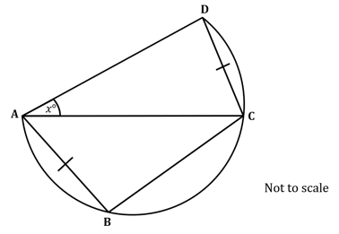

The machine that makes the logo requires angle $A B C$ to be input, accurate to 1 decimal place. Calculate the angle $A B C$.

**Q26** [4 marks]

The acceptable total error in angle $C A D$ is $1$ degree ($\pm0.5^{\circ}$). Find the acceptable range for $x ^{\circ}$, giving your values to 1 decimal place.

**Q26** [3 marks]

Given that $B C = 1$ inch, use the angles from parts (a) and (b) (correct to 1 decimal place) to calculate the area of the quadrilateral $A B C D$.

### Q27 — medium — 4 marks

**Q27** [4 marks]

A triangle has sides of length $4$ cm, $3$ cm and $2$ cm.

(i) Find the value of $\text{cos}  θ$ for each of the three angles.

(ii) State between which two sides the largest angle lies.

### Q28 — hard — 9 marks

**Q28** [3 marks]

Triangle $A B C$ has $A B = 2 x$ cm, $A C = ( x + 6 )$ cm and angle $B A C = 30 ^{\circ}$. The area of the triangle is $5 \frac{3}{4}$ cm².

Show that $2 x^{2} + 12 x - 23 = 0$.

**Q28** [3 marks]

Hence, or otherwise, find the perimeter of the triangle, giving your answer correct to 3 significant figures.

**Q28** [3 marks]

Given that angle $A B C$ is obtuse, find the ratio of the angles of the triangle, to the nearest degree.

### Q29 — medium — 4 marks

**Q29** [2 marks]

Triangle $A B C$ has $A B = 5$ cm, $B C = 4$ cm and $A C = 7$ cm.

Calculate the size of angle $B A C$, giving your answer to the nearest degree.

**Q29** [2 marks]

Triangle $P Q R$ has $P Q = 12$ cm, $Q R = 8$ cm and angle $P Q R = 60 ^{\circ}$.

Calculate the length of $R P$, giving your answer correct to 3 significant figures.

### Q30 — medium — 4 marks

**Q30** [4 marks]

The diagram shows triangle $A B C$ in which $A B = 8 . 4$ cm, $B C = 5 . 2$ cm and angle $A C B = 28 ^{\circ}$. Angle $B A C = x ^{\circ}$ and $A C = y$ cm.

Calculate the values of $x$ and $y$, giving your answers to 3 significant figures.

### Q31 — medium — 8 marks

**Q31** [2 marks]

Triangle $A B C$ has $A B = 10$ cm and $A C = 17$ cm, with angle $B A C$ acute. The area of the triangle is $40$ cm².

Find angle $B A C$, giving your answer to the nearest degree.

**Q31** [2 marks]

Show that the side length $B C$ is $9 . 43$ cm, correct to 3 significant figures.

**Q31** [2 marks]

Find angle $B C A$, giving your answer correct to 3 significant figures.

**Q31** [2 marks]

A point $D$ is placed on the side $A C$ so that $B D = B C$. Find the area of triangle $B C D$, giving your answer correct to 3 significant figures.

### Q32 — medium — 4 marks

**Q32** [2 marks]

Two sides of a triangular garden are $2 . 8$ m and $12$ m long, and they meet at an angle of $67 ^{\circ}$.

Calculate the area of the garden, giving your answer correct to 3 significant figures.

**Q32** [2 marks]

Calculate the length of the third side of the garden, giving your answer correct to 3 significant figures.

### Q33 — medium — 3 marks

**Q33** [3 marks]

Triangle $A B C$ has sides of length $4$ cm, $5$ cm and $6$ cm.

(i) Show that the angle between the sides of length $4$ cm and $5$ cm has $\text{cos}  θ = \frac{1}{8}$.

(ii) Find the value of $\text{cos}  θ$ for each of the other two angles.

### Q34 — medium — 5 marks

**Q34** [2 marks]

The Save My Exams logo is a blue circle with a black lightning bolt through the centre. The lightning bolt is modelled as two congruent triangles $A B C$ and $D E F$ with $A B = D E = 12$ cm, $B C = E F = 15$ cm and $A C = D F = 7$ cm.

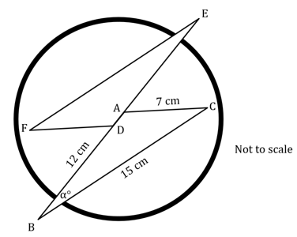

Calculate the size of the angle $α ^{\circ}$, giving your answer in degrees to 1 decimal place.

**Q34** [3 marks]

For the banner, the side lengths of the triangles are enlarged by a scale factor of $10$. Find the area the lightning bolt will take up on the banner, giving your answer in m².

### Q35 — medium — 8 marks

**Q35** [3 marks]

A triangular field has an area of $10$ m². Two of its sides have lengths $3 . 2$ m and $8 . 4$ m, and the angle between them is $θ$.

Show that one possible value of $θ$ is $48 . 1 ^{\circ}$, correct to 3 significant figures.

**Q35** [2 marks]

Show that there is another possible value of $θ$. You must show all your working.

**Q35** [3 marks]

Using $θ = 48 . 1 ^{\circ}$, calculate the perimeter of the field, giving your answer correct to 3 significant figures.

### Q36 — medium — 11 marks

**Q36** [3 marks]

Triangle $A B C$ has $A B = x$ cm, $A C = ( x + 8 )$ cm and angle $B A C = 150 ^{\circ}$. The area of the triangle is $2 \frac{1}{4}$ cm².

Show that $x$ satisfies the equation $x^{2} + 8 x = 9$.

**Q36** [2 marks]

Hence find the value of $x$.

**Q36** [3 marks]

Find the perimeter of the triangle, giving your answer correct to 3 significant figures.

**Q36** [3 marks]

Write the ratio of the angles of the triangle, to the nearest degree, in its simplest form.

### Q37 — medium — 4 marks

**Q37** [4 marks]

Two different triangles each have $A B = 5 . 3$ cm, $B C = 6 . 4$ cm and angle $A C B = 38 ^{\circ}$.

(i) Show that angle $B A C = 132 ^{\circ}$, correct to 3 significant figures, for one of the triangles.

(ii) Find angle $A B C$ for the other triangle.

### Q38 — hard — 9 marks

**Q38** [3 marks]

The diagram shows a quadrilateral field $A B C D$ in which alpacas are kept. $A B = 128$ m, $B C = 72$ m, $C D = 120$ m, $D A = 68$ m and angle $A B C = 86 ^{\circ}$.

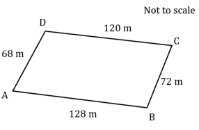

Find the length $A C$, giving your answer to the nearest metre.

**Q38** [3 marks]

Find the angle between the fences $A D$ and $C D$.

**Q38** [3 marks]

Calculate the area of the field, giving your answer correct to 3 significant figures.
