# Exam Questions — Circular Measure (Radians)
**Trigonometry** · Cambridge (CIE) AS maths (9709)
> Source: [https://www.savemyexams.com/as/maths/cie/20/pure-1/topic-questions/](https://www.savemyexams.com/as/maths/cie/20/pure-1/topic-questions/) · 25 questions across 1 sets

## Exam Questions (25 questions)

### Q1 — medium — 4 marks

**Q1** [4 marks]

A sector of a circle has area $8 π$ cm² and arc length $4 π$ cm.

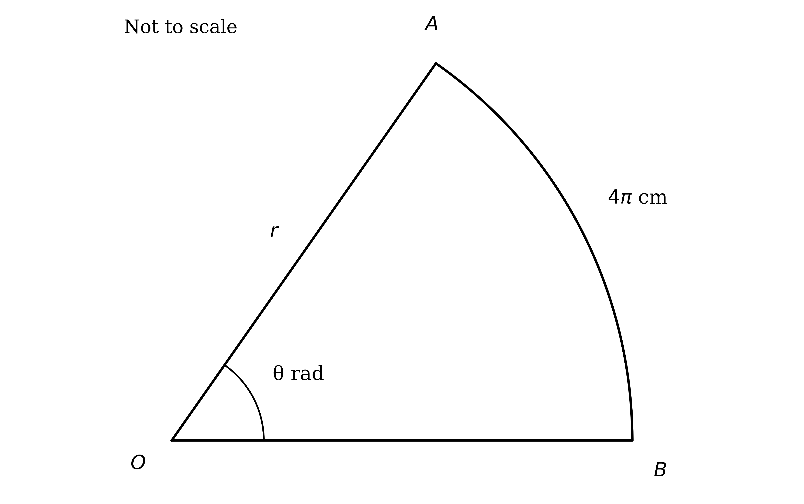

Find the radius of the circle and the angle at the centre of the sector.

### Q2 — easy — 3 marks

**Q2** [3 marks]

The diagram shows a sector of a circle with centre $O$ and radius 8 cm. The angle at the centre is $\frac{π}{3}$ radians.

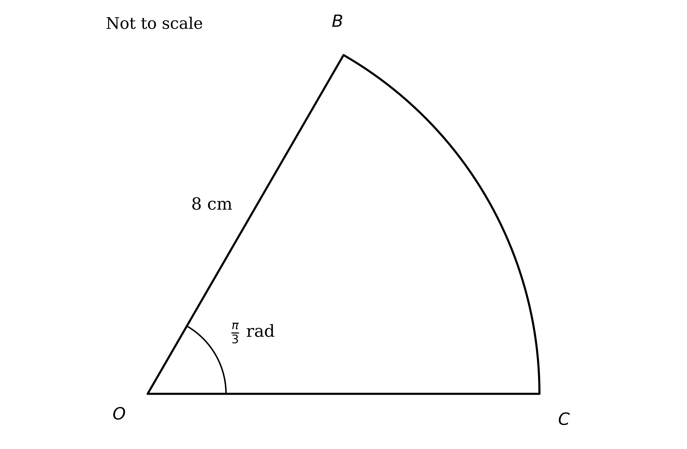

Find the perimeter of the sector.

### Q3 — easy — 6 marks

**Q3** [2 marks]

The diagram shows a sector of a circle $O P Q$ with centre $O$ and radius 6 cm. The angle at the centre is $\frac{π}{12}$ radians.

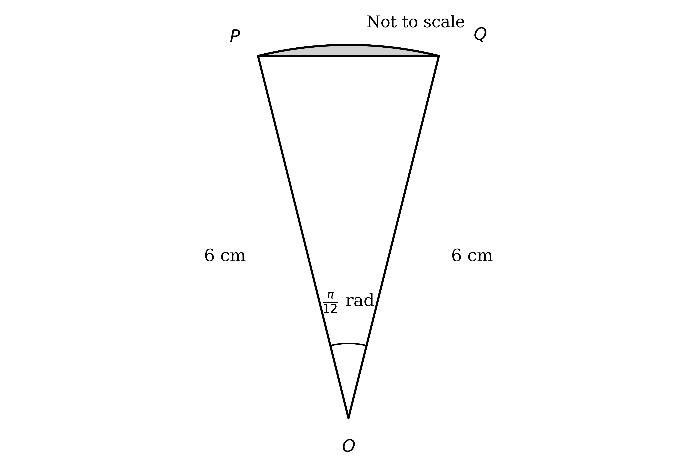

Use the formula $\frac{1}{2} a b  \text{sin}  C$ to find the area of the triangle $O P Q$.

**Q3** [2 marks]

Find the area of the sector $O P Q$.

**Q3** [2 marks]

Hence, or otherwise, find the area of the shaded segment.

### Q4 — easy — 2 marks

**Q4** [2 marks]

The arc length of a sector of a circle is 5 cm. The radius of the sector is twice the length of the arc.

Find the angle at the centre of the sector.

### Q5 — easy — 5 marks

**Q5** [5 marks]

Without using a calculator, write down:

(i) $60 ^{\circ}$ in radians

(ii) $\text{sin}  45 ^{\circ}$

(iii) $\text{tan}  π$

(iv) $\frac{5π}{6}$ radians in degrees

(v) $\text{cos}  0$

### Q6 — easy — 4 marks

**Q6** [4 marks]

A sector of a circle $O P Q$ has radius 4 cm, and the angle at the centre $O$ is $\frac{π}{4}$ radians.

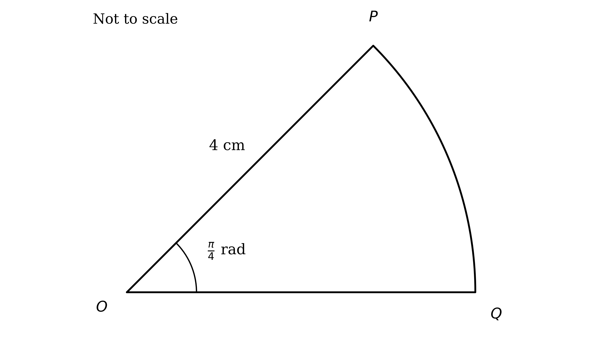

(i) Find the length of the arc $P Q$.

(ii) Find the area of the sector $O P Q$.

### Q7 — easy — 3 marks

**Q7** [3 marks]

The area of a quarter circle is $18 π$ cm².

Find the radius of the circle.

### Q8 — hard — 5 marks

**Q8** [5 marks]

The canopy of a parachute and the two outermost suspension lines form a sector of a circle $O A B$, as shown below, with the parachutist modelled as a particle at the point $O$.

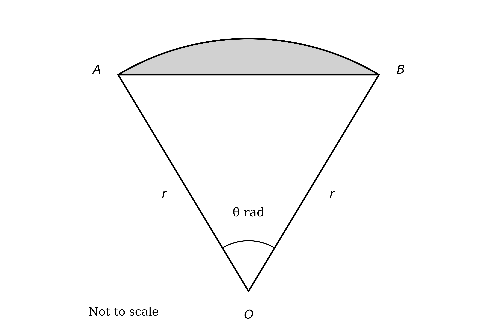

The area of the sector $O A B$ is $\frac{125π}{144}$ m², and the length of the arc $A B$ is $\frac{25π}{36}$ m.

Find the length of one suspension line, and the angle $A O B$ that the two outermost suspension lines make at the parachutist.

### Q9 — very_hard — 6 marks

**Q9** [6 marks]

The diagram shows a sector of a circle with centre $O$. The radii $O A$ and $O B$ are each $r$ cm, and the angle at the centre $A O B$ is $θ$ radians. The point $D$ lies on $O A$ and the point $C$ lies on $O B$, with $D C$ perpendicular to $O B$.

Given that $B C : C O = 2 : 3$, show that the area of the shaded shape $A B C D$ is $\frac{1}{50} r^{2} ( 25 θ - 9  \text{tan}  θ )$ cm².

### Q10 — very_hard — 7 marks

**Q10** [7 marks]

An eccentric wizard has captured a unicorn and will only set it free if you can answer the following question:

"I wish to create a rainbow-shaped mosaic for the floor of the throne room in my castle. The mosaic is to be formed from four semicircles, as shown below. The innermost semicircle has radius $R$ metres, and each outer semicircle has a radius that is a constant $k$ metres greater than the one immediately inside it. The rainbow mosaic must be exactly 22 metres across.

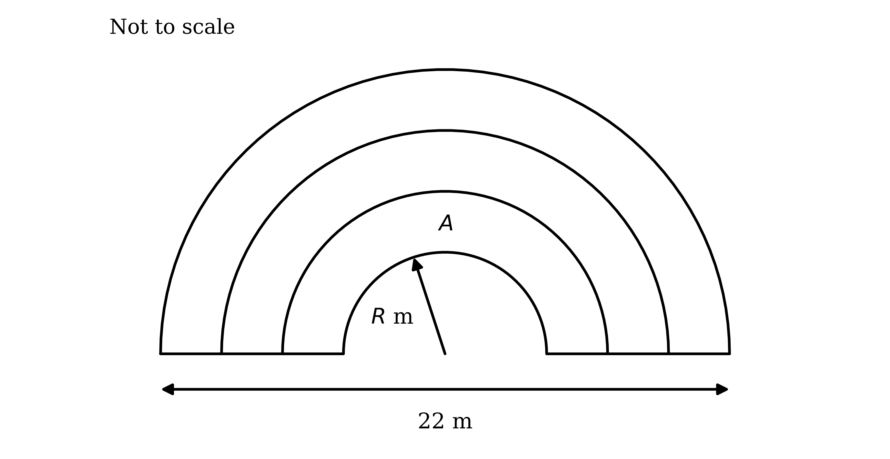

I also wish the inner region (labelled $A$ in the diagram) to take up exactly one quarter of the total area of the rainbow."

Find the required values of $R$ and $k$, and set the unicorn free.

### Q11 — hard — 5 marks

**Q11** [3 marks]

The diagram shows a sector of a circle $O A B$ with centre $O$, radius $r$ cm and angle $θ$ radians at the centre.

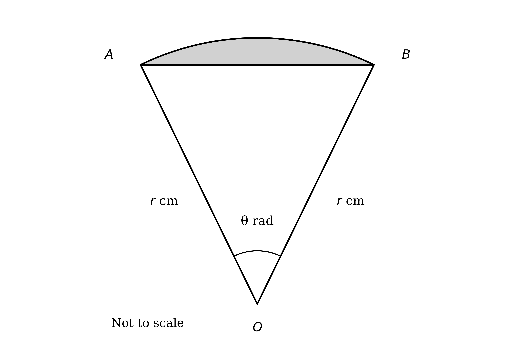

Show that the area of the shaded segment is $\frac{1}{2} r^{2} ( θ - \text{sin}  θ )$ cm².

**Q11** [2 marks]

Find, in terms of $θ$, the percentage of the sector that the segment occupies.

### Q12 — very_hard — 7 marks

**Q12** [2 marks]

A sector of a circle $O S T$ has radius $r$ cm, and the angle at the centre $O$ is $θ$ radians. The chord $S T$ has length $a$ cm.

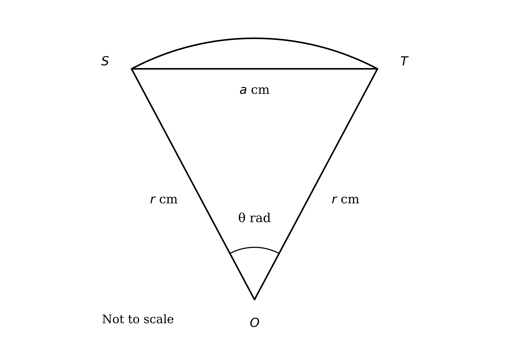

Show that $a^{2} = 2 r^{2} ( 1 - \text{cos}  θ )$.

**Q12** [5 marks]

Given that $r = 4 θ$ and the area of the sector is $\frac{8π^{3}}{27}$ cm², find the value of $a$.

### Q13 — hard — 4 marks

**Q13** [4 marks]

A sector of a circle $O P Q$ has radius $a$ cm, and the angle at the centre $O$ is $\frac{a}{3}$ radians.

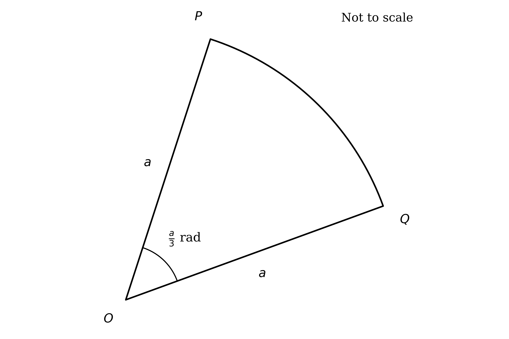

Given that the area of the sector $O P Q$ (in cm²) is three times the length of the arc $P Q$ (in cm), find the value of $a$.

### Q14 — hard — 8 marks

**Q14** [5 marks]

The diagram shows a sector of a circle $O A B$ with centre $O$ and radius $r$ cm. The angle at the centre is 0.8 radians.

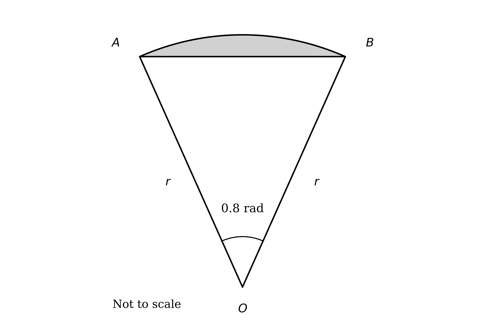

Given that the area of the triangle $O A B$ is 5.64 cm², find the area of the shaded segment, giving your answer correct to 3 significant figures.

**Q14** [3 marks]

Find the perimeter of the sector $O A B$, giving your answer correct to 3 significant figures.

### Q15 — hard — 5 marks

**Q15** [5 marks]

The diagram shows a prism whose cross-section is a sector of a circle. The sector has radius $( 2 a - 3 )$ cm and the angle at the centre is 1.7 radians. The prism is 4 cm thick.

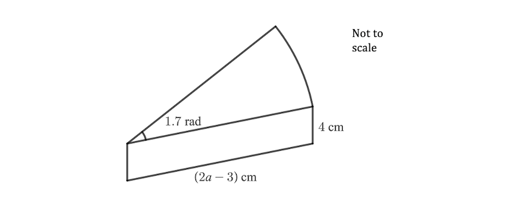

Given that the volume of the prism is 7.65 cm³, find the possible value(s) of $a$.

### Q16 — hard — 4 marks

**Q16** [4 marks]

The canopy of a parachute and the two outermost suspension lines form a sector of a circle, as shown below, with the parachutist modelled as a particle at the point $O$. The angle at the centre $O$ is $\frac{π}{3}$ radians.

The area of the sector $O A B$ is $\frac{49π}{150}$ m².

The parachute is made with 40 equal-length suspension lines. Disregarding any extra cord needed for knots and fastenings, find the total length of suspension line required to make the parachute.

### Q17 — hard — 5 marks

**Q17** [5 marks]

A rainbow-shaped logo is formed from three semicircles, as shown below. Each inner semicircle has a radius that is 1 cm less than that of the next semicircle further out.

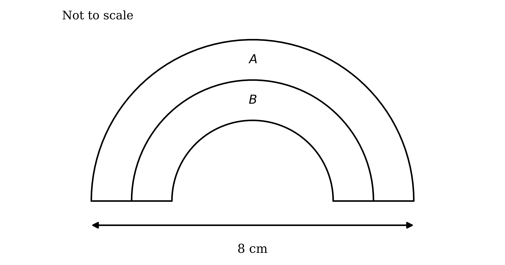

Find, in its simplest form, the ratio of the outer area $A$ of the logo to the inner area $B$.

### Q18 — medium — 4 marks

**Q18** [4 marks]

A rainbow-shaped logo is formed from two semicircles, as shown below. The radius of the smaller semicircle is 1 cm less than the radius of the larger semicircle.

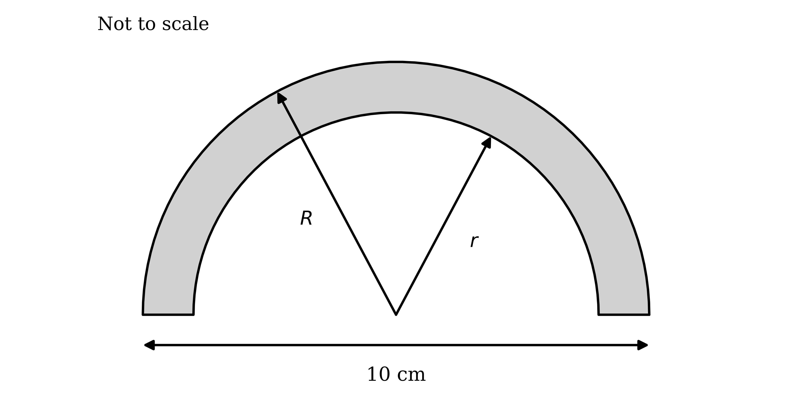

Find the area of the logo.

### Q19 — medium — 3 marks

**Q19** [3 marks]

The canopy of a parachute and the two outermost connecting cords form a sector of a circle, as shown below, with the parachutist modelled as a particle at the point $O$. The angle at the centre $O$ is $\frac{π}{4}$ radians.

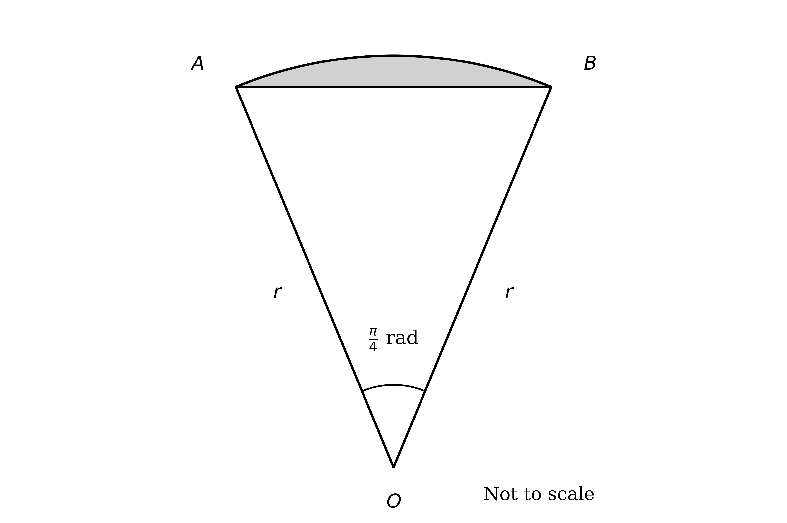

The area of the sector $O A B$ is $\frac{81π}{200}$ m².

Find the length of one of the connecting cords.

### Q20 — medium — 3 marks

**Q20** [3 marks]

A plastic puzzle piece is a prism whose cross-section is a sector of a circle, as shown below. The sector has radius 8 cm and the angle at the centre is 1.2 radians. The prism is 2 cm thick.

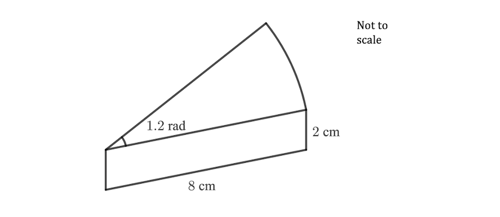

(i) Work out the area of the cross-section.

(ii) Hence, or otherwise, work out the volume of the puzzle piece.

### Q21 — medium — 8 marks

**Q21** [2 marks]

The diagram shows a circle sector $O A B$ with centre $O$. The angle at the centre is $\frac{π}{3}$ radians, and the line segments $O C$ and $B C$ have lengths 8 cm and $p$ cm respectively. Also, $C D$ is parallel to $A B$, so that $A D = B C$ and $O D = O C$.

Show that the area of the sector $O A B$ is $\frac{π}{6} ( p + 8 )^{2}$ cm².

**Q21** [2 marks]

Show that the area of the triangle $O C D$ is $16 \sqrt{3}$ cm².

**Q21** [4 marks]

Given that the area of the shaded shape $A B C D$ is `\left(\dfrac{50\pi}{3} - 16\sqrt{3}\right)` cm², find the value of $p$.

### Q22 — medium — 5 marks

**Q22** [5 marks]

Complete the table.

| **Degrees** | **Radians** | **sin** | **cos** | **tan** |
|---|---|---|---|---|
|   | $\frac{π}{6}$ |   | $\frac{\sqrt{3}}{2}$ |   |
| 45° |   |   | $\frac{1}{\sqrt{2}}$ |   |
| 60° | $\frac{π}{3}$ |   |   |   |
|   | $\frac{2π}{3}$ | $\frac{\sqrt{3}}{2}$ |   |   |
| 270° |   |   |   | n/a |

### Q23 — medium — 8 marks

**Q23** [5 marks]

The diagram shows a sector of a circle $O A B$ with centre $O$. The radii $O A$ and $O B$ are each 5.4 cm, and the angle $A O B$ is 1.2 radians.

Giving each answer correct to 3 significant figures:

(i) find the area of the sector $O A B$;

(ii) find the area of the triangle $O A B$;

(iii) find the area of the shaded segment.

**Q23** [3 marks]

(i) Find the length of the arc $A B$.

(ii) Find the perimeter of the sector $O A B$.

### Q24 — medium — 5 marks

**Q24** [5 marks]

The diagram shows a sector of a circle with centre $O$ and radius 9 cm. The angle at the centre is $\frac{π}{5}$ radians.

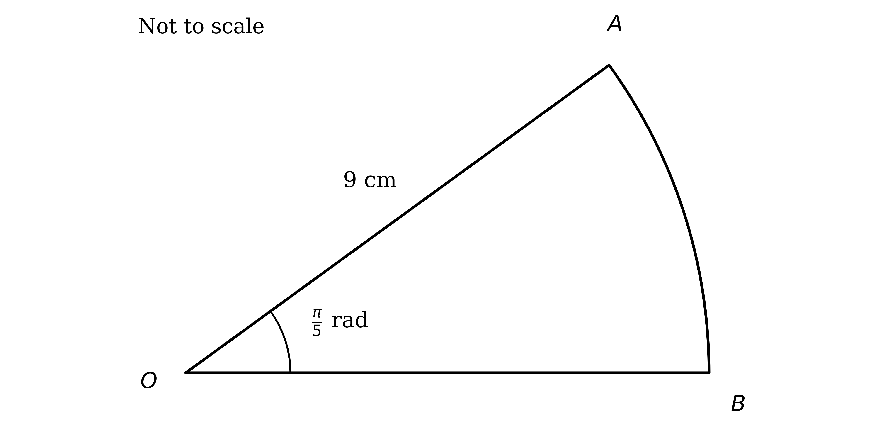

Find the area and the perimeter of the sector.

### Q25 — medium — 4 marks

**Q25** [4 marks]

A sector of a circle $O P Q$ has radius 3.4 cm, and the angle at the centre $O$ is $\frac{3π}{4}$ radians.

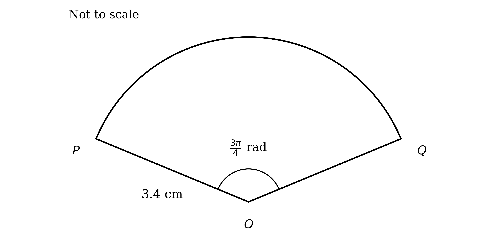

(i) Find the length of the arc $P Q$.

(ii) Find the area of the sector $O P Q$.
