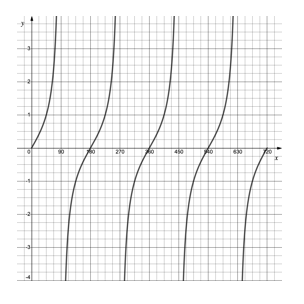
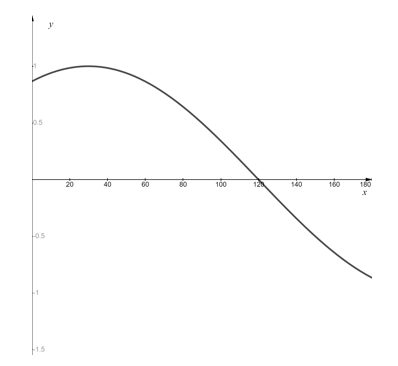
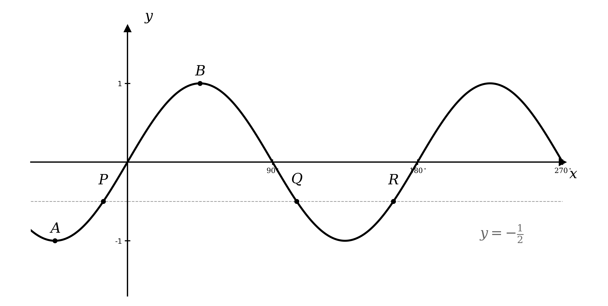
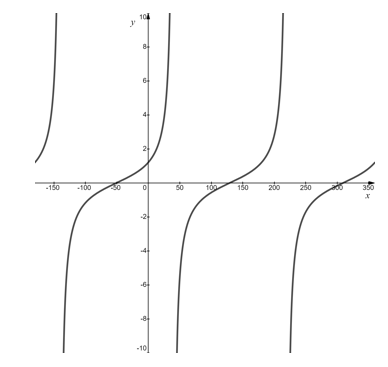

# Exam Questions — Trigonometric Functions
**Trigonometry** · Cambridge (CIE) AS maths (9709)
> Source: [https://www.savemyexams.com/as/maths/cie/20/pure-1/topic-questions/](https://www.savemyexams.com/as/maths/cie/20/pure-1/topic-questions/) · 42 questions across 1 sets

## Exam Questions (42 questions)

### Q1 — easy — 3 marks

**Q1** [3 marks]

Sketch the graph of $y = \text{sin}  2 x$ for $0 ^{\circ} \leq x \leq 180 ^{\circ}$.

### Q2 — easy — 2 marks

**Q2** [2 marks]

Solve $\text{cos}  x = \frac{1}{2}$ for $0 ^{\circ} \leq x \leq 360 ^{\circ}$.

### Q3 — easy — 2 marks

**Q3** [2 marks]

The diagram shows the graph of $y = \text{tan}  x$ for $0 ^{\circ} \leq x \leq 720 ^{\circ}$.

By adding a suitable straight line to the graph, show that the equation $\text{tan}  x = 2$ has four solutions in the interval $0 ^{\circ} \leq x \leq 720 ^{\circ}$.

### Q4 — easy — 2 marks

**Q4** [2 marks]

(i) Write down the maximum value of $y$, where $y = 3  \text{cos}  x$.

(ii) Write down the minimum value of $y$, where $y = 9  \text{sin}  x$.

### Q5 — easy — 3 marks

**Q5** [3 marks]

Given that $\text{f} ( θ ) = \text{cos}  θ$, write each of the following as an expression involving the cosine function.

(i) $2  \text{f} ( θ ) + 3$

(ii) $3  \text{f} ( 2 θ )$

### Q6 — easy — 2 marks

**Q6** [2 marks]

Solve $\text{sin}  3 x = 0$ for $0 ^{\circ} \leq x \leq 360 ^{\circ}$.

### Q7 — easy — 6 marks

**Q7** [6 marks]

On separate diagrams, sketch the graphs of:

(i) $y = \text{sin}  x$ for $- 180 ^{\circ} \leq x \leq 180 ^{\circ}$

(ii) $y = \text{cos}  x$ for $0 ^{\circ} \leq x \leq 360 ^{\circ}$

(iii) $y = \text{tan}  x$ for $- 180 ^{\circ} \leq x \leq 180 ^{\circ}$

### Q8 — easy — 2 marks

**Q8** [2 marks]

Sketch the graph of $y = - \text{sin}  θ$ for $0 ^{\circ} \leq θ \leq 360 ^{\circ}$.

### Q9 — easy — 3 marks

**Q9** [3 marks]

The point $P$ has coordinates `\left(90^{\circ},\ 1\right)` and lies on the graph of $y = \text{f} ( x )$, where $\text{f} ( x ) = \text{sin}  x$ and $0 ^{\circ} \leq x \leq 180 ^{\circ}$.

Write down the coordinates of the image of point $P$ under each of the following transformations:

(i) $y = \text{f} ( x ) + 2$

(ii) $y = \text{f} ( 3 x )$

(iii) $y = \text{f} ( x + 30 ^{\circ} )$

### Q10 — hard — 4 marks

**Q10** [4 marks]

By sketching an appropriate graph, find all the solutions to $\text{tan}  θ = \frac{-1}{\sqrt{3}}$ in the interval $0 ^{\circ} \leq θ \leq 360 ^{\circ}$.

### Q11 — very_hard — 6 marks

**Q11** [4 marks]

On the same set of axes, sketch the graphs of $y = \text{sin}  \frac{1}{2} θ$ and $y = \text{sin} ( θ + 30 ^{\circ} )$ in the interval $- 270 ^{\circ} \leq θ \leq 270 ^{\circ}$. Label the coordinates of points of intersection with the coordinate axes and of maximum and minimum points where appropriate.

**Q11** [2 marks]

Find the solution to the equation $\text{sin}  \frac{1}{2} θ = \text{sin} ( θ + 30 ^{\circ} )$ within the interval $- 90 ^{\circ} \leq θ \leq 0 ^{\circ}$. Hence, determine the coordinates of the corresponding point of intersection between the two graphs in part (a).

### Q12 — very_hard — 7 marks

**Q12** [4 marks]

On the same set of axes, sketch the graphs of $y = \text{tan}  \frac{1}{2} θ$ and $y = \text{tan} ( θ - 30 ^{\circ} )$ in the interval $- 360 ^{\circ} \leq θ \leq 360 ^{\circ}$. Label the coordinates of points of intersection with the coordinate axes.

**Q12** [3 marks]

Within the interval $- 360 ^{\circ} \leq θ \leq 360 ^{\circ}$, determine the coordinates of the two points where $\text{tan}  \frac{1}{2} θ = \text{tan} ( θ - 30 ^{\circ} )$. Give your answer in surd form.

### Q13 — very_hard — 4 marks

**Q13** [2 marks]

Describe geometrically the transformation that maps the graph of $y = \text{sin} ( x + 20 ^{\circ} )$ onto the graph of $y = \text{cos} ( x + 20 ^{\circ} )$.

**Q13** [2 marks]

On the same set of axes, sketch both graphs in the interval $- 180 ^{\circ} \leq x \leq 180 ^{\circ}$. Label the coordinates of any points of intersection between the two graphs.

### Q14 — very_hard — 6 marks

**Q14** [6 marks]

A function $\text{f} ( x ) = \text{cos}  p x$, $0 ^{\circ} \leq x \leq 360 ^{\circ}$, first crosses the $x$-axis at $18 ^{\circ}$.

(i) Determine the value of $p$ and sketch the graph of $y = \text{f} ( x )$.

(ii) State the period of $\text{f} ( x )$.

### Q15 — very_hard — 6 marks

**Q15** [4 marks]

The graph shows two curves with equations $y = p  \text{sin}  x$ and $y = \text{cos} ( x + q ^{\circ} )$, in the interval $- 180 ^{\circ} \leq x \leq 180 ^{\circ}$, where $p$ and $q$ are integers.

Using the graph above, find the values of $p$ and $q$ and label or list the points of intersection each graph has with the coordinate axes.

**Q15** [2 marks]

Within the stated interval, the curves intersect at the two points $R$ and $S$ as shown in the diagram. The coordinates of point $R$ are $( 9 . 90 ^{\circ} ,  0 . 34 )$, accurate to 2 decimal places. By considering the graph, as well as the properties of the sine and cosine functions, state the coordinates of point $S$, to two decimal places.

### Q16 — very_hard — 6 marks

**Q16** [6 marks]

(i) Describe geometrically the transformation that maps the graph of $y = \frac{1}{3} \text{tan}  x$ onto the graph of $y = 3  \text{tan}  x$.

(ii) On the graph of $y = \text{tan}  x$, a point $S$ has coordinates `\left(60^{\circ},\ \sqrt{3}\right)`. State the new coordinates of point $S$ after a transformation onto each of the graphs in part (i). Give your answers in surd form.

### Q17 — very_hard — 6 marks

**Q17** [6 marks]

(i) On the same set of axes, sketch the graphs of $y = \text{cos} ( - 2 θ )$ and $y = \text{cos}  \frac{1}{2} θ$ in the interval $- 360 ^{\circ} \leq θ \leq 360 ^{\circ}$. Label the axes appropriately to show all points of intersection between the graphs and the coordinate axes.

(ii) State the periodicity of each function.

### Q18 — very_hard — 4 marks

**Q18** [2 marks]

The graph shows part of the curve with equation $y = \text{sin} ( x + k ^{\circ} )$, where $k$ is a constant.

A student states that there are an infinite number of possible values for $k$. Is the student correct? You must explain your answer fully.

**Q18** [2 marks]

Another student claims that the curve could also be the graph of the equation $y = \text{cos} ( x + k ^{\circ} )$. Find a value for $k$ to show that the student is correct.

### Q19 — hard — 4 marks

**Q19** [2 marks]

The graph shows a curve with equation $y = \text{cos} ( x + k ^{\circ} )$, $- 360 ^{\circ} \leq x \leq 360 ^{\circ}$, where $k$ is a constant.

A student states that there is only one possible value for $k$. Explain why the student is incorrect, stating at least two possible values for $k$.

**Q19** [2 marks]

Give the coordinates of all points of intersection with the $x$-axis in the given interval.

### Q20 — hard — 8 marks

**Q20** [8 marks]

(i) On the same set of axes, sketch the graphs of $y = \text{tan}  \frac{1}{4} θ$ and $y = \text{cos} ( θ + 120 ^{\circ} )$ in the interval $0 ^{\circ} \leq θ \leq 270 ^{\circ}$. Show clearly the coordinates of all points of intersection with the coordinate axes.

(ii) Deduce the number of solutions to the equation $\text{cos} ( θ + 120 ^{\circ} ) - \text{tan}  \frac{1}{4} θ = 0$, in the interval $0 ^{\circ} \leq θ \leq 270 ^{\circ}$.

### Q21 — hard — 6 marks

**Q21** [6 marks]

On the same set of axes, sketch the graphs of $y = - 3  \text{cos}  θ$ and $y = \text{cos}  3 θ$ in the interval $0 ^{\circ} \leq θ \leq 360 ^{\circ}$.

The sketches must include the coordinates of all points where the graphs meet the coordinate axes. In each case state the periodicity of the function.

### Q22 — medium — 3 marks

**Q22** [3 marks]

(i) Describe geometrically the transformation that maps the graph of $y = \text{tan}  x$ onto the graph of $y = \frac{1}{5} \text{tan}  x$.

(ii) On the graph of $y = \text{tan}  x$, a point $Q$ has coordinates `\left(30^{\circ},\ \dfrac{\sqrt{3}}{3}\right)`. State the new coordinates of point $Q$ after the transformation to $y = \frac{1}{5} \text{tan}  x$. Leave your answer in surd form.

### Q23 — hard — 5 marks

**Q23** [5 marks]

A series of dips and mounds caused by underground mining has a cross-section which can be modelled using the function $y = 4  \text{cos} ( 18 x ) ^{\circ}$, where $x$ and $y$ are respectively the horizontal and vertical displacements, in metres, from a fixed origin point.

(i) Sketch the function for the interval $0 \leq x \leq 40$ and state the periodicity of the model.

(ii) How many dips are in this model in the given interval?

### Q24 — hard — 3 marks

**Q24** [3 marks]

(i) Sketch the graph of $y = \text{sin}  θ$ in the interval $- 180 ^{\circ} \leq θ \leq 180 ^{\circ}$. The sketch must include the coordinates of all points where the graph meets the coordinate axes.

(ii) Given that $\text{sin}  60 ^{\circ} = \frac{\sqrt{3}}{2}$, use your graph to find all values of $θ$ in the given interval for which $\text{sin}  θ = - \frac{\sqrt{3}}{2}$.

### Q25 — hard — 8 marks

**Q25** [8 marks]

(i) On the same set of axes, sketch the graphs of $y = \frac{1}{2} \text{sin}  θ$ and $y = \text{sin} ( θ - 60 ^{\circ} )$ in the interval $- 180 ^{\circ} \leq θ \leq 180 ^{\circ}$. State the coordinates of all points of intersection with the coordinate axes and of maximum and minimum points where appropriate.

(ii) Verify that $θ = 90 ^{\circ}$ is a solution to the equation $\frac{1}{2} \text{sin}  θ = \text{sin} ( θ - 60 ^{\circ} )$. Hence, using your sketch from part (i) or otherwise, find all other solutions to the equation $\frac{1}{2} \text{sin}  θ = \text{sin} ( θ - 60 ^{\circ} )$ in the interval $- 180 ^{\circ} \leq θ \leq 180 ^{\circ}$.

### Q26 — hard — 5 marks

**Q26** [5 marks]

Changes in the depth of water in a small tidal estuary relative to a fixed reference depth can be modelled using the function $y = \text{sin} ( 22 . 5 t ) ^{\circ}$, where $y$ is measured in metres and $t$ is the time in hours.

(i) Sketch the function for the interval $0 \leq t \leq 8$.

(ii) If $t = 0$ represents 2pm, during what times, to the nearest half hour, will the estuary be at or above the halfway point between $y = 0$ and its maximum depth?

### Q27 — hard — 3 marks

**Q27** [3 marks]

Sketch the graph of $y = \text{tan}  θ$ in the interval $- 270 ^{\circ} \leq θ \leq 270 ^{\circ}$. The sketch must include the coordinates of all points where the graph meets the coordinate axes.

Given that $\text{tan}  30 ^{\circ} = \frac{1}{\sqrt{3}}$, use your graph to find all other values of $θ$ in the given interval for which $\text{tan}  θ = \frac{1}{\sqrt{3}}$.

### Q28 — hard — 4 marks

**Q28** [4 marks]

Sketch the graph of $y = \text{tan} ( θ - 45 ^{\circ} )$ in the interval $- 360 ^{\circ} \leq θ \leq 360 ^{\circ}$.

Write down all the values of $θ$ for which $\text{tan} ( θ - 45 ^{\circ} ) = 1$ in the given interval.

### Q29 — hard — 3 marks

**Q29** [1 mark]

The graph shows a curve with equation $y = \text{sin}  3 x$ in the interval $- 60 ^{\circ} \leq x \leq 150 ^{\circ}$.

Points $A$ and $B$ are the stationary points closest to the origin. State the coordinates of $A$ and $B$.

**Q29** [2 marks]

A straight line with equation $y = \frac{\sqrt{3}}{2}$ meets the graph $y = \text{sin}  3 x$ at three points, $R$, $S$ and $T$. Determine the coordinates of $R$, $S$ and $T$.

### Q30 — medium — 2 marks

**Q30** [2 marks]

(i) Sketch the graph of $y = \text{cos}  θ$ in the interval $- 90 ^{\circ} \leq θ \leq 360 ^{\circ}$. The sketch must include the coordinates of all points where the graph meets the coordinate axes.

(ii) Given that $\text{cos}  60 ^{\circ} = 0 . 5$, use your graph to find all other values of $θ$ in the given interval for which $\text{cos}  θ = 0 . 5$.

### Q31 — medium — 3 marks

**Q31** [3 marks]

(i) Sketch the graph of $y = \text{sin}  θ$ in the interval $0 ^{\circ} \leq θ \leq 360 ^{\circ}$. The sketch must include the coordinates of all points where the graph meets the coordinate axes.

(ii) Given that $\text{sin}  30 ^{\circ} = 0 . 5$, use your graph to find another value of $θ$ in the given range for which $\text{sin}  θ = 0 . 5$.

### Q32 — medium — 3 marks

**Q32** [1 mark]

The graph shows the curve with equation $y = \text{sin}  2 x$ in the interval $- 60 ^{\circ} \leq x \leq 270 ^{\circ}$.

Point $A$ has coordinates `\left(-45^{\circ},\ -1\right)` and is the minimum point closest to the origin. Point $B$ is the maximum point closest to the origin.

State the coordinates of $B$.

**Q32** [2 marks]

A straight line with equation $y = - \frac{1}{2}$ meets the graph of $y = \text{sin}  2 x$ at the three points $P$, $Q$ and $R$, as shown in the diagram.

Given that point $P$ has coordinates `\left(-15^{\circ},\ -\dfrac{1}{2}\right)`, use graph symmetries to determine the coordinates of $Q$ and $R$.

### Q33 — medium — 4 marks

**Q33** [4 marks]

(i) Sketch the graph of $y = \text{cos} ( θ + 30 ^{\circ} )$ in the interval $- 180 ^{\circ} \leq θ \leq 360 ^{\circ}$.

(ii) Write down all the values where $\text{cos} ( θ + 30 ^{\circ} ) = 0$ in the given interval.

### Q34 — medium — 5 marks

**Q34** [5 marks]

(i) On the same set of axes, sketch the graphs of $y = \text{cos}  θ$ and $y = \text{cos}  3 θ$ in the interval $- 180 ^{\circ} \leq θ \leq 180 ^{\circ}$, giving the coordinates of all points of intersection with the coordinate axes.

(ii) State the coordinates of any points where the graphs intersect.

### Q35 — medium — 3 marks

**Q35** [3 marks]

By sketching an appropriate graph, find all the solutions of $\text{tan}  θ = - 1$ in the interval $0 ^{\circ} \leq θ \leq 360 ^{\circ}$.

### Q36 — medium — 8 marks

**Q36** [8 marks]

(i) On the same set of axes, sketch the graphs of $y = \text{sin}  2 θ$ and $y = \text{cos} ( θ + 90 ^{\circ} )$ in the interval $- 180 ^{\circ} \leq θ \leq 180 ^{\circ}$. Show clearly the coordinates of all points of intersection with the coordinate axes.

(ii) Deduce the number of solutions to the equation $\text{sin}  2 θ = \text{cos} ( θ + 90 ^{\circ} )$ in the interval $- 180 ^{\circ} \leq θ \leq 180 ^{\circ}$.

### Q37 — medium — 6 marks

**Q37** [6 marks]

A section of a new rollercoaster has a series of rises and falls. The vertical displacement of the rollercoaster carriage, $y$, measured in metres relative to a fixed reference height, can be modelled using the function $y = 30  \text{cos} ( 24 t ) ^{\circ}$, where $t$ is the time in seconds.

(i) Sketch the function for the interval $0 \leq t \leq 30$.

(ii) How many times will the rollercoaster carriage fall during the 30 seconds?

(iii) How long does the model suggest it will take for the rollercoaster carriage to reach the bottom of the first fall?

### Q38 — medium — 3 marks

**Q38** [3 marks]

(i) Sketch the graph of $y = \text{cos}  θ$ in the interval $0 ^{\circ} \leq θ \leq 360 ^{\circ}$. The sketch must include the coordinates of all points where the graph meets the coordinate axes.

(ii) Write down all the values of $θ$ for which $\text{cos}  θ = 0$ for $0 ^{\circ} \leq θ \leq 360 ^{\circ}$.

### Q39 — medium — 5 marks

**Q39** [5 marks]

On the same set of axes, sketch the graphs of the following functions:

(i) $y = 2  \text{sin}  θ$ in the interval $0 ^{\circ} \leq θ \leq 360 ^{\circ}$

(ii) $y = - 2  \text{sin}  θ$ in the interval $0 ^{\circ} \leq θ \leq 360 ^{\circ}$

The sketch must include the coordinates of all points where the graphs meet the coordinate axes. Also state the periodicity of each function.

### Q40 — medium — 3 marks

**Q40** [3 marks]

(i) Describe geometrically the transformation that maps the graph of $y = \text{cos}  x$ onto the graph of $y = 4  \text{cos}  x$.

(ii) On the graph of $y = \text{cos}  x$, a point $P$ has coordinates `\left(60^{\circ},\ 0.5\right)`. State the new coordinates of point $P$ after the transformation to $y = 4  \text{cos}  x$.

### Q41 — medium — 5 marks

**Q41** [2 marks]

The graph shows the curve with equation $y = \text{tan} ( x + 50 ^{\circ} )$ in the interval $- 180 ^{\circ} \leq x \leq 360 ^{\circ}$.

A student states that the curve could also have equation $y = \text{tan} ( x - 130 ^{\circ} )$.

Is the student correct? You must give a reason for your answer.

**Q41** [2 marks]

Give the coordinates of all points of intersection with the coordinate axes within the interval.

**Q41** [1 mark]

Give another example of an equation that would also produce the same curve.

### Q42 — medium — 3 marks

**Q42** [3 marks]

(i) Describe geometrically the transformation that maps the graph of $y = \text{sin} x$ onto the graph of $y = \text{sin} 3 x$.

(ii) On the graph of $y = \text{sin} x$, a point $Q$ has coordinates `\left(60 \circ , \frac{\sqrt{3}}{2}\right)`. State the new coordinates of point $Q$ after the transformation to $y = \text{sin} 3 x$.
