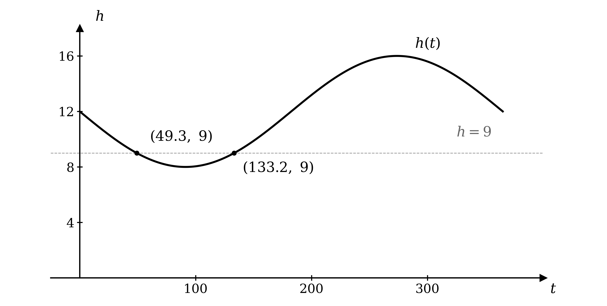
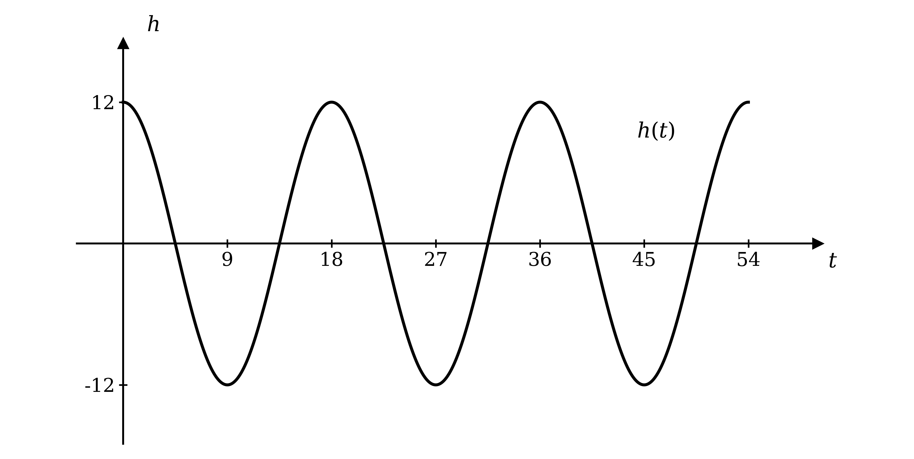

# Mark Schemes — Further Modelling with Functions
**Algebra & Functions** · Cambridge (CIE) AS maths (9709)

## Exam Questions (12 questions)

### Q1
To find the value after 7 years, substitute $t = 7$ into the model

`V \left(7\right) = 30000 \left( 1 + \frac{1 . 14}{100} \right)^{7}`

Evaluate

**Final answer:** $V = 32477 . 45$** dollars, to the nearest cent**

**[B1]**

> **[mark-scheme]**
> **B1**: The value of the investment after 7 years. Accept any answer of 3 significant figure accuracy or better, so 32500 and 32477.45 both score. Units are not required.
The investment has doubled when it is worth 60 000 dollars, so set the model equal to that value

`30000 \left( 1 + \frac{1 . 14}{100} \right)^{t} = 60000`

**[M1]**

Divide both sides by 30000

$1 . 0114^{t} = 2$

Take natural logarithms of both sides

`\text{ln} \; \left(1 . 0114^{t}\right) = \text{ln} \; 2`

Use the power law to bring the exponent down

$t \text{ln}  1 . 0114 = \text{ln}  2$

**[M1]**

Divide to make $t$ the subject

$t = \frac{\text{ln}2}{\text{ln}1.0114} = 61 . 148 . . .$

Round up, since after 61 years the value has not yet doubled

**Final answer:** $t = 62$** years**

**[A1]**

> **[exam-tip]**
> The direction of the rounding is where this sort of question is most often lost. If you are unsure, put both whole years back into the model and see which one first passes 60 000. Here 61 years gives about 59 900 and 62 years gives about 60 600, which confirms that 62 is the answer.

> **[mark-scheme]**
> **M1**: Correct use of the model to set up the doubling condition, either as `30000 \left( 1 . 0114 \right)^{t} = 60000` or as $1 . 0114^{t} = 2$.
> 
> **M1**: Correct use of logarithms on both sides, with the power law used to bring $t$ down. Logarithms to any base are accepted.
> 
> **A1**: The integer conclusion of 62 years. An unrounded answer of 61.1, or a value rounded down to 61, does not earn this mark, because the question asks for the number of whole years before the value has doubled.
Keep the structure of the first model, replacing the initial investment and the interest rate

`W = 25000 \left( 1 + \frac{1 . 3}{100} \right)^{t}`

**[B1]**

> **[mark-scheme]**
> **B1**: The correct formula. The simplified form `W = 25000 \left( 1 . 013 \right)^{t}` is equally acceptable, as is the use of $V$ in place of $W$.

### Q2
(i)

To find the altitude after 4 minutes, substitute $t = 4$ into the model

`a \left(4\right) = 5 \left( 4 \right)^{3} + 5 \left( 4 \right)^{2}`

Evaluate

**Final answer:** $a = 400$** feet**

**[B1]**

(ii)

Substitute $t = 6$ in the same way

`a \left(6\right) = 5 \left( 6 \right)^{3} + 5 \left( 6 \right)^{2}`

Evaluate

**Final answer:** $a = 1260$** feet**

**[B1]**

> **[mark-scheme]**
> **B1**: The altitude of 400 feet after 4 minutes. Units are not required.
> 
> **B1**: The altitude of 1260 feet after 6 minutes. Units are not required.
The change in altitude is the altitude at 9 minutes minus the altitude at 5 minutes, so find each in turn

`a \left(5\right) = 5 \left( 5 \right)^{3} + 5 \left( 5 \right)^{2} = 750`

`a \left(9\right) = 5 \left( 9 \right)^{3} + 5 \left( 9 \right)^{2} = 4050`

Subtract to find the change

$4050 - 750$

**[M1]**

**Final answer:** $\text{Change in altitude} = 3300$** feet**

**[A1]**

> **[mark-scheme]**
> **M1**: Correct use of the model at both 5 minutes and 9 minutes, with the two altitudes subtracted. Subtracting in the other order, giving $- 3300$, also earns this mark.
> 
> **A1**: The change in altitude of 3300 feet. A negative answer does not earn this mark, since the balloon is rising over this interval.
Consider what the model predicts once $t$ grows beyond the given interval

**Final answer:** **As **$t$** increases the altitude keeps increasing without limit, but a hot air balloon cannot rise forever, so the model is only valid up to its cruising altitude**

**[B1]**

> **[mark-scheme]**
> **B1**: Any statement making clear that the altitude given by the model grows without limit while a real balloon cannot keep rising, or that the balloon levels off once it reaches its cruising altitude. A comment only that the model is valid for $0 \leq t \leq 10$, without saying why, does not earn this mark.

### Q3
(i)

The greatest value of the sine function is 1, so the greatest height is 20 times that

**Final answer:** $\text{Maximum height} = 20$** cm**

**[B1]**

(ii)

The sine function first equals 1 when the angle is 90°

$15 t = 90$

Divide by 15 to reach the time

**Final answer:** $t = 6$** seconds**

**[B1]**

(iii)

To find the height after 8 seconds, substitute $t = 8$ into the model

`h \left(8\right) = 20 \text{sin} \; \left(15 \times 8\right)`*°*

Simplify the angle

`h \left(8\right) = 20 \text{sin} \; 120`*°*

Use the exact value of the sine of 120°

`h \left(8\right) = 20 \times \frac{\sqrt{3}}{2}`

Give the height in exact form and correct to 3 significant figures

**Final answer:** $h = 10 \sqrt{3}$** cm, which is **$17 . 3$** cm (3 s.f.)**

**[B1]**

> **[mark-scheme]**
> **B1**: The maximum height of 20 cm. The value 20 on its own is enough, and no working is needed.
> 
> **B1**: The time of 6 seconds. Accept the answer with or without units. Working is not required, but $15 t = 90$ leading to $t = 6$ shows where the value comes from.
> 
> **B1**: The height after 8 seconds, given either as the exact value $10 \sqrt{3}$ or as an answer which rounds to 17.3. An answer of 11.6 comes from evaluating the sine in radians and earns nothing.

### Q4
Doubling means the final value is $2 I$, so set the model equal to that

`I \left( 1 + \frac{r}{100} \right)^{8} = 2 I`

The initial amount cancels, so the answer does not depend on how much is invested

`\left( 1 + \frac{r}{100} \right)^{8} = 2`

**[M1]**

Raise both sides to the power $\frac{1}{8}$ (taking the 8th root, `\sqrt[8]{}`)

$1 + \frac{r}{100} = 2^{\frac{1}{8}} = 1 . 0905077 . . .$

**[M1]**

Subtract 1, then multiply by 100

**Final answer:** $r = 9 . 05$** % (3 s.f.)**

**[A1]**

> **[mark-scheme]**
> **M1**: Correct use of the model with the final value as twice the initial value, reaching `\left( 1 + \frac{r}{100} \right)^{8} = 2`. Using a particular starting amount, such as 100 and 200, is equally acceptable.
> 
> **M1**: Correct method to undo the power of 8, either by raising both sides to the power $\frac{1}{8}$ or by taking logarithms and dividing by 8.
> 
> **A1**: An answer which rounds to 9.05. The percentage sign is not required.
(i)

Write the value of each option after 10 years, taking $I$ as the amount invested

`V_{1} = I \left( 1 . 034 \right)^{10} + 500`

`V_{2} = I \left( 1 . 0385 \right)^{10}`

**[M1]**

Option 2 gives a greater return when its value is the larger of the two

`I \left( 1 . 0385 \right)^{10} > I \left( 1 . 034 \right)^{10} + 500`

Collect the terms in $I$ on one side and factorise

`I \left(1 . 0385^{10} - 1 . 034^{10}\right) > 500`

**[M1]**

Divide by the bracket, which is positive, so the inequality keeps its direction

$I > \frac{500}{1.0385^{10}-1.034^{10}} = 8064 . 028 . . .$

**Final answer:** **The least amount needed is 8064.03 dollars**

**[A1]**

(ii)

Compare the customer's 8100 dollars with that threshold

$8100 > 8064 . 03$

**[B1]**

The amount clears the threshold, so the option without the bonus wins

**Final answer:** **Advise the customer to choose Option 2, since 8100 dollars is above the amount at which the higher interest rate outweighs the 500 dollar bonus**

**[B1]**

> **[exam-tip]**
> Notice that the amount invested cancels in part (a) but not in part (b). In part (a) both sides grow in proportion to $I$, so the doubling rate is the same whatever you invest. In part (b) the 500 dollar bonus is a fixed amount rather than a proportion, which is exactly why a threshold exists at all: the bonus matters more to a small investor and less to a large one.

> **[mark-scheme]**
> **M1**: Correct expressions for the value of both options after 10 years, with the 500 added to Option 1 only.
> 
> **M1**: Correct formation of the inequality and collection of the terms in $I$, reaching `I \left(1 . 0385^{10} - 1 . 034^{10}\right) > 500` or equivalent. An equation rather than an inequality is accepted throughout, provided the final answer is identified as a least amount.
> 
> **A1**: An answer which rounds to 8064.03. Accept a value stated to the nearest dollar above, such as 8065, and accept the answer given as an inequality.
> 
> **B1**: A comparison of 8100 with the threshold found in (i), following through from that value.
> 
> **B1**: A conclusion recommending Option 2, justified by that comparison. A recommendation with no supporting comparison does not earn this mark. If the threshold found in (i) was above 8100, follow through and credit a correctly justified recommendation of Option 1.

### Q5
(i)

Since $b$ is positive, the maximum occurs where the sine equals 1 and the minimum where it equals $- 1$

$a + b = 17$

$a - b = 7$

**[M1]**

Add the two equations to eliminate $b$

$2 a = 24$

$a = 12 ,  b = 5$

**[A1]**

(ii)

Consider what the angle does over a full year, as $t$ runs from 0 to 365

$\frac{2π}{365} t$* runs from *$0$* to *$2 π$

That is one complete cycle of the sine

**Final answer:** **It makes the model repeat once every 365 days, so the pattern of daylight repeats once a year**

**[B1]**

(iii)

Find what the model gives on its own first day, and which way it is then heading

`h \left(0\right) = 12 + 5 \text{sin} \; 0 = 12`

The model starts at the halfway value of 12 hours and increases from there towards its maximum

**Final answer:** **The model starts at the spring equinox, around 20 March, because that is when daylight passes through 12 hours while still increasing**

**[B1]**

> **[mark-scheme]**
> **M1**: Correct use of the maximum and minimum to form two equations in $a$ and $b$. Accept the equivalent route of taking $a$ as the mean of 17 and 7 and $b$ as half their difference.
> 
> **A1**: Both values, $a = 12$ and $b = 5$. Both are needed.
> 
> **B1**: Any explanation making clear that this value sets the period to 365 days, so the model repeats once a year.
> 
> **B1**: The spring equinox, or any date around 20 or 21 March, supported by a reason. The reason must refer to the daylight being 12 hours and increasing, or to the model being at its mean value on the way up. A date with no reason does not earn this mark, and neither does the autumn equinox, where daylight is decreasing. Allow "middle of spring" or similar.

### Q6
(i)

Read the height of the peak from the graph

**Final answer:** $\text{Maximum height} = 20$** cm**

**[B1]**

(ii)

One complete wave runs from one crossing of the axis to the second one after it, so the curve repeats every 24 seconds

**Final answer:** **One wave every 24 seconds**

**[B1]**

(iii)

The amplitude is the maximum height, so $A$ is the value found in part (i)

$A = 20$

**[B1]**

A full cycle of the sine takes 360° of the angle, so divide that by the period to find $B$

$B = \frac{360}{24} = 15$

**Final answer:** `h \left(t\right) = 20 \text{sin} \; \left(15 t\right)`**°**

**[B1]**

> **[mark-scheme]**
> **B1**: The maximum height of 20 cm, read from the graph.
> 
> **B1**: One wave every 24 seconds. Accept any equivalent statement of the period, such as 2.5 waves per minute.
> 
> **B1**: The value $A = 20$.
> 
> **B1**: The value $B = 15$, or the complete function. A value of $B = \frac{2π}{24}$, from working in radians, does not earn this mark, since the question specifies degrees.
Doubling the amplitude doubles $A$

$A = 2 \times 20 = 40$

**[B1]**

At 15 waves per minute, each wave takes a minute divided by 15, and a minute is 60 seconds, so find the new period in seconds

$\text{Period} = \frac{60}{15} = 4$

Divide 360° by the new period to find $B$

$B = \frac{360}{4} = 90$

**Final answer:** `h \left(t\right) = 40 \text{sin} \; \left(90 t\right)`**°**

**[B1]**

> **[mark-scheme]**
> **B1**: The amplitude $A = 40$.
> 
> **B1**: The value $B = 90$, or the complete function. The period of 4 seconds seen on its own is not enough without $B$.
The model repeats one identical wave forever, whereas real waves differ from one another

**Final answer:** **Allow the height to vary from wave to wave, so that the waves are not all identical**

**[B1]**

> **[mark-scheme]**
> **B1**: Any improvement which introduces variation between waves. Accept varying the amplitude, varying the period, or adding a random element. Accept also allowing the tide level to change over time.

### Q7
(i)

The sine term is zero at the midway altitude, so the cruise begins and ends where `\text{sin} \; \left(t - 12\right) = 0`

$t - 12 = 0 ,  π ,  2 π ,  3 π ,  . . .$

The graph places the start of the cruise between 10 and 15 minutes, so take the first of these

$A_{t} = 12$

**[B1]**

The cruise completes $5 \frac{1}{2}$ cycles on the graph, and one cycle of `\text{sin} \; \left(t - 12\right)` takes $2 π$

$B_{t} = 12 + 5 . 5 \times 2 π$

**[M1]**

**Final answer:** $B_{t} = 12 + 11 π = 46 . 6$** minutes (3 s.f.)**

**[A1]**

The altitude $c$ is the value of $g$ at either end of the cruise, where the sine is zero

**Final answer:** $c = 3456$** feet**

**[B1]**

(ii)

The sine varies between $- 1$ and 1, so the cruising altitude varies 200 feet either side of 3456

$\text{Maximum} = 3456 + 200 = 3656$

$\text{Minimum} = 3456 - 200 = 3256$

Subtract to find the difference

**Final answer:** $3656 - 3256 = 400$** feet**

**[B1]**

> **[mark-scheme]**
> **B1**: The value $A_{t} = 12$. Accept this from either solving `\text{sin} \; \left(t - 12\right) = 0` or from solving `8 \left( t - 6 \right)^{3} + 1728 = 3456`, which gives the same value.
> 
> **M1**: Correct use of the period $2 π$ together with the 5.5 cycles read from the graph.
> 
> **A1**: The value $B_{t} = 12 + 11 π$, or an answer which rounds to 46.6. The exact form is preferred but the decimal is fully acceptable.
> 
> **B1**: The value $c = 3456$ feet.
> 
> **B1**: The difference of 400 feet. Accept this stated directly as twice the amplitude, without the maximum and minimum being found separately.
The descent runs from the end of the cruise to the ground, so it passes through two known points

`\left(B_{t}, \; c\right) = \left(12 + 11 \pi, \; 3456\right)`* and *`\left(60, \; 0\right)`

Find the gradient from these two points

`m = \frac{0 - 3456}{60 - \left(12 + 11 \pi\right)}`

**[M1]**

Simplify the denominator

$m = - \frac{3456}{48-11π} = - 257 . 1$* (1 d.p.)*

**[A1]**

Use the equation of a line with gradient $m$ through the point `\left(x_{1}, \; y_{1}\right)`, which is `y - y_{1} = m \left(x - x_{1}\right)`, taking the point `\left(60, \; 0\right)`

`h \left(t\right) - 0 = - \frac{3456}{48 - 11 \pi} \left(t - 60\right)`

**[M1]**

Take the minus sign inside the bracket to leave a positive coefficient

**Final answer:** `h \left(t\right) = \frac{3456}{48 - 11 \pi} \left(60 - t\right)`** for **$12 + 11 π \leq t \leq 60$

**[A1]**

> **[mark-scheme]**
> **M1**: Correct gradient calculation using the two endpoints of the descent, with the value of $B_{t}$ from part (a) followed through.
> 
> **A1**: The gradient, either exactly as $- \frac{3456}{48-11π}$ or as an answer which rounds to $- 257$.
> 
> **M1**: Correct use of a straight line equation with the gradient and either endpoint.
> 
> **A1**: Any correct form of the equation. Accept the exact form, the expanded form `h \left(t\right) = 15426 - 257 . 1 t`, or `h \left(t\right) = - 257 . 1 \left(t - 60\right)`. The domain is not required for the mark.
Consider what a real flight has to contend with that the model ignores

**Final answer:** **A real balloon is affected by the weather, particularly wind speed and direction, and the pilot must also find a safe place to land and avoid obstacles, so an actual flight is unlikely to follow so precise a path**

**[B1]**

> **[mark-scheme]**
> **B1**: Any sensible practical objection. Accept the effect of wind or weather, the need to choose a landing site, avoiding obstacles, or the point that a real balloon could not follow a smooth sine wave while cruising. A comment only that the model is unrealistic, with no reason, does not earn this mark.

### Q8
(i)

The sine term is subtracted, so $h$ is greatest when the sine takes its least value of $- 1$

`16 = 12 - a \left(- 1\right) = 12 + a`

$a = 4$

**[B1]**

(ii)

The gardener cannot play golf when there are fewer than 9 hours of daylight, so start from the boundary case $h = 9$

`9 = 12 - 4 \text{sin} \; \left(\frac{2 \pi t}{365}\right)`

Rearrange to isolate the sine

`4 \text{sin} \; \left(\frac{2 \pi t}{365}\right) = 3`

`\text{sin} \; \left(\frac{2 \pi t}{365}\right) = \frac{3}{4}`

**[M1]**

Take the inverse sine to find the first angle, working in radians

`\frac{2 \pi t}{365} = \text{sin}^{- 1} \left(\frac{3}{4}\right) = 0 . 848062 . . .`

Multiply by $\frac{365}{2π}$ to convert the angle back to a day

$t = 49 . 3$

**[A1]**

The sine curve is symmetrical about its peak, so the second angle is $π$ minus the first

$\frac{2πt}{365} = π - 0 . 848062 . . . = 2 . 293530 . . .$

$t = 133 . 2$

**[M1]**

A sketch shows which stretch of the year falls below the 9 hour line

Test the whole days at each end, since the days must be counted inclusively

`h \left(49\right) = 9 . 01`* and *`h \left(50\right) = 8 . 97`

`h \left(133\right) = 8 . 99`* and *`h \left(134\right) = 9 . 04`

So the short days run from day 50 to day 133 inclusive, which is $133 - 50 + 1$ days

**Final answer:** **The gardener cannot play golf on approximately 84 days**

**[A1]**

> **[mark-scheme]**
> **B1**: The value $a = 4$. No working is required, since the question says to write it down.
> 
> **M1**: Correct use of $h = 9$ and rearrangement to `\text{sin} \; \left(\frac{2 \pi t}{365}\right) = \frac{3}{4}`, or equivalent.
> 
> **A1**: The first value, which is any answer rounding to 49.3. The angle 0.848 on its own is enough for this mark. Working in degrees gives 48.6 for the angle and does not lead to a correct day, so it earns nothing here.
> 
> **M1**: Correct use of the symmetry of the sine curve to obtain the second angle as $π - 0 . 848$, leading to a value which rounds to 133.2.
> 
> **A1**: The count of 84 days. Accept 83 or 84, since the question asks only for an approximate figure, and accept the count reached either by the inclusive day count from 50 to 133 or by the difference $133 . 2 - 49 . 3 = 83 . 9$ rounded to the nearest day.

### Q9
The coefficient of the cosine is the amplitude, so the curve runs between $12$ and $- 12$

$\text{Maximum} = 12$

$\text{Minimum} = - 12$

A full cycle of the cosine takes 360° of the angle, so divide by the 20 inside the bracket to get the period in seconds

$\text{Period} = \frac{360}{20} = 18$

Since $54 = 3 \times 18$, the interval holds exactly three complete waves, and the cosine starts at its maximum

**[B1 B1 B1]**

> **[mark-scheme]**
> **B1**: A cosine shape starting at its maximum when $t = 0$. A sine shape, starting at zero, does not earn this mark.
> 
> **B1**: The maximum and minimum values shown as 12 and $- 12$.
> 
> **B1**: Three complete waves drawn across $0 \leq t \leq 54$, equivalent to a period of 18 seconds. The curve must finish at a peak at $t = 54$.
(i)

The amplitude is the coefficient of the cosine

**Final answer:** $\text{Maximum height} = 12$** cm**

**[B1]**

(ii)

One wave takes one full period, found above

**Final answer:** **One wave every 18 seconds**

**[B1]**

(iii)

The water is at its calm level when $h = 0$, so the cosine must be zero

$20 t = 90 ,  270 ,  450 ,  . . .$

$t = 4 . 5 ,  13 . 5 ,  22 . 5 ,  . . .$

These are 9 seconds apart, which is half a period

**Final answer:** **Every 9 seconds, starting at **$t = 4 . 5$** seconds**

**[B1]**

(iv)

The peak of the first wave is at $t = 0$, so the 12th peak comes 11 periods later

$t = 11 \times 18$

**Final answer:** $t = 198$** seconds**

**[B1]**

> **[exam-tip]**
> Count the gaps, not the peaks. The question tells you $t = 0$ is when the first peak passes, so by the 12th peak only 11 full waves have gone by, giving $11 \times 18$ rather than $12 \times 18$.

> **[mark-scheme]**
> **B1**: The maximum height of 12 cm.
> 
> **B1**: One wave every 18 seconds. Accept any equivalent statement of the period, such as a frequency of one wave per 18 seconds.
> 
> **B1**: Every 9 seconds. The starting time of 4.5 seconds is not required for the mark, but a bare 4.5 seconds without the interval does not earn it.
> 
> **B1**: The time of 198 seconds. An answer of 216, from counting 12 periods rather than 11, does not earn this mark.
Compare what the model repeats with what real water does

**Final answer:** **Every wave the model produces is identical, whereas real sea waves vary in height and spacing, so the model is not entirely realistic**

**[B1]**

> **[mark-scheme]**
> **B1**: Any comment making clear that the model gives identical, perfectly regular waves while real sea waves vary. Accept comments on varying height, varying period, or the waves continuing unchanged forever. A comment only that the model is unrealistic, with no reason, does not earn this mark.

### Q10
(i)

Since $t = 0$ is the first day, the 100th day is $t = 99$

`h \left(99\right) = 12 + 5 \text{sin} \; \left(\frac{2 \pi \times 99}{365}\right)`

**[M1]**

Evaluate, working in radians

`h \left(99\right) = 16 . 9555 . . .`

**Final answer:** $h = 16 . 96$** hours (2 d.p.)**

**[A1]**

(ii)

The sine function ranges between $- 1$ and 1, so the model ranges 5 either side of 12

**Final answer:** $\text{Maximum} = 12 + 5 = 17$** hours**

**[B1]**

**Final answer:** $\text{Minimum} = 12 - 5 = 7$** hours**

**[B1]**

(iii)

Find what the model predicts on its own first day

`h \left(0\right) = 12 + 5 \text{sin} \; 0 = 12`

Compare this with what the UK actually experiences in early January

**Final answer:** **The model gives 12 hours of daylight on its first day, but daylight in the UK on 1 January is close to the minimum of 7 hours, so the model must start at a different time of year**

**[B1]**

> **[exam-tip]**
> Read the definition of the variable before you substitute. Here $t = 0$ is the first day, so the 100th day is $t = 99$, and substituting 100 instead gives 16.94, which is close enough to look right but is not. Whenever a question defines a starting value explicitly, it is usually because the off-by-one matters.

> **[mark-scheme]**
> **M1**: Correct substitution of $t = 99$ into the model. Substituting $t = 100$ does not earn this mark, because the question states that $t = 0$ is the first day.
> 
> **A1**: Accept any answer of 3 significant figure accuracy or better, so both 17.0 and 16.96 score. An answer of 16.94 comes from using $t = 100$ and scores nothing here. Working in degrees rather than radians gives 12.1 and earns neither mark.
> 
> **B1**: The maximum of 17 hours, from $12 + 5$.
> 
> **B1**: The minimum of 7 hours, from $12 - 5$.
> 
> **B1**: Any reason making clear that the model predicts 12 hours on its first day while UK daylight on 1 January is near the yearly minimum. Stating only that the answer should be near the minimum, without linking it to what the model gives at $t = 0$, is not enough for this mark.

### Q11
Substitute the initial amount, the rate and the time into the model

`V \left(12\right) = 1000 \left( 1 + \frac{0 . 8}{100} \right)^{12}`

**[M1]**

Evaluate

`V \left(12\right) = 1000 \times 1 . 008^{12}`

**Final answer:** $V = 1100 . 34$** dollars, to the nearest cent**

**[A1]**

> **[mark-scheme]**
> **M1**: Correct substitution of $I = 1000$, $r = 0 . 8$ and $t = 12$ into the model. The multiplier 1.008 seen raised to the power 12 also earns this mark.
> 
> **A1**: The value of the investment. Accept any answer of 3 significant figure accuracy or better, so 1100 and 1100.34 both score.
Substitute the values that are known into the model, leaving $r$ as the unknown

`400 \left( 1 + \frac{r}{100} \right)^{8} = 448 . 82`

**[M1]**

Divide both sides by 400 to isolate the bracket

`\left( 1 + \frac{r}{100} \right)^{8} = 1 . 12205`

Raise both sides to the power $\frac{1}{8}$ (taking the 8th root, `\sqrt[8]{}`)

$1 + \frac{r}{100} = 1 . 12205^{\frac{1}{8}} = 1 . 0144987 . . .$

**[M1]**

Subtract 1

$\frac{r}{100} = 0 . 0144987 . . .$

Multiply by 100 to reach the percentage rate

**Final answer:** $r = 1 . 45$** % (3 s.f.)**

**[A1]**

> **[mark-scheme]**
> **M1**: Correct substitution of the initial amount, the final value and the time into the model, giving an equation in $r$ alone.
> 
> **M1**: Correct method to undo the power of 8, either by raising both sides to the power $\frac{1}{8}$ or by taking logarithms of both sides and dividing by 8. Both routes are equally acceptable.
> 
> **A1**: An answer which rounds to 1.45. The percentage sign is not required. An answer of 0.0145, left as a decimal rather than converted to a percentage, does not earn this mark.
The value has doubled when it reaches 40 000 dollars, so set the model equal to that value

`20000 \left( 1 + \frac{3 . 4}{100} \right)^{t} = 40000`

**[M1]**

Divide both sides by 20000

$1 . 034^{t} = 2$

Take natural logarithms of both sides

`\text{ln} \; \left(1 . 034^{t}\right) = \text{ln} \; 2`

Use the power law to bring the exponent down

$t \text{ln}  1 . 034 = \text{ln}  2$

**[M1]**

Divide to make $t$ the subject

$t = \frac{\text{ln}2}{\text{ln}1.034} = 20 . 7313 . . .$

**[A1]**

Round up, since after 20 years the value has not yet doubled

**Final answer:** $t = 21$** years**

**[A1]**

> **[mark-scheme]**
> **M1**: Correct use of the model to set up the doubling condition, either as `20000 \left( 1 . 034 \right)^{t} = 40000` or as $1 . 034^{t} = 2$.
> 
> **M1**: Correct use of logarithms on both sides, with the power law used to bring $t$ down. Logarithms to any base are accepted.
> 
> **A1**: The unrounded value, which is any answer rounding to 20.7.
> 
> **A1**: The integer conclusion of 21 years. Rounding down to 20 does not earn this mark, because the value has not doubled by the end of the 20th year.
The model fixes the rate and assumes no money moves in or out, so relax one of those assumptions

**Final answer:** **Allow the interest rate to change over time, or allow money to be paid into or taken out of the account**

**[B1]**

> **[mark-scheme]**
> **B1**: Either refinement is enough on its own. Accept allowing the interest rate to vary from year to year, or allowing deposits and withdrawals during the investment. Accept also interest being added more often than once a year. A comment only that the model is unrealistic, with no refinement described, does not earn this mark.

### Q12
(i)

The balloon reaches its cruising altitude at 11 minutes, so substitute $t = 11$

`a \left(11\right) = 8 \left( 11 \right)^{3} - 132 \left( 11 \right)^{2} + 726 \left(11\right)`

Evaluate

**Final answer:** $\text{Cruising altitude} = 2662$** feet**

**[B1]**

(ii)

Find the altitude at each end of the interval, starting at 8 minutes

`a \left(8\right) = 8 \left( 8 \right)^{3} - 132 \left( 8 \right)^{2} + 726 \left(8\right) = 1456`

Now find the altitude at 3 minutes

`a \left(3\right) = 8 \left( 3 \right)^{3} - 132 \left( 3 \right)^{2} + 726 \left(3\right) = 1206`

**[M1]**

Subtract to find the rise over the interval

**Final answer:** $1456 - 1206 = 250$** feet, as required**

**[A1]**

To judge how the pilot flew, compare this with the rise over the two intervals either side

`a \left(3\right) - a \left(0\right) = 1206 - 0 = 1206`

`a \left(11\right) - a \left(8\right) = 2662 - 1456 = 1206`

The balloon gains 1206 feet in each of the outer intervals but only 250 feet in the middle one

**Final answer:** **The pilot ascended quickly at the start and at the end of the flight, but much more slowly between 3 and 8 minutes**

**[B1]**

> **[mark-scheme]**
> **B1**: The cruising altitude of 2662 feet. Units are not required.
> 
> **M1**: Correct use of the model at both 8 minutes and 3 minutes. Both altitudes must be seen, since the answer is given.
> 
> **A1**: The subtraction shown to give 250 feet. Because the result is printed in the question, the working must be visible; a bare statement that the rise is 250 feet does not earn this mark.
> 
> **B1**: Any comparison making clear that the balloon rose much more slowly between 3 and 8 minutes than it did before 3 minutes or after 8 minutes. Supporting figures are not required, but a comment only that the rise is small, with nothing to compare it against, does not earn this mark.
Set the model equal to zero

$8 t^{3} - 132 t^{2} + 726 t = 0$

Every term has a factor of $2 t$, so take it out

`2 t \left(4 t^{2} - 66 t + 363\right) = 0`

**[M1]**

One solution comes from the factor outside the bracket

$2 t = 0$

Divide by 2

$t = 0$

Test the quadratic factor with the discriminant $b^{2} - 4 a c$, where $a = 4$, $b = - 66$ and $c = 363$

`\left( - 66 \right)^{2} - 4 \left(4\right) \left(363\right) = 4356 - 5808`

**[M1]**

$b^{2} - 4 a c = - 1452 < 0$

A negative discriminant means the quadratic has no real roots, so nothing else can make the product zero

**Final answer:** **The only real solution is **$t = 0$**, as required**

**[A1]**

Interpret that in the context of the flight

**Final answer:** **The model gives an altitude of zero only at take off, so it predicts the balloon never returns to the ground and therefore cannot describe the flight indefinitely**

**[B1]**

> **[mark-scheme]**
> **M1**: Correct factorisation of the cubic, taking out a factor of $t$ or $2 t$ to leave a quadratic. Accept `t \left(8 t^{2} - 132 t + 726\right)` as an equivalent factorisation.
> 
> **M1**: Correct use of the discriminant on the quadratic factor. If the factorisation was `t \left(8 t^{2} - 132 t + 726\right)`, the discriminant is `\left( - 132 \right)^{2} - 4 \left(8\right) \left(726\right) = - 5808`, which is equally acceptable.
> 
> **A1**: A negative discriminant stated, the conclusion that the quadratic has no real roots, and hence that $t = 0$ is the only real solution. All three are needed, since the result is given.
> 
> **B1**: Any explanation making clear that the model has the balloon at ground level only at the start, so it never predicts a landing. Accept also that the altitude increases without limit beyond the given interval.
