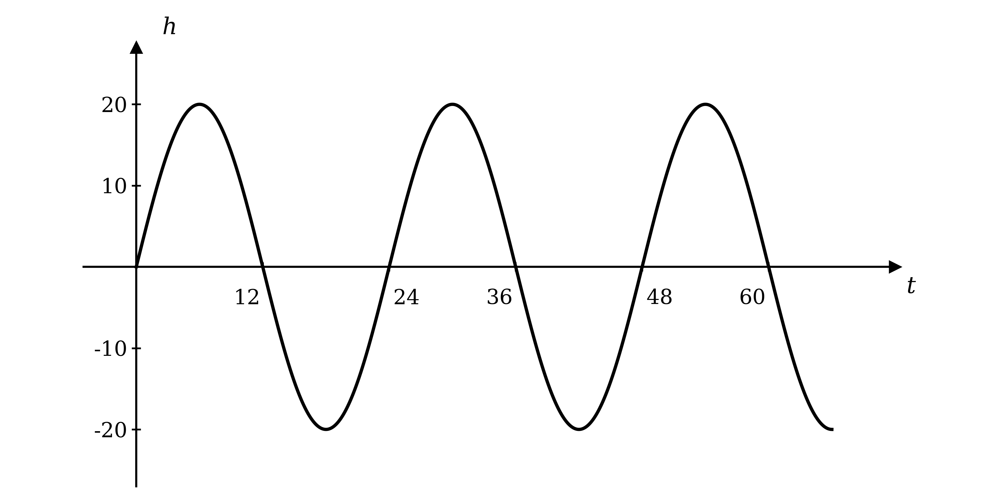

# Exam Questions — Further Modelling with Functions
**Algebra & Functions** · Cambridge (CIE) AS maths (9709)
> Source: [https://www.savemyexams.com/as/maths/cie/20/pure-2/topic-questions/](https://www.savemyexams.com/as/maths/cie/20/pure-2/topic-questions/) · 12 questions across 1 sets

## Exam Questions (12 questions)

### Q1 — easy — 5 marks

**Q1** [1 mark]

A business owner invests 30 000 dollars at an interest rate of 1.14% per year.

The value, $V$ dollars, of the investment $t$ years after the initial investment is modelled by the formula

`V \left(t\right) = 30000 \left( 1 + \frac{1 . 14}{100} \right)^{t}`

Find the value of the investment after 7 years.

**Q1** [3 marks]

Find the least number of whole years it will take before the value of the investment has doubled.

**Q1** [1 mark]

The value, $W$ dollars, of a second investment $t$ years after the initial investment is modelled in the same way, with an initial investment of 25 000 dollars at an interest rate of 1.3% per year.

Write down a formula for $W$ in terms of $t$.

### Q2 — easy — 5 marks

**Q2** [2 marks]

The flight of a hot air balloon ascending from the ground to its cruising altitude is modelled according to the function

`a \left(t\right) = 5 t^{3} + 5 t^{2}`

$0 \leq t \leq 10$

where $t$ is the time of ascent in minutes and $a$ is the altitude in feet.

Find the altitude of the hot air balloon after:

(i) 4 minutes,

(ii) 6 minutes.

**Q2** [2 marks]

Find the change in altitude of the hot air balloon between 5 minutes and 9 minutes.

**Q2** [1 mark]

Explain why the model should not be used for larger values of $t$.

### Q3 — easy — 3 marks

**Q3** [3 marks]

***Note: For this question ensure you are working in degrees.***

The height, $h$ cm, of water in a wave tank, at time $t$ seconds after the tank is switched on, is measured according to the function

`h \left(t\right) = 20 \text{sin} \; \left(15 t\right)`°

$t \geq 0$

The model is designed so that a height of 0 cm represents calm, still water.

(i) What is the maximum height the water will reach?

(ii) How long does it take the water to first reach its maximum height?

(iii) Find the height of the water after 8 seconds.

### Q4 — hard — 8 marks

**Q4** [3 marks]

In a simple model of an investment account, the function

`V \left(t\right) = I \left( 1 + \frac{r}{100} \right)^{t}`

is used, where $I$ is the initial amount invested, $r$ % is the interest rate, and $V$ is the value of the investment at the end of $t$ years.

Find the interest rate required for an amount of money invested for 8 years to double in value.

**Q4** [5 marks]

An investor is comparing two options offered by a local bank.

(i) Find the least amount of money an investor would need in order for Option 2 to give a greater return than Option 1.

(ii) What advice would you give to a customer with 8100 dollars to invest? Justify your answer.

### Q5 — medium — 4 marks

**Q5** [4 marks]

A gardener wants to model the number of hours of daylight his allotment receives at different times of the year using a function of the form

`h \left(t\right) = a + b \text{sin} \; \left(\frac{2 \pi}{365} t\right)`

$t \geq 0$

where $h$ is the number of hours of daylight on a given day, $t$ is the time measured in whole days, and $a$ and $b$ are positive constants. Note that $t = 0$ corresponds to the first day of the model.

(i) Given that the model needs to predict a maximum of 17 hours daylight and a minimum of 7 hours daylight, find the values of $a$ and $b$.

(ii) Explain the significance of the value $\frac{2π}{365}$ in the model.

(iii) Suggest, with a reason, the date of the year that the model starts on.

### Q6 — hard — 7 marks

**Q6** [4 marks]

***Note: For this question ensure you are working in degrees.***

A wave tank is used to simulate the sea at high tide.

At a certain point along the tank the height of water is measured relative to the calm water level, which has a height of 0 cm.

The graph of the height of water, $h$ cm, against the time after the simulation is started, $t$ seconds, is shown below.

(i) According to the graph what is the maximum height the water will reach?

(ii) How frequent are the waves generated by the tank?

(iii) Use the graph to write down a function for the model in the form

`h \left(t\right) = A \text{sin} \; \left(B t\right)`°

$t \geq 0$

**Q6** [2 marks]

Write down a model of the form `h \left(t\right) = A \text{sin} \; \left(B t\right)`° that could be used to generate waves of double the amplitude and at a frequency of 15 waves per minute.

**Q6** [1 mark]

Suggest a way the model can be improved for simulating actual sea waves.

### Q7 — very_hard — 10 marks

**Q7** [5 marks]

The flight path of a hot air balloon is planned according to the graph below.

The path is made up of three segments, ascent, cruising and descent.

Point `A \left(A_{t}, \; c\right)` is the point where the flight path changes from ascent to cruising.

Point `B \left(B_{t}, \; c\right)` is the point where the flight path changes from cruising to descent.

The functions for the ascent and cruising segments of the flight are given below.

Ascent: `f \left(t\right) = 8 \left( t - 6 \right)^{3} + 1728` for $0 \leq t \leq A_{t}$

Cruise: `g \left(t\right) = 3456 + 200 \text{sin} \; \left(t - 12\right)` for $A_{t} \leq t \leq B_{t}$

where `f \left(t\right)` and `g \left(t\right)` give the altitude in feet at a time $t$ minutes after the commencement of the balloon's flight.

The balloon begins and ends the cruising segment of its flight at an altitude midway between its minimum and maximum cruising altitudes.

Use the information given to deduce

(i) the values of $A_{t}$, $B_{t}$ and $c$,

(ii) the difference between the maximum and minimum cruising altitudes.

**Q7** [4 marks]

The total flight time is planned to be 60 minutes. The descent part of the journey is modelled by a linear function, `h \left(t\right)`, where $B_{t} \leq t \leq 60$.

Find an equation for `h \left(t\right)`.

**Q7** [1 mark]

Describe a problem with attempting to model hot air balloon flights in this manner.

### Q8 — hard — 5 marks

**Q8** [5 marks]

A gardener is modelling the number of hours of daylight his allotment receives at different times of the year using the function

`h \left(t\right) = 12 - a \text{sin} \; \left(\frac{2 \pi t}{365}\right)`

$t \geq 0$

where $h$ is the number of hours of daylight on a given day, $t$ is the time measured in whole days, and $a$ is a positive constant.

(i) Given that the maximum amount of daylight predicted by the model is 16 hours, write down the value of $a$.

(ii) The gardener is also a keen golfer.

In order to have enough daylight to play golf after working in the garden there needs to be at least 9 hours daylight in the day.

On approximately how many days of the year can the gardener ***not*** play golf?

### Q9 — medium — 8 marks

**Q9** [3 marks]

***Note: For this question ensure you are working in degrees.***

A wave tank is used to simulate the sea at high tide. At a certain point along the tank the height of water is measured relative to the calm water level, which has a height of 0 cm.

The height of water in the tank is modelled by the function

`h \left(t\right) = 12 \text{cos} \; \left(20 t\right)`°

$t \geq 0$

where $h$ cm is the height of water and $t$ seconds is the time after the peak of the first wave passes the measuring point.

Sketch a graph of $h$ against $t$ for $0 \leq t \leq 54$.

**Q9** [4 marks]

(i) What is the maximum height the water reaches according to the model?

(ii) How frequent are the waves generated by the tank?

(iii) How often is the water at its calm level?

(iv) When will the peak of the 12th wave pass the measuring point?

**Q9** [1 mark]

Comment on the suitability of using this model to simulate actual sea waves.

### Q10 — easy — 5 marks

**Q10** [5 marks]

A gardener is modelling the number of hours of daylight his allotment receives at different times of the year using the function

`h \left(t\right) = 12 + 5 \text{sin} \; \left(\frac{2 \pi t}{365}\right)`

$t \geq 0$

where $h$ is the number of hours of daylight on a given day, and $t$ is the time measured in whole days. Note that $t = 0$ corresponds to the first day of the model.

(i) Find the number of hours of daylight on the 100th day.

(ii) Write down the maximum and minimum number of daylight hours the model predicts.

(iii) Assuming the allotment is located in the UK, give a reason why the first day of the model most likely does ***not*** correspond to 1st January.

### Q11 — medium — 10 marks

**Q11** [2 marks]

In a simple model of an investment account, the function

`V \left(t\right) = I \left( 1 + \frac{r}{100} \right)^{t}`

is used, where $I$ is the initial amount invested, $r$ % is the interest rate, and $V$ is the value of the investment $t$ years later.

For an initial investment of 1000 dollars, find the value after 12 years at an interest rate of 0.8%.

**Q11** [3 marks]

After investing 400 dollars for 8 years the value of the investment is 448.82 dollars.

Find the interest rate, correct to three significant figures.

**Q11** [4 marks]

Find the least number of years 20 000 dollars would need to be invested at an interest rate of 3.4% in order for its value to have doubled.

**Q11** [1 mark]

Describe a refinement to the model that would more realistically reflect the way savings and investment accounts work.

### Q12 — hard — 8 marks

**Q12** [4 marks]

A hot air balloon is modelled ascending from the ground to its cruising height according to the function

`a \left(t\right) = 8 t^{3} - 132 t^{2} + 726 t`

$0 \leq t \leq 11$

where $t$ is the time of ascent in minutes and $a$ is the altitude in feet.

(i) It takes 11 minutes for the hot air balloon to reach its cruising altitude. Find the cruising altitude.

(ii) Show that the hot air balloon rises by just 250 feet between 3 and 8 minutes. What does this suggest about how the pilot flew the hot air balloon during its ascent?

**Q12** [4 marks]

Show that there is only one real solution to the equation `a \left(t\right) = 0` and hence explain why the model cannot be used indefinitely for the altitude of the hot air balloon.
