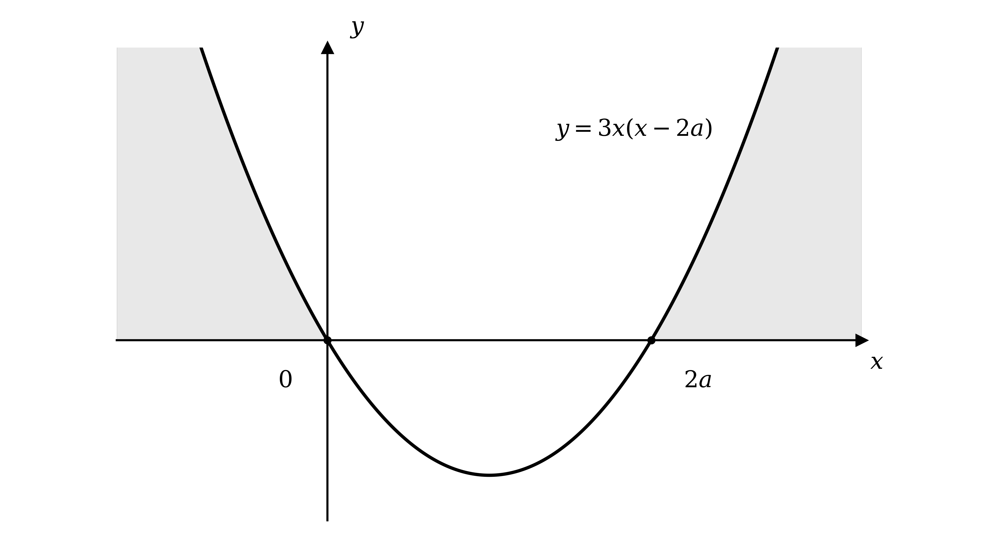
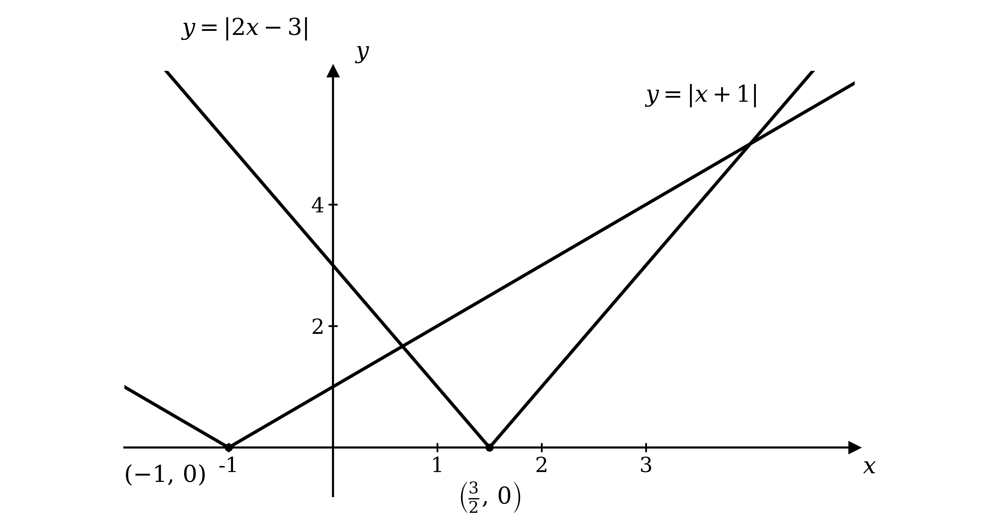
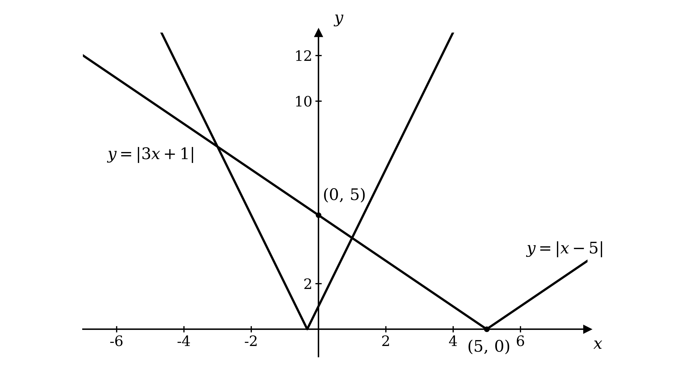
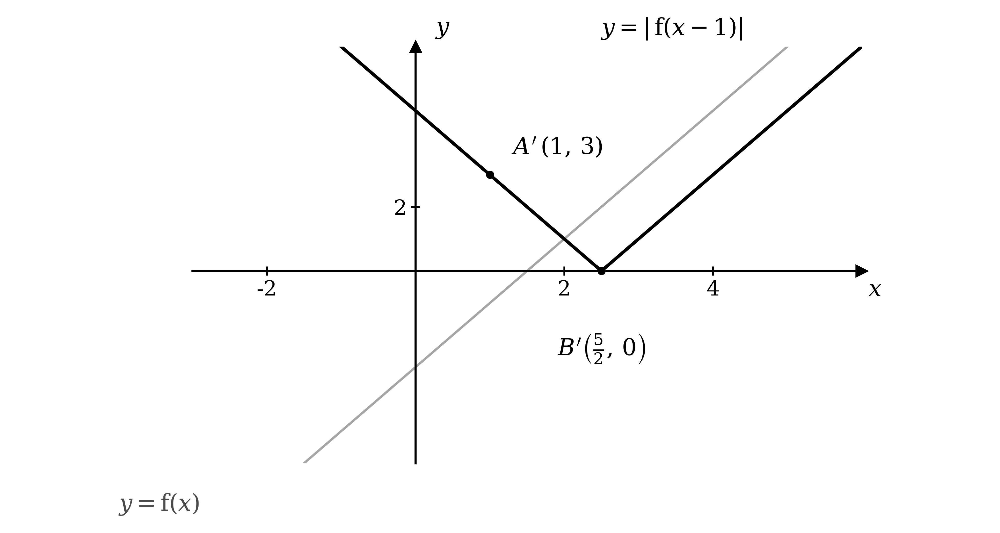
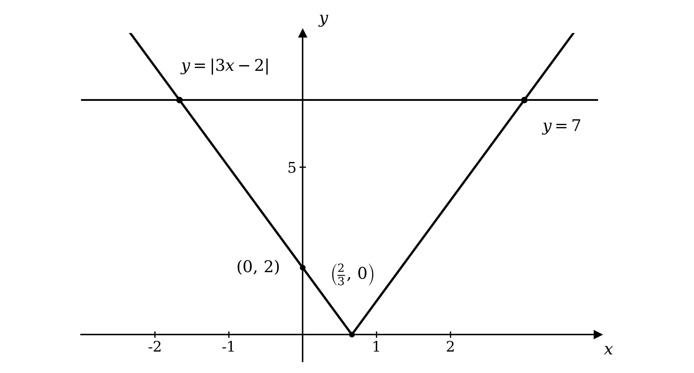
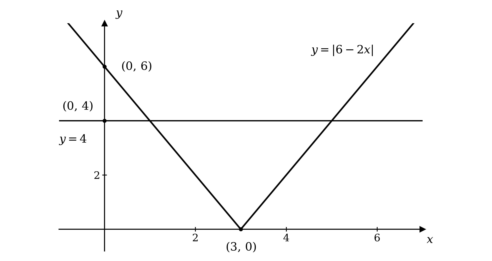
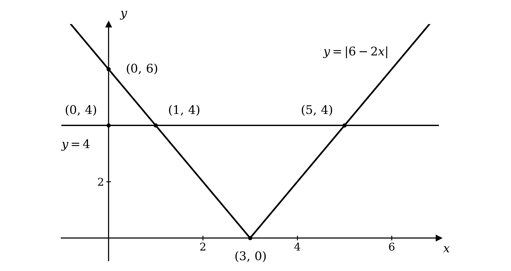
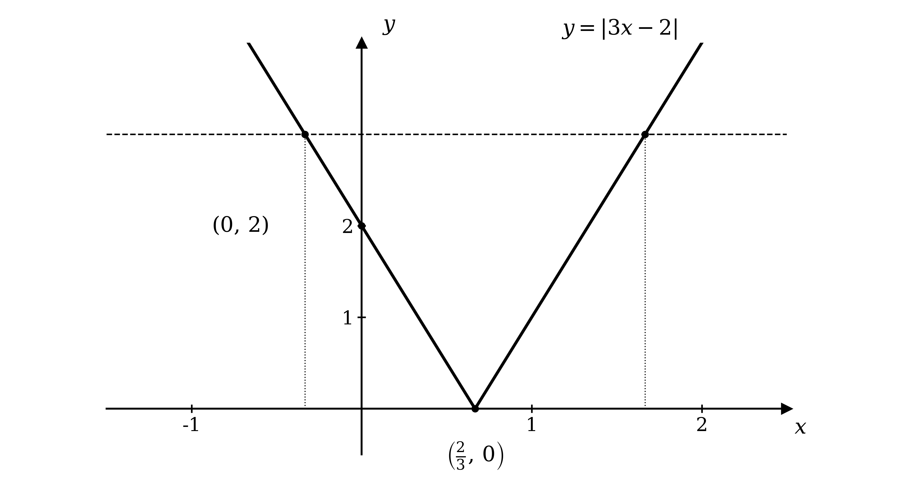
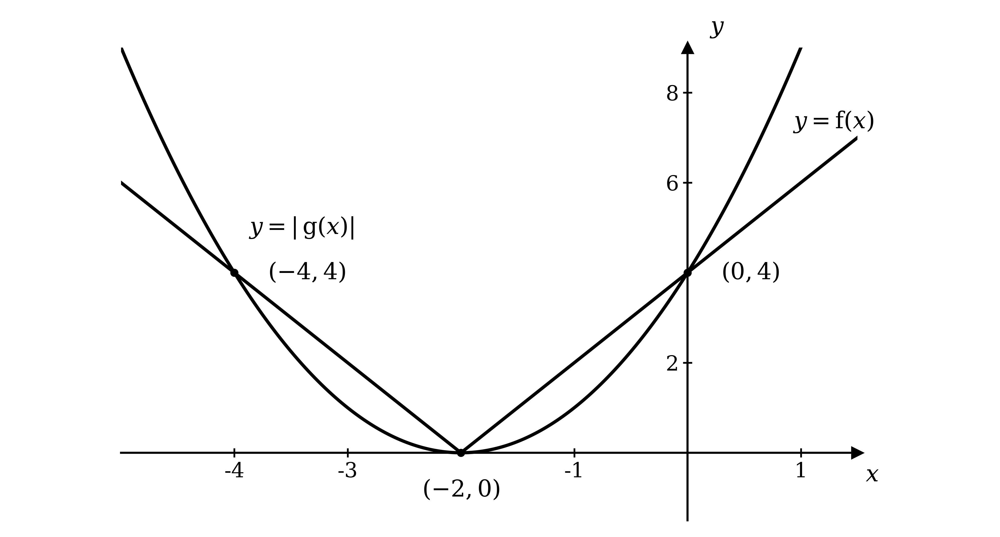
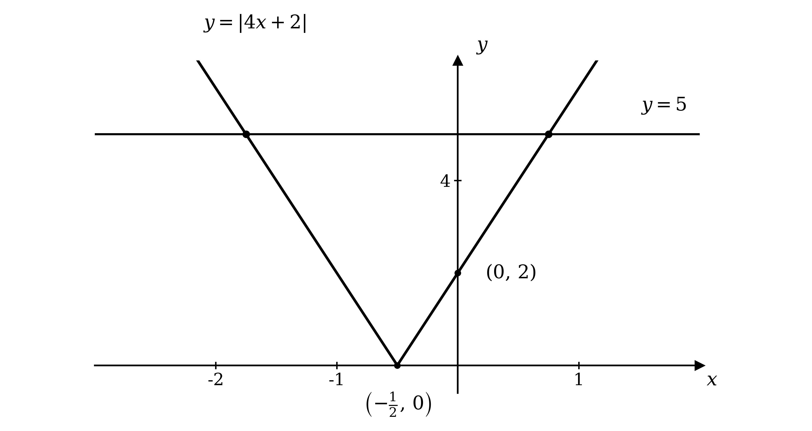

# Mark Schemes — Modulus Functions
**Algebra & Functions** · Cambridge (CIE) AS maths (9709)

## Exam Questions (15 questions)

### Q1
Both sides are moduli, so square both sides, using `\left|X\right| > \left|Y\right| \Leftrightarrow X^{2} > Y^{2}`

`\left( 2 x - a \right)^{2} > \left( x + a \right)^{2}`

**[B1]**

Expand both sides

$4 x^{2} - 4 a x + a^{2} > x^{2} + 2 a x + a^{2}$

Collect all terms on one side, and note the $a^{2}$ terms cancel

$3 x^{2} - 6 a x > 0$

Factorise

`3 x \left(x - 2 a\right) > 0`

**[M1]**

**Final answer:** $x = 0$** and **$x = 2 a$

**[A1]**

Since $a > 0$, the critical values are in the order $0 < 2 a$, and the upward parabola `3 x \left(x - 2 a\right)` is positive outside its roots, shown shaded below

**Final answer:** $x < 0$** or **$x > 2 a$

**[A1]**

> **[mark-scheme]**
> **B1**: Squares both sides to form `\left( 2 x - a \right)^{2} > \left( x + a \right)^{2}`.
> 
> **M1**: Expands, cancels the $a^{2}$ terms and factorises to `3 x \left(x - 2 a\right) > 0` (or finds the critical values by the formula).
> 
> **A1**: Critical values $x = 0$ and $x = 2 a$.
> 
> **A1**: $x < 0$ or $x > 2 a$. The region must be outside the critical values, using $a > 0$ to order them.

### Q2
Sketch `y = \left|x - 4\right|` (a V with vertex `\left(4 , 0\right)`) and the line $y = 2 x - 5$

Each arm of the V gives a possible equation: the regular (right) arm $x - 4 = 2 x - 5$ and the reflected (left) arm `- \left(x - 4\right) = 2 x - 5`

$x - 4 = 2 x - 5$

`- \left(x - 4\right) = 2 x - 5`

**[M1]**

Solving these gives two candidate values

$x - 4 = 2 x - 5 \Rightarrow x = 1$

$4 - x = 2 x - 5 \Rightarrow 3 x = 9 \Rightarrow x = 3$

**[A1]**

The sketch shows the line crosses the V just once. To the right of the vertex the line $y = 2 x - 5$ (gradient $2$) is steeper than the arm $y = x - 4$ (gradient $1$) and already lies above it, so they cannot meet there; the candidate $x = 1$ is rejected

$x = 3$

**[A1]**

> **[mark-scheme]**
> **M1**: Both cases formed from the two arms, $x - 4 = 2 x - 5$ and `- \left(x - 4\right) = 2 x - 5`.
> 
> **A1**: Both candidate values $x = 1$ and $x = 3$.
> 
> **A1**: Rejects $x = 1$ because the steeper line does not meet the right arm (equivalently, the line is negative there), giving $x = 3$.

### Q3
Both sides are moduli, so square both sides, using `\left|a\right| \leq \left|b\right| \Leftrightarrow a^{2} \leq b^{2}`

`\left( 3 x + 2 \right)^{2} \leq \left( x - 4 \right)^{2}`

**[B1]**

Expand and collect all terms on one side

$9 x^{2} + 12 x + 4 \leq x^{2} - 8 x + 16$

$8 x^{2} + 20 x - 12 \leq 0$

Divide by $4$ and factorise to find the critical values

$2 x^{2} + 5 x - 3 \leq 0$

`\left(2 x - 1\right) \left(x + 3\right) \leq 0`

**[M1]**

**Final answer:** $x = \frac{1}{2}$** and **$x = - 3$

**[A1]**

The graph of $y = 2 x^{2} + 5 x - 3$ is an upward parabola, so it is negative or zero between its roots, shown shaded below

$- 3 \leq x \leq \frac{1}{2}$

**[A1]**

> **[exam-tip]**
> You could also solve this graphically: sketch `y = \left|3 x + 2\right|` and `y = \left|x - 4\right|` on the same axes and find the crossings by matching arms.
> 
> Both reflected arms give $3 x + 2 = x - 4$, so $x = - 3$; the non-reflected arm of `y = \left|3 x + 2\right|` against the reflected arm of `y = \left|x - 4\right|` gives `3 x + 2 = - \left(x - 4\right)`, so $x = \frac{1}{2}$.
> 
> The inequality `\left|3 x + 2\right| \leq \left|x - 4\right|` then holds where the first graph lies on or below the second, which is between the crossings, giving $- 3 \leq x \leq \frac{1}{2}$.

> **[mark-scheme]**
> **B1**: Correct non-modular inequality `\left( 3 x + 2 \right)^{2} \leq \left( x - 4 \right)^{2}` from squaring both sides.
> 
> **M1**: Rearrangement to a three-term quadratic, factorised (or the formula used) to find the critical values.
> 
> **A1**: Critical values $x = - 3$ and $x = \frac{1}{2}$.
> 
> **A1**: $- 3 \leq x \leq \frac{1}{2}$. The inclusive inequalities are required, and the region must be between the critical values.

### Q4
Sketch `y = \left|2 x - 3\right|` (a V with vertex `\left(\frac{3}{2} , 0\right)`) and `y = \left|x + 1\right|` (a V with vertex `\left(- 1 , 0\right)`); the two graphs cross at two points

Read from the sketch which arm of each graph forms each crossing, then equate those arms

At the right-hand crossing both graphs are on their non-reflected arms, so the line $2 x - 3$ meets the line $x + 1$

$2 x - 3 = x + 1$

At the left-hand crossing the reflected part of `y = \left|2 x - 3\right|` meets the non-reflected part of `y = \left|x + 1\right|`

`- \left(2 x - 3\right) = x + 1`

**[M1]**

Solve the right-hand crossing

$2 x - 3 = x + 1 \Rightarrow x = 4$

$x = 4$

**[A1]**

Solve the left-hand crossing

`- \left(2 x - 3\right) = x + 1 \Rightarrow 3 - 2 x = x + 1 \Rightarrow 3 x = 2`

$x = \frac{2}{3}$

**[A1]**

> **[mark-scheme]**
> **M1**: Reads the arms from the graph to form the two equations, $2 x - 3 = x + 1$ and `- \left(2 x - 3\right) = x + 1` (equivalently `2 x - 3 = - \left(x + 1\right)`, or squares both sides to `\left( 2 x - 3 \right)^{2} = \left( x + 1 \right)^{2}`).
> 
> **A1**: $x = 4$.
> 
> **A1**: $x = \frac{2}{3}$.

### Q5
(i)

Sketch `y = \left|x - 5\right|` by drawing the line $y = x - 5$ and reflecting the part below the $x$-axis back above it, giving a V-shape with vertex `\left(5 , 0\right)` and $y$-intercept `\left(0 , 5\right)`

**[B1]**

The two graphs cross at two points; read from the sketch which arm of each graph forms each crossing, then equate those arms

At the left-hand crossing both graphs lie on their reflected arms, so the reflected part of `y = \left|3 x + 1\right|` meets the reflected part of `y = \left|x - 5\right|`

`- \left(3 x + 1\right) = - \left(x - 5\right)`

At the right-hand crossing the non-reflected part of `y = \left|3 x + 1\right|` meets the reflected part of `y = \left|x - 5\right|`

`3 x + 1 = - \left(x - 5\right)`

**[M1]**

Solve the left-hand crossing

$3 x + 1 = x - 5 \Rightarrow 2 x = - 6 \Rightarrow x = - 3$

Solve the right-hand crossing

$3 x + 1 = 5 - x \Rightarrow 4 x = 4 \Rightarrow x = 1$

**[A1]**

Substitute each $x$-value back into either graph to find its $y$-coordinate

`x = - 3 \Rightarrow y = \left|3 \left(- 3\right) + 1\right| = 8`

`x = 1 \Rightarrow y = \left|3 \left(1\right) + 1\right| = 4`

**Final answer:** `\left(- 3 , 8\right)`** and **`\left(1 , 4\right)`

**[A1]**

(ii)

`\left|3 x + 1\right| < \left|x - 5\right|` is satisfied where the graph of `y = \left|3 x + 1\right|` lies below the graph of `y = \left|x - 5\right|`, which from the sketch is the region between the two points of intersection

$- 3 < x < 1$

**[M1 A1]**

> **[exam-tip]**
> If you prefer to work algebraically, squaring both sides of `\left|3 x + 1\right| = \left|x - 5\right|` gives `\left( 3 x + 1 \right)^{2} = \left( x - 5 \right)^{2}`, which rearranges to $x^{2} + 2 x - 3 = 0$ and factorises to `\left(x + 3\right) \left(x - 1\right) = 0`. Once you have drawn the graph, though, reading straight off it which arm meets which is quicker and keeps the working tied to the picture.

> **[mark-scheme]**
> **B1**: Correct sketch of `y = \left|x - 5\right|` as a V-shape with vertex at `\left(5 , 0\right)`, drawn on the given axes.
> 
> **M1**: Reads the arms from the graph to form the two correct linear equations, `- \left(3 x + 1\right) = - \left(x - 5\right)` and `3 x + 1 = - \left(x - 5\right)` (or squares both sides to `\left( 3 x + 1 \right)^{2} = \left( x - 5 \right)^{2}`).
> 
> **A1**: $x = - 3$ and $x = 1$.
> 
> **A1**: Both coordinate pairs `\left(- 3 , 8\right)` and `\left(1 , 4\right)`.
> 
> **M1**: Uses the graph to identify that the inequality holds between the two intersection points.
> 
> **A1**: $- 3 < x < 1$. The strict inequalities are required.

### Q6
(i)

Remove the modulus: an expression whose modulus is less than $9$ must lie between $- 9$ and $9$

$- 9 < 4 x + 3 < 9$

**[M1]**

Subtract $3$ from each part

$- 12 < 4 x < 6$

Divide each part by $4$

$- 3 < x < \frac{3}{2}$

**[A1]**

(ii)

First isolate the modulus by subtracting $5$ from both sides

`\left|2 x\right| \geq 10`

An expression whose modulus is at least $10$ is itself either $\leq - 10$ or $\geq 10$, giving two inequalities

$2 x \leq - 10$* or *$2 x \geq 10$

**[M1]**

Divide each by $2$

**Final answer:** $x \leq - 5$** or **$x \geq 5$

**[A1]**

(iii)

Sketch `y = \left|x + 8\right|` (a V with vertex `\left(- 8 , 0\right)`) and `y = \left|2 x + 10\right|` (a V with vertex `\left(- 5 , 0\right)`)

Read from the sketch which arm of each graph forms each crossing, then equate those arms

At the right-hand crossing both graphs are on their non-reflected arms, so the line $x + 8$ meets the line $2 x + 10$

$x + 8 = 2 x + 10$

At the left-hand crossing the non-reflected arm of `y = \left|x + 8\right|` meets the reflected arm of `y = \left|2 x + 10\right|`

`x + 8 = - \left(2 x + 10\right)`

**[M1]**

Solve the right-hand crossing

$x + 8 = 2 x + 10 \Rightarrow x = - 2$

Solve the left-hand crossing

$x + 8 = - 2 x - 10 \Rightarrow 3 x = - 18 \Rightarrow x = - 6$

**Final answer:** $x = - 6$** or **$x = - 2$

**[A1]**

> **[mark-scheme]**
> **M1**: For `\left|4 x + 3\right| < 9`, correct removal of the modulus as the double inequality $- 9 < 4 x + 3 < 9$ (or as two separate inequalities).
> 
> **A1**: $- 3 < x < \frac{3}{2}$. The strict inequalities are required.
> 
> **M1**: For `\left|2 x\right| + 5 \geq 15`, isolating the modulus to `\left|2 x\right| \geq 10` and forming $2 x \leq - 10$ or $2 x \geq 10$.
> 
> **A1**: $x \leq - 5$ or $x \geq 5$.
> 
> **M1**: For `\left|x + 8\right| = \left|2 x + 10\right|`, reading the arms from the sketch (or forming the two cases $x + 8 = 2 x + 10$ and `x + 8 = - \left(2 x + 10\right)`, or squaring both sides).
> 
> **A1**: $x = - 6$ and $x = - 2$.

### Q7
$A$ is where the line meets the $y$-axis and $B$ is where it meets the $x$-axis

`x = 0 \Rightarrow y = 2 \left(0\right) - 3 = - 3`

$y = 0 \Rightarrow 2 x - 3 = 0 \Rightarrow x = \frac{3}{2}$

**Final answer:** `A = \left(0 , - 3\right)`** and **`B = \left(\frac{3}{2} , 0\right)`

**[B1]**

> **[mark-scheme]**
> **B1**: Both coordinates correct, `A = \left(0 , - 3\right)` and `B = \left(\frac{3}{2} , 0\right)`.
(i)

The transformation from `\text{f} \left(x\right)` to `\left|\text{f} \left(x - 1\right)\right|` is applied in two stages

First, `\text{f} \left(x - 1\right)` translates the graph $1$ unit to the right

**[B1]**

Then the modulus reflects the part of the graph below the $x$-axis back above it, giving a V-shape with vertex at `\left(\frac{5}{2} , 0\right)`

**[B1]**

**[B1]**

(ii)

Apply the same two steps to each point: add $1$ to the $x$-coordinate, then make any negative $y$-coordinate positive

`A = \left(0 , - 3\right)` translates to `\left(1 , - 3\right)`, which the modulus reflects to

`A ' = \left(1 , 3\right)`

**[B1]**

`B = \left(\frac{3}{2} , 0\right)` translates to `\left(\frac{5}{2} , 0\right)`, and the modulus leaves it unchanged

`B ' = \left(\frac{5}{2} , 0\right)`

**[B1]**

> **[mark-scheme]**
> **B1**: Applies the translation $1$ unit to the right.
> 
> **B1**: Applies the modulus, reflecting the part below the $x$-axis above it.
> 
> **B1**: Fully correct sketch of `y = \left|\text{f} \left(x - 1\right)\right|`.
> 
> **B1**: `A ' = \left(1 , 3\right)`.
> 
> **B1**: `B ' = \left(\frac{5}{2} , 0\right)`.

### Q8
Sketch `y = \left|3 x - 2\right|`, a V-shape with vertex `\left(\frac{2}{3} , 0\right)` and $y$-intercept `\left(0 , 2\right)`, together with the line $y = 7$, which meets the V once on each arm

On the right-hand arm the graph is the unreflected line $y = 3 x - 2$, so one solution is where this line equals $7$

$3 x - 2 = 7$

On the left-hand arm the graph is that line reflected in the $x$-axis, so the other solution is where the reflected line equals $7$

`- \left(3 x - 2\right) = 7`

**[M1]**

Solve the equation from the right-hand arm

$3 x = 9$

$x = 3$

**[A1]**

Solve the equation from the left-hand arm

$3 x - 2 = - 7 \Rightarrow 3 x = - 5$

$x = - \frac{5}{3}$

**[A1]**

> **[mark-scheme]**
> **M1**: The two cases identified from the graph: the unreflected line gives $3 x - 2 = 7$ and the reflected line gives `- \left(3 x - 2\right) = 7`.
> 
> **A1**: $x = 3$.
> 
> **A1**: $x = - \frac{5}{3}$. Accept answers which round to $- 1 . 67$ to 3 significant figures.

### Q9
Sketch `y = \left|6 - 2 x\right|`, a V-shape with vertex `\left(3 , 0\right)` and $y$-intercept `\left(0 , 6\right)`, together with the line $y = 4$; the line meets the V once on each arm

On the left-hand arm the graph is the regular line $6 - 2 x$, so one solution is where this equals $4$

$6 - 2 x = 4$

On the right-hand arm the graph is that line reflected in the $x$-axis, so the other solution is where the reflected line equals $4$

`- \left(6 - 2 x\right) = 4`

**[M1]**

Solve the left-hand arm

$6 - 2 x = 4 \Rightarrow 2 x = 2$

$x = 1$

**[A1]**

Solve the right-hand arm

`- \left(6 - 2 x\right) = 4 \Rightarrow 2 x - 6 = 4 \Rightarrow 2 x = 10`

$x = 5$

**[A1]**

> **[mark-scheme]**
> **M1**: Reads the two arms from the graph (or otherwise identifies the two cases), the regular line $6 - 2 x = 4$ and the reflected line `- \left(6 - 2 x\right) = 4`.
> 
> **A1**: $x = 1$.
> 
> **A1**: $x = 5$.
Sketch $y = 6 - 2 x$, which crosses the axes at `\left(0 , 6\right)` and `\left(3 , 0\right)`, then reflect the part below the $x$-axis back above it to give a V-shape with vertex `\left(3 , 0\right)`

**[B1]**

Label the intercepts of `y = \left|6 - 2 x\right|` with the axes, `\left(0 , 6\right)` and `\left(3 , 0\right)`

**[B1]**

Add the horizontal line $y = 4$, which crosses the $y$-axis at `\left(0 , 4\right)`

**[B1]**

The two graphs meet at the points found in part (a), namely `\left(1 , 4\right)` and `\left(5 , 4\right)`

**[B1]**

> **[mark-scheme]**
> **B1**: Correct V-shape for `y = \left|6 - 2 x\right|` with vertex at `\left(3 , 0\right)`.
> 
> **B1**: Axis intercepts of the modulus graph labelled, `\left(0 , 6\right)` and `\left(3 , 0\right)`.
> 
> **B1**: Horizontal line $y = 4$ drawn, with its $y$-axis intercept `\left(0 , 4\right)` labelled.
> 
> **B1**: Both intersection points labelled, `\left(1 , 4\right)` and `\left(5 , 4\right)`.
The graph of `y = \left|6 - 2 x\right|` has its lowest point at the vertex `\left(3 , 0\right)`, so its smallest value is $0$; compare the horizontal line $y = k$ with this

(i)

The line lies below the vertex and never meets the graph

$k < 0$

**[B1]**

(ii)

The line passes through the vertex, touching the graph once

$k = 0$

**[B1]**

(iii)

The line lies above the vertex and crosses each arm of the V

$k > 0$

**[B1]**

> **[mark-scheme]**
> **B1**: $k < 0$.
> 
> **B1**: $k = 0$.
> 
> **B1**: $k > 0$.

### Q10
$y = \sqrt{x}$ starts at the origin `\left(0 , 0\right)` and increases, becoming less steep as $x$ grows

**[B1]**

`\left|\text{g} \left(x\right)\right| = \left|2 x - 3\right|` is a V-shape; since $2 x - 3 = 0$ at $x = \frac{3}{2}$, its vertex is `\left(\frac{3}{2} , 0\right)` and its $y$-intercept is `\left(0 , 3\right)`

**[B1]**

The graphs meet the axes at `\left(0 , 0\right)`, `\left(\frac{3}{2} , 0\right)` and `\left(0 , 3\right)`

**[B1]**

> **[mark-scheme]**
> **B1**: Correct shape of $y = \sqrt{x}$ from the origin (increasing, concave down).
> 
> **B1**: Correct V-shape of `y = \left|2 x - 3\right|` with vertex `\left(\frac{3}{2} , 0\right)`.
> 
> **B1**: Axis intersection points labelled, `\left(0 , 0\right)`, `\left(\frac{3}{2} , 0\right)` and `\left(0 , 3\right)`.

From the sketch in part (a), the two graphs cross at two points. Both sides are non-negative, so square both sides to remove the square root and the modulus together

`x = \left( 2 x - 3 \right)^{2}`

**[M1]**

Expand and rearrange to a quadratic

$x = 4 x^{2} - 12 x + 9$

$4 x^{2} - 13 x + 9 = 0$

Factorise and solve

`\left(4 x - 9\right) \left(x - 1\right) = 0`

**[A1]**

**Final answer:** $x = \frac{9}{4}$** or **$x = 1$

**[A1]**

> **[mark-scheme]**
> **M1**: Squares both sides to form `x = \left( 2 x - 3 \right)^{2}`.
> 
> **A1**: Correct three-term quadratic $4 x^{2} - 13 x + 9 = 0$.
> 
> **A1**: Both values $x = \frac{9}{4}$ and $x = 1$.

The equation `\text{f} \left(x\right) = \text{g} \left(x\right)` is $\sqrt{x} = 2 x - 3$; at $x = \frac{9}{4}$ both sides equal $\frac{3}{2}$, but at $x = 1$ the left side is $1$ while `2 \left(1\right) - 3 = - 1`, so $x = 1$ satisfies `\text{f} \left(x\right) = - \text{g} \left(x\right)` rather than `\text{f} \left(x\right) = \text{g} \left(x\right)`

$x = 1$

**[B1]**

> **[mark-scheme]**
> **B1**: $x = 1$ (the solution arising from the negative case of the modulus).

### Q11
`\left|\text{f} \left(x\right)\right| = \left|3 x - 1\right|` is a V-shape; since $3 x - 1 = 0$ at $x = \frac{1}{3}$, its vertex is `\left(\frac{1}{3} , 0\right)` and its $y$-intercept is `\left(0 , 1\right)`

**[B1]**

`\left|\text{g} \left(x\right)\right| = \left|2 x + 2\right|` is a V-shape; since $2 x + 2 = 0$ at $x = - 1$, its vertex is `\left(- 1 , 0\right)` and its $y$-intercept is `\left(0 , 2\right)`

**[B1]**

The graphs meet the axes at `\left(\frac{1}{3} , 0\right)`, `\left(0 , 1\right)`, `\left(- 1 , 0\right)` and `\left(0 , 2\right)`

**[B1]**

> **[mark-scheme]**
> **B1**: Correct V-shape for `y = \left|3 x - 1\right|` with vertex `\left(\frac{1}{3} , 0\right)`.
> 
> **B1**: Correct V-shape for `y = \left|2 x + 2\right|` with vertex `\left(- 1 , 0\right)`.
> 
> **B1**: All four axis intersection points labelled, `\left(\frac{1}{3} , 0\right)`, `\left(0 , 1\right)`, `\left(- 1 , 0\right)` and `\left(0 , 2\right)`.

The two graphs cross at two points; read from the sketch which arm of each graph forms each crossing, then equate those arms

At the right-hand crossing both graphs are on their non-reflected arms, so the line $3 x - 1$ meets the line $2 x + 2$

$3 x - 1 = 2 x + 2$

At the left-hand crossing the reflected part of `y = \left|3 x - 1\right|` meets the non-reflected part of `y = \left|2 x + 2\right|`

`- \left(3 x - 1\right) = 2 x + 2`

**[M1]**

Solve the right-hand crossing

$3 x - 1 = 2 x + 2 \Rightarrow x = 3$

$x = 3$

**[A1]**

Solve the left-hand crossing

`- \left(3 x - 1\right) = 2 x + 2 \Rightarrow 1 - 3 x = 2 x + 2 \Rightarrow 5 x = - 1`

$x = - \frac{1}{5}$

**[A1]**

> **[mark-scheme]**
> **M1**: Reads the arms from the graph to form the two equations, $3 x - 1 = 2 x + 2$ and `- \left(3 x - 1\right) = 2 x + 2` (equivalently `3 x - 1 = - \left(2 x + 2\right)`, or squares both sides to form $5 x^{2} - 14 x - 3 = 0$).
> 
> **A1**: $x = 3$.
> 
> **A1**: $x = - \frac{1}{5}$.

The right-hand crossing, where both graphs are on their non-reflected arms, is where `\text{f} \left(x\right) = \text{g} \left(x\right)` itself (the equation $3 x - 1 = 2 x + 2$), giving $x = 3$; the other crossing came from `\text{f} \left(x\right) = - \text{g} \left(x\right)`

$x = 3$

**[B1]**

> **[mark-scheme]**
> **B1**: $x = 3$.

### Q12
$\text{f}$ is a many-to-one function: as the graph shows, a horizontal line can cross the V-shape at two points, so two different values of $x$ give the same value of `\text{f} \left(x\right)`

**Final answer:** **Only a one-to-one function has an inverse, so **$\text{f}^{-1}$** does not exist**

**[B1]**

> **[mark-scheme]**
> **B1**: States that $\text{f}$ is many-to-one (not one-to-one), so it has no inverse. Accept a clear statement that two $x$-values give the same output.
The graph turns at its vertex, where $3 x - 2 = 0$, that is $x = \frac{2}{3}$; restricting to one arm from the vertex makes $\text{f}$ one-to-one while keeping the full range `\text{f} \left(x\right) \geq 0`

$x \geq \frac{2}{3}$

**[B1]**

> **[mark-scheme]**
> **B1**: $x \geq \frac{2}{3}$. Accept $x \leq \frac{2}{3}$ (either arm gives the maximum range).
On the domain $x \geq \frac{2}{3}$, the expression $3 x - 2$ is not negative, so `\text{f} \left(x\right) = 3 x - 2`; set $y = 3 x - 2$ and make $x$ the subject

$y + 2 = 3 x$

$x = \frac{y+2}{3}$

**[M1]**

Replace $y$ with $x$ to write the inverse

`\text{f}^{- 1} \left(x\right) = \frac{x + 2}{3}`

**[A1]**

The domain of $\text{f}^{-1}$ is the range of $\text{f}$, and the range of $\text{f}^{-1}$ is the domain of $\text{f}$

$\text{domain} :  x \geq 0$

`\text{range}:\textrm{ } \text{f}^{- 1} \left(x\right) \geq \frac{2}{3}`

**[A1]**

> **[mark-scheme]**
> **M1**: Uses `\text{f} \left(x\right) = 3 x - 2` on the restricted domain and rearranges $y = 3 x - 2$ to make $x$ the subject.
> 
> **A1**: `\text{f}^{- 1} \left(x\right) = \frac{x + 2}{3}` (or equivalent). For the $x \leq \frac{2}{3}$ branch, accept `\text{f}^{- 1} \left(x\right) = \frac{2 - x}{3}`.
> 
> **A1**: Domain $x \geq 0$ and range `\text{f}^{- 1} \left(x\right) \geq \frac{2}{3}` both correct (or $\leq \frac{2}{3}$ for the other branch).

### Q13
On $x \leq 0$ the expression $2 x$ is not positive, so `\text{p} \left(x\right) = \left|2 x\right| = - 2 x`, a half-line from the origin rising to the upper left

**[B1]**

The graph of `y = \text{p}^{- 1} \left(x\right)` is the reflection of `y = \text{p} \left(x\right)` in the line $y = x$

**[B1]**

Both half-lines start at the origin, with `y = \text{p}^{- 1} \left(x\right)` falling to the lower right

**[B1]**

> **[mark-scheme]**
> **B1**: Correct half-line for `y = \text{p} \left(x\right)`, i.e. $y = - 2 x$ for $x \leq 0$.
> 
> **B1**: `y = \text{p}^{- 1} \left(x\right)` shown as the reflection of `y = \text{p} \left(x\right)` in $y = x$.
> 
> **B1**: Fully correct sketch, both half-lines from the origin (line $y = x$ indicated).
Let `y = \left|2 x\right|`; on the domain $x \leq 0$ this is $y = - 2 x$, so make $x$ the subject

$x = - \frac{y}{2}$

**[M1]**

Replace $y$ with $x$ to write the inverse

`\text{p}^{- 1} \left(x\right) = - \frac{1}{2} x`

**[A1]**

The domain of $\text{p}^{-1}$ is the range of $\text{p}$

$\text{domain} :  x \geq 0$

**[A1]**

> **[mark-scheme]**
> **M1**: Uses `\text{p} \left(x\right) = - 2 x` on the restricted domain and rearranges to make $x$ the subject.
> 
> **A1**: `\text{p}^{- 1} \left(x\right) = - \frac{1}{2} x`.
> 
> **A1**: Domain $x \geq 0$.
Work from the right-hand side, substituting $- \frac{1}{2} x$ into `\text{p} \left(t\right) = \left|2 t\right|`

`- \frac{1}{2} \text{p} \left(- \frac{1}{2} x\right) = - \frac{1}{2} \left|2 \left(- \frac{1}{2} x\right)\right|`

**[M1]**

Simplify inside the modulus

`= - \frac{1}{2} \left|- x\right|`

**[A1]**

The expression $\text{p}^{-1}$ has domain $x \geq 0$, so `\left|- x\right| = x`, which gives the result found in part (b)

`- \frac{1}{2} \text{p} \left(- \frac{1}{2} x\right) = - \frac{1}{2} x = \text{p}^{- 1} \left(x\right)`

**[A1]**

> **[mark-scheme]**
> **M1**: Substitutes $- \frac{1}{2} x$ into $\text{p}$ to form `- \frac{1}{2} \left|2 \left(- \frac{1}{2} x\right)\right|`.
> 
> **A1**: Simplifies to `- \frac{1}{2} \left|- x\right|`.
> 
> **A1**: Uses $x \geq 0$ to reach $- \frac{1}{2} x$ and concludes this equals `\text{p}^{- 1} \left(x\right)`.

### Q14
`\text{f} \left(x\right) = \left( x + 2 \right)^{2}` is a parabola with a repeated root, touching the $x$-axis at `\left(- 2 , 0\right)` and crossing the $y$-axis at `\left(0 , 4\right)`

**[B1]**

`\left|\text{g} \left(x\right)\right| = \left|2 x + 4\right|` is a V-shape; since $2 x + 4 = 0$ at $x = - 2$, its vertex is `\left(- 2 , 0\right)` and its $y$-intercept is `\left(0 , 4\right)`

**[B1]**

Both graphs meet the coordinate axes at `\left(- 2 , 0\right)` and `\left(0 , 4\right)`

**[B1]**

> **[mark-scheme]**
> **B1**: Correct parabola `y = \left( x + 2 \right)^{2}`, touching the $x$-axis at `\left(- 2 , 0\right)`.
> 
> **B1**: Correct V-shape `y = \left|2 x + 4\right|` with vertex at `\left(- 2 , 0\right)`.
> 
> **B1**: Axis intersection points labelled, `\left(- 2 , 0\right)` and `\left(0 , 4\right)`.
From part (a) both graphs pass through the shared axis points `\left(- 2 , 0\right)` and `\left(0 , 4\right)`, so two solutions are

$x = - 2$* and *$x = 0$

**[M1]**

Both graphs are symmetric about the vertical line $x = - 2$, so the solution $x = 0$ has a mirror image at $x = - 4$

$x = - 4 , - 2 , 0$

**[A1]**

> **[exam-tip]**
> You can also solve this purely algebraically, without the graph, by removing the modulus in two cases: for $2 x + 4 \geq 0$ you get `\left( x + 2 \right)^{2} = 2 x + 4`, and for $2 x + 4 < 0$ you get `\left( x + 2 \right)^{2} = - \left(2 x + 4\right)`. Solving both and keeping only the roots that fit each case gives the same three answers, and confirms the third solution $x = - 4$.

> **[mark-scheme]**
> **M1**: Both intersections identified at the shared axis points $x = - 2$ and $x = 0$, or the two modulus cases set up algebraically.
> 
> **A1**: All three solutions $x = - 4$, $x = - 2$ and $x = 0$.

### Q15
Sketch `y = \left|4 x + 2\right|`, a V-shape with vertex `\left(- \frac{1}{2} , 0\right)` and $y$-intercept `\left(0 , 2\right)`, together with the line $y = 5$, which meets the V once on each arm

On the right-hand arm the graph is the unreflected line $y = 4 x + 2$, so one solution is where this line equals $5$

$4 x + 2 = 5$

On the left-hand arm the graph is that line reflected in the $x$-axis, so the other solution is where the reflected line equals $5$

`- \left(4 x + 2\right) = 5`

**[M1]**

Solve the equation from the right-hand arm

$4 x = 3$

$x = \frac{3}{4}$

**[A1]**

Solve the equation from the left-hand arm

$4 x + 2 = - 5 \Rightarrow 4 x = - 7$

$x = - \frac{7}{4}$

**[A1]**

> **[mark-scheme]**
> **M1**: The two cases identified from the graph: the unreflected line gives $4 x + 2 = 5$ and the reflected line gives `- \left(4 x + 2\right) = 5`.
> 
> **A1**: $x = \frac{3}{4}$. Accept $0 . 75$.
> 
> **A1**: $x = - \frac{7}{4}$. Accept $- 1 . 75$.
