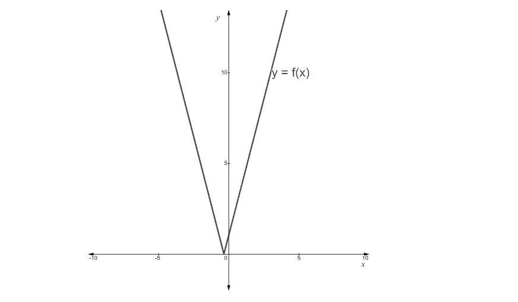

# Exam Questions — Modulus Functions
**Algebra & Functions** · Cambridge (CIE) AS maths (9709)
> Source: [https://www.savemyexams.com/as/maths/cie/20/pure-2/topic-questions/](https://www.savemyexams.com/as/maths/cie/20/pure-2/topic-questions/) · 15 questions across 1 sets

## Exam Questions (15 questions)

### Q1 — hard — 4 marks

**Q1** [4 marks]

The constant $a$ is positive. Solve the inequality `\left|2 x - a\right| > \left|x + a\right|`, giving your answer in terms of $a$.

### Q2 — medium — 3 marks

**Q2** [3 marks]

Solve the equation `\left|x - 4\right| = 2 x - 5`.

### Q3 — medium — 4 marks

**Q3** [4 marks]

Solve the inequality `\left|3 x + 2\right| \leq \left|x - 4\right|`.

### Q4 — medium — 3 marks

**Q4** [3 marks]

Solve the equation `\left|2 x - 3\right| = \left|x + 1\right|`.

### Q5 — medium — 6 marks

**Q5** [6 marks]

The graph of `y = \text{f} \left(x\right)`, where `\text{f} \left(x\right) = \left|3 x + 1\right|`, is shown below.

(i) On the diagram above, sketch the graph of `y = \left|x - 5\right|` and state the coordinates of any points of intersection with `y = \text{f} \left(x\right)`.

(ii) Hence, or otherwise, solve the inequality `\left|3 x + 1\right| < \left|x - 5\right|`.

### Q6 — easy — 6 marks

**Q6** [6 marks]

Solve the following.

(i) `\left|4 x + 3\right| < 9`

(ii) `\left|2 x\right| + 5 \geq 15`

(iii) `\left|x + 8\right| = \left|2 x + 10\right|`

### Q7 — easy — 6 marks

**Q7** [1 mark]

The graph of `y = \text{f} \left(x\right)`, where `\text{f} \left(x\right) = 2 x - 3`, is shown below.

Determine the coordinates of the points marked $A$ and $B$.

**Q7** [5 marks]

(i) On the diagram above, sketch the graph of `y = \left|\text{f} \left(x - 1\right)\right|`.

(ii) Determine the coordinates of the image of the points $A$ and $B$ under the transformation in part (i).

### Q8 — easy — 3 marks

**Q8** [3 marks]

Solve the equation `\left|3 x - 2\right| = 7`.

### Q9 — easy — 10 marks

**Q9** [3 marks]

Solve the equation `\left|6 - 2 x\right| = 4`.

**Q9** [4 marks]

On the same diagram, sketch the graphs of `y = \left|6 - 2 x\right|` and $y = 4$. Label the coordinates of the points where the two graphs intersect each other and the coordinate axes.

**Q9** [3 marks]

Consider the graphs of `y = \left|6 - 2 x\right|` and $y = k$, where $k$ is a constant. For which values of $k$ will the two graphs have

(i) no points of intersection,

(ii) one point of intersection,

(iii) two points of intersection?

### Q10 — hard — 7 marks

**Q10** [3 marks]

The functions $\text{f}$ and $\text{g}$ are defined by `\text{f} \left(x\right) = \sqrt{x}` for $x \geq 0$ and `\text{g} \left(x\right) = 2 x - 3` for $x \in ℝ$.

On the same axes, sketch the graphs of `y = \text{f} \left(x\right)` and `y = \left|\text{g} \left(x\right)\right|`, labelling the points at which the graphs intersect the coordinate axes.

**Q10** [3 marks]

Solve the equation `\text{f} \left(x\right) = \left|\text{g} \left(x\right)\right|`.

**Q10** [1 mark]

Which of the solutions to `\text{f} \left(x\right) = \left|\text{g} \left(x\right)\right|` is **not** a solution to `\text{f} \left(x\right) = \text{g} \left(x\right)`?

### Q11 — hard — 7 marks

**Q11** [3 marks]

The functions $\text{f}$ and $\text{g}$ are defined for all real $x$ by `\text{f} \left(x\right) = 3 x - 1` and `\text{g} \left(x\right) = 2 x + 2`.

On the same axes, sketch the graphs of `y = \left|\text{f} \left(x\right)\right|` and `y = \left|\text{g} \left(x\right)\right|`, labelling the points at which the graphs intersect the coordinate axes.

**Q11** [3 marks]

Solve the equation `\left|\text{f} \left(x\right)\right| = \left|\text{g} \left(x\right)\right|`.

**Q11** [1 mark]

Which of the solutions to `\left|\text{f} \left(x\right)\right| = \left|\text{g} \left(x\right)\right|` is also a solution to `\text{f} \left(x\right) = \text{g} \left(x\right)`?

### Q12 — hard — 5 marks

**Q12** [1 mark]

The function $\text{f}$ is defined by `\text{f} : x \mapsto \left|3 x - 2\right|` for $x \in ℝ$.

Explain why the inverse of `\text{f} \left(x\right)` does not exist.

**Q12** [1 mark]

Suggest an adaptation to the domain of `\text{f} \left(x\right)` so that its inverse exists, while also producing the maximum possible range for `\text{f} \left(x\right)`.

**Q12** [3 marks]

Using your adaptation from part (b), find an expression for `\text{f}^{- 1} \left(x\right)` and state its domain and range.

### Q13 — hard — 9 marks

**Q13** [3 marks]

The function $\text{p}$ is defined by `\text{p} \left(x\right) = \left|2 x\right|` for $x \leq 0$.

On the same axes, sketch the graphs of `y = \text{p} \left(x\right)` and `y = \text{p}^{- 1} \left(x\right)`.

**Q13** [3 marks]

Find an expression for `\text{p}^{- 1} \left(x\right)` and state its domain.

**Q13** [3 marks]

Show that `\text{p}^{- 1} \left(x\right) = - \frac{1}{2} \text{p} \left(- \frac{1}{2} x\right)`.

### Q14 — medium — 5 marks

**Q14** [3 marks]

The functions $\text{f}$ and $\text{g}$ are defined for all real $x$ by `\text{f} \left(x\right) = \left( x + 2 \right)^{2}` and `\text{g} \left(x\right) = 2 x + 4`.

On the same axes, sketch the graphs of `y = \text{f} \left(x\right)` and `y = \left|\text{g} \left(x\right)\right|`, labelling the points at which the graphs intersect the coordinate axes.

**Q14** [2 marks]

Solve the equation `\text{f} \left(x\right) = \left|\text{g} \left(x\right)\right|`.

### Q15 — easy — 3 marks

**Q15** [3 marks]

Solve the equation `\left|4 x + 2\right| = 5`.
