# Mark Schemes — Polynomials
**Algebra & Functions** · Cambridge (CIE) AS maths (9709)

## Exam Questions (65 questions)

### Q1
Look for a factor; testing $x = - 2$ gives `4 \left(- 8\right) + 17 \left(4\right) + 20 \left(- 2\right) + 4 = 0`, so `\left(x + 2\right)` is a factor. Divide it out, writing the cubic as `\left(x + 2\right)` multiplied by an unknown quadratic

`4 x^{3} + 17 x^{2} + 20 x + 4 = \left(x + 2\right) \left(a x^{2} + b x + c\right)`

**[M1]**

Compare the coefficient of $x^{3}$

$a = 4$

Compare the constant term

$2 c = 4 \Rightarrow c = 2$

Compare the coefficient of $x^{2}$

$2 a + b = 17 \Rightarrow b = 9$

These give the quadratic factor

`4 x^{3} + 17 x^{2} + 20 x + 4 = \left(x + 2\right) \left(4 x^{2} + 9 x + 2\right)`

**[A1]**

Factorise the quadratic; $4 \times 2 = 8$, and $8$ and $1$ multiply to $8$ and add to $9$

`4 x^{2} + 9 x + 2 = \left(4 x + 1\right) \left(x + 2\right)`

Combine, noting that `\left(x + 2\right)` now appears twice

`4 x^{3} + 17 x^{2} + 20 x + 4 = \left(4 x + 1\right) \left( x + 2 \right)^{2}`

**[A1]**

> **[mark-scheme]**
> **M1**: Finding a factor (e.g. `\left(x + 2\right)`) and dividing to reach a quadratic factor, or comparing coefficients.
> 
> **A1**: Correct quadratic factor $4 x^{2} + 9 x + 2$.
> 
> **A1**: Fully factorised `\left(4 x + 1\right) \left( x + 2 \right)^{2}`, in any order. The square must be shown, so `\left(4 x + 1\right) \left(x + 2\right)` alone is not fully factorised.
From part (a) the factors give the $x$-axis behaviour: a crossing where $4 x + 1 = 0$ and a touch where `\left(x + 2\right)^{2} = 0`

`\text{crosses at} \textrm{ } \left(- \frac{1}{4}, \; 0\right), \; \textrm{ } \text{touches at} \textrm{ } \left(- 2, \; 0\right)`

Find the $y$-intercept by substituting $x = 0$, then draw a positive cubic through these points

`\left(0, \; 4\right)`

**[B1 B1]**

> **[mark-scheme]**
> **B1**: All axis points correct and labelled: touches at `\left(- 2, \; 0\right)`, crosses at `\left(- \frac{1}{4}, \; 0\right)`, $y$-intercept `\left(0, \; 4\right)`.
> 
> **B1**: Correct positive-cubic shape, touching (not crossing) at `\left(- 2, \; 0\right)` and crossing at `\left(- \frac{1}{4}, \; 0\right)`. Follow through from part (a)'s factors.

### Q2
To find where the curve crosses the $x$-axis, factorise the cubic; the crossings do not depend on the factor of $\frac{1}{4}$

Test values to find a factor: $x = 2$ gives `\left(2\right)^{3} - 5 \left(2\right)^{2} - 12 \left(2\right) + 36 = 0`, so `\left(x - 2\right)` is a factor

`x^{3} - 5 x^{2} - 12 x + 36 = \left(x - 2\right) \left(x^{2} + b x + c\right)`

Compare the coefficient of $x^{2}$

$b - 2 = - 5 \Rightarrow b = - 3$

Compare the constant term

$- 2 c = 36 \Rightarrow c = - 18$

Factorise the quadratic $x^{2} - 3 x - 18$; $- 6$ and $3$ multiply to $- 18$ and add to $- 3$

`x^{3} - 5 x^{2} - 12 x + 36 = \left(x - 2\right) \left(x - 6\right) \left(x + 3\right)`

**[M1]**

The curve crosses the $x$-axis where each factor is zero

`\left(- 3, \; 0\right), \; \left(2, \; 0\right), \; \left(6, \; 0\right)`

**[A1]**

Find the cubic's $y$-intercept; because $4 y = 36$ at $x = 0$, divide by $4$

`\left(0, \; 9\right)`

**[B1]**

Rearrange the line to $y = 6 - x$; it has negative gradient and crosses the axes at `\left(6, \; 0\right)` and `\left(0, \; 6\right)`

**[B1]**

Find the intersections by setting `6 - x = \frac{1}{4} \left(x^{3} - 5 x^{2} - 12 x + 36\right)` and clearing the fraction

$24 - 4 x = x^{3} - 5 x^{2} - 12 x + 36$

$x^{3} - 5 x^{2} - 8 x + 12 = 0$

**[M1]**

To solve, factorise; $x = 6$ is already known to lie on both graphs, so `\left(x - 6\right)` is a factor. Divide by it, writing the cubic as `\left(x - 6\right)` times a quadratic

`x^{3} - 5 x^{2} - 8 x + 12 = \left(x - 6\right) \left(x^{2} + b x + c\right)`

Compare the coefficient of $x^{2}$

$b - 6 = - 5 \Rightarrow b = 1$

Compare the constant term

$- 6 c = 12 \Rightarrow c = - 2$

Factorise the quadratic $x^{2} + x - 2$; $2$ and $- 1$ multiply to $- 2$ and add to $1$

`\left(x - 6\right) \left(x - 1\right) \left(x + 2\right) = 0 \Rightarrow x = 6, \; 1, \; - 2`

**[A1]**

Substitute each into the line $y = 6 - x$ to get the intersection points

`\left(6, \; 0\right), \; \left(1, \; 5\right), \; \left(- 2, \; 8\right)`

**[A1]**

Draw both graphs on one diagram: a positive cubic through its three crossings and $y$-intercept, and the descending line, meeting at the three intersection points

**[B1 B1]**

> **[exam-tip]**
> Two things may trip people here. First, the cubic is written as $4 y = \dots$, so every $y$-value is a quarter of the cubic expression, making the $y$-intercept $9$, not $36$.
> 
> Secondly the point `\left(6, \; 0\right)` does three things: it is a crossing of the cubic, the $x$-intercept of the line, and one of the three intersections. Spotting that gives you a factor of the intersection cubic for free.

> **[mark-scheme]**
> **M1**: Factorising the cubic $x^{3} - 5 x^{2} - 12 x + 36$.
> 
> **A1**: Correct cubic crossings `\left(- 3, \; 0\right)`, `\left(2, \; 0\right)`, `\left(6, \; 0\right)`.
> 
> **B1**: The cubic's $y$-intercept `\left(0, \; 9\right)`, with the division by $4$ applied.
> 
> **B1**: The line drawn correctly with negative gradient, crossing at `\left(6, \; 0\right)` and `\left(0, \; 6\right)`.
> 
> **M1**: Setting the two expressions equal and reaching $x^{3} - 5 x^{2} - 8 x + 12 = 0$.
> 
> **A1**: Factorising and solving for all three $x$-values $6 ,  1 ,  - 2$.
> 
> **A1**: All three intersection points `\left(6, \; 0\right)`, `\left(1, \; 5\right)`, `\left(- 2, \; 8\right)` as coordinate pairs.
> 
> **B1**: Correct positive-cubic shape drawn on the same diagram as the line.
> 
> **B1**: A fully correct diagram with both graphs, all axis crossings and all three intersections labelled.

### Q3
Both `\left(x - 2\right)` and `\left(x + 3\right)` are factors, so their product `\left(x - 2\right) \left(x + 3\right) = x^{2} + x - 6` divides `\text{f} \left(x\right)`; divide to find the remaining quadratic

`x^{4} - 9 x^{3} + 9 x^{2} + 85 x - 150 = \left(x^{2} + x - 6\right) \left(x^{2} + b x + c\right)`

**[M1]**

Compare the coefficient of $x^{3}$

$b + 1 = - 9 \Rightarrow b = - 10$

Compare the constant term

$- 6 c = - 150 \Rightarrow c = 25$

These give the quadratic factor

`\text{f} \left(x\right) = \left(x^{2} + x - 6\right) \left(x^{2} - 10 x + 25\right)`

Factorise both quadratics; the second is a perfect square

`\text{f} \left(x\right) = \left(x - 2\right) \left(x + 3\right) \left(x - 5\right)^{2}`

**[A1]**

Set each factor to zero; the repeated factor `\left(x - 5\right)^{2}` gives a point where the curve touches the axis, the others where it crosses

`\text{crosses at} \textrm{ } \left(- 3, \; 0\right) \textrm{ } \text{and} \textrm{ } \left(2, \; 0\right), \; \textrm{ } \text{touches at} \textrm{ } \left(5, \; 0\right)`

**[B1]**

Find the $y$-intercept by substituting $x = 0$

`\left(0, \; - 150\right)`

**[B1]**

The coefficient of $x^{4}$ is positive, so the curve falls from the upper left and rises to the upper right; draw it crossing at $- 3$ and $2$ and touching at $5$

**[B1]**

> **[exam-tip]**
> The squared factor `\left(x - 5\right)^{2}` is the key: a repeated root means the curve *touches* the $x$-axis there rather than crossing it. Miss that and your sketch has the wrong shape even with every coordinate correct.

> **[mark-scheme]**
> **M1**: Using the product `\left(x - 2\right) \left(x + 3\right)` as a quadratic factor and dividing (or comparing coefficients) to find the remaining quadratic.
> 
> **A1**: Fully factorised `\text{f} \left(x\right) = \left(x - 2\right) \left(x + 3\right) \left(x - 5\right)^{2}`.
> 
> **B1**: All three $x$-axis points correct: crosses at `\left(- 3, \; 0\right)` and `\left(2, \; 0\right)`, touches at `\left(5, \; 0\right)`.
> 
> **B1**: The $y$-intercept `\left(0, \; - 150\right)`.
> 
> **B1**: Correct positive-quartic shape, crossing at the two single roots and touching (not crossing) at the repeated root. A curve that crosses at `\left(5, \; 0\right)` does not earn this mark.

### Q4
Test values to find a factor of the cubic: $x = 1$ gives `\left(1\right)^{3} - 3 \left(1\right)^{2} - 6 \left(1\right) + 8 = 0`, so `\left(x - 1\right)` is a factor

Divide by `\left(x - 1\right)`, writing the cubic as `\left(x - 1\right)` multiplied by an unknown quadratic

`x^{3} - 3 x^{2} - 6 x + 8 = \left(x - 1\right) \left(x^{2} + b x + c\right)`

Compare the coefficient of $x^{2}$

$b - 1 = - 3 \Rightarrow b = - 2$

Compare the constant term

$- c = 8 \Rightarrow c = - 8$

Factorise the quadratic $x^{2} - 2 x - 8$; $- 4$ and $2$ multiply to $- 8$ and add to $- 2$

`x^{3} - 3 x^{2} - 6 x + 8 = \left(x - 1\right) \left(x - 4\right) \left(x + 2\right)`

**[M1]**

Set each factor to zero to find where the curve crosses the $x$-axis

`\left(- 2, \; 0\right), \; \left(1, \; 0\right), \; \left(4, \; 0\right)`

**[A1]**

Find the cubic's $y$-intercept by substituting $x = 0$

`\left(0, \; 8\right)`

**[B1]**

For $y = \frac{3}{x^{2}}$, note that $x^{2} > 0$ for all $x \neq 0$, so the graph lies entirely above the $x$-axis in two branches, with the $y$-axis ($x = 0$) and the $x$-axis as asymptotes; draw it on the same diagram as the cubic

**[B1]**

> **[mark-scheme]**
> **M1**: Factorising the cubic $x^{3} - 3 x^{2} - 6 x + 8$.
> 
> **A1**: Correct cubic crossings `\left(- 2, \; 0\right)`, `\left(1, \; 0\right)` and `\left(4, \; 0\right)`, with a correct positive-cubic shape.
> 
> **B1**: The $y$-intercept `\left(0, \; 8\right)` labelled.
> 
> **B1**: A correct $y = \frac{3}{x^{2}}$: two branches, both above the $x$-axis, with the $y$-axis and $x$-axis as asymptotes, drawn on the same diagram.
Divide both sides by $x^{2}$; this is valid because $x = 0$ is not a solution (the left-hand side would be $0$, not $3$)

$x^{3} - 3 x^{2} - 6 x + 8 = \frac{3}{x^{2}}$

The two sides are exactly the two graphs from part (a)

The number of solutions is the number of times those graphs cross

$3$

**[B1]**

> **[mark-scheme]**
> **B1**: $3$, following from a correct part (a) sketch. The count follows through from the candidate's own diagram; award the mark if their sketch clearly shows that many intersections and the reasoning (divide by $x^{2}$, read off the graphs) is sound, even if their graph is slightly inaccurate.

### Q5
Look for a factor; testing $x = - 2$ gives `3 \left(- 8\right) + 2 \left(4\right) - 3 \left(- 2\right) + 10 = 0`, so `\left(x + 2\right)` is a factor. Divide it out

`3 x^{3} + 2 x^{2} - 3 x + 10 = \left(x + 2\right) \left(3 x^{2} - 4 x + 5\right)`

**[M1]**

Check whether the quadratic factor gives further crossings by evaluating its discriminant

`b^{2} - 4 a c = \left(- 4\right)^{2} - 4 \left(3\right) \left(5\right) = 16 - 60 = - 44`

Since the discriminant is negative, $3 x^{2} - 4 x + 5$ has no real roots, so the only crossing is where $x + 2 = 0$

`\left(- 2, \; 0\right)`

**[A1]**

Find the $y$-intercept by substituting $x = 0$

`\left(0, \; 10\right)`

**[B1]**

The coefficient of $x^{3}$ is positive, so the curve rises from lower left to upper right, crossing the axis only at `\left(- 2, \; 0\right)`

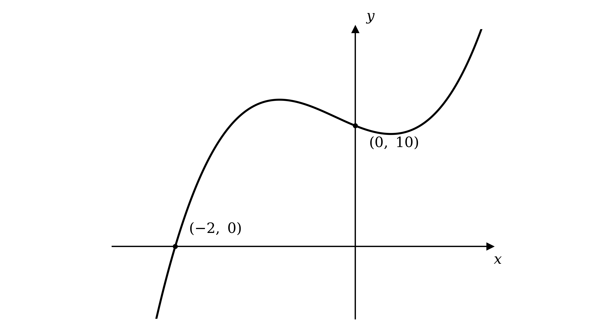

**[B1]**

> **[exam-tip]**
> A positive cubic can cross the $x$-axis once, twice or three times. Once you have one factor, check the quadratic that is left: a negative discriminant means it never reaches the axis, so there is exactly one crossing.

> **[mark-scheme]**
> **M1**: Finding the factor `\left(x + 2\right)` and dividing to reach the quadratic factor $3 x^{2} - 4 x + 5$.
> 
> **A1**: Establishing `\left(- 2, \; 0\right)` as the only $x$-axis crossing, supported by showing the quadratic factor has a negative discriminant (or equivalent reasoning that it has no real roots).
> 
> **B1**: The $y$-intercept `\left(0, \; 10\right)`.
> 
> **B1**: Correct positive-cubic shape crossing the $x$-axis exactly once, at `\left(- 2, \; 0\right)`. A sketch showing extra crossings does not earn this mark.

### Q6
The graphs meet where their $y$-values are equal, so set the two expressions equal

$x^{3} - x^{2} - 4 x + 4 = 2 x + 4$

**[M1]**

Rearrange so that one side is zero; the constant terms cancel

$x^{3} - x^{2} - 6 x = 0$

**[A1]**

Every term has a factor of $x$, so take it out and factorise the quadratic

`x \left(x^{2} - x - 6\right) = 0`

`x \left(x - 3\right) \left(x + 2\right) = 0`

**[M1]**

Set each factor to zero to get the three $x$-values

$x = 0 ,  3 ,  - 2$

Substitute each into the line $y = 2 x + 4$, which is the simpler of the two equations

`\left(0, \; 4\right), \; \left(3, \; 10\right), \; \left(- 2, \; 0\right)`

**[A1]**

> **[exam-tip]**
> Substitute back into the line rather than the cubic, as it is far less work and both must give the same answer.

> **[mark-scheme]**
> **M1**: Setting the two expressions for $y$ equal to each other.
> 
> **A1**: Correct simplified cubic equal to zero, $x^{3} - x^{2} - 6 x = 0$.
> 
> **M1**: Taking out the factor of $x$ and factorising the resulting quadratic (or otherwise solving for all three roots).
> 
> **A1**: All three points `\left(0, \; 4\right)`, `\left(3, \; 10\right)` and `\left(- 2, \; 0\right)`, as coordinate pairs. Accept them in any order. $x$-values alone, without the matching $y$-values, do not score this mark.
The line $y = 2 x + 4$ has gradient $2$; it crosses the axes at `\left(- 2, \; 0\right)` and `\left(0, \; 4\right)`

**[B1]**

To find where the curve crosses the $x$-axis, factorise the cubic by grouping the terms in pairs

`x^{3} - x^{2} - 4 x + 4 = x^{2} \left(x - 1\right) - 4 \left(x - 1\right)`

Take out the common factor of `\left(x - 1\right)`

`= \left(x - 1\right) \left(x^{2} - 4\right)`

Factorise the difference of two squares

`= \left(x - 1\right) \left(x - 2\right) \left(x + 2\right)`

The curve crosses the $x$-axis where each factor is zero

`\left(- 2, \; 0\right), \; \left(1, \; 0\right), \; \left(2, \; 0\right)`

**[B1]**

Find the curve's $y$-intercept by substituting $x = 0$

`\left(0, \; 4\right)`

**[B1]**

The coefficient of $x^{3}$ is positive, so the curve rises from lower left to upper right; draw both graphs on one diagram and mark the three intersection points found in part (a)

**[B1 B1]**

> **[mark-scheme]**
> **B1**: Correct straight line with positive gradient, crossing at `\left(- 2, \; 0\right)` and `\left(0, \; 4\right)`.
> 
> **B1**: The curve's three $x$-axis crossings `\left(- 2, \; 0\right)`, `\left(1, \; 0\right)` and `\left(2, \; 0\right)`, correct and labelled.
> 
> **B1**: The curve's $y$-intercept `\left(0, \; 4\right)`, correct and labelled.
> 
> **B1**: Correct shape of a positive cubic, drawn on the same diagram as the line.
> 
> **B1**: All three intersection points `\left(- 2, \; 0\right)`, `\left(0, \; 4\right)` and `\left(3, \; 10\right)` labelled, following through from part (a). The first two coincide with the axis crossings already labelled, so a single label at each of those points is enough.

### Q7
By the factor theorem, `\left(x + 3\right)` is a factor exactly when `\text{f} \left(- 3\right) = 0`, so evaluate `\text{f} \left(- 3\right)`

`\text{f} \left(- 3\right) = 6 \left(- 3\right)^{3} + 23 \left(- 3\right)^{2} + 11 \left(- 3\right) - 12`

$= - 162 + 207 - 33 - 12 = 0$

`\text{f} \left(- 3\right) = 0, \; \textrm{ }\text{so} \textrm{ } \left(x + 3\right) \textrm{ } \text{is a factor}`

**[B1]**

Now divide `\text{f} \left(x\right)` by `\left(x + 3\right)`; write `\text{f} \left(x\right)` as `\left(x + 3\right)` multiplied by an unknown quadratic

`6 x^{3} + 23 x^{2} + 11 x - 12 = \left(x + 3\right) \left(a x^{2} + b x + c\right)`

**[M1]**

Compare the coefficient of $x^{3}$

$a = 6$

Compare the constant term

$3 c = - 12 \Rightarrow c = - 4$

Compare the coefficient of $x^{2}$

$3 a + b = 23 \Rightarrow b = 5$

These give the quadratic factor

`\text{f} \left(x\right) = \left(x + 3\right) \left(6 x^{2} + 5 x - 4\right)`

Factorise the quadratic; `6 \times \left(- 4\right) = - 24`, and $8$ and $- 3$ multiply to $- 24$ and add to $5$

`6 x^{2} + 5 x - 4 = \left(2 x - 1\right) \left(3 x + 4\right)`

`\text{f} \left(x\right) = \left(x + 3\right) \left(2 x - 1\right) \left(3 x + 4\right)`

**[A1]**

> **[mark-scheme]**
> **B1**: Substituting $x = - 3$ and reaching $0$, which shows `\left(x + 3\right)` is a factor. A written conclusion is good practice but is not required for the mark; an arithmetic slip loses it even if the last line reads $0$.
> 
> **M1**: Writing `\text{f} \left(x\right) = \left(x + 3\right) \left(a x^{2} + b x + c\right)` and comparing coefficients, or dividing by `\left(x + 3\right)` by long division.
> 
> **A1**: Fully factorised `\text{f} \left(x\right) = \left(x + 3\right) \left(2 x - 1\right) \left(3 x + 4\right)`, factors in any order. Accept the equivalent `3 \left(x + 3\right) \left(2 x - 1\right) \left(x + \frac{4}{3}\right)` or similar, provided it multiplies back to `\text{f} \left(x\right)`.
Set each factor from part (a) to zero to find where the curve crosses the $x$-axis

`\left(- 3, \; 0\right), \; \left(- \frac{4}{3}, \; 0\right), \; \left(\frac{1}{2}, \; 0\right)`

**[B1]**

Find the $y$-intercept by substituting $x = 0$

`y = \left(0 + 3\right) \left(2 \left(0\right) - 1\right) \left(3 \left(0\right) + 4\right) = - 12`

`\left(0, \; - 12\right)`

**[B1]**

The coefficient of $x^{3}$ is positive, so the curve rises from lower left to upper right; draw it through the four points

**[B1 B1]**

> **[mark-scheme]**
> **B1**: All three $x$-axis crossings `\left(- 3, \; 0\right)`, `\left(- \frac{4}{3}, \; 0\right)` and `\left(\frac{1}{2}, \; 0\right)`, correct and labelled. Follow through from part (a)'s factors.
> 
> **B1**: The $y$-intercept `\left(0, \; - 12\right)`, correct and labelled.
> 
> **B1**: Correct shape of a positive cubic (down to the left, up to the right).
> 
> **B1**: A fully correct curve crossing the axis at all three points, with a local maximum then a local minimum in the right places.

### Q8
Since `\left(x + 1\right)` is a factor, divide the cubic by it; write it as `\left(x + 1\right)` multiplied by an unknown quadratic

`x^{3} - 4 x^{2} + x + 6 = \left(x + 1\right) \left(a x^{2} + b x + c\right)`

**[M1]**

Compare the coefficient of $x^{3}$

$a = 1$

Compare the constant term

$c = 6$

Compare the coefficient of $x^{2}$

$a + b = - 4 \Rightarrow b = - 5$

These give the quadratic factor

`x^{3} - 4 x^{2} + x + 6 = \left(x + 1\right) \left(x^{2} - 5 x + 6\right)`

Factorise the quadratic, using two numbers that multiply to $6$ and add to $- 5$, namely $- 2$ and $- 3$

`x^{3} - 4 x^{2} + x + 6 = \left(x + 1\right) \left(x - 2\right) \left(x - 3\right)`

**[A1]**

Set each factor to zero to find where the curve crosses the $x$-axis

`\left(- 1, \; 0\right), \; \left(2, \; 0\right), \; \left(3, \; 0\right)`

**[B1]**

Find the $y$-intercept by substituting $x = 0$

`y = \left(0 + 1\right) \left(0 - 2\right) \left(0 - 3\right) = 6`

`\left(0, \; 6\right)`

The coefficient of $x^{3}$ is positive, so the curve rises from lower left to upper right; draw it through the four points

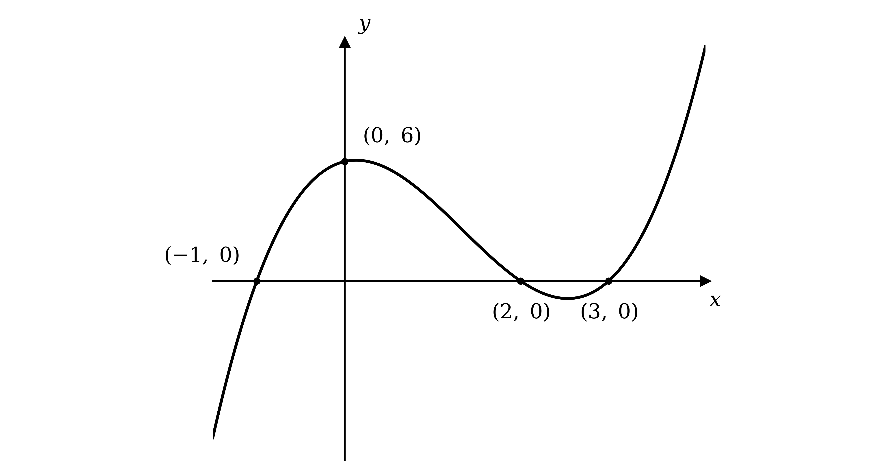

**[B1]**

> **[mark-scheme]**
> **M1**: Writing the cubic as `\left(x + 1\right) \left(a x^{2} + b x + c\right)` and comparing coefficients, or dividing by `\left(x + 1\right)` by long division.
> 
> **A1**: Fully factorised `\left(x + 1\right) \left(x - 2\right) \left(x - 3\right)`, factors in any order.
> 
> **B1**: All three $x$-axis crossings `\left(- 1, \; 0\right)`, `\left(2, \; 0\right)` and `\left(3, \; 0\right)`, correct and labelled.
> 
> **B1**: Correct positive-cubic shape through those crossings with the $y$-intercept `\left(0, \; 6\right)` labelled. Stationary points are not required, as the question says.

### Q9
By the factor theorem, `\left(x + 2\right)` is a factor exactly when the value at $x = - 2$ is zero, so evaluate it there

`2 \left( - 2 \right)^{3} - 3 \left( - 2 \right)^{2} - 11 \left(- 2\right) + 6 = - 16 - 12 + 22 + 6 = 0`

**[B1]**

Since the result is zero, the factor theorem confirms the factor

`\left(x + 2\right) \textrm{ }\text{is a factor}`

> **[mark-scheme]**
> **B1**: Substituting $x = - 2$ and reaching $0$, which shows `\left(x + 2\right)` is a factor. A written conclusion is good practice but not required. The working must be correct throughout — an arithmetic slip loses the mark even if the last line reads $0$.
Since `\left(x + 2\right)` is a factor, divide the cubic by it; write it as `\left(x + 2\right)` multiplied by an unknown quadratic

`2 x^{3} - 3 x^{2} - 11 x + 6 = \left(x + 2\right) \left(a x^{2} + b x + c\right)`

**[M1]**

Compare the coefficient of $x^{3}$

$a = 2$

Compare the constant term

$2 c = 6 \Rightarrow c = 3$

Compare the coefficient of $x^{2}$

$2 a + b = - 3 \Rightarrow b = - 7$

These give the quadratic factor

`2 x^{3} - 3 x^{2} - 11 x + 6 = \left(x + 2\right) \left(2 x^{2} - 7 x + 3\right)`

Factorise the quadratic

`\left(x + 2\right) \left(2 x - 1\right) \left(x - 3\right)`

**[A1]**

> **[mark-scheme]**
> **M1**: Writing the cubic as `\left(x + 2\right) \left(a x^{2} + b x + c\right)` and comparing coefficients, or dividing by `\left(x + 2\right)` by long division.
> 
> **A1**: Fully factorised `\left(x + 2\right) \left(2 x - 1\right) \left(x - 3\right)`, factors in any order.
The coefficient of $x^{3}$ is positive, so the curve rises from lower left to upper right

Set each factor to zero to find where the curve crosses the $x$-axis

`\left(- 2, \; 0\right), \; \left(\frac{1}{2}, \; 0\right), \; \left(3, \; 0\right)`

**[B1]**

Find the $y$-intercept by substituting $x = 0$

`y = \left(0 + 2\right) \left(2 \left(0\right) - 1\right) \left(0 - 3\right) = 6`

`\left(0, \; 6\right)`

**[B1]**

Draw a positive cubic passing through these four points

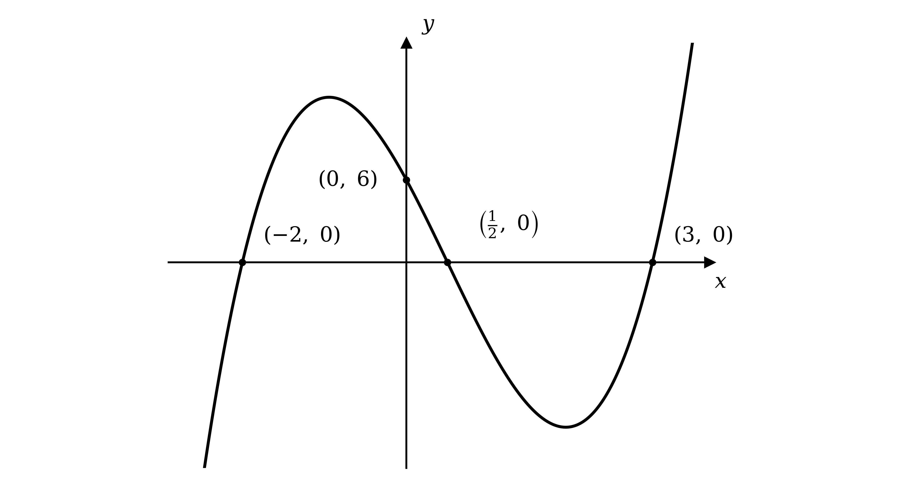

**[B1 B1]**

> **[mark-scheme]**
> **B1**: The three $x$-axis crossings `\left(- 2, \; 0\right)`, `\left(\frac{1}{2}, \; 0\right)` and `\left(3, \; 0\right)`, correct and labelled.
> 
> **B1**: The $y$-intercept `\left(0, \; 6\right)`, correct and labelled.
> 
> **B1**: Correct shape of a positive cubic (up to the right, down to the left).
> 
> **B1**: A fully correct curve crossing the axis at all three points with a local maximum then a local minimum.

### Q10
Apply the factor theorem: `\left(x - 2\right)` is a factor exactly when `\text{f} \left(2\right) = 0`, so evaluate `\text{f} \left(2\right)`

`\text{f} \left(2\right) = \left(2\right)^{3} - 2 \left(2\right)^{2} - 4 \left(2\right) + 8`

**[M1]**

Work out the arithmetic

$8 - 8 - 8 + 8 = 0$

`\text{f} \left(2\right) = 0, \; \textrm{ }\text{so} \textrm{ } \left(x - 2\right) \textrm{ } \text{is a factor}`

**[A1]**

> **[mark-scheme]**
> **M1**: Substituting $x = 2$ into `\text{f} \left(x\right)`.
> 
> **A1**: Reaching `\text{f} \left(2\right) = 0` with no errors, which is sufficient to show the factor. A written conclusion is good practice but is not required for the mark.
Since `\left(x - 2\right)` is a factor, divide `\text{f} \left(x\right)` by it; write `\text{f} \left(x\right)` as `\left(x - 2\right)` multiplied by an unknown quadratic

`x^{3} - 2 x^{2} - 4 x + 8 = \left(x - 2\right) \left(x^{2} + b x + c\right)`

**[M1]**

Compare the constant term

$- 2 c = 8 \Rightarrow c = - 4$

Compare the coefficient of $x^{2}$

$b - 2 = - 2 \Rightarrow b = 0$

These give the quadratic factor

`\text{f} \left(x\right) = \left(x - 2\right) \left(x^{2} - 4\right)`

Factorise the difference of two squares

`\text{f} \left(x\right) = \left(x - 2\right) \left(x - 2\right) \left(x + 2\right) = \left( x - 2 \right)^{2} \left(x + 2\right)`

**[A1]**

> **[mark-scheme]**
> **M1**: Dividing `\text{f} \left(x\right)` by `\left(x - 2\right)` (long division or inspection) to obtain the quadratic factor $x^{2} - 4$.
> 
> **A1**: Fully factorised `\left( x - 2 \right)^{2} \left(x + 2\right)`, accepting `\left(x - 2\right) \left(x - 2\right) \left(x + 2\right)`, in any order.
The coefficient of $x^{3}$ is positive, so the curve rises from lower left to upper right

The repeated factor `\left(x - 2\right)^{2}` gives a point where the curve touches the axis, and `\left(x + 2\right)` a point where it crosses

`\left(2, \; 0\right) \textrm{ } \text{and} \textrm{ } \left(- 2, \; 0\right)`

**[B1]**

Find the $y$-intercept by substituting $x = 0$

`y = \left(0 - 2\right)^{2} \left(0 + 2\right) = 8`

`\left(0, \; 8\right)`

**[B1]**

Draw a positive cubic through these points, touching the $x$-axis at `\left(2, \; 0\right)`

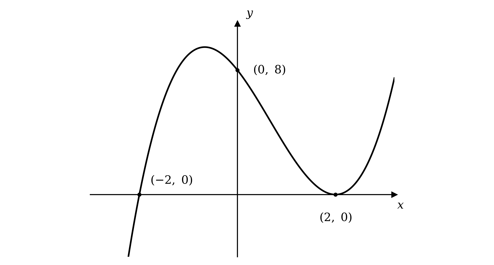

**[B1]**

> **[mark-scheme]**
> **B1**: Both $x$-axis points, `\left(- 2, \; 0\right)` crossing and `\left(2, \; 0\right)` touching, correct.
> 
> **B1**: $y$-intercept `\left(0, \; 8\right)`.
> 
> **B1**: Correct positive cubic shape that touches at `\left(2, \; 0\right)` and crosses at `\left(- 2, \; 0\right)`.

### Q11
(i)

The divisor is the expression the polynomial is divided by

$x - 2$

**[B1]**

(ii)

The quotient is the polynomial part of the result

$A x + B$

**[B1]**

(iii)

The remainder is the constant left over, sitting on top of the divisor

$C$

**[B1]**

> **[mark-scheme]**
> **B1**: Divisor $x - 2$.
> 
> **B1**: Quotient $A x + B$.
> 
> **B1**: Remainder $C$.
**Method 1 - Long Division**

Divide $x^{2} - 8 x - 20$ by `\left(x - 2\right)` to find the quotient and remainder

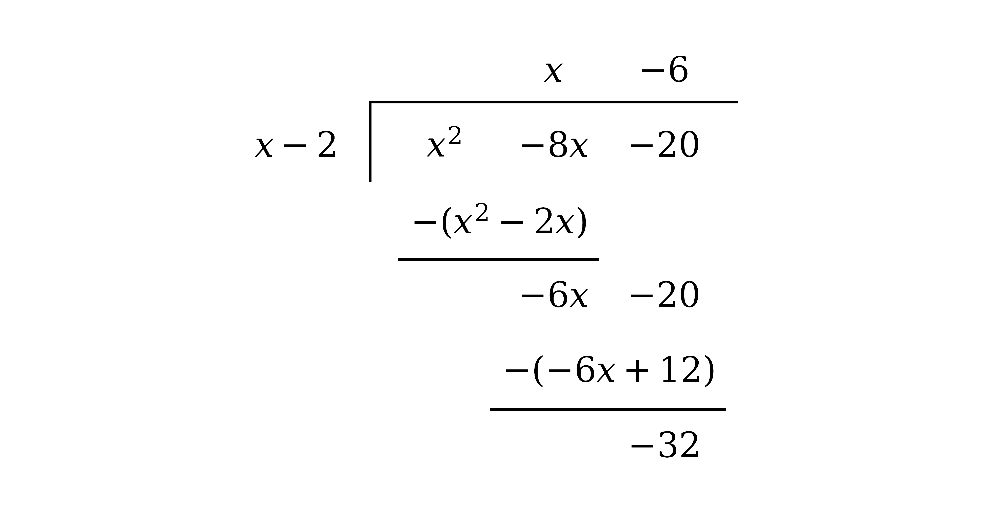

**[M1]**

Match the quotient $x - 6$ to $A x + B$ and the remainder to $C$

`x^{2} - 8 x - 20 = \left(x - 2\right) \left(x - 6\right) - 32`

$A = 1 ,  B = - 6 ,  C = - 32$

**[A1 A1 A1]**

> **[mark-scheme]**
> **M1**: Commencing division of $x^{2} - 8 x - 20$ by `\left(x - 2\right)`, by any valid method.
> 
> **A1**: $A = 1$.
> 
> **A1**: $B = - 6$.
> 
> **A1**: $C = - 32$. The quotient and remainder must be identified correctly; swapping them loses the accuracy marks.

**Method 2 - Inspection**

Expand the given identity so the coefficients can be compared

`x^{2} - 8 x - 20 = \left(x - 2\right) \left(A x + B\right) + C`

**[M1]**

Compare the coefficients of $x^{2}$

$A = 1$

**[A1]**

Compare the coefficients of $x$

$B - 2 A = - 8 \Rightarrow B = - 6$

**[A1]**

Compare the constant terms

$C - 2 B = - 20 \Rightarrow C = - 32$

**[A1]**

$A = 1 ,  B = - 6 ,  C = - 32$

> **[mark-scheme]**
> **M1**: Writing `x^{2} - 8 x - 20 = \left(x - 2\right) \left(A x + B\right) + C` and comparing coefficients.
> 
> **A1**: $A = 1$.
> 
> **A1**: $B = - 6$.
> 
> **A1**: $C = - 32$.

### Q12
A root at $x = - 2$ means `\left(x + 2\right)` is a factor, so write `\text{f} \left(x\right)` as `\left(x + 2\right)` multiplied by an unknown quadratic

`x^{3} - 3 x^{2} - 8 x + 4 = \left(x + 2\right) \left(x^{2} + b x + c\right)`

**[M1]**

Expand and compare the coefficients of $x^{2}$ to find $b$

$b + 2 = - 3 \Rightarrow b = - 5$

**[A1]**

Compare the constant terms to find $c$

$2 c = 4 \Rightarrow c = 2$

**[A1]**

Test whether the quadratic factor $x^{2} - 5 x + 2$ factorises: its discriminant `\left( - 5 \right)^{2} - 4 \left(1\right) \left(2\right) = 17` is not a perfect square, so it has no rational factors and will not factorise further

`\text{f} \left(x\right) = \left(x + 2\right) \left(x^{2} - 5 x + 2\right)`

**[B1]**

> **[exam-tip]**
> Not every cubic breaks into three linear factors. Once the quadratic factor has a non-square discriminant, it has no rational factors, so leaving it as a quadratic is the fully factorised answer.

> **[mark-scheme]**
> **M1**: Using the root to write `\text{f} \left(x\right) = \left(x + 2\right) \left(x^{2} + b x + c\right)` and compare coefficients, or dividing by `\left(x + 2\right)` by long division.
> 
> **A1**: Correct $b = - 5$.
> 
> **A1**: Correct $c = 2$, giving the quadratic factor $x^{2} - 5 x + 2$.
> 
> **B1**: Stating `\text{f} \left(x\right) = \left(x + 2\right) \left(x^{2} - 5 x + 2\right)` and recognising the quadratic does not factorise further.

### Q13
Since `\left(x + 1\right)` is a factor, write `\text{f} \left(x\right)` as `\left(x + 1\right)` multiplied by an unknown quadratic

`x^{3} - 5 x^{2} + 3 x + 9 = \left(x + 1\right) \left(x^{2} + b x + c\right)`

**[M1]**

Compare the coefficient of $x^{2}$ to find $b$

$b + 1 = - 5 \Rightarrow b = - 6$

Compare the constant terms to find $c$, giving the quadratic factor $x^{2} - 6 x + 9$

$c = 9$

**[A1]**

Factorise the quadratic; it is a perfect square, since $- 3$ and $- 3$ multiply to $9$ and add to $- 6$

`x^{2} - 6 x + 9 = \left( x - 3 \right)^{2}`

**[M1]**

Combine the factors

`\text{f} \left(x\right) = \left(x + 1\right) \left( x - 3 \right)^{2}`

**[A1]**

> **[mark-scheme]**
> **M1**: Writing `\text{f} \left(x\right) = \left(x + 1\right) \left(x^{2} + b x + c\right)` and comparing coefficients, or dividing by `\left(x + 1\right)` by long division.
> 
> **A1**: Correct quadratic factor $x^{2} - 6 x + 9$.
> 
> **M1**: Factorising the quadratic into `\left( x - 3 \right)^{2}` or `\left(x - 3\right) \left(x - 3\right)`.
> 
> **A1**: Fully factorised `\text{f} \left(x\right) = \left(x + 1\right) \left( x - 3 \right)^{2}`.
The coefficient of $x^{3}$ is positive, so the curve rises from the lower left to the upper right

The factor `\left(x + 1\right)` gives a point where the curve crosses the $x$-axis, and the repeated factor `\left(x - 3\right)^{2}` gives a point where it touches the $x$-axis

`\left(- 1, \; 0\right) \textrm{ } \text{and} \textrm{ } \left(3, \; 0\right)`

**[B1]**

Find the $y$-intercept by substituting $x = 0$

`y = \left(0 + 1\right) \left(0 - 3\right)^{2} = 9`

`\left(0, \; 9\right)`

**[B1]**

Draw a positive cubic passing through these points, touching the $x$-axis at `\left(3, \; 0\right)`

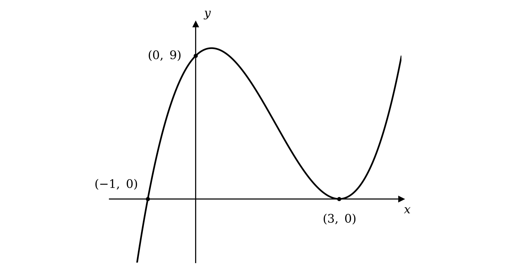

**[B1]**

> **[mark-scheme]**
> **B1**: Both $x$-axis points, `\left(- 1, \; 0\right)` crossing and `\left(3, \; 0\right)` touching, correct and labelled.
> 
> **B1**: $y$-intercept `\left(0, \; 9\right)` correct and labelled.
> 
> **B1**: Correct positive cubic shape that crosses at `\left(- 1, \; 0\right)` and touches at `\left(3, \; 0\right)`.

### Q14
Substitute $x = 1$ into the polynomial

`\text{f} \left(1\right) = \left( 1 \right)^{3} - 4 \left( 1 \right)^{2} - 7 \left(1\right) + 10 = 0`

**[M1]**

Since `\text{f} \left(1\right) = 0`, the factor theorem gives a factor

`\left(x - 1\right) \textrm{ }\text{is a factor}`

**[A1]**

> **[mark-scheme]**
> **M1**: Evaluating `\text{f} \left(1\right)`, showing the substitution.
> 
> **A1**: Obtaining `\text{f} \left(1\right) = 0` and stating the factor `\left(x - 1\right)`, which the question asks for.
**Method 1 - Long Division**

Divide `\text{f} \left(x\right)` by `\left(x + 2\right)`

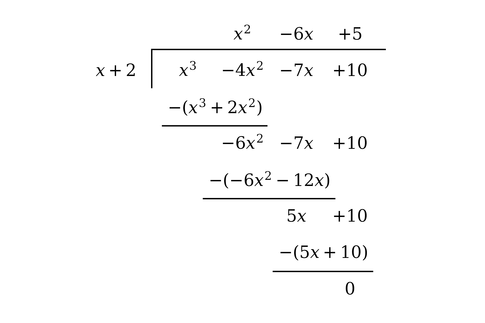

**[M1]**

Read the quotient from the top of the tableau; the remainder is zero

$x^{2} - 6 x + 5$

**[A1]**

> **[mark-scheme]**
> **M1**: Commencing division of `\text{f} \left(x\right)` by `\left(x + 2\right)`, by any valid method, reaching a partial quotient of the form $x^{2} + k x$.
> 
> **A1**: Correct quotient $x^{2} - 6 x + 5$ with zero remainder.

**Method 2 - Inspection**

Write `\text{f} \left(x\right)` as `\left(x + 2\right)` multiplied by an unknown quadratic

`x^{3} - 4 x^{2} - 7 x + 10 = \left(x + 2\right) \left(x^{2} + p x + q\right)`

**[M1]**

Compare the coefficients of $x^{2}$ to find $p$

$p + 2 = - 4 \Rightarrow p = - 6$

Compare the constant terms to find $q$

$2 q = 10 \Rightarrow q = 5$

$x^{2} - 6 x + 5$

**[A1]**

> **[mark-scheme]**
> **M1**: Writing `\text{f} \left(x\right) = \left(x + 2\right) \left(x^{2} + p x + q\right)` and comparing coefficients.
> 
> **A1**: Correct quotient $x^{2} - 6 x + 5$.
Factorise the quadratic quotient from part (b)

`x^{2} - 6 x + 5 = \left(x - 1\right) \left(x - 5\right)`

**[M1 A1]**

Combine with the factor `\left(x + 2\right)` and match the required form

`\text{f} \left(x\right) = \left(x + 2\right) \left(x - 1\right) \left(x - 5\right)`

$a = 2 ,  b = - 1 ,  c = - 5$

**[A1]**

> **[mark-scheme]**
> **M1**: Attempting to factorise $x^{2} - 6 x + 5$ into two linear factors.
> 
> **A1**: Correct factors `\left(x - 1\right) \left(x - 5\right)`.
> 
> **A1**: Writing `\text{f} \left(x\right) = \left(x + 2\right) \left(x - 1\right) \left(x - 5\right)`, giving $a = 2 ,  b = - 1 ,  c = - 5$. The factors may be in any order.

### Q15
Since `\left(x - 4\right)` is a factor, the factor theorem gives `\text{f} \left(4\right) = 0`, so substitute $x = 4$ and set the result equal to zero

`\left( 4 \right)^{3} - k \left( 4 \right)^{2} - 4 \left(4\right) + 16 = 0`

**[M1]**

Work out the arithmetic and collect the terms

$64 - 16 k - 16 + 16 = 0$

$64 - 16 k = 0$

**[A1]**

Solve for $k$

$k = 4$

**[A1]**

> **[mark-scheme]**
> **M1**: Using `\text{f} \left(4\right) = 0` and substituting $x = 4$ into the cubic.
> 
> **A1**: Correct simplified equation $64 - 16 k = 0$, or equivalent.
> 
> **A1**: $k = 4$.

### Q16
Define the cubic as a function so the factor theorem can be applied

`\text{f} \left(x\right) = x^{3} - x^{2} - 14 x + 24`

The factor theorem says `\left(x - 2\right)` is a factor exactly when `\text{f} \left(2\right) = 0`, so substitute $x = 2$

`\text{f} \left(2\right) = \left( 2 \right)^{3} - \left( 2 \right)^{2} - 14 \left(2\right) + 24`

**[M1]**

Work out the arithmetic

`\text{f} \left(2\right) = 8 - 4 - 28 + 24 = 0`

Because the result is zero, the factor theorem confirms the factor

`\left(x - 2\right) \textrm{ }\text{is a factor of}\textrm{ } \text{f} \left(x\right)`

**[A1]**

> **[mark-scheme]**
> **M1**: Substituting $x = 2$ into `\text{f} \left(x\right)`, showing the substituted expression `\left( 2 \right)^{3} - \left( 2 \right)^{2} - 14 \left(2\right) + 24`.
> 
> **A1**: Correctly reaching `\text{f} \left(2\right) = 0` with no errors, which is sufficient to show the factor. A written conclusion is good practice but is not required for the mark; an arithmetic slip loses it even if the last line reads $0$.

### Q17
**Method 1 - Remainder Theorem**

By the remainder theorem, the remainder on dividing by `\left(x + 4\right)` is the value of the polynomial at $x = - 4$, so evaluate it there

`\left( - 4 \right)^{3} - 7 \left(- 4\right) - 6`

**[M1]**

Work out the arithmetic

$- 64 + 28 - 6$

$- 42$

**[A1]**

> **[mark-scheme]**
> **M1**: Using the remainder theorem, substituting $x = - 4$ into the polynomial (or commencing long division by `\left(x + 4\right)`).
> 
> **A1**: Correct remainder $- 42$. A bare value with no substitution or division seen does not score.

**Method 2 - Long Division**

Divide the polynomial by `\left(x + 4\right)`, writing the missing $x^{2}$ term as $0 x^{2}$ so that the columns line up; the number left at the foot of the division is the remainder

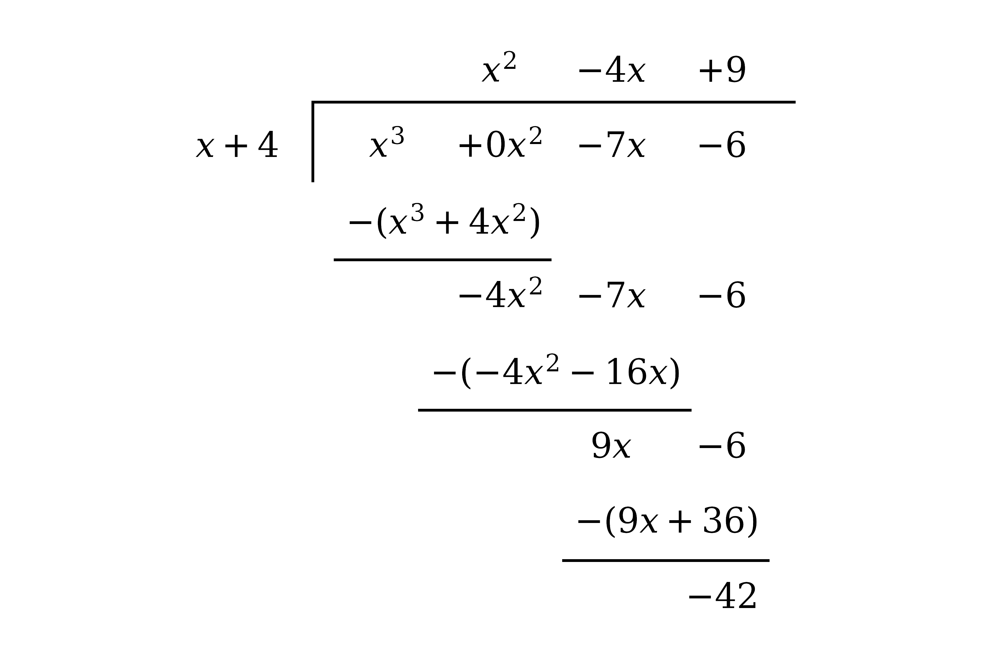

**[M1]**

The final line of the division is the remainder

$- 42$

**[A1]**

> **[mark-scheme]**
> **M1**: Commencing division of $x^{3} - 7 x - 6$ by `\left(x + 4\right)` and working through to the constant left at the foot.
> 
> **A1**: Correct remainder $- 42$.

### Q18
Take out the common factor of $x$ first

`2 x^{3} + 7 x^{2} - 4 x = x \left(2 x^{2} + 7 x - 4\right)`

**[M1]**

Factorise the quadratic, checking it expands to the required form

`\text{f} \left(x\right) = x \left(2 x - 1\right) \left(x + 4\right)`

**[A1]**

> **[mark-scheme]**
> **M1**: Taking out the common factor $x$ to reach `x \left(2 x^{2} + 7 x - 4\right)`.
> 
> **A1**: Factorising the quadratic to reach the given `x \left(2 x - 1\right) \left(x + 4\right)`. Because the result is given, the factorisation must be shown.
A fraction is zero only where its numerator is zero, provided the denominator is not, so solve `\text{f} \left(x\right) = 0` with $x \neq - 1$

`x \left(2 x - 1\right) \left(x + 4\right) = 0`

**[M1]**

Set each factor to zero; none of the roots is $- 1$, so all are valid

$x = - 4 ,  0 ,  \frac{1}{2}$

**[A1]**

> **[mark-scheme]**
> **M1**: Setting `\text{f} \left(x\right) = 0` from the factorised form (or otherwise), using that the fraction is zero when its numerator is.
> 
> **A1**: All three solutions $x = - 4 ,  0 ,  \frac{1}{2}$, in any order. None is excluded, since none equals $- 1$.

### Q19
Since `\left(x + 1\right)` is a factor, the factor theorem gives `\text{f} \left(- 1\right) = 0`, so substitute $x = - 1$

`\left(- 1\right)^{4} + a \left(- 1\right)^{3} - 13 \left(- 1\right)^{2} - 38 \left(- 1\right) - 4 b = 0`

**[M1]**

Simplify to a linear equation in $a$ and $b$

$1 - a - 13 + 38 - 4 b = 0$

$a + 4 b = 26$

**[A1]**

Since `\left(x + 2\right)` is also a factor, `\text{f} \left(- 2\right) = 0`, so substitute $x = - 2$

`\left(- 2\right)^{4} + a \left(- 2\right)^{3} - 13 \left(- 2\right)^{2} - 38 \left(- 2\right) - 4 b = 0`

**[M1]**

Simplify to a second linear equation

$16 - 8 a - 52 + 76 - 4 b = 0$

$2 a + b = 10$

**[A1]**

Multiply the second equation by $4$ so the $b$ terms match, then subtract the first to eliminate $b$

$8 a + 4 b = 40$

$7 a = 14 \Rightarrow a = 2$

Substitute $a = 2$ back into $2 a + b = 10$

$b = 10 - 4 = 6$

$a = 2 ,  b = 6$

**[A1]**

> **[mark-scheme]**
> **M1**: Using `\text{f} \left(- 1\right) = 0` (or dividing by `\left(x + 1\right)` and equating the remainder to zero), substituting $x = - 1$.
> 
> **A1**: A correct first equation in any equivalent form, e.g. $a + 4 b = 26$ or $1 - a - 13 + 38 - 4 b = 0$.
> 
> **M1**: Using `\text{f} \left(- 2\right) = 0` (or dividing by `\left(x + 2\right)`), substituting $x = - 2$.
> 
> **A1**: A correct second equation in any equivalent form, e.g. $2 a + b = 10$.
> 
> **A1**: Solving the equations simultaneously to obtain both $a = 2$ and $b = 6$. Both values are required, and the simultaneous working must be shown.

### Q20
(i)

Split the middle term using two numbers that multiply to `4 \times \left(- 15\right) = - 60` and add to $- 4$, namely $- 10$ and $6$

$4 x^{2} - 4 x - 15 = 4 x^{2} + 6 x - 10 x - 15$

**[M1]**

Factorise in pairs, then take out the common bracket

`2 x \left(2 x + 3\right) - 5 \left(2 x + 3\right)`

`\left(2 x + 3\right) \left(2 x - 5\right)`

**[A1]**

(ii)

First take out the common factor of $x$

`3 x^{3} + 11 x^{2} - 4 x = x \left(3 x^{2} + 11 x - 4\right)`

**[M1]**

Factorise the quadratic, using two numbers that multiply to `3 \times \left(- 4\right) = - 12` and add to $11$, namely $- 1$ and $12$

`x \left(3 x^{2} - x + 12 x - 4\right) = x \left[x \left(3 x - 1\right) + 4 \left(3 x - 1\right)\right]`

`x \left(3 x - 1\right) \left(x + 4\right)`

**[A1]**

> **[mark-scheme]**
> **M1**: Splitting the middle term of $4 x^{2} - 4 x - 15$ into $+ 6 x$ and $- 10 x$, or otherwise attempting two factors.
> 
> **A1**: Correct `\left(2 x + 3\right) \left(2 x - 5\right)`, in either order.
> 
> **M1**: Taking out the common factor $x$ from $3 x^{3} + 11 x^{2} - 4 x$ to reach `x \left(3 x^{2} + 11 x - 4\right)`.
> 
> **A1**: Fully correct `x \left(3 x - 1\right) \left(x + 4\right)`, factors in any order.

### Q21
**Method 1 - Remainder Theorem**

By the remainder theorem, the remainder on dividing by `\left(x - 3\right)` is the value of the polynomial at $x = 3$, so evaluate it there

`\left( 3 \right)^{3} + 2 \left( 3 \right)^{2} - 5 \left(3\right) + 8`

**[M1]**

Work out the arithmetic

$27 + 18 - 15 + 8$

$38$

**[A1]**

> **[mark-scheme]**
> **M1**: Using the remainder theorem, substituting $x = 3$ into the polynomial (or commencing long division by `\left(x - 3\right)`).
> 
> **A1**: Correct remainder $38$. A bare value with no substitution or division seen does not score.

**Method 2 - Long Division**

Divide the polynomial by `\left(x - 3\right)`; the number left at the foot of the division is the remainder

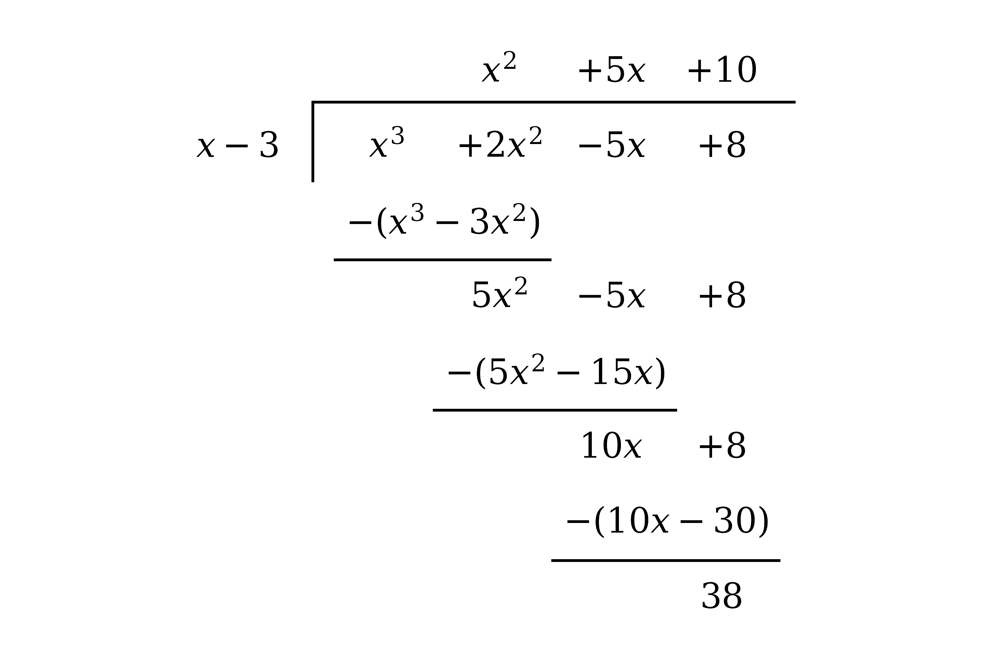

**[M1]**

The final line of the division is the remainder

$38$

**[A1]**

> **[mark-scheme]**
> **M1**: Commencing division of $x^{3} + 2 x^{2} - 5 x + 8$ by `\left(x - 3\right)` and working through to the constant left at the foot.
> 
> **A1**: Correct remainder $38$.

### Q22
Divide the polynomial by `\left(x - 2\right)`; a zero remainder is exactly the condition for a factor

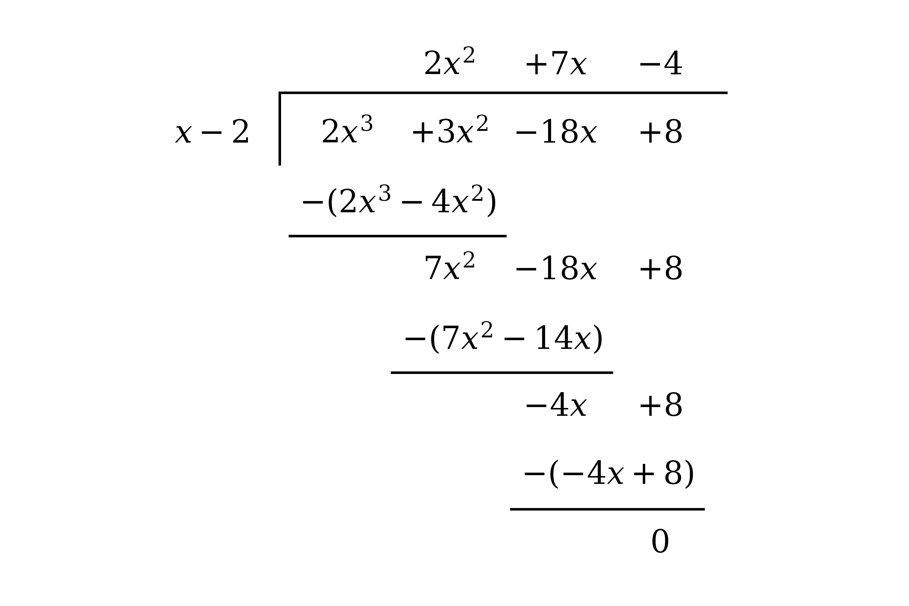

**[M1]**

Read off the quotient, with a remainder of zero

`2 x^{3} + 3 x^{2} - 18 x + 8 = \left(x - 2\right) \left(2 x^{2} + 7 x - 4\right)`

**[A1]**

Since the remainder is zero, `\left(x - 2\right)` is a factor

`\left(x - 2\right) \textrm{ }\text{is a factor}`

**[A1]**

> **[mark-scheme]**
> **M1**: A valid method, either commencing division of $2 x^{3} + 3 x^{2} - 18 x + 8$ by `\left(x - 2\right)`, or evaluating `\text{f} \left(2\right)` by the factor theorem.
> 
> **A1**: Correct division, with quotient $2 x^{2} + 7 x - 4$ and zero remainder (or `\text{f} \left(2\right) = 0`).
> 
> **A1**: Concluding from the zero remainder that `\left(x - 2\right)` is a factor. Reaching the zero with no errors is sufficient; a written conclusion is good practice but not required.

### Q23
Since `\text{f} \left(3\right) = 0`, substitute $x = 3$ into `\text{f} \left(x\right)` and set the result to zero

$9 + 3 a + b = 0$

**[M1]**

Do the same with `\text{f} \left(- 8\right) = 0`, giving two simultaneous equations

$3 a + b = - 9$

$- 8 a + b = - 64$

**[A1]**

Subtract the equations to eliminate $b$

$11 a = 55 \Rightarrow a = 5$

**[M1]**

Substitute $a = 5$ back to find $b$

`b = - 9 - 3 \left(5\right) = - 24`

$a = 5 ,  b = - 24$

**[A1]**

> **[mark-scheme]**
> **M1**: Substituting $x = 3$ (or $x = - 8$) into `\text{f} \left(x\right)` and equating to zero. Substituting without equating to zero does not score.
> 
> **A1**: Two correct equations, e.g. $3 a + b = - 9$ and $- 8 a + b = - 64$.
> 
> **M1**: Solving the simultaneous equations. The factor method also scores here: writing `\text{f} \left(x\right) = \left(x - 3\right) \left(x + 8\right)` and comparing with $x^{2} + a x + b$.
> 
> **A1**: Both correct values $a = 5$ and $b = - 24$. The working must be shown; a bare answer does not score.

### Q24
**Method 1 - Long Division**

Set the division out as a bus-stop, dividing the cubic by `\left(x + 2\right)` and working down through the powers of $x$, subtracting at each stage

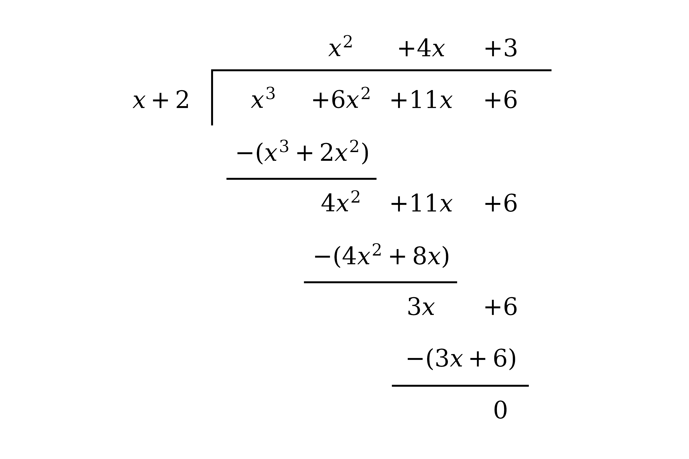

**[M1]**

The final subtraction leaves zero, so there is no remainder, and the quotient is read from the top of the tableau

$x^{2} + 4 x + 3$

**[A1 A1]**

> **[mark-scheme]**
> **M1**: Beginning a correct division of $x^{3} + 6 x^{2} + 11 x + 6$ by `\left(x + 2\right)`, by any valid method, and reaching a leading quotient term $x^{2}$.
> 
> **A1**: Correct quotient $x^{2} + 4 x + 3$.
> 
> **A1**: Zero remainder, confirming that `\left(x + 2\right)` divides exactly.

**Method 2 - Inspection**

Since a cubic divided by a linear expression leaves a quadratic, write the cubic as the divisor multiplied by an unknown quadratic

`x^{3} + 6 x^{2} + 11 x + 6 = \left(x + 2\right) \left(x^{2} + b x + c\right)`

**[M1]**

Expand the right hand side and compare the coefficients of $x^{2}$ to find $b$

$b + 2 = 6 \Rightarrow b = 4$

**[A1]**

Compare the constant terms to find $c$

$2 c = 6 \Rightarrow c = 3$

The coefficient of $x$ then agrees as a check, since $c + 2 b = 3 + 8 = 11$, so the division is exact

$x^{2} + 4 x + 3$

**[A1]**

> **[mark-scheme]**
> **M1**: Writing `x^{3} + 6 x^{2} + 11 x + 6 = \left(x + 2\right) \left(x^{2} + b x + c\right)` and comparing coefficients (an equally valid method of division).
> 
> **A1**: Correct $b = 4$.
> 
> **A1**: Correct $c = 3$, giving quotient $x^{2} + 4 x + 3$ with zero remainder.

### Q25
A root at $x = 3$ means `\left(x - 3\right)` is a factor, so write `\text{f} \left(x\right)` as `\left(x - 3\right)` multiplied by an unknown quadratic

`x^{3} - 5 x^{2} - 2 x + 24 = \left(x - 3\right) \left(x^{2} + b x + c\right)`

**[M1]**

Expand the right hand side and compare the coefficients of $x^{2}$ to find $b$

$b - 3 = - 5 \Rightarrow b = - 2$

**[A1]**

Compare the constant terms to find $c$

$- 3 c = 24 \Rightarrow c = - 8$

**[A1]**

The quadratic factor is $x^{2} - 2 x - 8$; factorise it by finding two numbers that multiply to $- 8$ and add to $- 2$, namely $- 4$ and $2$

`x^{2} - 2 x - 8 = \left(x - 4\right) \left(x + 2\right)`

**[M1 A1]**

Combine all three linear factors

`\text{f} \left(x\right) = \left(x - 3\right) \left(x - 4\right) \left(x + 2\right)`

**[A1]**

> **[mark-scheme]**
> **M1**: Using the given root to write `\text{f} \left(x\right) = \left(x - 3\right) \left(x^{2} + b x + c\right)` and compare coefficients, or dividing `\text{f} \left(x\right)` by `\left(x - 3\right)` by long division.
> 
> **A1**: Correct $b = - 2$ (equivalently, the $x^{2}$ term of the quotient).
> 
> **A1**: Correct $c = - 8$, giving the quadratic factor $x^{2} - 2 x - 8$.
> 
> **M1**: Attempting to factorise the quadratic into two linear factors.
> 
> **A1**: Correct factors `\left(x - 4\right) \left(x + 2\right)`.
> 
> **A1**: Fully factorised `\text{f} \left(x\right) = \left(x - 3\right) \left(x - 4\right) \left(x + 2\right)`. The factors may be in any order.

### Q26
Since $x = \frac{1}{2}$ is a root, the factor theorem gives `\text{f} \left(\frac{1}{2}\right) = 0`, so substitute $x = \frac{1}{2}$

`2 \left(\frac{1}{2}\right)^{3} + \left(p^{2} + 1\right) \left(\frac{1}{2}\right)^{2} - 11 \left(\frac{1}{2}\right) + 4 = 0`

**[M1]**

Multiply every term by $4$ to clear the fractions

`1 + \left(p^{2} + 1\right) - 22 + 16 = 0`

**[A1]**

Collect the terms into an equation in $p$

$p^{2} - 4 = 0$

**[M1]**

Solve, remembering that a squared term gives two roots

$p = \pm 2$

**[A1]**

> **[mark-scheme]**
> **M1**: Using `\text{f} \left(\frac{1}{2}\right) = 0` and substituting $x = \frac{1}{2}$ into the cubic.
> 
> **A1**: Correct equation after clearing fractions, such as $1 + p^{2} + 1 - 22 + 16 = 0$.
> 
> **M1**: Rearranging to $p^{2} = 4$ (or $p^{2} - 4 = 0$).
> 
> **A1**: Both values $p = \pm 2$. Both are required; a single value is not enough.

### Q27
Substitute $x = - 1$ and $x = - 2$ into `\text{f} \left(x\right)` and show each gives zero

`\text{f} \left(- 1\right) = 2 + 15 - 10 - 105 + 98 = 0`

`\text{f} \left(- 2\right) = 32 + 120 - 40 - 210 + 98 = 0`

**[B1]**

> **[mark-scheme]**
> **B1**: Both `\text{f} \left(- 1\right) = 0` and `\text{f} \left(- 2\right) = 0` shown, with the substitutions seen. As both results are given, the working must be seen for each.
From part (a), `\left(x + 1\right)` and `\left(x + 2\right)` are both factors, so their product `\left(x + 1\right) \left(x + 2\right) = x^{2} + 3 x + 2` is a factor; divide `\text{f} \left(x\right)` by it, writing `\text{f} \left(x\right)` as `\left(x^{2} + 3 x + 2\right)` multiplied by an unknown quadratic

`2 x^{4} - 15 x^{3} - 10 x^{2} + 105 x + 98 = \left(x^{2} + 3 x + 2\right) \left(a x^{2} + b x + c\right)`

**[M1]**

Compare the coefficient of $x^{4}$

$a = 2$

Compare the constant term

$2 c = 98 \Rightarrow c = 49$

Compare the coefficient of $x^{3}$

$3 a + b = - 15 \Rightarrow b = - 21$

These give the quadratic factor

`\text{f} \left(x\right) = \left(x^{2} + 3 x + 2\right) \left(2 x^{2} - 21 x + 49\right)`

**[A1]**

Factorise the quadratic $2 x^{2} - 21 x + 49$; $2 \times 49 = 98$, and $- 14$ and $- 7$ multiply to $98$ and add to $- 21$

`2 x^{2} - 21 x + 49 = \left(2 x - 7\right) \left(x - 7\right)`

**[M1 A1]**

Write `\text{f} \left(x\right)` fully factorised

`\text{f} \left(x\right) = \left(x + 1\right) \left(x + 2\right) \left(2 x - 7\right) \left(x - 7\right)`

**[A1]**

Set each factor to zero to solve `\text{f} \left(x\right) = 0`

$x = - 1 ,  - 2 ,  \frac{7}{2} ,  7$

**[A1 A1]**

> **[mark-scheme]**
> **M1**: Using `\left(x + 1\right) \left(x + 2\right) = x^{2} + 3 x + 2` as a factor and dividing (or comparing coefficients).
> 
> **A1**: Correct quadratic quotient $2 x^{2} - 21 x + 49$.
> 
> **M1**: Attempting to factorise $2 x^{2} - 21 x + 49$ into two linear factors.
> 
> **A1**: Correct factors `\left(2 x - 7\right) \left(x - 7\right)`.
> 
> **A1**: Fully factorised `\text{f} \left(x\right) = \left(x + 1\right) \left(x + 2\right) \left(2 x - 7\right) \left(x - 7\right)`.
> 
> **A1**: Two correct solutions.
> 
> **A1**: All four solutions $x = - 1 ,  - 2 ,  \frac{7}{2} ,  7$ and no extras.

### Q28
The expression is a quadratic in $x^{2}$; writing $y = x^{2}$ turns it into $9 y^{2} - 40 y + 16$

`9 x^{4} - 40 x^{2} + 16 = 9 \left(x^{2}\right)^{2} - 40 \left(x^{2}\right) + 16`

**[M1]**

By the factor theorem in $y$, test $y = \frac{4}{9}$ (that is, $x^{2} = \frac{4}{9}$)

`9 \left(\frac{4}{9}\right)^{2} - 40 \left(\frac{4}{9}\right) + 16 = \frac{16}{9} - \frac{160}{9} + \frac{144}{9} = 0`

**Final answer:** **so **`\left(9 x^{2} - 4\right)`** is a factor**

**[A1]**

The quadratic in $y$ therefore factorises completely as `\left(9 y - 4\right) \left(y - 4\right)`; replacing $y$ with $x^{2}$ and setting the result equal to zero

`9 x^{4} - 40 x^{2} + 16 = \left(9 x^{2} - 4\right) \left(x^{2} - 4\right) = 0`

**[M1]**

Factorise each difference of two squares and solve

`\left(3 x - 2\right) \left(3 x + 2\right) \left(x - 2\right) \left(x + 2\right) = 0`

$x = \frac{2}{3} ,  - \frac{2}{3} ,  2 ,  - 2$

**[A1 A1]**

> **[mark-scheme]**
> **M1**: Recognising the expression as a quadratic in $x^{2}$ (substitution $y = x^{2}$ or working directly in $x^{2}$).
> 
> **A1**: Showing `\left(9 x^{2} - 4\right)` is a factor, by evaluating at $x^{2} = \frac{4}{9}$ or by dividing.
> 
> **M1**: Reaching the fully factorised `\left(9 x^{2} - 4\right) \left(x^{2} - 4\right)`, or dividing $9 x^{4} - 40 x^{2} + 16$ by `\left(9 x^{2} - 4\right)` to obtain $x^{2} - 4$.
> 
> **A1**: Two correct solutions.
> 
> **A1**: All four solutions $x = \pm \frac{2}{3} ,  \pm 2$ and no extras. Accept decimals $\pm 0 . 667$.

### Q29
**Method 1 - Long Division**

Divide by `\left(2 x - 1\right)`, writing the missing $x^{3}$ and $x$ terms as $0 x^{3}$ and $0 x$ so the columns line up

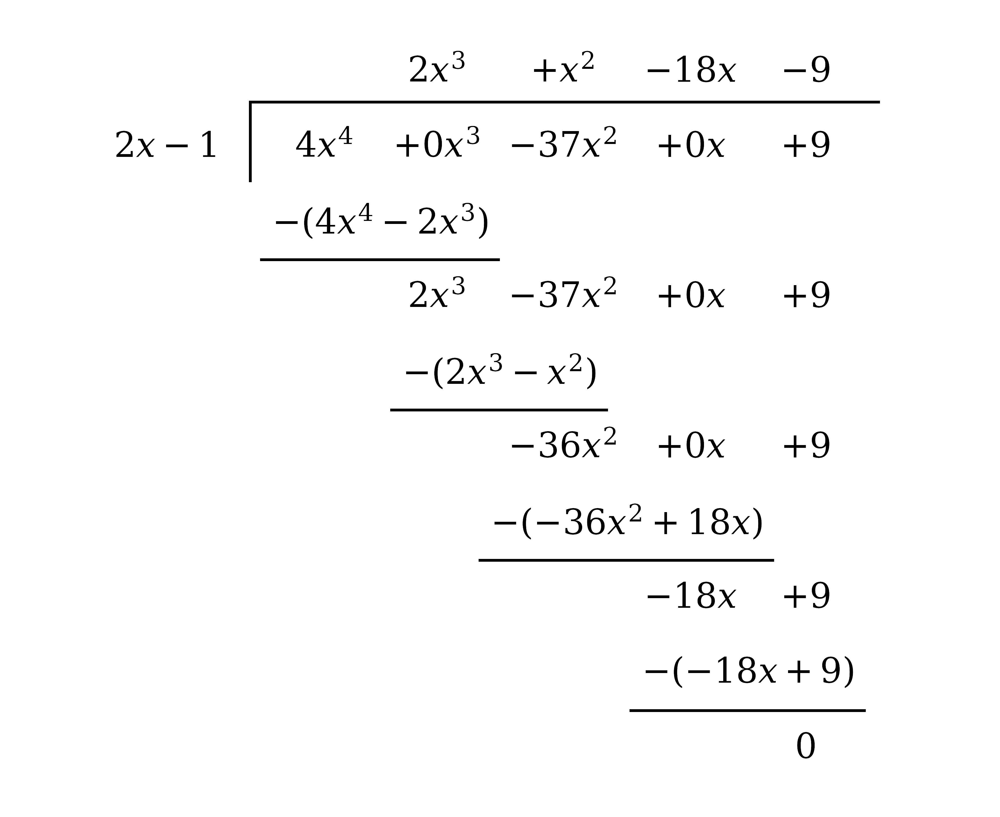

**[M1]**

Read the quotient from the top of the tableau; the remainder is zero

$2 x^{3} + x^{2} - 18 x - 9$

**[A1 A1]**

> **[mark-scheme]**
> **M1**: Commencing division of $4 x^{4} - 37 x^{2} + 9$ by `\left(2 x - 1\right)`, by any valid method, dividing $4 x^{4}$ by $2 x$ to start the quotient with $2 x^{3}$.
> 
> **A1**: A correct partial quotient (at least $2 x^{3} + x^{2}$).
> 
> **A1**: Fully correct quotient $2 x^{3} + x^{2} - 18 x - 9$ with zero remainder.

**Method 2 - Inspection**

Write the quartic as `\left(2 x - 1\right)` multiplied by an unknown cubic

`4 x^{4} - 37 x^{2} + 9 = \left(2 x - 1\right) \left(a x^{3} + b x^{2} + c x + d\right)`

**[M1]**

Compare coefficients term by term, from $x^{4}$ down to the constant

$2 a = 4 \Rightarrow a = 2$

$- a + 2 b = 0 \Rightarrow b = 1$

$- b + 2 c = - 37 \Rightarrow c = - 18$

$- c + 2 d = 0 \Rightarrow d = - 9$

$2 x^{3} + x^{2} - 18 x - 9$

**[A1 A1]**

> **[mark-scheme]**
> **M1**: Writing `4 x^{4} - 37 x^{2} + 9 = \left(2 x - 1\right) \left(a x^{3} + b x^{2} + c x + d\right)` and comparing coefficients.
> 
> **A1**: At least two coefficients correct.
> 
> **A1**: Fully correct quotient $2 x^{3} + x^{2} - 18 x - 9$.

### Q30
**Method 1 - Remainder Theorem**

The factor `\left(2 x + 3\right)` is zero at $x = - \frac{3}{2}$, so the remainder is `\text{f} \left(- \frac{3}{2}\right)`

`\text{f} \left(- \frac{3}{2}\right) = 6 \left(- \frac{3}{2}\right)^{4} + 7 \left(- \frac{3}{2}\right)^{3} - 27 \left(- \frac{3}{2}\right)^{2} - 28 \left(- \frac{3}{2}\right) + 12`

**[M1]**

Work out the arithmetic

$= \frac{243}{8} - \frac{189}{8} - \frac{243}{4} + 42 + 12 = 0$

$0$

**[A1]**

> **[mark-scheme]**
> **M1**: Using the remainder theorem, substituting $x = - \frac{3}{2}$ into `\text{f} \left(x\right)` (or commencing long division by `\left(2 x + 3\right)`).
> 
> **A1**: Correct remainder $0$. (A remainder of $0$ also shows `\left(2 x + 3\right)` is a factor, which is used implicitly in part (b).)

**Method 2 - Long Division**

Divide `\text{f} \left(x\right)` by `\left(2 x + 3\right)`; the constant left at the foot is the remainder

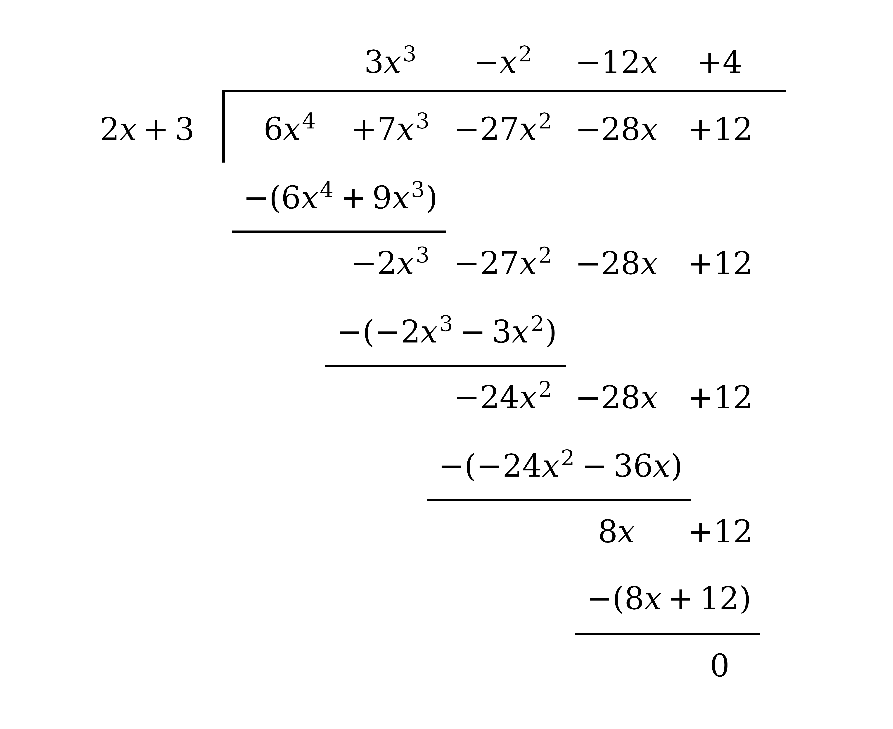

**[M1]**

The final line of the division is the remainder

$0$

**[A1]**

> **[mark-scheme]**
> **M1**: Commencing division of `\text{f} \left(x\right)` by `\left(2 x + 3\right)` and working through to the constant at the foot.
> 
> **A1**: Correct remainder $0$.
Since `\left(x + 2\right)` is a factor, divide `\text{f} \left(x\right)` by it; write `\text{f} \left(x\right)` as `\left(x + 2\right)` multiplied by an unknown cubic

`6 x^{4} + 7 x^{3} - 27 x^{2} - 28 x + 12 = \left(x + 2\right) \left(a x^{3} + b x^{2} + c x + d\right)`

**[M1]**

Compare the coefficient of $x^{4}$

$a = 6$

Compare the coefficient of $x^{3}$

$2 a + b = 7 \Rightarrow b = - 5$

Compare the constant term

$2 d = 12 \Rightarrow d = 6$

Compare the coefficient of $x$

$2 c + d = - 28 \Rightarrow c = - 17$

These give the cubic factor

`\text{f} \left(x\right) = \left(x + 2\right) \left(6 x^{3} - 5 x^{2} - 17 x + 6\right)`

**[A1]**

From part (a), `\left(2 x + 3\right)` is also a factor (the remainder was $0$), so divide the cubic by it

`6 x^{3} - 5 x^{2} - 17 x + 6 = \left(2 x + 3\right) \left(3 x^{2} - 7 x + 2\right)`

**[M1]**

Factorise the quadratic; $3 \times 2 = 6$, and $- 6$ and $- 1$ multiply to $6$ and add to $- 7$

`3 x^{2} - 7 x + 2 = \left(3 x - 1\right) \left(x - 2\right)`

**[A1]**

Combine all four linear factors

`\text{f} \left(x\right) = \left(x + 2\right) \left(2 x + 3\right) \left(3 x - 1\right) \left(x - 2\right)`

**[A1]**

> **[mark-scheme]**
> **M1**: Dividing `\text{f} \left(x\right)` by `\left(x + 2\right)` (or comparing coefficients) to begin reducing the quartic.
> 
> **A1**: Correct cubic factor $6 x^{3} - 5 x^{2} - 17 x + 6$.
> 
> **M1**: Using `\left(2 x + 3\right)` from part (a), or otherwise, to reduce the cubic to a quadratic factor.
> 
> **A1**: Correct quadratic factor $3 x^{2} - 7 x + 2$, or its factors `\left(3 x - 1\right) \left(x - 2\right)`.
> 
> **A1**: Fully factorised `\text{f} \left(x\right) = \left(x + 2\right) \left(2 x + 3\right) \left(3 x - 1\right) \left(x - 2\right)`, factors in any order.

### Q31
The factor `\left(a x - 2\right)` is zero at $x = \frac{2}{a}$, so by the factor theorem evaluate the quadratic there and check it is zero

`3 a \left(\frac{2}{a}\right)^{2} + \left(a - 6\right) \left(\frac{2}{a}\right) - 2`

**[M1]**

Work out each term

$= \frac{12}{a} + 2 - \frac{12}{a} - 2 = 0$

**Final answer:** **The value is **$0$**, so **`\left(a x - 2\right)`** is a factor**

**[A1]**

> **[mark-scheme]**
> **M1**: Substituting $x = \frac{2}{a}$ into the quadratic (or writing it as `\left(a x - 2\right) \left(3 x + 1\right)` and expanding to verify).
> 
> **A1**: Reaching $0$ with no errors, which shows `\left(a x - 2\right)` is a factor. A written conclusion is good practice but is not required for the mark.
Part (a) shows `\left(a x - 2\right)` is a factor, so divide the quadratic by it to find the other factor

`3 a x^{2} + \left(a - 6\right) x - 2 = \left(a x - 2\right) \left(3 x + 1\right)`

Setting each factor to zero gives the two roots $x = \frac{2}{a}$ and $x = - \frac{1}{3}$

**[M1]**

The given root $x = - \frac{1}{a-4}$ must equal one of these; equating it to $- \frac{1}{3}$

$- \frac{1}{a-4} = - \frac{1}{3}$

$a - 4 = 3 \Rightarrow a = 7$

**[M1]**

Equating it instead to $\frac{2}{a}$

$- \frac{1}{a-4} = \frac{2}{a}$

`- a = 2 \left(a - 4\right)`

$- a = 2 a - 8$

$3 a = 8 \Rightarrow a = \frac{8}{3}$

Both values give a genuine root of the quadratic, so

**Final answer:** $a = 7$** or **$a = \frac{8}{3}$

**[A1]**

> **[mark-scheme]**
> **M1**: Dividing by `\left(a x - 2\right)` to obtain the other factor `\left(3 x + 1\right)`, and hence the roots $x = \frac{2}{a}$ and $x = - \frac{1}{3}$.
> 
> **M1**: Equating $- \frac{1}{a-4}$ to a root and solving for $a$ (either case).
> 
> **A1**: Both $a = 7$ and $a = \frac{8}{3}$. Giving only $a = 7$ (equating to $- \frac{1}{3}$ alone) is incomplete and scores M1 M1 A0, since $x = - \frac{1}{a-4}$ can equally be the root $\frac{2}{a}$, which gives $a = \frac{8}{3}$.

### Q32
Since $3$ is a root, `\left(x - 3\right)` is a factor; divide the cubic by it, writing it as `\left(x - 3\right)` multiplied by an unknown quadratic

`2 x^{3} - x^{2} - 11 x - 12 = \left(x - 3\right) \left(a x^{2} + b x + c\right)`

**[M1]**

Compare the coefficient of $x^{3}$

$a = 2$

Compare the constant term

$- 3 c = - 12 \Rightarrow c = 4$

Compare the coefficient of $x^{2}$

$- 3 a + b = - 1 \Rightarrow b = 5$

These give the quadratic factor

`2 x^{3} - x^{2} - 11 x - 12 = \left(x - 3\right) \left(2 x^{2} + 5 x + 4\right)`

**[A1]**

Any further real root must come from $2 x^{2} + 5 x + 4 = 0$; test whether that has real roots using its discriminant

`b^{2} - 4 a c = 5^{2} - 4 \left(2\right) \left(4\right) = 25 - 32 = - 7`

**[M1]**

Since the discriminant is negative, $2 x^{2} + 5 x + 4 = 0$ has no real roots, so the only real root of the cubic is $x = 3$

**Final answer:** **The discriminant is **$- 7 < 0$**, so there are no other real roots**

**[A1]**

> **[mark-scheme]**
> **M1**: Using `\left(x - 3\right)` as a factor and dividing (or comparing coefficients) to reach the quadratic factor.
> 
> **A1**: Correct quadratic factor $2 x^{2} + 5 x + 4$.
> 
> **M1**: Computing the discriminant of the quadratic factor.
> 
> **A1**: Concluding from the negative discriminant that the quadratic has no real roots, so the cubic has no real root other than $x = 3$. A conclusion in words is required here, because this is a "prove" question, so the negative discriminant must be explicitly linked to "no other real roots".

### Q33
Since `\left(3 x + 1\right)` is a factor, write `\text{f} \left(x\right)` as `\left(3 x + 1\right)` multiplied by an unknown cubic

`3 x^{4} + x^{3} - 12 x^{2} - 49 x - 15 = \left(3 x + 1\right) \left(a x^{3} + b x^{2} + c x + d\right)`

**[M1]**

Expanding `\left(3 x + 1\right) \left(a x^{3} + b x^{2} + c x + d\right)` gives `3 a x^{4} + \left(3 b + a\right) x^{3} + \left(3 c + b\right) x^{2} + \left(3 d + c\right) x + d`; compare each coefficient with `\text{f} \left(x\right)`

$3 a = 3 \Rightarrow a = 1$

$3 b + a = 1 \Rightarrow b = 0$

$d = - 15$

$3 d + c = - 49 \Rightarrow c = - 4$

`\text{f} \left(x\right) = \left(3 x + 1\right) \left(x^{3} - 4 x - 15\right)`

**[A1]**

> **[mark-scheme]**
> **M1**: Writing `\text{f} \left(x\right) = \left(3 x + 1\right) \left(a x^{3} + b x^{2} + c x + d\right)` and comparing coefficients, or dividing by `\left(3 x + 1\right)`.
> 
> **A1**: Correct $a = 1 ,  b = 0 ,  c = - 4 ,  d = - 15$, giving `\text{f} \left(x\right) = \left(3 x + 1\right) \left(x^{3} - 4 x - 15\right)`. The $b = 0$ (no $x^{2}$ term in the cubic) must be correct.
From part (a), `\text{f} \left(x\right) = \left(3 x + 1\right) \left(x^{3} - 4 x - 15\right)`. Since `\left(x - 3\right)` is a factor of `\text{f} \left(x\right)` but not of `\left(3 x + 1\right)`, it must be a factor of the cubic; divide the cubic by it, writing the missing $x^{2}$ term as $0 x^{2}$

`x^{3} + 0 x^{2} - 4 x - 15 = \left(x - 3\right) \left(x^{2} + b x + c\right)`

**[M1]**

Compare the coefficient of $x^{2}$

$b - 3 = 0 \Rightarrow b = 3$

Compare the constant term

$- 3 c = - 15 \Rightarrow c = 5$

These give the quadratic factor

`x^{3} - 4 x - 15 = \left(x - 3\right) \left(x^{2} + 3 x + 5\right)`

**[A1]**

Check whether the quadratic factorises further by its discriminant

`b^{2} - 4 a c = 3^{2} - 4 \left(1\right) \left(5\right) = 9 - 20 = - 11`

**[M1]**

Since the discriminant is negative, $x^{2} + 3 x + 5$ has no real factors, so the full factorisation is

`\text{f} \left(x\right) = \left(3 x + 1\right) \left(x - 3\right) \left(x^{2} + 3 x + 5\right)`

**[A1 A1]**

> **[mark-scheme]**
> **M1**: Using `\left(x - 3\right)` as a factor of the cubic $x^{3} - 4 x - 15$ and dividing (or comparing coefficients).
> 
> **A1**: Correct quadratic factor $x^{2} + 3 x + 5$.
> 
> **M1**: Testing the quadratic factor for further factorisation (discriminant, or an equivalent argument that it has no real roots).
> 
> **A1**: Recognising $x^{2} + 3 x + 5$ is irreducible (negative discriminant), so it is left as a quadratic.
> 
> **A1**: Fully factorised `\text{f} \left(x\right) = \left(3 x + 1\right) \left(x - 3\right) \left(x^{2} + 3 x + 5\right)`, factors in any order.
Set the fully factorised form to zero; a product is zero when one of its factors is zero

`\left(3 x + 1\right) \left(x - 3\right) \left(x^{2} + 3 x + 5\right) = 0`

The two linear factors give real roots, while $x^{2} + 3 x + 5 = 0$ has discriminant $- 11 < 0$ from part (b), so contributes none

**Final answer:** **The only real roots are **$x = - \frac{1}{3}$** and **$x = 3$**, so **`\text{f} \left(x\right) = 0`** has exactly two real roots**

**[B1 B1]**

> **[mark-scheme]**
> **B1**: Identifying the two real roots $x = - \frac{1}{3}$ and $x = 3$ from the linear factors.
> 
> **B1**: Concluding "exactly 2" by explicitly ruling out the quadratic factor via its negative discriminant. Both the two real roots and the reason the quadratic gives none are needed, because this is a "show" part, so the count must be justified, not just stated.

### Q34
Here $2 x + 1 = 0$ at $x = - \frac{1}{2}$, so by the remainder theorem the remainder is the value of the polynomial there

`8 \left(- \frac{1}{2}\right)^{3} + 6 \left(- \frac{1}{2}\right)^{2} - \left(- \frac{1}{2}\right) - 2 = - 1 + \frac{3}{2} + \frac{1}{2} - 2`

**[M1]**

$- 1$

**[A1]**

> **[mark-scheme]**
> **M1**: Substituting $x = - \frac{1}{2}$ into $8 x^{3} + 6 x^{2} - x - 2$.
> 
> **A1**: Correct remainder $- 1$.
Again $2 x + 1 = 0$ at $x = - \frac{1}{2}$, so evaluate the polynomial there

`6 \left(- \frac{1}{2}\right)^{2} - \left(- \frac{1}{2}\right) - 2 = \frac{3}{2} + \frac{1}{2} - 2`

**[M1]**

$0$

**[A1]**

> **[exam-tip]**
> A remainder of $0$ is not a mistake: it means `\left(2 x + 1\right)` divides exactly, so it is a factor. Compare with part (a), where the same divisor gave a remainder of $- 1$, so this zero is telling you something specific about this polynomial.

> **[mark-scheme]**
> **M1**: Substituting $x = - \frac{1}{2}$ into $6 x^{2} - x - 2$ (or dividing by `\left(2 x + 1\right)`).
> 
> **A1**: Correct remainder $0$.

### Q35
The factor `\left(2 x - 5\right)` is zero at $x = \frac{5}{2}$, so by the factor theorem `\text{f} \left(\frac{5}{2}\right) = 0`

`2 \left(\frac{5}{2}\right)^{3} + k \left(\frac{5}{2}\right)^{2} - 11 \left(\frac{5}{2}\right) - 60 = 0`

**[M1]**

Work out the arithmetic and solve for $k$

$\frac{125}{4} + \frac{25k}{4} - \frac{55}{2} - 60 = 0 \Rightarrow \frac{25k}{4} = \frac{225}{4}$

$k = 9$

**[A1]**

Substitute $k = 9$ and divide by `\left(2 x - 5\right)`; write `\text{f} \left(x\right)` as `\left(2 x - 5\right)` multiplied by an unknown quadratic

`2 x^{3} + 9 x^{2} - 11 x - 60 = \left(2 x - 5\right) \left(x^{2} + b x + c\right)`

**[M1]**

Compare the constant term

$- 5 c = - 60 \Rightarrow c = 12$

Compare the coefficient of $x^{2}$

$- 5 + 2 b = 9 \Rightarrow b = 7$

Factorise the quadratic

`x^{2} + 7 x + 12 = \left(x + 3\right) \left(x + 4\right)`

`\text{f} \left(x\right) = \left(2 x - 5\right) \left(x + 3\right) \left(x + 4\right)`

**[A1]**

> **[mark-scheme]**
> **M1**: Using the factor theorem at $x = \frac{5}{2}$, substituting into `\text{f} \left(x\right)` and equating to zero. The fractional substitution must be seen.
> 
> **A1**: $k = 9$.
> 
> **M1**: Substituting $k = 9$ and dividing by `\left(2 x - 5\right)` (or comparing coefficients) to reach the quadratic factor $x^{2} + 7 x + 12$.
> 
> **A1**: Fully factorised `\text{f} \left(x\right) = \left(2 x - 5\right) \left(x + 3\right) \left(x + 4\right)`, factors in any order.

### Q36
Every term has a common factor of $x y$, so take that out first

`x^{5} y - x y^{5} = x y \left(x^{4} - y^{4}\right)`

**[M1]**

$x^{4} - y^{4}$ is a difference of two squares, `\left( x^{2} \right)^{2} - \left( y^{2} \right)^{2}`

`= x y \left(x^{2} - y^{2}\right) \left(x^{2} + y^{2}\right)`

**[A1]**

$x^{2} - y^{2}$ is itself a difference of two squares; $x^{2} + y^{2}$ does not factorise over the reals, so leave it

`x y \left(x - y\right) \left(x + y\right) \left(x^{2} + y^{2}\right)`

**[A1]**

> **[mark-scheme]**
> **M1**: Taking out the common factor $x y$ to reach `x y \left(x^{4} - y^{4}\right)`.
> 
> **A1**: One correct difference-of-squares step, reaching `x y \left(x^{2} - y^{2}\right) \left(x^{2} + y^{2}\right)`.
> 
> **A1**: Fully factorised `x y \left(x - y\right) \left(x + y\right) \left(x^{2} + y^{2}\right)`, factors in any order. The $x^{2} + y^{2}$ must be present and left unfactorised, since it has no real factors, so "completely" means stopping there. Splitting $x^{2} + y^{2}$ further loses this mark.

### Q37
Write out the division identity, dividend `= \left(\text{divisor}\right) \left(\text{quotient}\right) + \text{remainder}`

`2 x^{3} + \left(a + b\right) x^{2} + \left(a - b\right) x - 3 = \left(x + 4\right) \left(2 x^{2} + \left(2 a + 3\right) x + \left(2 b - 5\right)\right) + c`

**[M1]**

Expand the right hand side and collect like terms

`= 2 x^{3} + \left(2 a + 11\right) x^{2} + \left(8 a + 2 b + 7\right) x + \left(8 b - 20 + c\right)`

Compare the coefficient of $x^{2}$

$2 a + 11 = a + b \Rightarrow b = a + 11$

Compare the coefficient of $x$

$8 a + 2 b + 7 = a - b \Rightarrow 7 a + 3 b = - 7$

Substitute $b = a + 11$ and solve for $a$

`7 a + 3 \left(a + 11\right) = - 7`

$a = - 4 ,  b = 7$

**[M1 A1]**

Compare the constant terms to find $c$

`8 b - 20 + c = - 3 \Rightarrow 8 \left(7\right) - 20 + c = - 3`

$c = - 39$

**[A1]**

> **[mark-scheme]**
> **M1**: Writing the division identity dividend `= \left(x + 4\right) \left(\text{quotient}\right) + c` and expanding the product.
> 
> **M1**: Comparing coefficients of $x^{2}$ and $x$ to form two simultaneous equations in $a$ and $b$.
> 
> **A1**: Both $a = - 4$ and $b = 7$.
> 
> **A1**: $c = - 39$, from comparing the constant terms.

### Q38
Any division can be written as `\text{dividend} = \left(\text{divisor}\right) \left(\text{quotient}\right) + \text{remainder}`, so write that identity out

`x^{3} + a x^{2} + 4 x - 1 = \left(x + 2\right) \left(x^{2} - 4 x + 12\right) + b`

**[M1]**

Expand the right hand side

$= x^{3} - 4 x^{2} + 12 x + 2 x^{2} - 8 x + 24 + b$

$= x^{3} - 2 x^{2} + 4 x + 24 + b$

Compare the coefficient of $x^{2}$

$a = - 2$

**[A1]**

Compare the constant terms

$24 + b = - 1$

$b = - 25$

**[A1]**

> **[exam-tip]**
> Once you have expanded, the coefficient of $x$ comes out as $4$ on both sides without you having used it. That is a free check that you multiplied out correctly, so glance at it before writing down your answers.

> **[mark-scheme]**
> **M1**: Writing the division identity `x^{3} + a x^{2} + 4 x - 1 = \left(x + 2\right) \left(x^{2} - 4 x + 12\right) + b` and expanding the product. Accept an equivalent route, such as dividing $x^{3} + a x^{2} + 4 x - 1$ by `\left(x + 2\right)` and matching the given quotient.
> 
> **A1**: $a = - 2$.
> 
> **A1**: $b = - 25$.

### Q39
The factor `\left(2 x + 1\right)` is zero at $x = - \frac{1}{2}$, so by the factor theorem evaluate `\text{f} \left(x\right)` there and check it is zero

`\text{f} \left(- \frac{1}{2}\right) = 4 \left(- \frac{1}{2}\right)^{3} - 7 \left(- \frac{1}{2}\right) - 3`

**[M1]**

Work out the arithmetic

$= - \frac{1}{2} + \frac{7}{2} - 3 = 0$

`\text{f} \left(- \frac{1}{2}\right) = 0, \; \textrm{ }\text{so} \textrm{ } \left(2 x + 1\right) \textrm{ } \text{is a factor}`

**[A1]**

> **[mark-scheme]**
> **M1**: Substituting $x = - \frac{1}{2}$ into `\text{f} \left(x\right)`. The fractional substitution must be seen; substituting $x = \frac{1}{2}$ or $x = - 1$ scores nothing.
> 
> **A1**: Reaching $0$ with no errors, which shows `\left(2 x + 1\right)` is a factor. A written conclusion is good practice but is not required for the mark; an arithmetic slip loses it even if the last line reads $0$.
Since `\left(2 x + 1\right)` is a factor, divide `\text{f} \left(x\right)` by it; write `\text{f} \left(x\right)` as `\left(2 x + 1\right)` multiplied by an unknown quadratic

`4 x^{3} + 0 x^{2} - 7 x - 3 = \left(2 x + 1\right) \left(a x^{2} + b x + c\right)`

**[M1]**

Compare the coefficient of $x^{3}$

$2 a = 4 \Rightarrow a = 2$

Compare the constant term

$c = - 3$

Compare the coefficient of $x^{2}$

$a + 2 b = 0 \Rightarrow b = - 1$

These give the quadratic factor

`\text{f} \left(x\right) = \left(2 x + 1\right) \left(2 x^{2} - x - 3\right)`

**[A1]**

Factorise the quadratic; `2 \times \left(- 3\right) = - 6`, and $- 3$ and $2$ multiply to $- 6$ and add to $- 1$

`2 x^{2} - x - 3 = \left(2 x - 3\right) \left(x + 1\right)`

**[M1]**

Combine the factors

`\text{f} \left(x\right) = \left(2 x + 1\right) \left(2 x - 3\right) \left(x + 1\right)`

**[A1]**

> **[mark-scheme]**
> **M1**: Writing `\text{f} \left(x\right) = \left(2 x + 1\right) \left(a x^{2} + b x + c\right)` and comparing coefficients, or dividing by `\left(2 x + 1\right)`. The missing $x^{2}$ term must be handled as $0 x^{2}$.
> 
> **A1**: Correct quadratic factor $2 x^{2} - x - 3$.
> 
> **M1**: Factorising the quadratic into two linear factors.
> 
> **A1**: Fully factorised `\text{f} \left(x\right) = \left(2 x + 1\right) \left(2 x - 3\right) \left(x + 1\right)`, factors in any order.
Set each factor to zero; each gives a root of `\text{f} \left(x\right) = 0`

$x = - \frac{1}{2} ,  \frac{3}{2} ,  - 1$

**[B1 B1]**

> **[mark-scheme]**
> **B1**: Two correct roots.
> 
> **B1**: All three roots $x = - \frac{1}{2} ,  \frac{3}{2} ,  - 1$ and no extras. Accept decimals $- 0 . 5$ and $1 . 5$, and accept them in any order.

### Q40
Since `\text{f} \left(2\right) = 0`, substitute $x = 2$ and set the result to zero

$8 + 4 r + 2 s - 30 = 0$

**[M1]**

Simplify to obtain the first equation

$2 r + s = 11$

**[A1]**

Since `\text{f} \left(- 3\right) = - 240`, substitute $x = - 3$ and set the result to $- 240$

$- 27 + 9 r - 3 s - 30 = - 240$

**[M1]**

Simplify to obtain the second equation

$3 r - s = - 61$

**[A1]**

Add the two equations to eliminate $s$

$5 r = - 50 \Rightarrow r = - 10$

**[M1]**

Substitute back into the first equation to find $s$

`2 \left(- 10\right) + s = 11`

$r = - 10 ,  s = 31$

**[A1]**

> **[mark-scheme]**
> **M1**: Substituting $x = 2$ into `\text{f} \left(x\right)` and equating to zero.
> 
> **A1**: Correct first equation, e.g. $2 r + s = 11$.
> 
> **M1**: Substituting $x = - 3$ into `\text{f} \left(x\right)` and equating to $- 240$.
> 
> **A1**: Correct second equation, e.g. $3 r - s = - 61$.
> 
> **M1**: Solving the two equations simultaneously by elimination or substitution.
> 
> **A1**: Both $r = - 10$ and $s = 31$.
From part (a), `\text{f} \left(2\right) = 0`, so `\left(x - 2\right)` is a factor; divide `\text{f} \left(x\right)` by it, writing `\text{f} \left(x\right)` as `\left(x - 2\right)` times an unknown quadratic

`x^{3} - 10 x^{2} + 31 x - 30 = \left(x - 2\right) \left(a x^{2} + b x + c\right)`

**[M1]**

Compare the coefficient of $x^{3}$

$a = 1$

Compare the constant term

$- 2 c = - 30 \Rightarrow c = 15$

Compare the coefficient of $x^{2}$

$- 2 a + b = - 10 \Rightarrow b = - 8$

These give the quadratic factor

`\text{f} \left(x\right) = \left(x - 2\right) \left(x^{2} - 8 x + 15\right)`

Factorise the quadratic, using two numbers that multiply to $15$ and add to $- 8$, namely $- 3$ and $- 5$

`x^{2} - 8 x + 15 = \left(x - 3\right) \left(x - 5\right)`

**[A1]**

Combine the factors

`\text{f} \left(x\right) = \left(x - 2\right) \left(x - 3\right) \left(x - 5\right)`

**[A1]**

> **[mark-scheme]**
> **M1**: Using `\left(x - 2\right)` as a factor and comparing coefficients (or dividing) to reach $x^{2} - 8 x + 15$.
> 
> **A1**: Correct factors `\left(x - 3\right) \left(x - 5\right)`.
> 
> **A1**: Fully factorised `\text{f} \left(x\right) = \left(x - 2\right) \left(x - 3\right) \left(x - 5\right)`, factors in any order. Follow through from part (a)'s values of $r$ and $s$.

### Q41
Any division can be written as $\frac{\text{dividend}}{\text{divisor}} = \text{quotient} + \frac{\text{remainder}}{\text{divisor}}$, so the divisor is whatever sits underneath the remainder term

`\text{The remainder term is} \textrm{ } \frac{4}{x + 1}, \; \textrm{ }\text{so the divisor} \textrm{ } \text{g} \left(x\right) \textrm{ } \text{is} \textrm{ } x + 1`

**[B1]**

> **[mark-scheme]**
> **B1**: Identifying that in the standard division form the divisor appears as the denominator of the remainder term, and that here that denominator is `\left(x + 1\right)`. Accept any wording carrying that idea, for example "the remainder is written over the thing you divided by". Simply asserting "because it is the denominator" with no link to the division form is enough at this level, but a bare "it looks right" is not.
Take `\text{g} \left(x\right) = x + 1` and multiply every term by it to clear the fractions

`\text{f} \left(x\right) = \left(x + 1\right) \left(2 x + 3\right) - 4`

**[M1]**

Expand and simplify

`\text{f} \left(x\right) = 2 x^{2} + 5 x + 3 - 4`

`\text{f} \left(x\right) = 2 x^{2} + 5 x - 1`

**[A1]**

> **[mark-scheme]**
> **M1**: Multiplying through by `\left(x + 1\right)` to reach `\text{f} \left(x\right) = \left(x + 1\right) \left(2 x + 3\right) - 4`.
> 
> **A1**: Correct `\text{f} \left(x\right) = 2 x^{2} + 5 x - 1`.
**Final answer:** **The equation only fixes the ratio **`\frac{\text{f} \left(x\right)}{\text{g} \left(x\right)}`**, so multiplying both functions by the same non-zero factor leaves that ratio unchanged**

**[B1]**

**Final answer:** **For example, doubling both gives a different pair of functions satisfying the same equation**

`\text{f} \left(x\right) = 4 x^{2} + 10 x - 2 \textrm{ }\text{and}\textrm{ } \text{g} \left(x\right) = 2 x + 2`

**[B1]**

> **[mark-scheme]**
> **B1**: Explaining that only the ratio of `\text{f} \left(x\right)` to `\text{g} \left(x\right)` is determined, so both may be multiplied by the same non-zero factor. Accept "any common multiple of both works" or equivalent.
> 
> **B1**: A correct concrete example, i.e. any pair `k \left(2 x^{2} + 5 x - 1\right)` and `k \left(x + 1\right)` with $k \neq 1$. A common polynomial factor is equally acceptable, e.g. `\text{f} \left(x\right) = \left(2 x^{2} + 5 x - 1\right) \left(x - 3\right)` with `\text{g} \left(x\right) = \left(x + 1\right) \left(x - 3\right)`. The example must actually be stated; the explanation alone does not earn this mark.

### Q42
The factor `\left(4 x - 3\right)` is zero at $x = \frac{3}{4}$, so by the factor theorem evaluate `\text{f} \left(x\right)` there and check it is zero

`\text{f} \left(\frac{3}{4}\right) = 4 \left(\frac{3}{4}\right)^{3} - 7 \left(\frac{3}{4}\right)^{2} - 21 \left(\frac{3}{4}\right) + 18`

**[M1]**

Work out the arithmetic

$= \frac{27}{16} - \frac{63}{16} - \frac{63}{4} + 18 = 0$

`\text{f} \left(\frac{3}{4}\right) = 0, \; \textrm{ }\text{so} \textrm{ } \left(4 x - 3\right) \textrm{ } \text{is a factor}`

**[A1]**

> **[mark-scheme]**
> **M1**: Substituting $x = \frac{3}{4}$ into `\text{f} \left(x\right)`. The fractional substitution must be seen.
> 
> **A1**: Reaching $0$ with no errors, which shows `\left(4 x - 3\right)` is a factor. A written conclusion is good practice but is not required for the mark; an arithmetic slip loses it even if the last line reads $0$.
Since `\left(4 x - 3\right)` is a factor, divide `\text{f} \left(x\right)` by it; write `\text{f} \left(x\right)` as `\left(4 x - 3\right)` multiplied by an unknown quadratic

`4 x^{3} - 7 x^{2} - 21 x + 18 = \left(4 x - 3\right) \left(a x^{2} + b x + c\right)`

**[M1]**

Compare the coefficient of $x^{3}$

$4 a = 4 \Rightarrow a = 1$

Compare the constant term

$- 3 c = 18 \Rightarrow c = - 6$

Compare the coefficient of $x^{2}$

$- 3 a + 4 b = - 7 \Rightarrow b = - 1$

These give the quadratic factor

`\text{f} \left(x\right) = \left(4 x - 3\right) \left(x^{2} - x - 6\right)`

**[A1]**

Factorise the quadratic, using two numbers that multiply to $- 6$ and add to $- 1$, namely $- 3$ and $2$

`x^{2} - x - 6 = \left(x - 3\right) \left(x + 2\right)`

**[M1]**

Combine the factors

`\text{f} \left(x\right) = \left(4 x - 3\right) \left(x - 3\right) \left(x + 2\right)`

**[A1]**

> **[mark-scheme]**
> **M1**: Writing `\text{f} \left(x\right) = \left(4 x - 3\right) \left(a x^{2} + b x + c\right)` and comparing coefficients, or dividing by `\left(4 x - 3\right)`.
> 
> **A1**: Correct quadratic factor $x^{2} - x - 6$.
> 
> **M1**: Factorising the quadratic into two linear factors.
> 
> **A1**: Fully factorised `\text{f} \left(x\right) = \left(4 x - 3\right) \left(x - 3\right) \left(x + 2\right)`, factors in any order.
Set each factor to zero; each gives a root of `\text{f} \left(x\right) = 0`

$x = \frac{3}{4} ,  3 ,  - 2$

**[B1 B1]**

> **[mark-scheme]**
> **B1**: Two correct roots.
> 
> **B1**: All three roots $x = \frac{3}{4} ,  3 ,  - 2$ and no extras. Accept $0 . 75$ for $\frac{3}{4}$, and accept them in any order.

### Q43
Since `\left(2 x - 3\right)` is a factor, write `\text{f} \left(x\right)` as `\left(2 x - 3\right)` multiplied by an unknown quadratic

`6 x^{3} - 19 x^{2} + 11 x + 6 = \left(2 x - 3\right) \left(a x^{2} + b x + c\right)`

**[M1]**

Compare the coefficient of $x^{3}$

$2 a = 6 \Rightarrow a = 3$

Compare the constant term

$- 3 c = 6 \Rightarrow c = - 2$

Compare the coefficient of $x^{2}$

$- 3 a + 2 b = - 19 \Rightarrow b = - 5$

`\text{f} \left(x\right) = \left(2 x - 3\right) \left(3 x^{2} - 5 x - 2\right)`

**[A1]**

> **[mark-scheme]**
> **M1**: Writing `\text{f} \left(x\right) = \left(2 x - 3\right) \left(a x^{2} + b x + c\right)` and comparing coefficients, or dividing by `\left(2 x - 3\right)`.
> 
> **A1**: Correct $a = 3 ,  b = - 5 ,  c = - 2$, giving `\text{f} \left(x\right) = \left(2 x - 3\right) \left(3 x^{2} - 5 x - 2\right)`.
Factorise the quadratic from part (a); `3 \times \left(- 2\right) = - 6`, and $- 6$ and $1$ multiply to $- 6$ and add to $- 5$

`3 x^{2} - 5 x - 2 = \left(3 x + 1\right) \left(x - 2\right)`

**[M1 A1]**

Combine with the factor from part (a)

`\text{f} \left(x\right) = \left(2 x - 3\right) \left(3 x + 1\right) \left(x - 2\right)`

**[A1]**

> **[mark-scheme]**
> **M1**: Attempting to factorise $3 x^{2} - 5 x - 2$ into two linear factors.
> 
> **A1**: Correct factors `\left(3 x + 1\right) \left(x - 2\right)`.
> 
> **A1**: Fully factorised `\text{f} \left(x\right) = \left(2 x - 3\right) \left(3 x + 1\right) \left(x - 2\right)`, factors in any order. Follow through from part (a)'s quadratic.
Set each factor to zero; each gives a root of `\text{f} \left(x\right) = 0`

$x = \frac{3}{2} ,  - \frac{1}{3} ,  2$

**[B1 B1]**

> **[mark-scheme]**
> **B1**: Two correct roots.
> 
> **B1**: All three roots $x = \frac{3}{2} ,  - \frac{1}{3} ,  2$ and no extras. Accept decimals $1 . 5$ and $- 0 . 333 \dots$, and accept them in any order.

### Q44
Every term has a factor of $x$, so take that out first

`15 x^{3} + 19 x^{2} - 10 x = x \left(15 x^{2} + 19 x - 10\right)`

**[M1]**

Factorise the quadratic; `15 \times \left(- 10\right) = - 150`, and $25$ and $- 6$ multiply to $- 150$ and add to $19$

`15 x^{2} + 19 x - 10 = \left(5 x - 2\right) \left(3 x + 5\right)`

Combine with the common factor

`x \left(5 x - 2\right) \left(3 x + 5\right)`

**[A1]**

> **[mark-scheme]**
> **M1**: Taking out the common factor of $x$ to reach `x \left(15 x^{2} + 19 x - 10\right)`, or otherwise beginning a valid factorisation.
> 
> **A1**: Fully factorised `x \left(5 x - 2\right) \left(3 x + 5\right)`, factors in any order. The $x$ must be there: "completely" means all three factors, so `\left(5 x - 2\right) \left(3 x + 5\right)` on its own does not score.

### Q45
**Method 1 - Long Division**

Divide the cubic by `\left(x - 5\right)`, writing the missing $x^{2}$ term as $0 x^{2}$ so that the columns line up

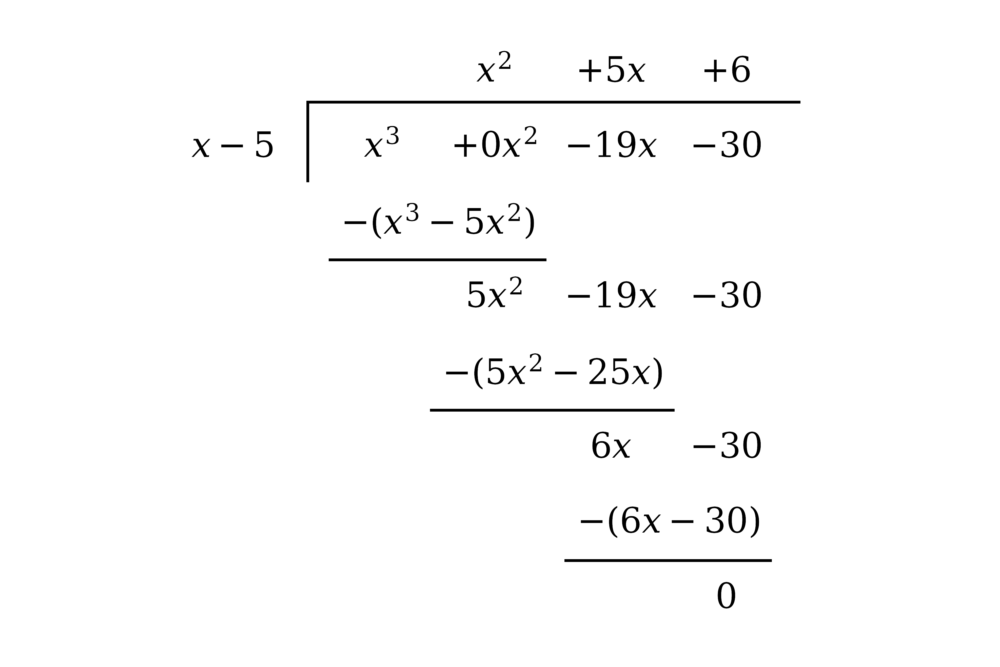

**[M1]**

Read the quotient from the top of the tableau; the remainder is zero

$x^{2} + 5 x + 6$

**[A1]**

> **[mark-scheme]**
> **M1**: Commencing division of $x^{3} - 19 x - 30$ by `\left(x - 5\right)`, by any valid method, reaching a partial quotient of the form $x^{2} + k x$.
> 
> **A1**: Correct quotient $x^{2} + 5 x + 6$, with zero remainder. Accept the factorised `\left(x + 2\right) \left(x + 3\right)`.

**Method 2 - Inspection**

Write the cubic as `\left(x - 5\right)` multiplied by an unknown quadratic

`x^{3} - 19 x - 30 = \left(x - 5\right) \left(a x^{2} + b x + c\right)`

**[M1]**

Compare the coefficient of $x^{3}$

$a = 1$

Compare the constant term

$- 5 c = - 30 \Rightarrow c = 6$

Compare the coefficient of $x^{2}$

$- 5 a + b = 0 \Rightarrow b = 5$

$x^{2} + 5 x + 6$

**[A1]**

> **[mark-scheme]**
> **M1**: Writing `x^{3} - 19 x - 30 = \left(x - 5\right) \left(a x^{2} + b x + c\right)` and comparing coefficients.
> 
> **A1**: Correct quotient $x^{2} + 5 x + 6$.

### Q46
Write out the required identity, noting that the left hand side has no constant term

`3 x^{3} + 16 x^{2} - 22 x + 0 = \left(3 x + 1\right) \left(a x^{2} + b x + c\right) + d`

**[M1]**

Compare the coefficient of $x^{3}$

$3 a = 3 \Rightarrow a = 1$

**[A1]**

Compare the coefficient of $x^{2}$

$3 b + a = 16 \Rightarrow b = 5$

Compare the coefficient of $x$

$3 c + b = - 22 \Rightarrow c = - 9$

**[A1]**

Compare the constant terms; the left hand side has none, so the two must cancel

$c + d = 0 \Rightarrow d = 9$

`3 x^{3} + 16 x^{2} - 22 x = \left(3 x + 1\right) \left(x^{2} + 5 x - 9\right) + 9`

**[A1]**

> **[mark-scheme]**
> **M1**: Writing the identity `3 x^{3} + 16 x^{2} - 22 x = \left(3 x + 1\right) \left(a x^{2} + b x + c\right) + d` and comparing coefficients, or dividing $3 x^{3} + 16 x^{2} - 22 x$ by `\left(3 x + 1\right)` by long division.
> 
> **A1**: $a = 1$.
> 
> **A1**: $b = 5$ and $c = - 9$.
> 
> **A1**: $d = 9$, with the full identity stated. Accept the values listed separately rather than substituted back in.

### Q47
**Method 1 - Remainder Theorem**

The remainder on dividing by `\left(x - 3\right)` is the value of `\text{f} \left(x\right)` at $x = 3$

`\text{f} \left(3\right) = \left( 3 \right)^{3} - 28 \left(3\right) + 48 = 27 - 84 + 48`

**[M1]**

$- 9$

**[A1]**

> **[mark-scheme]**
> **M1**: Using the remainder theorem, substituting $x = 3$ into `\text{f} \left(x\right)` (or commencing long division by `\left(x - 3\right)`).
> 
> **A1**: Correct remainder $- 9$. A bare value with no substitution or division seen does not score.

**Method 2 - Long Division**

Divide `\text{f} \left(x\right)` by `\left(x - 3\right)`, writing the missing $x^{2}$ term as $0 x^{2}$ so that the columns line up; the number left at the foot of the division is the remainder

**[M1]**

The final line of the division is the remainder

$- 9$

**[A1]**

> **[mark-scheme]**
> **M1**: Commencing division of `\text{f} \left(x\right)` by `\left(x - 3\right)` and working through to the constant at the foot.
> 
> **A1**: Correct remainder $- 9$.
Since `\left(x + 6\right)` is a factor, divide `\text{f} \left(x\right)` by it; write `\text{f} \left(x\right)` as `\left(x + 6\right)` multiplied by an unknown quadratic

`x^{3} + 0 x^{2} - 28 x + 48 = \left(x + 6\right) \left(a x^{2} + b x + c\right)`

**[M1]**

Compare the coefficient of $x^{3}$

$a = 1$

Compare the constant term

$6 c = 48 \Rightarrow c = 8$

Compare the coefficient of $x^{2}$

$6 a + b = 0 \Rightarrow b = - 6$

These give the quadratic factor

`\text{f} \left(x\right) = \left(x + 6\right) \left(x^{2} - 6 x + 8\right)`

**[A1]**

Factorise the quadratic, using two numbers that multiply to $8$ and add to $- 6$, namely $- 2$ and $- 4$

`x^{2} - 6 x + 8 = \left(x - 2\right) \left(x - 4\right)`

**[M1]**

Combine the factors

`\text{f} \left(x\right) = \left(x + 6\right) \left(x - 2\right) \left(x - 4\right)`

**[A1]**

> **[mark-scheme]**
> **M1**: Writing `\text{f} \left(x\right) = \left(x + 6\right) \left(a x^{2} + b x + c\right)` and comparing coefficients, or dividing by `\left(x + 6\right)`. The missing $x^{2}$ term must be handled as $0 x^{2}$.
> 
> **A1**: Correct quadratic factor $x^{2} - 6 x + 8$.
> 
> **M1**: Factorising the quadratic into two linear factors.
> 
> **A1**: Fully factorised `\text{f} \left(x\right) = \left(x + 6\right) \left(x - 2\right) \left(x - 4\right)`, factors in any order.

### Q48
The factor `\left(5 x - 2\right)` is zero at $x = \frac{2}{5}$, so by the factor theorem evaluate the cubic there and check it is zero

`25 \left(\frac{2}{5}\right)^{3} + 55 \left(\frac{2}{5}\right)^{2} - 56 \left(\frac{2}{5}\right) + 12`

**[M1]**

Work out the arithmetic

$= \frac{8}{5} + \frac{44}{5} - \frac{112}{5} + \frac{60}{5} = 0$

`\text{The value is} \textrm{ } 0, \; \textrm{ }\text{so} \textrm{ } \left(5 x - 2\right) \textrm{ } \text{is a factor}`

**[A1]**

Now divide the cubic by `\left(5 x - 2\right)`; write it as `\left(5 x - 2\right)` multiplied by an unknown quadratic

`25 x^{3} + 55 x^{2} - 56 x + 12 = \left(5 x - 2\right) \left(a x^{2} + b x + c\right)`

**[M1]**

Compare the coefficient of $x^{3}$

$5 a = 25 \Rightarrow a = 5$

Compare the constant term

$- 2 c = 12 \Rightarrow c = - 6$

Compare the coefficient of $x^{2}$

$- 2 a + 5 b = 55 \Rightarrow b = 13$

These give the quadratic factor

`25 x^{3} + 55 x^{2} - 56 x + 12 = \left(5 x - 2\right) \left(5 x^{2} + 13 x - 6\right)`

Factorise the quadratic; `5 \times \left(- 6\right) = - 30`, and $15$ and $- 2$ multiply to $- 30$ and add to $13$

`5 x^{2} + 13 x - 6 = \left(5 x - 2\right) \left(x + 3\right)`

**[A1]**

The factor `\left(5 x - 2\right)` appears twice, so write the cubic in its fully factorised form and set each distinct factor to zero

`\left(5 x - 2\right)^{2} \left(x + 3\right) = 0`

$x = \frac{2}{5} ,  - 3$

**[A1]**

> **[mark-scheme]**
> **M1**: Substituting $x = \frac{2}{5}$ into the cubic. The fractional substitution must be seen.
> 
> **A1**: Reaching $0$ with no errors, which shows `\left(5 x - 2\right)` is a factor. A written conclusion is good practice but is not required for the mark; an arithmetic slip loses it even if the last line reads $0$.
> 
> **M1**: Writing the cubic as `\left(5 x - 2\right) \left(a x^{2} + b x + c\right)` and comparing coefficients, or dividing by `\left(5 x - 2\right)`.
> 
> **A1**: Correct quadratic factor $5 x^{2} + 13 x - 6$, or the fully factorised `\left(5 x - 2\right)^{2} \left(x + 3\right)`.
> 
> **A1**: Both solutions $x = \frac{2}{5}$ and $x = - 3$, and no extras. Accept $0 . 4$ for $\frac{2}{5}$. Do not penalise a candidate for giving only two solutions, because there are only two. Listing $\frac{2}{5}$ twice is condoned.

### Q49
The factor `\left(4 x - 5\right)` is zero at $x = \frac{5}{4}$, so by the factor theorem the polynomial is zero there

`4 \left(\frac{5}{4}\right)^{3} - 9 \left(\frac{5}{4}\right)^{2} + a \left(\frac{5}{4}\right) + 30 = 0`

**[M1]**

Work out the arithmetic and solve for $a$

$\frac{125}{16} - \frac{225}{16} + \frac{5a}{4} + 30 = 0$

$\frac{5a}{4} = - \frac{95}{4}$

$a = - 19$

**[A1]**

> **[mark-scheme]**
> **M1**: Using the factor theorem at $x = \frac{5}{4}$, substituting into the cubic and equating to zero. The fractional substitution must be seen.
> 
> **A1**: $a = - 19$.
Substitute $a = - 19$ from part (a), then divide by the known factor `\left(4 x - 5\right)`; write the cubic as `\left(4 x - 5\right)` multiplied by an unknown quadratic

`4 x^{3} - 9 x^{2} - 19 x + 30 = \left(4 x - 5\right) \left(p x^{2} + q x + r\right)`

**[M1]**

Compare the coefficient of $x^{3}$

$4 p = 4 \Rightarrow p = 1$

Compare the constant term

$- 5 r = 30 \Rightarrow r = - 6$

Compare the coefficient of $x^{2}$

$- 5 p + 4 q = - 9 \Rightarrow q = - 1$

These give the quadratic factor

`4 x^{3} - 9 x^{2} - 19 x + 30 = \left(4 x - 5\right) \left(x^{2} - x - 6\right)`

Factorise the quadratic, using two numbers that multiply to $- 6$ and add to $- 1$, namely $- 3$ and $2$

`\left(4 x - 5\right) \left(x - 3\right) \left(x + 2\right)`

**[A1]**

> **[mark-scheme]**
> **M1**: Substituting $a = - 19$ and writing the cubic as `\left(4 x - 5\right) \left(p x^{2} + q x + r\right)`, comparing coefficients or dividing by `\left(4 x - 5\right)`. Follow through from part (a)'s value of $a$.
> 
> **A1**: Fully factorised `\left(4 x - 5\right) \left(x - 3\right) \left(x + 2\right)`, factors in any order.

### Q50
Since `\left(x + 4\right)` is a factor, the factor theorem gives `\text{f} \left(- 4\right) = 0`, so substitute $x = - 4$

`p \left(- 4\right)^{3} + \left(5 p + 1\right) \left(- 4\right)^{2} + 5 q \left(- 4\right) - 2 q - 2 = 0`

**[M1]**

Expand and collect like terms

$- 64 p + 80 p + 16 - 20 q - 2 q - 2 = 0$

$16 p - 22 q = - 14$

Divide through by $2$ to obtain the first equation

$8 p - 11 q = - 7$

**[A1]**

When `\text{f} \left(x\right)` is divided by `\left(x + 1\right)` the remainder is $- 12$, so by the remainder theorem `\text{f} \left(- 1\right) = - 12`

`p \left(- 1\right)^{3} + \left(5 p + 1\right) \left(- 1\right)^{2} + 5 q \left(- 1\right) - 2 q - 2 = - 12`

**[M1]**

Expand and collect like terms to obtain the second equation

$- p + 5 p + 1 - 5 q - 2 q - 2 = - 12$

$4 p - 7 q = - 11$

**[A1]**

Solve the two equations simultaneously; doubling the second gives $8 p - 14 q = - 22$, so subtracting eliminates $p$

`\left(8 p - 11 q\right) - \left(8 p - 14 q\right) = - 7 - \left(- 22\right)`

$3 q = 15 \Rightarrow q = 5$

Substitute back into the second equation to find $p$

`4 p - 7 \left(5\right) = - 11 \Rightarrow 4 p = 24`

$p = 6 ,  q = 5$

**[A1]**

> **[mark-scheme]**
> **M1**: Using the factor theorem, substituting $x = - 4$ into `\text{f} \left(x\right)` and equating to zero. Dividing by `\left(x + 4\right)` and equating the constant remainder to zero is equally acceptable.
> 
> **A1**: A correct simplified equation in $p$ and $q$, e.g. $8 p - 11 q = - 7$ or the unsimplified $16 p - 22 q = - 14$.
> 
> **M1**: Using the remainder theorem, substituting $x = - 1$ into `\text{f} \left(x\right)` and equating to $- 12$. Dividing by `\left(x + 1\right)` and equating the constant remainder to $- 12$ is equally acceptable.
> 
> **A1**: A correct simplified equation in $p$ and $q$, e.g. $4 p - 7 q = - 11$.
> 
> **A1**: Both $p = 6$ and $q = 5$, from correct working throughout. There is no follow-through here: if either equation is wrong, this mark is lost even if the wrong pair is then solved perfectly.

### Q51
When `\text{f} \left(x\right)` is divided by `\left(x - 2\right)` the remainder is $7$, so by the remainder theorem `\text{f} \left(2\right) = 7`

$16 - 20 + 2 a + b = 7$

**[M1]**

Rearrange to obtain the first equation

$2 a + b = 11$

**[A1]**

Since `\left(2 x + 3\right)` is a factor, `\text{f} \left(- \frac{3}{2}\right) = 0`

`2 \left(- \frac{3}{2}\right)^{3} - 5 \left(- \frac{3}{2}\right)^{2} + a \left(- \frac{3}{2}\right) + b = 0`

**[M1]**

Multiply through by $2$ and rearrange to obtain the second equation

$3 a - 2 b = - 36$

**[A1]**

> **[mark-scheme]**
> **M1**: Using the remainder theorem `\text{f} \left(2\right) = 7` (or dividing by `\left(x - 2\right)` and equating the constant remainder to $7$).
> 
> **A1**: Correctly reaching the given $2 a + b = 11$ with no errors.
> 
> **M1**: Using `\text{f} \left(- \frac{3}{2}\right) = 0` (the fractional substitution must be seen, or divide by `\left(2 x + 3\right)`).
> 
> **A1**: Correctly reaching the given $3 a - 2 b = - 36$ with no errors. As both results are given, the working must be fully correct.
Solve the two equations simultaneously; from the first equation $b = 11 - 2 a$, so substitute into the second

`3 a - 2 \left(11 - 2 a\right) = - 36`

**[M1]**

$7 a = - 14 \Rightarrow a = - 2$

$a = - 2 ,  b = 15$

**[A1]**

> **[mark-scheme]**
> **M1**: Solving the simultaneous equations from part (a) by elimination or substitution.
> 
> **A1**: Both $a = - 2$ and $b = 15$. The simultaneous working must be shown; a bare answer from a calculator does not score.

### Q52
The factor `\left(2 x - 1\right)` is zero at $x = \frac{1}{2}$, so by the factor theorem the polynomial is zero there

`2 \left(\frac{1}{2}\right)^{3} + \left(\frac{1}{2}\right)^{2} - 25 \left(\frac{1}{2}\right) + a = 0`

**[M1]**

Work out the arithmetic and solve for $a$

$\frac{1}{4} + \frac{1}{4} - \frac{25}{2} + a = 0$

$a = 12$

**[A1]**

> **[mark-scheme]**
> **M1**: Using the factor theorem at $x = \frac{1}{2}$, substituting into the cubic and equating to zero.
> 
> **A1**: $a = 12$.

### Q53
Write the numerator as the divisor times the quotient plus the remainder

`x^{2} + a x - 5 = \left(x + 1\right) \left(x + 3\right) + d`

**[M1]**

Expand the right hand side

$x^{2} + a x - 5 = x^{2} + 4 x + 3 + d$

Compare the coefficient of $x$ and the constant term

$a = 4 ,  d = - 8$

**[A1]**

> **[mark-scheme]**
> **M1**: Writing `x^{2} + a x - 5 = \left(x + 1\right) \left(x + 3\right) + d` and comparing coefficients (or dividing and matching).
> 
> **A1**: Both $a = 4$ and $d = - 8$.

### Q54
Since `\left(2 x + 1\right)` is a factor, write `\text{f} \left(x\right)` as `\left(2 x + 1\right)` multiplied by a quadratic and expand to compare coefficients

`2 x^{3} - 3 x^{2} - 72 x - 35 = \left(2 x + 1\right) \left(a x^{2} + b x + c\right)`

**[M1]**

Compare the coefficient of $x^{3}$

$2 a = 2 \Rightarrow a = 1$

Compare the constant term

$c = - 35$

Compare the coefficient of $x^{2}$

$2 b + a = - 3 \Rightarrow b = - 2$

`\text{f} \left(x\right) = \left(2 x + 1\right) \left(x^{2} - 2 x - 35\right)`

**[A1]**

> **[mark-scheme]**
> **M1**: Writing `\text{f} \left(x\right) = \left(2 x + 1\right) \left(a x^{2} + b x + c\right)` and comparing coefficients (or dividing by `\left(2 x + 1\right)`).
> 
> **A1**: Correct $a = 1 ,  b = - 2 ,  c = - 35$, giving `\text{f} \left(x\right) = \left(2 x + 1\right) \left(x^{2} - 2 x - 35\right)`.
Factorise the quadratic, using two numbers that multiply to $- 35$ and add to $- 2$, namely $- 7$ and $5$

`x^{2} - 2 x - 35 = \left(x - 7\right) \left(x + 5\right)`

**[M1 A1]**

Combine with the factor from part (a)

`\text{f} \left(x\right) = \left(2 x + 1\right) \left(x - 7\right) \left(x + 5\right)`

**[A1]**

> **[mark-scheme]**
> **M1**: Attempting to factorise $x^{2} - 2 x - 35$ into two linear factors.
> 
> **A1**: Correct factors `\left(x - 7\right) \left(x + 5\right)`.
> 
> **A1**: Fully factorised `\text{f} \left(x\right) = \left(2 x + 1\right) \left(x - 7\right) \left(x + 5\right)`, factors in any order.
`\text{f} \left(x\right) = \left(2 x + 1\right) \left(x - 7\right) \left(x + 5\right)`

Set each factor to zero; each gives a root of `\text{f} \left(x\right) = 0`

$x = - \frac{1}{2} ,  7 ,  - 5$

**[B1 B1]**

> **[mark-scheme]**
> **B1**: Two correct roots.
> 
> **B1**: All three roots $x = - \frac{1}{2} ,  7 ,  - 5$ and no extras.

### Q55
(i)

The divisor is the expression the polynomial is divided by

$x - 3$

**[B1]**

(ii)

The quotient is the polynomial part of the result

$x + 11$

**[B1]**

(iii)

The remainder is the numerator of the term written over the divisor

$29$

**[B1]**

> **[mark-scheme]**
> **B1**: Divisor $x - 3$.
> 
> **B1**: Quotient $x + 11$.
> 
> **B1**: Remainder $29$.
(i)

The highest power of $x$ in $x^{2} + 8 x - 4$ is $2$

$2$

**[B1]**

(ii)

The highest power of $x$ in $x - 3$ is $1$

$1$

**[B1]**

(iii)

**Final answer:** **When a polynomial is divided, the degree of the quotient is the degree of the dividend minus the degree of the divisor**

$2 - 1 = 1$

**Final answer:** **so the quotient has degree **$1$

**[B1]**

> **[mark-scheme]**
> **B1**: Degree $2$.
> 
> **B1**: Degree $1$.
> 
> **B1**: Explaining that the quotient's degree is the dividend's degree minus the divisor's degree, $2 - 1 = 1$.

### Q56
The factor `\left(2 x - 3\right)` is zero at $x = \frac{3}{2}$, so by the factor theorem evaluate the cubic there and check it is zero

`2 \left(\frac{3}{2}\right)^{3} - 13 \left(\frac{3}{2}\right)^{2} + 23 \left(\frac{3}{2}\right) - 12`

**[M1]**

Work out the arithmetic

$= \frac{27}{4} - \frac{117}{4} + \frac{69}{2} - 12 = 0$

`\text{The value is} \textrm{ } 0, \; \textrm{ }\text{so} \textrm{ } \left(2 x - 3\right) \textrm{ } \text{is a factor}`

**[A1]**

> **[mark-scheme]**
> **M1**: Substituting $x = \frac{3}{2}$ into the cubic.
> 
> **A1**: Reaching $0$ with no errors, which shows `\left(2 x - 3\right)` is a factor. A written conclusion is good practice but is not required for the mark; an arithmetic slip loses it even if the last line reads $0$.
Since `\left(2 x - 3\right)` is a factor, divide the cubic by it; write it as `\left(2 x - 3\right)` multiplied by an unknown quadratic

`2 x^{3} - 13 x^{2} + 23 x - 12 = \left(2 x - 3\right) \left(a x^{2} + b x + c\right)`

**[M1]**

Compare the coefficient of $x^{3}$

$2 a = 2 \Rightarrow a = 1$

Compare the constant term

$- 3 c = - 12 \Rightarrow c = 4$

Compare the coefficient of $x^{2}$

$- 3 a + 2 b = - 13 \Rightarrow b = - 5$

These give the quadratic factor

`2 x^{3} - 13 x^{2} + 23 x - 12 = \left(2 x - 3\right) \left(x^{2} - 5 x + 4\right)`

Factorise the quadratic

`\left(2 x - 3\right) \left(x - 1\right) \left(x - 4\right)`

**[A1]**

> **[mark-scheme]**
> **M1**: Writing the cubic as `\left(2 x - 3\right) \left(a x^{2} + b x + c\right)` and comparing coefficients, or dividing by `\left(2 x - 3\right)`.
> 
> **A1**: Fully factorised `\left(2 x - 3\right) \left(x - 1\right) \left(x - 4\right)`, factors in any order.
Set each factor to zero; each gives a solution

$x = \frac{3}{2} ,  1 ,  4$

**[B1 B1]**

> **[mark-scheme]**
> **B1**: Two correct solutions.
> 
> **B1**: All three solutions $x = \frac{3}{2} ,  1 ,  4$ and no extras.

### Q57
**Method 1 - Long Division**

Divide the cubic by `\left(x - 7\right)`, working down through the powers of $x$

**[M1]**

Read the quotient from the top of the tableau; the remainder is zero

$x^{2} + x - 2$

**[A1]**

> **[mark-scheme]**
> **M1**: Commencing division of $x^{3} - 6 x^{2} - 9 x + 14$ by `\left(x - 7\right)`, by any valid method, reaching a partial quotient of the form $x^{2} + k x$.
> 
> **A1**: Correct quotient $x^{2} + x - 2$, with zero remainder.

**Method 2 - Inspection**

Write the cubic as `\left(x - 7\right)` multiplied by an unknown quadratic

`x^{3} - 6 x^{2} - 9 x + 14 = \left(x - 7\right) \left(x^{2} + b x + c\right)`

**[M1]**

Compare the coefficients of $x^{2}$ to find $b$

$b - 7 = - 6 \Rightarrow b = 1$

Compare the constant terms to find $c$

$- 7 c = 14 \Rightarrow c = - 2$

$x^{2} + x - 2$

**[A1]**

> **[mark-scheme]**
> **M1**: Writing `x^{3} - 6 x^{2} - 9 x + 14 = \left(x - 7\right) \left(x^{2} + b x + c\right)` and comparing coefficients.
> 
> **A1**: Correct quotient $x^{2} + x - 2$.

### Q58
Since `\text{f} \left(2\right) = 0`, substitute $x = 2$ and set the result to zero

$8 + 36 + 2 r + s = 0$

**[M1]**

This gives the first equation

$2 r + s = - 44$

**[A1]**

Since `\text{f} \left(- 1\right) = - 54`, substitute $x = - 1$

$- 1 + 9 - r + s = - 54$

**[M1]**

This gives the second equation

$- r + s = - 62$

**[A1]**

Subtract the second equation from the first to eliminate $s$

$3 r = 18 \Rightarrow r = 6$

**[M1]**

Substitute back to find $s$

`s = - 44 - 2 \left(6\right) = - 56`

$r = 6 ,  s = - 56$

**[A1]**

> **[mark-scheme]**
> **M1**: Substituting $x = 2$ into `\text{f} \left(x\right)` and equating to zero.
> 
> **A1**: Correct first equation, e.g. $2 r + s = - 44$.
> 
> **M1**: Substituting $x = - 1$ into `\text{f} \left(x\right)` and equating to $- 54$.
> 
> **A1**: Correct second equation, e.g. $- r + s = - 62$.
> 
> **M1**: Solving the two equations simultaneously.
> 
> **A1**: Both $r = 6$ and $s = - 56$.
From part (a), `\text{f} \left(2\right) = 0`, so `\left(x - 2\right)` is a factor; divide `\text{f} \left(x\right)` by it, writing `\text{f} \left(x\right)` as `\left(x - 2\right)` times an unknown quadratic

`x^{3} + 9 x^{2} + 6 x - 56 = \left(x - 2\right) \left(a x^{2} + b x + c\right)`

**[M1]**

Compare the coefficient of $x^{3}$

$a = 1$

Compare the constant term

$- 2 c = - 56 \Rightarrow c = 28$

Compare the coefficient of $x^{2}$

$- 2 a + b = 9 \Rightarrow b = 11$

These give the quadratic factor

`\text{f} \left(x\right) = \left(x - 2\right) \left(x^{2} + 11 x + 28\right)`

Factorise the quadratic

`x^{2} + 11 x + 28 = \left(x + 4\right) \left(x + 7\right)`

**[A1]**

Combine the factors

`\text{f} \left(x\right) = \left(x - 2\right) \left(x + 4\right) \left(x + 7\right)`

**[A1]**

> **[mark-scheme]**
> **M1**: Using `\left(x - 2\right)` as a factor and comparing coefficients (or dividing) to reach $x^{2} + 11 x + 28$.
> 
> **A1**: Correct factors `\left(x + 4\right) \left(x + 7\right)`.
> 
> **A1**: Fully factorised `\text{f} \left(x\right) = \left(x - 2\right) \left(x + 4\right) \left(x + 7\right)`.

### Q59
**Method 1 - Remainder Theorem**

The remainder on dividing by `\left(x - 2\right)` is the value of `\text{f} \left(x\right)` at $x = 2$

`\text{f} \left(2\right) = 2 \left( 2 \right)^{3} - \left( 2 \right)^{2} - 16 \left(2\right) + 15 = 16 - 4 - 32 + 15`

**[M1]**

$- 5$

**[A1]**

> **[mark-scheme]**
> **M1**: Using the remainder theorem, substituting $x = 2$ into `\text{f} \left(x\right)` (or commencing long division by `\left(x - 2\right)`).
> 
> **A1**: Correct remainder $- 5$.

**Method 2 - Long Division**

Divide `\text{f} \left(x\right)` by `\left(x - 2\right)`; the constant left at the foot is the remainder

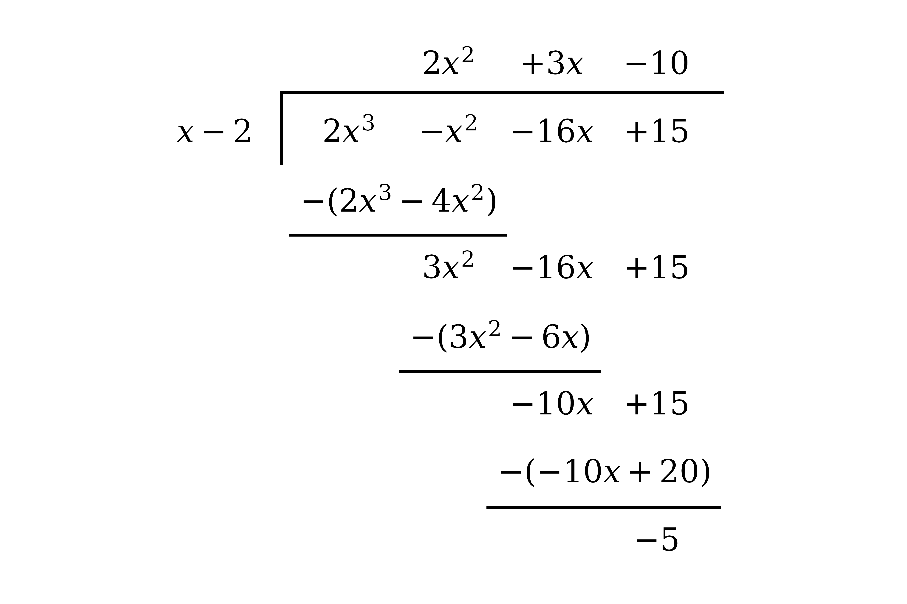

**[M1]**

$- 5$

**[A1]**

> **[mark-scheme]**
> **M1**: Commencing division of `\text{f} \left(x\right)` by `\left(x - 2\right)` and working through to the constant at the foot.
> 
> **A1**: Correct remainder $- 5$.
Since `\left(x + 3\right)` is a factor, divide `\text{f} \left(x\right)` by it; write `\text{f} \left(x\right)` as `\left(x + 3\right)` multiplied by an unknown quadratic

`2 x^{3} - x^{2} - 16 x + 15 = \left(x + 3\right) \left(a x^{2} + b x + c\right)`

**[M1]**

Compare the coefficient of $x^{3}$

$a = 2$

Compare the constant term

$3 c = 15 \Rightarrow c = 5$

Compare the coefficient of $x^{2}$

$3 a + b = - 1 \Rightarrow b = - 7$

These give the quadratic factor

`\text{f} \left(x\right) = \left(x + 3\right) \left(2 x^{2} - 7 x + 5\right)`

**[A1]**

Factorise the quadratic

`2 x^{2} - 7 x + 5 = \left(2 x - 5\right) \left(x - 1\right)`

**[M1]**

Combine the factors

`\text{f} \left(x\right) = \left(x + 3\right) \left(2 x - 5\right) \left(x - 1\right)`

**[A1]**

> **[mark-scheme]**
> **M1**: Writing `\text{f} \left(x\right) = \left(x + 3\right) \left(2 x^{2} + b x + c\right)` and comparing coefficients, or dividing by `\left(x + 3\right)`.
> 
> **A1**: Correct quadratic factor $2 x^{2} - 7 x + 5$.
> 
> **M1**: Factorising the quadratic into two linear factors.
> 
> **A1**: Fully factorised `\text{f} \left(x\right) = \left(x + 3\right) \left(2 x - 5\right) \left(x - 1\right)`, factors in any order.

### Q60
Expand the first two brackets

`\left(3 x + y\right) \left(2 x - 3 y\right) = 6 x^{2} - 7 x y - 3 y^{2}`

**[M1]**

Multiply the result by the third bracket and collect like terms

`\left(6 x^{2} - 7 x y - 3 y^{2}\right) \left(x - 2 y\right) = 6 x^{3} - 19 x^{2} y + 11 x y^{2} + 6 y^{3}`

$a = 6 ,  b = - 19 ,  c = 11 ,  d = 6$

**[A1]**

> **[mark-scheme]**
> **M1**: Expanding to reach a correct product of two of the brackets, then multiplying by the third.
> 
> **A1**: All four values correct: $a = 6 ,  b = - 19 ,  c = 11 ,  d = 6$.

### Q61
Make `\text{f} \left(x\right)` the subject by multiplying every term by `\left(x + 2\right)`

`\text{f} \left(x\right) = \left(x + 2\right) \left(3 x + 4\right) - 2`

**[M1]**

Expand and simplify

`\text{f} \left(x\right) = 3 x^{2} + 10 x + 8 - 2`

`\text{f} \left(x\right) = 3 x^{2} + 10 x + 6`

**[A1]**

> **[mark-scheme]**
> **M1**: Multiplying through by `\left(x + 2\right)` to reach `\text{f} \left(x\right) = \left(x + 2\right) \left(3 x + 4\right) - 2`.
> 
> **A1**: Correct `\text{f} \left(x\right) = 3 x^{2} + 10 x + 6`.

### Q62
Substitute $x = \frac{2}{3}$ into `\text{f} \left(x\right)` and show the result is zero

`3 \left(\frac{2}{3}\right)^{3} - 5 \left(\frac{2}{3}\right)^{2} - 4 \left(\frac{2}{3}\right) + 4`

**[M1]**

Work out each term

$= \frac{8}{9} - \frac{20}{9} - \frac{8}{3} + 4 = 0$

**[A1]**

> **[mark-scheme]**
> **M1**: Substituting $x = \frac{2}{3}$ into `\text{f} \left(x\right)`.
> 
> **A1**: Showing the terms sum to $0$. As the result is given, the working must be seen.
Since `\text{f} \left(\frac{2}{3}\right) = 0`, there is a factor with a root at $x = \frac{2}{3}$

`\left(3 x - 2\right)`

**[B1]**

> **[mark-scheme]**
> **B1**: The factor `\left(3 x - 2\right)`. Accept `3 \left(x - \frac{2}{3}\right)` or equivalent.
Divide `\text{f} \left(x\right)` by the factor from part (b), writing `\text{f} \left(x\right)` as `\left(3 x - 2\right)` multiplied by an unknown quadratic

`3 x^{3} - 5 x^{2} - 4 x + 4 = \left(3 x - 2\right) \left(a x^{2} + b x + c\right)`

**[M1]**

Compare the coefficient of $x^{3}$

$3 a = 3 \Rightarrow a = 1$

Compare the constant term

$- 2 c = 4 \Rightarrow c = - 2$

Compare the coefficient of $x^{2}$

$- 2 a + 3 b = - 5 \Rightarrow b = - 1$

These give the quadratic factor

`\text{f} \left(x\right) = \left(3 x - 2\right) \left(x^{2} - x - 2\right)`

Factorise the quadratic

`x^{2} - x - 2 = \left(x - 2\right) \left(x + 1\right)`

**[A1]**

Combine the factors

`\text{f} \left(x\right) = \left(3 x - 2\right) \left(x - 2\right) \left(x + 1\right)`

**[A1]**

> **[mark-scheme]**
> **M1**: Writing `\text{f} \left(x\right) = \left(3 x - 2\right) \left(x^{2} + b x + c\right)` and comparing coefficients, or dividing by `\left(3 x - 2\right)`.
> 
> **A1**: Correct quadratic factor $x^{2} - x - 2$.
> 
> **A1**: Fully factorised `\left(3 x - 2\right) \left(x - 2\right) \left(x + 1\right)`, factors in any order.
Set each factor to zero

$x = \frac{2}{3} ,  2 ,  - 1$

**[B1 B1]**

> **[mark-scheme]**
> **B1**: Two correct solutions.
> 
> **B1**: All three solutions $x = \frac{2}{3} ,  2 ,  - 1$.

### Q63
Take out the common factor of $3 x$ first

`3 x^{3} - 51 x^{2} + 126 x = 3 x \left(x^{2} - 17 x + 42\right)`

**[M1]**

Factorise the quadratic, using two numbers that multiply to $42$ and add to $- 17$, namely $- 3$ and $- 14$

`3 x \left(x - 3\right) \left(x - 14\right)`

**[A1]**

> **[mark-scheme]**
> **M1**: Taking out the common factor $3 x$ to reach `3 x \left(x^{2} - 17 x + 42\right)`.
> 
> **A1**: Fully factorised `3 x \left(x - 3\right) \left(x - 14\right)`, factors in any order.

### Q64
(i)

**Method 1 - Long Division**

Divide $4 x^{3} + 6 x^{2} - 7 x + 2$ by `\left(x - 2\right)`

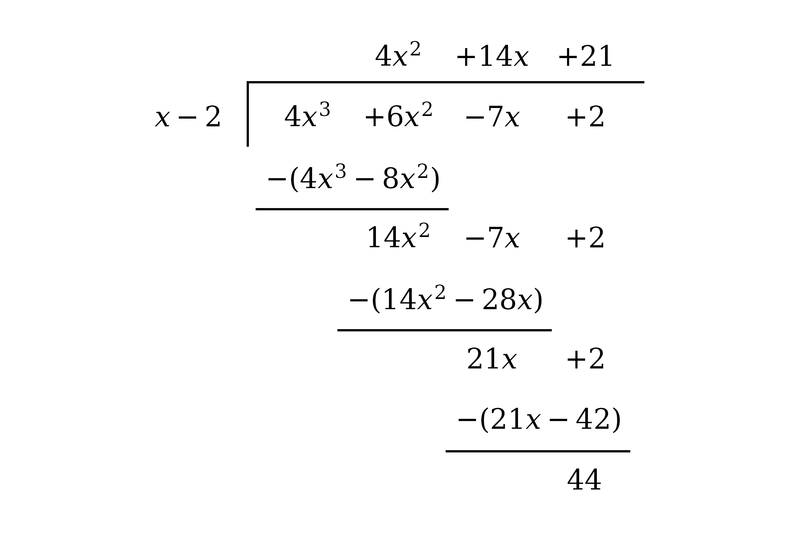

**[M1]**

Read the quotient from the top of the tableau and the remainder from the foot

$\text{quotient}  4 x^{2} + 14 x + 21 ,   \text{remainder}  44$

**[A1 A1]**

> **[mark-scheme]**
> **M1**: Commencing division of `\text{f} \left(x\right)` by `\left(x - 2\right)`, by any valid method, reaching a partial quotient of the form $4 x^{2} + k x$.
> 
> **A1**: Correct quotient $4 x^{2} + 14 x + 21$.
> 
> **A1**: Correct remainder $44$. Stating the quotient and remainder the wrong way round earns a maximum of 2 of these 3 marks.

**Method 2 - Inspection**

Write the cubic as `\left(x - 2\right)` multiplied by an unknown quadratic plus a remainder, then compare coefficients

`4 x^{3} + 6 x^{2} - 7 x + 2 = \left(x - 2\right) \left(a x^{2} + b x + c\right) + d`

**[M1]**

Compare the coefficient of $x^{3}$

$a = 4$

Compare the coefficient of $x^{2}$

$- 2 a + b = 6 \Rightarrow b = 14$

Compare the coefficient of $x$

$- 2 b + c = - 7 \Rightarrow c = 21$

Compare the constant term

$- 2 c + d = 2 \Rightarrow d = 44$

$\text{quotient}  4 x^{2} + 14 x + 21 ,   \text{remainder}  44$

**[A1 A1]**

> **[mark-scheme]**
> **M1**: Writing `\text{f} \left(x\right) = \left(x - 2\right) \left(a x^{2} + b x + c\right) + d` and comparing coefficients.
> 
> **A1**: Correct quotient $4 x^{2} + 14 x + 21$.
> 
> **A1**: Correct remainder $44$.

(ii)

Use the quotient and remainder from part (i) directly

`4 x^{3} + 6 x^{2} - 7 x + 2 = \left(x - 2\right) \left(4 x^{2} + 14 x + 21\right) + 44`

**[B1]**

> **[mark-scheme]**
> **B1**: Correct identity, following from part (i): `\left(x - 2\right) \left(4 x^{2} + 14 x + 21\right) + 44`, or equivalently $a = 4 ,  b = 14 ,  c = 21 ,  d = 44$.

### Q65
By the factor theorem, `\left(x + 2\right)` is a factor exactly when `\text{f} \left(- 2\right) = 0`, so evaluate `\text{f} \left(- 2\right)`

`\text{f} \left(- 2\right) = 4 \left(- 2\right)^{3} + 4 \left(- 2\right)^{2} - 23 \left(- 2\right) - 30`

**[M1]**

Work out the arithmetic

$= - 32 + 16 + 46 - 30 = 0$

`\text{f} \left(- 2\right) = 0, \; \textrm{ }\text{so} \textrm{ } \left(x + 2\right) \textrm{ } \text{is a factor}`

**[A1]**

> **[mark-scheme]**
> **M1**: Substituting $x = - 2$ into `\text{f} \left(x\right)`.
> 
> **A1**: Reaching `\text{f} \left(- 2\right) = 0` with no errors, which shows the factor. A written conclusion is good practice but is not required for the mark; an arithmetic slip loses it even if the last line reads $0$.
Since `\left(x + 2\right)` is a factor, divide `\text{f} \left(x\right)` by it; write `\text{f} \left(x\right)` as `\left(x + 2\right)` multiplied by an unknown quadratic

`4 x^{3} + 4 x^{2} - 23 x - 30 = \left(x + 2\right) \left(a x^{2} + b x + c\right)`

**[M1]**

Compare the coefficient of $x^{3}$

$a = 4$

Compare the constant term

$2 c = - 30 \Rightarrow c = - 15$

Compare the coefficient of $x^{2}$

$2 a + b = 4 \Rightarrow b = - 4$

These give the quadratic factor

`\text{f} \left(x\right) = \left(x + 2\right) \left(4 x^{2} - 4 x - 15\right)`

**[A1]**

Factorise the quadratic

`4 x^{2} - 4 x - 15 = \left(2 x - 5\right) \left(2 x + 3\right)`

**[M1]**

Combine the factors

`\text{f} \left(x\right) = \left(x + 2\right) \left(2 x - 5\right) \left(2 x + 3\right)`

**[A1]**

> **[mark-scheme]**
> **M1**: Writing `\text{f} \left(x\right) = \left(x + 2\right) \left(4 x^{2} + b x + c\right)` and comparing coefficients, or dividing by `\left(x + 2\right)`.
> 
> **A1**: Correct quadratic factor $4 x^{2} - 4 x - 15$.
> 
> **M1**: Factorising the quadratic into two linear factors.
> 
> **A1**: Fully factorised `\text{f} \left(x\right) = \left(x + 2\right) \left(2 x - 5\right) \left(2 x + 3\right)`, factors in any order.
Set each factor to zero; each gives a root of `\text{f} \left(x\right) = 0`

$x = - 2 ,  \frac{5}{2} ,  - \frac{3}{2}$

**[B1 B1]**

> **[mark-scheme]**
> **B1**: Two correct roots.
> 
> **B1**: All three roots $x = - 2 ,  \frac{5}{2} ,  - \frac{3}{2}$ and no extras.
