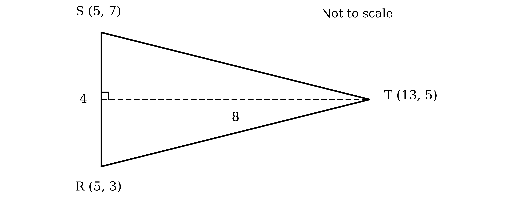

# Mark Schemes — Differentiation of Parametric Equations
**Differentiation** · Cambridge (CIE) AS maths (9709)

## Exam Questions (22 questions)

### Q1
$A$ lies on the $y$-axis, so start by finding the values of $θ$ which make $x$ zero

$5 \text{sin} θ = 0$

Solve this over the given interval

$θ = - π , 0 , π$

**[M1]**

The value $θ = 0$ gives $y = 0$, which is the origin rather than $A$, so use $θ = \pm π$

`y = \left( \pm \pi \right)^{2} = \pi^{2}`

State the coordinates as a pair

`A \left(0 , \pi^{2}\right)`

**[A1]**

> **[exam-tip]**
> The grid makes it tempting to read $A$ straight off as `\left(0 , 10\right)`, but $π^{2}$ is $9 . 87$ to 3 significant figures, so that answer is simply wrong. Whenever a question says "exact", treat the diagram as a picture to check your answer against, never as the source of it.

> **[mark-scheme]**
> **M1**: Correct method, setting $x = 0$ and solving $5 \text{sin} θ = 0$ for $θ$ within $- π \leq θ \leq π$. Obtaining $θ = π$ or $θ = - π$ alone is enough for this mark.
> 
> **A1**: Correct exact coordinates `\left(0 , \pi^{2}\right)`. The question asks for the exact coordinates, so `\left(0 , 9 . 87\right)` does not earn this mark. Accept the coordinates given separately as $x = 0$ and $y = π^{2}$.
(i)

The origin is the point where $θ = 0$, and $y = θ^{2}$ has a minimum there

$\frac{\text{d}y}{\text{d}θ} = 0$

**[B1]**

(ii)

The points where $x = \pm 5$ are the widest points of the curve, where $x$ momentarily stops changing

$\frac{\text{d}x}{\text{d}θ} = 0$

**[B1]**

> **[mark-scheme]**
> **B1**: Correct value of $0$.
> 
> **B1**: Correct value of $0$. One value covers both points, since $x$ is stationary at each of them.
(i)

Differentiate $x$ with respect to $θ$, using the fact that the derivative of $\text{sin} θ$ is $\text{cos} θ$

$\frac{\text{d}x}{\text{d}θ} = 5 \text{cos} θ$

Differentiate $y$ with respect to $θ$

$\frac{\text{d}y}{\text{d}θ} = 2 θ$

**[B1]**

(ii)

Use the result for differentiating a curve given parametrically, $\frac{\text{d}y}{\text{d}x} = \frac{\text{d}y}{\text{d}θ} \div \frac{\text{d}x}{\text{d}θ}$

$\frac{\text{d}y}{\text{d}x} = 2 θ \div 5 \text{cos} θ$

**[M1]**

Write the division as a single fraction

$\frac{\text{d}y}{\text{d}x} = \frac{2θ}{5\text{cos}θ}$

**[A1]**

(iii)

Substitute $θ = \frac{π}{3}$, working in radians, and use $\text{cos} \frac{π}{3} = \frac{1}{2}$

`\frac{\text{d} y}{\text{d} x} = \frac{2 \left(\frac{\pi}{3}\right)}{5 \left(\frac{1}{2}\right)}`

Simplify the compound fraction

$\text{Gradient} = \frac{4π}{15} = 0 . 838  ( \text{3 s} . \text{f} . )$

**[A1]**

> **[mark-scheme]**
> **B1**: Both derivatives correct, $\frac{\text{d}x}{\text{d}θ} = 5 \text{cos} θ$ and $\frac{\text{d}y}{\text{d}θ} = 2 θ$.
> 
> **M1**: Correct use of $\frac{\text{d}y}{\text{d}x} = \frac{\text{d}y}{\text{d}θ} \div \frac{\text{d}x}{\text{d}θ}$, with your derivatives from part (i). You still earn this mark if one of those derivatives was wrong, provided they are divided the right way round.
> 
> **A1**: Correct expression $\frac{2θ}{5\text{cos}θ}$. There is no need to simplify further, and $\frac{2}{5} θ \text{sec} θ$ is equally acceptable. The left hand side must be written as $\frac{\text{d}y}{\text{d}x}$.
> 
> **A1**: Correct gradient, following through from your expression. Since the question does not ask for an exact value, both $\frac{4π}{15}$ and answers which round to $0 . 838$ earn the mark. You must work in radians, so an answer obtained by treating $\frac{π}{3}$ as a value in degrees does not earn this mark.

### Q2
Differentiate $x$ with respect to $t$, using the fact that $e^{t}$ is its own derivative

$\frac{\text{d}x}{\text{d}t} = e^{t}$

**[B1]**

Differentiate $y$ with respect to $t$, one term at a time

$\frac{\text{d}y}{\text{d}t} = 6 t^{2} + 3$

**[B1]**

> **[mark-scheme]**
> **B1**: Correct derivative $\frac{\text{d}x}{\text{d}t} = e^{t}$.
> 
> **B1**: Correct derivative $\frac{\text{d}y}{\text{d}t} = 6 t^{2} + 3$. Both terms must be differentiated correctly, so $6 t^{2}$ on its own does not earn this mark.
Use the result for differentiating a curve given parametrically, $\frac{\text{d}y}{\text{d}x} = \frac{\text{d}y}{\text{d}t} \div \frac{\text{d}x}{\text{d}t}$

`\frac{\text{d} y}{\text{d} x} = \left(6 t^{2} + 3\right) \div e^{t}`

**[M1]**

Write the division as a single fraction

$\frac{\text{d}y}{\text{d}x} = \frac{6t^{2}+3}{e^{t}}$

**[A1]**

> **[mark-scheme]**
> **M1**: Correct use of $\frac{\text{d}y}{\text{d}x} = \frac{\text{d}y}{\text{d}t} \div \frac{\text{d}x}{\text{d}t}$, with your derivatives from part (a). You still earn this mark if one of those derivatives was wrong, provided they are divided the right way round.
> 
> **A1**: Correct expression in terms of $t$. Accept any equivalent form, whether simplified or not, so $\frac{6t^{2}+3}{e^{t}}$, `\left(6 t^{2} + 3\right) e^{- t}` and `3 e^{- t} \left(2 t^{2} + 1\right)` all earn the mark. The left hand side must be written as $\frac{\text{d}y}{\text{d}x}$.

### Q3
(i)

Differentiate $x$ with respect to $t$

$\frac{\text{d}x}{\text{d}t} = 10 t$

Differentiate $y$ with respect to $t$, noting that $3 t$ is linear so its derivative is constant

$\frac{\text{d}y}{\text{d}t} = 3$

**[B1]**

(ii)

Use the result for differentiating a curve given parametrically, $\frac{\text{d}y}{\text{d}x} = \frac{\text{d}y}{\text{d}t} \div \frac{\text{d}x}{\text{d}t}$

$\frac{\text{d}y}{\text{d}x} = 3 \div 10 t$

**[M1]**

Write the division as a single fraction

$\frac{\text{d}y}{\text{d}x} = \frac{3}{10t}$

**[A1]**

> **[mark-scheme]**
> **B1**: Both derivatives correct, $\frac{\text{d}x}{\text{d}t} = 10 t$ and $\frac{\text{d}y}{\text{d}t} = 3$.
> 
> **M1**: Correct use of $\frac{\text{d}y}{\text{d}x} = \frac{\text{d}y}{\text{d}t} \div \frac{\text{d}x}{\text{d}t}$, with your derivatives from part (i). You still earn this mark if one of those derivatives was wrong, provided they are divided the right way round.
> 
> **A1**: Correct expression $\frac{\text{d}y}{\text{d}x} = \frac{3}{10t}$. Accept any equivalent form, simplified or not, such as $0 . 3 t^{-1}$. The left hand side must be written as $\frac{\text{d}y}{\text{d}x}$.
(i)

The gradient from part (a) is in terms of $t$, so first find the value of $t$ at this point, using the simpler of the two parametric equations

$3 = 3 t \Rightarrow t = 1$

**[M1]**

Check this value against the other equation to confirm the point lies on $C$

`x = 5 \left( 1 \right)^{2} - 1 = 4`

Substitute $t = 1$ into the gradient from part (a)

`\frac{\text{d} y}{\text{d} x} = \frac{3}{10 \left(1\right)}`

$\text{Gradient} = \frac{3}{10}$

**[A1]**

(ii)

Use the equation of a straight line through a known point, `y - y_{1} = m \left(x - x_{1}\right)`, with $m = \frac{3}{10}$ and the point `\left(4 , 3\right)`

`y - 3 = \frac{3}{10} \left(x - 4\right)`

Multiply through by 10 to clear the fraction

$10 y - 30 = 3 x - 12$

Collect the terms on one side

$3 x - 10 y + 18 = 0$

**[A1]**

> **[mark-scheme]**
> **M1**: Correct method to find the value of $t$ at the given point, by substituting into either parametric equation. Using $y = 3 t$ is the quicker route, but substituting into $x = 5 t^{2} - 1$ and rejecting the negative root also earns this mark, since the question states $t > 0$.
> 
> **A1**: Correct gradient $\frac{3}{10}$. Accept $0 . 3$.
> 
> **A1**: Correct equation of the tangent, following through from your gradient. Any equivalent form is accepted, so $3 x - 10 y + 18 = 0$, $y = \frac{3}{10} x + \frac{9}{5}$, $y = 0 . 3 x + 1 . 8$ and `y - 3 = \frac{3}{10} \left(x - 4\right)` all earn the mark, as does any integer multiple of the first of these.

### Q4
(i)

Differentiate $x$ with respect to $t$, bringing the power down and reducing it by one

$\frac{\text{d}x}{\text{d}t} = 6 t^{2}$

Differentiate $y$ with respect to $t$, noting that $4 t - 1$ is linear

$\frac{\text{d}y}{\text{d}t} = 4$

**[B1]**

(ii)

Use the result for differentiating a curve given parametrically, $\frac{\text{d}y}{\text{d}x} = \frac{\text{d}y}{\text{d}t} \div \frac{\text{d}x}{\text{d}t}$

$\frac{\text{d}y}{\text{d}x} = \frac{4}{6t^{2}}$

**[M1]**

Cancel the common factor of 2

$\frac{\text{d}y}{\text{d}x} = \frac{2}{3t^{2}}$

**[A1]**

> **[mark-scheme]**
> **B1**: Both derivatives correct, $\frac{\text{d}x}{\text{d}t} = 6 t^{2}$ and $\frac{\text{d}y}{\text{d}t} = 4$.
> 
> **M1**: Correct use of $\frac{\text{d}y}{\text{d}x} = \frac{\text{d}y}{\text{d}t} \div \frac{\text{d}x}{\text{d}t}$, with your derivatives from part (i). You still earn this mark if one of those derivatives was wrong, provided they are divided the right way round.
> 
> **A1**: Correct expression for $\frac{\text{d}y}{\text{d}x}$. There is no need to cancel, so $\frac{4}{6t^{2}}$ and $\frac{2}{3t^{2}}$ both earn the mark. The left hand side must be written as $\frac{\text{d}y}{\text{d}x}$.
(i)

The gradient from part (a) is in terms of $t$, so first find the value of $t$ at this point, using the $x$ equation

$16 = 2 t^{3} \Rightarrow t^{3} = 8$

$t = 2$

**[M1]**

Check this value against the other equation to confirm the point lies on $C$

`y = 4 \left(2\right) - 1 = 7`

Substitute $t = 2$ into the gradient from part (a)

`\frac{\text{d} y}{\text{d} x} = \frac{2}{3 \left( 2 \right)^{2}}`

$\text{Gradient of tangent} = \frac{1}{6}$

**[A1]**

(ii)

A normal is perpendicular to the tangent, so its gradient is the negative reciprocal

$\text{Gradient of normal} = - 6$

**[B1]**

(iii)

Use the equation of a straight line through a known point, `y - y_{1} = m \left(x - x_{1}\right)`, with $m = - 6$ and the point `\left(16 , 7\right)`

`y - 7 = - 6 \left(x - 16\right)`

**[M1]**

Expand the bracket

$y - 7 = - 6 x + 96$

Collect the terms on one side

$6 x + y - 103 = 0$

**[A1]**

> **[mark-scheme]**
> **M1**: Correct method to find the value of $t$ at the given point, by substituting into either parametric equation. Using $y = 4 t - 1$ is the quicker route and earns the mark equally.
> 
> **A1**: Correct gradient of the tangent, $\frac{1}{6}$. Accept answers which round to $0 . 167$.
> 
> **B1**: Correct gradient of the normal, $- 6$, as the negative reciprocal of your tangent gradient.
> 
> **M1**: Correct method to find the equation of the normal, using your normal gradient together with the point `\left(16 , 7\right)`. Either `y - y_{1} = m \left(x - x_{1}\right)` or finding $c$ in $y = m x + c$ earns this mark.
> 
> **A1**: Correct equation of the normal. Any equivalent form is accepted, so $6 x + y - 103 = 0$, $y = - 6 x + 103$ and `y - 7 = - 6 \left(x - 16\right)` all earn the mark, as does any integer multiple of the first of these.

### Q5
Substitute $t = 0 . 2$ into the equation for $x$

`x = 6 \left(0 . 2\right) = 1 . 2`

**[M1]**

Substitute $t = 0 . 2$ into the equation for $y$

`y = 8 \left( 0 . 2 \right)^{2} - 8 \left(0 . 2\right) + 3`

$y = 0 . 32 - 1 . 6 + 3 = 1 . 72$

State the coordinates as a pair

`\left(1 . 2 , 1 . 72\right)`

**[A1]**

> **[mark-scheme]**
> **M1**: Correct method, substituting $t = 0 . 2$ into both parametric equations.
> 
> **A1**: Both coordinates correct. Accept them given separately as $x = 1 . 2$ and $y = 1 . 72$, provided it is clear which is which. Both values are exact, so no rounding is expected.
(i)

Differentiate $x$ with respect to $t$, noting that $6 t$ is linear

$\frac{\text{d}x}{\text{d}t} = 6$

Differentiate $y$ with respect to $t$, one term at a time

$\frac{\text{d}y}{\text{d}t} = 16 t - 8$

**[B1]**

(ii)

Use the result for differentiating a curve given parametrically, $\frac{\text{d}y}{\text{d}x} = \frac{\text{d}y}{\text{d}t} \div \frac{\text{d}x}{\text{d}t}$

$\frac{\text{d}y}{\text{d}x} = \frac{16t-8}{6}$

**[M1]**

Take out a common factor of 8 in the numerator and cancel with the 6

`\frac{\text{d} y}{\text{d} x} = \frac{4 \left(2 t - 1\right)}{3}`

**[A1]**

> **[mark-scheme]**
> **B1**: Both derivatives correct, $\frac{\text{d}x}{\text{d}t} = 6$ and $\frac{\text{d}y}{\text{d}t} = 16 t - 8$.
> 
> **M1**: Correct use of $\frac{\text{d}y}{\text{d}x} = \frac{\text{d}y}{\text{d}t} \div \frac{\text{d}x}{\text{d}t}$, with your derivatives from part (i). You still earn this mark if one of those derivatives was wrong, provided they are divided the right way round.
> 
> **A1**: Correct expression in terms of $t$. There is no need to simplify, so $\frac{16t-8}{6}$, `\frac{4 \left(2 t - 1\right)}{3}` and $\frac{8t-4}{3}$ all earn the mark. The left hand side must be written as $\frac{\text{d}y}{\text{d}x}$.
At a stationary point the gradient is zero, so set the expression from part (b) equal to zero

`\frac{4 \left(2 t - 1\right)}{3} = 0`

A fraction is zero only when its numerator is zero, so solve for $t$

$2 t - 1 = 0 \Rightarrow t = 0 . 5$

**[M1]**

Substitute $t = 0 . 5$ into the equation for $x$

`x = 6 \left(0 . 5\right) = 3`

Substitute $t = 0 . 5$ into the equation for $y$

`y = 8 \left( 0 . 5 \right)^{2} - 8 \left(0 . 5\right) + 3 = 1`

State the coordinates as a pair

`\left(3 , 1\right)`

**[A1]**

> **[mark-scheme]**
> **M1**: Correct method, equating a derivative to zero and solving as far as $t = \dots$. Setting either $\frac{\text{d}y}{\text{d}x} = 0$ or $\frac{\text{d}y}{\text{d}t} = 0$ earns this mark, since both lead to $16 t - 8 = 0$. You still earn it if your derivative from part (b) was wrong, provided it is set to zero and solved correctly.
> 
> **A1**: Both coordinates correct, `\left(3 , 1\right)`. Accept them given separately as $x = 3$ and $y = 1$. A value of $t$ on its own does not earn this mark, since the question asks for coordinates.

### Q6
Differentiate $x$ with respect to $t$, noting that $t - 1$ is linear

$\frac{\text{d}x}{\text{d}t} = 1$

**[B1]**

Differentiate $y$ with respect to $t$, using the fact that the derivative of $\mathrm{ln} t$ is $\frac{1}{t}$

$\frac{\text{d}y}{\text{d}t} = \frac{2}{t}$

**[B1]**

> **[mark-scheme]**
> **B1**: Correct derivative $\frac{\text{d}x}{\text{d}t} = 1$.
> 
> **B1**: Correct derivative $\frac{\text{d}y}{\text{d}t} = \frac{2}{t}$. Accept $2 t^{-1}$.
Use the result for differentiating a curve given parametrically, $\frac{\text{d}y}{\text{d}x} = \frac{\text{d}y}{\text{d}t} \div \frac{\text{d}x}{\text{d}t}$

$\frac{\text{d}y}{\text{d}x} = \frac{2}{t} \div 1$

**[M1]**

Dividing by 1 leaves the expression unchanged

$\frac{\text{d}y}{\text{d}x} = \frac{2}{t}$

**[A1]**

Substitute $t = 1$ to find the gradient at that point

$\text{Gradient} = 2$

**[A1]**

> **[mark-scheme]**
> **M1**: Correct use of $\frac{\text{d}y}{\text{d}x} = \frac{\text{d}y}{\text{d}t} \div \frac{\text{d}x}{\text{d}t}$, with your derivatives from part (a). You still earn this mark if one of those derivatives was wrong, provided they are divided the right way round.
> 
> **A1**: Correct expression $\frac{\text{d}y}{\text{d}x} = \frac{2}{t}$. Accept an equivalent form, simplified or not, such as $\frac{2/t}{1}$ or $2 t^{-1}$. The left hand side must be written as $\frac{\text{d}y}{\text{d}x}$.
> 
> **A1**: Correct gradient of $2$, following through from your expression.
The gradient is known from part (b), so all that is needed is the point itself. Substitute $t = 1$ into each parametric equation

$x = 1 - 1 = 0$

Use the fact that $\mathrm{ln} 1 = 0$

$y = 2 \mathrm{ln} 1 = 0$

Use the equation of a straight line through a known point, `y - y_{1} = m \left(x - x_{1}\right)`, with $m = 2$ and the point `\left(0 , 0\right)`

`y - 0 = 2 \left(x - 0\right)`

**[M1]**

Simplify to give the equation of the tangent

$y = 2 x$

**[A1]**

> **[mark-scheme]**
> **M1**: Correct method to find the equation of the tangent, using your gradient from part (b) together with the coordinates at $t = 1$. Either `y - y_{1} = m \left(x - x_{1}\right)` or finding $c$ in $y = m x + c$ earns this mark. Both coordinates must be correct.
> 
> **A1**: Correct equation $y = 2 x$. Any equivalent form is accepted, such as $2 x - y = 0$ or `y - 0 = 2 \left(x - 0\right)`, and any further correct rearrangement is ignored.

### Q7
(i)

Both coordinates are 1, and $e^{0} = 1$, so try $t = 0$

`x = e^{2 \left(0\right)} = e^{0} = 1`

`y = e^{- 3 \left(0\right)} = e^{0} = 1`

**Final answer:** **The curve passes through (1, 1), when t = 0**

**[B1]**

(ii)

Differentiate each parametric equation with respect to $t$, using the chain rule on each exponential

$\frac{\text{d}x}{\text{d}t} = 2 e^{2t}$

$\frac{\text{d}y}{\text{d}t} = - 3 e^{-3t}$

**[B1]**

Use the result for differentiating a curve given parametrically, $\frac{\text{d}y}{\text{d}x} = \frac{\text{d}y}{\text{d}t} \div \frac{\text{d}x}{\text{d}t}$

$\frac{\text{d}y}{\text{d}x} = \frac{-3e^{-3t}}{2e^{2t}} = - \frac{3}{2} e^{-5t}$

**[M1]**

Substitute $t = 0$, the value found in part (i)

$\frac{\text{d}y}{\text{d}x} = - \frac{3}{2} e^{0} = - \frac{3}{2}$

**[A1]**

A normal is perpendicular to the tangent, so its gradient is the negative reciprocal

`\text{Gradient of normal} = - \frac{1}{\left(- \frac{3}{2}\right)} = \frac{2}{3}`

**[B1]**

The line $y = x$ has gradient 1, and the normal at this point has gradient $\frac{2}{3}$

**Final answer:** **The gradients are different, so y = x is not the normal to the curve at (1, 1)**

**[A1]**

> **[exam-tip]**
> The line $y = x$ does pass through `\left(1 , 1\right)`, so you cannot settle this by checking the point. The whole question turns on the gradient, and a comparison of the two gradients is the only thing that answers it. When you are asked to show something is not the case, work out exactly which condition fails and say so.

> **[mark-scheme]**
> **B1**: Correct verification, showing that $t = 0$ gives both $x = 1$ and $y = 1$. Both coordinates must be checked.
> 
> **B1**: Both derivatives correct, $\frac{\text{d}x}{\text{d}t} = 2 e^{2t}$ and $\frac{\text{d}y}{\text{d}t} = - 3 e^{-3t}$. The chain rule must be applied to each, and the negative sign is required.
> 
> **M1**: Correct use of $\frac{\text{d}y}{\text{d}x} = \frac{\text{d}y}{\text{d}t} \div \frac{\text{d}x}{\text{d}t}$, with your derivatives.
> 
> **A1**: Correct gradient of the tangent, $- \frac{3}{2}$, at $t = 0$. Accept $- 1 . 5$.
> 
> **B1**: Correct gradient of the normal, $\frac{2}{3}$, as the negative reciprocal of your tangent gradient. Accept answers which round to $0 . 667$.
> 
> **A1**: A correct conclusion which compares the gradient of the normal with the gradient 1 of the line $y = x$ and states that they differ. A bare statement that $y = x$ is not the normal, with no comparison of gradients, does not earn this mark. Noting that $y = x$ would be the normal only if the tangent gradient were $- 1$ is an equally valid route.

### Q8
On the line $y = x$ the two parametric expressions are equal, so set them equal to each other

$3 t = t + \frac{1}{t}$

**[M1]**

Multiply through by $t$ and collect the terms

$3 t^{2} = t^{2} + 1 \Rightarrow 2 t^{2} = 1$

**[M1]**

Solve for $t$, rejecting the negative root because the question states $t > 0$

$t = \frac{1}{\sqrt{2}} = \frac{\sqrt{2}}{2}$

**[A1]**

Substitute this value into each parametric equation to find the point

`x = 3 \left(\frac{\sqrt{2}}{2}\right) = \frac{3 \sqrt{2}}{2}`

`y = \frac{\sqrt{2}}{2} + \frac{1}{\left(\frac{\sqrt{2}}{2}\right)} = \frac{\sqrt{2}}{2} + \sqrt{2} = \frac{3 \sqrt{2}}{2}`

**[A1]**

Differentiate each parametric equation with respect to $t$

$\frac{\text{d}x}{\text{d}t} = 3$

$\frac{\text{d}y}{\text{d}t} = 1 - \frac{1}{t^{2}}$

**[B1]**

Use the result for differentiating a curve given parametrically, $\frac{\text{d}y}{\text{d}x} = \frac{\text{d}y}{\text{d}t} \div \frac{\text{d}x}{\text{d}t}$

$\frac{\text{d}y}{\text{d}x} = \frac{1-\frac{1}{t^{2}}}{3}$

**[M1]**

Substitute $t^{2} = \frac{1}{2}$, so that $\frac{1}{t^{2}} = 2$

$\frac{\text{d}y}{\text{d}x} = \frac{1-2}{3} = - \frac{1}{3}$

**[A1]**

A normal is perpendicular to the tangent, so its gradient is the negative reciprocal

$\text{Gradient of normal} = 3$

**[B1]**

Use the equation of a straight line through a known point, `y - y_{1} = m \left(x - x_{1}\right)`, then simplify

`y - \frac{3 \sqrt{2}}{2} = 3 \left(x - \frac{3 \sqrt{2}}{2}\right)`

$y = 3 x - \frac{9\sqrt{2}}{2} + \frac{3\sqrt{2}}{2}$

$y = 3 x - 3 \sqrt{2}$

**[A1]**

> **[exam-tip]**
> Because the point lies on $y = x$, its two coordinates must come out equal. Working out $y$ separately rather than just copying $x$ across costs you a few seconds and gives you a free check on the value of $t$: if the two do not match, the error is earlier on and you can catch it.

> **[mark-scheme]**
> **M1**: Correct method, equating the two parametric expressions because $y = x$ on the line.
> 
> **M1**: Correct method to clear the fraction and reach a quadratic in $t$.
> 
> **A1**: Correct value $t = \frac{\sqrt{2}}{2}$. Accept $\frac{1}{\sqrt{2}}$ or answers which round to $0 . 707$. The negative root must be rejected, since the question states $t > 0$.
> 
> **A1**: Correct point `\left(\frac{3 \sqrt{2}}{2} , \frac{3 \sqrt{2}}{2}\right)`. Both coordinates are needed, and they must be equal.
> 
> **B1**: Both derivatives correct, $\frac{\text{d}x}{\text{d}t} = 3$ and $\frac{\text{d}y}{\text{d}t} = 1 - \frac{1}{t^{2}}$.
> 
> **M1**: Correct use of $\frac{\text{d}y}{\text{d}x} = \frac{\text{d}y}{\text{d}t} \div \frac{\text{d}x}{\text{d}t}$, with your derivatives.
> 
> **A1**: Correct gradient of the tangent, $- \frac{1}{3}$.
> 
> **B1**: Correct gradient of the normal, $3$, as the negative reciprocal of your tangent gradient.
> 
> **A1**: Correct equation of the normal. Any equivalent form is accepted, so $y = 3 x - 3 \sqrt{2}$ and $3 x - y - 3 \sqrt{2} = 0$ both earn the mark. The constant must be exact, so $y = 3 x - 4 . 24$ does not.

### Q9
Differentiate each parametric equation with respect to $t$, using the chain rule on $e^{t^{2}}$

$\frac{\text{d}x}{\text{d}t} = 4$

$\frac{\text{d}y}{\text{d}t} = 2 t e^{t^{2}}$

**[B1]**

Use the result for differentiating a curve given parametrically, $\frac{\text{d}y}{\text{d}x} = \frac{\text{d}y}{\text{d}t} \div \frac{\text{d}x}{\text{d}t}$

$\frac{\text{d}y}{\text{d}x} = \frac{2te^{t^{2}}}{4} = \frac{1}{2} t e^{t^{2}}$

**[M1]**

Any line through the origin has the form $y = m x$, so at the point of contact the gradient of the tangent must also equal $\frac{y}{x}$

$\frac{1}{2} t e^{t^{2}} = \frac{e^{t^{2}}}{4t}$

**[M1]**

Multiply both sides by $4 t$

$2 t^{2} e^{t^{2}} = e^{t^{2}}$

Divide both sides by $e^{t^{2}}$, which is never zero

$2 t^{2} = 1 \Rightarrow t^{2} = \frac{1}{2}$

**[M1]**

Take the square root, keeping both signs since the two points lie either side of the $y$-axis

**Final answer:** $t = - \frac{\sqrt{2}}{2}$** and **$t = \frac{\sqrt{2}}{2}$

**[A1]**

> **[mark-scheme]**
> **B1**: Both derivatives correct, $\frac{\text{d}x}{\text{d}t} = 4$ and $\frac{\text{d}y}{\text{d}t} = 2 t e^{t^{2}}$. The chain rule must be applied to $e^{t^{2}}$, so an answer missing the factor $2 t$ does not earn this mark.
> 
> **M1**: Correct use of $\frac{\text{d}y}{\text{d}x} = \frac{\text{d}y}{\text{d}t} \div \frac{\text{d}x}{\text{d}t}$, with your derivatives.
> 
> **M1**: Correct method, using the fact that a line through the origin has gradient $\frac{y}{x}$ and equating this to your $\frac{\text{d}y}{\text{d}x}$. Writing the tangent as `y = \left(\frac{\text{d} y}{\text{d} x}\right) x` and substituting the parametric coordinates is an equally valid route.
> 
> **M1**: Correct method to simplify, cancelling $e^{t^{2}}$ to reach a quadratic in $t$.
> 
> **A1**: Both given values reached from fully correct working. Because the answers are printed, the cancellation of $e^{t^{2}}$ must be visible, and both signs must be present. Accept $\pm \frac{1}{\sqrt{2}}$ as an equivalent exact form.
Substitute each value of $t$ into the parametric equations, using $t^{2} = \frac{1}{2}$ for both $y$-coordinates

`A \left(- 2 \sqrt{2} , e^{\frac{1}{2}}\right)`* and *`B \left(2 \sqrt{2} , e^{\frac{1}{2}}\right)`

**[M1]**

$A$ and $B$ share a $y$-coordinate, so $A B$ is horizontal and can be used as the base, with the height measured from $O$ up to that level

`\text{Base} = 2 \sqrt{2} - \left(- 2 \sqrt{2}\right) = 4 \sqrt{2}`

$\text{Height} = e^{\frac{1}{2}}$

**[M1]**

Use the area of a triangle, $\text{Area} = \frac{1}{2} \times \text{base} \times \text{height}$

$\text{Area} = \frac{1}{2} \times 4 \sqrt{2} \times e^{\frac{1}{2}}$

$\text{Area} = 2 \sqrt{2} e^{\frac{1}{2}}  \text{square units}$

**[A1]**

> **[mark-scheme]**
> **M1**: Correct method to find the coordinates of $A$ and $B$, substituting your values of $t$ into both parametric equations. Both $y$-coordinates must be $e^{\frac{1}{2}}$, since $t^{2} = \frac{1}{2}$ for both values of $t$.
> 
> **M1**: Correct method for the area, identifying the horizontal distance $A B$ as the base and the common $y$-coordinate as the perpendicular height.
> 
> **A1**: The given result reached from fully correct working. Because the answer is printed, the substitution into $\frac{1}{2} \times \text{base} \times \text{height}$ must be visible. Accept the result reached by the determinant or shoelace formula, provided the working is complete.

### Q10
Differentiate $x$ with respect to $θ$, using the chain rule on the bracket

`\frac{\text{d} x}{\text{d} \theta} = - 2 \text{sin} \left(\theta + \frac{\pi}{3}\right)`

Differentiate $y$ with respect to $θ$

$\frac{\text{d}y}{\text{d}θ} = 4 \text{cos} θ$

**[B1]**

Use the result for differentiating a curve given parametrically, $\frac{\text{d}y}{\text{d}x} = \frac{\text{d}y}{\text{d}θ} \div \frac{\text{d}x}{\text{d}θ}$

`\frac{\text{d} y}{\text{d} x} = \frac{4 \text{cos} \theta}{- 2 \text{sin} \left(\theta + \frac{\pi}{3}\right)}`

**[M1]**

Cancel the factor of 2 and move the negative sign to the front

`\frac{\text{d} y}{\text{d} x} = - \frac{2 \text{cos} \theta}{\text{sin} \left(\theta + \frac{\pi}{3}\right)}`

**[A1]**

> **[mark-scheme]**
> **B1**: Both derivatives correct. The derivative of $x$ must carry the negative sign from differentiating cosine, and the bracket $θ + \frac{π}{3}$ must be left intact.
> 
> **M1**: Correct use of $\frac{\text{d}y}{\text{d}x} = \frac{\text{d}y}{\text{d}θ} \div \frac{\text{d}x}{\text{d}θ}$, with your derivatives.
> 
> **A1**: Correct expression in terms of $θ$. There is no need to simplify, so the uncancelled quotient earns the mark equally. The left hand side must be written as $\frac{\text{d}y}{\text{d}x}$.
Find the coordinates at $θ = - \frac{π}{6}$, noting that the bracket becomes $- \frac{π}{6} + \frac{π}{3} = \frac{π}{6}$

`x = 2 \text{cos} \frac{\pi}{6} = 2 \left(\frac{\sqrt{3}}{2}\right) = \sqrt{3}`

`y = 4 \text{sin} \left(- \frac{\pi}{6}\right) = 4 \left(- \frac{1}{2}\right) = - 2`

**[B1]**

Substitute $θ = - \frac{π}{6}$ into the expression from part (a)

`\frac{\text{d} y}{\text{d} x} = - \frac{2 \text{cos} \left(- \frac{\pi}{6}\right)}{\text{sin} \frac{\pi}{6}} = - \frac{2 \left(\frac{\sqrt{3}}{2}\right)}{\frac{1}{2}}`

$\frac{\text{d}y}{\text{d}x} = - 2 \sqrt{3}$

**[M1]**

Use the equation of a straight line through a known point, `y - y_{1} = m \left(x - x_{1}\right)`

`y - \left(- 2\right) = - 2 \sqrt{3} \left(x - \sqrt{3}\right)`

**[M1]**

Expand the bracket, using $2 \sqrt{3} \times \sqrt{3} = 6$

$y + 2 = - 2 \sqrt{3} x + 6$

Rearrange into the required form

$y = 4 - 2 \sqrt{3} x$

**[A1]**

> **[mark-scheme]**
> **B1**: Both coordinates correct, `\left(\sqrt{3} , - 2\right)`. The bracket must be evaluated as $\frac{π}{6}$, not $- \frac{π}{6}$.
> 
> **M1**: Correct method, substituting $θ = - \frac{π}{6}$ into your expression from part (a) to obtain a gradient.
> 
> **M1**: Correct method to find the equation of the tangent, using your gradient together with your coordinates.
> 
> **A1**: Correct equation in the required form, $y = 4 - 2 \sqrt{3} x$, so $a = 4$ and $b = 2 \sqrt{3}$. Because the question names the form, an equivalent rearrangement such as $2 \sqrt{3} x + y - 4 = 0$ does not earn this mark, and $a$ and $b$ must be exact, so $y = 4 - 3 . 46 x$ does not earn it either.

### Q11
(i)

Substituting $t = 0$ leaves only the constant term

$y = 2$

**[B1]**

(ii)

The minimum occurs where $y$ stops changing, so differentiate $y$ with respect to $t$

$\frac{\text{d}y}{\text{d}t} = 9 . 8 t - 4 . 9$

Set the derivative equal to zero

$9 . 8 t - 4 . 9 = 0$

**[M1]**

Solve for $t$

$t = 0 . 5$

**[A1]**

This value lies inside $0 \leq t \leq 1$, so substitute it into the equation for $y$

`y = 4 . 9 \left( 0 . 5 \right)^{2} - 4 . 9 \left(0 . 5\right) + 2 = 1 . 225 - 2 . 45 + 2`

$\text{Minimum value of}  y = 0 . 775$

**[B1]**

> **[mark-scheme]**
> **B1**: Correct value $y = 2$.
> 
> **M1**: Correct method to locate the minimum. Either differentiating $y$ with respect to $t$ and equating to zero, or completing the square on $4 . 9 t^{2} - 4 . 9 t + 2$, earns this mark. There is no need to justify formally that the stationary value is a minimum.
> 
> **A1**: Correct value $t = 0 . 5$.
> 
> **B1**: Correct minimum value $y = 0 . 775$. This value is exact, so no rounding is expected. Accept $\frac{31}{40}$.
Substitute $y = 1 . 4$ into the equation for $y$

$4 . 9 t^{2} - 4 . 9 t + 2 = 1 . 4$

Collect the terms to form a quadratic equation in $t$

$4 . 9 t^{2} - 4 . 9 t + 0 . 6 = 0$

**[M1]**

Use the quadratic formula $t = \frac{-b\pm\sqrt{b^{2}-4ac}}{2a}$ with $a = 4 . 9$, $b = - 4 . 9$ and $c = 0 . 6$

$t = \frac{4.9\pm\sqrt{24.01-11.76}}{9.8} = \frac{4.9\pm\sqrt{12.25}}{9.8}$

**[M1]**

The square root is exact, since $\sqrt{12.25} = 3 . 5$

$t = \frac{4.9+3.5}{9.8} = \frac{6}{7}$* or *$t = \frac{4.9-3.5}{9.8} = \frac{1}{7}$

Only one root satisfies $t > 0 . 5$, so reject $t = \frac{1}{7}$

$t = \frac{6}{7}$

**[A1]**

Substitute this value into the equation for $x$

`x = 10 \left(\frac{6}{7}\right) = \frac{60}{7}`

$x = 8 . 57  ( \text{3 s} . \text{f} . )$

**[A1]**

> **[mark-scheme]**
> **M1**: Correct method, substituting $y = 1 . 4$ and forming a three term quadratic equation in $t$.
> 
> **M1**: Correct method to solve your three term quadratic, by the formula, by completing the square or by factorising.
> 
> **A1**: Correct root $t = \frac{6}{7}$, with $t = \frac{1}{7}$ rejected or ignored because the question states $t > 0 . 5$. Accept answers which round to $0 . 857$. Giving both roots as the final answer does not earn this mark.
> 
> **A1**: Correct value of $x$. Accept $\frac{60}{7}$ or answers which round to $8 . 57$.

### Q12
Write both equations using powers of $t$ so they can be differentiated

$x = t^{-2}$

$y = t + t^{-1}$

Differentiate $x$ with respect to $t$

$\frac{\text{d}x}{\text{d}t} = - 2 t^{-3} = - \frac{2}{t^{3}}$

Differentiate $y$ with respect to $t$

$\frac{\text{d}y}{\text{d}t} = 1 - t^{-2} = 1 - \frac{1}{t^{2}}$

**[B1]**

Use the result for differentiating a curve given parametrically, $\frac{\text{d}y}{\text{d}x} = \frac{\text{d}y}{\text{d}t} \div \frac{\text{d}x}{\text{d}t}$

`\frac{\text{d} y}{\text{d} x} = \left(1 - \frac{1}{t^{2}}\right) \div \left(- \frac{2}{t^{3}}\right)`

**[M1]**

Dividing by a fraction is multiplying by its reciprocal, so multiply by $- \frac{t^{3}}{2}$

`\frac{\text{d} y}{\text{d} x} = \left(1 - \frac{1}{t^{2}}\right) \times \left(- \frac{t^{3}}{2}\right) = - \frac{t^{3}}{2} + \frac{t}{2}`

Take out a common factor of $- \frac{t}{2}$

`\frac{\text{d} y}{\text{d} x} = - \frac{t \left(t^{2} - 1\right)}{2}`

**[A1]**

> **[mark-scheme]**
> **B1**: Both derivatives correct, $\frac{\text{d}x}{\text{d}t} = - \frac{2}{t^{3}}$ and $\frac{\text{d}y}{\text{d}t} = 1 - \frac{1}{t^{2}}$. Accept $- 2 t^{-3}$ and $1 - t^{-2}$.
> 
> **M1**: Correct use of $\frac{\text{d}y}{\text{d}x} = \frac{\text{d}y}{\text{d}t} \div \frac{\text{d}x}{\text{d}t}$, with your derivatives.
> 
> **A1**: Correct expression in terms of $t$. There is no need to factorise, so $\frac{t-t^{3}}{2}$, `- \frac{t \left(t^{2} - 1\right)}{2}` and `\frac{t \left(1 - t^{2}\right)}{2}` all earn the mark, as does the unsimplified quotient. The left hand side must be written as $\frac{\text{d}y}{\text{d}x}$.
(i)

Substitute $t = \frac{1}{2}$ into the expression from part (a)

`\frac{\text{d} y}{\text{d} x} = - \frac{\left(\frac{1}{2}\right) \left(\left(\frac{1}{2}\right)^{2} - 1\right)}{2}`

**[M1]**

Work out the bracket first, then the whole expression

`\frac{\text{d} y}{\text{d} x} = - \frac{\left(\frac{1}{2}\right) \left(- \frac{3}{4}\right)}{2}`

$\text{Gradient of tangent} = \frac{3}{16}$

**[A1]**

(ii)

A normal is perpendicular to the tangent, so its gradient is the negative reciprocal

$\text{Gradient of normal} = - \frac{16}{3}$

**[B1]**

Find the coordinates at $t = \frac{1}{2}$ by substituting into both parametric equations

`x = \frac{1}{\left(\frac{1}{2}\right)^{2}} = 4`

`y = \frac{1}{2} + \frac{1}{\left(\frac{1}{2}\right)} = \frac{5}{2}`

Use the equation of a straight line through a known point, `y - y_{1} = m \left(x - x_{1}\right)`

`y - \frac{5}{2} = - \frac{16}{3} \left(x - 4\right)`

**[M1]**

Expand the bracket

$y - \frac{5}{2} = - \frac{16}{3} x + \frac{64}{3}$

Make $y$ the subject, writing the constant over a common denominator of 6

$y = - \frac{16}{3} x + \frac{143}{6}$

**[A1]**

> **[mark-scheme]**
> **M1**: Correct method, substituting $t = \frac{1}{2}$ into your expression from part (a).
> 
> **A1**: Correct gradient of the tangent, $\frac{3}{16}$. Accept answers which round to $0 . 188$.
> 
> **B1**: Correct gradient of the normal, $- \frac{16}{3}$, as the negative reciprocal of your tangent gradient. Accept answers which round to $- 5 . 33$.
> 
> **M1**: Correct method to find the equation of the normal, using your normal gradient together with the coordinates at $t = \frac{1}{2}$. Both coordinates must be correct. Either `y - y_{1} = m \left(x - x_{1}\right)` or finding $c$ in $y = m x + c$ earns this mark.
> 
> **A1**: Correct equation of the normal. Any equivalent form is accepted, so $y = - \frac{16}{3} x + \frac{143}{6}$ and $32 x + 6 y - 143 = 0$ both earn the mark, as does any integer multiple of the second of these.

### Q13
Substitute $y = 6$ into the equation for $y$

$3 t = 6 \Rightarrow t = 2$

Confirm that this value also gives the correct $x$-coordinate

`x = \left( 2 \right)^{2} - 4 = 0`

**Final answer:** **Both coordinates are satisfied by t = 2, as required**

**[M1]**

Differentiate each parametric equation with respect to $t$

$\frac{\text{d}x}{\text{d}t} = 2 t$

$\frac{\text{d}y}{\text{d}t} = 3$

**[B1]**

Use the result for differentiating a curve given parametrically, $\frac{\text{d}y}{\text{d}x} = \frac{\text{d}y}{\text{d}t} \div \frac{\text{d}x}{\text{d}t}$

$\frac{\text{d}y}{\text{d}x} = \frac{3}{2t}$

**[M1]**

Substitute $t = 2$

$\frac{\text{d}y}{\text{d}x} = \frac{3}{4}$

**[A1]**

> **[mark-scheme]**
> **M1**: Correct method to show $t = 2$ at `\left(0 , 6\right)`. Because the value is given, both parametric equations must be seen to be satisfied by $t = 2$. Substituting into only one of them does not earn this mark.
> 
> **B1**: Both derivatives correct, $\frac{\text{d}x}{\text{d}t} = 2 t$ and $\frac{\text{d}y}{\text{d}t} = 3$.
> 
> **M1**: Correct use of $\frac{\text{d}y}{\text{d}x} = \frac{\text{d}y}{\text{d}t} \div \frac{\text{d}x}{\text{d}t}$, with your derivatives.
> 
> **A1**: Correct value $\frac{3}{4}$. Accept $0 . 75$.
Parallel lines have equal gradients, so the normal at $P$ has gradient $\frac{3}{4}$, the tangent gradient found in part (a)

Write the gradient of the normal at a general point as the negative reciprocal of $\frac{\text{d}y}{\text{d}x}$

`\text{Gradient of normal} = - \frac{1}{\left(\frac{3}{2 t}\right)} = - \frac{2 t}{3}`

**[M1]**

Set this equal to $\frac{3}{4}$ and solve for $t$

$- \frac{2t}{3} = \frac{3}{4} \Rightarrow - 8 t = 9$

$t = - \frac{9}{8}$

**[M1]**

Substitute this value into the equation for $x$

`x = \left(- \frac{9}{8}\right)^{2} - 4 = \frac{81}{64} - 4 = - \frac{175}{64}`

Substitute it into the equation for $y$

`y = 3 \left(- \frac{9}{8}\right) = - \frac{27}{8}`

`P \left(- \frac{175}{64} , - \frac{27}{8}\right)`

**[A1]**

> **[mark-scheme]**
> **M1**: Correct method, forming an expression in $t$ for the gradient of the normal at $P$, or equivalently for the tangent gradient $- \frac{4}{3}$ required at $P$. The negative reciprocal must be taken somewhere.
> 
> **M1**: Correct method, equating your gradients and solving for $t$ as far as $t = \dots$.
> 
> **A1**: Correct exact coordinates `\left(- \frac{175}{64} , - \frac{27}{8}\right)`. The question asks for exact coordinates, so `\left(- 2 . 73 , - 3 . 375\right)` does not earn this mark. Accept the coordinates given separately as $x$ and $y$.

### Q14
Differentiate $x$ with respect to $t$, using the chain rule on $\text{sin} 2 t$

$\frac{\text{d}x}{\text{d}t} = 2 \text{cos} 2 t$

Differentiate $y$ with respect to $t$, using the fact that $e^{t}$ is its own derivative

$\frac{\text{d}y}{\text{d}t} = e^{t}$

**[B1]**

Use the result for differentiating a curve given parametrically, $\frac{\text{d}y}{\text{d}x} = \frac{\text{d}y}{\text{d}t} \div \frac{\text{d}x}{\text{d}t}$

$\frac{\text{d}y}{\text{d}x} = e^{t} \div 2 \text{cos} 2 t$

**[M1]**

Write the division as a single fraction

$\frac{\text{d}y}{\text{d}x} = \frac{e^{t}}{2\text{cos}2t}$

**[A1]**

> **[mark-scheme]**
> **B1**: Both derivatives correct, $\frac{\text{d}x}{\text{d}t} = 2 \text{cos} 2 t$ and $\frac{\text{d}y}{\text{d}t} = e^{t}$. The chain rule must be applied to $\text{sin} 2 t$, so an answer of $\text{cos} 2 t$ missing the factor of 2 does not earn this mark.
> 
> **M1**: Correct use of $\frac{\text{d}y}{\text{d}x} = \frac{\text{d}y}{\text{d}t} \div \frac{\text{d}x}{\text{d}t}$, with your derivatives.
> 
> **A1**: Correct expression in terms of $t$. There is no need to simplify, and $\frac{1}{2} e^{t} \text{sec} 2 t$ is equally acceptable. The left hand side must be written as $\frac{\text{d}y}{\text{d}x}$.
Start from the $y$-coordinate, since $y = e^{t}$ gives a single value of $t$

$e^{t} = 1 \Rightarrow t = \text{ln} 1 = 0$

Check that this value of $t$ also gives the required $x$-coordinate

`x = \text{sin} 2 \left(0\right) = \text{sin} 0 = 0`

**Final answer:** **The curve passes through (0, 1), when t = 0**

**[M1]**

Substitute $t = 0$ into the expression from part (a)

`\frac{\text{d} y}{\text{d} x} = \frac{e^{0}}{2 \text{cos} 0} = \frac{1}{2 \left(1\right)}`

$\text{Gradient} = \frac{1}{2}$

**[A1]**

> **[exam-tip]**
> Work from $y$ rather than $x$ here. Setting $\text{sin} 2 t = 0$ gives infinitely many values of $t$ and leaves you having to decide which one to use, whereas $e^{t} = 1$ pins $t$ down to $0$ straight away. When you verify a point on a parametric curve, start with whichever equation is easier to invert, then check the other.

> **[mark-scheme]**
> **M1**: Correct method to verify the point, finding a value of $t$ from one parametric equation and confirming it gives the correct coordinate in the other. Both coordinates must be shown to be satisfied by the same value of $t$; simply stating $t = 0$ is not enough.
> 
> **A1**: Correct gradient of $\frac{1}{2}$, following through from your expression in part (a). Accept $0 . 5$.

### Q15
Differentiate $x$ with respect to $θ$, using the chain rule on $\text{cos} 3 θ$

$\frac{\text{d}x}{\text{d}θ} = - 6 \text{sin} 3 θ$

Differentiate $y$ with respect to $θ$

$\frac{\text{d}y}{\text{d}θ} = 5 \text{cos} θ$

**[B1]**

Use the result for differentiating a curve given parametrically, $\frac{\text{d}y}{\text{d}x} = \frac{\text{d}y}{\text{d}θ} \div \frac{\text{d}x}{\text{d}θ}$

$\frac{\text{d}y}{\text{d}x} = \frac{5\text{cos}θ}{-6\text{sin}3θ}$

**[M1]**

Move the negative sign to the front of the fraction

$\frac{\text{d}y}{\text{d}x} = - \frac{5\text{cos}θ}{6\text{sin}3θ}$

**[A1]**

> **[mark-scheme]**
> **B1**: Both derivatives correct, $\frac{\text{d}x}{\text{d}θ} = - 6 \text{sin} 3 θ$ and $\frac{\text{d}y}{\text{d}θ} = 5 \text{cos} θ$. The chain rule must be applied to $\text{cos} 3 θ$, and the negative sign is required.
> 
> **M1**: Correct use of $\frac{\text{d}y}{\text{d}x} = \frac{\text{d}y}{\text{d}θ} \div \frac{\text{d}x}{\text{d}θ}$, with your derivatives.
> 
> **A1**: Correct expression in terms of $θ$. There is no need to move the negative sign, so $\frac{5\text{cos}θ}{-6\text{sin}3θ}$ earns the mark equally. The left hand side must be written as $\frac{\text{d}y}{\text{d}x}$.
(i)

Substitute $θ = \frac{π}{4}$ into the expression from part (a), noting that this makes $3 θ = \frac{3π}{4}$

$\frac{\text{d}y}{\text{d}x} = - \frac{5\text{cos}\frac{π}{4}}{6\text{sin}\frac{3π}{4}}$

**[M1]**

Both trigonometric values are $\frac{\sqrt{2}}{2}$, so they cancel

`\frac{\text{d} y}{\text{d} x} = - \frac{5 \left(\frac{\sqrt{2}}{2}\right)}{6 \left(\frac{\sqrt{2}}{2}\right)}`

$\frac{\text{d}y}{\text{d}x} = - \frac{5}{6}$

**[A1]**

(ii)

Find the coordinates at $θ = \frac{π}{4}$ by substituting into each parametric equation

`x = 2 \text{cos} \frac{3 \pi}{4} = 2 \left(- \frac{\sqrt{2}}{2}\right) = - \sqrt{2}`

$y = 5 \text{sin} \frac{π}{4} = \frac{5\sqrt{2}}{2}$

Use the equation of a straight line through a known point, `y - y_{1} = m \left(x - x_{1}\right)`

`y - \frac{5 \sqrt{2}}{2} = - \frac{5}{6} \left(x + \sqrt{2}\right)`

**[M1]**

Expand the bracket

$y - \frac{5\sqrt{2}}{2} = - \frac{5}{6} x - \frac{5\sqrt{2}}{6}$

Make $y$ the subject, combining the surd terms over a denominator of 6

$y = - \frac{5}{6} x + \frac{5\sqrt{2}}{3}$

**[A1]**

> **[mark-scheme]**
> **M1**: Correct method, substituting $θ = \frac{π}{4}$ into your expression from part (a), with $3 θ = \frac{3π}{4}$ used correctly.
> 
> **A1**: The given gradient reached from fully correct working. Because the answer is printed, the exact values $\text{cos} \frac{π}{4} = \text{sin} \frac{3π}{4} = \frac{\sqrt{2}}{2}$ must be seen and cancelled. Reaching $- 0 . 833$ from decimals does not earn this mark.
> 
> **M1**: Correct method to find the equation of the tangent, using $- \frac{5}{6}$ together with the exact coordinates `\left(- \sqrt{2} , \frac{5 \sqrt{2}}{2}\right)`. Both coordinates must be correct.
> 
> **A1**: Correct equation of the tangent. Any equivalent form is accepted, so $y = - \frac{5}{6} x + \frac{5\sqrt{2}}{3}$ and $5 x + 6 y - 10 \sqrt{2} = 0$ both earn the mark, as does any integer multiple of the second of these.

### Q16
Substitute $x = 5$ into the equation for $x$ to find the values of $t$ at the two points

$9 - t^{2} = 5 \Rightarrow t^{2} = 4$

$t = 2$* or *$t = - 2$

**[M1]**

Substitute each value into the equation for $y$ to find the two points

$t = 2 : y = 5 - 2 = 3$

`t = - 2 : y = 5 - \left(- 2\right) = 7`

**Final answer:** `R \left(5 , 3\right)`** and **`S \left(5 , 7\right)`

**[A1]**

Differentiate each parametric equation with respect to $t$

$\frac{\text{d}x}{\text{d}t} = - 2 t$

$\frac{\text{d}y}{\text{d}t} = - 1$

**[B1]**

Use the result for differentiating a curve given parametrically, $\frac{\text{d}y}{\text{d}x} = \frac{\text{d}y}{\text{d}t} \div \frac{\text{d}x}{\text{d}t}$

$\frac{\text{d}y}{\text{d}x} = \frac{-1}{-2t} = \frac{1}{2t}$

**[M1]**

Substitute $t = 2$ to find the gradient of the tangent at $R$

$\frac{\text{d}y}{\text{d}x} = \frac{1}{4}$

Substitute $t = - 2$ to find the gradient of the tangent at $S$

$\frac{\text{d}y}{\text{d}x} = - \frac{1}{4}$

**[A1]**

Use `y - y_{1} = m \left(x - x_{1}\right)` to write the tangent at $R$

`y - 3 = \frac{1}{4} \left(x - 5\right)`

**[M1]**

Rearrange into the form $y = m x + c$

$y = \frac{1}{4} x + \frac{7}{4}$

Do the same for the tangent at $S$

$y = - \frac{1}{4} x + \frac{33}{4}$

**[A1]**

$T$ is where the tangents meet, so set the two expressions for $y$ equal

$\frac{1}{4} x + \frac{7}{4} = - \frac{1}{4} x + \frac{33}{4}$

**[M1]**

Multiply through by 4 and solve for $x$

$x + 7 = - x + 33 \Rightarrow x = 13$

Substitute back into either tangent to find $y$

`y = \frac{1}{4} \left(13\right) + \frac{7}{4} = 5`

`T \left(13 , 5\right)`

**[A1]**

$R$ and $S$ share an $x$-coordinate, so $R S$ is vertical and can be used as the base, with the horizontal distance across to $T$ as the height

$\text{Base} = 7 - 3 = 4$

$\text{Height} = 13 - 5 = 8$

Use the area of a triangle, $\text{Area} = \frac{1}{2} \times \text{base} \times \text{height}$

$\text{Area} = \frac{1}{2} \times 4 \times 8$

$\text{Area} = 16  \text{units}^{2}$

**[A1]**

> **[exam-tip]**
> Once you have all three vertices, resist reaching for a general area formula. The fact that $R$ and $S$ have the same $x$-coordinate is given to you deliberately: it makes $R S$ a vertical line, so the base and the perpendicular height are just differences of coordinates.

> **[mark-scheme]**
> **M1**: Correct method, substituting $x = 5$ into $x = 9 - t^{2}$ and solving to obtain both values of $t$.
> 
> **A1**: Both points correct, `R \left(5 , 3\right)` and `S \left(5 , 7\right)`. It does not matter which point you call $R$ and which $S$.
> 
> **B1**: Both derivatives correct, $\frac{\text{d}x}{\text{d}t} = - 2 t$ and $\frac{\text{d}y}{\text{d}t} = - 1$.
> 
> **M1**: Correct use of $\frac{\text{d}y}{\text{d}x} = \frac{\text{d}y}{\text{d}t} \div \frac{\text{d}x}{\text{d}t}$, with your derivatives.
> 
> **A1**: Both tangent gradients correct, $\frac{1}{4}$ and $- \frac{1}{4}$.
> 
> **M1**: Correct method to form the equation of a tangent, using one of your gradients with the matching point.
> 
> **A1**: Both tangent equations correct. Any equivalent form is accepted.
> 
> **M1**: Correct method to find $T$, solving your two tangent equations simultaneously.
> 
> **A1**: Correct coordinates `T \left(13 , 5\right)`.
> 
> **A1**: Correct area of $16$. Accept the answer with or without units, and accept it reached by any valid method, including the determinant or shoelace formula.

### Q17
Differentiate $x$ with respect to $t$, noting that $8 t - 4$ is linear

$\frac{\text{d}x}{\text{d}t} = 8$

Differentiate $y$ with respect to $t$, one term at a time

$\frac{\text{d}y}{\text{d}t} = 32 t - 16$

**[B1]**

Use the result for differentiating a curve given parametrically, $\frac{\text{d}y}{\text{d}x} = \frac{\text{d}y}{\text{d}t} \div \frac{\text{d}x}{\text{d}t}$

$\frac{\text{d}y}{\text{d}x} = \frac{32t-16}{8}$

**[M1]**

Divide each term in the numerator by 8

$\frac{\text{d}y}{\text{d}x} = 4 t - 2$

**[A1]**

> **[mark-scheme]**
> **B1**: Both derivatives correct, $\frac{\text{d}x}{\text{d}t} = 8$ and $\frac{\text{d}y}{\text{d}t} = 32 t - 16$.
> 
> **M1**: Correct use of $\frac{\text{d}y}{\text{d}x} = \frac{\text{d}y}{\text{d}t} \div \frac{\text{d}x}{\text{d}t}$, with your derivatives.
> 
> **A1**: Correct expression in terms of $t$. There is no need to simplify, so $\frac{32t-16}{8}$ and $4 t - 2$ both earn the mark. The left hand side must be written as $\frac{\text{d}y}{\text{d}x}$.
The least value is at the stationary point, so set the gradient from part (a) to zero

$4 t - 2 = 0 \Rightarrow t = \frac{1}{2}$

Substitute to find the least value of $y$

`y = 16 \left(\frac{1}{2}\right)^{2} - 16 \left(\frac{1}{2}\right) + 5 = 4 - 8 + 5 = 1`

Since $y$ is a quadratic in $t$ with a positive coefficient, its greatest value on $0 \leq t \leq 1$ is at an end of the interval, so check both

$t = 0 : y = 5$

$t = 1 : y = 16 - 16 + 5 = 5$

**[M1]**

Subtract the least value from the greatest

$\text{Difference} = 5 - 1 = 4$

**[A1]**

> **[mark-scheme]**
> **M1**: Correct method to find both the least and the greatest values of $y$ on $0 \leq t \leq 1$. The least value may be found by setting a derivative to zero or by completing the square; the greatest value must come from evaluating $y$ at $t = 0$ or $t = 1$. There is no need to justify formally that the stationary value is a minimum.
> 
> **A1**: Correct difference of $4$. Giving the two values $5$ and $1$ without subtracting them does not earn this mark, since the question asks for the difference.
Substitute $x = 3$ into the equation for $x$ to find the corresponding value of $t$

$8 t - 4 = 3 \Rightarrow 8 t = 7$

$t = \frac{7}{8}$

**[M1]**

This value lies inside $0 \leq t \leq 1$, so substitute it into the equation for $y$

`y = 16 \left(\frac{7}{8}\right)^{2} - 16 \left(\frac{7}{8}\right) + 5`

**[M1]**

Evaluate each term

$y = \frac{49}{4} - 14 + 5$

$y = 3 . 25$

**[A1]**

> **[mark-scheme]**
> **M1**: Correct method, substituting $x = 3$ into $x = 8 t - 4$ and solving for $t$.
> 
> **M1**: Correct method, substituting your value of $t$ into $y = 16 t^{2} - 16 t + 5$.
> 
> **A1**: Correct value $y = 3 . 25$. Accept $\frac{13}{4}$. This value is exact, so no rounding is expected.

### Q18
Differentiate $x$ with respect to $t$

$\frac{\text{d}x}{\text{d}t} = 12 t$

Write $y$ as a power of $t$ so it can be differentiated

$y = t^{-1}$

Differentiate $y$ with respect to $t$

$\frac{\text{d}y}{\text{d}t} = - t^{-2} = - \frac{1}{t^{2}}$

**[B1]**

Use the result for differentiating a curve given parametrically, $\frac{\text{d}y}{\text{d}x} = \frac{\text{d}y}{\text{d}t} \div \frac{\text{d}x}{\text{d}t}$

$\frac{\text{d}y}{\text{d}x} = - \frac{1}{t^{2}} \div 12 t$

**[M1]**

Dividing by $12 t$ multiplies the denominator by $12 t$

$\frac{\text{d}y}{\text{d}x} = - \frac{1}{12t^{3}}$

**[A1]**

> **[mark-scheme]**
> **B1**: Both derivatives correct, $\frac{\text{d}x}{\text{d}t} = 12 t$ and $\frac{\text{d}y}{\text{d}t} = - \frac{1}{t^{2}}$. Accept $- t^{-2}$.
> 
> **M1**: Correct use of $\frac{\text{d}y}{\text{d}x} = \frac{\text{d}y}{\text{d}t} \div \frac{\text{d}x}{\text{d}t}$, with your derivatives. You still earn this mark if one of them was wrong, provided they are divided the right way round.
> 
> **A1**: Correct expression in terms of $t$. There is no need to simplify, so $- \frac{1}{12t^{3}}$, $- \frac{1/t^{2}}{12t}$ and $- \frac{1}{12} t^{-3}$ all earn the mark. The negative sign is required. The left hand side must be written as $\frac{\text{d}y}{\text{d}x}$.
(i)

The gradient from part (a) is in terms of $t$, so first find the value of $t$ at this point, using the $x$ equation

$6 t^{2} + 2 = 8 \Rightarrow t^{2} = 1$

$t = 1$* or *$t = - 1$

The question states $t > 0$, so reject the negative value

$t = 1$

**[M1]**

Check this value against the other equation to confirm the point lies on $C$

$y = \frac{1}{1} = 1$

Substitute $t = 1$ into the gradient from part (a)

`\frac{\text{d} y}{\text{d} x} = - \frac{1}{12 \left( 1 \right)^{3}}`

$\text{Gradient of tangent} = - \frac{1}{12}$

**[A1]**

(ii)

A normal is perpendicular to the tangent, so its gradient is the negative reciprocal

$\text{Gradient of normal} = 12$

**[B1]**

(iii)

Use the equation of a straight line through a known point, `y - y_{1} = m \left(x - x_{1}\right)`, with $m = 12$ and the point `\left(8 , 1\right)`

`y - 1 = 12 \left(x - 8\right)`

**[M1]**

Expand the bracket

$y - 1 = 12 x - 96$

Make $y$ the subject

$y = 12 x - 95$

**[A1]**

> **[exam-tip]**
> Solving $6 t^{2} + 2 = 8$ gives two values of $t$, and it is easy to charge on with the negative one. The condition $t > 0$ is printed in the question precisely because it is needed here, so treat any stated restriction on the parameter as something you will have to use, not as decoration.

> **[mark-scheme]**
> **M1**: Correct method to find the value of $t$ at the given point, by substituting into either parametric equation. If you use $x = 6 t^{2} + 2$ you must reject $t = - 1$, since the question states $t > 0$. Using $y = \frac{1}{t}$ reaches $t = 1$ directly and earns the mark equally.
> 
> **A1**: Correct gradient of the tangent, $- \frac{1}{12}$. Accept answers which round to $- 0 . 0833$.
> 
> **B1**: Correct gradient of the normal, $12$, as the negative reciprocal of your tangent gradient.
> 
> **M1**: Correct method to find the equation of the normal, using your normal gradient together with the point `\left(8 , 1\right)`. Either `y - y_{1} = m \left(x - x_{1}\right)` or finding $c$ in $y = m x + c$ earns this mark.
> 
> **A1**: Correct equation of the normal. Any equivalent form is accepted, so $y = 12 x - 95$, $12 x - y - 95 = 0$ and `y - 1 = 12 \left(x - 8\right)` all earn the mark.

### Q19
Differentiate $x$ with respect to $t$

$\frac{\text{d}x}{\text{d}t} = 2 t$

Differentiate $y$ with respect to $t$, using the fact that the derivative of $\text{sin} t$ is $\text{cos} t$

$\frac{\text{d}y}{\text{d}t} = 2 \text{cos} t$

**[B1]**

Use the result for differentiating a curve given parametrically, $\frac{\text{d}y}{\text{d}x} = \frac{\text{d}y}{\text{d}t} \div \frac{\text{d}x}{\text{d}t}$

$\frac{\text{d}y}{\text{d}x} = \frac{2\text{cos}t}{2t}$

**[M1]**

Cancel the common factor of 2 to reach the given result

$\frac{\text{d}y}{\text{d}x} = \frac{\text{cos}t}{t}$

**[A1]**

> **[mark-scheme]**
> **B1**: Both derivatives correct, $\frac{\text{d}x}{\text{d}t} = 2 t$ and $\frac{\text{d}y}{\text{d}t} = 2 \text{cos} t$.
> 
> **M1**: Correct use of $\frac{\text{d}y}{\text{d}x} = \frac{\text{d}y}{\text{d}t} \div \frac{\text{d}x}{\text{d}t}$, with your derivatives.
> 
> **A1**: The given result reached from fully correct working. Because the answer is printed, the cancelling step must be visible, and writing down $\frac{\text{cos}t}{t}$ straight after the two derivatives does not earn this mark.
At a maximum or minimum the gradient is zero, so set the result from part (a) equal to zero

$\frac{\text{cos}t}{t} = 0$

A fraction is zero only when its numerator is zero

$\text{cos} t = 0$

Solve this over $0 \leq t \leq 2 π$

$t = \frac{π}{2}$* or *$t = \frac{3π}{2}$

**[M1]**

Substitute $t = \frac{π}{2}$ into each parametric equation

`x = \left(\frac{\pi}{2}\right)^{2} = \frac{\pi^{2}}{4}`

$y = 2 \text{sin} \frac{π}{2} = 2$

Now do the same with $t = \frac{3π}{2}$

`x = \left(\frac{3 \pi}{2}\right)^{2} = \frac{9 \pi^{2}}{4}`

$y = 2 \text{sin} \frac{3π}{2} = - 2$

**[A1]**

Use the distance between two points, `d = \sqrt{\left( x_{2} - x_{1} \right)^{2} + \left( y_{2} - y_{1} \right)^{2}}`

`d = \sqrt{\left(\frac{9 \pi^{2}}{4} - \frac{\pi^{2}}{4}\right)^{2} + \left( - 2 - 2 \right)^{2}}`

**[M1]**

Simplify inside each bracket

`d = \sqrt{\left(2 \pi^{2}\right)^{2} + \left( - 4 \right)^{2}} = \sqrt{4 \pi^{4} + 16}`

Take a factor of 4 out of the square root to reach the given result

$d = \sqrt{4} \times \sqrt{π^{4}+4} = 2 \sqrt{π^{4}+4}$

**[A1]**

> **[mark-scheme]**
> **M1**: Correct method, equating a derivative to zero and solving for $t$ within $0 \leq t \leq 2 π$. Setting $\frac{\text{cos}t}{t} = 0$, $\text{cos} t = 0$ or $\frac{\text{d}y}{\text{d}t} = 0$ all earn this mark, as does using the shape of the sine curve to identify where $y$ reaches $2$ and $- 2$.
> 
> **A1**: Both points correct, `\left(\frac{\pi^{2}}{4} , 2\right)` and `\left(\frac{9 \pi^{2}}{4} , - 2\right)`. Both coordinates of both points are needed.
> 
> **M1**: Correct use of the distance between two points, with your coordinates substituted.
> 
> **A1**: The given result reached from fully correct working. Because the answer is printed, the step from $\sqrt{4π^{4}+16}$ to $2 \sqrt{π^{4}+4}$ must be visible. Working in radians throughout is required.

### Q20
Substitute $t = 0 . 3$ into the equation for $y$

`y = 9 \left( 0 . 3 \right)^{2} - 9 \left(0 . 3\right) + 4`

**[M1]**

Evaluate each term

$y = 0 . 81 - 2 . 7 + 4$

$y = 2 . 11$

**[A1]**

> **[mark-scheme]**
> **M1**: Correct method, substituting $t = 0 . 3$ into the equation for $y$.
> 
> **A1**: Correct value $y = 2 . 11$. This value is exact, so no rounding is expected.
The minimum occurs where $y$ stops changing, so differentiate $y$ with respect to $t$

$\frac{\text{d}y}{\text{d}t} = 18 t - 9$

Set the derivative equal to zero

$18 t - 9 = 0$

**[M1]**

Solve for $t$

$t = 0 . 5$

**[A1]**

This value lies inside $0 \leq t \leq 1$, so substitute it into the equation for $y$

`y = 9 \left( 0 . 5 \right)^{2} - 9 \left(0 . 5\right) + 4 = 2 . 25 - 4 . 5 + 4`

$\text{Minimum value of}  y = 1 . 75$

**[B1]**

> **[mark-scheme]**
> **M1**: Correct method to locate the minimum. Either differentiating $y$ with respect to $t$ and equating to zero, or completing the square to give `9 \left(t - \frac{1}{2}\right)^{2} + \frac{7}{4}`, earns this mark. There is no need to verify that the stationary value is a minimum.
> 
> **A1**: Correct value $t = 0 . 5$, or the equivalent `\left(t - \frac{1}{2}\right)^{2}` seen from completing the square.
> 
> **B1**: Correct minimum value $y = 1 . 75$. Accept $\frac{7}{4}$. If you give the answer as a coordinate pair `\left(6 , 1 . 75\right)` you still earn the mark, since the extra information is ignored.
Substitute $y = 2 . 9$ into the equation for $y$

$9 t^{2} - 9 t + 4 = 2 . 9$

Collect the terms to form a quadratic equation in $t$

$9 t^{2} - 9 t + 1 . 1 = 0$

**[M1]**

Use the quadratic formula $t = \frac{-b\pm\sqrt{b^{2}-4ac}}{2a}$ with $a = 9$, $b = - 9$ and $c = 1 . 1$

`t = \frac{9 \pm \sqrt{81 - 4 \left(9\right) \left(1 . 1\right)}}{18} = \frac{9 \pm \sqrt{41 . 4}}{18}`

**[M1]**

Work out both roots, keeping the unrounded values for the next step

$t = 0 . 142539 \dots$* or *$t = 0 . 857460 \dots$

**[A1]**

Both roots lie inside $0 \leq t \leq 1$, so substitute each into $x = 12 t$

`x = 12 \left(0 . 142539 \ldots\right) = 1 . 7105 \ldots`

`x = 12 \left(0 . 857460 \ldots\right) = 10 . 2895 \ldots`

Round each to 1 decimal place

**Final answer:** $x = 1 . 7$** or **$x = 10 . 3$

**[A1]**

> **[exam-tip]**
> Do not round the values of $t$ before multiplying by 12. Rounding $t$ to 1 decimal place first gives $0 . 1$ and $0 . 9$, which lead to $1 . 2$ and $10 . 8$, and both are wrong. Carry the full calculator value through and round only the final answers.

> **[mark-scheme]**
> **M1**: Correct method, substituting $y = 2 . 9$ and forming a three term quadratic equation in $t$.
> 
> **M1**: Correct method to solve your three term quadratic, by the formula, by completing the square or by factorising.
> 
> **A1**: Both values of $t$ correct, $0 . 1425$ and $0 . 8575$ to 4 significant figures. Accept exact equivalents such as $\frac{9\pm\sqrt{41.4}}{18}$.
> 
> **A1**: Both values of $x$ correct to 1 decimal place, $1 . 7$ and $10 . 3$. Both are needed. Answers given to greater accuracy are accepted provided they are correct, and a value obtained by rounding $t$ before multiplying by 12 does not earn this mark.

### Q21
Differentiate $x$ with respect to $t$, using the chain rule on the exponential

$\frac{\text{d}x}{\text{d}t} = 2 e^{2t}$

Differentiate $y$ with respect to $t$

$\frac{\text{d}y}{\text{d}t} = 6 t$

**[B1]**

Use the result for differentiating a curve given parametrically, $\frac{\text{d}y}{\text{d}x} = \frac{\text{d}y}{\text{d}t} \div \frac{\text{d}x}{\text{d}t}$

$\frac{\text{d}y}{\text{d}x} = \frac{6t}{2e^{2t}}$

**[M1]**

Cancel the common factor of 2

$\frac{\text{d}y}{\text{d}x} = \frac{3t}{e^{2t}}$

**[A1]**

> **[mark-scheme]**
> **B1**: Both derivatives correct, $\frac{\text{d}x}{\text{d}t} = 2 e^{2t}$ and $\frac{\text{d}y}{\text{d}t} = 6 t$.
> 
> **M1**: Correct use of $\frac{\text{d}y}{\text{d}x} = \frac{\text{d}y}{\text{d}t} \div \frac{\text{d}x}{\text{d}t}$, with your derivatives. You still earn this mark if one of them was wrong, provided they are divided the right way round.
> 
> **A1**: Correct expression in terms of $t$. There is no need to simplify, so $\frac{6t}{2e^{2t}}$, $\frac{3t}{e^{2t}}$ and $3 t e^{-2t}$ all earn the mark. The left hand side must be written as $\frac{\text{d}y}{\text{d}x}$.
(i)

Substitute $y = 1$ into the equation for $y$, since it is the easier of the two to solve

$1 = 3 t^{2} + 1 \Rightarrow 3 t^{2} = 0$

$t = 0$

**[B1]**

Check this value against the other equation to confirm $P$ lies on the curve

`x = e^{2 \left(0\right)} = e^{0} = 1`

(ii)

Substitute $t = 0$ into the expression from part (a)

`\frac{\text{d} y}{\text{d} x} = \frac{3 \left(0\right)}{e^{0}} = \frac{0}{1}`

$\text{Gradient} = 0$

**[B1]**

(iii)

A zero gradient means the tangent to the curve at $P$ is horizontal

**Final answer:** **P is a stationary point on the curve**

**[B1]**

> **[mark-scheme]**
> **B1**: Correct value $t = 0$.
> 
> **B1**: Correct gradient of $0$, following through from your expression in part (a).
> 
> **B1**: A correct interpretation. Accept "stationary point", "turning point", or a statement that the tangent at $P$ is horizontal or parallel to the $x$-axis. Naming it as a maximum or a minimum is not required, and an unsupported claim that it is one of those specifically does not gain any extra credit.

### Q22
(i)

At `\left(0 , 6\right)` the curve reaches its greatest value of $y$, so $y$ is momentarily not changing

$\frac{\text{d}y}{\text{d}θ} = 0$

**[B1]**

(ii)

At `\left(- 3 , 3\right)` and `\left(3 , 3\right)` the curve reaches its extreme values of $x$, so $x$ is momentarily not changing

$\frac{\text{d}x}{\text{d}θ} = 0$

**[B1]**

> **[mark-scheme]**
> **B1**: Correct value of $0$.
> 
> **B1**: Correct value of $0$. One value covers both points, since $x$ is stationary at each of them.
Differentiate $x$ with respect to $θ$, using the chain rule on $\text{sin} 3 θ$

$\frac{\text{d}x}{\text{d}θ} = 9 \text{cos} 3 θ$

Differentiate $y$ with respect to $θ$, using the chain rule on $\text{cos} 2 θ$

$\frac{\text{d}y}{\text{d}θ} = - 12 \text{sin} 2 θ$

**[B1]**

Use the result for differentiating a curve given parametrically, $\frac{\text{d}y}{\text{d}x} = \frac{\text{d}y}{\text{d}θ} \div \frac{\text{d}x}{\text{d}θ}$

$\frac{\text{d}y}{\text{d}x} = \frac{-12\text{sin}2θ}{9\text{cos}3θ}$

**[M1]**

Cancel the common factor of 3

$\frac{\text{d}y}{\text{d}x} = - \frac{4\text{sin}2θ}{3\text{cos}3θ}$

**[A1]**

> **[mark-scheme]**
> **B1**: Both derivatives correct, $\frac{\text{d}x}{\text{d}θ} = 9 \text{cos} 3 θ$ and $\frac{\text{d}y}{\text{d}θ} = - 12 \text{sin} 2 θ$. The chain rule must be applied to both, so answers missing the factors of 3 and 2 do not earn this mark.
> 
> **M1**: Correct use of $\frac{\text{d}y}{\text{d}x} = \frac{\text{d}y}{\text{d}θ} \div \frac{\text{d}x}{\text{d}θ}$, with your derivatives.
> 
> **A1**: Correct expression in terms of $θ$. There is no need to cancel, so $\frac{-12\text{sin}2θ}{9\text{cos}3θ}$ earns the mark as readily as $- \frac{4\text{sin}2θ}{3\text{cos}3θ}$. The left hand side must be written as $\frac{\text{d}y}{\text{d}x}$.
(i)

Substitute $θ = \frac{π}{12}$ into the equation for $x$, using $\text{sin} \frac{π}{4} = \frac{\sqrt{2}}{2}$

$x = 3 \text{sin} \frac{π}{4} = \frac{3\sqrt{2}}{2}$

Substitute into the equation for $y$, using $\text{cos} \frac{π}{6} = \frac{\sqrt{3}}{2}$

$y = 6 \text{cos} \frac{π}{6} = 3 \sqrt{3}$

**[B1]**

Substitute into the expression from part (b)

`\frac{\text{d} y}{\text{d} x} = - \frac{4 \text{sin} \frac{\pi}{6}}{3 \text{cos} \frac{\pi}{4}} = - \frac{4 \left(\frac{1}{2}\right)}{3 \left(\frac{\sqrt{2}}{2}\right)}`

Rationalise to give the gradient in exact form

$\frac{\text{d}y}{\text{d}x} = - \frac{2\sqrt{2}}{3}$

**[B1]**

(ii)

Use the equation of a straight line through a known point, `y - y_{1} = m \left(x - x_{1}\right)`

`y - 3 \sqrt{3} = - \frac{2 \sqrt{2}}{3} \left(x - \frac{3 \sqrt{2}}{2}\right)`

**[M1]**

Expand the bracket, noting that $\frac{2\sqrt{2}}{3} \times \frac{3\sqrt{2}}{2} = 2$

$y - 3 \sqrt{3} = - \frac{2\sqrt{2}}{3} x + 2$

Multiply through by 3 to clear the fraction

$3 y - 9 \sqrt{3} = - 2 \sqrt{2} x + 6$

Collect all the terms on one side to reach the given result

`2 \sqrt{2} x + 3 y - \left(9 \sqrt{3} + 6\right) = 0`

**[A1]**

> **[exam-tip]**
> Notice that $θ = \frac{π}{12}$ feeds a different angle into each function, because of the $3 θ$ and $2 θ$ inside them. Writing down $3 θ = \frac{π}{4}$ and $2 θ = \frac{π}{6}$ before you start substituting keeps the two apart, and mixing them up is the single most common way to lose every mark in this part.

> **[mark-scheme]**
> **B1**: Both coordinates correct, $x = \frac{3\sqrt{2}}{2}$ and $y = 3 \sqrt{3}$. Accept equivalent exact forms such as $\frac{3}{\sqrt{2}}$ and $\sqrt{27}$.
> 
> **B1**: Correct gradient $- \frac{2\sqrt{2}}{3}$, following through from your expression in part (b). Accept an unrationalised equivalent such as $- \frac{2}{\sqrt{2}} \times \frac{2}{3}$, and answers which round to $- 0 . 943$.
> 
> **M1**: Correct method to find the equation of the tangent, using your gradient together with your coordinates. Either `y - y_{1} = m \left(x - x_{1}\right)` or finding $c$ in $y = m x + c$ earns this mark.
> 
> **A1**: The given result reached from fully correct working. Because the answer is printed, the steps clearing the fraction and collecting the terms must be visible. Working in radians throughout is required.
