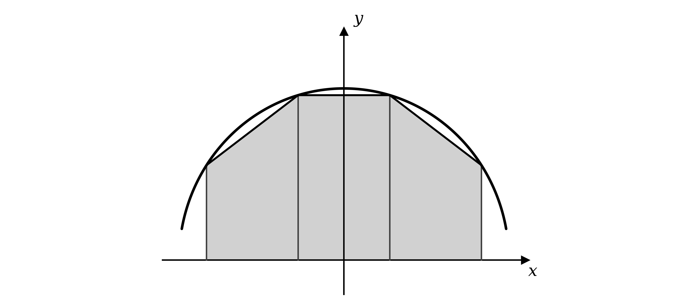
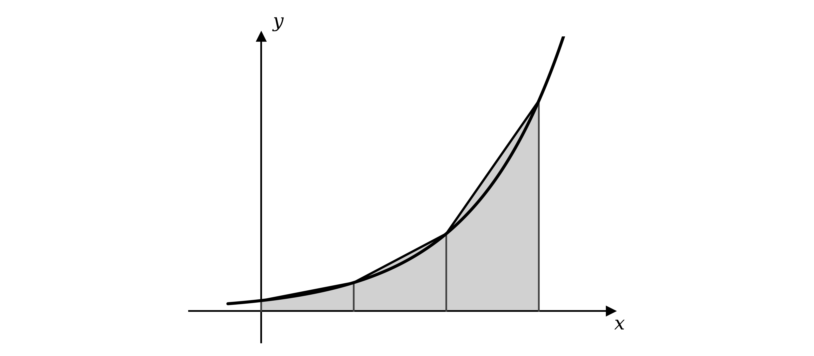

# Mark Schemes — Further Integration
**Integration** · Cambridge (CIE) AS maths (9709)

## Exam Questions (51 questions)

### Q1
The times in the table go up in equal steps, so the interval width can be read straight from the table

$h = 0 . 25$

**[B1]**

Write down the trapezium rule, adding the first and last values once and every value in between twice

`\int_{a}^{b} y \, dx \approx \frac{1}{2}h \left[ y_{0} + y_{n} + 2\left(y_{1} + y_{2} + \ldots + y_{n-1}\right) \right]`

The area under a speed-time graph is the distance travelled, so substitute the three speeds

`\text{Distance} \approx \frac{1}{2}\left(0.25\right)\left[ 32 + 27 + 2\left(38\right) \right]`

**[M1]**

Work out the bracket first

`= 0.125 \left[ 59 + 76 \right] = 0.125 \times 135 = 16.875`

Round to 3 significant figures

$\text{Distance} \approx 16 . 9 \text{miles}$

**[A1]**

> **[mark-scheme]**
> **B1**: The correct interval width, $h = 0 . 25$, seen or used.
> 
> **M1**: A correct trapezium rule expression using all three values, with the first and last added once and the middle value doubled. The two intervals may instead be treated as two separate trapezia and their areas added, which is equally acceptable.
> 
> **A1**: The value $16 . 9$. Answers which round to $16 . 9$ are accepted; the unrounded $16 . 875$ alone does not earn the mark, since the question asks for 3 significant figures. Units are not required.
Average speed is total distance divided by total time, so use the unrounded distance from part (a) over the full half hour

$\text{Average speed} = \frac{\text{distance}}{\text{time}} = \frac{16.875}{0.5}$

**[M1]**

$= 33 . 75 \text{mph}$

Compare this with the speed limit of 30 mph

**Final answer:** **The average speed of 33.75 mph is greater than 30 mph, so the car is not driving within the speed limit**

**[A1]**

> **[mark-scheme]**
> **M1**: Dividing a distance by the total time of $0 . 5$ hours.
> 
> **A1**: A correct average speed together with a conclusion comparing it with 30 mph. Using the rounded distance from part (a) gives $33 . 8$ mph and is equally acceptable; follow through from an incorrect part (a). The comparison must be explicit — a bare value with no conclusion does not earn the mark. Note that the car is within the limit at the third camera, but it is the average speed across the whole stretch that the cameras measure.

### Q2
Divide the interval from $x = a$ to $x = b$ into four strips of equal width, and draw a vertical line from the $x$-axis up to the curve at each of the three points in between

Join the top of each ordinate to the top of the next one with a straight line

Each strip is now a trapezium, with two vertical parallel sides and a straight top

**[B1 B1]**

The four trapezia together approximate the area under the curve

> **[mark-scheme]**
> **B1**: The region divided into four strips of equal width, with an ordinate drawn from the $x$-axis to the curve at each dividing point. Four unequal strips do not earn this mark.
> 
> **B1**: The top of each ordinate joined to the next with a straight line, so that four trapezia are formed. Accept freehand straight lines provided the intention is clear. Shading and numbering are not required. Rectangles rather than trapezia earn nothing, since the tops must follow the chords of the curve.

### Q3
Substitute each missing $x$ value into $y = e^{x^{2}}$, keeping the full calculator accuracy before rounding

$x = 1 \Rightarrow y = e^{1^{2}} = e^{1} = 2 . 718281 \dots$

$x = 1 . 4 \Rightarrow y = e^{1.4^{2}} = e^{1.96} = 7 . 099327 \dots$

$x = 2 \Rightarrow y = e^{2^{2}} = e^{4} = 54 . 598150 \dots$

Round each to 3 significant figures and enter them in the table

| $x$ | 1 | 1.2 | 1.4 | 1.6 | 1.8 | 2 |
|---|---|---|---|---|---|---|
| $y$ | **Final answer:** **2.72** | 4.22 | **Final answer:** **7.10** | 12.9 | 25.5 | **Final answer:** **54.6** |

**[B1 B1]**

> **[mark-scheme]**
> **B1**: At least two of the three missing values correct to 3 significant figures.
> 
> **B1**: All three correct: $2 . 72$, $7 . 10$ and $54 . 6$. Accept $7 . 1$ for $7 . 10$. Values must be given to 3 significant figures as instructed; unrounded values alone do not earn this mark.
The six values in the table are equally spaced, so the five intervals each have the same width

$h = \frac{2-1}{5} = 0 . 2$

**[B1]**

Write down the trapezium rule, adding the first and last $y$ values and twice every value in between

`\int_{a}^{b} y \, dx \approx \frac{1}{2}h \left[ y_{0} + y_{n} + 2\left(y_{1} + y_{2} + \ldots + y_{n-1}\right) \right]`

Substitute the six values from the table

`\int_{1}^{2} e^{x^{2}} dx \approx \frac{1}{2}\left(0.2\right)\left[ 2.72 + 54.6 + 2\left(4.22 + 7.10 + 12.9 + 25.5\right) \right]`

**[M1]**

Work out the bracket before multiplying

`= 0.1 \left[ 57.32 + 2\left(49.72\right) \right]`

`= 0.1 \left[ 57.32 + 99.44 \right] = 0.1 \times 156.76 = 15.676`

Round to 3 significant figures as the question requires

`\int_{1}^{2} e^{x^{2}} dx \approx 15.7`

**[A1]**

> **[mark-scheme]**
> **B1**: The correct interval width, $h = 0 . 2$, seen or used.
> 
> **M1**: A correct trapezium rule expression using all six values from the table, with the first and last added once and the four inner values doubled. The five intervals may instead be treated as five separate trapezia and their areas added, which is equally acceptable.
> 
> **A1**: The value $15 . 7$. Answers which round to $15 . 7$ are accepted; using the unrounded values throughout gives $15 . 6895 \dots$, which also rounds to $15 . 7$. A final answer left as $15 . 676$ without rounding does not earn the mark, since the question asks for 3 significant figures.

### Q4
(i)

Divide the width of the region by the number of intervals

$h = \frac{b-a}{n} = \frac{2-1}{4}$

$h = 0 . 25$

**[B1]**

(ii)

Substitute each missing $x$ value into $y = 5 - 3 e^{-x}$, keeping full calculator accuracy before rounding

$x = 1 . 25 \Rightarrow y = 5 - 3 e^{-1.25} = 4 . 140486 \dots$

$x = 1 . 5 \Rightarrow y = 5 - 3 e^{-1.5} = 4 . 330610 \dots$

$x = 2 \Rightarrow y = 5 - 3 e^{-2} = 4 . 593994 \dots$

Round each to 3 significant figures and enter them in the table

| $x$ | 1 | 1.25 | 1.5 | 1.75 | 2 |
|---|---|---|---|---|---|
| $y$ | 3.90 | **Final answer:** **4.14** | **Final answer:** **4.33** | 4.48 | **Final answer:** **4.59** |

**[B1 B1]**

(iii)

Write down the trapezium rule, adding the first and last values once and every value in between twice

`\int_{a}^{b} y \, dx \approx \frac{1}{2}h \left[ y_{0} + y_{n} + 2\left(y_{1} + y_{2} + \ldots + y_{n-1}\right) \right]`

Substitute all five values from the table, with $h = 0 . 25$

`\text{Area} \approx \frac{1}{2}\left(0.25\right)\left[ 3.90 + 4.59 + 2\left(4.14 + 4.33 + 4.48\right) \right]`

**[M1]**

Work out the inner bracket first

`= 0.125 \left[ 8.49 + 2\left(12.95\right) \right] = 0.125 \left[ 8.49 + 25.90 \right]`

$= 0 . 125 \times 34 . 39 = 4 . 29875$

**[A1]**

Round to 3 significant figures

$\text{Area} \approx 4 . 30$

**[A1]**

> **[mark-scheme]**
> **B1**: The interval width $h = 0 . 25$.
> 
> **B1**: At least two of the three missing values correct to 3 significant figures.
> 
> **B1**: All three correct: $4 . 14$, $4 . 33$ and $4 . 59$.
> 
> **M1**: A correct trapezium rule expression using all five values, with the first and last added once and the three inner values doubled. The four intervals may instead be treated as four separate trapezia and their areas added, which is equally acceptable.
> 
> **A1**: The value $4 . 29875$. Using unrounded ordinates throughout gives $4 . 29874 \dots$, which is equally acceptable.
> 
> **A1**: The value $4 . 30$. It must be written as $4 . 30$, not $4 . 3$, since 3 significant figures are asked for.

### Q5
(i)

The bracket $2 x + 1$ has derivative 2, so insert that factor inside the integral and compensate with $- \frac{1}{2}$ outside, which sets up the reverse chain rule

`\int \text{sin} \; (2x+1) \, \; \text{d}x = -\dfrac{1}{2} \int -2 \, \; \text{sin} \; (2x+1) \, \; \text{d}x`

**[M1]**

The bracket now integrates directly, since $- 2   \text{sin}  ( 2 x + 1 )$ is the derivative of $\text{cos}  ( 2 x + 1 )$

`\int \text{sin} \; (2x+1) \, \; \text{d}x = -\dfrac{1}{2} \, \; \text{cos} \; (2x+1) + c`

**[A1]**

(ii)

The bracket $2 θ - \frac{π}{6}$ has derivative 2, so adjust and compensate in the same way

`\int_{\frac{\pi}{6}}^{\frac{\pi}{4}} \text{sec}^{2} \left(2\theta - \frac{\pi}{6}\right) \text{d}\theta = \dfrac{1}{2} \int_{\frac{\pi}{6}}^{\frac{\pi}{4}} 2 \, \; \text{sec}^{2} \left(2\theta - \frac{\pi}{6}\right) \text{d}\theta`

**[M1]**

Integrate, using the fact that $\text{sec}^{2}$ integrates to $\text{tan}$

`= \dfrac{1}{2} \left[\text{tan} \left(2\theta - \frac{\pi}{6}\right)\right]_{\frac{\pi}{6}}^{\frac{\pi}{4}}`

**[A1]**

Substitute the limits

`= \dfrac{1}{2}\left[\text{tan} \left(2\left(\frac{\pi}{4}\right) - \frac{\pi}{6}\right) - \text{tan} \left(2\left(\frac{\pi}{6}\right) - \frac{\pi}{6}\right)\right] \\ = \dfrac{1}{2}\left[\text{tan} \; \frac{\pi}{3} - \text{tan} \; \frac{\pi}{6}\right] \\ = \dfrac{1}{2}\left(\sqrt{3} - \dfrac{1}{\sqrt{3}}\right)`

**[M1]**

Write both terms over $\sqrt{3}$ so they can be combined

`= \dfrac{1}{2} \left(\dfrac{3}{\sqrt{3}} - \dfrac{1}{\sqrt{3}}\right) \\ = \dfrac{1}{2} \times \dfrac{2}{\sqrt{3}}`

Rationalise the denominator to give the exact value

`\int_{\frac{\pi}{6}}^{\frac{\pi}{4}} \text{sec}^{2} \left(2\theta - \frac{\pi}{6}\right) \text{d}\theta = \dfrac{\sqrt{3}}{3}`

**[A1]**

(iii)

The bracket $5 x + 2$ has derivative 5, so adjust and compensate before integrating

`\dfrac{\text{d}y}{\text{d}x} = 4 \times \dfrac{1}{5} \left[5 \, \; \text{cos} \; (5x+2)\right]`

**[M1]**

Integrate, using the fact that $5   \text{cos}  ( 5 x + 2 )$ is the derivative of $\text{sin}  ( 5 x + 2 )$, and add the constant of integration

$y = \frac{4}{5}   \text{sin}  ( 5 x + 2 ) + c$

**[A1]**

> **[mark-scheme]**
> **M1**: Correct use of the reverse chain rule in part (i), reaching a multiple of $\text{cos}  ( 2 x + 1 )$.
> 
> **A1**: Correct integral $- \frac{1}{2}   \text{cos}  ( 2 x + 1 ) + c$. The sign and the $\frac{1}{2}$ must both be right.
> 
> **M1**: Correct use of the reverse chain rule in part (ii), reaching a multiple of `\text{tan} \left(2\theta - \dfrac{\pi}{6}\right)`.
> 
> **A1**: Correct integrated expression `\dfrac{1}{2} \left[\text{tan} \left(2\theta - \dfrac{\pi}{6}\right)\right]` with the limits still attached.
> 
> **M1**: Correct substitution of both limits, upper minus lower.
> 
> **A1**: Correct exact value. Accept any equivalent exact form, such as $\frac{1}{\sqrt{3}}$ or $\frac{\sqrt{3}}{3}$. Because the question asks for the exact value, a decimal such as 0.577 does not earn this mark.
> 
> **M1**: Correct use of the reverse chain rule in part (iii), reaching a multiple of $\text{sin}  ( 5 x + 2 )$.
> 
> **A1**: Correct expression $y = \frac{4}{5}   \text{sin}  ( 5 x + 2 ) + c$. Any letter may be used for the constant.

### Q6
(i)

Count the $x$ values in the table

$\text{Number of ordinates} = 7$

There is always one fewer interval than there are ordinates

$\text{Number of intervals} = 6$

Divide the width of the region by the number of intervals

$h = \frac{b-a}{n} = \frac{10-4}{6}$

$h = 1$

**[B1 B1 B1]**

(ii)

Write down the trapezium rule, adding the first and last values once and every value in between twice

`\int_{a}^{b} y \, dx \approx \frac{1}{2}h \left[ y_{0} + y_{n} + 2\left(y_{1} + y_{2} + \ldots + y_{n-1}\right) \right]`

Substitute all seven values from the table, with $h = 1$

`\text{Area} \approx \frac{1}{2}\left(1\right)\left[ 1.59 + 4.00 + 2\left(2.08 + 2.52 + 2.92 + 3.30 + 3.70\right) \right]`

**[M1]**

Work out the inner bracket first

`= \frac{1}{2}\left[ 5.59 + 2\left(14.52\right) \right] = \frac{1}{2}\left[ 5.59 + 29.04 \right]`

$= \frac{1}{2} \times 34 . 63 = 17 . 315$

**[A1]**

Round to 3 significant figures

$\text{Area} \approx 17 . 3$

**[A1]**

(iii)

Look at the shape of the curve across the whole region

The curve is concave, so each chord joining the tops of two neighbouring ordinates lies below the curve

**Final answer:** **Under-estimate, because the curve is concave, so the top of each trapezium lies below the curve**

**[B1 B1]**

> **[mark-scheme]**
> **B1**: 7 ordinates.
> 
> **B1**: 6 intervals.
> 
> **B1**: $h = 1$. Accept it read directly from the table, or obtained as $\frac{10-4}{6}$.
> 
> **M1**: A correct trapezium rule expression using all seven values, with the first and last added once and the five inner values doubled. The six intervals may instead be treated as six separate trapezia and their areas added, which is equally acceptable.
> 
> **A1**: The value $17 . 315$.
> 
> **A1**: The value $17 . 3$.
> 
> **B1**: Stating under-estimate.
> 
> **B1**: A reason referring to the tops of the trapezia lying below the curve, or to the curve being concave. A correct statement with no reason, or a reason with no statement, earns 1 of these 2 marks.

### Q7
(i)

Integrating is the reverse of differentiating, so look for the function whose derivative is $\frac{1}{x}$

`\dfrac{\text{d}}{\text{d}x}\left(\text{ln} \; x\right) = \dfrac{1}{x}`

**[M1]**

Reversing this gives the integral, and an indefinite integral needs a constant of integration

`\int \frac{1}{x} \text{d}x = \text{ln} \; |x| + c`

**[A1]**

(ii)

The integral of $\text{e}^{x}$ is itself, since `\dfrac{\text{d}}{\text{d}x}\left(\text{e}^{x}\right) = \text{e}^{x}`, so integrate and write the result in brackets with the limits

`\int_{0}^{1} \text{e}^{x} \text{d}x = \left[\text{e}^{x}\right]_{0}^{1}`

**[M1]**

Substitute the limits

$= \text{e}^{1} - \text{e}^{0}$

Since $\text{e}^{0} = 1$

`\int_{0}^{1} \text{e}^{x} \, \; \text{d}x = \text{e} - 1`

**[A1]**

(iii)

The integral of $\text{cos}  θ$ is $\text{sin}  θ$, and the constant multiple of 3 carries through

`\int 3 \, \; \text{cos} \; \theta \, \; \text{d}\theta = 3 \, \; \text{sin} \; \theta`

**[M1]**

Add the constant of integration to complete the expression for $y$

$y = 3   \text{sin}  θ + c$

**[A1]**

> **[mark-scheme]**
> **M1**: Correct use of the fact that $\frac{1}{x}$ integrates to a logarithm, in part (i).
> 
> **A1**: Correct integral `\text{ln} \; |x| + c`. The modulus signs are condoned, so $\text{ln}  x + c$ also earns this mark.
> 
> **M1**: Correct integration of $\text{e}^{x}$ in part (ii), with the limits attached, giving `\left[\text{e}^{x}\right]_{0}^{1}`.
> 
> **A1**: Correct exact value $\text{e} - 1$. Because the question says to use calculus, a decimal such as 1.72 does not earn this mark on its own.
> 
> **M1**: Correct integration of $3   \text{cos}  θ$ to give $3   \text{sin}  θ$ in part (iii).
> 
> **A1**: Correct expression $y = 3   \text{sin}  θ + c$. Any letter may be used for the constant.

### Q8
The identity has $\text{sin}^{2} A$ on the right, so rearrange to collect that term on its own side

$\text{cos}  2 A \equiv 1 - 2   \text{sin}^{2} A$

$2   \text{sin}^{2} A \equiv 1 - \text{cos}  2 A$

**[M1]**

Divide both sides by 2 to reach the required form

`\text{sin}^{2} A \equiv \frac{1}{2}\left(1 - \text{cos} \; 2A\right)`

**[A1]**

> **[mark-scheme]**
> **M1**: Correct rearrangement of the given identity to isolate the $\text{sin}^{2} A$ term, reaching $2   \text{sin}^{2} A \equiv 1 - \text{cos}  2 A$.
> 
> **A1**: Correct division by 2 to reach the given result. Because the result is given, both rearrangement steps must be visible. Accept $\frac{1-\text{cos}2A}{2}$ as an equivalent form.
A power of sine cannot be integrated directly, so use the result from part (a) with $A = x$ to replace $\text{sin}^{2} x$, then split the bracket into two terms that each integrate on sight

`\int_{\frac{1}{2}\pi}^{\pi} \text{sin}^{2} x \, \; \text{d}x = \int_{\frac{1}{2}\pi}^{\pi} \frac{1}{2}\left(1 - \text{cos} \; 2x\right) \text{d}x = \int_{\frac{1}{2}\pi}^{\pi} \left(\frac{1}{2} - \frac{1}{2}\text{cos} \; 2x\right) \text{d}x`

Integrate each term, remembering that $\text{cos}  2 x$ integrates to $\frac{1}{2} \text{sin}  2 x$

`= \left[\frac{1}{2}x - \frac{1}{4}\text{sin} \; 2x\right]_{\frac{1}{2}\pi}^{\pi}`

**[M1]**

Substitute the limits

`= \left(\frac{1}{2}\pi - \frac{1}{4}\text{sin} \; 2\pi\right) - \left(\frac{1}{2}\left(\frac{1}{2}\pi\right) - \frac{1}{4}\text{sin} \; \pi\right) \\ = \left(\frac{\pi}{2} - 0\right) - \left(\frac{\pi}{4} - 0\right)`

**[M1]**

Subtract to give the exact value

`\int_{\frac{1}{2}\pi}^{\pi} \text{sin}^{2} x \, \; \text{d}x = \frac{\pi}{4}`

**[A1]**

> **[exam-tip]**
> No power of sine or cosine can be integrated as it stands, so whenever you meet $\text{sin}^{2}$ or $\text{cos}^{2}$ in an integral your first move should be the double-angle identity, even when the question does not prompt you. In a real exam this question would appear without part (a) at all, so practise spotting the rearrangement yourself rather than waiting to be handed it.

> **[mark-scheme]**
> **M1**: Correct use of the double-angle result from part (a) followed by correct integration, reaching $p x + q   \text{sin}  2 x$ where $p$ and $q$ are both non-zero. Accept the unsimplified form.
> 
> **M1**: Correct substitution of both limits into an integrated expression of that form, upper minus lower. The limits need to be stated, but it is condoned if the zero terms are not written out in the substitution.
> 
> **A1**: Correct exact value $\frac{π}{4}$. Accept any exact equivalent, including $\frac{1}{4} π$. Because the question asks for the exact value, a decimal such as 0.785 does not earn this mark.

### Q9
(i)

Integrating a cubed bracket produces a fourth power

Consider differentiating $( 2 x - 1 )^{4}$, which brings down a 4 from the power and a 2 from the chain rule on the bracket

`\dfrac{\text{d}}{\text{d}x}\left[(2x-1)^{4}\right] = 4 \times 2 \times (2x-1)^{3} \\ = 8(2x-1)^{3}`

**[M1]**

That is exactly the integrand, so the integral needs no adjusting at all. Integrate and add the constant

`\int 8(2x-1)^{3} \, \; \text{d}x = (2x-1)^{4} + c`

**[A1]**

(ii)

The bracket $2 x$ has derivative 2, so insert that factor and compensate with $- \frac{1}{2}$ outside

`\int_{0}^{\frac{\pi}{4}} \text{sin} \; 2x \, \; \text{d}x = -\dfrac{1}{2}\int_{0}^{\frac{\pi}{4}} -2 \, \; \text{sin} \; 2x \, \; \text{d}x`

**[M1]**

Integrate, since $- 2   \text{sin}  2 x$ is the derivative of $\text{cos}  2 x$

`= -\dfrac{1}{2}\left[\text{cos} \; 2x\right]_{0}^{\frac{\pi}{4}}`

**[A1]**

Substitute the limits

`= -\dfrac{1}{2}\left(\text{cos} \; 2\left(\frac{\pi}{4}\right) - \text{cos} \; 2(0)\right) \\ = -\dfrac{1}{2}\left(\text{cos} \; \frac{\pi}{2} - \text{cos} \; 0\right) \\ = -\dfrac{1}{2}\left(0 - 1\right)`

**[M1]**

Evaluate to give the exact value

`\int_{0}^{\frac{\pi}{4}} \text{sin} \; 2x \, \; \text{d}x = \dfrac{1}{2}`

**[A1]**

(iii)

The integral of $\text{e}^{3x}$ brings a factor of $\frac{1}{3}$, and here the coefficient 3 cancels it exactly

`y = \int 3\text{e}^{3x} \, \; \text{d}x = 3 \times \dfrac{1}{3}\text{e}^{3x}`

**[M1]**

Simplify and add the constant of integration

$y = \text{e}^{3x} + c$

**[A1]**

> **[mark-scheme]**
> **M1**: Correct use of the reverse chain rule in part (i), reaching a multiple of $( 2 x - 1 )^{4}$.
> 
> **A1**: Correct integral $( 2 x - 1 )^{4} + c$. Accept the expanded form.
> 
> **M1**: Correct use of the reverse chain rule in part (ii), reaching a multiple of $\text{cos}  2 x$.
> 
> **A1**: Correct integrated expression `-\dfrac{1}{2}\left[\text{cos} \; 2x\right]` with the limits still attached.
> 
> **M1**: Correct substitution of both limits, upper minus lower.
> 
> **A1**: Correct exact value $\frac{1}{2}$. Accept 0.5.
> 
> **M1**: Correct integration of $3 \text{e}^{3x}$ in part (iii), reaching a multiple of $\text{e}^{3x}$.
> 
> **A1**: Correct expression $y = \text{e}^{3x} + c$. Any letter may be used for the constant.

### Q10
The shaded region runs from $x = 0$ to $x = 4$ and four intervals are to be used, so each interval has width

$h = \frac{4-0}{4} = 1$

**[B1]**

Read the five ordinates off the graph

$y_{0} = 4 , y_{1} = 3 . 641 , y_{2} = 2 . 708 , y_{3} = 1 . 443 , y_{4} = 0$

Write down the trapezium rule, adding the first and last values once and every value in between twice

`\int_{a}^{b} y \, dx \approx \frac{1}{2}h \left[ y_{0} + y_{n} + 2\left(y_{1} + y_{2} + \ldots + y_{n-1}\right) \right]`

Substitute the five values

`\text{Area} \approx \frac{1}{2}\left(1\right)\left[ 4 + 0 + 2\left(3.641 + 2.708 + 1.443\right) \right]`

**[M1]**

Work out the inner bracket first

`= \frac{1}{2}\left[ 4 + 2\left(7.792\right) \right] = \frac{1}{2}\left[ 4 + 15.584 \right]`

$= \frac{1}{2} \times 19 . 584 = 9 . 792$

Round to 3 significant figures

$\text{Area} \approx 9 . 79$

**[A1]**

> **[mark-scheme]**
> **B1**: The correct interval width, $h = 1$, seen or used.
> 
> **M1**: A correct trapezium rule expression using all five ordinates, with the first and last added once and the three inner values doubled. The four intervals may instead be treated as four separate trapezia and their areas added, which is equally acceptable. The two zero ordinates may be omitted from the working provided the structure of the rule is otherwise correct.
> 
> **A1**: The value $9 . 79$. Answers which round to $9 . 79$ are accepted.
Look at the shape of the curve across the whole region

The curve is concave, so each chord joining the tops of two neighbouring ordinates lies below the curve

Every trapezium therefore sits below the region it is approximating, so their total is smaller than the true area

**Final answer:** **Under-estimate, because the curve is concave, so the top of each trapezium lies below the curve**

**[B1 B1]**

> **[mark-scheme]**
> **B1**: Stating under-estimate.
> 
> **B1**: A reason referring to the tops of the trapezia lying below the curve, or to the curve being concave. "The curve is concave" alone is sufficient, as is "the chords lie below the curve" or any clear equivalent. A labelled sketch showing a trapezium sitting below the curve is accepted in place of a written reason. A correct statement with no reason, or a reason with no statement, earns 1 of the 2 marks.

### Q11
(i)

The exponent $3 x - 4$ has derivative 3, so insert that factor and compensate with $\frac{1}{3}$ outside

$\frac{\text{d}y}{\text{d}x} = 7 \times \frac{1}{3} \times 3 \text{e}^{3x-4}$

**[M1]**

Integrate, since $3 \text{e}^{3x-4}$ is the derivative of $\text{e}^{3x-4}$, and add the constant of integration

$y = \frac{7}{3} \text{e}^{3x-4} + c$

**[A1]**

(ii)

An integrand of the form $\frac{1}{ax+b}$ integrates to a logarithm, so insert the derivative 4 on the top and compensate with $\frac{1}{4}$ outside

`\int \dfrac{1}{4x+9} \, \; \text{d}x = \dfrac{1}{4}\int \dfrac{4}{4x+9} \, \; \text{d}x`

**[M1]**

The top is now the derivative of the bottom, so the integral is the natural logarithm of the denominator

`\int \frac{1}{4x + 9} \, \; \text{d}x = \dfrac{1}{4}\, \;\text{ln} \; |4x+9| + c`

**[A1]**

> **[mark-scheme]**
> **M1**: Correct use of the reverse chain rule in part (i), reaching a multiple of $\text{e}^{3x-4}$.
> 
> **A1**: Correct expression $y = \frac{7}{3} \text{e}^{3x-4} + c$. Any letter may be used for the constant.
> 
> **M1**: Correct method in part (ii), reaching a multiple of `\text{ln} \; |4x+9|`.
> 
> **A1**: Correct integral `\dfrac{1}{4}\, \;\text{ln} \; |4x+9| + c`. The modulus signs are condoned, so $\frac{1}{4}   \text{ln}  ( 4 x + 9 ) + c$ also earns this mark. Accept `\text{ln} \; |4x+9|^{\frac{1}{4}}` as an equivalent form.

### Q12
(i)

Writing the denominator with the $x$ term first makes the standard $\frac{1}{ax+b}$ shape easier to see

`\int \frac{1}{2-3x} \, \; \text{d}x = \int \frac{1}{-3x+2} \, \; \text{d}x`

The denominator has derivative $- 3$, so insert that on the top and compensate with $- \frac{1}{3}$ outside

`= -\dfrac{1}{3}\int \frac{-3}{-3x+2} \, \; \text{d}x`

**[M1]**

The numerator is now the derivative of the denominator, so the integral is a logarithm

`\int \frac{1}{2 - 3x} \, \; \text{d}x = -\dfrac{1}{3}\, \;\text{ln} \; |2-3x| + c`

**[A1]**

(ii)

Rewrite the second fraction so that its numerator can be compared with the derivative of its denominator

`y = \int \left(\frac{2}{2x+1} + \frac{-1}{-x+3}\right) \text{d}x`

In each term the numerator is exactly the derivative of the denominator, so each integrates straight to a logarithm with no adjusting needed

`y = \text{ln} \; |2x+1| + \text{ln} \; |3-x| + \text{ln} \; A`

**[M1 A1]**

Writing the constant of integration as $\text{ln}  A$ allows all three terms to be combined using the addition law for logarithms

`y = \text{ln} \; A\left|(2x+1)(3-x)\right|`

**[A1]**

> **[mark-scheme]**
> **M1**: Correct method in sub-part (i), reaching a multiple of `\text{ln} \; |2-3x|`.
> 
> **A1**: Correct integral `-\dfrac{1}{3}\, \;\text{ln} \; |2-3x| + c`. The sign and the $\frac{1}{3}$ must both be right. Modulus signs are condoned, and the constant is condoned if omitted here.
> 
> **M1**: Correct method in sub-part (ii), integrating both terms to logarithms.
> 
> **A1**: Both logarithms correct, `\text{ln} \; |2x+1|` and `\text{ln} \; |3-x|`, with the correct signs. Accept `\text{ln} \; |x-3|` as an equivalent, since the modulus makes the two the same.
> 
> **A1**: Correct combination into a single logarithm. Accept either `\text{ln} \; A\left|(2x+1)(3-x)\right|` with the constant absorbed, or `\text{ln} \; \left|(2x+1)(3-x)\right| + c` with the constant kept separate. Both contain a single logarithm and both score. Accept an expanded bracket. An answer left as a sum of two separate logarithms does not earn this mark.

### Q13
Write $A = θ + \frac{π}{8}$ to keep the working readable. The two brackets are a sum and a difference of the same pair, so their product is a difference of two squares

`\left(\text{cos} \; A + \text{sin} \; A\right)\left(\text{sin} \; A - \text{cos} \; A\right) = \text{sin}^{2} A - \text{cos}^{2} A`

**[M1]**

The double-angle formula gives $\text{cos}  2 A \equiv \text{cos}^{2} A - \text{sin}^{2} A$, which is the negative of the expression above

`\text{sin}^{2} A - \text{cos}^{2} A = -\left(\text{cos}^{2} A - \text{sin}^{2} A\right) = -\text{cos} \; 2A`

**[M1]**

Substitute back, so that $2 A = 2 θ + \frac{π}{4}$

`\left(\text{cos} \left(\theta + \frac{\pi}{8}\right) + \text{sin} \left(\theta + \frac{\pi}{8}\right)\right)\left(\text{sin} \left(\theta + \frac{\pi}{8}\right) - \text{cos} \left(\theta + \frac{\pi}{8}\right)\right) \equiv -\text{cos} \left(2\theta + \frac{\pi}{4}\right)`

**[A1]**

> **[mark-scheme]**
> **M1**: Correct expansion of the product, either as a difference of two squares or by multiplying out in full, reaching $\text{sin}^{2} A - \text{cos}^{2} A$ or its expanded equivalent.
> 
> **M1**: Correct use of a double-angle formula, recognising the expression as $- \text{cos}  2 A$.
> 
> **A1**: Correct substitution back to reach the given result, with the doubled angle written as $2 θ + \frac{π}{4}$. Because the result is given, the intermediate form must be visible.
The integrand is exactly the expanded form from part (a), so replace it with the single cosine term

`\int_{0}^{\frac{1}{8}\pi} \left(\text{sin}^{2} \left(\theta + \frac{\pi}{8}\right) - \text{cos}^{2} \left(\theta + \frac{\pi}{8}\right)\right) \text{d}\theta = \int_{0}^{\frac{1}{8}\pi} -\text{cos} \left(2\theta + \frac{\pi}{4}\right) \text{d}\theta`

**[M1]**

The bracket has derivative 2, so insert that factor and compensate with $- \frac{1}{2}$ outside, then integrate

`= -\dfrac{1}{2}\int_{0}^{\frac{1}{8}\pi} 2\, \;\text{cos} \left(2\theta + \frac{\pi}{4}\right) \text{d}\theta = -\dfrac{1}{2}\left[\text{sin} \left(2\theta + \frac{\pi}{4}\right)\right]_{0}^{\frac{1}{8}\pi}`

**[M1]**

Substitute the limits

`= -\dfrac{1}{2}\left(\text{sin} \left(2\left(\frac{1}{8}\pi\right) + \frac{\pi}{4}\right) - \text{sin} \left(2(0) + \frac{\pi}{4}\right)\right) \\ = -\dfrac{1}{2}\left(\text{sin} \; \frac{\pi}{2} - \text{sin} \; \frac{\pi}{4}\right) \\ = -\dfrac{1}{2}\left(1 - \frac{\sqrt{2}}{2}\right)`

Multiply out and write over a common denominator

`\int_{0}^{\frac{1}{8}\pi} \left(\text{sin}^{2} \left(\theta + \frac{\pi}{8}\right) - \text{cos}^{2} \left(\theta + \frac{\pi}{8}\right)\right) \text{d}\theta = -\frac{2 - \sqrt{2}}{4}`

**[A1]**

> **[mark-scheme]**
> **M1**: Correct use of the result from part (a) to replace the integrand with `-\text{cos} \left(2\theta + \dfrac{\pi}{4}\right)`, or an equivalent correct use of a double-angle formula.
> 
> **M1**: Correct integration, reaching a multiple of `\text{sin} \left(2\theta + \dfrac{\pi}{4}\right)` with the limits attached.
> 
> **A1**: Correct exact value $- \frac{2-\sqrt{2}}{4}$. Accept any exact equivalent, such as $\frac{\sqrt{2}-2}{4}$ or $\frac{\sqrt{2}}{4} - \frac{1}{2}$. Because the question asks for the exact value, a decimal such as -0.146 does not earn this mark.

### Q14
The integrand is a power of $\text{cos}  4 x$ multiplied by something close to its derivative, so start by differentiating the cube to see what the reverse chain rule produces

`\dfrac{\text{d}}{\text{d}x}\left(\text{cos}^{3} 4x\right) = 3\, \;\text{cos}^{2} 4x \times \left(-4\, \;\text{sin} \; 4x\right) = -12\, \;\text{cos}^{2} 4x \, \; \text{sin} \; 4x`

**[M1]**

That is $- 12$ times the integrand's trigonometric part, so insert the factor $- 12$ inside and compensate with $- \frac{5}{12}$ outside

`y = -\dfrac{5}{12}\int -12\, \;\text{cos}^{2} 4x \, \; \text{sin} \; 4x \, \; \text{d}x`

**[M1]**

Integrate and add the constant

$y = - \frac{5}{12} \text{cos}^{3} 4 x + c$

**[A1]**

> **[mark-scheme]**
> **M1**: Correct method, recognising that the integrand is a multiple of the derivative of $\text{cos}^{3} 4 x$, or an equivalent substitution such as $u = \text{cos}  4 x$.
> 
> **M1**: Correct adjustment of the constant, reaching a multiple of $\text{cos}^{3} 4 x$.
> 
> **A1**: Correct expression $y = - \frac{5}{12} \text{cos}^{3} 4 x + c$, with the minus sign and both parts of the fraction right. Any letter may be used for the constant.
Integrating a bracket to the fourth power produces a fifth power

Consider differentiating `\left(5x^{2}+4\right)^{5}`, which brings down a 5 from the power and a $10 x$ from the chain rule on the bracket

`\dfrac{\text{d}}{\text{d}x}\left[\left(5x^{2}+4\right)^{5}\right] = 5 \times 10x \times \left(5x^{2}+4\right)^{4} \\ = 50x\left(5x^{2}+4\right)^{4}`

**[M1]**

The integrand has $3 x$ in front rather than $50 x$, so insert that factor and compensate with $\frac{3}{50}$ outside

`\int 3x\left(5x^{2}+4\right)^{4} \, \; \text{d}x = \dfrac{3}{50}\int 50x\left(5x^{2}+4\right)^{4} \, \; \text{d}x`

**[M1]**

The integrand is now the derivative of `\left(5x^{2}+4\right)^{5}`, so integrate and add the constant

`\int 3x\left(5x^{2} + 4\right)^{4} \, \; \text{d}x = \dfrac{3}{50}\left(5x^{2} + 4\right)^{5} + c`

**[A1]**

> **[mark-scheme]**
> **M1**: Correct method, recognising that $3 x$ is a multiple of the derivative of $5 x^{2} + 4$, or an equivalent substitution such as $u = 5 x^{2} + 4$.
> 
> **M1**: Correct adjustment of the constant, reaching a multiple of `\left(5x^{2}+4\right)^{5}`.
> 
> **A1**: Correct integral `\dfrac{3}{50}\left(5x^{2}+4\right)^{5} + c`. Accept the expanded form. Any letter may be used for the constant.

### Q15
Five intervals across $1 \leq x \leq 2$ gives

$h = \frac{2-1}{5} = 0 . 2$

Substitute each $x$ value into $y = 4 - 2 x^{\text{ln}x}$, keeping full calculator accuracy

$y_{0} = 2 , y_{1} = 1 . 932400 \dots , y_{2} = 1 . 760264 \dots$

$y_{3} = 1 . 505586 \dots , y_{4} = 1 . 174656 \dots , y_{5} = 0 . 766516 \dots$

**[B1]**

Write down the trapezium rule, adding the first and last values once and every value in between twice

`\int_{a}^{b} y \, dx \approx \frac{1}{2}h \left[ y_{0} + y_{n} + 2\left(y_{1} + y_{2} + \ldots + y_{n-1}\right) \right]`

Substitute the six ordinates, with $h = 0 . 2$

`\int_{1}^{2} \left(4 - 2x^{\text{ln} x}\right) dx \approx \frac{1}{2}\left(0.2\right)\left[ 2 + 0.766516 + 2\left(1.932400 + 1.760264 + 1.505586 + 1.174656\right) \right]`

**[M1]**

Work out the inner bracket first

`= 0.1 \left[ 2.766516 + 2\left(6.372906\right) \right] = 0.1 \left[ 2.766516 + 12.745812 \right]`

$= 0 . 1 \times 15 . 512328 = 1 . 551233$

**[A1]**

Round to 3 significant figures

`\int_{1}^{2} \left(4 - 2x^{\text{ln} x}\right) dx \approx 1.55`

**[A1]**

> **[mark-scheme]**
> **B1**: The correct ordinates, to at least 2 decimal places.
> 
> **M1**: A correct trapezium rule expression using all six ordinates, with the first and last added once and the four inner values doubled. The five intervals may instead be treated as five separate trapezia and their areas added, which is equally acceptable.
> 
> **A1**: The value $1 . 5512 \dots$
> 
> **A1**: The value $1 . 55$.
Use the numerical integration function on the calculator with lower limit 1 and upper limit 2

`\int_{1}^{2} \left(4 - 2x^{\text{ln} x}\right) dx = 1.558658\ldots`

$\approx 1 . 56$

**[B1]**

> **[mark-scheme]**
> **B1**: The value $1 . 56$. Accept $1 . 5586 \dots$ or any value which rounds to $1 . 56$.
Percentage error compares the size of the error with the true value

`\text{Percentage error} = \frac{\left|\text{approximation} - \text{true value}\right|}{\text{true value}} \times 100`

Substitute the unrounded values from parts (a) and (b)

`= \frac{\left|1.551233 - 1.558658\right|}{1.558658} \times 100 = \frac{0.007425}{1.558658} \times 100`

**[M1]**

$= 0 . 4764 \dots$

`\text{Percentage error} \approx 0.476\%`

**[A1]**

> **[mark-scheme]**
> **M1**: A correct percentage error structure: the difference between the two values, divided by one of them, multiplied by 100.
> 
> **A1**: The value $0 . 476$, or $0 . 48$ to 2 significant figures, or $0 . 5$ to 1 significant figure. Dividing by the approximation rather than by the true value gives $0 . 483$ and is equally acceptable. Follow through from incorrect answers to parts (a) and (b). A negative percentage is condoned, as the question asks for the size of the error.

### Q16
Take the left-hand side first. The denominator has derivative $a$, and the numerator is $2 a$, so the integral is $2   \text{ln}$ of the denominator

`\int_{0}^{1} \frac{2a}{ax+b} \, \; \text{d}x = \left[2\, \;\text{ln} \; |ax+b|\right]_{0}^{1} = 2\, \;\text{ln} \; |a+b| - 2\, \;\text{ln} \; |b|`

**[M1]**

Use the power law to move each 2 inside, then the subtraction law to combine into one logarithm

`= \text{ln} \; (a+b)^{2} - \text{ln} \; b^{2} = \text{ln} \; \left(\frac{a+b}{b}\right)^{2}`

**[A1]**

Now the right-hand side, which is the standard logarithmic integral

`\int_{b}^{2a} \frac{1}{x} \, \; \text{d}x = \left[\text{ln} \; |x|\right]_{b}^{2a} = \text{ln} \; |2a| - \text{ln} \; |b|`

**[M1]**

Combine these into a single logarithm as well

`= \text{ln} \; \left|\frac{2a}{b}\right|`

**[A1]**

Setting the two sides equal, the logarithms can be removed because the logarithm function takes each value only once

`\left(\frac{a+b}{b}\right)^{2} = \left|\frac{2a}{b}\right|`

**[M1]**

Now use the assumption being tested: if $a$ and $b$ are both positive then $\frac{2a}{b}$ is positive, so the modulus can be removed. Multiply through by $b^{2}$ and expand

$\frac{a^{2}+2ab+b^{2}}{b^{2}} = \frac{2a}{b}  \Rightarrow  a^{2} + 2 a b + b^{2} = 2 a b$

**[M1]**

The $2 a b$ terms cancel from both sides

$a^{2} + b^{2} = 0$

A sum of two squares is zero only when both are zero, so the only solution is $a = 0$ and $b = 0$, and neither is positive. That contradicts the assumption

**Final answer:** **Since a squared and b squared are both non-negative, a = 0 and b = 0 is the only solution, so there are no positive values of a and b that satisfy the equation**

**[A1]**

> **[mark-scheme]**
> **M1**: Correct integration of the left-hand side, reaching a multiple of `\text{ln} \; |ax+b|` with the limits used.
> 
> **A1**: Correct left-hand side as a single logarithm, `\text{ln} \; \left(\dfrac{a+b}{b}\right)^{2}`, or any equivalent form.
> 
> **M1**: Correct integration of the right-hand side, reaching `\text{ln} \; |x|` with the limits used.
> 
> **A1**: Correct right-hand side as a single logarithm, `\text{ln} \; \left|\dfrac{2a}{b}\right|`, or equivalent.
> 
> **M1**: Correct removal of the logarithms to equate the two arguments.
> 
> **M1**: Correct expansion and simplification, using the positivity of $a$ and $b$ to remove the modulus.
> 
> **A1**: Correct conclusion that $a^{2} + b^{2} = 0$ forces $a = b = 0$, together with a clear statement that this means no positive values exist. Reaching $a^{2} + b^{2} = 0$ without drawing the conclusion does not earn this mark.

### Q17
(i)

Two intervals across $4 \leq x \leq 8$ means $h = 2$, so use only $x = 4$, $6$ and $8$

`\int_{4}^{8} \text{f}(x) \, dx \approx \frac{1}{2}\left(2\right)\left[ 3.16 + 4.69 + 2\left(4\right) \right]`

**[M1]**

`= 1 \times \left[ 7.85 + 8 \right]`

$\approx 15 . 85$

**[B1]**

(ii)

Four intervals means $h = 1$, so use $x = 4$, $5$, $6$, $7$ and $8$

`\int_{4}^{8} \text{f}(x) \, dx \approx \frac{1}{2}\left(1\right)\left[ 3.16 + 4.69 + 2\left(3.61 + 4 + 4.36\right) \right]`

`= \frac{1}{2}\left[ 7.85 + 2\left(11.97\right) \right] = \frac{1}{2} \times 31.79`

$\approx 15 . 895$

**[B1]**

(iii)

Eight intervals means $h = 0 . 5$, so use every value in the table

`\int_{4}^{8} \text{f}(x) \, dx \approx \frac{1}{2}\left(0.5\right)\left[ 3.16 + 4.69 + 2\left(3.39 + 3.61 + 3.81 + 4 + 4.18 + 4.36 + 4.53\right) \right]`

`= 0.25 \left[ 7.85 + 2\left(27.88\right) \right] = 0.25 \times 63.61`

$\approx 15 . 9025$

**[B1]**

> **[mark-scheme]**
> **M1**: A correct trapezium rule expression in any one of the three cases, with the first and last values added once and the inner values doubled.
> 
> **B1**: The value $15 . 85$.
> 
> **B1**: The value $15 . 895$.
> 
> **B1**: The value $15 . 9025$. Each part must select the correct values from the table: every other value for four intervals, every fourth value for two intervals. Answers which round to these values are accepted.
Compare the three approximations

$15 . 85 < 15 . 895 < 15 . 9025$

Look at how $\text{f} ( x )$ changes across the table: the differences between successive values are $0 . 23 , 0 . 22 , 0 . 20 , 0 . 19 , 0 . 18 , 0 . 18 , 0 . 17 , 0 . 16$, which are decreasing, so the curve is concave

Each chord therefore lies below the curve, so all three are under-estimates, and the estimates rise towards the true value as the trapezia get narrower

**Final answer:** **The approximation using eight intervals is the most accurate, because narrower trapezia follow the curve more closely, so less area is missed beneath each chord**

**[B1 B1]**

> **[mark-scheme]**
> **B1**: Selecting the eight-interval approximation.
> 
> **B1**: A justification referring to narrower intervals, or more trapezia, following the curve more closely so that less area is missed. Accept a justification based on the estimates increasing towards the true value because the curve is concave. A bare "it uses more values", without reference to accuracy or to the trapezia fitting the curve, does not earn this mark.

### Q18
Nothing can be integrated while it sits inside a squared bracket, so expand it first

`\left(2\, \;\text{tan} \; x + 3\, \;\text{sec} \; x\right)^{2} = 4\, \;\text{tan}^{2} x + 12\, \;\text{tan} \; x \, \; \text{sec} \; x + 9\, \;\text{sec}^{2} x`

**[M1 A1]**

There is no standard integral for $\text{tan}^{2} x$, so use the identity $\text{tan}^{2} x + 1 \equiv \text{sec}^{2} x$ to replace it

`4\, \;\text{tan}^{2} x = 4\left(\text{sec}^{2} x - 1\right)`

**[M1]**

Substitute that in and collect the two $\text{sec}^{2} x$ terms, which gives $4 + 9 = 13$

`\int \left(2\, \;\text{tan} \; x + 3\, \;\text{sec} \; x\right)^{2} \text{d}x = \int \left(13\, \;\text{sec}^{2} x + 12\, \;\text{tan} \; x \, \; \text{sec} \; x - 4\right) \text{d}x`

**[A1]**

The list of formulae gives the integral of the first term directly

`\int \text{sec}^{2} x \, \; \text{d}x = \text{tan} \; x + c`

For the second term it gives the derivative of secant, and integrating reverses that

`\dfrac{\text{d}}{\text{d}x}\left(\text{sec} \; x\right) = \text{sec} \; x \, \; \text{tan} \; x`

`\int \text{tan} \; x \, \; \text{sec} \; x \, \; \text{d}x = \text{sec} \; x + c`

Integrate all three terms, with the constant giving $- 4 x$

`\int \left(2 \, \; \text{tan} \; x + 3 \, \; \text{sec} \; x\right)^{2} \text{d}x = 13\, \;\text{tan} \; x + 12\, \;\text{sec} \; x - 4x + c`

**[A1]**

> **[mark-scheme]**
> **M1**: Correct method to expand the squared bracket, producing three terms including the cross term.
> 
> **A1**: Correct expansion $4   \text{tan}^{2} x + 12   \text{tan}  x   \text{sec}  x + 9   \text{sec}^{2} x$.
> 
> **M1**: Correct use of the identity $\text{tan}^{2} x \equiv \text{sec}^{2} x - 1$.
> 
> **A1**: Correct simplified integrand $13   \text{sec}^{2} x + 12   \text{tan}  x   \text{sec}  x - 4$, or equivalent.
> 
> **A1**: Correct integral $13   \text{tan}  x + 12   \text{sec}  x - 4 x + c$, including the $- 4 x$ term. Reaching the $12   \text{sec}  x$ term by rewriting the integrand as $\frac{12\text{sin}x}{\text{cos}^{2}x}$ and using the reverse chain rule is equally acceptable. Any letter may be used for the constant.

### Q19
The first two fractions have the same variable part, so simplify before integrating

$\frac{1}{x} + \frac{4}{2x} = \frac{1}{x} + \frac{2}{x} = \frac{3}{x}$

**[M1]**

In the third fraction the numerator 3 is already the derivative of $3 x - 2$, so it integrates to a logarithm with no adjusting

`\int_{2}^{6} \left(\frac{3}{x} + \frac{3}{3x-2}\right) \text{d}x = \left[3\, \;\text{ln} \; |x| + \text{ln} \; |3x-2|\right]_{2}^{6}`

**[A1]**

Substitute the limits, upper minus lower

`= \left(3\, \;\text{ln} \; |6| + \text{ln} \; |3(6)-2|\right) - \left(3\, \;\text{ln} \; |2| + \text{ln} \; |3(2)-2|\right) \\ = \left(3\, \;\text{ln} \; 6 + \text{ln} \; 16\right) - \left(3\, \;\text{ln} \; 2 + \text{ln} \; 4\right)`

**[M1]**

The answer must be in terms of prime bases, so break each logarithm down using the addition and power laws

$\text{ln}  6 = \text{ln}  2 + \text{ln}  3$

$\text{ln}  16 = \text{ln}  2^{4} = 4   \text{ln}  2$

$\text{ln}  4 = \text{ln}  2^{2} = 2   \text{ln}  2$

**[M1]**

Substitute these in and collect the $\text{ln}  2$ terms, which give $3 + 4 - 3 - 2 = 2$

`= 3\left(\text{ln} \; 2 + \text{ln} \; 3\right) + 4\, \;\text{ln} \; 2 - 3\, \;\text{ln} \; 2 - 2\, \;\text{ln} \; 2`

`\int_{2}^{6} \left(\frac{1}{x} + \frac{4}{2x} + \frac{3}{3x - 2}\right) \text{d}x = 3 \, \; \text{ln} \; 3 + 2 \, \; \text{ln} \; 2`

**[A1]**

> **[mark-scheme]**
> **M1**: Correct simplification of $\frac{1}{x} + \frac{4}{2x}$ to $\frac{3}{x}$, or equivalent handling of the first two terms.
> 
> **A1**: Correct integration to `3\, \;\text{ln} \; |x| + \text{ln} \; |3x-2|`, with the limits attached. Modulus signs are condoned.
> 
> **M1**: Correct substitution of both limits, upper minus lower.
> 
> **M1**: Correct use of the logarithm laws to express the terms in prime bases, breaking down at least two of $\text{ln}  6$, $\text{ln}  16$ and $\text{ln}  4$.
> 
> **A1**: Correct final answer $3   \text{ln}  3 + 2   \text{ln}  2$, identifying $p = 3$ and $q = 2$. An answer left in an uncollected form such as $3   \text{ln}  6 + \text{ln}  16 - 3   \text{ln}  2 - \text{ln}  4$ does not earn this mark, because the question asks for the prime form. Accept the two terms in either order.

### Q20
The shaded region runs from $x = 1$ to $x = 5$, and 5 ordinates means 4 intervals, so

$h = \frac{5-1}{4} = 1$

Substitute each $x$ value into `y = x\left(x - 6\right)^{2}`

$y_{0} = 1 ( - 5 )^{2} = 25
y_{1} = 2 ( - 4 )^{2} = 32
y_{2} = 3 ( - 3 )^{2} = 27$

$y_{3} = 4 ( - 2 )^{2} = 16
y_{4} = 5 ( - 1 )^{2} = 5$

**[B1]**

Write down the trapezium rule, adding the first and last values once and every value in between twice

`\int_{a}^{b} y \, dx \approx \frac{1}{2}h \left[ y_{0} + y_{n} + 2\left(y_{1} + y_{2} + \ldots + y_{n-1}\right) \right]`

Substitute the five ordinates, with $h = 1$

`\text{Area} \approx \frac{1}{2}\left(1\right)\left[ 25 + 5 + 2\left(32 + 27 + 16\right) \right]`

**[M1]**

Work out the inner bracket first

`= \frac{1}{2}\left[ 30 + 2\left(75\right) \right] = \frac{1}{2}\left[ 30 + 150 \right]`

$\text{Area} \approx 90$

**[A1]**

> **[mark-scheme]**
> **B1**: The correct ordinates $25$, $32$, $27$, $16$ and $5$.
> 
> **M1**: A correct trapezium rule expression using all five ordinates, with the first and last added once and the three inner values doubled. The four intervals may instead be treated as four separate trapezia and their areas added, which is equally acceptable. 5 ordinates means 4 intervals; treating it as 5 intervals gives $h = 0 . 8$ and earns nothing beyond this mark.
> 
> **A1**: The value $90$.

### Q21
Write $A = 2 θ + \frac{π}{4}$ to keep the working readable. The brackets are a sum and a difference of the same pair, so the product is a difference of two squares

`\left(1 + \text{cot} \; A\right)\left(1 - \text{cot} \; A\right) = 1 - \text{cot}^{2} A`

**[M1]**

The Pythagorean identity for cotangent gives $1 + \text{cot}^{2} A \equiv \text{cosec}^{2} A$, so rearrange it to replace $\text{cot}^{2} A$

$\text{cot}^{2} A \equiv \text{cosec}^{2} A - 1$

**[M1]**

Substitute that in, and the two constants combine

`1 - \text{cot}^{2} A = 1 - \left(\text{cosec}^{2} A - 1\right) = 2 - \text{cosec}^{2} A`

Replace $A$ to reach the required form

`\left(1 + \text{cot} \left(2\theta + \frac{\pi}{4}\right)\right)\left(1 - \text{cot} \left(2\theta + \frac{\pi}{4}\right)\right) \equiv 2 - \text{cosec}^{2} \left(2\theta + \frac{\pi}{4}\right)`

**[A1]**

> **[mark-scheme]**
> **M1**: Correct expansion of the product, reaching $1 - \text{cot}^{2} A$ or its equivalent in full.
> 
> **M1**: Correct use of the identity $1 + \text{cot}^{2} A \equiv \text{cosec}^{2} A$, rearranged to replace $\text{cot}^{2} A$.
> 
> **A1**: Correct simplification to reach the given result. Because the result is given, the substitution step must be visible.
Each bracket has a factor of 2, so take both out and the expression becomes 4 times the product from part (a)

`\text{f}'(\theta) = 4\left(1 + \text{cot} \left(2\theta + \frac{\pi}{4}\right)\right)\left(1 - \text{cot} \left(2\theta + \frac{\pi}{4}\right)\right) = 4\left(2 - \text{cosec}^{2} \left(2\theta + \frac{\pi}{4}\right)\right)`

**[M1]**

To recover $\text{f} ( θ )$, integrate. The list of formulae gives the derivative of cotangent

`\dfrac{\text{d}}{\text{d}x}\left(\text{cot} \; x\right) = -\text{cosec}^{2} x`

Apply the chain rule to the bracket $2 θ + \frac{π}{4}$, which has derivative 2

`\dfrac{\text{d}}{\text{d}\theta}\left(\text{cot} \left(2\theta + \frac{\pi}{4}\right)\right) = -2\, \;\text{cosec}^{2} \left(2\theta + \frac{\pi}{4}\right)`

So write $- 4   \text{cosec}^{2}$ as `2 \times \left(-2\, \;\text{cosec}^{2}\right)`, which is 2 times that derivative

`\text{f}(\theta) = \int \left(8 + 2\left(-2\, \;\text{cosec}^{2} \left(2\theta + \frac{\pi}{4}\right)\right)\right) \text{d}\theta`

**[M1]**

Integrate both terms and add the constant

`\text{f}(\theta) = 8\theta + 2 \, \; \text{cot} \left(2\theta + \frac{\pi}{4}\right) + c`

**[A1]**

> **[mark-scheme]**
> **M1**: Correct use of the result from part (a), taking the factor of 4 out to reach `8 - 4\, \;\text{cosec}^{2}\left(2\theta + \dfrac{\pi}{4}\right)`, or an equivalent correct expansion.
> 
> **M1**: Correct method for integrating the $\text{cosec}^{2}$ term, reaching a multiple of `\text{cot}\left(2\theta + \dfrac{\pi}{4}\right)`, with the constant adjusted for the chain rule.
> 
> **A1**: Correct expression `\text{f}(\theta) = 8\theta + 2\, \;\text{cot}\left(2\theta + \dfrac{\pi}{4}\right) + c`, with both terms and the sign right. Any letter may be used for the constant.

### Q22
The index $a x + b$ has derivative $a$, so integrating brings out a factor of $\frac{1}{a}$. This is where the condition $a \neq 0$ is needed

`\int_{0}^{1} \text{e}^{ax+b} \, \; \text{d}x = \dfrac{1}{a}\left[\text{e}^{ax+b}\right]_{0}^{1}`

**[M1]**

Substitute the limits

`= \dfrac{1}{a}\left(\text{e}^{a(1)+b} - \text{e}^{a(0)+b}\right) \\ = \dfrac{1}{a}\left(\text{e}^{a+b} - \text{e}^{b}\right)`

**[A1]**

Both terms share a factor of $\text{e}^{b}$, since $\text{e}^{a+b} = \text{e}^{a} \text{e}^{b}$, so factorise it out to reach the required form

`\int_{0}^{1} \text{e}^{ax + b} \, \; \text{d}x = \text{e}^{b}\left(\frac{\text{e}^{a} - 1}{a}\right)`

**[A1]**

> **[mark-scheme]**
> **M1**: Correct integration, reaching $\frac{1}{a} \text{e}^{ax+b}$ with the limits attached.
> 
> **A1**: Correct substitution of both limits, giving `\dfrac{1}{a}\left(\text{e}^{a+b} - \text{e}^{b}\right)` or equivalent.
> 
> **A1**: Correct factorisation to reach the given result, using $\text{e}^{a+b} = \text{e}^{a} \text{e}^{b}$. Because the answer is printed, the unfactorised form must be seen first. You are not required to comment on the condition $a \neq 0$.
The integrand and the lower limit are unchanged, so the integrated expression from part (a) still applies. Only the upper limit is different

`\int_{0}^{c} \text{e}^{ax+b} \, \; \text{d}x = \dfrac{1}{a}\left[\text{e}^{ax+b}\right]_{0}^{c} = \dfrac{1}{a}\left(\text{e}^{ac+b} - \text{e}^{b}\right)`

**[M1]**

Factor out $\text{e}^{b}$ exactly as before

`\int_{0}^{c} \text{e}^{ax + b} \, \; \text{d}x = \text{e}^{b}\left(\frac{\text{e}^{ac} - 1}{a}\right)`

**[A1]**

> **[mark-scheme]**
> **M1**: Correct use of the integrated expression with the new upper limit, reaching `\dfrac{1}{a}\left(\text{e}^{ac+b} - \text{e}^{b}\right)` or equivalent. Re-deriving the integral from scratch is equally acceptable.
> 
> **A1**: Correct answer `\text{e}^{b}\left(\dfrac{\text{e}^{ac} - 1}{a}\right)`. Accept any equivalent form, including the unfactorised $\frac{\text{e}^{ac+b}-\text{e}^{b}}{a}$.

### Q23
(i)

The camera records a car only if it passes the camera

**Final answer:** **Sherlock left the road before reaching the last camera, for example by turning off at a junction**

(ii)

The distance between cameras is fixed, so a much longer time means a much lower average speed over that stretch

**Final answer:** **Sherlock stopped, or was held up, between the sixth and seventh cameras, for example in traffic**

**[B1 B1]**

> **[mark-scheme]**
> **B1**: Any sensible reason why Sherlock did not pass the last camera, such as leaving the road, turning off, or stopping before reaching it.
> 
> **B1**: Any sensible reason for the long gap, such as stopping, being held up in traffic, or taking a break.
The times are given in minutes but the speeds are in miles per hour, so convert the interval width to hours

$h = 4 \text{minutes} = \frac{4}{60} = \frac{1}{15} \text{hours}$

**[B1]**

Write down the trapezium rule, adding the first and last values once and every value in between twice

`\int_{a}^{b} y \, dx \approx \frac{1}{2}h \left[ y_{0} + y_{n} + 2\left(y_{1} + y_{2} + \ldots + y_{n-1}\right) \right]`

The area under a speed-time graph is the distance travelled, so substitute the six speeds from cameras 1 to 6

`\text{Distance} \approx \frac{1}{2}\left(\frac{1}{15}\right)\left[ 64 + 58 + 2\left(59 + 61 + 62 + 57\right) \right]`

**[M1]**

Work out the inner bracket first

`= \frac{1}{30}\left[ 122 + 2\left(239\right) \right] = \frac{1}{30}\left[ 122 + 478 \right]`

$= \frac{600}{30} = 20$

$\text{Distance} = 20 . 0 \text{miles}$

**[A1]**

> **[mark-scheme]**
> **B1**: Converting the interval width to hours, $h = \frac{1}{15}$ or $0 . 0667$.
> 
> **M1**: A correct trapezium rule expression using the six speeds from cameras 1 to 6, with the first and last added once and the four inner values doubled. Failing to convert minutes to hours gives $1200$ and earns this mark only.
> 
> **A1**: The value $20$, or $20 . 0$.
Compare the time gaps between consecutive cameras

$4 , 4 , 4 , 4 , 4 , 34 \text{minutes}$

The trapezium rule requires every interval to have the same width, and the last gap is 34 minutes rather than 4

**Final answer:** **The intervals are not all the same width, since the gap between the sixth and seventh cameras is 34 minutes rather than 4 minutes, so the trapezium rule cannot be applied across the whole stretch**

**[B1 B1]**

> **[mark-scheme]**
> **B1**: Identifying that the time intervals are not equal.
> 
> **B1**: Stating that the trapezium rule requires equal interval widths, so it cannot be used here. Accept an answer noting that nothing is known about the speed during the 34 minute gap, so a straight line between the two speeds is not a reasonable model. A bare "the gap is bigger", without saying why that matters, earns 1 of these 2 marks.

### Q24
Since $t$ is measured in hours after 6pm, midnight is $t = 6$ and 4am is $t = 10$

Four intervals across $6 \leq t \leq 10$ gives

$h = \frac{10-6}{4} = 1$

**[B1]**

Substitute each value of $t$ into $P ( t ) = 60 + 5 e^{0.7\sqrt{t}}  \text{sin}  t$, working in radians

$P ( 6 ) = 52 . 239666 \dots , P ( 7 ) = 80 . 933949 \dots , P ( 8 ) = 95 . 824719 \dots$

$P ( 9 ) = 76 . 827148 \dots , P ( 10 ) = 35 . 115004 \dots$

Write down the trapezium rule, adding the first and last values once and every value in between twice

`\int_{a}^{b} y \, dx \approx \frac{1}{2}h \left[ y_{0} + y_{n} + 2\left(y_{1} + y_{2} + \ldots + y_{n-1}\right) \right]`

Substitute the five ordinates, with $h = 1$

`\text{Total} \approx \frac{1}{2}\left(1\right)\left[ 52.239666 + 35.115004 + 2\left(80.933949 + 95.824719 + 76.827148\right) \right]`

**[M1]**

Work out the inner bracket first

`= \frac{1}{2}\left[ 87.354670 + 2\left(253.585816\right) \right] = \frac{1}{2}\left[ 87.354670 + 507.171632 \right]`

$= \frac{1}{2} \times 594 . 526302 = 297 . 263151$

**[A1]**

Round to 3 significant figures

$\text{Total} \approx 297 \text{kWh}$

**[A1]**

> **[mark-scheme]**
> **B1**: Using $t = 6$ to $t = 10$, obtained from $t$ being measured in hours after 6pm. Using $t = 0$ to $t = 4$ misreads the time origin and earns nothing beyond the method mark.
> 
> **M1**: A correct trapezium rule expression using all five ordinates, with the first and last added once and the three inner values doubled. The calculator must be in radians.
> 
> **A1**: The value $297 . 26 \dots$
> 
> **A1**: The value $297$. The unit is kilowatt-hours, since the area under a power-time graph is energy.
The turbine should be switched off when it is generating least, so that the least power is lost

Look at the value of $P$ across the twelve hours

$P(9)=76.8,P(10)=35.1,P(11)=9.0,P(12)=29.7$

The output falls to a minimum shortly after $t = 11$, which is 5am

**Final answer:** **The checks should be carried out at about 5am, because the power output is at its lowest then, so the least amount of generation is lost**

**[B1 B1]**

> **[mark-scheme]**
> **B1**: A time at or close to 5am. Accept any time from about 4:45am to 5:30am, or $t = 11$ given rather than a clock time provided the reason is correct. Follow through: a time corresponding to the minimum of their own evaluated values earns this mark.
> 
> **B1**: A reason referring to the power output being lowest at that time, so that the least generation is lost. A correct reason with no time, or a time with no reason, earns 1 of these 2 marks.

### Q25
The derivative cannot be integrated as it stands, so factor the 3 out of the denominator and use the Pythagorean identity $1 - \text{sin}^{2} A \equiv \text{cos}^{2} A$

`\text{f}'(\theta) = \frac{9}{3\left(1 - \text{sin}^{2}\left(3\theta - \frac{\pi}{6}\right)\right)} = \frac{3}{\text{cos}^{2}\left(3\theta - \frac{\pi}{6}\right)}`

**[M1]**

A reciprocal of a squared cosine is a squared secant

`\text{f}'(\theta) = 3\, \;\text{sec}^{2}\left(3\theta - \frac{\pi}{6}\right)`

**[A1]**

Now integrate. Since $\text{sec}^{2}$ integrates to $\text{tan}$ and the bracket has derivative 3, the coefficient 3 cancels exactly

`\text{f}(\theta) = \int 3\, \;\text{sec}^{2}\left(3\theta - \frac{\pi}{6}\right) \text{d}\theta = \text{tan}\left(3\theta - \frac{\pi}{6}\right) + c`

**[M1]**

Evaluate at the two given values, using the exact tangent values

`\text{f}\left(\frac{\pi}{6}\right) = \text{tan} \; \frac{\pi}{3} + c = \sqrt{3} + c`

`\text{f}\left(\frac{\pi}{9}\right) = \text{tan} \; \frac{\pi}{6} + c = \frac{\sqrt{3}}{3} + c`

**[M1]**

The question stated that `\left[\text{f}\left(\frac{\pi}{6}\right)\right]^{2} - \left[\text{f}\left(\frac{\pi}{9}\right)\right]^{2} = \frac{8}{3}\left(1 - \sqrt{3}\right)`

So square each and subtract. The $c^{2}$ terms appear in both and cancel, leaving an expression that is linear in $c$

`\left(3 + 2\sqrt{3}c + c^{2}\right) - \left(\frac{1}{3} + \frac{2\sqrt{3}}{3}c + c^{2}\right) = \frac{8}{3} + \frac{4\sqrt{3}}{3}c`

**[M1]**

Set this equal to the given value and solve for $c$

$\frac{8}{3} + \frac{4\sqrt{3}}{3} c = \frac{8}{3} - \frac{8\sqrt{3}}{3}  \Rightarrow  \frac{4\sqrt{3}}{3} c = - \frac{8\sqrt{3}}{3}  \Rightarrow  c = - 2$

Substitute the constant back

`\text{f}(\theta) = \text{tan}\left(3\theta - \frac{\pi}{6}\right) - 2`

**[A1]**

> **[mark-scheme]**
> **M1**: Correct method to simplify the derivative, factorising the 3 out and using $1 - \text{sin}^{2} A \equiv \text{cos}^{2} A$.
> 
> **A1**: Correct simplified derivative `3\, \;\text{sec}^{2}\left(3\theta - \dfrac{\pi}{6}\right)`, or equivalent.
> 
> **M1**: Correct integration, reaching `\text{tan}\left(3\theta - \dfrac{\pi}{6}\right) + c` with the coefficient handled.
> 
> **M1**: Correct evaluation of both function values, with the exact tangent values used.
> 
> **M1**: Correct expansion and subtraction of the two squares, reaching an expression linear in $c$.
> 
> **A1**: Correct value $c = - 2$ and correct final expression `\text{f}(\theta) = \text{tan}\left(3\theta - \dfrac{\pi}{6}\right) - 2`.

### Q26
The times go up in equal steps, so the interval width can be read straight from the table

$h = 4$

**[B1]**

Write down the trapezium rule, adding the first and last values once and every value in between twice

`\int_{a}^{b} y \, dx \approx \frac{1}{2}h \left[ y_{0} + y_{n} + 2\left(y_{1} + y_{2} + \ldots + y_{n-1}\right) \right]`

The area under a rate-time graph is the total amount, so substitute all ten values

`\text{Total} \approx \frac{1}{2}\left(4\right)\left[ 0 + 0 + 2\left(10 + 20 + 40 + 70 + 110 + 160 + 230 + 150\right) \right]`

**[M1]**

Work out the inner bracket first

`= 2 \left[ 0 + 2\left(790\right) \right] = 2 \times 1580 = 3160`

**[A1]**

Compare the total with the 2500 tonne threshold

**Final answer:** **The estimated total of 3160 tonnes exceeds 2500 tonnes, so the environmentalists were right to declare an environmental disaster**

**[A1]**

> **[mark-scheme]**
> **B1**: The correct interval width, $h = 4$, seen or used.
> 
> **M1**: A correct trapezium rule expression using all ten values, with the first and last added once and the eight inner values doubled. Both end values are zero, so they may be omitted from the working provided the structure of the rule is otherwise correct.
> 
> **A1**: The value $3160$.
> 
> **A1**: A conclusion comparing $3160$ with $2500$ and stating that a disaster was correctly declared. The comparison must be explicit — a bare $3160$ with no conclusion does not earn the mark. Note that $3160$ tonnes is well below the $4000$ tonnes the ship was carrying, so the answer is consistent with the scenario.

### Q27
Multiply each term inside the bracket by $\text{e}^{2x}$, adding indices each time since $\text{e}^{a} \times \text{e}^{b} = \text{e}^{a+b}$

`\text{e}^{2x}\left(1 + \text{e}^{2x} + \text{e}^{2}\right) = \text{e}^{2x} + \text{e}^{2x}\text{e}^{2x} + \text{e}^{2x}\text{e}^{2}`

**[M1]**

Each index is now linear in $x$, as required

`\text{e}^{2x}\left(1 + \text{e}^{2x} + \text{e}^{2}\right) = \text{e}^{2x} + \text{e}^{4x} + \text{e}^{2x + 2}`

**[A1]**

> **[mark-scheme]**
> **M1**: Correct expansion of the bracket, multiplying each of the three terms by $\text{e}^{2x}$.
> 
> **A1**: All three indices correct, giving $\text{e}^{2x} + \text{e}^{4x} + \text{e}^{2x+2}$. Accept the terms in any order.
A product of exponentials cannot be integrated as it stands, which is why part (a) is needed: it turns the integrand into a sum of three standard exponentials

`\int_{0}^{1} \text{e}^{2x}\left(1 + \text{e}^{2x} + \text{e}^{2}\right) \text{d}x = \int_{0}^{1} \left(\text{e}^{2x} + \text{e}^{4x} + \text{e}^{2x+2}\right) \text{d}x`

**[M1]**

Integrate each term, dividing by the coefficient of $x$ in its index, so by 2, then 4, then 2

`= \left[\dfrac{1}{2}\text{e}^{2x} + \dfrac{1}{4}\text{e}^{4x} + \dfrac{1}{2}\text{e}^{2x+2}\right]_{0}^{1}`

**[A1]**

Substitute the limits

`= \left(\dfrac{1}{2}\text{e}^{2(1)} + \dfrac{1}{4}\text{e}^{4(1)} + \dfrac{1}{2}\text{e}^{2(1)+2}\right) - \left(\dfrac{1}{2}\text{e}^{2(0)} + \dfrac{1}{4}\text{e}^{4(0)} + \dfrac{1}{2}\text{e}^{2(0)+2}\right) \\ = \left(\dfrac{1}{2}\text{e}^{2} + \dfrac{1}{4}\text{e}^{4} + \dfrac{1}{2}\text{e}^{4}\right) - \left(\dfrac{1}{2} + \dfrac{1}{4} + \dfrac{1}{2}\text{e}^{2}\right)`

**[M1]**

The two $\frac{1}{2} \text{e}^{2}$ terms cancel, and the remaining $\text{e}^{4}$ terms combine to give $\frac{3}{4} \text{e}^{4}$

$= \frac{3}{4} \text{e}^{4} - \frac{3}{4}$

Factor out $\frac{3}{4}$ to reach the required form

`\int_{0}^{1} \text{e}^{2x}\left(1 + \text{e}^{2x} + \text{e}^{2}\right) \text{d}x = \frac{3}{4}\left(\text{e}^{4} - 1\right)`

**[A1]**

> **[mark-scheme]**
> **M1**: Correct use of the expansion from part (a) to replace the integrand with a sum of exponentials.
> 
> **A1**: Correct integration of all three terms, giving $\frac{1}{2} \text{e}^{2x} + \frac{1}{4} \text{e}^{4x} + \frac{1}{2} \text{e}^{2x+2}$ with the limits attached.
> 
> **M1**: Correct substitution of both limits, upper minus lower.
> 
> **A1**: Correct simplification to the given result. Because the answer is printed, the cancellation of the $\text{e}^{2}$ terms and the collection of the $\text{e}^{4}$ terms must be visible.

### Q28
A fraction of the form $\frac{1}{ax+b}$ integrates to a logarithm. The denominator has derivative 2, so insert that on the top and compensate with $\frac{1}{2}$ outside

`\text{f}(x) = \dfrac{5}{2}\int \frac{2}{2x+3} \, \; \text{d}x`

**[M1]**

The numerator is now the derivative of the denominator, so the integral is the logarithm of the denominator

`\text{f}(x) = \dfrac{5}{2}\, \;\text{ln} \; |2x + 3| + c`

**[A1]**

> **[mark-scheme]**
> **M1**: Correct method, reaching a multiple of `\text{ln} \; |2x+3|`.
> 
> **A1**: Correct expression `\dfrac{5}{2}\, \;\text{ln} \; |2x+3| + c`. Modulus signs are condoned, present or absent. Accept `2.5\, \;\text{ln} \; |2x+3| + c` or `\text{ln} \; |2x+3|^{\frac{5}{2}} + c`. Any letter may be used for the constant.
To recover $y$, integrate each term separately. For the first, the index $3 x - 5$ has derivative 3, so integrating brings out a factor of $\frac{1}{3}$

`\int 2\text{e}^{3x-5} \, \; \text{d}x = \dfrac{2}{3}\text{e}^{3x-5}`

**[M1]**

For the second, the index $5 x$ has derivative 5, and the coefficient 5 cancels that factor exactly, so no fraction survives

`\int 5\text{e}^{5x} \, \; \text{d}x = 5 \times \dfrac{1}{5}\text{e}^{5x} = \text{e}^{5x}`

**[M1]**

Combine the two terms, keeping the subtraction, and add the constant of integration

$y = \frac{2}{3} \text{e}^{3x-5} - \text{e}^{5x} + c$

**[A1]**

> **[mark-scheme]**
> **M1**: Correct integration of the first term, reaching a multiple of $\text{e}^{3x-5}$.
> 
> **M1**: Correct integration of the second term, reaching a multiple of $\text{e}^{5x}$.
> 
> **A1**: Fully correct expression $y = \frac{2}{3} \text{e}^{3x-5} - \text{e}^{5x} + c$, with both coefficients and the minus sign right. Any letter may be used for the constant.

### Q29
The denominator mixes a single and a double angle, so use the double-angle formula $\text{cos}  2 x \equiv 1 - 2   \text{sin}^{2} x$ to put everything in terms of $x$

`1 - \text{cos} \; 2x = 1 - \left(1 - 2\, \;\text{sin}^{2}x\right) = 2\, \;\text{sin}^{2}x`

**[M1]**

Substitute this back, and the 2 on the top cancels the 2 on the bottom

`\int_{\frac{1}{2}\pi}^{\frac{5}{6}\pi} \frac{2\, \;\text{cos} \; x}{1 - \text{cos} \; 2x} \, \; \text{d}x = \int_{\frac{1}{2}\pi}^{\frac{5}{6}\pi} \frac{2\, \;\text{cos} \; x}{2\, \;\text{sin}^{2}x} \, \; \text{d}x = \int_{\frac{1}{2}\pi}^{\frac{5}{6}\pi} \frac{\text{cos} \; x}{\text{sin}^{2}x} \, \; \text{d}x`

**[A1]**

Split the fraction into two factors, each of which is a reciprocal trigonometric function

$\frac{\text{cos}x}{\text{sin}^{2}x} = \frac{1}{\text{sin}x} \times \frac{\text{cos}x}{\text{sin}x}$

Apply $\text{cosec}  x \equiv \frac{1}{\text{sin}x}$ and $\text{cot}  x \equiv \frac{\text{cos}x}{\text{sin}x}$ to write the integrand as a single product

`= \int_{\frac{1}{2}\pi}^{\frac{5}{6}\pi} \text{cosec} \; x \, \; \text{cot} \; x \, \; \text{d}x`

**[M1]**

The list of formulae gives the derivative of cosecant

`\dfrac{\text{d}}{\text{d}x}\left(\text{cosec} \; x\right) = -\text{cosec} \; x \, \; \text{cot} \; x`

Integrating reverses that, so the integral is minus cosecant

`= \left[-\text{cosec} \; x\right]_{\frac{1}{2}\pi}^{\frac{5}{6}\pi} = \left[-\frac{1}{\text{sin} \; x}\right]_{\frac{1}{2}\pi}^{\frac{5}{6}\pi}`

**[A1]**

Substitute the limits, using $\text{sin}  \frac{5π}{6} = \frac{1}{2}$ and $\text{sin}  \frac{π}{2} = 1$

`= \left(-\frac{1}{\frac{1}{2}}\right) - \left(-\frac{1}{1}\right) \\ = -2 + 1`

**[M1]**

Evaluate

`\int_{\frac{1}{2}\pi}^{\frac{5}{6}\pi} \frac{2 \, \; \text{cos} \; x}{1 - \text{cos} \; 2x} \, \; \text{d}x = -1`

**[A1]**

> **[mark-scheme]**
> **M1**: Correct use of a double-angle formula to write $1 - \text{cos}  2 x$ as $2   \text{sin}^{2} x$.
> 
> **A1**: Correct simplified integrand $\frac{\text{cos}x}{\text{sin}^{2}x}$, with the 2 cancelled.
> 
> **M1**: Correct rewriting of the integrand as $\text{cosec}  x   \text{cot}  x$, using the reciprocal identities. Writing it instead as `\left(\text{sin} \; x\right)^{-2}\text{cos} \; x`, ready for the reverse chain rule, is an equally valid route and earns this mark.
> 
> **A1**: Correct integrated expression $- \text{cosec}  x$, or the equivalent $- \frac{1}{\text{sin}x}$, with the limits attached. The derivative of $\text{cosec}  x$ is given in the list of formulae, so quoting it and reversing it is enough; you are not required to derive it. By the reverse chain rule route, raising the power of `\left(\text{sin} \; x\right)^{-2}` by one and dividing by the new power reaches the same expression.
> 
> **M1**: Correct substitution of both limits, upper minus lower.
> 
> **A1**: Correct exact value $- 1$. The negative sign is needed.

### Q30
Integrating $\text{e}^{5x}$ brings out a factor of $\frac{1}{5}$, and integrating $\text{e}^{-5x}$ brings out $- \frac{1}{5}$. The coefficient 5 cancels both

`\int 5\left(\text{e}^{5x} - \text{e}^{-5x}\right) \text{d}x = 5\left(\dfrac{1}{5}\text{e}^{5x} - \left(-\dfrac{1}{5}\text{e}^{-5x}\right)\right)`

**[M1]**

The two minus signs in the second term combine to a plus

`\int 5\left(\text{e}^{5x} - \text{e}^{-5x}\right) \text{d}x = \text{e}^{5x} + \text{e}^{-5x} + c`

**[A1]**

> **[mark-scheme]**
> **M1**: Correct method, reaching multiples of both $\text{e}^{5x}$ and $\text{e}^{-5x}$.
> 
> **A1**: Correct integral $\text{e}^{5x} + \text{e}^{-5x} + c$. The plus sign in front of the second term is needed. Any letter may be used for the constant.
Integrate each term, remembering that $\text{sin}  x$ integrates to $- \text{cos}  x$ and $\text{cos}  x$ integrates to $\text{sin}  x$

$y = - \text{cos}  x + \text{sin}  x + c$

**[M1]**

Write the terms in the conventional order and add the constant of integration

$y = \text{sin}  x - \text{cos}  x + c$

**[A1]**

> **[mark-scheme]**
> **M1**: Correct integration of at least one of the two terms.
> 
> **A1**: Correct expression $y = \text{sin}  x - \text{cos}  x + c$, with both signs right. Accept the terms in either order. Any letter may be used for the constant.
Both limits are negative, so the modulus signs in the standard result matter here: without them the logarithm would be undefined at these values

`\int_{-8}^{-2} \frac{1}{x} \, \; \text{d}x = \left[\text{ln} \; |x|\right]_{-8}^{-2}`

**[M1]**

Substitute the limits, upper minus lower, taking the modulus of each

`= \text{ln} \; |-2| - \text{ln} \; |-8| = \text{ln} \; 2 - \text{ln} \; 8`

**[M1]**

Apply the subtraction law for logarithms to combine into one logarithm

`\int_{-8}^{-2} \frac{1}{x} \, \; \text{d}x = \text{ln} \; \frac{1}{4}`

**[A1]**

> **[mark-scheme]**
> **M1**: Correct integration of $\frac{1}{x}$ to a logarithm, with the limits attached.
> 
> **M1**: Correct substitution of both limits, upper minus lower, reaching $\text{ln}  2 - \text{ln}  8$ or equivalent.
> 
> **A1**: Correct single logarithm $\text{ln}  \frac{1}{4}$. Accept any exact equivalent, such as $- \text{ln}  4$ or $\text{ln}  0 . 25$. Modulus signs are condoned throughout, so working that omits them but reaches the correct value still earns full marks. An answer left as $\text{ln}  2 - \text{ln}  8$ does not earn this mark, because the question asks for a single logarithm.

### Q31
The rule for integrating powers of $x$ needs every term written as a power, so rewrite the fraction using $\frac{1}{x^{n}} = x^{-n}$

`\int \left(x^{2} + 5 - \frac{3}{x^{2}}\right) \text{d}x = \int \left(x^{2} + 5 - 3x^{-2}\right) \text{d}x`

**[M1]**

Integrate term by term, using `\displaystyle\int x^{n} \, \; \text{d}x = \frac{x^{n+1}}{n+1} + c` for each power and `\displaystyle\int k \, \; \text{d}x = kx + c` for the constant

`= \frac{x^{3}}{3} + 5x - 3\left(\frac{x^{-1}}{-1}\right) + c`

**[A1]**

Dividing by $- 1$ turns the last term positive. Convert it back to a fraction to finish

`\int \left(x^{2} + 5 - \frac{3}{x^{2}}\right) \text{d}x = \frac{1}{3}x^{3} + 5x + \frac{3}{x} + c`

**[A1]**

> **[mark-scheme]**
> **M1**: Correct conversion of $\frac{3}{x^{2}}$ to $3 x^{-2}$, or equivalent, so that the powers rule can be applied.
> 
> **A1**: Correct integration of all three terms, in any form. Accept the unsimplified version with $\frac{x^{-1}}{-1}$ still shown.
> 
> **A1**: Correct final answer $\frac{1}{3} x^{3} + 5 x + \frac{3}{x} + c$, with the sign of the last term correct. Accept $3 x^{-1}$ in place of $\frac{3}{x}$, and $\frac{x^{3}}{3}$ in place of $\frac{1}{3} x^{3}$. Any letter may be used for the constant.
The chain rule gives `\dfrac{\text{d}}{\text{d}x}\left(\text{e}^{3x}\right) = 3\text{e}^{3x}`, which is exactly the integrand, so the integral can be written down directly

`\int 3\text{e}^{3x} \, \; \text{d}x = \text{e}^{3x} + c`

**[M1 A1]**

> **[mark-scheme]**
> **M1**: Correct method, reaching a multiple of $\text{e}^{3x}$.
> 
> **A1**: Correct integral $\text{e}^{3x} + c$. Because the question says to write the answer down, no working is required and a correct answer alone earns both marks. Any letter may be used for the constant.

### Q32
When the curve is concave, each chord joining the tops of two neighbouring ordinates lies below the curve, so every trapezium misses a sliver of area

**Final answer:** **A concave curve gives an under-estimate**

When the curve is convex, each chord lies above the curve, so every trapezium includes a sliver of area that is not under the curve

**Final answer:** **A convex curve gives an over-estimate**

**[B1 B1]**

> **[mark-scheme]**
> **B1**: A diagram of a concave curve with at least one trapezium whose top clearly lies below the curve, identified as an under-estimate.
> 
> **B1**: A diagram of a convex curve with at least one trapezium whose top clearly lies above the curve, identified as an over-estimate. The two diagrams must be separate, as the question asks. A single trapezium in each is sufficient; the curvature and the position of the chord relative to the curve are what matter. Freehand sketches are accepted provided the intention is clear.
The region runs from $x = 1$ to $x = 2$ with four intervals, so each has width

$h = \frac{2-1}{4} = 0 . 25$

Substitute each $x$ value into $y = 1 + 0 . 3 x^{2}  \text{sin}  x$, working in radians

$y_{0} = 1 . 252441 \dots , y_{1} = 1 . 444837 \dots , y_{2} = 1 . 673309 \dots$

$y_{3} = 1 . 904037 \dots , y_{4} = 2 . 091157 \dots$

**[B1]**

Write down the trapezium rule, adding the first and last values once and every value in between twice

`\int_{a}^{b} y \, dx \approx \frac{1}{2}h \left[ y_{0} + y_{n} + 2\left(y_{1} + y_{2} + \ldots + y_{n-1}\right) \right]`

Substitute the five ordinates, with $h = 0 . 25$

`\text{Area} \approx \frac{1}{2}\left(0.25\right)\left[ 1.252441 + 2.091157 + 2\left(1.444837 + 1.673309 + 1.904037\right) \right]`

**[M1]**

Work out the inner bracket first

`= 0.125 \left[ 3.343598 + 2\left(5.022183\right) \right] = 0.125 \left[ 3.343598 + 10.044366 \right]`

$= 0 . 125 \times 13 . 387964 = 1 . 673496$

**[A1]**

Round to 3 significant figures

$\text{Area} \approx 1 . 67$

**[A1]**

> **[mark-scheme]**
> **B1**: The correct ordinates, to at least 2 decimal places. The calculator must be in radians; degree mode gives entirely different ordinates and earns nothing.
> 
> **M1**: A correct trapezium rule expression using all five values, with the first and last added once and the three inner values doubled. The four intervals may instead be treated as four separate trapezia and their areas added, which is equally acceptable.
> 
> **A1**: The value $1 . 6734 \dots$
> 
> **A1**: The value $1 . 67$.
Consider what finding the exact value would involve compared with applying the trapezium rule

**Final answer:** **The exact method is long and complicated, whereas the trapezium rule needs only five values from the function and gives an answer that is accurate enough for most practical purposes**

**[B1]**

> **[mark-scheme]**
> **B1**: Any sensible reason referring to the numerical method being quicker, simpler, or requiring less work than finding the exact value. Accept "the exact integration is difficult or time-consuming", "the trapezium rule only needs a few values of $y$", or "the approximation is accurate enough for the purpose". "It is more accurate" is not accepted, since the trapezium rule is less accurate, not more.

### Q33
The double-angle formula $\text{cos}  2 A \equiv 1 - 2   \text{sin}^{2} A$ applies for any angle $A$, so take $A = 3 x + 2$, which makes $2 A = 6 x + 4$

$\text{cos}  ( 6 x + 4 ) \equiv 1 - 2   \text{sin}^{2} ( 3 x + 2 )$

**[M1]**

Rearrange to make the squared sine the subject, then divide by 2

$2   \text{sin}^{2} ( 3 x + 2 ) \equiv 1 - \text{cos}  ( 6 x + 4 )$

`\text{sin}^{2} (3x + 2) \equiv \frac{1}{2}\left(1 - \text{cos} \; (6x + 4)\right)`

**[A1]**

> **[mark-scheme]**
> **M1**: Correct use of the double-angle formula with $A = 3 x + 2$, so that the doubled angle appears as $6 x + 4$.
> 
> **A1**: Correct rearrangement to reach the given result. Because the result is given, the rearrangement must be visible.
A squared sine cannot be integrated directly, so replace it using part (a) and split the bracket into two terms

`\int \text{sin}^{2}(3x+2) \, \; \text{d}x = \int \frac{1}{2}\left(1 - \text{cos} \; (6x+4)\right) \text{d}x = \int \left(\frac{1}{2} - \frac{1}{2}\text{cos} \; (6x+4)\right) \text{d}x`

**[M1]**

The bracket $6 x + 4$ has derivative 6, so insert that factor in the cosine term and compensate, giving $\frac{1}{2} \times \frac{1}{6} = \frac{1}{12}$ outside

`= \int \left(\frac{1}{2} - \frac{1}{12}\left(6\, \;\text{cos} \; (6x+4)\right)\right) \text{d}x`

**[M1]**

Integrate both terms and add the constant

`\int \text{sin}^{2} (3x + 2) \, \; \text{d}x = \frac{1}{2}x - \frac{1}{12}\text{sin} \; (6x + 4) + c`

**[A1]**

> **[mark-scheme]**
> **M1**: Correct use of the result from part (a) to replace the integrand, or an equivalent correct use of a double-angle formula.
> 
> **M1**: Correct method for integrating the cosine term, reaching a multiple of $\text{sin}  ( 6 x + 4 )$.
> 
> **A1**: Correct expression $\frac{1}{2} x - \frac{1}{12} \text{sin}  ( 6 x + 4 ) + c$, with both coefficients and the minus sign right. Any letter may be used for the constant.

### Q34
A product of a sine and a cosine at the same angle is exactly the right-hand side of the double-angle formula, so replace it with a single trigonometric term

$2   \text{sin}  x   \text{cos}  x \equiv \text{sin}  2 x$

`\int 2 \, \; \text{sin} \; x \, \; \text{cos} \; x \, \; \text{d}x = \int \text{sin} \; 2x \, \; \text{d}x`

**[M1]**

The bracket $2 x$ has derivative 2, so insert that factor and compensate with $- \frac{1}{2}$ outside, since $\text{cos}  2 x$ differentiates to $- 2   \text{sin}  2 x$

`\int 2 \, \; \text{sin} \; x \, \; \text{cos} \; x \, \; \text{d}x = -\dfrac{1}{2}\text{cos} \; 2x + c`

**[A1]**

> **[mark-scheme]**
> **M1**: Correct method by any valid route, either applying the double-angle formula, or recognising the integrand as a constant multiple of $\text{f} ' ( x ) \text{f} ( x )$.
> 
> **A1**: Correct integral. Accept any of the equivalent forms $- \frac{1}{2} \text{cos}  2 x + c$, $\text{sin}^{2} x + c$, or $- \text{cos}^{2} x + c$, since they differ only by a constant which the constant of integration absorbs. Any letter may be used for the constant.
Integrating a fifth power of a bracket produces a sixth power

Consider differentiating $( 4 x + 1 )^{6}$, which brings down a 6 from the power and a 4 from the chain rule on the bracket

`\dfrac{\text{d}}{\text{d}x}\left[(4x+1)^{6}\right] = 6 \times 4 \times (4x+1)^{5} \\ = 24(4x+1)^{5}`

Insert that factor of 24 inside the integral and compensate with $\frac{1}{24}$ outside

`\int_{1}^{3} (4x+1)^{5} \, \; \text{d}x = \dfrac{1}{24}\int_{1}^{3} 24(4x+1)^{5} \, \; \text{d}x`

**[M1]**

Integrate

`= \dfrac{1}{24}\left[(4x+1)^{6}\right]_{1}^{3}`

**[A1]**

Substitute the limits

`= \dfrac{1}{24}\left(\left(4(3)+1\right)^{6} - \left(4(1)+1\right)^{6}\right) \\ = \dfrac{1}{24}\left(13^{6} - 5^{6}\right) \\ = \dfrac{4811184}{24}`

**[M1]**

Evaluate

`\int_{1}^{3} (4x + 1)^{5} \, \; \text{d}x = 200466`

**[A1]**

> **[mark-scheme]**
> **M1**: Correct use of the reverse chain rule, reaching a multiple of $( 4 x + 1 )^{6}$.
> 
> **A1**: Correct integrated expression `\dfrac{1}{24}\left[(4x+1)^{6}\right]` with the limits still attached. Expanding the bracket and integrating term by term is a valid alternative method and earns this mark if correct.
> 
> **M1**: Correct substitution of both limits, upper minus lower.
> 
> **A1**: Correct value $200466$.

### Q35
The times go up in equal steps, so the interval width can be read straight from the table

$h = 0 . 05$

**[B1]**

Write down the trapezium rule, adding the first and last values once and every value in between twice

`\int_{a}^{b} y \, dx \approx \frac{1}{2}h \left[ y_{0} + y_{n} + 2\left(y_{1} + y_{2} + \ldots + y_{n-1}\right) \right]`

The area under a speed-time graph is the distance travelled, so substitute all six speeds

`\text{Distance} \approx \frac{1}{2}\left(0.05\right)\left[ 68 + 70 + 2\left(72 + 69 + 71 + 70\right) \right]`

**[M1]**

Work out the inner bracket first

`= 0.025 \left[ 138 + 2\left(282\right) \right] = 0.025 \left[ 138 + 564 \right]`

$= 0 . 025 \times 702 = 17 . 55$

Round to 3 significant figures

$\text{Distance} \approx 17 . 6 \text{miles}$

**[A1]**

> **[mark-scheme]**
> **B1**: The correct interval width, $h = 0 . 05$, seen or used.
> 
> **M1**: A correct trapezium rule expression using all six values, with the first and last added once and the four inner values doubled. The five intervals may instead be treated as five separate trapezia and their areas added, which is equally acceptable.
> 
> **A1**: The value $17 . 6$. Answers which round to $17 . 6$ are accepted.
Average speed is total distance divided by total time, so use the unrounded distance over the full 0.25 hours

$\text{Average speed} = \frac{\text{distance}}{\text{time}} = \frac{17.55}{0.25}$

**[M1]**

$= 70 . 2  \text{mph}$

Compare this with the speed limit of 70 mph, and consider how reliable the figure is

The distance in part (a) came from the trapezium rule, so it is an approximation, not an exact value

An excess of only 0.2 mph is far smaller than the error the approximation could carry, so it is not firm evidence that the limit was exceeded

**Final answer:** **No, Ricky should not receive a ticket. The average speed works out at 70.2 mph, only 0.2 mph above the limit, and it is based on an estimated distance, so it is not reliable enough to show that he exceeded the limit**

**[A1]**

> **[mark-scheme]**
> **M1**: Dividing a distance by the total time of $0 . 25$ hours to reach an average speed of $70 . 2$ mph.
> 
> **A1**: Concluding that no ticket should be issued, with a justification referring to the margin being only $0 . 2$ mph and the distance being an estimate rather than an exact value. Accept any clear equivalent, such as "the trapezium rule only approximates the distance, so a 0.2 mph excess is within the error of the method". A bare "no" with no justification does not earn the mark. Follow through from an incorrect part (a): a candidate whose average speed is comfortably above 70 may conclude that a ticket is issued, provided the comparison is explicit.

### Q36
The last four hours run from $t = 8$ to $t = 12$, and 5 ordinates means 4 intervals, so

$h = \frac{12-8}{4} = 1$

**[B1]**

Substitute each value of $t$ into $P ( t ) = 50 + 30 e^{-0.1t}  \text{sin}  t$, working in radians

$P ( 8 ) = 63 . 336419 \dots , P ( 9 ) = 55 . 026646 \dots , P ( 10 ) = 43 . 995975 \dots$

$P ( 11 ) = 40 . 013965 \dots , P ( 12 ) = 45 . 151620 \dots$

Write down the trapezium rule, adding the first and last values once and every value in between twice

`\int_{a}^{b} y \, dx \approx \frac{1}{2}h \left[ y_{0} + y_{n} + 2\left(y_{1} + y_{2} + \ldots + y_{n-1}\right) \right]`

Substitute the five ordinates, with $h = 1$

`\text{Total} \approx \frac{1}{2}\left(1\right)\left[ 63.336419 + 45.151620 + 2\left(55.026646 + 43.995975 + 40.013965\right) \right]`

**[M1]**

Work out the inner bracket first

`= \frac{1}{2}\left[ 108.488039 + 2\left(139.036586\right) \right] = \frac{1}{2}\left[ 108.488039 + 278.073172 \right]`

$= \frac{1}{2} \times 386 . 561211 = 193 . 280606$

**[A1]**

Round to 3 significant figures

$\text{Total} \approx 193 \text{kWh}$

**[A1]**

> **[mark-scheme]**
> **B1**: $h = 1$, obtained from 5 ordinates giving 4 intervals across $8 \leq t \leq 12$. Treating 5 ordinates as 5 intervals gives $h = 0 . 8$ and earns nothing beyond the method mark.
> 
> **M1**: A correct trapezium rule expression using all five ordinates, with the first and last added once and the three inner values doubled. The calculator must be in radians.
> 
> **A1**: The value $193 . 28 \dots$
> 
> **A1**: The value $193$. The unit is kilowatt-hours, since the area under a power-time graph is energy.
Four hours is $4 \times 60$ minutes, so divide the total from part (a) by 240, using the unrounded value

$\text{Average per minute} = \frac{193.280606}{4\times60} = \frac{193.280606}{240}$

**[M1]**

$= 0 . 805336 \dots$

Round to 3 significant figures

$\text{Average} \approx 0 . 805 \text{kWh per minute}$

**[A1]**

> **[mark-scheme]**
> **M1**: Dividing the answer to part (a) by $240$. Dividing by 4 instead earns this mark only where the intention to find a per-minute rate is clear.
> 
> **A1**: The value $0 . 805$. Follow through from an incorrect part (a).

### Q37
The times go up in equal steps, so the interval width can be read straight from the table

$h = 2$

Write down the trapezium rule, adding the first and last values once and every value in between twice

`\int_{a}^{b} y \, dx \approx \frac{1}{2}h \left[ y_{0} + y_{n} + 2\left(y_{1} + y_{2} + \ldots + y_{n-1}\right) \right]`

The area under a rate-time graph is the total amount, so substitute all eight values

`\text{Total} \approx \frac{1}{2}\left(2\right)\left[ 0 + 0 + 2\left(8 + 12 + 18 + 26 + 38 + 18\right) \right]`

**[M1]**

Work out the inner bracket first

`= 1 \times \left[ 0 + 2\left(120\right) \right] = 240`

**[A1]**

Compare the total with the 250 tonne threshold

**Final answer:** **The estimated total of 240 tonnes does not exceed 250 tonnes, so the rig should not be shut down**

**[A1]**

> **[mark-scheme]**
> **M1**: A correct trapezium rule expression using all eight values, with the first and last added once and the six inner values doubled. Both end values are zero, so they may be omitted from the working provided the structure of the rule is otherwise correct.
> 
> **A1**: The value $240$.
> 
> **A1**: A conclusion comparing $240$ with $250$ and stating that the rig should not be shut down. The comparison must be explicit — a bare $240$ with no conclusion does not earn the mark. Note the answer is close to the threshold, so an arithmetic slip that pushes the total above $250$ reverses the conclusion; this mark follows through only from correct working.
Look at how the rate is changing over the first 10 hours

The rate is increasing more and more steeply, so the curve is convex over this interval

Each chord joining the tops of two neighbouring ordinates therefore lies above the curve

**Final answer:** **The curve is convex over the first 10 hours, so the top of each trapezium lies above the curve and the trapezia together cover more than the true area**

**[B1]**

> **[mark-scheme]**
> **B1**: A reason referring to the tops of the trapezia lying above the curve, or to the curve being convex over this interval. Accept "the rate is increasing at an increasing rate, so the graph curves upwards" or any clear equivalent. A bare "because it is an over-estimate" does not earn the mark, as the question asks for the reason.

### Q38
The numerator has a common factor of 2, and the bracket that remains is the Pythagorean identity rearranged, since $\text{sin}^{2} θ \equiv 1 - \text{cos}^{2} θ$

`\frac{2 - 2\, \;\text{cos}^{2}\theta}{\text{sin} \; 2\theta} = \frac{2\left(1 - \text{cos}^{2}\theta\right)}{\text{sin} \; 2\theta} = \frac{2\, \;\text{sin}^{2}\theta}{\text{sin} \; 2\theta}`

**[M1]**

Expand the denominator with the double-angle formula $\text{sin}  2 θ \equiv 2   \text{sin}  θ   \text{cos}  θ$

$= \frac{2\text{sin}^{2}θ}{2\text{sin}θ\text{cos}θ}$

**[M1]**

Cancel the 2 and one factor of $\text{sin}  θ$ from top and bottom, which is valid because the condition $θ \neq k π$ guarantees $\text{sin}  θ \neq 0$

$= \frac{\text{sin}θ}{\text{cos}θ}$

Recognise this as the definition of the tangent

$\frac{2-2\text{cos}^{2}θ}{\text{sin}2θ} = \text{tan}  θ$

**[A1]**

> **[mark-scheme]**
> **M1**: Correct use of the Pythagorean identity to turn $1 - \text{cos}^{2} θ$ into $\text{sin}^{2} θ$, after factorising out the 2.
> 
> **M1**: Correct use of the double-angle formula to write $\text{sin}  2 θ$ as $2   \text{sin}  θ   \text{cos}  θ$.
> 
> **A1**: Correct cancellation leading to the given result, using $\text{tan}  θ \equiv \frac{\text{sin}θ}{\text{cos}θ}$. Because the result is given, the intermediate fraction $\frac{\text{sin}θ}{\text{cos}θ}$ must be visible. You are not required to comment on the condition $θ \neq k π$.
Part (a) replaces the whole integrand with a single tangent, which is a standard integral

`\int_{\frac{1}{6}\pi}^{\frac{1}{3}\pi} \frac{2 - 2\, \;\text{cos}^{2}\theta}{\text{sin} \; 2\theta} \, \; \text{d}\theta = \int_{\frac{1}{6}\pi}^{\frac{1}{3}\pi} \text{tan} \; \theta \, \; \text{d}\theta`

**[M1]**

Use the standard result that $\text{tan}  θ$ integrates to `\text{ln} \; |\text{sec} \; \theta|`

`= \left[\text{ln} \; |\text{sec} \; \theta|\right]_{\frac{1}{6}\pi}^{\frac{1}{3}\pi}`

**[A1]**

Evaluate the secant at each limit from its definition as the reciprocal of the cosine

$\text{sec}  \frac{π}{3} = \frac{1}{\text{cos}\frac{π}{3}} = 2$

$\text{sec}  \frac{π}{6} = \frac{1}{\text{cos}\frac{π}{6}} = \frac{2}{\sqrt{3}}$

Substitute both, upper minus lower

$= \text{ln}  2 - \text{ln}  \frac{2}{\sqrt{3}}$

**[M1]**

Split the second logarithm using the subtraction law, so the two $\text{ln}  2$ terms cancel

`= \text{ln} \; 2 - \left(\text{ln} \; 2 - \text{ln} \; \sqrt{3}\right) = \text{ln} \; \sqrt{3} = \text{ln} \; 3^{\frac{1}{2}}`

Bring the power down using the power law to reach the required form

`\int_{\frac{1}{6}\pi}^{\frac{1}{3}\pi} \frac{2 - 2 \, \; \text{cos}^{2} \theta}{\text{sin} \; 2\theta} \, \; \text{d}\theta = \frac{1}{2} \, \; \text{ln} \; 3`

**[A1]**

> **[mark-scheme]**
> **M1**: Correct use of the result from part (a) to replace the integrand with $\text{tan}  θ$.
> 
> **A1**: Correct integration to `\text{ln} \; |\text{sec} \; \theta|`, with the limits attached. Accept the equivalent form `-\text{ln} \; |\text{cos} \; \theta|`. Modulus signs are condoned.
> 
> **M1**: Correct substitution of both limits, with the exact secant or cosine values used.
> 
> **A1**: Correct use of the logarithm laws to reach the given result. Because the answer is printed, the step showing $\text{ln}  \sqrt{3} = \frac{1}{2} \text{ln}  3$ must be visible.

### Q39
The shaded region runs from $x = 0 . 5$ to $x = 1$ and five intervals are to be used, so each has width

$h = \frac{1-0.5}{5} = 0 . 1$

**[B1]**

Substitute each $x$ value into $y = 3 x - e^{x^{2}}$, keeping full calculator accuracy

$y_{0} = 0 . 215975 \dots , y_{1} = 0 . 366671 \dots , y_{2} = 0 . 467684 \dots$

$y_{3} = 0 . 503519 \dots , y_{4} = 0 . 452092 \dots , y_{5} = 0 . 281718 \dots$

**[B1]**

Write down the trapezium rule, adding the first and last values once and every value in between twice

`\int_{a}^{b} y \, dx \approx \frac{1}{2}h \left[ y_{0} + y_{n} + 2\left(y_{1} + y_{2} + \ldots + y_{n-1}\right) \right]`

Substitute the six ordinates, with $h = 0 . 1$

`\text{Area} \approx \frac{1}{2}\left(0.1\right)\left[ 0.215975 + 0.281718 + 2\left(0.366671 + 0.467684 + 0.503519 + 0.452092\right) \right]`

**[M1]**

Work out the inner bracket first

`= 0.05 \left[ 0.497693 + 2\left(1.789966\right) \right] = 0.05 \left[ 0.497693 + 3.579932 \right]`

$= 0 . 05 \times 4 . 077625 = 0 . 203881$

**[A1]**

Round to 3 significant figures

$\text{Area} \approx 0 . 204$

**[A1]**

> **[mark-scheme]**
> **B1**: The correct interval width, $h = 0 . 1$, seen or used.
> 
> **B1**: The correct ordinates, to at least 3 significant figures. Rounding them to 2 significant figures first gives $0 . 20$ and loses the final mark.
> 
> **M1**: A correct trapezium rule expression using all six ordinates, with the first and last added once and the four inner values doubled. The five intervals may instead be treated as five separate trapezia and their areas added, which is equally acceptable.
> 
> **A1**: The value $0 . 2038 \dots$
> 
> **A1**: The value $0 . 204$.

### Q40
Integrating reverses differentiating, and $\text{cos}  x$ differentiates to $- \text{sin}  x$, so the integral of $\text{sin}  x$ carries a minus sign

`\int \text{sin} \; x \, \; \text{d}x = -\text{cos} \; x + c`

**[B1]**

> **[mark-scheme]**
> **B1**: Correct integral $- \text{cos}  x + c$. The minus sign is needed. The constant is condoned if omitted. Any letter may be used for the constant.
Although $\frac{1}{x}$ can be written as $x^{-1}$, the rule for integrating powers of $x$ cannot be used here because it would require dividing by zero. Instead use the standard result that $\frac{1}{x}$ integrates to a logarithm

`\int_{1}^{4} \frac{1}{x} \, \; \text{d}x = \left[\text{ln} \; x\right]_{1}^{4}`

**[M1]**

Both limits are positive, so the modulus signs are not needed. Substitute them, upper minus lower

$= \text{ln}  4 - \text{ln}  1$

**[M1]**

Since $\text{ln}  1 = 0$, the second term vanishes

`\int_{1}^{4} \frac{1}{x} \, \; \text{d}x = \text{ln} \; 4`

**[A1]**

> **[mark-scheme]**
> **M1**: Correct integration of $\frac{1}{x}$ to $\text{ln}  x$, with the limits attached. Modulus signs are condoned, present or absent.
> 
> **M1**: Correct substitution of both limits, upper minus lower.
> 
> **A1**: Correct exact value $\text{ln}  4$. Accept any exact equivalent, such as $2   \text{ln}  2$. Because the question asks for the exact value, a decimal such as $1 . 39$ does not earn this mark.
Integrating $\text{e}^{7x}$ brings out a factor of $\frac{1}{7}$, which the coefficient 7 cancels exactly

$y = 7 \times \frac{1}{7} \text{e}^{7x}$

**[M1]**

Simplify and add the constant of integration

$y = \text{e}^{7x} + c$

**[A1]**

> **[mark-scheme]**
> **M1**: Correct method, reaching a multiple of $\text{e}^{7x}$.
> 
> **A1**: Correct expression $y = \text{e}^{7x} + c$. Any letter may be used for the constant.

### Q41
Substitute each value of $t$ into `P(t) = 50 + 10\,\text{sin}\left(\sqrt{10t}\right)`, working in radians

$P ( 0 ) = 50 , P ( 1 ) = 49 . 79316 \dots , P ( 2 ) = 40 . 28722 \dots , P ( 3 ) = 42 . 78504 \dots$

$P ( 4 ) = 50 . 41358 \dots , P ( 5 ) = 57 . 08861 \dots , P ( 6 ) = 59 . 94172 \dots$

Enter these in the table, correct to 3 significant figures

| Time $t$ | 0 | 1 | 2 | 3 | 4 | 5 | 6 |
|---|---|---|---|---|---|---|---|
| Power $P$ | *50.0* | *49.8* | *40.3* | *42.8* | *50.4* | *57.1* | *59.9* |

**[B1]**

Write down the trapezium rule, adding the first and last values once and every value in between twice

`\int_{a}^{b} y \, dx \approx \frac{1}{2}h \left[ y_{0} + y_{n} + 2\left(y_{1} + y_{2} + \ldots + y_{n-1}\right) \right]`

Substitute all seven values, with $h = 1$

`\text{Total} \approx \frac{1}{2}\left(1\right)\left[ 50.0 + 59.9 + 2\left(49.8 + 40.3 + 42.8 + 50.4 + 57.1\right) \right]`

**[M1]**

Work out the inner bracket first

`= \frac{1}{2}\left[ 109.9 + 2\left(240.4\right) \right] = \frac{1}{2}\left[ 109.9 + 480.8 \right]`

$= \frac{1}{2} \times 590 . 7 = 295 . 35$

**[A1]**

Round to 3 significant figures

$\text{Total} \approx 295 \text{kWh}$

**[A1]**

> **[mark-scheme]**
> **B1**: The correct values in the table, or decimal equivalents to at least 2 decimal places. The calculator must be in radians; values obtained in degree mode are all wrong and earn nothing here or below.
> 
> **M1**: A correct trapezium rule expression using all seven values, with the first and last added once and the five inner values doubled. The six intervals may instead be treated as six separate trapezia and their areas added, which is equally acceptable.
> 
> **A1**: The value $295 . 35$, or $295 . 34$ from unrounded values.
> 
> **A1**: The value $295$. Answers which round to $295$ are accepted. The unit is kilowatt-hours, since the area under a power-time graph is energy; units are not required, but kW is not accepted where a unit is given.
Look at the shape of the graph between $t = 0$ and $t = 6$

The curve falls and then rises again, so it is concave over part of the interval and convex over the rest

Where the curve is concave the trapezia lie below it, and where it is convex they lie above it, so the two effects work against each other

**Final answer:** **The curve is concave for part of the interval and convex for the rest, so some trapezia lie below the curve and others lie above it, and the overall effect cannot be determined**

**[B1]**

> **[mark-scheme]**
> **B1**: Identifying that the curve changes between concave and convex over the interval, so the errors act in opposite directions. Accept "the graph has a minimum and then a maximum, so it curves both ways", or any clear equivalent. "The curve is a wave" or "it goes up and down" on its own, without reference to the trapezia lying above and below, does not earn the mark.

### Q42
The bracket $2 x$ has derivative 2, so insert that factor and compensate with $\frac{1}{2}$ outside

`\int \text{cos} \; 2x \, \; \text{d}x = \dfrac{1}{2}\int 2 \, \; \text{cos} \; 2x \, \; \text{d}x`

**[M1]**

The integrand is now the derivative of $\text{sin}  2 x$, so integrate and add the constant

`\int \text{cos} \; 2x \, \; \text{d}x = \dfrac{1}{2}\, \;\text{sin} \; 2x + c`

**[A1]**

> **[mark-scheme]**
> **M1**: Correct method, reaching a multiple of $\text{sin}  2 x$.
> 
> **A1**: Correct integral $\frac{1}{2}   \text{sin}  2 x + c$. Any letter may be used for the constant.
Integrating a cubed bracket produces a fourth power

Consider differentiating $( 3 x - 1 )^{4}$, which brings down a 4 from the power and a 3 from the chain rule on the bracket

`\dfrac{\text{d}}{\text{d}x}\left[(3x-1)^{4}\right] = 4 \times 3 \times (3x-1)^{3}`

$= 12 ( 3 x - 1 )^{3}$

So insert that factor of 12 inside the integral and compensate with $\frac{1}{12}$ outside

`\int_{0}^{2} (3x-1)^{3} \, \; \text{d}x = \dfrac{1}{12}\int_{0}^{2} 12(3x-1)^{3} \, \; \text{d}x`

**[M1]**

Integrate

`= \dfrac{1}{12}\left[(3x-1)^{4}\right]_{0}^{2}`

**[A1]**

Substitute the limits

`= \dfrac{1}{12}\left(\left(3(2) - 1\right)^{4} - \left(3(0) - 1\right)^{4}\right) \\ = \dfrac{1}{12}\left(5^{4} - \left(-1\right)^{4}\right) \\ = \dfrac{624}{12}`

**[M1]**

Evaluate

`\int_{0}^{2} (3x - 1)^{3} \, \; \text{d}x = 52`

**[A1]**

> **[mark-scheme]**
> **M1**: Correct use of the reverse chain rule, reaching a multiple of $( 3 x - 1 )^{4}$.
> 
> **A1**: Correct integrated expression `\dfrac{1}{12}\left[(3x-1)^{4}\right]` with the limits still attached. Accept the expanded-then-integrated route as an equivalent method.
> 
> **M1**: Correct substitution of both limits, upper minus lower.
> 
> **A1**: Correct value 52.
To recover $y$, integrate the derivative, and integrating $\text{e}^{5x}$ brings out a factor of $\frac{1}{5}$

`y = \int \text{e}^{5x} \, \; \text{d}x`

**[M1]**

Add the constant of integration

$y = \frac{1}{5} \text{e}^{5x} + c$

**[A1]**

> **[mark-scheme]**
> **M1**: Correct method, reaching a multiple of $\text{e}^{5x}$.
> 
> **A1**: Correct expression $y = \frac{1}{5} \text{e}^{5x} + c$. Accept $\frac{\text{e}^{5x}}{5} + c$. Any letter may be used for the constant.

### Q43
The expression has the shape $\text{sin}  A   \text{cos}  A$ with the half angle in place of $A$, so set $A = \frac{θ}{2}$, which makes $2 A = θ$

$4   \text{sin}  \frac{θ}{2}   \text{cos}  \frac{θ}{2} = 4   \text{sin}  A   \text{cos}  A$

Factor out a 2 so that the identity can be applied to what remains

`= 2\left(2 \, \; \text{sin} \; A \, \; \text{cos} \; A\right) \equiv 2 \, \; \text{sin} \; 2A`

**[M1]**

Replace $2 A$ by $θ$ to reach the required form

$4   \text{sin}  \frac{θ}{2}   \text{cos}  \frac{θ}{2} \equiv 2   \text{sin}  θ$

**[A1]**

> **[mark-scheme]**
> **M1**: Correct use of the given identity with $A = \frac{θ}{2}$, including factorising out the 2 so that $2   \text{sin}  A   \text{cos}  A$ appears.
> 
> **A1**: Correct substitution of $2 A = θ$ to reach the given result. Because the result is given, the intermediate step in terms of $A$ must be visible.
The integrand is exactly the left-hand side of part (a), so replace it with the simpler equivalent

`\int 4 \, \; \text{sin} \; \frac{\theta}{2} \, \; \text{cos} \; \frac{\theta}{2} \, \; \text{d}\theta = \int 2 \, \; \text{sin} \; \theta \, \; \text{d}\theta`

**[M1]**

Since $\text{cos}  θ$ differentiates to $- \text{sin}  θ$, insert that minus sign inside and compensate outside

`= -2\int -\text{sin} \; \theta \, \; \text{d}\theta`

**[M1]**

Integrate and add the constant

`\int 4 \, \; \text{sin} \; \frac{\theta}{2} \, \; \text{cos} \; \frac{\theta}{2} \, \; \text{d}\theta = -2 \, \; \text{cos} \; \theta + c`

**[A1]**

> **[mark-scheme]**
> **M1**: Correct use of the result from part (a) to replace the integrand with $2   \text{sin}  θ$.
> 
> **M1**: Correct integration method, reaching a multiple of $\text{cos}  θ$.
> 
> **A1**: Correct integral $- 2   \text{cos}  θ + c$. The minus sign is needed. Any letter may be used for the constant.

### Q44
A fraction whose numerator is the derivative of its denominator integrates to a logarithm

`\int \frac{\text{f}'(x)}{\text{f}(x)} \, \; \text{d}x = \text{ln} \; |\text{f}(x)| + c`

Here $\text{f} ( x ) = 2 x + 3$ has derivative 2, so insert that 2 on the top and compensate with $\frac{1}{2}$ outside

`\int \frac{1}{2x+3} \, \; \text{d}x = \dfrac{1}{2}\int \frac{2}{2x+3} \, \; \text{d}x`

**[M1]**

The integrand now matches the standard form exactly

`\int \frac{1}{2x + 3} \, \; \text{d}x = \dfrac{1}{2}\, \;\text{ln} \; |2x+3| + c`

**[A1]**

> **[mark-scheme]**
> **M1**: Correct method, reaching a multiple of `\text{ln} \; |2x+3|`.
> 
> **A1**: Correct integral `\dfrac{1}{2}\, \;\text{ln} \; |2x+3| + c`. Modulus signs are condoned, so $\frac{1}{2}   \text{ln}  ( 2 x + 3 ) + c$ also earns this mark. Accept `\text{ln} \; |2x+3|^{\frac{1}{2}}` as an equivalent form. Any letter may be used for the constant.
To recover $y$, integrate the derivative with respect to $x$

`y = \int 3\text{e}^{3x+1} \, \; \text{d}x`

The chain rule gives `\dfrac{\text{d}}{\text{d}x}\left(\text{e}^{3x+1}\right) = 3\text{e}^{3x+1}`, which is exactly the integrand, so the integral follows directly

$y = 3 \times \frac{1}{3} \text{e}^{3x+1}$

**[M1]**

Simplify and add the constant of integration

$y = \text{e}^{3x+1} + c$

**[A1]**

> **[mark-scheme]**
> **M1**: Correct method, integrating to reach a multiple of $\text{e}^{3x+1}$.
> 
> **A1**: Correct expression $y = \text{e}^{3x+1} + c$. Any letter may be used for the constant.

### Q45
The times in the table go up in equal steps, so the interval width can be read straight from the table

$h = 0 . 1$

**[B1]**

Write down the trapezium rule, adding the first and last values once and every value in between twice

`\int_{a}^{b} y \, dx \approx \frac{1}{2}h \left[ y_{0} + y_{n} + 2\left(y_{1} + y_{2} + \ldots + y_{n-1}\right) \right]`

The area under a speed-time graph is the distance travelled, so substitute the four speeds

`\text{Distance} \approx \frac{1}{2}\left(0.1\right)\left[ 36 + 35 + 2\left(40 + 38\right) \right]`

**[M1]**

Work out the inner bracket first

`= 0.05 \left[ 71 + 2\left(78\right) \right] = 0.05 \left[ 71 + 156 \right]`

$= 0 . 05 \times 227 = 11 . 35$

Round to 3 significant figures

$\text{Distance} \approx 11 . 4 \text{miles}$

**[A1]**

> **[mark-scheme]**
> **B1**: The interval width $h = 0 . 1$, seen or used.
> 
> **M1**: A correct trapezium rule expression using all four values, with the first and last added once and the two inner values doubled. The three intervals may instead be treated as three separate trapezia and their areas added, which is equally acceptable.
> 
> **A1**: The value $11 . 4$. Answers which round to $11 . 4$ are accepted; the unrounded $11 . 35$ alone does not earn the mark. Units are not required.
Each gallon covers 52.6 miles, so divide the distance travelled by 52.6, using the unrounded distance from part (a)

$\text{Fuel} = \frac{\text{distance}}{52.6} = \frac{11.35}{52.6}$

**[M1]**

$= 0 . 215779 \dots$

Round to 3 significant figures

$\text{Fuel} \approx 0 . 216 \text{gallons}$

**[A1]**

> **[mark-scheme]**
> **M1**: Dividing a distance by $52 . 6$. Multiplying by $52 . 6$ instead earns nothing.
> 
> **A1**: The value $0 . 216$. Using the rounded distance $11 . 4$ gives $0 . 2167 \dots$, so $0 . 217$ is equally acceptable. Follow through from an incorrect part (a).

### Q46
The bracket $2 x + 1$ has derivative 2, so integrating brings out a factor of $\frac{1}{2}$, and $\text{sin}$ integrates to $- \text{cos}$

`\text{f}(x) = \dfrac{1}{2} \times \left(-\text{cos} \; (2x+1)\right)`

**[M1]**

Tidy the expression and add the constant of integration

$\text{f} ( x ) = - \frac{1}{2}   \text{cos}  ( 2 x + 1 ) + c$

**[A1]**

> **[mark-scheme]**
> **M1**: Correct method, reaching a multiple of $\text{cos}  ( 2 x + 1 )$.
> 
> **A1**: Correct expression $- \frac{1}{2}   \text{cos}  ( 2 x + 1 ) + c$. Both the sign and the $\frac{1}{2}$ are needed. Any letter may be used for the constant.
To recover $y$, integrate the derivative. The bracket $3 x + 5$ has derivative 3, which the coefficient 3 cancels exactly

`y = \int 3 \, \; \text{cos} \; (3x+5) \, \; \text{d}x = 3 \times \dfrac{1}{3}\, \;\text{sin} \; (3x+5)`

**[M1]**

Simplify and add the constant of integration

$y = \text{sin}  ( 3 x + 5 ) + c$

**[A1]**

> **[mark-scheme]**
> **M1**: Correct method, reaching a multiple of $\text{sin}  ( 3 x + 5 )$.
> 
> **A1**: Correct expression $y = \text{sin}  ( 3 x + 5 ) + c$. Any letter may be used for the constant.
The bracket $x - π$ has derivative 1, so no adjusting is needed here. Since $\text{tan}$ differentiates to $\text{sec}^{2}$, the integral follows directly

`\int_{\frac{7\pi}{6}}^{\frac{4\pi}{3}} \text{sec}^{2} \; (x - \pi) \, \; \text{d}x = \left[\text{tan} \; (x - \pi)\right]_{\frac{7\pi}{6}}^{\frac{4\pi}{3}}`

**[M1]**

Substitute the limits

`= \text{tan} \; \left(\frac{4\pi}{3} - \pi\right) - \text{tan} \; \left(\frac{7\pi}{6} - \pi\right) \\ = \text{tan} \; \frac{\pi}{3} - \text{tan} \; \frac{\pi}{6} \\ = \sqrt{3} - \dfrac{\sqrt{3}}{3}`

**[M1]**

Evaluate

`\int_{\frac{7\pi}{6}}^{\frac{4\pi}{3}} \text{sec}^{2} \; (x - \pi) \, \; \text{d}x = \dfrac{2\sqrt{3}}{3}`

**[A1]**

> **[exam-tip]**
> Because the bracket is $x - π$ rather than $a x + b$ with $a \neq 1$, there is no fraction to bring out, and inserting one out of habit is a common error here. Check the derivative of the bracket before you adjust anything: if it is 1, the integral is as simple as the standard result.

> **[mark-scheme]**
> **M1**: Correct integration to $\text{tan}  ( x - π )$, with the limits attached.
> 
> **M1**: Correct substitution of both limits, upper minus lower.
> 
> **A1**: Correct exact value $\frac{2\sqrt{3}}{3}$. Accept any exact equivalent, such as $\frac{2}{\sqrt{3}}$. Because the question asks for the exact value, a decimal such as $1 . 15$ does not earn this mark.

### Q47
Consider differentiating $\text{e}^{2x-4}$, which brings out a 2 from the chain rule on the exponent

`\dfrac{\text{d}}{\text{d}x}\left(\text{e}^{2x-4}\right) = 2\text{e}^{2x-4}`

The coefficient 4 is $2 \times 2$, so insert that derivative inside the integral and compensate with the remaining 2 outside

`\int_{2}^{5} 4\text{e}^{2x-4} \, \; \text{d}x = 2\int_{2}^{5} 2\text{e}^{2x-4} \, \; \text{d}x`

**[M1]**

Integrate

`= 2\left[\text{e}^{2x-4}\right]_{2}^{5}`

**[A1]**

Substitute the limits

`= 2\left(\text{e}^{2(5)-4} - \text{e}^{2(2)-4}\right) \\ = 2\left(\text{e}^{6} - \text{e}^{0}\right)`

Since $\text{e}^{0} = 1$, this gives the required result

`\int_{2}^{5} 4\text{e}^{2x - 4} \, \; \text{d}x = 2\left(\text{e}^{6} - 1\right)`

**[A1]**

> **[mark-scheme]**
> **M1**: Correct use of the reverse chain rule, reaching a multiple of $\text{e}^{2x-4}$.
> 
> **A1**: Correct integrated expression `2\left[\text{e}^{2x-4}\right]` with the limits still attached.
> 
> **A1**: Correct substitution of both limits leading to the given result. Because the answer is printed, the step showing $\text{e}^{0} = 1$ must be visible, either as $\text{e}^{0}$ written out or as an explicit statement that it equals 1.

### Q48
A squared cosine cannot be integrated directly, so rearrange the given identity to make $\text{cos}^{2} θ$ the subject

$\text{cos}  2 θ \equiv 2   \text{cos}^{2} θ - 1  \Rightarrow  \text{cos}^{2} θ \equiv \frac{1}{2} \text{cos}  2 θ + \frac{1}{2}$

**[M1]**

Replace the integrand, which leaves two terms that each integrate straightforwardly

`\int_{\frac{1}{4}\pi}^{\frac{1}{2}\pi} \text{cos}^{2} \theta \, \; \text{d}\theta = \int_{\frac{1}{4}\pi}^{\frac{1}{2}\pi} \left(\dfrac{1}{2}\text{cos} \; 2\theta + \dfrac{1}{2}\right) \text{d}\theta`

**[A1]**

For the cosine term, the bracket $2 θ$ has derivative 2, so insert that factor and compensate with $\frac{1}{4}$ outside

`\int \dfrac{1}{2}\text{cos} \; 2\theta \, \; \text{d}\theta = \dfrac{1}{4}\int 2 \, \; \text{cos} \; 2\theta \, \; \text{d}\theta`

Integrating $\text{cos}  2 θ$ gives $\frac{1}{2} \text{sin}  2 θ$, which leaves the 2 in front of it

`= \dfrac{1}{4}\left(2 \times \dfrac{1}{2}\text{sin} \; 2\theta\right) \\ = \dfrac{1}{4}\text{sin} \; 2\theta`

**[M1]**

The constant term integrates to $\frac{1}{2} θ$

`\int \dfrac{1}{2} \, \; \text{d}\theta = \dfrac{1}{2}\theta`

Put the two integrated terms together and attach the limits

`\int_{\frac{1}{4}\pi}^{\frac{1}{2}\pi} \text{cos}^{2} \theta \, \; \text{d}\theta = \left[\dfrac{1}{4}\text{sin} \; 2\theta + \dfrac{1}{2}\theta\right]_{\frac{1}{4}\pi}^{\frac{1}{2}\pi}`

**[A1]**

Substitute the limits

`= \left(\dfrac{1}{4}\text{sin} \; \pi + \dfrac{1}{2}\left(\dfrac{1}{2}\pi\right)\right) - \left(\dfrac{1}{4}\text{sin} \; \dfrac{\pi}{2} + \dfrac{1}{2}\left(\dfrac{1}{4}\pi\right)\right) \\ = \left(\dfrac{1}{4}(0) + \dfrac{\pi}{4}\right) - \left(\dfrac{1}{4}(1) + \dfrac{\pi}{8}\right)`

**[M1]**

Collect the $π$ terms and the numerical terms separately

`\int_{\frac{1}{4}\pi}^{\frac{1}{2}\pi} \text{cos}^{2} \theta \, \; \text{d}\theta = \dfrac{\pi}{8} - \dfrac{1}{4}`

**[A1]**

> **[mark-scheme]**
> **M1**: Correct rearrangement of the given identity to make $\text{cos}^{2} θ$ the subject.
> 
> **A1**: Correct rewritten integrand $\frac{1}{2} \text{cos}  2 θ + \frac{1}{2}$, or equivalent.
> 
> **M1**: Correct integration of the cosine term, reaching a multiple of $\text{sin}  2 θ$.
> 
> **A1**: Correct integrated expression $\frac{1}{4} \text{sin}  2 θ + \frac{1}{2} θ$, with the limits still attached. Accept the unsimplified form.
> 
> **M1**: Correct substitution of both limits, upper minus lower.
> 
> **A1**: Correct exact value $\frac{π}{8} - \frac{1}{4}$. Accept any exact equivalent, such as $\frac{π-2}{8}$. Because the question asks for the exact value, a decimal such as $0 . 143$ does not earn this mark.

### Q49
(i)

There are six values in the table, and there is always one fewer interval than there are ordinates

$n = 5$

(ii)

The times go up in equal steps, so the interval width can be read straight from the table

$h = 3$

**[B1 B1]**

> **[mark-scheme]**
> **B1**: $n = 5$.
> 
> **B1**: $h = 3$. Accept it read directly from the table, or obtained as $\frac{15-0}{5}$.
Write down the trapezium rule, adding the first and last values once and every value in between twice

`\int_{a}^{b} y \, dx \approx \frac{1}{2}h \left[ y_{0} + y_{n} + 2\left(y_{1} + y_{2} + \ldots + y_{n-1}\right) \right]`

Substitute all six values, with $h = 3$

`\text{Total} \approx \frac{1}{2}\left(3\right)\left[ 0 + 37500 + 2\left(2500 + 8000 + 15000 + 25000\right) \right]`

**[M1]**

Work out the inner bracket first

`= 1.5 \left[ 37500 + 2\left(50500\right) \right] = 1.5 \left[ 37500 + 101000 \right]`

$= 1 . 5 \times 138500 = 207750$

**[A1]**

Round to 3 significant figures and state the conclusion the question asks for

$207750 = 208000 \text{barrels (3 s.f.)}$

**[A1]**

> **[mark-scheme]**
> **M1**: A correct trapezium rule expression using all six values, with the first and last added once and the four inner values doubled. The five intervals may instead be treated as five separate trapezia and their areas added, which is equally acceptable.
> 
> **A1**: The value $207750$.
> 
> **A1**: Concluding $208000$ barrels to 3 significant figures. The rounding must be seen, since this is a "show that". A response that starts from $208000$ and works backwards earns nothing.
The rate rises more and more steeply, so the curve is convex

Each chord joining the tops of two neighbouring ordinates therefore lies above the curve

**Final answer:** **Over-estimate**

**[B1]**

> **[mark-scheme]**
> **B1**: Over-estimate. No reason is required, as the question asks only for a statement.

### Q50
(i)

The region runs from $x = 2$ to $x = 8$, a width of 6, and each interval has width 1

$n = \frac{8-2}{1}$

$\text{Number of intervals} = 6$

(ii)

There is always one more ordinate than there are intervals

$\text{Number of ordinates} = 7$

**[B1 B1]**

> **[mark-scheme]**
> **B1**: 6 intervals.
> 
> **B1**: 7 ordinates. Follow through: an answer of one more than their number of intervals earns this mark.
Substitute each $x$ value into $y = \sqrt{e^{-x}+2x}$, keeping full accuracy

$y_{0} = 2 . 033552 \dots , y_{1} = 2 . 459631 \dots , y_{2} = 2 . 831663 \dots , y_{3} = 3 . 163343 \dots$

$y_{4} = 3 . 464459 \dots , y_{5} = 3 . 741779 \dots , y_{6} = 4 . 000042 \dots$

**[B1]**

Write down the trapezium rule, adding the first and last values once and every value in between twice

`\int_{a}^{b} y \, dx \approx \frac{1}{2}h \left[ y_{0} + y_{n} + 2\left(y_{1} + y_{2} + \ldots + y_{n-1}\right) \right]`

Substitute all seven values, with $h = 1$

`\text{Area} \approx \frac{1}{2}\left(1\right)\left[ 2.033552 + 4.000042 + 2\left(2.459631 + 2.831663 + 3.163343 + 3.464459 + 3.741779\right) \right]`

**[M1]**

Work out the inner bracket first

`= \frac{1}{2}\left[ 6.033594 + 2\left(15.660875\right) \right] = \frac{1}{2}\left[ 6.033594 + 31.321750 \right]`

$= \frac{1}{2} \times 37 . 355344 = 18 . 677672$

**[A1]**

Round to 3 significant figures

$\text{Area} \approx 18 . 7$

**[A1]**

> **[mark-scheme]**
> **B1**: The correct ordinates, or decimal equivalents to at least 2 decimal places.
> 
> **M1**: A correct trapezium rule expression using all seven values, with the first and last added once and the five inner values doubled. The six intervals may instead be treated as six separate trapezia and their areas added, which is equally acceptable.
> 
> **A1**: The value $18 . 677 \dots$ Using the ordinates rounded to 3 significant figures instead gives $18 . 665$, which is equally acceptable.
> 
> **A1**: The value $18 . 7$. Answers which round to $18 . 7$ are accepted.
The trapezia only follow the curve exactly at the ordinates, so making them narrower makes the straight tops hug the curve more closely

**Final answer:** **Use more intervals, that is a smaller value of **$h$

**[B1]**

> **[mark-scheme]**
> **B1**: Using more intervals, or equivalently a smaller value of $h$, or more ordinates. Accept "make the strips narrower" or any clear equivalent. Vague answers such as "be more accurate" or "use a computer", with no reference to the number or width of the intervals, do not earn the mark.

### Q51
Divide the width of the region by the number of intervals

$h = \frac{b-a}{n} = \frac{10-5}{4}$

$h = 1 . 25$

**[B1]**

> **[mark-scheme]**
> **B1**: The interval width $h = 1 . 25$.
Substitute each missing $x$ value into $y = 2^{\text{ln}x}$, keeping full calculator accuracy before rounding

$x = 6 . 25 \Rightarrow y = 2^{\text{ln}6.25} = 3 . 561738 \dots$

$x = 8 . 75 \Rightarrow y = 2^{\text{ln}8.75} = 4 . 497283 \dots$

$x = 10 \Rightarrow y = 2^{\text{ln}10} = 4 . 933410 \dots$

Round each to 3 significant figures and enter them in the table

| $x$ | 5 | 6.25 | 7.5 | 8.75 | 10 |
|---|---|---|---|---|---|
| $y$ | 3.05 | **Final answer:** **3.56** | 4.04 | **Final answer:** **4.50** | **Final answer:** **4.93** |

**[B1 B1]**

> **[mark-scheme]**
> **B1**: At least two of the three missing values correct to 3 significant figures.
> 
> **B1**: All three correct: $3 . 56$, $4 . 50$ and $4 . 93$. The value $4 . 50$ must carry the trailing zero, since 3 significant figures are asked for; $4 . 5$ alone is condoned only where the unrounded value is also seen.
Write down the trapezium rule, adding the first and last values once and every value in between twice

`\int_{a}^{b} y \, dx \approx \frac{1}{2}h \left[ y_{0} + y_{n} + 2\left(y_{1} + y_{2} + \ldots + y_{n-1}\right) \right]`

Substitute all five values from the table, with $h = 1 . 25$

`\text{Area} \approx \frac{1}{2}\left(1.25\right)\left[ 3.05 + 4.93 + 2\left(3.56 + 4.04 + 4.50\right) \right]`

**[M1]**

Work out the inner bracket first

`= 0.625 \left[ 7.98 + 2\left(12.10\right) \right] = 0.625 \left[ 7.98 + 24.20 \right]`

$= 0 . 625 \times 32 . 18 = 20 . 1125$

**[A1]**

Round to 3 significant figures

$\text{Area} \approx 20 . 1$

**[A1]**

> **[mark-scheme]**
> **M1**: A correct trapezium rule expression using all five values, with the first and last added once and the three inner values doubled. The four intervals may instead be treated as four separate trapezia and their areas added, which is equally acceptable.
> 
> **A1**: The value $20 . 1125$. Using unrounded ordinates gives $20 . 1162$, which is equally acceptable.
> 
> **A1**: The value $20 . 1$. Answers which round to $20 . 1$ are accepted. Follow through from an incorrect table in part (b).
Look at the shape of the curve across the region

The curve is concave, so each chord joining the tops of two neighbouring ordinates lies below the curve

**Final answer:** **Under-estimate**

**[B1]**

> **[mark-scheme]**
> **B1**: Under-estimate. No reason is required, as the question asks only for a statement.
