# Exam Questions — Further Integration
**Integration** · Cambridge (CIE) AS maths (9709)
> Source: [https://www.savemyexams.com/as/maths/cie/20/pure-2/topic-questions/](https://www.savemyexams.com/as/maths/cie/20/pure-2/topic-questions/) · 51 questions across 1 sets

## Exam Questions (51 questions)

### Q1 — medium — 5 marks

**Q1** [3 marks]

Traffic is monitored by three average speed cameras along a stretch of road where the speed limit is 30 mph.

A car passes the first camera at time zero. The car's speed, and the time at which it passes each camera, are recorded in the table below.

| Camera | 1 | 2 | 3 |
|---|---|---|---|
| Time (hours) | 0 | 0.25 | 0.5 |
| Speed (mph) | 32 | 38 | 27 |

Use the trapezium rule with all the data in the table to find an approximation to the distance between the first and last camera.

Give your answer correct to 3 significant figures.

**Q1** [2 marks]

Determine whether the car is driving within the speed limit, showing clearly how the answer is obtained.

### Q2 — easy — 2 marks

**Q2** [2 marks]

A student is estimating the area bounded by the curve $y = \text{f} ( x )$, the $x$-axis and the lines $x = a$ and $x = b$.

The student intends to estimate this area using trapezia of equal width.

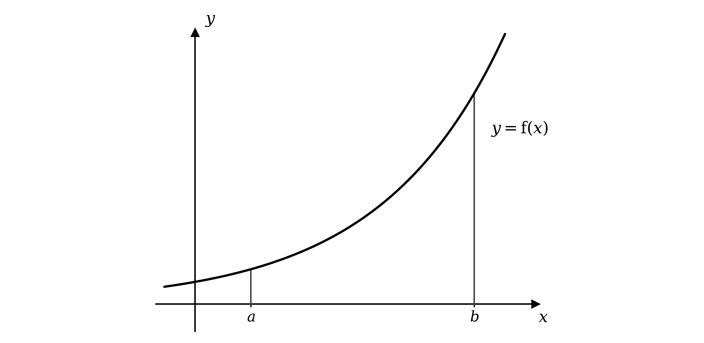

Add to the diagram to show how the student can use four trapezia to estimate the area.

### Q3 — easy — 5 marks

**Q3** [2 marks]

Complete the table of values for $y = e^{x^{2}}$ below, giving values correct to 3 significant figures.

| $x$ | 1 | 1.2 | 1.4 | 1.6 | 1.8 | 2 |
|---|---|---|---|---|---|---|
| $y$ |   | 4.22 |   | 12.9 | 25.5 |   |

**Q3** [3 marks]

Use the trapezium rule with five intervals to find an approximation to

`\int_{1}^{2} e^{x^{2}} dx`

Give your answer correct to 3 significant figures.

### Q4 — easy — 6 marks

**Q4** [6 marks]

The diagram shows part of the graph of $y = 5 - 3 e^{-x}$.

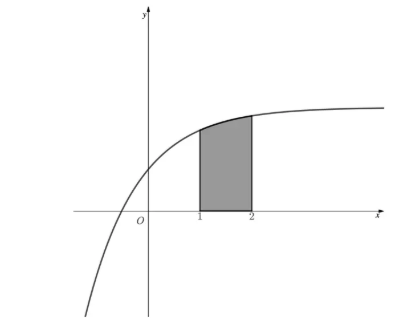

The trapezium rule is to be used to find an approximation to the shaded area, which is given by

`\int_{1}^{2} \left(5 - 3e^{-x}\right) dx`

(i) Given that four intervals are to be used, find the width, $h$, of each interval.

(ii) Complete the table of values below, giving each entry correct to 3 significant figures.

| $x$ | 1 | 1.25 | 1.5 | 1.75 | 2 |
|---|---|---|---|---|---|
| $y$ | 3.90 |   |   | 4.48 |   |

(iii) Use the trapezium rule with the values from the table to find an approximation to the shaded area, giving your answer correct to 3 significant figures.

### Q5 — easy — 8 marks

**Q5** [8 marks]

(i) Integrate

`\int \text{sin} \; (2x + 1) \, \; \text{d}x`

(ii) Use calculus to find the exact value of

`\int_{\frac{\pi}{6}}^{\frac{\pi}{4}} \text{sec}^{2} \left(2\theta - \frac{\pi}{6}\right) \text{d}\theta`

(iii) Find an expression for $y$ given that

$\frac{\text{d}y}{\text{d}x} = 4   \text{cos}  ( 5 x + 2 )$

### Q6 — easy — 8 marks

**Q6** [8 marks]

The diagram shows part of the graph of `y = \left(x - 2\right)^{\frac{2}{3}}`.

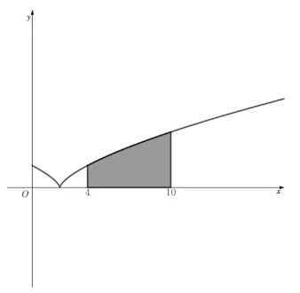

The trapezium rule is to be used to find an approximation to the shaded area, which is given by

`\int_{4}^{10} \left(x - 2\right)^{\frac{2}{3}} dx`

All of the values in the table below are to be used.

| $x$ | 4 | 5 | 6 | 7 | 8 | 9 | 10 |
|---|---|---|---|---|---|---|---|
| $y$ | 1.59 | 2.08 | 2.52 | 2.92 | 3.30 | 3.70 | 4.00 |

(i) Write down the number of ordinates that will be used, the number of intervals, and the width of each interval.

(ii) Use the trapezium rule with the values in the table to find an approximation to the shaded area, giving your answer correct to 3 significant figures.

(iii) State, with a reason, whether the answer to part (ii) is an over-estimate or an under-estimate.

### Q7 — easy — 6 marks

**Q7** [6 marks]

(i) Find the integral

`\int \frac{1}{x} \text{d}x`

(ii) Use calculus to evaluate

`\int_{0}^{1} \text{e}^{x} \text{d}x`

(iii) Find an expression for $y$ given that

`y = \int 3 \, \; \text{cos} \; \theta \, \; \text{d}\theta`

### Q8 — easy — 5 marks

**Q8** [2 marks]

Given the identity $\text{cos}  2 A \equiv 1 - 2   \text{sin}^{2} A$, show that

`\text{sin}^{2} A \equiv \frac{1}{2}\left(1 - \text{cos} \; 2A\right)`

**Q8** [3 marks]

Hence find the exact value of

`\int_{\frac{1}{2}\pi}^{\pi} \text{sin}^{2} x \, \; \text{d}x`

### Q9 — easy — 8 marks

**Q9** [8 marks]

(i) Integrate

`\int 8(2x - 1)^{3} \, \; \text{d}x`

(ii) Use calculus to find the exact value of

`\int_{0}^{\frac{\pi}{4}} \text{sin} \; 2x \, \; \text{d}x`

(iii) Find an expression for $y$ given that

$\frac{\text{d}y}{\text{d}x} = 3 \text{e}^{3x}$

### Q10 — easy — 5 marks

**Q10** [3 marks]

The diagram shows the graph of $y = 8 - \sqrt{3x^{2}+16}$.

Use the trapezium rule with four intervals to find an approximation to the shaded area. You may use the values shown on the graph.

Give your answer correct to 3 significant figures.

**Q10** [2 marks]

State whether the answer to part (a) is an under-estimate or an over-estimate, giving a reason for your answer.

### Q11 — easy — 4 marks

**Q11** [4 marks]

(i) Find an expression for $y$ given that

$\frac{\text{d}y}{\text{d}x} = 7 \text{e}^{3x-4}$

(ii) Find

`\int \frac{1}{4x + 9} \, \; \text{d}x`

### Q12 — easy — 5 marks

**Q12** [5 marks]

(i) Find

`\int \frac{1}{2 - 3x} \, \; \text{d}x`

(ii) Find an expression for $y$ given that

`y = \int \left(\frac{2}{2x + 1} - \frac{1}{3 - x}\right) \text{d}x`

giving your answer as a single logarithm.

### Q13 — hard — 6 marks

**Q13** [3 marks]

Show that

`\left(\text{cos} \left(\theta + \frac{\pi}{8}\right) + \text{sin} \left(\theta + \frac{\pi}{8}\right)\right)\left(\text{sin} \left(\theta + \frac{\pi}{8}\right) - \text{cos} \left(\theta + \frac{\pi}{8}\right)\right) \equiv -\text{cos} \left(2\theta + \frac{\pi}{4}\right)`

**Q13** [3 marks]

Hence, or otherwise, find the exact value of

`\int_{0}^{\frac{1}{8}\pi} \left(\text{sin}^{2} \left(\theta + \frac{\pi}{8}\right) - \text{cos}^{2} \left(\theta + \frac{\pi}{8}\right)\right) \text{d}\theta`

### Q14 — hard — 6 marks

**Q14** [3 marks]

Find an expression for $y$ given that

$\frac{\text{d}y}{\text{d}x} = 5   \text{cos}^{2} 4 x   \text{sin}  4 x$

**Q14** [3 marks]

Find

`\int 3x\left(5x^{2} + 4\right)^{4} \, \; \text{d}x`

### Q15 — medium — 7 marks

**Q15** [4 marks]

The diagram shows the graph of $y = 4 - 2 x^{\text{ln}x}$ for $x > 0$.

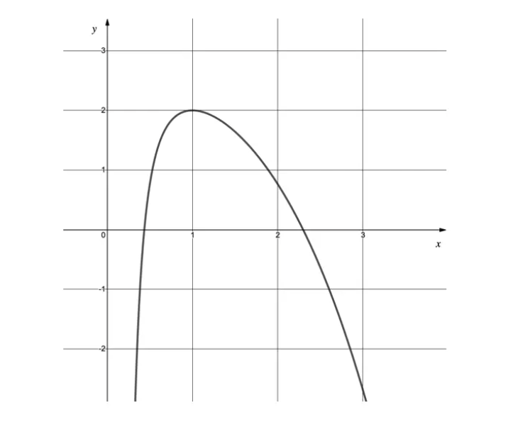

Use the trapezium rule with five intervals to find an approximation to

`\int_{1}^{2} \left(4 - 2x^{\text{ln} x}\right) dx`

Give your answer correct to 3 significant figures.

**Q15** [1 mark]

Using the integration feature on your calculator, find the value of

`\int_{1}^{2} \left(4 - 2x^{\text{ln} x}\right) dx`

Give your answer correct to 3 significant figures.

**Q15** [2 marks]

Assuming the calculator gives the exact value of the integral, find the percentage error in the approximation from part (a).

### Q16 — very_hard — 7 marks

**Q16** [7 marks]

Show that there are no positive values of $a$ and $b$ that satisfy the equation

`\int_{0}^{1} \frac{2a}{ax + b} \, \; \text{d}x = \int_{b}^{2a} \frac{1}{x} \, \; \text{d}x`

### Q17 — very_hard — 6 marks

**Q17** [4 marks]

The trapezium rule is to be used to find an approximation to

`\int_{4}^{8} \text{f}(x) \, dx`

The table below shows values of $x$ and $\text{f} ( x )$, rounded to 3 significant figures where appropriate.

| $x$ | 4 | 4.5 | 5 | 5.5 | 6 | 6.5 | 7 | 7.5 | 8 |
|---|---|---|---|---|---|---|---|---|---|
| $\text{f} ( x )$ | 3.16 | 3.39 | 3.61 | 3.81 | 4 | 4.18 | 4.36 | 4.53 | 4.69 |

Using values from the table, find an approximation to the integral using

(i) two intervals,

(ii) four intervals,

(iii) eight intervals.

**Q17** [2 marks]

Justify which of the approximations in part (a) is the most accurate.

### Q18 — hard — 5 marks

**Q18** [5 marks]

Find

`\int \left(2 \, \; \text{tan} \; x + 3 \, \; \text{sec} \; x\right)^{2} \text{d}x`

### Q19 — hard — 5 marks

**Q19** [5 marks]

Find the value of

`\int_{2}^{6} \left(\frac{1}{x} + \frac{4}{2x} + \frac{3}{3x - 2}\right) \text{d}x`

giving your answer in the form $p   \text{ln}  p + q   \text{ln}  q$, where $p$ and $q$ are prime numbers to be found.

### Q20 — medium — 3 marks

**Q20** [3 marks]

The diagram shows a sketch of the graph of `y = x\left(x - 6\right)^{2}` for $x \geq 0$.

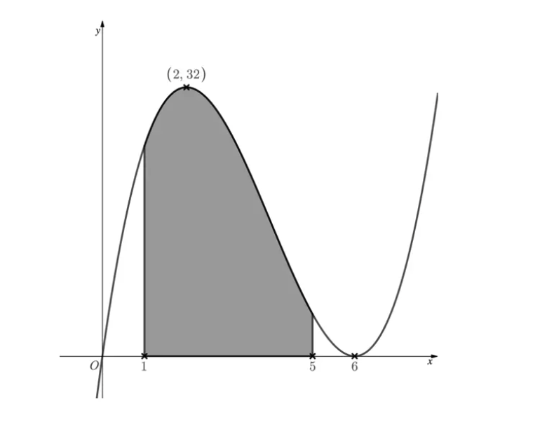

The graph has a local maximum point at `\left(2, 32\right)`, as indicated on the diagram.

Use the trapezium rule with 5 ordinates to find an approximation to the shaded area.

### Q21 — hard — 6 marks

**Q21** [3 marks]

Show that

`\left(1 + \text{cot} \left(2\theta + \frac{\pi}{4}\right)\right)\left(1 - \text{cot} \left(2\theta + \frac{\pi}{4}\right)\right) \equiv 2 - \text{cosec}^{2} \left(2\theta + \frac{\pi}{4}\right)`

**Q21** [3 marks]

Hence, or otherwise, find an expression for $\text{f} ( θ )$ given that

`\text{f}'(\theta) = \left(2 + 2 \, \; \text{cot} \left(2\theta + \frac{\pi}{4}\right)\right)\left(2 - 2 \, \; \text{cot} \left(2\theta + \frac{\pi}{4}\right)\right)`

### Q22 — medium — 5 marks

**Q22** [3 marks]

Show that

`\int_{0}^{1} \text{e}^{ax + b} \, \; \text{d}x = \text{e}^{b}\left(\frac{\text{e}^{a} - 1}{a}\right)`

where $a$ and $b$ are constants, and $a \neq 0$.

**Q22** [2 marks]

Using your working from part (a), or otherwise, evaluate

`\int_{0}^{c} \text{e}^{ax + b} \, \; \text{d}x`

giving your answer in terms of $a$, $b$ and $c$, where $a$, $b$ and $c$ are constants, and $a \neq 0$.

### Q23 — hard — 7 marks

**Q23** [2 marks]

A stretch of road along Baker Street has a speed limit of 60 mph, and traffic along it is monitored by eight average speed cameras.

Sherlock is driving along Baker Street and passes the first camera at time zero. Sherlock's speed, measured in miles per hour, and the time at which he passes each camera, are recorded in the table below.

| Camera | 1 | 2 | 3 | 4 | 5 | 6 | 7 | 8 |
|---|---|---|---|---|---|---|---|---|
| Time (minutes) | 0 | 4 | 8 | 12 | 16 | 20 | 54 | n/a |
| Speed (mph) | 64 | 59 | 61 | 62 | 57 | 58 | 60 | n/a |

(i) Suggest a reason why the last camera did not record any data for Sherlock's journey.

(ii) Suggest a reason why there was a longer time gap between the sixth and seventh cameras.

**Q23** [3 marks]

Use the results in the table to find an approximation to the distance between the first and sixth cameras, giving your answer correct to 3 significant figures.

**Q23** [2 marks]

Briefly explain why it would not be suitable to use the trapezium rule to approximate the distance between the first and seventh cameras.

### Q24 — hard — 6 marks

**Q24** [4 marks]

The energy company PowerSquared owns and maintains a wind farm.

Engineers model the power output, $P$ kW, of a single turbine by

$P ( t ) = 60 + 5 e^{0.7\sqrt{t}}  \text{sin}  t , 0 \leq t \leq 12$

where $t$ is the number of hours after 6pm. The graph of $P$ against $t$ is shown below.

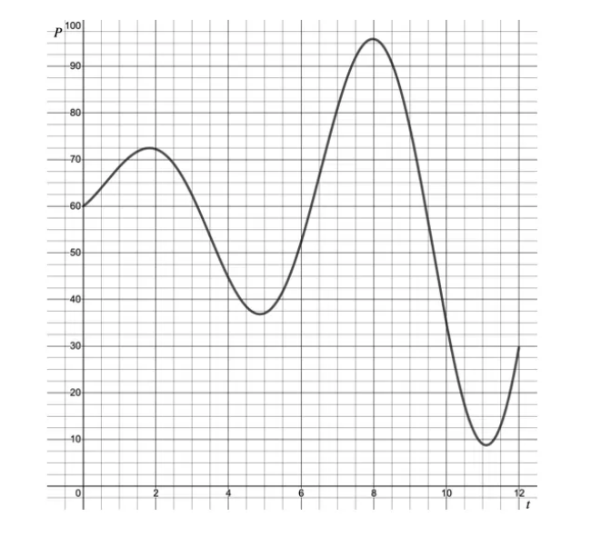

Use the trapezium rule with four intervals to find an approximation to the total energy generated by this turbine between midnight and 4am.

Give your answer correct to 3 significant figures.

**Q24** [2 marks]

Once every twelve hours, each turbine is switched off for half an hour for maintenance and safety checks.

Suggest, with a reason, at what time between 6pm and 6am these checks should be carried out on the turbine modelled above.

### Q25 — very_hard — 6 marks

**Q25** [6 marks]

Given that

`\text{f}'(\theta) = \frac{9}{3 - 3 \, \; \text{sin}^{2} \left(3\theta - \frac{\pi}{6}\right)}`

and also that

`\left[\text{f}\left(\frac{\pi}{6}\right)\right]^{2} - \left[\text{f}\left(\frac{\pi}{9}\right)\right]^{2} = \frac{8}{3}\left(1 - \sqrt{3}\right)`

find $\text{f} ( θ )$.

### Q26 — medium — 4 marks

**Q26** [4 marks]

The XnValdez container ship was carrying 4000 tonnes of crude oil when it ran aground and oil began leaking from its hull into the ocean. It took 36 days for experts to stop the leak.

During that time the rate at which oil leaked, measured in tonnes per day, was recorded every 4 days. The results are shown below.

| Time (days) | 0 | 4 | 8 | 12 | 16 | 20 | 24 | 28 | 32 | 36 |
|---|---|---|---|---|---|---|---|---|---|---|
| Rate of leak (tonnes per day) | 0 | 10 | 20 | 40 | 70 | 110 | 160 | 230 | 150 | 0 |

An environmental disaster is declared if the total amount of crude oil leaking into the ocean exceeds 2500 tonnes.

Use all the data in the table to determine whether environmentalists were right to declare the XnValdez incident an environmental disaster.

### Q27 — medium — 6 marks

**Q27** [2 marks]

Write `\text{e}^{2x}\left(1 + \text{e}^{2x} + \text{e}^{2}\right)` in the form $\text{e}^{\text{f}(x)} + \text{e}^{\text{g}(x)} + \text{e}^{\text{h}(x)}$, where $\text{f} ( x )$, $\text{g} ( x )$ and $\text{h} ( x )$ are all linear functions of $x$.

**Q27** [4 marks]

Hence show that

`\int_{0}^{1} \text{e}^{2x}\left(1 + \text{e}^{2x} + \text{e}^{2}\right) \text{d}x = \frac{3}{4}\left(\text{e}^{4} - 1\right)`

### Q28 — easy — 5 marks

**Q28** [2 marks]

Find an expression for $\text{f} ( x )$ given that

`\text{f}(x) = \int \frac{5}{2x + 3} \, \; \text{d}x`

**Q28** [3 marks]

Find an expression for $y$ given that

$\frac{\text{d}y}{\text{d}x} = 2 \text{e}^{3x-5} - 5 \text{e}^{5x}$

### Q29 — hard — 6 marks

**Q29** [6 marks]

Find the exact value of

`\int_{\frac{1}{2}\pi}^{\frac{5}{6}\pi} \frac{2 \, \; \text{cos} \; x}{1 - \text{cos} \; 2x} \, \; \text{d}x`

### Q30 — medium — 7 marks

**Q30** [2 marks]

Find

`\int 5\left(\text{e}^{5x} - \text{e}^{-5x}\right) \text{d}x`

**Q30** [2 marks]

Find an expression for $y$ given that

`y = \int \left(\text{sin} \; x + \text{cos} \; x\right) \text{d}x`

**Q30** [3 marks]

Evaluate

`\int_{-8}^{-2} \frac{1}{x} \, \; \text{d}x`

giving your answer as a single logarithm.

### Q31 — easy — 5 marks

**Q31** [3 marks]

Find

`\int \left(x^{2} + 5 - \frac{3}{x^{2}}\right) \text{d}x`

**Q31** [2 marks]

Write down

`\int 3\text{e}^{3x} \, \; \text{d}x`

### Q32 — hard — 7 marks

**Q32** [2 marks]

Use two separate diagrams to show how the trapezium rule can give an under-estimate or an over-estimate of the area under a curve.

**Q32** [4 marks]

Use the trapezium rule with four intervals to find an approximation to the area bounded by the curve $y = 1 + 0 . 3 x^{2}  \text{sin}  x$, the lines $x = 1$ and $x = 2$, and the $x$-axis.

Give your answer correct to 3 significant figures.

**Q32** [1 mark]

Finding the exact value of the integral

`\int_{1}^{2} \left(1 + 0.3 x^{2}\,\text{sin}\,x\right) dx`

requires a method of integration beyond this syllabus.

Suggest a reason why it may be preferable to use a numerical method, such as the trapezium rule, to approximate the value of the integral.

### Q33 — medium — 5 marks

**Q33** [2 marks]

Show that

`\text{sin}^{2} (3x + 2) \equiv \frac{1}{2}\left(1 - \text{cos} \; (6x + 4)\right)`

**Q33** [3 marks]

Hence, or otherwise, find an expression for

`\int \text{sin}^{2} (3x + 2) \, \; \text{d}x`

### Q34 — medium — 6 marks

**Q34** [2 marks]

Find

`\int 2 \, \; \text{sin} \; x \, \; \text{cos} \; x \, \; \text{d}x`

**Q34** [4 marks]

Find the value of

`\int_{1}^{3} (4x + 1)^{5} \, \; \text{d}x`

### Q35 — hard — 5 marks

**Q35** [3 marks]

A stretch of road along Equality Street has a speed limit of 70 mph, and traffic along it is monitored by six average speed cameras.

Ricky is driving his car along Equality Street and passes the first camera at time zero. Ricky's speed, measured in miles per hour, and the time at which he passes each camera, are recorded in the table below.

| Camera | 1 | 2 | 3 | 4 | 5 | 6 |
|---|---|---|---|---|---|---|
| Time (hours) | 0 | 0.05 | 0.1 | 0.15 | 0.2 | 0.25 |
| Speed (mph) | 68 | 72 | 69 | 71 | 70 | 70 |

Use all the data in the table to find an approximation to the distance between the first and last camera, giving your answer correct to 3 significant figures.

**Q35** [2 marks]

A driver receives a speeding ticket if their average speed between the first and last camera exceeds the speed limit.

Determine whether Ricky should receive a speeding ticket, justifying your answer.

### Q36 — hard — 6 marks

**Q36** [4 marks]

The energy company PowerY owns and maintains a wind farm.

Engineers model the power output, $P$ kW, of a single turbine over a twelve-hour period by

$P ( t ) = 50 + 30 e^{-0.1t}  \text{sin}  t , 0 \leq t \leq 12$

where $t$ is the time in hours. The graph of $P$ against $t$ is shown below.

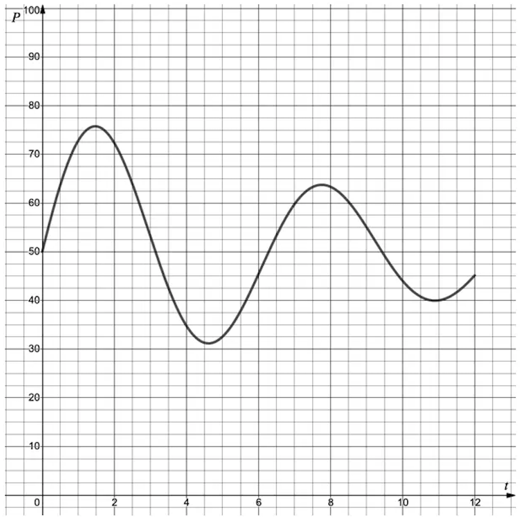

Use the trapezium rule with 5 ordinates to find an approximation to the total energy generated by the turbine in the last four hours of the twelve-hour period.

Give your answer correct to 3 significant figures.

**Q36** [2 marks]

Find an approximation to the average amount of energy generated per minute by the turbine during these last four hours, giving your answer correct to 3 significant figures.

### Q37 — hard — 4 marks

**Q37** [3 marks]

The drilling rig AlphaBeta began leaking oil into the North Sea following a technical fault. It took 14 hours for engineers to trace and repair the fault.

During that time the rate at which oil leaked, measured in tonnes per hour, was recorded every 2 hours. The results are shown below.

| Time (hours) | 0 | 2 | 4 | 6 | 8 | 10 | 12 | 14 |
|---|---|---|---|---|---|---|---|---|
| Rate of leak (tonnes per hour) | 0 | 8 | 12 | 18 | 26 | 38 | 18 | 0 |

For safety reasons, a rig must shut down and stop all operations until an inspection is carried out if the total amount of oil leaked during an incident exceeds 250 tonnes.

Use all the data in the table to determine whether the AlphaBeta rig should be shut down.

**Q37** [1 mark]

Explain why using the trapezium rule to approximate the total amount of oil leaked in the first 10 hours would give an over-estimate.

### Q38 — hard — 7 marks

**Q38** [3 marks]

Show that, for $θ \neq k π$ (where $k$ is an integer),

$\frac{2-2\text{cos}^{2}θ}{\text{sin}2θ} = \text{tan}  θ$

**Q38** [4 marks]

Hence show that

`\int_{\frac{1}{6}\pi}^{\frac{1}{3}\pi} \frac{2 - 2 \, \; \text{cos}^{2} \theta}{\text{sin} \; 2\theta} \, \; \text{d}\theta = \frac{1}{2} \, \; \text{ln} \; 3`

### Q39 — medium — 5 marks

**Q39** [5 marks]

The diagram shows part of the graph of $y = 3 x - e^{x^{2}}$.

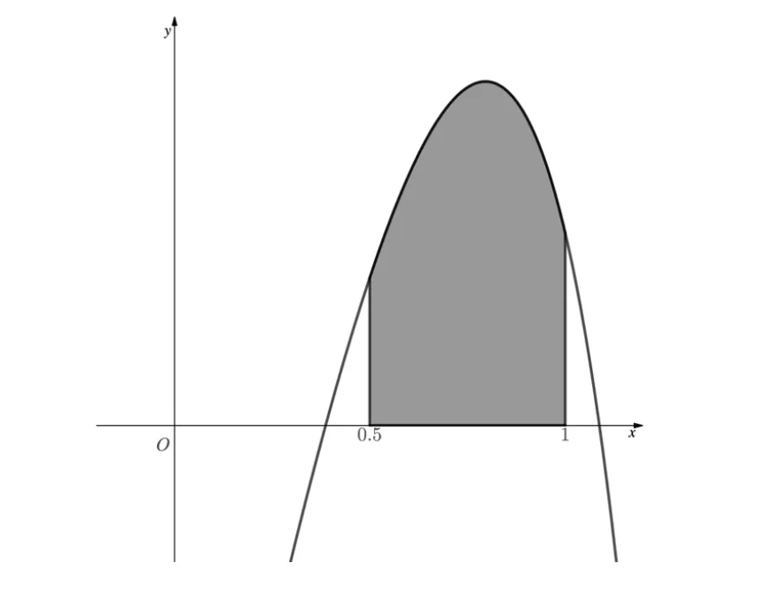

Use the trapezium rule with five intervals to find an approximation to the shaded area, giving your answer correct to 3 significant figures.

### Q40 — easy — 6 marks

**Q40** [1 mark]

Find

`\int \text{sin} \; x \, \; \text{d}x`

**Q40** [3 marks]

Find the exact value of

`\int_{1}^{4} \frac{1}{x} \, \; \text{d}x`

**Q40** [2 marks]

Find an expression for $y$ given that

`y = \int 7\text{e}^{7x} \, \; \text{d}x`

### Q41 — medium — 5 marks

**Q41** [4 marks]

The energy company PowerX operates a wind turbine.

Engineers model the power output, $P$ kW, of the turbine over a twelve-hour period by

`P(t) = 50 + 10\,\text{sin}\left(\sqrt{10t}\right), 0 \leq t \leq 12`

where $t$ is the time in hours. The graph of $P$ against $t$ is shown below.

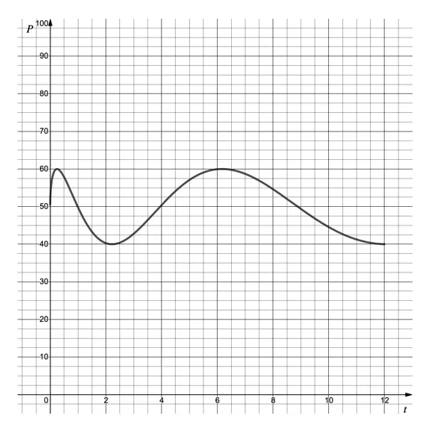

Use the trapezium rule with six intervals of width 1 to find an approximation to the total energy generated by the turbine in the first six hours. Give your answer correct to 3 significant figures.

You may use the table below to help.

| Time $t$ | 0 | 1 | 2 | 3 | 4 | 5 | 6 |
|---|---|---|---|---|---|---|---|
| Power $P$ |   |   |   |   |   |   |   |

**Q41** [1 mark]

Briefly explain why it is difficult for the engineers to determine whether the answer to part (a) is an over-estimate or an under-estimate.

### Q42 — easy — 8 marks

**Q42** [2 marks]

Find

`\int \text{cos} \; 2x \, \; \text{d}x`

**Q42** [4 marks]

Find the value of

`\int_{0}^{2} (3x - 1)^{3} \, \; \text{d}x`

**Q42** [2 marks]

Find an expression for $y$ given that

$\frac{\text{d}y}{\text{d}x} = \text{e}^{5x}$

### Q43 — medium — 5 marks

**Q43** [2 marks]

Use the identity

$\text{sin}  2 A \equiv 2   \text{sin}  A   \text{cos}  A$

to show that

$4   \text{sin}  \frac{θ}{2}   \text{cos}  \frac{θ}{2} \equiv 2   \text{sin}  θ$

**Q43** [3 marks]

Hence, or otherwise, find the integral

`\int 4 \, \; \text{sin} \; \frac{\theta}{2} \, \; \text{cos} \; \frac{\theta}{2} \, \; \text{d}\theta`

### Q44 — easy — 4 marks

**Q44** [2 marks]

Find

`\int \frac{1}{2x + 3} \, \; \text{d}x`

**Q44** [2 marks]

Find an expression for $y$ given that

$\frac{\text{d}y}{\text{d}x} = 3 \text{e}^{3x+1}$

### Q45 — medium — 5 marks

**Q45** [3 marks]

Coronation Street has a speed limit of 40 mph, and traffic is monitored along one stretch of the road by four average speed cameras.

Vera is driving her car along Coronation Street and passes the first camera at time zero. Vera's speed, measured in miles per hour, and the time at which she passes each camera, are recorded in the table below.

| Camera | 1 | 2 | 3 | 4 |
|---|---|---|---|---|
| Time (hours) | 0 | 0.1 | 0.2 | 0.3 |
| Speed (mph) | 36 | 40 | 38 | 35 |

Use the trapezium rule with all the data in the table to find an approximation to the distance between the first and last camera.

Give your answer correct to 3 significant figures.

**Q45** [2 marks]

Vera's car uses fuel at a rate of 52.6 miles per gallon.

Find an approximation to the amount of fuel, in gallons, that the car uses between the first and last camera, giving your answer correct to 3 significant figures.

### Q46 — easy — 7 marks

**Q46** [2 marks]

Find an expression for $\text{f} ( x )$ given that

`\text{f}(x) = \int \text{sin} \; (2x + 1) \, \; \text{d}x`

**Q46** [2 marks]

Find an expression for $y$ given that

$\frac{\text{d}y}{\text{d}x} = 3   \text{cos}  ( 3 x + 5 )$

**Q46** [3 marks]

Find the exact value of

`\int_{\frac{7\pi}{6}}^{\frac{4\pi}{3}} \text{sec}^{2} \; (x - \pi) \, \; \text{d}x`

### Q47 — easy — 3 marks

**Q47** [3 marks]

Show that

`\int_{2}^{5} 4\text{e}^{2x - 4} \, \; \text{d}x = 2\left(\text{e}^{6} - 1\right)`

### Q48 — medium — 6 marks

**Q48** [6 marks]

Given that

$\text{cos}2θ\equiv2\text{cos}^{2}θ-1$

find the exact value of

`\int_{\frac{1}{4}\pi}^{\frac{1}{2}\pi} \text{cos}^{2} \theta \, \; \text{d}\theta`

### Q49 — easy — 6 marks

**Q49** [2 marks]

Following an explosion on the Longwater drilling rig, oil began to leak into the ocean from a damaged underwater pipe. It took several months for experts to seal the pipe.

For the first fifteen weeks, the rate at which oil leaked from the pipe, measured in barrels per week, was recorded every three weeks. The results are shown below.

| Time (weeks) | 0 | 3 | 6 | 9 | 12 | 15 |
|---|---|---|---|---|---|---|
| Rate of leak (barrels per week) | 0 | 2500 | 8000 | 15000 | 25000 | 37500 |

The trapezium rule is to be used to find an approximation to the total amount of oil that leaked during the first fifteen weeks, using all the data in the table.

(i) Write down the number of intervals, $n$, that will be used.

(ii) Write down the width of each interval, $h$.

**Q49** [3 marks]

Show that the trapezium rule gives an approximation of 208000 barrels, correct to 3 significant figures.

**Q49** [1 mark]

The rate at which oil leaked rose steadily throughout the first fifteen weeks.

State whether the approximation in part (b) is an under-estimate or an over-estimate.

### Q50 — medium — 7 marks

**Q50** [2 marks]

The diagram shows the graph of $y = \sqrt{e^{-x}+2x}$.

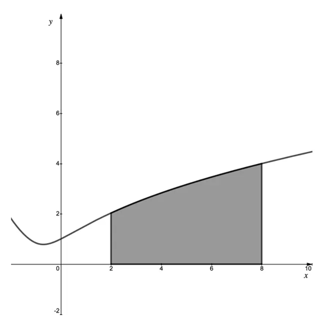

The shaded area is to be approximated using the trapezium rule with $h = 1$.

(i) Write down the number of intervals to be used.

(ii) Write down the number of ordinates to be used.

**Q50** [4 marks]

Use the trapezium rule as described above to find an approximation to the shaded area, giving your answer correct to 3 significant figures.

**Q50** [1 mark]

Describe one way in which the approximation found in part (b) could be improved.

### Q51 — easy — 7 marks

**Q51** [1 mark]

The diagram shows part of the graph of $y = 2^{\text{ln}x}$.

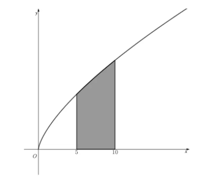

The trapezium rule is to be used to find an approximation to the shaded area, which is given by

`\int_{5}^{10} 2^{\text{ln} x} dx`

Given that four intervals are to be used, find $h$, the width of each interval.

**Q51** [2 marks]

Complete the table of values below, giving each entry correct to 3 significant figures.

| $x$ | 5 | 6.25 | 7.5 | 8.75 | 10 |
|---|---|---|---|---|---|
| $y$ | 3.05 |   | 4.04 |   |   |

**Q51** [3 marks]

Use the values from the table in part (b) to find an approximation to the shaded area, giving your answer correct to 3 significant figures.

**Q51** [1 mark]

State whether the answer to part (c) is an over-estimate or an under-estimate.
