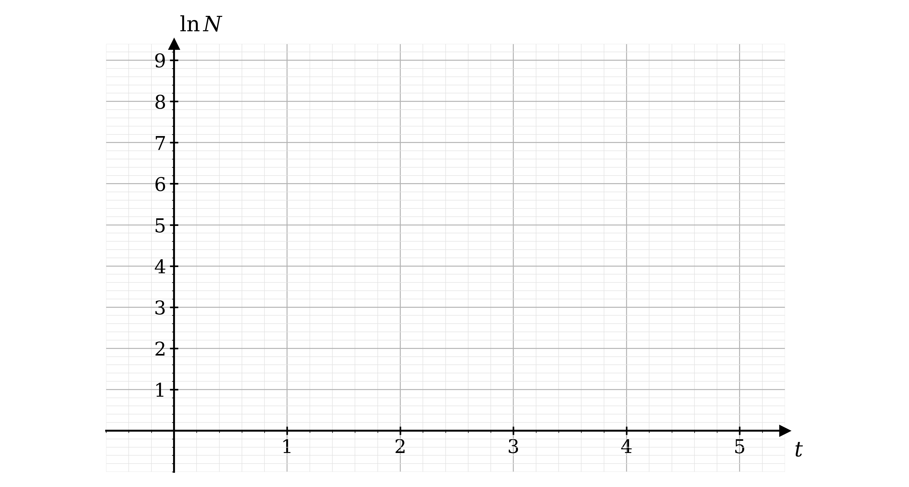
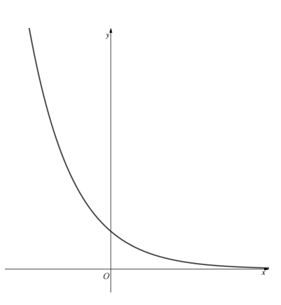
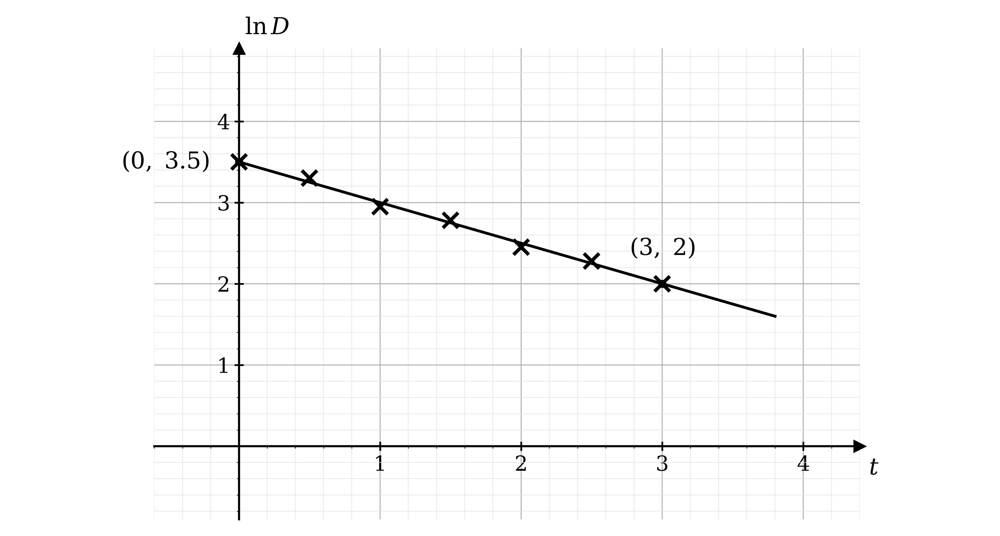
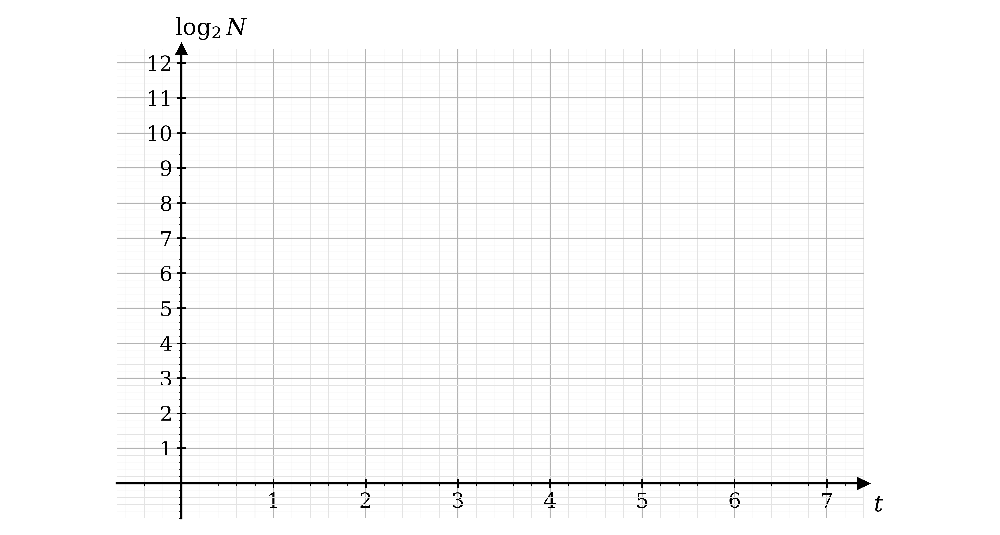
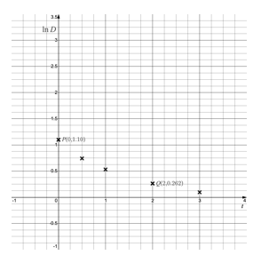
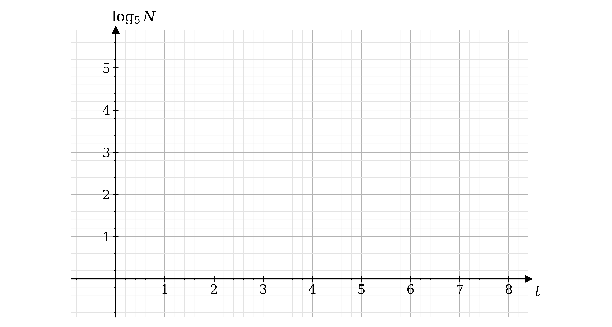
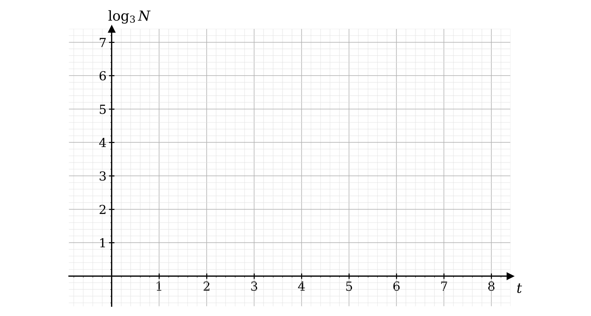
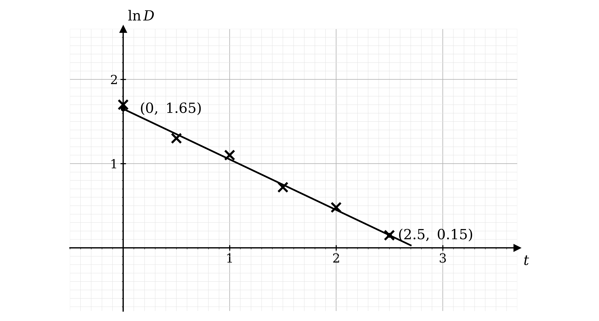

# Exam Questions — Modelling with Logarithms & Exponentials
**Logarithms & Exponentials** · Cambridge (CIE) AS maths (9709)
> Source: [https://www.savemyexams.com/as/maths/cie/20/pure-2/topic-questions/](https://www.savemyexams.com/as/maths/cie/20/pure-2/topic-questions/) · 42 questions across 1 sets

## Exam Questions (42 questions)

### Q1 — easy — 5 marks

**Q1** [1 mark]

An exponential growth model for the number of bacteria in an experiment is of the form $N = A e^{kt}$

$N$ is the number of bacteria and $t$ is the time in hours since the experiment began.

$A$ and $k$ are constants.

A scientist records the number of bacteria at hourly intervals over a four-hour period.

The results are shown in the table below.

| $t$, hours | 0 | 1 | 2 | 3 | 4 |
|---|---|---|---|---|---|
| $N$, no. of bacteria | 100 | 210 | 320 | 730 | 1580 |
| $\text{ln}  N$ (3 s.f.) | 4.61 | 5.35 | 5.77 | 6.59 | 7.37 |

Plot the observations on the graph below, plotting $\text{ln}  N$ against $t$.

**Q1** [2 marks]

Using the points $( 0 ,  4 . 61 )$ and $( 4 ,  7 . 37 )$, find an equation for a line of best fit in the form $\text{ln}  N = m t + \text{ln}  c$, where $m$ and $c$ are constants to be found.

**Q1** [2 marks]

Hence estimate the values of $A$ and $k$.

### Q2 — easy — 3 marks

**Q2** [3 marks]

Write the following in the form $e^{-kx}$, where $k$ is a constant and $k > 0$.

(i) $\frac{e^{-2x}}{e^{4x}}$

(ii) `\left(\dfrac{1}{5}\right)^{x}`

(iii) `\left(\dfrac{1}{2}\right)^{x}`

### Q3 — easy — 6 marks

**Q3** [1 mark]

The acceleration, $a  \text{m s}^{-2}$, of a rocket $t$ seconds after lift-off is modelled by the equation

$a = 10 e^{0.1t}$

where `t \geqslant 0`.

State the initial acceleration of the rocket.

**Q3** [2 marks]

Find the acceleration of the rocket when $t = 15$.

**Q3** [3 marks]

Find the time taken for the acceleration to reach $100  \text{m s}^{-2}$.

### Q4 — easy — 3 marks

**Q4** [3 marks]

Write the following in the form $e^{kx}$, where $k$ is a constant and $k > 0$.

(i) $e^{3x} \times e^{2x}$

(ii) $5^{x}$

(iii) $2^{x}$

### Q5 — easy — 4 marks

**Q5** [4 marks]

State whether the following functions could represent exponential growth or exponential decay.

(i) $\text{f} ( x ) = 5 e^{2x}$

(ii) $\text{f} ( t ) = 100 e^{-t}$

(iii) $\text{f} ( a ) = 20 e^{-ka} ,  k > 0$

(iv) $\text{f} ( t ) = A e^{kt} ,  A ,  k > 0$

### Q6 — easy — 3 marks

**Q6** [3 marks]

The diagram below shows a sketch of the graph of $y = e^{-x}$.

On the diagram, add the graph of $y = e^{-2x}$, labelling the point at which the graph intersects the $y$-axis.

Write down the equation of any asymptotes on the graph.

### Q7 — easy — 7 marks

**Q7** [3 marks]

By taking logarithms (base $e$) of both sides show that the equation

$y = A e^{kx}$

can be written in the form $\text{ln}  y = k x + \text{ln}  A$

**Q7** [4 marks]

Hence

(i) write the equation $y = 2 e^{0.01x}$ in the form $\text{ln}  y = k x + \text{ln}  A$

(ii) write the equation $\text{ln}  y = 0 . 3 x + \text{ln}  5$ in the form $y = A e^{kx}$

### Q8 — easy — 5 marks

**Q8** [1 mark]

The number of rare birds, $B$, in a newly constructed nature reserve at time $t$ years after their release is modelled by the equation

$B = A e^{0.4t}$

where $A$ is a constant. Initially, 24 birds are released into the reserve.

State the value of $A$.

**Q8** [2 marks]

Find the number of birds in the reserve when $t = 2$.

**Q8** [2 marks]

Find the time taken for the number of birds in the reserve to double.

### Q9 — very_hard — 5 marks

**Q9** [3 marks]

An exponential model of the form

$D = A e^{-kt}$

is used to model the concentration of a pain-relieving drug, $D$ mg/ml, in a patient's bloodstream $t$ hours after the drug was administered by injection. $A$ and $k$ are constants.

The graph below shows values of $\text{ln}  D$ plotted against $t$, with a line of best fit drawn passing through the points $( 0 ,  3 . 5 )$ and $( 3 ,  2 )$.

Find estimates for the constants $A$ and $k$.

**Q9** [2 marks]

Find the time, correct to the nearest minute, at which the rate of decrease of the concentration of the drug in the patient's bloodstream is 12 mg/ml per hour.

### Q10 — hard — 4 marks

**Q10** [2 marks]

Rewrite the equation $y = 3 . 6 x^{-0.4}$ in the form $\text{log}  y = \text{log}  A - b  \text{log}  x$.

**Q10** [2 marks]

Sketch the graph of $\text{log}  y$ against $\text{log}  x$.

### Q11 — hard — 6 marks

**Q11** [2 marks]

Scientists introduced a small number of apes into a previously unpopulated forest.

The population of apes in the forest is modelled by

$A = 16 e^{km}$

where $A$ is the number of apes $m$ months after first being introduced to the forest.

State, with a reason, whether you would expect the value of $k$ to be positive or negative.

**Q11** [2 marks]

After 8 months, the number of apes in the forest has increased by 50%. Find the value of $k$.

**Q11** [2 marks]

Scientists believe the forest cannot sustain a population of apes greater than 3000. Find the length of time for which the model for the population of the apes is reliable.

### Q12 — very_hard — 5 marks

**Q12** [3 marks]

Rewrite the equation $y = \frac{2}{3} \times 5^{-0.2x}$ in the form $\text{log}_{b}  y = \text{log}_{b}  p - q x$, where $b$ is an integer and $p$ and $q$ are rational numbers.

**Q12** [2 marks]

Sketch the graph of $\text{log}_{b}  y$ against $x$.

### Q13 — very_hard — 3 marks

**Q13** [3 marks]

The annual profits, in dollars, of a small company in the first 4 years of business are given in the table below.

| $a$, years in business | 1 | 2 | 3 | 4 |
|---|---|---|---|---|
| $\text{log}  P$, where $P$ is the annual profit | 3.74 | 3.86 | 3.94 | 4.01 |

Using this data the company uses the model

$P = P_{1} a^{k}$

to predict future years' profits, where $P_{1}$ and $k$ are constants.

Use the results in the table to estimate the values of $P_{1}$ and $k$.

### Q14 — very_hard — 6 marks

**Q14** [2 marks]

A simple model for the acceleration of a rocket, $A  \text{m s}^{-2}$, is given as

$A = R e^{kt}$

where $t$ is the time in seconds after lift-off, and $R$ and $k$ are constants.

Negative time is often used in rocket launches as a way of counting down until lift-off. Despite this, the model above is still not suitable for use with negative values of $t$. Explain briefly why.

**Q14** [3 marks]

After 5 seconds the acceleration of the rocket is $12  \text{m s}^{-2}$ and after 20 seconds its acceleration is $50  \text{m s}^{-2}$. Find the values of $R$ and $k$.

**Q14** [1 mark]

A space enthusiast suggests that a linear model, of the form $A = R + c t$, would be more suitable. Using the figures in part (b), explain why the enthusiast's model is unrealistic.

### Q15 — very_hard — 7 marks

**Q15** [4 marks]

A manufacturer claims their flask will keep a hot drink warm for up to 7 hours. In this sense, warm is considered to be $50 ^{\circ} \text{C}$ or higher.

Assuming a hot drink is made at $85 ^{\circ} \text{C}$ and its temperature inside the flask is $50 ^{\circ} \text{C}$ after exactly 7 hours, find

(i) a linear model for the temperature of the drink inside the flask of the form $T = a + b t$, and

(ii) an exponential model for the temperature of the drink inside the flask of the form $T = A e^{-kt}$

where $T ^{\circ} \text{C}$ is the temperature of the drink in the flask after $t$ hours and $a$, $b$, $A$ and $k$ are constants.

**Q15** [2 marks]

Compare the rate of change of the temperature of the drink inside the flask for both models after 3 hours.

**Q15** [1 mark]

A user of the flask suggests that hot drinks are only kept warm for 5 hours. Suggest a reason why the user's experience may not match the claims of the manufacturer.

### Q16 — very_hard — 4 marks

**Q16** [4 marks]

Sketch the graph of `y = \left(\dfrac{3}{5}\right)^{2x + 1} - 4`.

State the coordinates of any points where the graph intercepts the coordinate axes.

Write down the equations of any asymptotes.

### Q17 — hard — 5 marks

**Q17** [3 marks]

An exponential growth model for the number of bacteria in an experiment is of the form

$N = N_{0} a^{kt}$

$N$ is the number of bacteria and $t$ is the time in hours since the experiment began. $N_{0}$, $a$ and $k$ are constants.

A scientist records the number of bacteria at various points over a six-hour period. The results are in the table below.

| $t$, hours | 0 | 1.5 | 3 | 4.5 | 6 |
|---|---|---|---|---|---|
| $N$, no. of bacteria | 120 | 190 | 360 | 680 | 1230 |

Use your calculator to evaluate $\text{log}_{2}  N$ for each value of $N$ in the table, giving your values correct to three significant figures.

By plotting $\text{log}_{2}  N$ against $t$, drawing a line of best fit and finding its equation, estimate the values of $N_{0}$, $a$ and $k$.

**Q17** [2 marks]

Find what the model predicts for the value of $N$ after twelve hours, and comment on the reliability of this prediction.

### Q18 — very_hard — 9 marks

**Q18** [1 mark]

Carbon-14 is a radioactive isotope of the element carbon. Carbon-14 decays exponentially, losing mass as it decays, and is used in carbon dating to estimate the age of objects.

The time it takes carbon-14 to halve, called its half-life, is approximately 5700 years.

A model for the mass of carbon-14, $m$ g, in an object at time $t$ years is

$m = M_{0} e^{-kt}$

where $M_{0}$ and $k$ are constants.

Explain briefly the meaning of the constant $M_{0}$.

**Q18** [3 marks]

Find the value of $k$, giving your answer in the form $\frac{\text{ln}a}{b}$, where $a$ and $b$ are integers to be found.

**Q18** [2 marks]

An object currently contains 200 g of carbon-14. Find the mass of carbon-14, correct to the nearest gram, that remains in the object in 20 000 years' time.

**Q18** [3 marks]

The half-life of carbon-14 is believed to be accurate only to $\pm 40$ years.

A fossilised bone currently contains $3 \times 10^{-6}$ g of carbon-14. It is estimated the bone would have originally contained $1 \times 10^{-2}$ g of carbon-14.

Find upper and lower estimates for the age of the bone, giving your answers correct to two significant figures.

### Q19 — hard — 5 marks

**Q19** [1 mark]

Write `\left(0.8\right)^{x}` in the form $e^{kx}$, giving the value of $k$ correct to three significant figures.

**Q19** [4 marks]

(i) Write `\left(\dfrac{2}{3}\right)^{4t + 1}` in the form $A e^{kt}$, giving the values of $A$ and $k$ correct to three significant figures where necessary.

(ii) State, and justify, whether this would represent exponential growth or decay.

(iii) Write down the initial value of $A e^{kt}$.

### Q20 — hard — 4 marks

**Q20** [2 marks]

Rewrite the equation $\text{ln}  x = 2 t + \text{ln}  6$ in the form $x = A e^{kt}$.

**Q20** [2 marks]

Sketch the graph of $\text{ln}  x = 2 t + \text{ln}  6$ by plotting $\text{ln}  x$ against $t$.

### Q21 — hard — 6 marks

**Q21** [2 marks]

A simple model for the acceleration of a rocket, $A  \text{m s}^{-2}$, is given as

$A = 5 e^{kt}$

where $t$ is the time in seconds after lift-off and $k$ is a constant.

After 4 seconds the acceleration of the rocket is $10  \text{m s}^{-2}$. Find the value of $k$.

**Q21** [2 marks]

Find the time at which the acceleration of the rocket has increased by 200% of its initial value.

**Q21** [2 marks]

Sketch the graph of the acceleration of the rocket against time, stating the coordinates of the point that shows the initial acceleration of the rocket.

### Q22 — medium — 4 marks

**Q22** [2 marks]

Show that the equation

$x = 7 e^{-0.2t}$

can be written as

$\text{ln}  x = \text{ln}  7 - 0 . 2 t$

**Q22** [2 marks]

Rewrite the equation $\text{ln}  y = 4 . 1 x + \text{ln}  8$ in the form $y = A e^{kx}$.

### Q23 — medium — 5 marks

**Q23** [2 marks]

The annual profits, in dollars, of a small company in the first 4 years of business are given in the table below.

| $a$, years in business | 1 | 2 | 3 | 4 |
|---|---|---|---|---|
| $P$, annual profit | 3100 | 4384 | 5369 | 6200 |

Using this data the company uses the model

$P = P_{1} a^{k}$

to predict future years' profits, where $P_{1}$ and $k$ are constants.

Use data from the table to find the values of $P_{1}$ and $k$.

**Q23** [2 marks]

Show that $\text{log}  P = k  \text{log}  a + \text{log}  P_{1}$, where $P_{1}$ and $k$ take the values found in part (a).

**Q23** [1 mark]

State a potential problem with using the model to predict the profit in the company's 12th year of business.

### Q24 — hard — 4 marks

**Q24** [2 marks]

Write `\left(0.7\right)^{x + 1}` in the form $A e^{-kx}$.

**Q24** [2 marks]

Sketch the graph of `y = \left(0.7\right)^{x + 1} - 3`.

State the coordinates of the $y$-axis intercept.

Write down the equation of the asymptote.

### Q25 — hard — 6 marks

**Q25** [2 marks]

An exponential model of the form

$D = A e^{-kt}$

is used to model the amount of a pain-relieving drug, $D$ mg/ml, in a patient's bloodstream $t$ hours after the drug was administered by injection. $A$ and $k$ are constants.

The graph below shows values of $\text{ln}  D$ plotted against $t$.

Using the points marked $P$ and $Q$, find an equation for the line of best fit, giving your answer in the form $\text{ln}  D = m t + \text{ln}  c$, where $m$ and $c$ are constants to be found.

**Q25** [2 marks]

Hence find estimates for the constants $A$ and $k$.

**Q25** [2 marks]

The patient is allowed a second injection of the drug once the amount of drug in the bloodstream falls below 1% of the initial dose.

Find, correct to the nearest minute, how long it is until the patient is allowed a second injection of the drug.

### Q26 — medium — 4 marks

**Q26** [2 marks]

Write `\left(\dfrac{3}{5}\right)^{x}` in the form $e^{kx}$, giving the value of $k$ correct to three significant figures.

**Q26** [2 marks]

Write `\left(\dfrac{4}{7}\right)^{3t}` in the form $e^{kt}$, giving the value of $k$ correct to three significant figures.

State, and justify, whether this would represent exponential growth or decay.

### Q27 — medium — 4 marks

**Q27** [2 marks]

Show that the equation

$y = 2 x^{\frac{3}{4}}$

can be written as

$\text{log}  y = 0 . 75  \text{log}  x + \text{log}  2$

**Q27** [2 marks]

Rewrite the equation $\text{log}  y = 4 . 7  \text{log}  x + \text{log}  12$ in the form $y = A x^{b}$.

### Q28 — hard — 4 marks

**Q28** [2 marks]

Show that the equation

$y = 0 . 1 \times 2^{0.01x}$

can be written as

$\text{log}_{2}  y = 0 . 01 x - \text{log}_{2}  10$

**Q28** [2 marks]

Rewrite the equation $\text{log}_{3}  y = 6 . 3 x + \text{log}_{3}  4$ in the form $y = A b^{kx}$.

### Q29 — hard — 6 marks

**Q29** [2 marks]

Carbon-14 is a radioactive isotope of the element carbon. Carbon-14 decays exponentially, losing mass as it decays, and is used in carbon dating to estimate the age of objects.

The time it takes the mass of carbon-14 to halve, called its half-life, is approximately 5700 years.

A model for the mass of carbon-14, $y$ g, in an object originally containing 100 g, at time $t$ years is

$y = 100 e^{-kt}$

where $k$ is a constant.

Find the value of $k$, giving your answer correct to three significant figures.

**Q29** [2 marks]

The object is considered as having no radioactivity once the mass of carbon-14 it contains falls below 0.5 g. Find the age the object would have to be in order to be considered non-radioactive.

**Q29** [2 marks]

A different object currently contains 25 g of carbon-14. Find the mass of carbon-14 that will remain in the object in 500 years' time.

### Q30 — hard — 6 marks

**Q30** [1 mark]

Scientists introduced a small number of rare breed deer to a large wildlife sanctuary.

The population of deer within the sanctuary is modelled by

$D = 20 e^{0.1t}$

where $D$ is the number of deer $t$ years after first being introduced to the sanctuary.

State the number of deer the scientists introduced to the sanctuary.

**Q30** [2 marks]

Find the time taken for the deer population to double.

**Q30** [1 mark]

Give one criticism of the model for population growth.

**Q30** [2 marks]

The scientists suggest that the population of deer should be separated after either 25 years or when their population exceeds 400, whichever comes first.

Find the earliest time at which the deer should be separated.

### Q31 — hard — 6 marks

**Q31** [2 marks]

An exponential growth model for the number of bacteria in an experiment is of the form

$N = N_{0} a^{kt}$

$N$ is the number of bacteria and $t$ is the time in hours since the experiment began. $N_{0}$, $a$ and $k$ are constants.

A scientist records the number of bacteria at various points over a six-hour period. The results are in the table below.

| $t$, hours | 0 | 2 | 4 | 6 |
|---|---|---|---|---|
| $N$, no. of bacteria | 200 | 350 | 600 | 1100 |

Use your calculator to evaluate $\text{log}_{5}  N$ for each value of $N$ in the table, giving your values correct to three significant figures.

Plot the observations on the graph below, plotting $\text{log}_{5}  N$ against $t$. Draw a line of best fit.

**Q31** [2 marks]

Find an equation for your line of best fit in the form $\text{log}_{5}  N = m t + \text{log}_{5}  c$.

**Q31** [2 marks]

Estimate the values of $N_{0}$, $a$ and $k$.

### Q32 — medium — 8 marks

**Q32** [2 marks]

A small company makes a profit of \$2500 in its first year of business and \$3700 in the second year. The company decides they will use the model

$P = P_{0} y^{k}$

to predict future years' profits, where the profit, in dollars, in the $y^{\text{th}}$ year of business is $P$, and $P_{0}$ and $k$ are constants.

Write down two equations connecting $P_{0}$ and $k$.

**Q32** [2 marks]

Find the values of $P_{0}$ and $k$.

**Q32** [2 marks]

Find the predicted profit for years 3 and 4.

**Q32** [2 marks]

Show that

$P = P_{0} y^{k}$

can be written in the form

$\text{log}  P = \text{log}  P_{0} + k  \text{log}  y$

### Q33 — medium — 5 marks

**Q33** [1 mark]

An exponential growth model for the number of bacteria in an experiment is of the form $N = N_{0} a^{kt}$

$N$ is the number of bacteria and $t$ is the time in hours since the experiment began. $N_{0}$, $a$ and $k$ are constants.

A scientist records the number of bacteria at various points over a six-hour period. The results are shown in the table below.

| $t$, hours | 0 | 2 | 4 | 6 |
|---|---|---|---|---|
| $N$, no. of bacteria | 100 | 180 | 340 | 620 |
| $\text{log}_{3}  N$ (3 s.f.) | 4.19 | 4.73 | 5.31 | 5.85 |

Plot the observations on the graph below, plotting $\text{log}_{3}  N$ against $t$.

**Q33** [2 marks]

Using the points $( 0 ,  4 . 19 )$ and $( 6 ,  5 . 85 )$, find an equation for a line of best fit in the form $\text{log}_{3}  N = m t + \text{log}_{3}  c$, where $m$ and $c$ are constants to be found.

**Q33** [2 marks]

The equation $N = N_{0} a^{kt}$ can be written in the form $\text{log}_{a}  N = k t + \text{log}_{a}  N_{0}$.

Use your answer to part (b) to estimate the values of $N_{0}$, $a$ and $k$.

### Q34 — medium — 8 marks

**Q34** [2 marks]

An exponential model of the form $D = A e^{-kt}$ is used to model the amount of a pain-relieving drug, $D$ mg/ml, in a patient's bloodstream $t$ hours after the drug was administered by injection. $A$ and $k$ are constants.

The graph below shows values of $\text{ln}  D$ plotted against $t$, with a line of best fit drawn passing through the points $( 0 ,  1 . 65 )$ and $( 2 . 5 ,  0 . 15 )$.

(i) Use the graph and line of best fit to estimate $\text{ln}  D$ at time $t = 0$.

(ii) Work out the gradient of the line of best fit.

**Q34** [1 mark]

Use your answers to part (a) to write down an equation for the line of best fit in the form $\text{ln}  D = m t + \text{ln}  c$, where $m$ and $c$ are constants.

**Q34** [1 mark]

Show that $D = A e^{-kt}$ can be rearranged to give $\text{ln}  D = - k t + \text{ln}  A$.

**Q34** [2 marks]

Hence find estimates for the constants $A$ and $k$.

**Q34** [2 marks]

Find the time when the amount of the pain-relieving drug in the patient's bloodstream is 1.5 mg/ml.

### Q35 — medium — 3 marks

**Q35** [1 mark]

Write `\left(\dfrac{1}{3}\right)^{x}` in the form $e^{kx}$.

**Q35** [2 marks]

Write `\left(\dfrac{2}{7}\right)^{t}` in the form $e^{kt}$.

State whether this would represent exponential growth or exponential decay.

### Q36 — medium — 3 marks

**Q36** [1 mark]

Write `\left(\dfrac{7}{10}\right)^{x}` in the form $e^{-kx}$.

**Q36** [2 marks]

Sketch the graph of `y = \left(\dfrac{7}{10}\right)^{x}`.

State the coordinates of the $y$-axis intercept.

Write down the equation of the asymptote.

### Q37 — medium — 7 marks

**Q37** [1 mark]

Carbon-14 is a radioactive isotope of the element carbon. Carbon-14 decays exponentially, losing mass as it decays, and is used in carbon dating to estimate the age of objects.

The time it takes the mass of carbon-14 to halve, called its half-life, is approximately 5700 years.

A model for the mass of carbon-14, $m$ g, in an object of age $t$ years is

$m = m_{0} e^{-kt}$

where $m_{0}$ and $k$ are constants.

For an object initially containing 100 g of carbon-14, state the value of $m_{0}$.

**Q37** [2 marks]

Explain briefly why, if $m_{0} = 100$, then $m$ will equal 50 g when $t = 5700$ years.

**Q37** [2 marks]

Using the values from part (b), show that the value of $k$ is $1 . 22 \times 10^{-4}$, correct to three significant figures.

**Q37** [2 marks]

A different object currently contains 60 g of carbon-14. Find the mass of carbon-14 that will remain in the object in 2000 years' time.

### Q38 — medium — 5 marks

**Q38** [1 mark]

A simple model for the acceleration of a rocket, $A  \text{m s}^{-2}$, is given as

$A = A_{0} e^{0.2t}$

where $t$ is the time in seconds after lift-off and $A_{0}$ is a constant.

State what the constant $A_{0}$ represents.

**Q38** [2 marks]

After 10 seconds, the acceleration is $20  \text{m s}^{-2}$. Find the value of $A_{0}$.

**Q38** [2 marks]

Find the time taken for the acceleration of the rocket to reach $100  \text{m s}^{-2}$.

### Q39 — medium — 3 marks

**Q39** [1 mark]

By taking logarithms (base $e$) of both sides show that the equation

$y = 5 e^{0.1x}$

can be written as

$\text{ln}  y = 0 . 1 x + \text{ln}  5$

**Q39** [2 marks]

Given $y = A e^{kx}$ and $\text{ln}  y = 4 . 1 x + \text{ln}  8$, find the values of $A$ and $k$.

### Q40 — medium — 3 marks

**Q40** [1 mark]

By taking logarithms (base 10) of both sides show that the equation

$y = 2 x^{3.2}$

can be written as

$\text{log}  y = 3 . 2  \text{log}  x + \text{log}  2$

**Q40** [2 marks]

Given $y = A x^{b}$ and $\text{log}  y = 1 . 8  \text{log}  x + \text{log}  5$, find the values of $A$ and $b$.

### Q41 — easy — 5 marks

**Q41** [1 mark]

In an effort to prevent extinction, scientists released some rare birds into a newly constructed nature reserve.

The population of birds within the reserve is modelled by

$B = 16 e^{0.85t}$

where $B$ is the number of birds $t$ years after being released into the reserve.

State the number of birds the scientists released into the nature reserve.

**Q41** [2 marks]

According to this model, find the number of birds in the reserve after 3 years.

**Q41** [2 marks]

Find the time taken for the population of birds within the reserve to reach 500.

### Q42 — medium — 3 marks

**Q42** [1 mark]

By taking logarithms (base 2) of both sides show that the equation

$y = 3 \times 2^{4x}$

can be written as

$\text{log}_{2}  y = 4 x + \text{log}_{2}  3$

**Q42** [2 marks]

Given $y = A b^{kx}$ and $\text{log}_{3}  y = 5 x + \text{log}_{3}  7$, find the values of $A$, $b$ and $k$.
