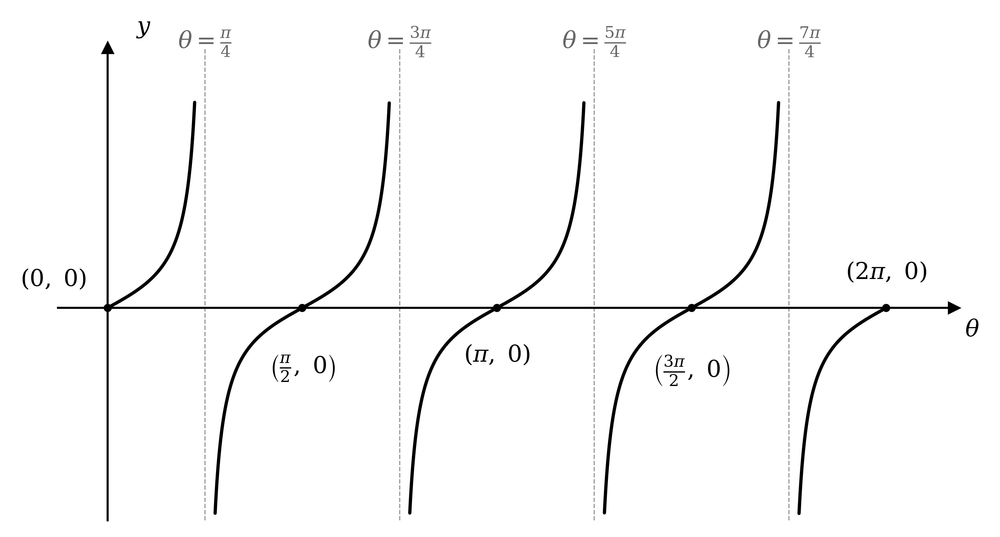
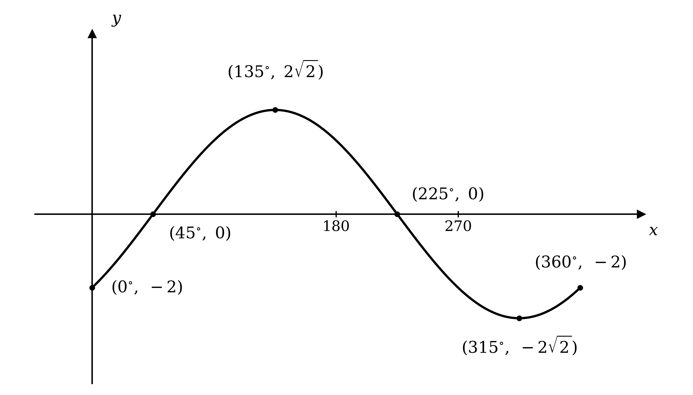
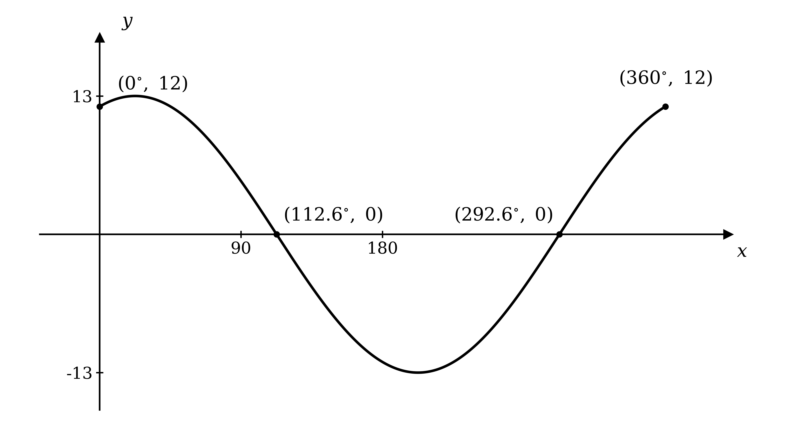

# Mark Schemes — Compound & Double Angle Formulae
**Trigonometry** · Cambridge (CIE) AS maths (9709)

## Exam Questions (42 questions)

### Q1
(i)

Expand the bracket with the compound angle formula $\text{sin} ( A + B ) \equiv \text{sin}  A  \text{cos}  B + \text{cos}  A  \text{sin}  B$, taking $A = θ$ and $B = α$

`R \; \text{sin}(\theta + \alpha) \equiv R\left(\text{sin} \; \theta \; \text{cos} \; \alpha + \text{cos} \; \theta \; \text{sin} \; \alpha\right)`

Multiply through by $R$

**Final answer:** $R  \text{sin} ( θ + α ) \equiv R  \text{cos}  α  \text{sin}  θ + R  \text{sin}  α  \text{cos}  θ$** as required**

**[B1]**

(ii)

Set the given expression equal to the result from part (i)

$\sqrt{3}  \text{sin}  θ + \text{cos}  θ \equiv R  \text{cos}  α  \text{sin}  θ + R  \text{sin}  α  \text{cos}  θ$

Compare the coefficients of $\text{sin}  θ$ and of $\text{cos}  θ$ on each side

$R  \text{cos}  α = \sqrt{3}$* and *$R  \text{sin}  α = 1$

**[M1]**

Square and add the two equations, so that $\text{cos}^{2}  α + \text{sin}^{2}  α \equiv 1$ removes $α$

`R^2 = \left(\sqrt{3}\right)^2 + 1^2 = 4`

Take the positive square root, since $R > 0$

$R = 2$

**[A1]**

Divide the second equation by the first, so that $R$ cancels and $\frac{\text{sin}α}{\text{cos}α} = \text{tan}  α$

`\text{tan} \; \alpha = \dfrac{1}{\sqrt{3}} \;\;\Rightarrow\;\; \alpha = \text{tan}^{-1}\left(\dfrac{1}{\sqrt{3}}\right) = \dfrac{\pi}{6}`

Substitute both constants into $R  \text{sin} ( θ + α )$

**Final answer:** `\sqrt{3} \; \text{sin} \; \theta + \text{cos} \; \theta \equiv 2 \; \text{sin}\left(\theta + \dfrac{\pi}{6}\right)`** as required**

**[A1]**

> **[mark-scheme]**
> **B1**: The compound angle formula applied to $R  \text{sin} ( θ + α )$ and multiplied out to reach the printed identity. Because the result is given, the line showing $R$ multiplying the bracket must appear.
> 
> **M1**: Both coefficients correctly compared, giving $R  \text{cos}  α = \sqrt{3}$ and $R  \text{sin}  α = 1$.
> 
> **A1**: $R = 2$. Accept this obtained from `R = \sqrt{\left(\sqrt{3}\right)^2 + 1^2}` or from a right-angled triangle with sides $1$ and $\sqrt{3}$.
> 
> **A1**: $α = \frac{π}{6}$ found from $\text{tan}  α = \frac{1}{\sqrt{3}}$, and the printed identity assembled. Because the answer is given, $α$ must be exact here; $0 . 524$ does not earn this mark.
From part (a) the expression is `2 \; \text{sin}\left(\theta + \dfrac{\pi}{6}\right)`, and the sine of any angle is at most $1$

$\text{maximum value} = 2$

**[B1]**

> **[mark-scheme]**
> **B1**: The value $2$. The command word is "write down", so no working is needed and none is required for the mark. A candidate who gives $\sqrt{3} + 1$, from maximising each term separately, does not earn this mark, since the two terms cannot reach their maxima at the same value of $θ$.

### Q2
Start from the left hand side, and choose the form of the double angle formula written in cosines only, $\text{cos}  2 A \equiv 2  \text{cos}^{2}  A - 1$

`\text{cos}^2 \; x + \text{cos} \; 2x \equiv \text{cos}^2 \; x + \left(2 \; \text{cos}^2 \; x - 1\right)`

**[M1]**

Collect the two terms in $\text{cos}^{2}  x$

**Final answer:** $\text{cos}^{2}  x + \text{cos}  2 x \equiv 3  \text{cos}^{2}  x - 1$** as required**

**[A1]**

> **[exam-tip]**
> There are three versions of the double angle formula for cosine in the formula booklet, and picking the right one turns a four line proof into a one line one. Look at what the answer is written in terms of: here it is cosines only, so choose the version with no sine in it.

> **[mark-scheme]**
> **M1**: A correct form of the double angle formula for $\text{cos}  2 x$ substituted into the left hand side. Any of the three forms earns this mark, so $\text{cos}^{2}  x - \text{sin}^{2}  x$ or $1 - 2  \text{sin}^{2}  x$ are equally acceptable starting points.
> 
> **A1**: The printed identity reached from correct working. A candidate who starts from $\text{cos}^{2}  x - \text{sin}^{2}  x$ must also use $\text{sin}^{2}  x \equiv 1 - \text{cos}^{2}  x$ to finish, which earns the mark equally. Because the result is given, every line must be correct and the $x$ must be present throughout; abbreviations such as $s$ or $c$ in place of the function names are accepted only if they are defined first.

### Q3
The bracket contains a difference of two angles, so select the compound angle formula for a difference

$\text{cos} ( A - B ) \equiv \text{cos}  A  \text{cos}  B + \text{sin}  A  \text{sin}  B$

**[M1]**

Apply it with $A = θ$ and $B = \frac{π}{6}$, keeping the factor of $5$ outside the bracket

`5 \; \text{cos}\left(\theta - \dfrac{\pi}{6}\right) \equiv 5\left(\text{cos} \; \theta \; \text{cos} \; \dfrac{\pi}{6} + \text{sin} \; \theta \; \text{sin} \; \dfrac{\pi}{6}\right)`

**[A1]**

Replace the two constants by their exact values, $\text{cos}  \frac{π}{6} = \frac{\sqrt{3}}{2}$ and $\text{sin}  \frac{π}{6} = \frac{1}{2}$

`\equiv 5\left(\dfrac{\sqrt{3}}{2} \; \text{cos} \; \theta + \dfrac{1}{2} \; \text{sin} \; \theta\right)`

**[M1]**

Multiply each term inside the bracket by $5$

**Final answer:** `5 \; \text{cos}\left(\theta - \dfrac{\pi}{6}\right) \equiv \dfrac{5\sqrt{3}}{2} \; \text{cos} \; \theta + \dfrac{5}{2} \; \text{sin} \; \theta`** as required**

**[A1]**

> **[mark-scheme]**
> **M1**: The correct compound angle formula for $\text{cos} ( A - B )$ selected and stated. The sign between the two products must be a plus.
> 
> **A1**: The formula applied with $A = θ$ and $B = \frac{π}{6}$, with the factor of $5$ retained.
> 
> **M1**: Both exact values substituted, $\text{cos}  \frac{π}{6} = \frac{\sqrt{3}}{2}$ and $\text{sin}  \frac{π}{6} = \frac{1}{2}$.
> 
> **A1**: The bracket expanded to reach the printed identity. Because the result is given, every line must be correct and $θ$ must be present throughout. Abbreviations such as $s$ or $c$ in place of the function names are accepted only if they are defined first.

### Q4
To reach $15 ^{\circ}$ from the two given angles, write it as a difference

$\text{sin}  15 ^{\circ} \equiv \text{sin} ( 45 ^{\circ} - 30 ^{\circ} )$

**[M1]**

Expand using the compound angle formula $\text{sin} ( A - B ) \equiv \text{sin}  A  \text{cos}  B - \text{cos}  A  \text{sin}  B$, with $A = 45 ^{\circ}$ and $B = 30 ^{\circ}$

$\text{sin}  15 ^{\circ} \equiv \text{sin}  45 ^{\circ}  \text{cos}  30 ^{\circ} - \text{cos}  45 ^{\circ}  \text{sin}  30 ^{\circ}$

**[A1]**

> **[mark-scheme]**
> **M1**: Writing $15 ^{\circ}$ as $45 ^{\circ} - 30 ^{\circ}$, so that the compound angle formula can be applied.
> 
> **A1**: The fully correct expansion, with the minus sign between the two products. Marks are not earned for an expansion with the angles the other way round, since $\text{sin} ( 30 ^{\circ} - 45 ^{\circ} )$ is negative.
Substitute the exact values $\text{sin}  45 ^{\circ} = \text{cos}  45 ^{\circ} = \frac{\sqrt{2}}{2}$, $\text{cos}  30 ^{\circ} = \frac{\sqrt{3}}{2}$ and $\text{sin}  30 ^{\circ} = \frac{1}{2}$ into the result from part (a)

$\text{sin}  15 ^{\circ} = \frac{\sqrt{2}}{2} \times \frac{\sqrt{3}}{2} - \frac{\sqrt{2}}{2} \times \frac{1}{2}$

**[M1]**

Multiply the fractions, using $\sqrt{2} \times \sqrt{3} = \sqrt{6}$

$= \frac{\sqrt{6}}{4} - \frac{\sqrt{2}}{4}$

**[A1]**

Combine over the common denominator

**Final answer:** $\text{sin}  15 ^{\circ} = \frac{\sqrt{6}-\sqrt{2}}{4}$** as required**

**[A1]**

> **[mark-scheme]**
> **M1**: All four exact values substituted into the expansion from part (a). Accept $\frac{1}{\sqrt{2}}$ in place of $\frac{\sqrt{2}}{2}$.
> 
> **A1**: A correct expression with the surds multiplied out, for example $\frac{\sqrt{6}}{4} - \frac{\sqrt{2}}{4}$. A candidate who used $\frac{1}{\sqrt{2}}$ reaches $\frac{\sqrt{3}-1}{2\sqrt{2}}$ at this stage, which earns the mark equally.
> 
> **A1**: The printed result reached from correct working. Because the answer is given, every line must be correct, and a candidate working from $\frac{\sqrt{3}-1}{2\sqrt{2}}$ must show the rationalising step. Quoting $\text{sin}  15 ^{\circ}$ from a calculator does not earn any of the three marks.

### Q5
Replace every $B$ in the given identity by $A$

$\text{sin} ( A + A ) \equiv \text{sin}  A  \text{cos}  A + \text{sin}  A  \text{cos}  A$

**[M1]**

Collect the two identical terms on the right, and write $A + A$ as $2 A$ on the left

**Final answer:** $\text{sin}  2 A \equiv 2  \text{sin}  A  \text{cos}  A$** as required**

**[A1]**

> **[mark-scheme]**
> **M1**: The substitution $B = A$ made throughout the given identity, giving $\text{sin} ( A + A )$ on the left and two terms in $\text{sin}  A  \text{cos}  A$ on the right.
> 
> **A1**: The printed identity reached, with both sides simplified. Because the result is given, the substituted line must be shown; writing down $\text{sin}  2 A \equiv 2  \text{sin}  A  \text{cos}  A$ from memory earns nothing here.
To use part (a), write $120 ^{\circ}$ as a double angle, so $2 A = 120 ^{\circ}$ and $A = 60 ^{\circ}$

`\text{sin} \; 120^{\circ} = \text{sin}\left(2 \times 60^{\circ}\right) = 2 \; \text{sin} \; 60^{\circ} \; \text{cos} \; 60^{\circ}`

**[M1]**

Substitute the exact values $\text{sin}  60 ^{\circ} = \frac{\sqrt{3}}{2}$ and $\text{cos}  60 ^{\circ} = \frac{1}{2}$

$= 2 \times \frac{\sqrt{3}}{2} \times \frac{1}{2}$

Cancel the factor of $2$

**Final answer:** $\text{sin}  120 ^{\circ} = \frac{\sqrt{3}}{2}$** as required**

**[A1]**

> **[mark-scheme]**
> **M1**: Writing $120 ^{\circ}$ as $2 \times 60 ^{\circ}$ and applying the identity from part (a), to reach $2  \text{sin}  60 ^{\circ}  \text{cos}  60 ^{\circ}$.
> 
> **A1**: The exact values substituted and simplified to the printed result. Because the answer is given, the substitution must be visible. Reading $\text{sin}  120 ^{\circ}$ straight from a calculator, or quoting it from the graph of the sine function, does not earn either mark, since the question says to use part (a).

### Q6
Both terms are squares of squares, so write the left hand side as `\left(\text{cos}^2 \; x\right)^2 - \left(\text{sin}^2 \; x\right)^2` and factorise it

`\text{cos}^4 \; x - \text{sin}^4 \; x \equiv \left(\text{cos}^2 \; x - \text{sin}^2 \; x\right)\left(\text{cos}^2 \; x + \text{sin}^2 \; x\right)`

**[M1]**

The second bracket is $1$, by the identity $\text{cos}^{2}  x + \text{sin}^{2}  x \equiv 1$

`\equiv \left(\text{cos}^2 \; x - \text{sin}^2 \; x\right) \times 1 \equiv \text{cos}^2 \; x - \text{sin}^2 \; x`

**[M1]**

Recognise what remains as a form of the double angle formula, $\text{cos}  2 A \equiv \text{cos}^{2}  A - \text{sin}^{2}  A$

**Final answer:** $\text{cos}^{4}  x - \text{sin}^{4}  x \equiv \text{cos}  2 x$** as required**

**[A1]**

> **[mark-scheme]**
> **M1**: The left hand side factorised as a difference of two squares, giving `\left(\text{cos}^2 \; x - \text{sin}^2 \; x\right)\left(\text{cos}^2 \; x + \text{sin}^2 \; x\right)`.
> 
> **M1**: The identity $\text{cos}^{2}  x + \text{sin}^{2}  x \equiv 1$ used to reduce the second bracket, leaving $\text{cos}^{2}  x - \text{sin}^{2}  x$. Stating the identity is enough for this mark.
> 
> **A1**: The double angle formula quoted and the printed result reached. Because the answer is given, every line must be correct and the $x$ must be present throughout.
Replace the left hand side using part (a), which turns the equation into one in a single trigonometric function

$\text{cos}  2 x = \frac{\sqrt{2}}{2}$

**[M1]**

Let $φ = 2 x$, and multiply each part of the interval by $2$ to find the interval for $φ$

$- π \leq φ \leq π$

Take the inverse cosine to find the principal value

`\varphi = \text{cos}^{-1}\left(\dfrac{\sqrt{2}}{2}\right) = \dfrac{\pi}{4}`

**[A1]**

The cosine curve is symmetrical about the vertical axis, so use $\text{cos}  φ = \text{cos} ( - φ )$

$φ = - \frac{π}{4}$

Divide each value by $2$ to return to $x$

$x = - \frac{π}{8} ,  \frac{π}{8}$

**[A1]**

> **[mark-scheme]**
> **M1**: Part (a) used to replace $\text{cos}^{4}  x - \text{sin}^{4}  x$ by $\text{cos}  2 x$, giving $\text{cos}  2 x = \frac{\sqrt{2}}{2}$.
> 
> **A1**: A correct value of $2 x$, with the interval for $2 x$ correctly changed to $- π \leq 2 x \leq π$.
> 
> **A1**: Both correct values of $x$, and no others in the interval. Answers must be exact and in terms of $π$; a decimal such as $0 . 393$ does not earn this mark. Solutions outside $- \frac{π}{2} \leq x \leq \frac{π}{2}$ are ignored rather than penalised, and answers given correctly in degrees are treated as a misread.

### Q7
(i)

Read the value from the special triangle with angles $30 ^{\circ}$ and $60 ^{\circ}$

$\text{cos}  60 ^{\circ} = \frac{1}{2}$

**[B1]**

(ii)

Read the value from the right-angled isosceles triangle

$\text{cos}  45 ^{\circ} = \frac{\sqrt{2}}{2}$

**[B1]**

(iii)

Since $105 ^{\circ} = 60 ^{\circ} + 45 ^{\circ}$, use the compound angle formula $\text{cos} ( A + B ) \equiv \text{cos}  A  \text{cos}  B - \text{sin}  A  \text{sin}  B$

$\text{cos}  105 ^{\circ} = \text{cos}  60 ^{\circ}  \text{cos}  45 ^{\circ} - \text{sin}  60 ^{\circ}  \text{sin}  45 ^{\circ}$

**[M1]**

Substitute the exact values, using $\text{sin}  60 ^{\circ} = \frac{\sqrt{3}}{2}$ and $\text{sin}  45 ^{\circ} = \frac{\sqrt{2}}{2}$

$= \frac{1}{2} \times \frac{\sqrt{2}}{2} - \frac{\sqrt{3}}{2} \times \frac{\sqrt{2}}{2}$

Multiply the fractions

$= \frac{\sqrt{2}}{4} - \frac{\sqrt{6}}{4}$

Combine over the common denominator

$\text{cos}  105 ^{\circ} = \frac{\sqrt{2}-\sqrt{6}}{4}$

**[A1]**

(iv)

To find the left-hand side, add the values from parts (i) and (ii)

$\text{cos}  60 ^{\circ} + \text{cos}  45 ^{\circ} = \frac{1}{2} + \frac{\sqrt{2}}{2} = \frac{1+\sqrt{2}}{2}$

Compare this with part (iii), where one value is positive and the other negative

$\frac{1+\sqrt{2}}{2} \neq \frac{\sqrt{2}-\sqrt{6}}{4}$

**Final answer:** **so **$\text{cos}  60 ^{\circ} + \text{cos}  45 ^{\circ} \neq \text{cos}  105 ^{\circ}$** as required**

**[B1]**

> **[mark-scheme]**
> **B1**: The exact value $\text{cos}  60 ^{\circ} = \frac{1}{2}$. Accept $0 . 5$.
> 
> **B1**: The exact value $\text{cos}  45 ^{\circ} = \frac{\sqrt{2}}{2}$. Accept the equivalent form $\frac{1}{\sqrt{2}}$.
> 
> **M1**: Writing $\text{cos}  105 ^{\circ}$ as $\text{cos} ( 60 ^{\circ} + 45 ^{\circ} )$ and expanding it with the compound angle formula for $\text{cos} ( A + B )$. The expansion must have the minus sign between the two products.
> 
> **A1**: The exact value $\frac{\sqrt{2}-\sqrt{6}}{4}$. Accept any equivalent exact form, for example $\frac{\sqrt{2}}{4} - \frac{\sqrt{6}}{4}$. A decimal does not earn this mark, because an exact value is asked for.
> 
> **B1**: A correct comparison of the two sides, ending with a statement that they are not equal. You must show the value of $\text{cos}  60 ^{\circ} + \text{cos}  45 ^{\circ}$ to earn this; writing only that the two are unequal is not enough.

### Q8
The angle is a sum, so select the compound angle formula for a sum of two angles

$\text{sin} ( A + B ) \equiv \text{sin}  A  \text{cos}  B + \text{cos}  A  \text{sin}  B$

**[M1]**

Apply it with $A = θ$ and $B = α$

$\text{sin} ( θ + α ) \equiv \text{sin}  θ  \text{cos}  α + \text{cos}  θ  \text{sin}  α$

**[A1]**

> **[mark-scheme]**
> **M1**: The correct compound angle formula for $\text{sin} ( A + B )$ selected and stated.
> 
> **A1**: The formula correctly applied with $A = θ$ and $B = α$, giving both terms with a plus sign between them. The two terms may be written in either order.
Multiply the identity from part (a) through by $R$

`R \; \text{sin}(\theta + \alpha) \equiv R\left(\text{sin} \; \theta \; \text{cos} \; \alpha + \text{cos} \; \theta \; \text{sin} \; \alpha\right)`

Expand the bracket and write each product with its coefficient first

**Final answer:** $R  \text{sin} ( θ + α ) \equiv R  \text{cos}  α  \text{sin}  θ + R  \text{sin}  α  \text{cos}  θ$** as required**

**[B1]**

> **[mark-scheme]**
> **B1**: The identity from part (a) multiplied through by $R$ and expanded to reach the printed result. Because the answer is given, the line showing $R$ multiplying the bracket must appear. The order of the two terms does not matter, since they are being added.

### Q9
Let $φ = 2 θ$, and multiply each part of the interval by $2$ to find the interval for $φ$

$- 2 π \leq φ \leq 2 π$

Take the inverse sine to find the principal value

`\varphi = \text{sin}^{-1}\left(\dfrac{1}{2}\right) = \dfrac{\pi}{6}`

**[M1]**

The sine curve is symmetrical about $φ = \frac{π}{2}$, so use $\text{sin}  φ = \text{sin} ( π - φ )$

$φ = π - \frac{π}{6} = \frac{5π}{6}$

Subtract the period $2 π$ from each of these to reach the negative half of the interval

$φ = \frac{π}{6} - 2 π = - \frac{11π}{6}$* and *$φ = \frac{5π}{6} - 2 π = - \frac{7π}{6}$

**[A1]**

Divide each value by $2$ to return to $θ$

$θ = - \frac{11π}{12} ,  - \frac{7π}{12} ,  \frac{π}{12} ,  \frac{5π}{12}$

**[A1]**

> **[mark-scheme]**
> **M1**: A correct method for finding one value of $2 θ$, with the interval for $2 θ$ correctly changed to $- 2 π \leq 2 θ \leq 2 π$. Evaluating `\text{sin}^{-1}\left(\dfrac{1}{2}\right)` is enough for this mark.
> 
> **A1**: At least two correct values of $θ$.
> 
> **A1**: All four correct values of $θ$, and no others in the interval. Answers must be exact and in terms of $π$; a decimal such as $0 . 262$ keeps the method mark but does not earn this one. Solutions outside $- π \leq θ \leq π$ are ignored rather than penalised, and answers given correctly in degrees are treated as a misread.
Let $φ = 2 θ$, and multiply each part of the interval by $2$ to find the interval for $φ$

$0 \leq φ \leq 4 π$

Take the inverse cosine to find the principal value

`\varphi = \text{cos}^{-1}\left(\dfrac{\sqrt{3}}{2}\right) = \dfrac{\pi}{6}`

**[M1]**

The cosine curve is symmetrical about $φ = π$, so the partner solution in the first period is $2 π - φ$

$φ = 2 π - \frac{π}{6} = \frac{11π}{6}$

Add the period $2 π$ to each of these to reach the second half of the interval

$φ = \frac{π}{6} + 2 π = \frac{13π}{6}$* and *$φ = \frac{11π}{6} + 2 π = \frac{23π}{6}$

**[A1]**

Divide each value by $2$ to return to $θ$

$θ = \frac{π}{12} ,  \frac{11π}{12} ,  \frac{13π}{12} ,  \frac{23π}{12}$

**[A1]**

> **[mark-scheme]**
> **M1**: A correct method for finding one value of $2 θ$, with the interval for $2 θ$ correctly changed to $0 \leq 2 θ \leq 4 π$. Evaluating `\text{cos}^{-1}\left(\dfrac{\sqrt{3}}{2}\right)` is enough for this mark.
> 
> **A1**: At least two correct values of $θ$.
> 
> **A1**: All four correct values of $θ$, and no others in the interval. Answers must be exact and in terms of $π$; a decimal keeps the method mark but does not earn this one. Solutions outside $0 \leq θ \leq 2 π$ are ignored rather than penalised, and answers given correctly in degrees are treated as a misread.

### Q10
Set the model equal to the identity given in the question

$20  \text{cos}  π t + 20 \sqrt{3}  \text{sin}  π t \equiv R  \text{cos}  α  \text{cos}  π t + R  \text{sin}  α  \text{sin}  π t$

Compare the coefficients of $\text{cos}  π t$ and of $\text{sin}  π t$ on each side

$R  \text{cos}  α = 20$* and *$R  \text{sin}  α = 20 \sqrt{3}$

**[M1]**

Divide the second equation by the first, so that $R$ cancels and $\frac{\text{sin}α}{\text{cos}α} = \text{tan}  α$

$\text{tan}  α = \frac{20\sqrt{3}}{20} = \sqrt{3}   \Rightarrow   α = \frac{π}{3}$

**[A1]**

Substitute this value back into $R  \text{cos}  α = 20$ to find $R$

$R \times \frac{1}{2} = 20   \Rightarrow   R = 40$

Put both constants into $R  \text{cos} ( π t - α )$

**Final answer:** `20 \; \text{cos} \; \pi t + 20\sqrt{3} \; \text{sin} \; \pi t \equiv 40 \; \text{cos}\left(\pi t - \dfrac{\pi}{3}\right)`** as required**

**[A1]**

> **[mark-scheme]**
> **M1**: Both coefficients correctly compared, giving $R  \text{cos}  α = 20$ and $R  \text{sin}  α = 20 \sqrt{3}$.
> 
> **A1**: $α = \frac{π}{3}$, obtained from $\text{tan}  α = \sqrt{3}$. Because the answer is given, $α$ must be exact; $1 . 047$ does not earn this mark.
> 
> **A1**: $R = 40$ and the printed form assembled. Accept $R$ found either by substituting $α$ back into one of the two equations or from `R = \sqrt{20^2 + \left(20\sqrt{3}\right)^2}`.
(i)

From part (a) the model is `40 \; \text{cos}\left(\pi t - \dfrac{\pi}{3}\right)`, and the cosine of any angle is at most $1$

$\text{maximum voltage} = 40  \text{volts}$

**[B1]**

(ii)

Substitute $t = 0$ into the model

`V = 40 \; \text{cos}\left(0 - \dfrac{\pi}{3}\right) = 40 \; \text{cos}\left(-\dfrac{\pi}{3}\right)`

Evaluate, using `\text{cos}\left(-\dfrac{\pi}{3}\right) = \dfrac{1}{2}`

$V = 20  \text{volts}$

**[B1]**

(iii)

Substitute $t = 2$ into the model

`V = 40 \; \text{cos}\left(2\pi - \dfrac{\pi}{3}\right)`

Evaluate, using `\text{cos}\left(2\pi - \dfrac{\pi}{3}\right) = \dfrac{1}{2}`

$V = 20  \text{volts}$

**[B1]**

> **[mark-scheme]**
> **B1**: The maximum voltage of $40$. The command word is "write down", so no working is needed. A candidate who gives $20 + 20 \sqrt{3}$, from maximising each term separately, does not earn this mark, since the two terms cannot reach their maxima at the same time.
> 
> **B1**: A voltage of $20$ at $t = 0$. Substituting $t = 0$ into the original model, $20  \text{cos}  0 + 20 \sqrt{3}  \text{sin}  0$, is equally acceptable.
> 
> **B1**: A voltage of $20$ after two seconds. This is the same value as in part (ii), which is correct rather than a slip, because two seconds is one whole period of the model. The units may be omitted, since the question names them.
Set the model equal to $- 20$ and divide by $40$ to isolate the cosine

`\text{cos}\left(\pi t - \dfrac{\pi}{3}\right) = -\dfrac{1}{2}`

**[M1]**

Take the inverse cosine to find the principal value

$π t - \frac{π}{3} = \frac{2π}{3}$

**[A1]**

Add $\frac{π}{3}$ to both sides, then divide by $π$

$π t = π   \Rightarrow   t = 1$

The principal value gives the smallest positive time, so this is the first occasion

**Final answer:** **The voltage first equals **$- 20$** volts after 1 second**

**[A1]**

> **[mark-scheme]**
> **M1**: The model set equal to $- 20$ and rearranged to `\text{cos}\left(\pi t - \dfrac{\pi}{3}\right) = -\dfrac{1}{2}`.
> 
> **A1**: $π t - \frac{π}{3} = \frac{2π}{3}$, or any correct equivalent value of the angle. Accept $2 . 09$ or better as a decimal at this stage.
> 
> **A1**: $t = 1$, with the reasoning that this is the first time. A candidate who finds a later solution, such as $t = \frac{5}{3}$ from the angle $\frac{4π}{3}$, does not earn this mark, because the question asks for the first occasion on which the voltage reaches $- 20$.

### Q11
The graph of $y = \text{tan}  θ$ has period $π$, and replacing $θ$ by $2 θ$ halves it, so the interval contains five sections of the curve: three complete branches between consecutive asymptotes, with a half branch at each end

$\text{period} = \frac{π}{2}$

The curve meets the horizontal axis where $\text{tan}  2 θ = 0$, so where $2 θ$ is a multiple of $π$

$θ = 0 ,  \frac{π}{2} ,  π ,  \frac{3π}{2} ,  2 π$

The asymptotes lie halfway between consecutive intercepts, where $2 θ$ is an odd multiple of $\frac{π}{2}$

$θ = \frac{π}{4} ,  \frac{3π}{4} ,  \frac{5π}{4} ,  \frac{7π}{4}$

Draw five increasing sections, each rising from left to right: a half branch from the origin up to the first asymptote, three complete branches between consecutive asymptotes, and a half branch from the last asymptote up to `\left(2\pi, \; 0\right)`

**[B1 B1]**

> **[mark-scheme]**
> **B1**: The correct shape over $0 \leq θ \leq 2 π$: three complete branches between consecutive asymptotes, together with a half branch at each end of the interval, giving five sections in all. Each section must increase from bottom left to top right, and no section may cross or curl away from an asymptote. Drawing the asymptotes in is not required.
> 
> **B1**: The five intersections with the axes correctly shown, at $( 0 ,  0 )$, `\left(\dfrac{\pi}{2}, \; 0\right)`, $( π ,  0 )$, `\left(\dfrac{3\pi}{2}, \; 0\right)` and $( 2 π ,  0 )$. Numbers marked on the axis are accepted in place of full coordinate pairs.

### Q12
Both sides are cosines of different angles, so use the form of the double angle formula written in cosines only, $\text{cos}  2 A \equiv 2  \text{cos}^{2}  A - 1$

$2  \text{cos}^{2}  θ - 1 = \text{cos}  θ$

**[M1]**

Collect everything on one side to give a quadratic in $\text{cos}  θ$

$2  \text{cos}^{2}  θ - \text{cos}  θ - 1 = 0$

Factorise the quadratic

`\left(2 \; \text{cos} \; \theta + 1\right)\left(\text{cos} \; \theta - 1\right) = 0`

**[M1]**

A product is zero when either factor is zero, which gives two equations to solve

$\text{cos}  θ = 1$* or *$\text{cos}  θ = - \frac{1}{2}$

**[A1]**

For the first, the cosine equals $1$ once per period. In this interval that happens only at the left hand end, since $θ = 2 π$ is excluded

$θ = 0$

**[A1]**

For the second, take the inverse cosine, then use the symmetry of the cosine curve about $θ = π$

`\theta = \text{cos}^{-1}\left(-\dfrac{1}{2}\right) = \dfrac{2\pi}{3}`* and *$θ = 2 π - \frac{2π}{3} = \frac{4π}{3}$

Collect every solution from both factors

$θ = 0 ,  \frac{2π}{3} ,  \frac{4π}{3}$

**[A1]**

> **[mark-scheme]**
> **M1**: A correct form of the double angle formula used to write the equation in $\text{cos}  θ$ only. Using $\text{cos}^{2}  θ - \text{sin}^{2}  θ$ and then the Pythagorean identity is equally acceptable.
> 
> **M1**: The quadratic collected on one side and factorised, or solved by the quadratic formula.
> 
> **A1**: Both factors set to zero, giving $\text{cos}  θ = 1$ and $\text{cos}  θ = - \frac{1}{2}$.
> 
> **A1**: At least two correct values of $θ$.
> 
> **A1**: All three correct values, and no others in the interval. The interval is strict at the upper end, so $θ = 2 π$ is not a solution and offering it loses this mark. Answers must be exact and in terms of $π$; decimals do not earn the accuracy marks, and answers given correctly in degrees are treated as a misread.
Replace the left hand side with the double angle formula $\text{tan}  2 A \equiv \frac{2\text{tan}A}{1-\text{tan}^{2}A}$, then multiply through by the denominator

$\frac{2\text{tan}x}{1-\text{tan}^{2}x} = 3  \text{tan}  x   \Rightarrow   2  \text{tan}  x = 3  \text{tan}  x - 3  \text{tan}^{3}  x$

**[M1]**

Collect everything on one side, then factorise rather than dividing by $\text{tan}  x$

`3 \; \text{tan}^3 \; x - \text{tan} \; x = 0 \;\;\Rightarrow\;\; \text{tan} \; x\left(3 \; \text{tan}^2 \; x - 1\right) = 0`

**[M1]**

Setting each factor to zero gives three equations, since the bracket has two roots

$\text{tan}  x = 0$* or *$\text{tan}  x = \pm \frac{1}{\sqrt{3}}$

**[A1]**

The tangent is zero at every multiple of $π$, and three of them lie in the interval

$x = - π ,  0 ,  π$

**[A1]**

For the positive root, take the inverse tangent, then subtract the period $π$ to reach the other value in the interval

`x = \text{tan}^{-1}\left(\dfrac{1}{\sqrt{3}}\right) = \dfrac{\pi}{6}`* and *$x = \frac{π}{6} - π = - \frac{5π}{6}$

**[A1]**

Do the same for the negative root

`x = \text{tan}^{-1}\left(-\dfrac{1}{\sqrt{3}}\right) = -\dfrac{\pi}{6}`* and *$x = - \frac{π}{6} + π = \frac{5π}{6}$

Collect every solution from all three factors

$x = - π ,  - \frac{5π}{6} ,  - \frac{π}{6} ,  0 ,  \frac{π}{6} ,  \frac{5π}{6} ,  π$

**[A1]**

> **[mark-scheme]**
> **M1**: The double angle formula for $\text{tan}  2 x$ substituted and the fraction cleared.
> 
> **M1**: The cubic collected on one side and factorised as `\text{tan} \; x\left(3 \; \text{tan}^2 \; x - 1\right) = 0`. A candidate who divides through by $\text{tan}  x$ loses the whole $\text{tan}  x = 0$ family and does not earn this mark.
> 
> **A1**: All three values of $\text{tan}  x$ found, namely $0$ and $\pm \frac{1}{\sqrt{3}}$. Accept $\pm \frac{\sqrt{3}}{3}$ as an equivalent form.
> 
> **A1**: The family from $\text{tan}  x = 0$, namely $x = - π ,  0 ,  π$. Both endpoints count, since the interval is inclusive.
> 
> **A1**: At least two correct values from the other two families.
> 
> **A1**: All seven correct values, and no others in the interval. Answers must be exact and in terms of $π$; decimals do not earn the accuracy marks, and answers given correctly in degrees are treated as a misread.

### Q13
Treat $4 A$ as double the angle $2 A$, and use the form of the double angle formula written in cosines only, $\text{cos}  2 θ \equiv 2  \text{cos}^{2}  θ - 1$

$\text{cos}  4 A \equiv 2  \text{cos}^{2}  2 A - 1$

**[M1]**

Apply the same formula again, this time to $\text{cos}  2 A$ itself

`\equiv 2\left(2 \; \text{cos}^2 \; A - 1\right)^2 - 1`

**[M1]**

Expand the square

`\equiv 2\left(4 \; \text{cos}^4 \; A - 4 \; \text{cos}^2 \; A + 1\right) - 1`

**[A1]**

Multiply out the bracket and collect the constants

$\text{cos}  4 A \equiv 8  \text{cos}^{4}  A - 8  \text{cos}^{2}  A + 1$

**[A1]**

> **[mark-scheme]**
> **M1**: $\text{cos}  4 A$ written as $2  \text{cos}^{2}  2 A - 1$, or as another correct double angle form of the angle $2 A$.
> 
> **M1**: The double angle formula applied a second time, to replace $\text{cos}  2 A$ by $2  \text{cos}^{2}  A - 1$.
> 
> **A1**: The square correctly expanded, giving $4  \text{cos}^{4}  A - 4  \text{cos}^{2}  A + 1$ inside the bracket. Squaring the bracket as $4  \text{cos}^{4}  A + 1$ loses this mark and the next.
> 
> **A1**: The correct identity, with the constants collected. Routes through $\text{cos}^{2}  2 A - \text{sin}^{2}  2 A$ or $1 - 2  \text{sin}^{2}  2 A$ are equally valid, provided the answer is left in cosines only as the question asks.
Substitute the identity from part (a) on the left, and use $\text{sin}^{2}  x \equiv 1 - \text{cos}^{2}  x$ on the right, so that the whole equation is in $\text{cos}  x$

`2\left(8 \; \text{cos}^4 \; x - 8 \; \text{cos}^2 \; x + 1\right) = 7\left(1 - \text{cos}^2 \; x\right) - 2`

**[M1]**

Multiply out both sides and collect every term on the left

$16  \text{cos}^{4}  x - 9  \text{cos}^{2}  x - 3 = 0$

**[A1]**

This is a quadratic in $\text{cos}^{2}  x$, so apply the quadratic formula to it

$\text{cos}^{2}  x = \frac{9\pm\sqrt{273}}{32}$

**[M1]**

A square cannot be negative, and $\sqrt{273} > 9$, so the root with the minus sign is rejected. Take the square root of the other

$\text{cos}  x = \pm \sqrt{\frac{9+\sqrt{273}}{32}} = \pm 0 . 893076 \dots$

**[A1]**

Take the inverse cosine of each. Both results lie in the interval, the second by the symmetry of the cosine curve about $x = \frac{π}{2}$

$x = 0 . 466659 \dots$* and *$x = 2 . 674932 \dots$

Round each to three significant figures

**Final answer:** $x = 0 . 467 ,  2 . 67$** (3 s.f.)**

**[A1]**

> **[mark-scheme]**
> **M1**: Part (a) substituted and the Pythagorean identity used, so that the equation is in $\text{cos}  x$ only.
> 
> **A1**: The correct quartic, $16  \text{cos}^{4}  x - 9  \text{cos}^{2}  x - 3 = 0$, or any correct equivalent.
> 
> **M1**: The equation treated as a quadratic in $\text{cos}^{2}  x$ and solved. Accept the quadratic formula or completing the square; the quartic does not factorise.
> 
> **A1**: The negative root rejected, with a reason, and $\text{cos}  x = \pm 0 . 893$ obtained. A candidate who keeps the negative value of $\text{cos}^{2}  x$ and tries to take its square root does not earn this mark.
> 
> **A1**: Both correct values of $x$, and no others in the interval. Accept answers which round to $0 . 467$ and $2 . 67$. Omitting the solution from the negative value of $\text{cos}  x$ is the most common loss here. Answers given correctly in degrees are treated as a misread.

### Q14
Start from the left hand side and replace $\text{tan}  2 θ$ with the double angle formula $\text{tan}  2 A \equiv \frac{2\text{tan}A}{1-\text{tan}^{2}A}$, then multiply by $\text{tan}  θ$

$\text{tan}  2 θ  \text{tan}  θ \equiv \frac{2\text{tan}θ}{1-\text{tan}^{2}θ} \times \text{tan}  θ \equiv \frac{2\text{tan}^{2}θ}{1-\text{tan}^{2}θ}$

**[M1]**

Write every tangent in terms of sine and cosine, using $\text{tan}  θ \equiv \frac{\text{sin}θ}{\text{cos}θ}$

$\equiv \frac{\frac{2\text{sin}^{2}θ}{\text{cos}^{2}θ}}{1-\frac{\text{sin}^{2}θ}{\text{cos}^{2}θ}}$

**[M1]**

Multiply the numerator and the denominator by $\text{cos}^{2}  θ$ to clear the inner fractions

$\equiv \frac{2\text{sin}^{2}θ}{\text{cos}^{2}θ-\text{sin}^{2}θ}$

**[A1]**

Now read two double angle formulae backwards. The denominator is $\text{cos}  2 θ$, and rearranging $\text{cos}  2 θ \equiv 1 - 2  \text{sin}^{2}  θ$ makes the numerator $1 - \text{cos}  2 θ$

$\equiv \frac{1-\text{cos}2θ}{\text{cos}2θ}$

**[M1]**

Split the single fraction into two, then use the definition $\text{sec}  θ = \frac{1}{\text{cos}θ}$ applied to the angle $2 θ$

$\equiv \frac{1}{\text{cos}2θ} - 1$

**Final answer:** $\text{tan}  2 θ  \text{tan}  θ \equiv \text{sec}  2 θ - 1$** as required**

**[A1]**

> **[mark-scheme]**
> **M1**: The double angle formula for $\text{tan}  2 θ$ substituted and combined with $\text{tan}  θ$ to give $\frac{2\text{tan}^{2}θ}{1-\text{tan}^{2}θ}$.
> 
> **M1**: Every tangent written in terms of sine and cosine.
> 
> **A1**: The inner fractions cleared, reaching $\frac{2\text{sin}^{2}θ}{\text{cos}^{2}θ-\text{sin}^{2}θ}$.
> 
> **M1**: Both double angle formulae used in reverse, so that the denominator becomes $\text{cos}  2 θ$ and the numerator becomes $1 - \text{cos}  2 θ$. Stating the identities is enough for this mark.
> 
> **A1**: The fraction split and named as $\text{sec}  2 θ - 1$, reaching the printed identity. Working from the right hand side back to the left is equally valid. Because the result is given, every line must be correct and $θ$ must be present throughout; abbreviations such as $s$, $c$ or $t$ in place of the function names are accepted only if they are defined first.

### Q15
Expand the required form with the compound angle formula $\text{sin} ( A - B ) \equiv \text{sin}  A  \text{cos}  B - \text{cos}  A  \text{sin}  B$, then set it equal to the given expression

$5  \text{sin}  θ - 3  \text{cos}  θ \equiv R  \text{cos}  α  \text{sin}  θ - R  \text{sin}  α  \text{cos}  θ$

Compare the coefficients of $\text{sin}  θ$ and of $\text{cos}  θ$ on each side

$R  \text{cos}  α = 5$* and *$R  \text{sin}  α = 3$

Square and add the two equations, so that $\text{cos}^{2}  α + \text{sin}^{2}  α \equiv 1$ removes $α$

$R^{2} = 5^{2} + 3^{2} = 34   \Rightarrow   R = \sqrt{34}$

**[B1]**

Divide the second equation by the first, so that $R$ cancels and $\frac{\text{sin}α}{\text{cos}α} = \text{tan}  α$

`\text{tan} \; \alpha = \dfrac{3}{5} \;\;\Rightarrow\;\; \alpha = \text{tan}^{-1}\left(\dfrac{3}{5}\right) = 0.5404195\ldots`

**[M1]**

Round to three decimal places, then substitute both constants into $R  \text{sin} ( θ - α )$

**Final answer:** `5 \; \text{sin} \; \theta - 3 \; \text{cos} \; \theta \equiv \sqrt{34} \; \text{sin}\left(\theta - 0.540\right)`** as required**

**[B1]**

> **[mark-scheme]**
> **B1**: $R = \sqrt{34}$. The surd form is needed, since it is the one printed in the question.
> 
> **M1**: A correct trigonometric method for $α$, such as $\text{tan}  α = \frac{3}{5}$, or $\text{sin}  α = \frac{3}{\sqrt{34}}$ using the value of $R$. The minus sign in the expansion of $\text{sin} ( θ - α )$ means the coefficient of $\text{cos}  θ$ is taken as $3$, not $- 3$.
> 
> **B1**: The printed value $α = 0 . 540$ reached, with the unrounded $0 . 5404195 \dots$ seen first. Because the answer is given, going straight to $0 . 540$ loses this mark. An answer in degrees, $30 . 964 ^{\circ}$, is treated as a misread.
Part (a) has a minus sign where this equation has a plus, so put $θ = - 2 x$ into it and use $\text{cos} ( - A ) = \text{cos}  A$ and $\text{sin} ( - A ) = - \text{sin}  A$ on the left hand side

`-5 \; \text{sin} \; 2x - 3 \; \text{cos} \; 2x = \sqrt{34} \; \text{sin}\left(-2x - 0.540\right)`

Apply $\text{sin} ( - A ) = - \text{sin}  A$ to the right hand side as well, then multiply through by $- 1$

`3 \; \text{cos} \; 2x + 5 \; \text{sin} \; 2x = \sqrt{34} \; \text{sin}\left(2x + 0.540\right)`

**[M1]**

The equation becomes a single sine, so divide by $\sqrt{34}$ to isolate it

`\text{sin}\left(2x + 0.540\right) = \dfrac{0.4}{\sqrt{34}} = 0.0685994\ldots`

**[M1]**

Let $φ = 2 x + 0 . 540$, then substitute each end of the interval in turn to find the interval for $φ$

$x = 0   \Rightarrow   φ = 0 + 0 . 540 = 0 . 540$

$x = 2 π   \Rightarrow   φ = 4 π + 0 . 540 = 13 . 106$

$0 . 540 \leq φ \leq 13 . 106$

Take the inverse sine. This principal value is below the interval, so it is not itself a solution, but its partners are

`\varphi = \text{sin}^{-1}\left(0.0685994\ldots\right) = 0.0686534\ldots`

**[A1]**

Use the symmetry $\text{sin}  φ = \text{sin} ( π - φ )$, then add the period $2 π$ repeatedly while the values stay in the interval

$φ = 3 . 072939 \dots ,  6 . 351838 \dots ,  9 . 356124 \dots ,  12 . 635023 \dots$

**[A1]**

Subtract $0 . 5404195 \dots$ from each value and divide by $2$, keeping full precision until the end

**Final answer:** $x = 1 . 27 ,  2 . 91 ,  4 . 41 ,  6 . 05$** (3 s.f.)**

**[A1]**

> **[mark-scheme]**
> **M1**: Part (a) used with $θ = - 2 x$, together with the odd and even properties of sine and cosine, to reach `3 \; \text{cos} \; 2x + 5 \; \text{sin} \; 2x = \sqrt{34} \; \text{sin}\left(2x + 0.540\right)`. Re-deriving the R form directly for $5  \text{sin}  2 x + 3  \text{cos}  2 x$ reaches the same expression and earns this mark equally.
> 
> **M1**: The equation divided by $\sqrt{34}$ to isolate the sine, with the interval for $2 x + 0 . 540$ correctly found.
> 
> **A1**: A correct principal value, with the recognition that it lies below the interval. Accept answers which round to $0 . 0687$.
> 
> **A1**: At least two correct values of $2 x + 0 . 540$ in the interval.
> 
> **A1**: All four correct values of $x$, and no others in the interval. Accept answers which round to $1 . 27$, $2 . 91$, $4 . 41$ and $6 . 05$. Rounding before the final step can shift the last figure, so full precision should be carried through; answers which round correctly are accepted however the candidate got there.

### Q16
Expand the required form with the compound angle formula $\text{sin} ( A + B ) \equiv \text{sin}  A  \text{cos}  B + \text{cos}  A  \text{sin}  B$, then set it equal to the given expression

$a  \text{sin}  θ + b  \text{cos}  θ \equiv R  \text{cos}  α  \text{sin}  θ + R  \text{sin}  α  \text{cos}  θ$

Compare the coefficients of $\text{sin}  θ$ and of $\text{cos}  θ$ on each side

$R  \text{cos}  α = a$* and *$R  \text{sin}  α = b$

**[M1]**

(i)

Divide the second equation by the first, so that $R$ cancels and $\frac{\text{sin}α}{\text{cos}α} = \text{tan}  α$

$\text{tan}  α = \frac{b}{a}$

**[M1]**

Take the inverse tangent

`\alpha = \text{tan}^{-1}\left(\dfrac{b}{a}\right)`

**[A1]**

(ii)

Square and add the two equations, so that $\text{cos}^{2}  α + \text{sin}^{2}  α \equiv 1$ removes $α$

`\left(R \; \text{cos} \; \alpha\right)^2 + \left(R \; \text{sin} \; \alpha\right)^2 = R^2\left(\text{cos}^2 \; \alpha + \text{sin}^2 \; \alpha\right) = R^2 = a^2 + b^2`

**[M1]**

Taking the square root leaves a choice of sign

$R = \pm \sqrt{a^{2}+b^{2}}$

**[A1]**

Decide the sign. Since $a$ and $b$ are positive, $\text{tan}  α = \frac{b}{a}$ is positive, so $α$ is acute and $\text{cos}  α$ is positive. Then $R = \frac{a}{\text{cos}α}$ is a positive number divided by a positive number

$R = \sqrt{a^{2}+b^{2}}$

**[A1]**

> **[mark-scheme]**
> **M1**: The compound angle formula applied to $R  \text{sin} ( θ + α )$ and the coefficients compared, giving $R  \text{cos}  α = a$ and $R  \text{sin}  α = b$.
> 
> **M1**: The two equations divided to give $\text{tan}  α = \frac{b}{a}$.
> 
> **A1**: `\alpha = \text{tan}^{-1}\left(\dfrac{b}{a}\right)`. Accept `\text{arctan}\left(\dfrac{b}{a}\right)` as an equivalent notation.
> 
> **M1**: The two equations squared and added, with the Pythagorean identity used to reach $R^{2} = a^{2} + b^{2}$.
> 
> **A1**: $R = \pm \sqrt{a^{2}+b^{2}}$, or $R = \sqrt{a^{2}+b^{2}}$ if the choice of sign is dealt with at the same time.
> 
> **A1**: A correct reason for taking the positive root. Any valid argument earns this, for example that $a$ and $b$ are positive so $α$ is acute and $\text{cos}  α$ is positive, or that $R$ is the amplitude of the curve and so cannot be negative. Writing $R = \sqrt{a^{2}+b^{2}}$ with no reason given does not earn this mark.

### Q17
Expand the required form with the compound angle formula $\text{sin} ( A + B ) \equiv \text{sin}  A  \text{cos}  B + \text{cos}  A  \text{sin}  B$, then set it equal to the model

$115  \text{sin}  ω t + 115 \sqrt{3}  \text{cos}  ω t \equiv R  \text{cos}  α  \text{sin}  ω t + R  \text{sin}  α  \text{cos}  ω t$

Compare the coefficients of $\text{sin}  ω t$ and of $\text{cos}  ω t$ on each side

$R  \text{cos}  α = 115$* and *$R  \text{sin}  α = 115 \sqrt{3}$

Square and add the two equations, so that $\text{cos}^{2}  α + \text{sin}^{2}  α \equiv 1$ removes $α$

`R^2 = 115^2 + \left(115\sqrt{3}\right)^2 = 13225 + 39675 = 52900 \;\;\Rightarrow\;\; R = 230`

**[B1]**

Divide the second equation by the first, so that $R$ cancels and $\frac{\text{sin}α}{\text{cos}α} = \text{tan}  α$

$\text{tan}  α = \frac{115\sqrt{3}}{115} = \sqrt{3}   \Rightarrow   α = \frac{π}{3}$

**[M1]**

Substitute both constants into the required form

`115 \; \text{sin} \; \omega t + 115\sqrt{3} \; \text{cos} \; \omega t \equiv 230 \; \text{sin}\left(\omega t + \dfrac{\pi}{3}\right)`

**[A1]**

> **[mark-scheme]**
> **B1**: $R = 230$. Accept this obtained from `R = \sqrt{115^2 + \left(115\sqrt{3}\right)^2}` or by taking out a factor of $115$ first.
> 
> **M1**: A correct trigonometric method for $α$, such as $\text{tan}  α = \sqrt{3}$.
> 
> **A1**: $α = \frac{π}{3}$ and the form assembled. The question says $α$ is acute, so the exact value is expected; accept $60 ^{\circ}$ only if the rest of the question is then worked in degrees consistently.
(i)

First find $ω$ from the frequency

$ω = 2 π f = 2 π \times 50 = 100 π$

The appliance is switched on at $t = 0$, so substitute that into the form from part (a)

`V = 230 \; \text{sin}\left(0 + \dfrac{\pi}{3}\right) = 230 \; \text{sin} \; \dfrac{\pi}{3} = 199.185\ldots`

**[M1]**

Round to three significant figures

**Final answer:** $V = 199  \text{volts}$** (3 s.f.)**

**[A1]**

(ii)

The voltage turns negative as the sine crosses zero going downwards, which first happens when the angle reaches $π$. The angle starts at $\frac{π}{3}$ when $t = 0$, so it cannot be zero

$100 π t + \frac{π}{3} = π$

**[M1]**

Subtract $\frac{π}{3}$ from both sides, then divide by $100 π$

$100 π t = \frac{2π}{3}   \Rightarrow   t = \frac{2π}{3} \times \frac{1}{100π}$

$t = \frac{1}{150}  \text{seconds}$

**[A1]**

> **[mark-scheme]**
> **M1**: $ω = 100 π$ found, and $t = 0$ substituted into the model.
> 
> **A1**: An initial voltage which rounds to $199$. Accept the exact form $115 \sqrt{3}$. Substituting into the original model gives $115  \text{sin}  0 + 115 \sqrt{3}  \text{cos}  0$, which reaches the same answer and earns both marks.
> 
> **M1**: The angle set equal to $π$, which is where the sine next crosses zero on the way down. Setting the angle to $0$ does not earn this mark, since the angle already exceeds zero at $t = 0$.
> 
> **A1**: $t = \frac{1}{150}$ seconds. Accept an answer which rounds to $0 . 00667$.
(i)

One period is one complete turn of the angle, so the angle must increase by $2 π$

$100 π T = 2 π   \Rightarrow   T = \frac{2π}{100π}$

$\text{period} = \frac{1}{50} = 0 . 02  \text{seconds}$

**[B1]**

(ii)

Part (i) shows the period is the reciprocal of the frequency, so reverse that

$\text{frequency} = 60  \text{Hz}$

**[B1]**

> **[mark-scheme]**
> **B1**: A period of $\frac{1}{50}$ seconds, or $0 . 02$ seconds. Accept this found either from $\frac{2π}{ω}$ or directly as $\frac{1}{f}$. An answer of $50$ seconds confuses the period with the frequency and does not earn this mark.
> 
> **B1**: A frequency of $60$ Hz. The command word is "write down", so no working is needed.

### Q18
The identities take two angles at a time, so group the three into two by treating $X + Y$ as a single angle

`\text{sin}(X + Y - Z) \equiv \text{sin}\left(\left(X + Y\right) - Z\right) \equiv \text{sin}(X + Y) \; \text{cos} \; Z - \text{cos}(X + Y) \; \text{sin} \; Z`

**[M1]**

Now expand $\text{sin} ( X + Y )$ and $\text{cos} ( X + Y )$, each with two angles again

`\equiv \left(\text{sin} \; X \; \text{cos} \; Y + \text{cos} \; X \; \text{sin} \; Y\right)\text{cos} \; Z - \left(\text{cos} \; X \; \text{cos} \; Y - \text{sin} \; X \; \text{sin} \; Y\right)\text{sin} \; Z`

**[M1]**

Multiply out both brackets, taking care with the minus sign in front of the second

**Final answer:** $\text{sin} ( X + Y - Z ) \equiv \text{sin}  X  \text{cos}  Y  \text{cos}  Z + \text{cos}  X  \text{sin}  Y  \text{cos}  Z - \text{cos}  X  \text{cos}  Y  \text{sin}  Z + \text{sin}  X  \text{sin}  Y  \text{sin}  Z$** as required**

**[A1]**

> **[mark-scheme]**
> **M1**: The three angles grouped into two, with the identity for $\text{sin} ( A - B )$ applied to `\left(X + Y\right) - Z`. Grouping as `X + \left(Y - Z\right)` instead is equally valid and reaches the same four terms.
> 
> **M1**: Both $\text{sin} ( X + Y )$ and $\text{cos} ( X + Y )$ correctly expanded.
> 
> **A1**: Both brackets multiplied out to reach the printed identity, with all four signs correct. The minus sign in front of the second bracket changes both of its signs, so a candidate who expands it as $- \text{cos}  X  \text{cos}  Y  \text{sin}  Z - \text{sin}  X  \text{sin}  Y  \text{sin}  Z$ does not earn this mark. Because the result is given, every line must be correct.
The angle $165 ^{\circ}$ is not a sum or difference of two standard angles, but it is a combination of three. Choose $X = 180 ^{\circ}$, $Y = 30 ^{\circ}$ and $Z = 45 ^{\circ}$

$X + Y - Z = 180 ^{\circ} + 30 ^{\circ} - 45 ^{\circ} = 165 ^{\circ}$

**[M1]**

Substitute these into part (a)

$\text{sin}  165 ^{\circ} = \text{sin}  180 ^{\circ}  \text{cos}  30 ^{\circ}  \text{cos}  45 ^{\circ} + \text{cos}  180 ^{\circ}  \text{sin}  30 ^{\circ}  \text{cos}  45 ^{\circ} - \text{cos}  180 ^{\circ}  \text{cos}  30 ^{\circ}  \text{sin}  45 ^{\circ} + \text{sin}  180 ^{\circ}  \text{sin}  30 ^{\circ}  \text{sin}  45 ^{\circ}$

**[M1]**

Replace each factor by its exact value, using $\text{sin}  180 ^{\circ} = 0$ and $\text{cos}  180 ^{\circ} = - 1$

`= 0 + (-1)\left(\dfrac{1}{2}\right)\left(\dfrac{\sqrt{2}}{2}\right) - (-1)\left(\dfrac{\sqrt{3}}{2}\right)\left(\dfrac{\sqrt{2}}{2}\right) + 0`

Every term containing $\text{sin}  180 ^{\circ}$ vanishes, leaving two products

$= - \frac{\sqrt{2}}{4} + \frac{\sqrt{6}}{4}$

**[A1]**

Write the two terms in the order of the printed answer and combine them

**Final answer:** $\text{sin}  165 ^{\circ} = \frac{\sqrt{6}-\sqrt{2}}{4}$** as required**

**[A1]**

> **[mark-scheme]**
> **M1**: A valid choice of $X$, $Y$ and $Z$ with $X + Y - Z = 165 ^{\circ}$, using angles whose sines and cosines are exact. Accept any such set, for example $X = 90 ^{\circ}$, $Y = 120 ^{\circ}$, $Z = 45 ^{\circ}$.
> 
> **M1**: The chosen values substituted into the identity from part (a).
> 
> **A1**: The exact values put in and the expression reduced to two non-zero terms, giving $\frac{\sqrt{6}}{4} - \frac{\sqrt{2}}{4}$ or equivalent. The two terms containing $\text{sin}  180 ^{\circ}$ must be seen to vanish rather than simply be dropped.
> 
> **A1**: The printed result reached from correct working. Because the answer is given, every line must be correct. Reading $\text{sin}  165 ^{\circ}$ from a calculator does not earn any of the four marks, since the question says to use part (a).

### Q19
The target is a tangent, so start from the identity $\text{tan}  θ \equiv \frac{\text{sin}θ}{\text{cos}θ}$, applied to the angle $2 A$

$\text{tan}  2 A \equiv \frac{\text{sin}2A}{\text{cos}2A}$

**[M1]**

Replace the top with $\text{sin}  2 A \equiv 2  \text{sin}  A  \text{cos}  A$ and the bottom with $\text{cos}  2 A \equiv \text{cos}^{2}  A - \text{sin}^{2}  A$

$\equiv \frac{2\text{sin}A\text{cos}A}{\text{cos}^{2}A-\text{sin}^{2}A}$

**[M1]**

The answer is in tangents, so divide every term in the numerator and the denominator by $\text{cos}^{2}  A$

$\equiv \frac{\frac{2\text{sin}A}{\text{cos}A}}{1-\frac{\text{sin}^{2}A}{\text{cos}^{2}A}}$

**[M1]**

Use $\text{tan}  A \equiv \frac{\text{sin}A}{\text{cos}A}$ once more, in both the numerator and the denominator

**Final answer:** $\text{tan}  2 A \equiv \frac{2\text{tan}A}{1-\text{tan}^{2}A}$** as required**

**[A1]**

> **[mark-scheme]**
> **M1**: $\text{tan}  2 A$ written as $\frac{\text{sin}2A}{\text{cos}2A}$, with the identity named.
> 
> **M1**: Both double angle formulae substituted and named, $\text{sin}  2 A \equiv 2  \text{sin}  A  \text{cos}  A$ and a correct form of $\text{cos}  2 A$. The form $\text{cos}^{2}  A - \text{sin}^{2}  A$ is the one that works here; the other two forms do not lead anywhere useful.
> 
> **M1**: Numerator and denominator both divided by $\text{cos}^{2}  A$.
> 
> **A1**: The identity $\text{tan}  A \equiv \frac{\text{sin}A}{\text{cos}A}$ used to finish, reaching the printed result. Because the question asks for the identities to be stated, each one must be visible somewhere in the working. Quoting $\text{tan}  2 A$ straight from the formula booklet earns nothing, since the question asks you to show where it comes from. An alternative route through $\text{tan} ( A + A )$ and the compound angle formula for the tangent is equally valid and earns the same marks.

### Q20
(i)

One counter-example is enough, so choose two angles whose sines are exact. Take $A = \frac{π}{2}$ and $B = \frac{π}{4}$, and evaluate the left hand side

`\text{sin}(A - B) = \text{sin}\left(\dfrac{\pi}{2} - \dfrac{\pi}{4}\right) = \text{sin} \; \dfrac{\pi}{4} = \dfrac{\sqrt{2}}{2}`

**[M1]**

Now evaluate the right hand side for the same two angles

$\text{sin}  A + \text{sin}  B = \text{sin}  \frac{π}{2} + \text{sin}  \frac{π}{4} = 1 + \frac{\sqrt{2}}{2}$

The two sides disagree for this choice, so the statement cannot hold for every pair of angles

$\frac{\sqrt{2}}{2} \neq 1 + \frac{\sqrt{2}}{2}$

**Final answer:** **so **$\text{sin} ( A - B ) = \text{sin}  A + \text{sin}  B$** does not hold for all values of **$A$** and **$B$

**[A1]**

(ii)

Expanding the left hand side gives $\text{sin}  A  \text{cos}  B - \text{cos}  A  \text{sin}  B$, which matches the right hand side when $\text{cos}  A = - 1$, since that makes $\text{sin}  A = 0$ as well. Take $A = π$, with $B = \frac{π}{3}$

`\text{sin}(A - B) = \text{sin}\left(\pi - \dfrac{\pi}{3}\right) = \text{sin} \; \dfrac{2\pi}{3} = \dfrac{\sqrt{3}}{2}`

$\text{sin}  A + \text{sin}  B = \text{sin}  π + \text{sin}  \frac{π}{3} = 0 + \frac{\sqrt{3}}{2} = \frac{\sqrt{3}}{2}$

Both sides take the same value, so the statement holds for this pair

**Final answer:** $A = π$** and **$B = \frac{π}{3}$

**[B1]**

> **[exam-tip]**
> Sub-part (ii) looks like trial and error, but it is not. Expand the left hand side and compare: $\text{sin}  A  \text{cos}  B - \text{cos}  A  \text{sin}  B$ equals $\text{sin}  A + \text{sin}  B$ whenever $\text{cos}  A = - 1$, because that also forces $\text{sin}  A$ to be zero. So any odd multiple of $π$ for $A$ works with absolutely any $B$ you like. The same argument with $\text{cos}  B = 1$ gives a second family, $B$ any even multiple of $π$, with any $A$.

> **[mark-scheme]**
> **M1**: A pair of values chosen and at least one side evaluated correctly for them. Any counter-example works, so $A = 90 ^{\circ}$ and $B = 30 ^{\circ}$, or any other pair giving different values, earns this mark equally.
> 
> **A1**: Both sides evaluated correctly for the chosen values, shown to be different, with a conclusion that the statement does not hold in general. Simply asserting that the two are unequal, without the numbers, does not earn this mark.
> 
> **B1**: Any pair with $A \neq 0$ and $B \neq 0$ for which the two sides agree, with both sides evaluated to show that they do. Accept any $A$ that is an odd multiple of $π$ paired with any non-zero $B$, or any non-zero $A$ paired with a $B$ that is a non-zero even multiple of $π$. A pair stated without the check does not earn this mark.

### Q21
For angle $A$, the side of length $4$ is opposite and the side of length $3$ is adjacent, with hypotenuse $5$

$\text{sin}  A = \frac{4}{5}$* and *$\text{cos}  A = \frac{3}{5}$

**[B1]**

For angle $B$, the vertical side is made of two parts, so its length is $3 + 3 = 6$. The side of length $8$ is opposite and this $6$ is adjacent, with hypotenuse $10$

$\text{sin}  B = \frac{8}{10} = \frac{4}{5}$* and *$\text{cos}  B = \frac{6}{10} = \frac{3}{5}$

**[B1]**

To find $\text{sin}  α$, use the compound angle formula $\text{sin} ( A + B ) \equiv \text{sin}  A  \text{cos}  B + \text{cos}  A  \text{sin}  B$

$\text{sin}  α = \frac{4}{5} \times \frac{3}{5} + \frac{3}{5} \times \frac{4}{5} = \frac{12}{25} + \frac{12}{25}$

**[M1]**

Add the two fractions

$\text{sin}  α = \frac{24}{25}$

**[A1]**

To find $\text{cos}  α$, use the compound angle formula $\text{cos} ( A + B ) \equiv \text{cos}  A  \text{cos}  B - \text{sin}  A  \text{sin}  B$

$\text{cos}  α = \frac{3}{5} \times \frac{3}{5} - \frac{4}{5} \times \frac{4}{5} = \frac{9}{25} - \frac{16}{25}$

**[M1]**

Subtract the two fractions. The result is negative, which is correct: adding two angles each larger than $45 ^{\circ}$ gives an obtuse angle

$\text{cos}  α = - \frac{7}{25}$

**[A1]**

Finally, use the identity $\text{tan}  α \equiv \frac{\text{sin}α}{\text{cos}α}$, so the two results above divide

$\text{tan}  α = - \frac{24}{7}$

**[B1]**

> **[mark-scheme]**
> **B1**: Both $\text{sin}  A = \frac{4}{5}$ and $\text{cos}  A = \frac{3}{5}$, read from the smaller triangle.
> 
> **B1**: Both $\text{sin}  B = \frac{4}{5}$ and $\text{cos}  B = \frac{3}{5}$, read from the larger triangle, using the full vertical length of $6$. Accept these left as $\frac{8}{10}$ and $\frac{6}{10}$.
> 
> **M1**: The compound angle formula for $\text{sin} ( A + B )$ used with the values from the diagram.
> 
> **A1**: $\text{sin}  α = \frac{24}{25}$.
> 
> **M1**: The compound angle formula for $\text{cos} ( A + B )$ used with the values from the diagram. Using $\text{cos}  α = \pm \sqrt{1-\text{sin}^{2}α}$ instead earns this mark, but the candidate must then justify choosing the negative root.
> 
> **A1**: $\text{cos}  α = - \frac{7}{25}$. The sign matters; $\frac{7}{25}$ does not earn this mark.
> 
> **B1**: $\text{tan}  α = - \frac{24}{7}$, following from the two results above.

### Q22
To reach $285 ^{\circ}$ from the two given angles, write it as a difference

`\text{cos} \; 285^{\circ} \equiv \text{cos}\left(315^{\circ} - 30^{\circ}\right)`

**[M1]**

Expand using the compound angle formula $\text{cos} ( A - B ) \equiv \text{cos}  A  \text{cos}  B + \text{sin}  A  \text{sin}  B$, with $A = 315 ^{\circ}$ and $B = 30 ^{\circ}$

$\text{cos}  285 ^{\circ} \equiv \text{cos}  315 ^{\circ}  \text{cos}  30 ^{\circ} + \text{sin}  315 ^{\circ}  \text{sin}  30 ^{\circ}$

**[A1]**

> **[mark-scheme]**
> **M1**: Writing $285 ^{\circ}$ as $315 ^{\circ} - 30 ^{\circ}$, so that the compound angle formula can be applied.
> 
> **A1**: The fully correct expansion. A minus inside the bracket gives a plus between the two products, so an expansion with a minus sign between them does not earn this mark.
Substitute the exact values into the result from part (a). The angle $315 ^{\circ}$ lies below the horizontal axis, so its sine is negative

$\text{cos}  315 ^{\circ} = \frac{\sqrt{2}}{2} ,   \text{sin}  315 ^{\circ} = - \frac{\sqrt{2}}{2} ,   \text{cos}  30 ^{\circ} = \frac{\sqrt{3}}{2} ,   \text{sin}  30 ^{\circ} = \frac{1}{2}$

**[M1]**

Put these into the expansion

`\text{cos} \; 285^{\circ} = \dfrac{\sqrt{2}}{2} \times \dfrac{\sqrt{3}}{2} + \left(-\dfrac{\sqrt{2}}{2}\right) \times \dfrac{1}{2}`

Multiply the fractions, using $\sqrt{2} \times \sqrt{3} = \sqrt{6}$

$= \frac{\sqrt{6}}{4} - \frac{\sqrt{2}}{4}$

**[A1]**

Combine over the common denominator

**Final answer:** $\text{cos}  285 ^{\circ} = \frac{\sqrt{6}-\sqrt{2}}{4}$** as required**

**[A1]**

> **[mark-scheme]**
> **M1**: All four exact values stated or substituted, with $\text{sin}  315 ^{\circ}$ negative. Accept $\frac{1}{\sqrt{2}}$ in place of $\frac{\sqrt{2}}{2}$.
> 
> **A1**: A correct expression with the surds multiplied out, for example $\frac{\sqrt{6}}{4} - \frac{\sqrt{2}}{4}$.
> 
> **A1**: The printed result reached from correct working. Because the answer is given, every line must be correct, and a candidate who used $\frac{1}{\sqrt{2}}$ must show the rationalising step. A candidate who takes $\text{sin}  315 ^{\circ}$ as positive reaches $\frac{\sqrt{6}+\sqrt{2}}{4}$ and earns neither accuracy mark. Reading $\text{cos}  285 ^{\circ}$ from a calculator does not earn any of the three marks, since the question says to use part (a).

### Q23
Multiply out the bracket, then expand `R \; \text{sin}\left(\dfrac{\pi t}{60} + \alpha\right)` with the compound angle formula $\text{sin} ( A + B ) \equiv \text{sin}  A  \text{cos}  B + \text{cos}  A  \text{sin}  B$ and set the two equal

$55 \sqrt{2}  \text{sin}  \frac{πt}{60} + 55 \sqrt{2}  \text{cos}  \frac{πt}{60} \equiv R  \text{cos}  α  \text{sin}  \frac{πt}{60} + R  \text{sin}  α  \text{cos}  \frac{πt}{60}$

Compare the coefficients of $\text{sin}  \frac{πt}{60}$ and of $\text{cos}  \frac{πt}{60}$ on each side

$R  \text{cos}  α = 55 \sqrt{2}$* and *$R  \text{sin}  α = 55 \sqrt{2}$

**[M1]**

Square and add the two equations, so that $\text{cos}^{2}  α + \text{sin}^{2}  α \equiv 1$ removes $α$

`R^2 = \left(55\sqrt{2}\right)^2 + \left(55\sqrt{2}\right)^2 = 6050 + 6050 = 12100 \;\;\Rightarrow\;\; R = 110`

**[A1]**

The two coefficients are equal, so dividing one equation by the other gives a tangent of $1$

$\text{tan}  α = 1   \Rightarrow   α = \frac{π}{4}$

Substitute both constants into the required form

`55\sqrt{2}\left(\text{sin} \; \dfrac{\pi t}{60} + \text{cos} \; \dfrac{\pi t}{60}\right) \equiv 110 \; \text{sin}\left(\dfrac{\pi t}{60} + \dfrac{\pi}{4}\right)`

**[A1]**

> **[mark-scheme]**
> **M1**: Both coefficients correctly compared, giving $R  \text{cos}  α = 55 \sqrt{2}$ and $R  \text{sin}  α = 55 \sqrt{2}$.
> 
> **A1**: $R = 110$. Accept this obtained from `R = \sqrt{2 \times \left(55\sqrt{2}\right)^2}` or from a right-angled isosceles triangle with both shorter sides $55 \sqrt{2}$.
> 
> **A1**: $α = \frac{π}{4}$ and the form assembled. The question says $α$ is acute, so the exact value is expected; accept $45 ^{\circ}$ only if the rest of the question is then worked in degrees consistently.
The circuit is switched on at $t = 0$, so substitute that into the form found in part (a)

`V = 110 \; \text{sin}\left(0 + \dfrac{\pi}{4}\right) = 110 \; \text{sin} \; \dfrac{\pi}{4}`

**[M1]**

Evaluate, using $\text{sin}  \frac{π}{4} = \frac{\sqrt{2}}{2}$

**Final answer:** $V = 55 \sqrt{2} = 77 . 8  \text{volts}$** (3 s.f.)**

**[A1]**

> **[mark-scheme]**
> **M1**: $t = 0$ substituted into the model, in either the original form or the form from part (a).
> 
> **A1**: A voltage of $55 \sqrt{2}$, or an answer which rounds to $77 . 8$. Either the exact surd or the decimal is acceptable, since the question does not ask for an exact value. Substituting into the original form gives `55\sqrt{2}\left(0 + 1\right)`, which reaches the same answer and earns both marks.
(i)

The sine of any angle is at most $1$, so the maximum voltage is the value of $R$, reached when the sine equals $1$

$\frac{πt}{60} + \frac{π}{4} = \frac{π}{2}   \Rightarrow   \frac{πt}{60} = \frac{π}{4}$

Multiply both sides by $\frac{60}{π}$

**Final answer:** **The maximum voltage is **$110$** volts, first reached after 15 seconds**

**[B1]**

(ii)

One period is one complete turn of the angle, so the angle must increase by $2 π$

$\frac{πt}{60} = 2 π   \Rightarrow   t = 2 π \times \frac{60}{π}$

$\text{period} = 120  \text{seconds}$

**[B1]**

> **[mark-scheme]**
> **B1**: Both the maximum voltage of $110$ and the time of $15$ seconds. One without the other does not earn this mark.
> 
> **B1**: A period of $120$ seconds. Accept this found either from the coefficient of $t$, or by finding the next maximum at $135$ seconds and subtracting the first at $15$ seconds.

### Q24
Expand all four compound angles, using $\text{sin} ( A \pm B ) \equiv \text{sin}  A  \text{cos}  B \pm \text{cos}  A  \text{sin}  B$, together with $\text{cos} ( A + B ) \equiv \text{cos}  A  \text{cos}  B - \text{sin}  A  \text{sin}  B$ and $\text{cos} ( A - B ) \equiv \text{cos}  A  \text{cos}  B + \text{sin}  A  \text{sin}  B$

`\equiv \dfrac{\left(\text{sin} \; A \; \text{cos} \; B + \text{cos} \; A \; \text{sin} \; B\right) + \left(\text{sin} \; A \; \text{cos} \; B - \text{cos} \; A \; \text{sin} \; B\right)}{\left(\text{cos} \; A \; \text{cos} \; B - \text{sin} \; A \; \text{sin} \; B\right) + \left(\text{cos} \; A \; \text{cos} \; B + \text{sin} \; A \; \text{sin} \; B\right)}`

**[M1]**

Each pair of expansions differs only in sign, so the second term cancels top and bottom, leaving the first term doubled

$\equiv \frac{2\text{sin}A\text{cos}B}{2\text{cos}A\text{cos}B}$

**[A1]**

The restriction keeps $\text{cos}  B$ non-zero, so the factor of $2  \text{cos}  B$ may be cancelled

$\equiv \frac{\text{sin}A}{\text{cos}A}$

**[M1]**

Finish with the identity $\text{tan}  A \equiv \frac{\text{sin}A}{\text{cos}A}$

**Final answer:** $\frac{\text{sin}(A+B)+\text{sin}(A-B)}{\text{cos}(A+B)+\text{cos}(A-B)} \equiv \text{tan}  A$** as required**

**[A1]**

> **[mark-scheme]**
> **M1**: All four compound angles correctly expanded, in the numerator and the denominator.
> 
> **A1**: Both simplifications correct, giving $2  \text{sin}  A  \text{cos}  B$ on top and $2  \text{cos}  A  \text{cos}  B$ underneath. A sign slip in any of the four expansions loses this mark.
> 
> **M1**: The common factor $2  \text{cos}  B$ cancelled, leaving $\frac{\text{sin}A}{\text{cos}A}$.
> 
> **A1**: The identity $\text{tan}  A \equiv \frac{\text{sin}A}{\text{cos}A}$ used to reach the printed result. Stating the identity is sufficient. Because the result is given, every line must be correct and the variables must be present throughout; abbreviations such as $s$, $c$ or $t$ in place of the function names are accepted only if they are defined first.

### Q25
A sum of a sine and a cosine of the same angle can be modelled as a single sine curve, so expand $R  \text{sin} ( x - α )$ with the compound angle formula $\text{sin} ( A - B ) \equiv \text{sin}  A  \text{cos}  B - \text{cos}  A  \text{sin}  B$, then set it equal to the given function

$2  \text{sin}  x - 2  \text{cos}  x \equiv R  \text{cos}  α  \text{sin}  x - R  \text{sin}  α  \text{cos}  x$

Compare the coefficients of $\text{sin}  x$ and of $\text{cos}  x$ on each side

$R  \text{cos}  α = 2$* and *$R  \text{sin}  α = 2$

**[M1]**

Square and add the two equations, so that $\text{cos}^{2}  α + \text{sin}^{2}  α \equiv 1$ removes $α$

$R^{2} = 2^{2} + 2^{2} = 8   \Rightarrow   R = 2 \sqrt{2}$

**[A1]**

Divide one equation by the other to find $α$

$\text{tan}  α = \frac{2}{2} = 1   \Rightarrow   α = 45 ^{\circ}$

`y = 2\sqrt{2} \; \text{sin}\left(x - 45^{\circ}\right)`

**[A1]**

This is the sine curve stretched to an amplitude of $2 \sqrt{2}$ and translated $45 ^{\circ}$ to the right. It meets the horizontal axis where the sine is zero

$x = 45 ^{\circ}$* and *$x = 225 ^{\circ}$

Substitute $x = 0 ^{\circ}$ and $x = 360 ^{\circ}$ for the two ends of the curve

`y = 2\sqrt{2} \; \text{sin}\left(-45^{\circ}\right) = -2`* and *`y = 2\sqrt{2} \; \text{sin}\left(315^{\circ}\right) = -2`

The maximum and minimum occur where the sine reaches $1$ and $- 1$, a quarter and three quarters of the way through the cycle

$x - 45 ^{\circ} = 90 ^{\circ}   \Rightarrow   x = 135 ^{\circ}$* and *$x - 45 ^{\circ} = 270 ^{\circ}   \Rightarrow   x = 315 ^{\circ}$

Draw one complete cycle with all six points marked

**[B1 B1 B1 B1]**

> **[mark-scheme]**
> **M1**: The function written in harmonic form and the coefficients compared, giving $R  \text{cos}  α = 2$ and $R  \text{sin}  α = 2$.
> 
> **A1**: $R = 2 \sqrt{2}$. Accept $\sqrt{8}$ provided it is simplified.
> 
> **A1**: $α = 45 ^{\circ}$ and the harmonic form stated. The equivalent form `y = -2\sqrt{2} \; \text{cos}\left(x + 45^{\circ}\right)` is equally acceptable and leads to the same graph.
> 
> **B1**: The correct shape, a single cycle of amplitude $2 \sqrt{2}$ shifted to the right, starting and finishing below the horizontal axis. No part of the curve may go beyond $2 \sqrt{2}$ or $- 2 \sqrt{2}$.
> 
> **B1**: The two crossings of the horizontal axis correctly shown, at $45 ^{\circ}$ and $225 ^{\circ}$.
> 
> **B1**: The two ends of the curve correctly shown, at $( 0 ^{\circ} ,  - 2 )$ and $( 360 ^{\circ} ,  - 2 )$. Numbers marked on the axis are accepted in place of full coordinate pairs.
> 
> **B1**: The maximum at `\left(135^{\circ}, \; 2\sqrt{2}\right)` and the minimum at `\left(315^{\circ}, \; -2\sqrt{2}\right)`. Accept $2 . 83$ and $- 2 . 83$ for the exact surds, since the question does not ask for exact values.

### Q26
Expand the left hand side with the double angle formula $\text{sin}  2 A \equiv 2  \text{sin}  A  \text{cos}  A$, then collect everything on one side

$2  \text{sin}  θ  \text{cos}  θ - \text{sin}  θ = 0$

**[M1]**

Both terms share a factor of $\text{sin}  θ$, so factorise rather than divide

`\text{sin} \; \theta\left(2 \; \text{cos} \; \theta - 1\right) = 0`

**[M1]**

A product is zero when either factor is zero, which gives two equations to solve

$\text{sin}  θ = 0$* or *$\text{cos}  θ = \frac{1}{2}$

**[A1]**

For the first, the sine is zero at every multiple of $π$, and three of them lie in the interval

$θ = - π ,  0 ,  π$

**[A1]**

For the second, take the inverse cosine, then use the symmetry $\text{cos}  θ = \text{cos} ( - θ )$

`\theta = \text{cos}^{-1}\left(\dfrac{1}{2}\right) = \dfrac{\pi}{3}`* or *$θ = - \frac{π}{3}$

Collect every solution from both factors

$θ = - π ,  - \frac{π}{3} ,  0 ,  \frac{π}{3} ,  π$

**[A1]**

> **[exam-tip]**
> It is tempting to divide both sides by $\text{sin}  θ$ at the start, which leaves the much simpler $2  \text{cos}  θ = 1$. Doing that throws away the three solutions where $\text{sin}  θ$ is itself zero, and you would score only two of the five marks. Whenever the same trigonometric function appears on both sides, collect everything on one side and factorise.

> **[mark-scheme]**
> **M1**: The double angle formula used on the left hand side, with all terms collected on one side to give $2  \text{sin}  θ  \text{cos}  θ - \text{sin}  θ = 0$.
> 
> **M1**: The expression factorised as `\text{sin} \; \theta\left(2 \; \text{cos} \; \theta - 1\right) = 0`.
> 
> **A1**: Both factors set to zero, giving $\text{sin}  θ = 0$ and $\text{cos}  θ = \frac{1}{2}$. A candidate who divides through by $\text{sin}  θ$ can reach $\text{cos}  θ = \frac{1}{2}$ but has lost the other factor, so does not earn this mark.
> 
> **A1**: One complete family of solutions, either $θ = - π ,  0 ,  π$ or $θ = \pm \frac{π}{3}$.
> 
> **A1**: All five correct values, and no others in the interval. Both endpoints count, since the interval is inclusive. Answers must be exact and in terms of $π$; decimals do not earn the accuracy marks, and answers given correctly in degrees are treated as a misread.
Of the three forms of the double angle formula, the one written in both functions is the one that cancels here, so use $\text{cos}  2 A \equiv \text{cos}^{2}  A - \text{sin}^{2}  A$

`\left(\text{cos}^2 \; x - \text{sin}^2 \; x\right) + \text{sin}^2 \; x = 0`

**[M1]**

The two terms in $\text{sin}^{2}  x$ cancel, then take the square root

$\text{cos}^{2}  x = 0   \Rightarrow   \text{cos}  x = 0$

**[A1]**

Take the inverse cosine to find the principal value

$x = \text{cos}^{-1} ( 0 ) = \frac{π}{2}$

The cosine curve is symmetrical about $x = π$, so the partner solution is $2 π - x$

$x = 2 π - \frac{π}{2} = \frac{3π}{2}$

**[A1]**

Collect the solutions in the interval

$x = \frac{π}{2} ,  \frac{3π}{2}$

**[A1]**

> **[mark-scheme]**
> **M1**: A correct form of the double angle formula substituted for $\text{cos}  2 x$. Any of the three forms earns this mark, so $1 - 2  \text{sin}^{2}  x$ leading to $1 - \text{sin}^{2}  x = 0$, or $2  \text{cos}^{2}  x - 1$, are equally acceptable starting points.
> 
> **A1**: The equation reduced to $\text{cos}  x = 0$, or to $\text{sin}  x = \pm 1$ by one of the other routes.
> 
> **A1**: One correct value of $x$.
> 
> **A1**: Both correct values, and no others in the interval. Answers must be exact and in terms of $π$; decimals do not earn the accuracy marks, and answers given correctly in degrees are treated as a misread.

### Q27
One counter-example is enough, so choose two different angles whose sines are exact. Take $A = π$ and $B = \frac{π}{2}$, and evaluate the left hand side

`\text{sin}(A - B) = \text{sin}\left(\pi - \dfrac{\pi}{2}\right) = \text{sin} \; \dfrac{\pi}{2} = 1`

**[M1]**

Now evaluate the right hand side for the same two angles

$\text{sin}  A - \text{sin}  B = \text{sin}  π - \text{sin}  \frac{π}{2} = 0 - 1 = - 1$

The two sides disagree for this choice, so the statement cannot hold for every pair of angles

$1 \neq - 1$

**Final answer:** **so **$\text{sin} ( A - B ) = \text{sin}  A - \text{sin}  B$** does not hold for all values of **$A$** and **$B$

**[A1]**

> **[mark-scheme]**
> **M1**: A pair of values with $A \neq B$ chosen, and at least one side evaluated correctly for them. Any counter-example works, so $A = 90 ^{\circ}$ and $B = 30 ^{\circ}$, or any other pair that gives different values, earns this mark equally.
> 
> **A1**: Both sides evaluated correctly for the chosen values, shown to be different, with a conclusion that the statement does not hold in general. Simply asserting that the two are unequal, without the numbers, does not earn this mark. A candidate who happens to pick a pair for which the two sides do agree, such as $A = 0$ and $B = 0$, has not produced a counter-example and earns nothing.

### Q28
Start from the left hand side. Use the definition $\text{cot}  θ = \frac{1}{\text{tan}θ}$, then replace $\text{tan}  2 A$ by the double angle formula $\text{tan}  2 A \equiv \frac{2\text{tan}A}{1-\text{tan}^{2}A}$

$2 - 2  \text{cot}  2 A  \text{tan}  A \equiv 2 - 2 \times \frac{1-\text{tan}^{2}A}{2\text{tan}A} \times \text{tan}  A$

**[M1]**

The restriction keeps $\text{tan}  A$ defined and non-zero, so the two factors of $2$ cancel and so does $\text{tan}  A$

`\equiv 2 - \left(1 - \text{tan}^2 \; A\right) \equiv 1 + \text{tan}^2 \; A`

**[M1]**

Finish with the identity $1 + \text{tan}^{2}  A \equiv \text{sec}^{2}  A$

**Final answer:** $2 - 2  \text{cot}  2 A  \text{tan}  A \equiv \text{sec}^{2}  A$** as required**

**[A1]**

> **[mark-scheme]**
> **M1**: $\text{cot}  2 A$ written as $\frac{1}{\text{tan}2A}$, with the double angle formula for $\text{tan}  2 A$ substituted so that the expression is in $\text{tan}  A$ only. Converting the whole left hand side to sines and cosines instead is an equally valid route and earns this mark.
> 
> **M1**: Both cancellations carried out and the bracket expanded, reaching $1 + \text{tan}^{2}  A$.
> 
> **A1**: The identity $1 + \text{tan}^{2}  A \equiv \text{sec}^{2}  A$ used to reach the printed result. Stating the identity is sufficient. Because the result is given, every line must be correct and the $A$ must be present throughout; abbreviations such as $t$ or $s$ in place of the function names are accepted only if they are defined first. Working from the right hand side back to the left is equally valid.

### Q29
Write the tripled angle as $A + 2 A$, then apply $\text{tan} ( A + B ) \equiv \frac{\text{tan}A+\text{tan}B}{1-\text{tan}A\text{tan}B}$ with $B = 2 A$

$\text{tan}  3 A \equiv \frac{\text{tan}A+\text{tan}2A}{1-\text{tan}A\text{tan}2A}$

**[M1]**

Replace $\text{tan}  2 A$ by the double angle formula $\text{tan}  2 A \equiv \frac{2\text{tan}A}{1-\text{tan}^{2}A}$

$\equiv \frac{\text{tan}A+\frac{2\text{tan}A}{1-\text{tan}^{2}A}}{1-\text{tan}A\times\frac{2\text{tan}A}{1-\text{tan}^{2}A}}$

**[M1]**

Write the numerator as a single fraction over $1 - \text{tan}^{2}  A$

`\text{numerator} \equiv \dfrac{\text{tan} \; A\left(1 - \text{tan}^2 \; A\right) + 2 \; \text{tan} \; A}{1 - \text{tan}^2 \; A} \equiv \dfrac{3 \; \text{tan} \; A - \text{tan}^3 \; A}{1 - \text{tan}^2 \; A}`

**[M1]**

Do the same with the denominator

`\text{denominator} \equiv \dfrac{\left(1 - \text{tan}^2 \; A\right) - 2 \; \text{tan}^2 \; A}{1 - \text{tan}^2 \; A} \equiv \dfrac{1 - 3 \; \text{tan}^2 \; A}{1 - \text{tan}^2 \; A}`

**[A1]**

Divide the two fractions, so the common factor $1 - \text{tan}^{2}  A$ cancels

$\text{tan}  3 A \equiv \frac{3\text{tan}A-\text{tan}^{3}A}{1-3\text{tan}^{2}A}$

**[A1]**

> **[mark-scheme]**
> **M1**: $3 A$ written as $A + 2 A$ and the compound angle formula for the tangent applied.
> 
> **M1**: The double angle formula for $\text{tan}  2 A$ substituted into both the numerator and the denominator.
> 
> **M1**: The numerator combined over the common denominator $1 - \text{tan}^{2}  A$ and simplified to $3  \text{tan}  A - \text{tan}^{3}  A$ over that denominator.
> 
> **A1**: The denominator likewise simplified to $1 - 3  \text{tan}^{2}  A$ over $1 - \text{tan}^{2}  A$.
> 
> **A1**: The two fractions divided and the common factor cancelled, giving the correct expression. Multiplying the numerator and denominator of the original nested fraction through by $1 - \text{tan}^{2}  A$ in one step is an equally valid route and earns the same marks.
The numerator is twice the numerator in part (a), so the whole left hand side is $2  \text{tan}  3 x$

$2  \text{tan}  3 x = 2   \Rightarrow   \text{tan}  3 x = 1$

**[M1]**

Let $φ = 3 x$, and multiply each part of the interval by $3$ to find the interval for $φ$

$0 \leq φ \leq 3 π$

Take the inverse tangent to find the principal value

$φ = \text{tan}^{-1} ( 1 ) = \frac{π}{4}$

The tangent has period $π$, so add $π$ repeatedly while the values stay in the interval

$φ = \frac{π}{4} + π = \frac{5π}{4}$* and *$φ = \frac{π}{4} + 2 π = \frac{9π}{4}$

**[A1]**

Divide each value by $3$ to return to $x$

$x = \frac{π}{12} ,  \frac{5π}{12} ,  \frac{3π}{4}$

**[A1]**

> **[mark-scheme]**
> **M1**: The left hand side recognised as $2  \text{tan}  3 x$ using part (a), giving $\text{tan}  3 x = 1$, with the interval for $3 x$ correctly changed to $0 \leq 3 x \leq 3 π$.
> 
> **A1**: At least two correct values of $x$.
> 
> **A1**: All three correct values of $x$, and no others in the interval. The tangent has period $π$, not $2 π$, so a candidate who adds $2 π$ only finds two of the three values and does not earn this mark. Answers must be exact and in terms of $π$; decimals do not earn the accuracy marks, and answers given correctly in degrees are treated as a misread.

### Q30
Expand the required form with the compound angle formula $\text{cos} ( A + B ) \equiv \text{cos}  A  \text{cos}  B - \text{sin}  A  \text{sin}  B$, then set it equal to the given expression

$2  \text{cos}  θ - 5  \text{sin}  θ \equiv R  \text{cos}  α  \text{cos}  θ - R  \text{sin}  α  \text{sin}  θ$

Compare the coefficients of $\text{cos}  θ$ and of $\text{sin}  θ$ on each side

$R  \text{cos}  α = 2$* and *$R  \text{sin}  α = 5$

Square and add the two equations, so that $\text{cos}^{2}  α + \text{sin}^{2}  α \equiv 1$ removes $α$

$R^{2} = 2^{2} + 5^{2} = 29   \Rightarrow   R = \sqrt{29}$

**[B1]**

Divide the second equation by the first, so that $R$ cancels and $\frac{\text{sin}α}{\text{cos}α} = \text{tan}  α$

`\text{tan} \; \alpha = \dfrac{5}{2} \;\;\Rightarrow\;\; \alpha = \text{tan}^{-1}\left(\dfrac{5}{2}\right) = 1.190289\ldots`

**[M1]**

Round to three decimal places, then substitute both constants into $R  \text{cos} ( θ + α )$

`2 \; \text{cos} \; \theta - 5 \; \text{sin} \; \theta \equiv \sqrt{29} \; \text{cos}\left(\theta + 1.190\right)`

**[A1]**

> **[mark-scheme]**
> **B1**: $R = \sqrt{29}$. The surd form is required, since the question asks for $R$ as $\sqrt{k}$ with $k$ an integer, so $5 . 39$ does not earn this mark.
> 
> **M1**: A correct trigonometric method for $α$, such as $\text{tan}  α = \frac{5}{2}$, or $\text{sin}  α = \frac{5}{\sqrt{29}}$ using the value of $R$. The minus sign in the expansion means the coefficient of $\text{sin}  θ$ is taken as $5$, not $- 5$.
> 
> **A1**: $α = 1 . 190$, correct to three decimal places, and the form assembled. The unrounded value $1 . 190289 \dots$ should be seen before it is rounded. An answer in degrees, $68 . 199 ^{\circ}$, is treated as a misread, since the question gives the range for $α$ in radians.

### Q31
Write the doubled angle as a sum, so that the supplied identity applies with $B = A$

$\text{sin}  2 A \equiv \text{sin} ( A + A ) \equiv \text{sin}  A  \text{cos}  A + \text{cos}  A  \text{sin}  A$

**[M1]**

The two terms on the right are the same product, so collect them

**Final answer:** $\text{sin}  2 A \equiv 2  \text{sin}  A  \text{cos}  A$** as required**

**[A1]**

> **[mark-scheme]**
> **M1**: $2 A$ written as $A + A$ and the supplied identity applied with $B = A$, giving two products on the right.
> 
> **A1**: The two identical terms collected to reach the printed identity. Because the result is given, the substituted line must be shown; writing down $\text{sin}  2 A \equiv 2  \text{sin}  A  \text{cos}  A$ from the formula booklet earns nothing here, since the question asks you to show where it comes from.

### Q32
Expand the required form with the compound angle formula $\text{cos} ( A - B ) \equiv \text{cos}  A  \text{cos}  B + \text{sin}  A  \text{sin}  B$, then set it equal to the given expression

$2  \text{sin}  θ + 4  \text{cos}  θ \equiv R  \text{cos}  α  \text{cos}  θ + R  \text{sin}  α  \text{sin}  θ$

Compare the coefficients of $\text{sin}  θ$ and of $\text{cos}  θ$ on each side

$R  \text{sin}  α = 2$* and *$R  \text{cos}  α = 4$

Square and add the two equations, so that $\text{sin}^{2}  α + \text{cos}^{2}  α \equiv 1$ removes $α$

$R^{2} = 2^{2} + 4^{2} = 20   \Rightarrow   R = \sqrt{20} = 2 \sqrt{5}$

**[B1]**

Divide the first equation by the second, so that $R$ cancels and $\frac{\text{sin}α}{\text{cos}α} = \text{tan}  α$

`\text{tan} \; \alpha = \dfrac{2}{4} = \dfrac{1}{2} \;\;\Rightarrow\;\; \alpha = \text{tan}^{-1}\left(\dfrac{1}{2}\right) = 0.4636476\ldots`

**[M1]**

Round to three decimal places, then substitute both constants into $R  \text{cos} ( θ - α )$

**Final answer:** `2 \; \text{sin} \; \theta + 4 \; \text{cos} \; \theta \equiv 2\sqrt{5} \; \text{cos}\left(\theta - 0.464\right)`** as required**

**[A1]**

> **[mark-scheme]**
> **B1**: $R = 2 \sqrt{5}$. Accept $\sqrt{20}$ provided it is then simplified, since the printed form uses $2 \sqrt{5}$.
> 
> **M1**: A correct trigonometric method for $α$, such as $\text{tan}  α = \frac{1}{2}$, or $\text{sin}  α = \frac{2}{2\sqrt{5}}$ using the value of $R$. Note that the expansion of $\text{cos} ( θ - α )$ puts $\text{sin}  α$ with $\text{sin}  θ$, so the equations are $R  \text{sin}  α = 2$ and $R  \text{cos}  α = 4$, not the other way round.
> 
> **A1**: The printed value $α = 0 . 464$ reached, with the unrounded $0 . 4636476 \dots$ seen first. Because the answer is given, going straight to $0 . 464$ loses this mark. An answer in degrees, $26 . 565 ^{\circ}$, is treated as a misread.
Replace the left hand side using part (a), then divide by $2 \sqrt{5}$ to isolate the cosine

$\text{cos} ( θ - 0 . 464 ) = \frac{3}{2\sqrt{5}} = \frac{3\sqrt{5}}{10}$

**[M1]**

Let $φ = θ - 0 . 464$, then substitute each end of the interval in turn to find the interval for $φ$

$θ = - π   \Rightarrow   φ = - π - 0 . 464 = - 3 . 606$

$θ = π   \Rightarrow   φ = π - 0 . 464 = 2 . 678$

$- 3 . 606 \leq φ \leq 2 . 678$

Take the inverse cosine to find the principal value

`\varphi = \text{cos}^{-1}\left(\dfrac{3\sqrt{5}}{10}\right) = 0.835481\ldots`

The cosine curve is symmetrical about the vertical axis, so use $\text{cos}  φ = \text{cos} ( - φ )$, and this partner also lies in the interval

$φ = - 0 . 835481 \dots$

**[A1]**

Add $0 . 4636476 \dots$ to each value to return to $θ$, keeping full precision until the end

$θ = 1 . 299129 \dots$* and *$θ = - 0 . 371834 \dots$

Round each to three significant figures

$θ = - 0 . 372 ,  1 . 30$

**[A1]**

> **[mark-scheme]**
> **M1**: Part (a) used to write the equation as $\text{cos} ( θ - 0 . 464 ) = \frac{3}{2\sqrt{5}}$, with the interval for $θ - 0 . 464$ correctly shifted.
> 
> **A1**: Both correct values of $θ - 0 . 464$, or one correct value of $θ$. Accept answers which round to $\pm 0 . 835$.
> 
> **A1**: Both correct values of $θ$, and no others in the interval. Accept answers which round to $- 0 . 372$ and $1 . 30$. Note that $1 . 30$ must keep its trailing zero to be correct to three significant figures. A candidate who rounds $α$ to $0 . 464$ before the final step still reaches these values, so no penalty applies for that.

### Q33
The left hand side is a form of the double angle formula, $\text{cos}  2 A \equiv \text{cos}^{2}  A - \text{sin}^{2}  A$

$\text{cos}  2 θ = \frac{1}{2}$

**[M1]**

Let $φ = 2 θ$, and multiply each part of the interval by $2$ to find the interval for $φ$

$- 2 π \leq φ \leq 2 π$

Take the inverse cosine to find the principal value

`\varphi = \text{cos}^{-1}\left(\dfrac{1}{2}\right) = \dfrac{\pi}{3}`

**[M1]**

The cosine curve is symmetrical about the vertical axis, so use $\text{cos}  φ = \text{cos} ( - φ )$

$φ = - \frac{π}{3}$

Add and subtract the period $2 π$ to reach the rest of the interval

$φ = - \frac{π}{3} + 2 π = \frac{5π}{3}$* and *$φ = \frac{π}{3} - 2 π = - \frac{5π}{3}$

**[A1]**

Divide each value by $2$ to return to $θ$

$θ = - \frac{5π}{6} ,  - \frac{π}{6} ,  \frac{π}{6} ,  \frac{5π}{6}$

**[A1]**

> **[mark-scheme]**
> **M1**: The double angle formula used to reduce the equation to $\text{cos}  2 θ = \frac{1}{2}$.
> 
> **M1**: A correct method for finding one value of $2 θ$, with the interval for $2 θ$ correctly changed to $- 2 π \leq 2 θ \leq 2 π$.
> 
> **A1**: At least two correct values of $θ$.
> 
> **A1**: All four correct values of $θ$, and no others in the interval. Answers must be exact and in terms of $π$; decimals such as $0 . 524$ and $2 . 62$ do not earn the accuracy marks, and answers given correctly in degrees are treated as a misread.
Take out a factor of $2$ so that the double angle formula $\text{sin}  2 A \equiv 2  \text{sin}  A  \text{cos}  A$ can be applied

`4 \; \text{sin} \; x \; \text{cos} \; x = 2\left(2 \; \text{sin} \; x \; \text{cos} \; x\right) = 2 \; \text{sin} \; 2x`

Divide the equation through by $2$

$\text{sin}  2 x = - \frac{\sqrt{3}}{2}$

**[M1]**

Let $φ = 2 x$, and multiply each part of the interval by $2$ to find the interval for $φ$

$0 \leq φ \leq 2 π$

Take the inverse sine to find the principal value

`\varphi = \text{sin}^{-1}\left(-\dfrac{\sqrt{3}}{2}\right) = -\dfrac{\pi}{3}`

**[M1]**

This is not within the interval, so use the symmetry $\text{sin}  φ = \text{sin} ( π - φ )$

`\varphi = \pi - \left(-\dfrac{\pi}{3}\right) = \dfrac{4\pi}{3}`

Add the period $2 π$ to the principal value for the other one

$φ = - \frac{π}{3} + 2 π = \frac{5π}{3}$

**[A1]**

Divide each value by $2$ to return to $x$

$x = \frac{2π}{3} ,  \frac{5π}{6}$

**[A1]**

> **[mark-scheme]**
> **M1**: The double angle formula used to reduce the equation to $\text{sin}  2 x = - \frac{\sqrt{3}}{2}$, including the division by $2$.
> 
> **M1**: A correct method for finding one value of $2 x$, with the interval for $2 x$ correctly changed to $0 \leq 2 x \leq 2 π$.
> 
> **A1**: One correct value of $x$.
> 
> **A1**: Both correct values of $x$, and no others in the interval. Answers must be exact and in terms of $π$; decimals such as $2 . 09$ and $2 . 62$ do not earn the accuracy marks, and answers given correctly in degrees are treated as a misread. A candidate who offers $- \frac{π}{6}$, from halving the principal value, does not earn this mark, since it lies outside the interval.

### Q34
Start from the left hand side and expand the numerator with the double angle formula $\text{sin}  2 A \equiv 2  \text{sin}  A  \text{cos}  A$

`\dfrac{5 \; \text{sin} \; 2x}{\text{tan} \; x} \equiv \dfrac{5\left(2 \; \text{sin} \; x \; \text{cos} \; x\right)}{\text{tan} \; x} \equiv \dfrac{10 \; \text{sin} \; x \; \text{cos} \; x}{\text{tan} \; x}`

**[M1]**

Write the denominator in terms of sine and cosine, using $\text{tan}  x \equiv \frac{\text{sin}x}{\text{cos}x}$, and turn the division into a multiplication

$\equiv 10  \text{sin}  x  \text{cos}  x \times \frac{\text{cos}x}{\text{sin}x}$

**[M1]**

The restriction $x \neq \frac{kπ}{2}$ keeps $\text{sin}  x$ non-zero, so it may be cancelled

$\equiv 10  \text{cos}  x \times \text{cos}  x \equiv 10  \text{cos}^{2}  x$

**Final answer:** $\frac{5\text{sin}2x}{\text{tan}x} \equiv 10  \text{cos}^{2}  x$** as required**

**[A1]**

> **[mark-scheme]**
> **M1**: The double angle formula used to replace $\text{sin}  2 x$ by $2  \text{sin}  x  \text{cos}  x$ in the numerator.
> 
> **M1**: $\text{tan}  x$ written as $\frac{\text{sin}x}{\text{cos}x}$, and the division carried out. Stating the identity is enough for this mark.
> 
> **A1**: $\text{sin}  x$ cancelled and the printed identity reached. Because the result is given, every line must be correct and the $x$ must be present throughout; abbreviations such as $s$, $c$ or $t$ in place of the function names are accepted only if they are defined first. Working from the right hand side back to the left is equally valid.

### Q35
(i)

Expand the bracket with the compound angle formula $\text{cos} ( A + B ) \equiv \text{cos}  A  \text{cos}  B - \text{sin}  A  \text{sin}  B$, taking $A = x$ and $B = α$

`R \; \text{cos}(x + \alpha) \equiv R\left(\text{cos} \; x \; \text{cos} \; \alpha - \text{sin} \; x \; \text{sin} \; \alpha\right)`

Multiply through by $R$

**Final answer:** $R  \text{cos} ( x + α ) \equiv R  \text{cos}  α  \text{cos}  x - R  \text{sin}  α  \text{sin}  x$** as required**

**[B1]**

(ii)

Set the given expression equal to the result from part (i)

$\text{cos}  x - \sqrt{3}  \text{sin}  x \equiv R  \text{cos}  α  \text{cos}  x - R  \text{sin}  α  \text{sin}  x$

Compare the coefficients of $\text{cos}  x$ and of $\text{sin}  x$ on each side

$R  \text{cos}  α = 1$* and *$R  \text{sin}  α = \sqrt{3}$

**[M1]**

Square and add the two equations, so that $\text{cos}^{2}  α + \text{sin}^{2}  α \equiv 1$ removes $α$

`R^2 = 1^2 + \left(\sqrt{3}\right)^2 = 4 \;\;\Rightarrow\;\; R = 2`

**[A1]**

Divide the second equation by the first, so that $R$ cancels and $\frac{\text{sin}α}{\text{cos}α} = \text{tan}  α$

`\text{tan} \; \alpha = \sqrt{3} \;\;\Rightarrow\;\; \alpha = \text{tan}^{-1}\left(\sqrt{3}\right) = \dfrac{\pi}{3}`

Substitute both constants into $R  \text{cos} ( x + α )$

**Final answer:** `\text{cos} \; x - \sqrt{3} \; \text{sin} \; x \equiv 2 \; \text{cos}\left(x + \dfrac{\pi}{3}\right)`** as required**

**[A1]**

> **[mark-scheme]**
> **B1**: The compound angle formula applied to $R  \text{cos} ( x + α )$ and multiplied out to reach the printed identity, with the minus sign between the two terms. Because the result is given, the line showing $R$ multiplying the bracket must appear.
> 
> **M1**: Both coefficients correctly compared, giving $R  \text{cos}  α = 1$ and $R  \text{sin}  α = \sqrt{3}$. The minus sign in part (i) means the coefficient of $\text{sin}  x$ is taken as $\sqrt{3}$, not $- \sqrt{3}$.
> 
> **A1**: $R = 2$. Accept this obtained from `R = \sqrt{1^2 + \left(\sqrt{3}\right)^2}` or from a right-angled triangle with sides $1$ and $\sqrt{3}$.
> 
> **A1**: $α = \frac{π}{3}$ found from $\text{tan}  α = \sqrt{3}$, and the printed identity assembled. Because the answer is given, $α$ must be exact; $1 . 047$ does not earn this mark.
Replace the left hand side using part (a), then divide by $2$ to isolate the cosine

`\text{cos}\left(x + \dfrac{\pi}{3}\right) = \dfrac{1}{2}`

**[M1]**

Let $φ = x + \frac{π}{3}$, then substitute each end of the interval in turn to find the interval for $φ$

$x = 0   \Rightarrow   φ = 0 + \frac{π}{3} = \frac{π}{3}$

$x = 2 π   \Rightarrow   φ = 2 π + \frac{π}{3} = \frac{7π}{3}$

$\frac{π}{3} \leq φ \leq \frac{7π}{3}$

Take the inverse cosine to find the principal value

`\varphi = \text{cos}^{-1}\left(\dfrac{1}{2}\right) = \dfrac{\pi}{3}`

The cosine curve is symmetrical about $φ = π$, so the partner solution in the first period is $2 π - φ$

$φ = 2 π - \frac{π}{3} = \frac{5π}{3}$

Add the period $2 π$ to the principal value

$φ = \frac{π}{3} + 2 π = \frac{7π}{3}$

**[A1]**

Subtract $\frac{π}{3}$ from each value to return to $x$

$x = 0 ,  \frac{4π}{3} ,  2 π$

**[A1]**

> **[mark-scheme]**
> **M1**: Part (a) used to write the equation as `\text{cos}\left(x + \dfrac{\pi}{3}\right) = \dfrac{1}{2}`, with the interval for $x + \frac{π}{3}$ correctly changed to $\frac{π}{3} \leq x + \frac{π}{3} \leq \frac{7π}{3}$.
> 
> **A1**: At least two correct values of $x$.
> 
> **A1**: All three correct values of $x$, and no others in the interval. Both endpoints count, since the interval is inclusive, so a solution that omits $x = 0$ or $x = 2 π$ does not earn this mark. Answers must be exact and in terms of $π$; decimals do not earn the accuracy marks, and answers given correctly in degrees are treated as a misread.

### Q36
Split the angle so that the compound angle formula applies, writing $3 A$ as $2 A + A$

$\text{sin}  3 A \equiv \text{sin} ( 2 A + A ) \equiv \text{sin}  2 A  \text{cos}  A + \text{sin}  A  \text{cos}  2 A$

**[M1]**

Replace $\text{sin}  2 A$ by $2  \text{sin}  A  \text{cos}  A$ and $\text{cos}  2 A$ by the identity given in the question

`\equiv \left(2 \; \text{sin} \; A \; \text{cos} \; A\right)\text{cos} \; A + \text{sin} \; A\left(1 - 2 \; \text{sin}^2 \; A\right)`

**[M1]**

The target is written in sines only, so replace $\text{cos}^{2}  A$ using $\text{cos}^{2}  A \equiv 1 - \text{sin}^{2}  A$

`\equiv 2 \; \text{sin} \; A\left(1 - \text{sin}^2 \; A\right) + \text{sin} \; A\left(1 - 2 \; \text{sin}^2 \; A\right)`

**[M1]**

Expand both brackets

$\equiv 2  \text{sin}  A - 2  \text{sin}^{3}  A + \text{sin}  A - 2  \text{sin}^{3}  A$

**[A1]**

Collect the terms in $\text{sin}  A$ and the terms in $\text{sin}^{3}  A$

**Final answer:** $\text{sin}  3 A \equiv 3  \text{sin}  A - 4  \text{sin}^{3}  A$** as required**

**[A1]**

> **[mark-scheme]**
> **M1**: $3 A$ written as $2 A + A$ and the compound angle formula applied, giving $\text{sin}  2 A  \text{cos}  A + \text{sin}  A  \text{cos}  2 A$. Splitting as $A + 2 A$ is equally acceptable.
> 
> **M1**: Both double angle results substituted, $\text{sin}  2 A \equiv 2  \text{sin}  A  \text{cos}  A$ and the identity for $\text{cos}  2 A$ given in the question.
> 
> **M1**: The Pythagorean identity used to replace $\text{cos}^{2}  A$ by $1 - \text{sin}^{2}  A$, so that the expression is in sines only. Stating the identity is enough for this mark.
> 
> **A1**: Both brackets correctly expanded, giving four terms.
> 
> **A1**: The printed identity reached, with like terms collected. Because the result is given, every line must be correct and the $A$ must be present throughout; abbreviations such as $s$ or $c$ in place of the function names are accepted only if they are defined first.
The left hand side is the result from part (a)

$\text{sin}  3 θ = \frac{1}{2}$

**[M1]**

Let $φ = 3 θ$, and multiply each part of the interval by $3$ to find the interval for $φ$

$- 3 π \leq φ \leq 3 π$

Take the inverse sine to find the principal value

`\varphi = \text{sin}^{-1}\left(\dfrac{1}{2}\right) = \dfrac{\pi}{6}`

The sine curve is symmetrical about $φ = \frac{π}{2}$, so use $\text{sin}  φ = \text{sin} ( π - φ )$

$φ = π - \frac{π}{6} = \frac{5π}{6}$

**[A1]**

Add the period $2 π$ to each of these

$φ = \frac{π}{6} + 2 π = \frac{13π}{6}$* and *$φ = \frac{5π}{6} + 2 π = \frac{17π}{6}$

Subtract the period $2 π$ from each of them to reach the negative half of the interval

$φ = \frac{π}{6} - 2 π = - \frac{11π}{6}$* and *$φ = \frac{5π}{6} - 2 π = - \frac{7π}{6}$

**[A1]**

Divide each value by $3$ to return to $θ$

$θ = - \frac{11π}{18} ,  - \frac{7π}{18} ,  \frac{π}{18} ,  \frac{5π}{18} ,  \frac{13π}{18} ,  \frac{17π}{18}$

**[A1]**

> **[mark-scheme]**
> **M1**: Part (a) used to reduce the equation to $\text{sin}  3 θ = \frac{1}{2}$, with the interval for $3 θ$ correctly changed to $- 3 π \leq 3 θ \leq 3 π$.
> 
> **A1**: Two correct values of $θ$.
> 
> **A1**: At least four correct values of $θ$.
> 
> **A1**: All six correct values of $θ$, and no others in the interval. Answers must be exact and in terms of $π$; decimals do not earn the accuracy marks, and answers given correctly in degrees are treated as a misread. Solutions outside $- π \leq θ \leq π$ are ignored rather than penalised. The question says "or otherwise", so solving the cubic in $\text{sin}  θ$ directly is equally valid, though far longer.

### Q37
Expand the required form with the compound angle formula $\text{sin} ( A + B ) \equiv \text{sin}  A  \text{cos}  B + \text{cos}  A  \text{sin}  B$, then set it equal to the model

$55 \sqrt{3}  \text{sin}  \frac{πt}{30} + 55  \text{cos}  \frac{πt}{30} \equiv R  \text{cos}  α  \text{sin}  \frac{πt}{30} + R  \text{sin}  α  \text{cos}  \frac{πt}{30}$

Compare the coefficients of $\text{sin}  \frac{πt}{30}$ and of $\text{cos}  \frac{πt}{30}$ on each side

$R  \text{cos}  α = 55 \sqrt{3}$* and *$R  \text{sin}  α = 55$

**[M1]**

Square and add the two equations, so that $\text{cos}^{2}  α + \text{sin}^{2}  α \equiv 1$ removes $α$

`R^2 = \left(55\sqrt{3}\right)^2 + 55^2 = 9075 + 3025 = 12100 \;\;\Rightarrow\;\; R = 110`

**[A1]**

Divide the second equation by the first, so that $R$ cancels and $\frac{\text{sin}α}{\text{cos}α} = \text{tan}  α$

$\text{tan}  α = \frac{55}{55\sqrt{3}} = \frac{1}{\sqrt{3}}   \Rightarrow   α = \frac{π}{6}$

Substitute both constants into `R \; \text{sin}\left(\dfrac{\pi t}{30} + \alpha\right)`

**Final answer:** `55\sqrt{3} \; \text{sin} \; \dfrac{\pi t}{30} + 55 \; \text{cos} \; \dfrac{\pi t}{30} \equiv 110 \; \text{sin}\left(\dfrac{\pi t}{30} + \dfrac{\pi}{6}\right)`** as required**

**[A1]**

> **[mark-scheme]**
> **M1**: Both coefficients correctly compared, giving $R  \text{cos}  α = 55 \sqrt{3}$ and $R  \text{sin}  α = 55$. Taking them the other way round does not earn this mark, since the required form has the sine of the angle multiplying $\text{cos}  α$.
> 
> **A1**: $R = 110$. Accept this obtained from `R = \sqrt{\left(55\sqrt{3}\right)^2 + 55^2}` or from a right-angled triangle with sides $55$ and $55 \sqrt{3}$.
> 
> **A1**: $α = \frac{π}{6}$, obtained from $\text{tan}  α = \frac{1}{\sqrt{3}}$, and the printed form assembled. Because the answer is given, $α$ must be exact; $0 . 524$ does not earn this mark.
(i)

Substitute $t = 0$ into the form found in part (a)

`V = 110 \; \text{sin}\left(0 + \dfrac{\pi}{6}\right) = 110 \; \text{sin} \; \dfrac{\pi}{6}`

**[M1]**

Evaluate, using $\text{sin}  \frac{π}{6} = \frac{1}{2}$

$V = 55  \text{volts}$

**[A1]**

(ii)

One minute is $60$ seconds, so substitute $t = 60$

`V = 110 \; \text{sin}\left(\dfrac{60\pi}{30} + \dfrac{\pi}{6}\right) = 110 \; \text{sin}\left(2\pi + \dfrac{\pi}{6}\right)`

**[M1]**

The angle has advanced by exactly one period, $2 π$

$V = 55  \text{volts}$

**[A1]**

> **[mark-scheme]**
> **M1**: $t = 0$ substituted into the model, in either the original form or the form from part (a).
> 
> **A1**: A voltage of $55$ at $t = 0$.
> 
> **M1**: $t = 60$ substituted, showing that one minute has been converted to seconds. Using $t = 1$ does not earn this mark.
> 
> **A1**: A voltage of $55$ after one minute. This is the same value as in part (i), which is correct rather than a slip, because one minute is exactly one period of the model. The units may be omitted, since the question names them.
Set the model equal to $- 55$ and divide by $110$ to isolate the sine

`\text{sin}\left(\dfrac{\pi t}{30} + \dfrac{\pi}{6}\right) = -\dfrac{1}{2}`

**[M1]**

The inverse sine gives a value below the starting angle, so use the symmetry $\text{sin}  φ = \text{sin} ( π - φ )$

`\dfrac{\pi t}{30} + \dfrac{\pi}{6} = \pi - \left(-\dfrac{\pi}{6}\right) = \dfrac{7\pi}{6}`

**[A1]**

Subtract $\frac{π}{6}$ from both sides, then multiply by $\frac{30}{π}$

$\frac{πt}{30} = π   \Rightarrow   t = 30$

This is the smallest time the angle reaches, so it is the first occasion

**Final answer:** **The voltage first equals **$- 55$** volts after 30 seconds**

**[A1]**

> **[mark-scheme]**
> **M1**: The model set equal to $- 55$ and rearranged to `\text{sin}\left(\dfrac{\pi t}{30} + \dfrac{\pi}{6}\right) = -\dfrac{1}{2}`.
> 
> **A1**: $\frac{πt}{30} + \frac{π}{6} = \frac{7π}{6}$, or any correct equivalent value of the angle. Accept $3 . 67$ or better as a decimal at this stage.
> 
> **A1**: $t = 30$, with the reasoning that this is the first time. A candidate who finds a later solution, such as $t = 50$ from the angle $\frac{11π}{6}$, does not earn this mark, because the question asks for the first occasion on which the voltage reaches $- 55$.

### Q38
Start from the left hand side and use the definition $\text{cosec}  θ = \frac{1}{\text{sin}θ}$

$2  \text{cosec}  2 A \equiv \frac{2}{\text{sin}2A}$

**[M1]**

Expand the denominator with the double angle formula $\text{sin}  2 A \equiv 2  \text{sin}  A  \text{cos}  A$, then cancel the factor of $2$

$\equiv \frac{2}{2\text{sin}A\text{cos}A} \equiv \frac{1}{\text{sin}A\text{cos}A}$

**[M1]**

Split the single fraction into a product of two reciprocals

$\equiv \frac{1}{\text{sin}A} \times \frac{1}{\text{cos}A} \equiv \text{cosec}  A  \text{sec}  A$

**Final answer:** $2  \text{cosec}  2 A \equiv \text{cosec}  A  \text{sec}  A$** as required**

**[A1]**

> **[mark-scheme]**
> **M1**: $\text{cosec}  2 A$ written as $\frac{1}{\text{sin}2A}$, using the definition of the cosecant.
> 
> **M1**: The double angle formula used to replace $\text{sin}  2 A$ by $2  \text{sin}  A  \text{cos}  A$, with the factor of $2$ cancelled.
> 
> **A1**: The fraction split into $\frac{1}{\text{sin}A} \times \frac{1}{\text{cos}A}$ and named as $\text{cosec}  A  \text{sec}  A$, reaching the printed identity. Working from the right hand side back to the left is equally valid. Because the result is given, every line must be correct and the $A$ must be present throughout; abbreviations such as $s$ or $c$ in place of the function names are accepted only if they are defined first.

### Q39
Expand the required form with the compound angle formula $\text{sin} ( A + B ) \equiv \text{sin}  A  \text{cos}  B + \text{cos}  A  \text{sin}  B$, then set it equal to the given expression

$5  \text{sin}  θ + 12  \text{cos}  θ \equiv R  \text{cos}  α  \text{sin}  θ + R  \text{sin}  α  \text{cos}  θ$

Compare the coefficients of $\text{sin}  θ$ and of $\text{cos}  θ$ on each side

$R  \text{cos}  α = 5$* and *$R  \text{sin}  α = 12$

Square and add the two equations, so that $\text{cos}^{2}  α + \text{sin}^{2}  α \equiv 1$ removes $α$

$R^{2} = 5^{2} + 12^{2} = 169   \Rightarrow   R = 13$

**[B1]**

Divide the second equation by the first, so that $R$ cancels and $\frac{\text{sin}α}{\text{cos}α} = \text{tan}  α$

`\text{tan} \; \alpha = \dfrac{12}{5} \;\;\Rightarrow\;\; \alpha = \text{tan}^{-1}\left(\dfrac{12}{5}\right) = 67.380135\ldots`

**[M1]**

Round to two decimal places, then substitute both constants into $R  \text{sin} ( θ + α ^{\circ} )$

`5 \; \text{sin} \; \theta + 12 \; \text{cos} \; \theta \equiv 13 \; \text{sin}\left(\theta + 67.38^{\circ}\right)`

**[A1]**

> **[mark-scheme]**
> **B1**: $R = 13$. Accept this obtained from $R = \sqrt{5^{2}+12^{2}}$ or from a right-angled triangle with sides $5$ and $12$.
> 
> **M1**: A correct trigonometric method for $α$, such as $\text{tan}  α = \frac{12}{5}$, or $\text{sin}  α = \frac{12}{13}$ using the value of $R$.
> 
> **A1**: $α = 67 . 38$, correct to two decimal places, and the form assembled. Two decimal places are required for $α$, so $67 . 4$ does not earn this mark. An answer in radians, $1 . 176$, is treated as a misread, since the question asks for $α$ in degrees.
From part (a) the curve is $y = 13  \text{sin} ( x + 67 . 38 ^{\circ} )$, which is the sine curve stretched to an amplitude of $13$ and translated 67.38° to the left

Find where it meets the vertical axis by substituting $x = 0 ^{\circ}$

$y = 13  \text{sin}  67 . 38 ^{\circ} = 12$

Find where it meets the horizontal axis by setting the sine to zero, so $x + 67 . 38 ^{\circ}$ is a multiple of $180 ^{\circ}$

$x = 180 ^{\circ} - 67 . 38 ^{\circ} = 112 . 6 ^{\circ}$* and *$x = 360 ^{\circ} - 67 . 38 ^{\circ} = 292 . 6 ^{\circ}$

Draw one complete cycle, starting at $12$, rising to the maximum, and returning to $12$ at the right hand end

**[B1 B1 B1]**

> **[mark-scheme]**
> **B1**: The correct shape, a single sine cycle of amplitude $13$ shifted to the left, starting above the horizontal axis and finishing above it. No part of the curve may go beyond $13$ or $- 13$.
> 
> **B1**: The two crossings of the vertical axis correctly shown, at (0°, 12) and (360°, 12). Numbers marked on the axis are accepted in place of full coordinate pairs.
> 
> **B1**: The two crossings of the horizontal axis correctly shown, at 112.6° and 292.6°. Accept answers which round to these, or better, so 112.62° and 292.62° are equally acceptable.

### Q40
The angle is a sum, so expand with the compound angle formula $\text{sin} ( A + B ) \equiv \text{sin}  A  \text{cos}  B + \text{cos}  A  \text{sin}  B$, taking $A = θ$ and $B = α$

`R \; \text{sin}(\theta + \alpha) \equiv R\left(\text{sin} \; \theta \; \text{cos} \; \alpha + \text{cos} \; \theta \; \text{sin} \; \alpha\right)`

**[M1]**

Multiply each term inside the bracket by $R$

**Final answer:** $R  \text{sin} ( θ + α ) \equiv R  \text{cos}  α  \text{sin}  θ + R  \text{sin}  α  \text{cos}  θ$** as required**

**[A1]**

> **[mark-scheme]**
> **M1**: The correct compound angle formula for $\text{sin} ( A + B )$ applied to $\text{sin} ( θ + α )$, with the factor of $R$ retained.
> 
> **A1**: The bracket expanded to reach the printed identity. Because the result is given, the line showing $R$ multiplying the bracket must appear. The order of the two terms does not matter, since they are being added.
Set the given expression equal to the result from part (a)

$3  \text{sin}  θ + 2  \text{cos}  θ \equiv R  \text{cos}  α  \text{sin}  θ + R  \text{sin}  α  \text{cos}  θ$

Compare the coefficients of $\text{sin}  θ$ and of $\text{cos}  θ$ on each side

$R  \text{cos}  α = 3$* and *$R  \text{sin}  α = 2$

**[M1]**

Square and add the two equations, so that $\text{cos}^{2}  α + \text{sin}^{2}  α \equiv 1$ removes $α$

$R^{2} = 3^{2} + 2^{2} = 13   \Rightarrow   R = \sqrt{13}$

**[A1]**

Divide the second equation by the first, so that $R$ cancels and $\frac{\text{sin}α}{\text{cos}α} = \text{tan}  α$

`\text{tan} \; \alpha = \dfrac{2}{3} \;\;\Rightarrow\;\; \alpha = \text{tan}^{-1}\left(\dfrac{2}{3}\right) = 0.588002\ldots`

Round to three decimal places, then substitute both constants into $R  \text{sin} ( θ + α )$

**Final answer:** $3  \text{sin}  θ + 2  \text{cos}  θ = \sqrt{13}  \text{sin} ( θ + 0 . 588 )$** as required**

**[A1]**

> **[mark-scheme]**
> **M1**: Both coefficients correctly compared, giving $R  \text{cos}  α = 3$ and $R  \text{sin}  α = 2$.
> 
> **A1**: $R = \sqrt{13}$. Accept this obtained from $R = \sqrt{3^{2}+2^{2}}$ or from a right-angled triangle with sides $2$ and $3$. The exact surd is needed, since it appears in the printed answer.
> 
> **A1**: $α = 0 . 588$, correct to three decimal places, found from $\text{tan}  α = \frac{2}{3}$, and the printed form assembled. Because the answer is given, the unrounded value $0 . 588002 \dots$ must appear before it is rounded; going straight to $0 . 588$ loses this mark. An answer in degrees, 33.7°, is treated as a misread.

### Q41
To reach 210° from the two given angles, write it as a sum

`\text{tan} \; 210^{\circ} \equiv \text{tan}\left(180^{\circ} + 30^{\circ}\right)`

**[M1]**

Expand using the compound angle formula $\text{tan} ( A + B ) \equiv \frac{\text{tan}A+\text{tan}B}{1-\text{tan}A\text{tan}B}$, with $A$ = 180° and $B$ = 30°

$\text{tan}  210 ^{\circ} \equiv \frac{\text{tan}180^{\circ}+\text{tan}30^{\circ}}{1-\text{tan}180^{\circ}\text{tan}30^{\circ}}$

**[A1]**

> **[mark-scheme]**
> **M1**: Writing 210° as 180° + 30°, so that the compound angle formula can be applied.
> 
> **A1**: The fully correct expansion, with a plus sign in the numerator and a minus sign in the denominator. The two tangents may be written in either order in the numerator.
Substitute the exact values $\text{tan}  180 ^{\circ} = 0$ and $\text{tan}  30 ^{\circ} = \frac{\sqrt{3}}{3}$ into the result from part (a)

$\text{tan}  210 ^{\circ} = \frac{0+\frac{\sqrt{3}}{3}}{1-0\times\frac{\sqrt{3}}{3}}$

**[M1]**

Every term containing $\text{tan}  180 ^{\circ}$ vanishes, leaving a denominator of $1$

$= \frac{\frac{\sqrt{3}}{3}}{1}$

Simplify the fraction

**Final answer:** $\text{tan}  210 ^{\circ} = \frac{\sqrt{3}}{3}$** as required**

**[A1]**

> **[mark-scheme]**
> **M1**: Both exact values substituted into the expansion from part (a). Accept $\frac{1}{\sqrt{3}}$ in place of $\frac{\sqrt{3}}{3}$ for $\text{tan}  30 ^{\circ}$.
> 
> **A1**: The printed result reached from correct working, with the denominator shown to be $1$. Because the answer is given, the substitution must be visible; a candidate who uses $\frac{1}{\sqrt{3}}$ must also show the rationalising step. Reading $\text{tan}  210 ^{\circ}$ straight from a calculator does not earn either mark, since the question says to use part (a).

### Q42
Replace every $B$ in the given identity by $A$

$\text{cos} ( A + A ) \equiv \text{cos}  A  \text{cos}  A - \text{sin}  A  \text{sin}  A$

**[M1]**

Write each repeated product as a square, and $A + A$ as $2 A$

**Final answer:** $\text{cos}  2 A \equiv \text{cos}^{2}  A - \text{sin}^{2}  A$** as required**

**[A1]**

> **[mark-scheme]**
> **M1**: The substitution $B = A$ made throughout the given identity, giving $\text{cos} ( A + A )$ on the left and the two products on the right.
> 
> **A1**: The printed identity reached, with both sides simplified. Because the result is given, the substituted line must be shown; writing down $\text{cos}  2 A \equiv \text{cos}^{2}  A - \text{sin}^{2}  A$ from memory earns nothing here.
The target is in sines only, so rearrange $\text{sin}^{2}  A + \text{cos}^{2}  A \equiv 1$

$\text{cos}^{2}  A \equiv 1 - \text{sin}^{2}  A$

**[M1]**

Substitute this into the result from part (a), then collect the two sine squared terms

`\text{cos} \; 2A \equiv \left(1 - \text{sin}^2 \; A\right) - \text{sin}^2 \; A`

**Final answer:** $\text{cos}  2 A \equiv 1 - 2  \text{sin}^{2}  A$** as required**

**[A1]**

> **[mark-scheme]**
> **M1**: The identity $\text{sin}^{2}  A + \text{cos}^{2}  A \equiv 1$ used to replace $\text{cos}^{2}  A$ by $1 - \text{sin}^{2}  A$ in the result from part (a). Stating the identity and substituting it is enough for this mark.
> 
> **A1**: The printed identity reached, with the two terms in $\text{sin}^{2}  A$ collected. The question says "or otherwise", so any valid route earns both marks, including starting from $\text{cos}  2 A \equiv 2  \text{cos}^{2}  A - 1$ or deriving the result directly from the compound angle identity. Because the result is given, every line must be correct and the $A$ must be present throughout.
