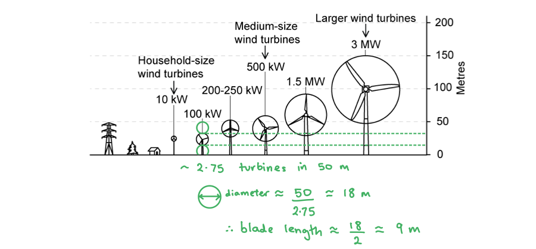

# Mark Schemes — SI Units
**1. Physical Quantities & Units** · Cambridge (CIE) AS physics (9702)

## Multiple Choice Questions (22 questions)

### Q1
**Final answer:** **The correct answer is D**

- The newton (N) is a derived unit (1 N = 1 kg m s-2)

**A** is incorrect because ampere (A) is an SI base unit

**B** is incorrect because kelvin (K) is an SI base unit

**C** is incorrect because mole (mol) is an SI base unit

> **[exam-tip]**
> The derived units you need to be familiar with are:
> 
> - force - newton (N)
> - energy - joule (J)
> - power - watt (W)
> - pressure - pascal (Pa)
> - potential difference - volt (V)

### Q2
**Final answer:** **The correct answer is D**

- $T = \text{tera} = 10^{12}$

$10^{2} \times 10^{12} = 10^{(12+2)} = 10^{14}$

- $p = \text{pico} = 10^{-12}$

$10^{-4} \times 10^{-12} = 10^{(-12-4)} = 10^{-16}$

- Determine the ratio

$10^{ \frac{14}{10^{-16}} } = 10^{14 - ( - 16 )} = 10^{30}$

- This is answer **D**

### Q3
**Final answer:** **The correct answer is ****D**** because:**

- The volt is a derived unit (1 V = 1 kg m2 s−3 A−1 )

**A** is incorrect because kilogram is a base unit

**B** is incorrect because metre is a base unit

**C** is incorrect because second is a base unit

The base units you need to be familiar with are:

- Mass - kilogram (kg)
- Length - metre (m)
- Time - second (s)
- Temperature - Kelvin (K)
- Electric current - ampere (A)

### Q4
**Final answer:** **The correct answer is ****D**** because:**

- $T=\mathrm{tera}=10^{12}$

  - $10^{ - } 3 \times 10^{12} = 10^{open} \text{parentheses} 12 - 3 ) = 10^{9}$
- $k=\mathrm{kilo}=10^{3}$

  - $10^{3} \times 10^{3} = 10^{( 3 + 3 )} = 10^{6}$
- $10^{ \frac{9}{10^{6}} = 10^{(} \text{parentheses} 9 - 6 ) } = 10^{3}$

### Q5
**Final answer:** **The correct answer is ****A**** because:**

- Combining $\DeltaP=\frac{F}{A}\text{and}F=ma$

  - $\DeltaP=\frac{ma}{A}=\frac{\mathrm{kg} \mathrm{ms}^{-2}}{m^{2}}=\mathrm{kg}m^{-1}s^{-2}$
- The units of density are

  - $ρ=\frac{m}{v}$$=\mathrm{kg}m^{-3}$
  - $\frac{\DeltaP}{ρ}=\frac{\mathrm{kg}m^{-1}s^{-2}}{\mathrm{kg}m^{-3}}=m^{3}m^{-1}s^{-2}=m^{2}s^{-2}$
  - $\mathrm{m} \mathrm{s}^{- 1 } = ( \mathrm{m}^{2} \mathrm{s}^{- 2} )^{n}$
- Therefore $n=\frac{1}{2}$

### Q6
**Final answer:** **The correct answer is ****A**** because:**

- nano = 1 × 10−9
- mega = 1 × 106
- nano × mega = (1 × 10−9) × (1 × 106) = (1 × 10−3) = 0.001
- This is the smallest answer

**B** is incorrect because:

- tera = 1 × 1012
- pico = 1 × 10-12
- tera × pico = (1 × 1012) × (1 ×10-12) = (1 × 100) = 1
- This is greater than **A**

**C** is incorrect because:

- centi = 1 × 10−2
- kilo = 1 × 103
- centi × kilo = (1 × 10−2) × (1 × 103) = (1 × 101) = 10
- This is greater than **A**

**D** is incorrect because:

- micro = 1  × 10−6
- giga = 1 × 109
- micro × giga = (1 ×10−6) × (1 × 109) = (1 × 103)  = 1000
- This is greater than **A**

You are expected to know the following prefixes:

- pico (p)
- nano (n)
- micro (μ)
- milli (m)
- centi (c)
- deci (d)
- kilo (k)
- mega (M)
- giga (G)
- tera (T)

### Q7
**Final answer:** **The correct answer is ****A**** because:**

- From the given relationship $I=I_{0}e^{\frac{-qV}{nT}}$

  - $I$ and $I_{0}$ are both currents with units of amperes, A
  - The exponent $\frac{qV}{nT}$ must be dimensionless (have no units)
  - Therefore, the units of $n$ must cancel the units of $\frac{qV}{T}$
- The unit of charge $q$ is the coulomb C, which in SI base units is:

  - $q=I\timest$
  - $[ q ] = \mathrm{A} \mathrm{s}$
- The unit of potential difference $V$ is the volt V, which in SI base units is:

  - $V=\frac{W}{q}$
  - the unit of work done is $[ W ] = \mathrm{J} = \text{kg} \mathrm{m}^{2} \mathrm{s}^{- 2}$
  - $[ V ] = \mathrm{J} \mathrm{C}^{- 1}$
  - $[ V ] = \text{kg} \mathrm{m}^{2} \mathrm{s}^{- 2} ( \mathrm{A} \mathrm{s} )^{- 1}$
  - $[ V ] = \text{kg} \mathrm{m}^{2} \mathrm{s}^{- 3} \mathrm{A}^{- 1}$
- The unit of temperature $T$ is the Kelvin K, which is an SI base unit
- Therefore, the unit of $n$ is:

  - $n\propto\frac{qV}{T}$
  - $[ n ] = \mathrm{A} \mathrm{s} ( \text{kg} \mathrm{m}^{2} \mathrm{s}^{- 3} \mathrm{A}^{- 1} ) \mathrm{K}^{- 1}$
  - $[ n ] = \text{kg} \mathrm{m}^{2} \mathrm{s}^{- 2} \mathrm{K}^{- 1}$

### Q8
**Final answer:** **The correct answer is ****D**** because:**

- Potential difference is equal to $\frac{workdone}{charge}$
- So, the unit of the volt is J C-1
- The base unit of energy $E=\frac{1}{2}mv^{2}$ is

  - $\mathrm{J} = \text{kg} ( ms^{- 1} )^{2} = kgm^{2} \mathrm{s}^{- 2}$
- The base unit of charge $Q=It$ is

  - $C=\mathrm{As}$
- So, the base unit of the volt is

  - $JC^{-1}=\mathrm{kg}m^{2}s^{-2}A^{-1}s^{-1}$
- $V=\mathrm{kg}m^{2}s^{-3}A^{-1}$

### Q9
**Final answer:** **The correct answer is ****C**** because:**

- The unit of

  - *v* is $ms^{-1}$
  - *g* is $ms^{-2}$
  - *λ* is $m$
- The unit of g*λ* is

  - $( \mathrm{m} \mathrm{s}^{- 2} \mathrm{m} )^{1 \frac{1}{2}} = ( \mathrm{m}^{2} \mathrm{s}^{- 2} )^{1 \frac{1}{2}} = \mathrm{m} \mathrm{s}^{- 1}$
- The units of the LHS and the RHS match so the correct answer is C

**A** is incorrect because  the unit of $\sqrt{ρgh}$ is $( [ \text{kg} \mathrm{m}^{- 3} ] [ \mathrm{m} \mathrm{s}^{- 2} ] [ \mathrm{m} ] )^{1 \frac{1}{2} } = ( \text{kg} \mathrm{m}^{- 1} \mathrm{s}^{- 2} )^{1 \frac{1}{2}}$

**B** is incorrect because the unit of $\sqrt{\frac{g}{h}}$ is $( [ \mathrm{m} \mathrm{s}^{- 2} ] [ \mathrm{m}^{- 1} ] )^{1 \frac{1}{2}} = \mathrm{s}^{- 1}$

**D** is incorrect because the unit of $\sqrt{\frac{g}{ρ}}$ is $( [ \mathrm{m} \mathrm{s}^{- 2} ] [ kg^{- 1} \mathrm{m}^{3} ] )^{1 \frac{1}{2}} = ( kg^{- 1} \mathrm{m}^{4 \mathrm{s}^{-2} } )^{1 \frac{1}{2}}$

### Q10
**Final answer:** **The correct answer is ****B**** because:**

- Once any constants are removed, $F\proptorηv$

  - * *$η\propto\frac{F}{rv}$
- $[ \\eta ] = \mathrm{N} \mathrm{m}^{- 1} ( \mathrm{m} \mathrm{s}^{- 1} )^{- 1}$
- $[ \\eta ] = \text{kg} \mathrm{m} \mathrm{s}^{- 2} \mathrm{m}^{- 2} \mathrm{s}$
- $[ \\eta ] = \text{kg} \mathrm{m}^{- 1} \mathrm{s}^{- 1}$
- Therefore, the units for *η* are $\mathrm{kg}m^{-1}s^{-1}$

### Q11
**Final answer:** **The correct answer is ****C**** because: **

- Change in momentum (or impulse) is equal to force × time, giving a unit of N s

**A** is incorrect as the unit of energy is* *J or* *kg m2 s-2* *or N m

**B** is incorrect as the unit of force is N or kg m s-2

**D** is incorrect as the unit of torque is N m or kg m2 s-2

### Q12
**Final answer:** **The correct answer is ****A**** because:**

- When $d=k_{1}v^{2}$ the unit of *k**1* is

  - $\frac{d}{v^{2}} = [ \mathrm{m} ] [ \mathrm{m} \mathrm{s}^{- 1} ] = \mathrm{m}^{- 1} \mathrm{s}^{2}$

- When $d=kv^{2}$ the unit of *k* is

  - $\frac{d}{v^{2}} ( \mathrm{m} ) [ \text{km} \mathrm{h}^{- 1} ] = \mathrm{m} ( \mathrm{m} \mathrm{s}^{- 1} )^{- 2 } ( \frac{1000}{60 \times 60} )^{- 2} = 13.0 \mathrm{m}^{- 1} \mathrm{s}^{2}$

- Comparing the two units we can see *k**1* = 13.0*k*, so *k* = 0.077$k_{1}$

**B **and **C **are incorrect because these are the answers you get if you don't square the conversion i.e.* *$\frac{3000}{1000}=3.6$* *

**D** is incorrect because $k_{1}$ is equal to 13.0*k*, not the other way around

### Q13
**Final answer:** **The correct answer is ****C**** because:**

- The definition of an electron volt is the energy that an electron gains when it travels through a potential of one volt
- 1 eV is equal to 1.6 × 10–19 J

### Q14
**Final answer:** **The correct answer is ****C**** because:**

- Pressure is equal to

  - $P = \frac{F}{A} = \mathrm{N} \mathrm{m}^{- 2} = ( \text{kg} ms^{- 2} ) \mathrm{m}^{- 2} = \text{kg} \mathrm{m}^{- 1} \mathrm{s}^{- 2}$
- On the RHS we can combine units to give

  - $[ \text{kg} \mathrm{m}^{- 3} ] [ \mathrm{m} ] [ \mathrm{m} \mathrm{s}^{- 2} ] = \text{kg} \mathrm{m}^{- 1} \mathrm{s}^{- 2}$
- The LHS matches the RHS so the correct answer is C

**A** is incorrect as the $Nm^{-1}$ on the LHS is the incorrect unit for pressure

**B** is incorrect as the units are correct on the LHS, but on the RHS $[ \text{kg} \mathrm{m}^{- 2} ] [ \mathrm{m} \mathrm{s}^{- 2} ] [ \mathrm{m} ]$ simplifies to* *$\mathrm{kg}s^{-1}$* *which is incorrect

**D** is incorrect as the $\mathrm{kg}m^{-1}s^{-1}$ on the LHS is the incorrect base unit for pressure

### Q15
**Final answer:** **The correct answer is ****C**** because:**

- If we convert each power of ten we get:

| - 5 kJ | = | 5 $\times$ 103 J |
|---|---|---|
| - 5 mJ | = | 5 $\times$10-3 J |
| - 5 MJ | = | 5 $\times$ 106 J |
| - 5 nJ | = | 5 $\times$ 10-9 J |

- Therefore, from smallest to largest: $5\mathrm{nJ}\rightarrow5\mathrm{mJ}\rightarrow5\mathrm{kJ}\rightarrow5\mathrm{MJ}$

### Q16
**Final answer:** **The correct answer is ****B**** because:**

- Pressure is equal to

  - $P=\frac{F}{A}=\mathrm{Nm}^{-2}$
- Young Modulus is equal to

  - $Y=\frac{stress}{strain}=\frac{σ}{ε}$
  - Stress: $σ=\frac{F}{A}$
  - Strain: $ε=\frac{x}{l}$
  - $Y=\frac{σ}{ε}=\frac{F}{A}\times\frac{l}{x}=\frac{N}{m^{2}}\times\frac{m}{m}=\mathrm{Nm}^{-2}$

Therefore, pressure and Young Modulus have the same base units.

**A** is incorrect as the base unit for force is kg m s-2 and the base unit for momentum is kg m s-1

**C** is incorrect as the unit for power is J s-1 and the unit for energy is J

**D** is incorrect as The base unit for mass is kg and the unit for weight is N or kg m s-2

### Q17
**Final answer:** **The correct answer is ****D**** because:**

- The base unit of energy is $\mathrm{J} = \text{kg} ( ms^{- 1} )^{2} = \text{kg} \mathrm{m}^{2} \mathrm{s}^{- 2}$

  - $\begin{gathered} g \\rho h V & = [ ms^{- 2} ] [ \text{kg} \mathrm{m}^{- 3} ] [ \mathrm{m} ] [ \mathrm{m}^{3} ] \end{gathered}$ $\begin{gathered} = \mathrm{N} \mathrm{m} \\ = ( \text{kg} \mathrm{m} \mathrm{s}^{- 2} ) \mathrm{m} \\ = \text{kg} \mathrm{m}^{2 } \mathrm{s}^{2} \end{gathered}$
- Therefore, $gρhV$ has the same units as energy

**A** is incorrect as the units of $\\rho g^{2} h = [ \text{kg} \mathrm{m}^{- 3} ] [ \mathrm{m} \mathrm{s}^{- 2} ]^{2} [ \mathrm{m} ] = \text{kg} \mathrm{s}^{- 4}$

**B** is incorrect as the units of $\frac{\\rho h V}{g} = [ \text{kg} \mathrm{m}^{- 3} ] [ \mathrm{m} ] [ \mathrm{m}^{3} ] [ \mathrm{m} \mathrm{s}^{- 2} ]^{- 1 } = \text{kg} \mathrm{s}^{2}$

**C** is incorrect as the units of $\frac{\\rho g}{h V} = [ \text{kg} \mathrm{m}^{- 3} ] [ \mathrm{m} \mathrm{s}^{- 2} ] [ \mathrm{m} ]^{- 1} [ \mathrm{m}^{3} ]^{- 1 } = \text{kg} \mathrm{m}^{- 6} \mathrm{s}^{- 2}$

### Q18
**Final answer:** **The correct answer is ****D**** because:**

- milli × tera is equal to 10–3 × 1012 = 109

**A** is incorrect as this is equal to 10–12 × 106 = 10–6

**B** is incorrect as this is equal to 10–9 × 103 = 10–6

**C** is incorrect as this is equal to 10–6 × 109 = 103

### Q19
**Final answer:** **The correct answer is ****D**** because:**

- We can ignore any numbers in the formula since they do not have any units.
- $k\propto\frac{E}{T}$ so, the unit will be along the lines of J K −1
- We can reduce J to its SI unit by considering the equation for kinetic energy $E_{k}\proptomv^{2}$

  - $\mathrm{J} = \text{kg} ( \mathrm{m} \mathrm{s}^{- 1} )^{2} = \text{kg} \mathrm{m}^{2} \mathrm{s}^{- 2}$
- The units of *k* are

  - $JK^{-1}=\mathrm{kg}m^{2}s^{-2}K^{-1}$

### Q20
**Final answer:** **The correct answer is ****C**** because:**

- The units of the variables are:

  - *g *: m s−2
  - *r *: m
  - *⍴* : kg m−3
  - *ɳ *: kg  m−1 s−1
- Substituting these units into the equation and ignoring constants:

  - $ms^{-1}=\frac{(ms^{-2})(m^{n})(\mathrm{kgm}^{-3})}{\mathrm{kg}m^{-1}s^{-1}}$
  - $ms^{-1}=\frac{m^{-2}s^{-2}m^{n}\mathrm{kg}}{\mathrm{kg}m^{-1}s^{-1}}$
  - $ms^{-1}=m^{-1}s^{-1}m^{n}$

- For the sides to balance *n* must be 2 so that:

  - $ms^{-1}=m^{-1}s^{-1}m^{2}$
  - $ms^{-1}=ms^{-1}$

**A** is incorrect because:

- $\mathrm{m} \mathrm{s}^{- 1} = \frac{( \mathrm{m} \mathrm{s}^{- 2} ) ( \mathrm{m}^{1 \frac{1}{2}} ) ( \text{kg} \mathrm{m}^{- 3} )}{kg \mathrm{m}^{- 1} \mathrm{s}^{- 1} }$
- $ms^{-1}=m^{-1}s^{-1}m^{\frac{1}{2}}$
- $ms^{-1}=m^{-\frac{1}{2}}s^{-1}$

**B** is incorrect because:

- $ms^{-1}=\frac{(ms^{-2})(m)(\mathrm{kg}m^{-3})}{\mathrm{kg}m^{-1}s^{-1}}$
- $ms^{-1}=m^{-1}s^{-1}m$
- $ms^{-1}=s^{-1}$

**D** is incorrect because:

- $ms^{-1}=\frac{(ms^{-2})(m^{3})(\mathrm{kg}m^{-3})}{\mathrm{kg}m^{-1}s^{-1}}$
- $ms^{-1}=m^{-1}s^{-1}m^{3}$
- $ms^{-1}=m^{2}s^{-1}$

Make sure to substitute the units of all of the terms into the equations. Then set *n* such that the equation is homogeneous. An equation is homogeneous when the units on both sides of the equation are the same.

### Q21
**Final answer:** **The correct answer is ****B**** because:**

- Since *C**d* is a quantity with no units we can disregard it for this question
- That leaves us with F $αρv^{n}A$
- So, $v^{n}α\frac{F}{ρA}$
- $( ms^{- 1} )^{ \mathrm{n} = [ \mathrm{N} ] [ \text{kg} \mathrm{m}^{-3} } ]^{- 1} [ \mathrm{m}^{2} ]^{- 1}$ *= *$\mathrm{kg}ms^{-2}\mathrm{kg}^{-1}m^{3}m^{-2}$ *=  *$m^{2}s^{-2}$
- Comparing $( \mathrm{m} \mathrm{s}^{- 1} )^{ \mathrm{n} = \mathrm{m}^{2} \mathrm{s}^{-2} }$ we can see that *n *=  2

### Q22
**Final answer:** **The correct answer is ****C**** because:**

- The main SI units you need to be aware of are:

  - Metre (m)
  - Kilogram (kg)
  - Second (s)
  - Ampere (A)
  - Kelvin (K)
  - Mole (mol)

- Kelvin is the only SI unit listed

**A **is incorrect as current is a quantity, not a unit

**B** is incorrect as the correct SI unit for mass is the kilogram

**D** is incorrect as the volt is a derived unit

## Structured Questions (8 questions)

### Q1
Show that the constant *C**P* has no units:

- $P=C_{P}L^{2}ρv^{3}$
- Unit of length $[ L ]$ = m
- Unit of density $[ \\rho ] = \frac{[ m ]}{[ V ]}$ = kg m−3 **[1 mark]**
- Unit of velocity $[ v ]$ = m s−1

Determine the SI unit of power:

- Unit of power $[ P ] = \frac{[ E ]}{[ t ]} = \frac{[ m ] [ v ]^{2}}{[ t ]} = \frac{( k g ) ( m s^{- 1} )^{2}}{s}$ **[1 mark]**
- $[ P ]$ = kg m2 s−2 s−3 = kg m2 s−3 **[1 mark]**

Determine the units on both sides of the expression:

- $[ P ] = [ C_{P} ] [ L ]^{2} [ \\rho ] [ v ]^{3}$
- LHS: $[ P ]$ = kg m2 s−3
- RHS: $[ L ]^{2} [ \\rho ] [ v ]^{3}$ = (m)2 (kg m−3) (m s−1)3 **[1 mark]**
- RHS: $[ L ]^{2} [ \\rho ] [ v ]^{3}$ = kg m2 m−3 m3 s−1 = kg m2 s−3 **[1 mark]**
- LHS = RHS, so *C**P* has no unit

**[Total: 5 marks]**
List the known quantities:

- Number of households = 2500
- Average energy consumption per household per year = 2800 kWh
- Number of turbines = 8
- Constant, *C**P* = 0.45
- Density of air, *ρ* = 1.3 kg m−3

(i) Determine the power rating of the wind turbine the council decided to build:

- Total energy (kWh) required by the village in a year:  2500 × 2800 = 7 000 000 kWh
- Total energy required per day:  $\frac{7000000}{365}$ = 19 178 kW h
- Power output required:  $\frac{19178}{24}$ = 799 kW **[1 mark]**
- Power output required per turbine:  $\frac{799}{8}\approx$ 100 kW **[1 mark]**
- The council chose the 100 kW turbine; **[1 mark]**

(ii) Estimate the average wind velocity required to power the entire village:

- (From Fig 1.3) there are about 2 ¾ 100 kW turbine diameters in 50 m
- So, the diameter of the 1 turbine ≈ $\frac{50}{2.75}$ ≈ 18 m
- The length of a blade *L* ≈ 9 m **[1 mark]** *Acceptable range for blade length L = 7 to 11 m*

Determine the average wind velocity:

- $P = C_{P} L^{2} \\rho v^{3} \Leftrightarrow v = \sqrt[3]{ \frac{P}{C_{P} L^{2} \\rho } }$
- $v \approx \sqrt[3]{ \frac{100 000}{0.45 \times 9^{2} \times 1.3} } \approx$ 13 m s−1 **[1 mark]**
- The wind velocity must average at least 13 m s−1 in order for the turbines to maintain a power output of 100 kW

**[Total: 5 marks] **

### Q2
(i) The SI base units are:

| **SI base quantity** | **SI base unit** |
|---|---|
| mass | kg |
| time | **Final answer:** **s** |
| length | **Final answer:** **m** |

- time = second **OR** s **[1 mark]**
- length = metre **OR** m **[1 mark]**

(ii) Two other SI base quantities & their units are:

Any** two** from:

- Temperature **AND** Kelvin / K **[1 mark]**
- Current **AND** amp / ampere / A **[1 mark]**
- Amount of substance **AND** mole / mol **[1 mark]**

**[Total: 4 marks]**
Write 1 N in SI base units:

- $F = m a \Leftrightarrow [ F ] = [ m ] [ a ]$

  - $[ m ]$* *= kg
  - $[ a ]$ = m s−2

- 1 N = (kg) × (m s−2) **[1 mark]**
- 1 N = kg m s−2 **[1 mark]**

**[Total: 2 marks]**

> *It is really important that you learn the SI base units in case you are asked a question like this in the exam*

> *Once you know the SI base units, it is fairly straightforward to deduce the base units for any derived unit because the method is exactly the same as the method given here.*
Write 1 J in SI base units:

- $E_{k} = 1 \frac{1}{2} m v^{2} \Leftrightarrow [ E_{k} ] = [ m ] [ v ]^{2}$

  - $[ m ]$ = kg
  - $[ v ]$ = m s−1

- 1 J = (kg) × (m s−1)2** [1 mark]**
- 1 J = kg m2 s−2 **[1 mark]**

**[Total: 2 marks]**

> *The same method is used to determine the SI base units for any derived unit*

> *Practice this skill as part of your revision. It will help you to remember the SI base units (if you don't already know them) rather than having to learn them by rote.*
Deduce the SI base unit for W:

- Power: * *$P = \frac{E}{t} \Leftrightarrow [ P ] = \frac{[ E ]}{[ t ]}$

  - $[ E ]$ = kg m2 s−2 (from **(c)**)
  - $[ t ]$ = s

- W = $\frac{kgm^{2}s^{-2}}{s}$ **[1 mark]**
- W = kg m2 s−3 **[1 mark]**

**[Total: 2 marks]**

> *It would be a good idea to practice deducing the SI base units for a variety of derived units so that you get comfortable with the method and familiar with the SI units*

> *Try it for each topic as part of your revision. *

### Q3
Underline all the units that are SI base units:

<u>kilogram</u> ‎ ‎ ‎ ‎ ‎ ‎ ‎ ‎ ‎ newton ‎ ‎ ‎ ‎ ‎ ‎ ‎ ‎ ‎ <u>metre</u> ‎ ‎ ‎ ‎ ‎ ‎ ‎ ‎ ‎ coulomb ‎ ‎ ‎ ‎ ‎ ‎ ‎ ‎ ‎ volt ‎ ‎ ‎ ‎ ‎ ‎ ‎ ‎ ‎ <u>ampere</u>

- kilogram **[1 mark]**
- metre **[1 mark]**
- ampere **[1 mark]**

**[Total: 3 marks]**

> *Make sure you can quickly recall the SI quantities! This will save you a lot of time in your exam. *
The correct table of prefixes and powers of ten is as follows:

| **Prefix** | **Power of ten** |
|---|---|
| tera (T) | ** 10****12**** ** |
| **Final answer:** **giga (G)** | 109 |
| **Final answer:** ** kilo (k)** | 103  |
| centi (c) | 10−2 |
| milli (m) | **Final answer:** **10****−3** |
| micro (μ) | **10****−6** |
| **Final answer:** ** nano (n)** | 10−9 |
| pico (p) | 10−12 |

- **[3 marks] **for all six correct
- **[2 marks]** for four or five correct
- **[1 mark]** for two or three correct
- **[0 marks]** for less than two correct

**[Total: 3 marks]**
(i) 0.71 GJ in standard form and 3 s.f. is:

- 1 GJ = 1 × 109 J
- 0.71 GJ = 0.71 × (1 × 109 J)
- 0.71 GJ = 7.10 × 108 J (3 s.f.) **[1 mark]**

(ii) 24.5 kW in standard form and 4 s.f. is:

- 1 kW = 1 × 103 W
- 24.5 kW = 24.5 × (1 × 103 W)
- 24.5 kW = 2.450 × 104 W (4 s.f.) **[1 mark]**

(iii) 0.003823 mm in standard form and 1 s.f. is:

- 1 mm = 1 × 10−3 m
- 0.003823 mm = 0.003823 × (1 × 10−3 m)
- 0.003823 mm = 4 × 10−6 m (1 s.f) **[1 mark]**

(iv) 644.9 pN in standard form and 2 s.f. is:

- 1 pN = 1 × 10–12 N
- 644.9 pN = 644.9 × (1 × 10–12 N)
- 644.9 pN = 6.4 × 10–10 N (2 s.f.) **[1 mark]**

**[Total: 4 marks]**

> *You should be familiar with using scientific notation from IGCSE, but it can be tricky when you are first learning. Practice makes perfect.*

> *Make sure you are confident in using and converting numbers in standard form well before your exams. And make sure you know how to quote numbers to appropriate numbers of significant figures, as this is something that can cost you marks in an exam if you don't do it correctly!*
The measurements with suitable prefixes are:

- 9.3 × 106 J = 9.3 MJ **[1 mark]**
- 7.4 × 103 W = 7.4 kW **[1 mark]**
- 1.0 × 10−2 m = 1.0 cm **OR** 10 mm **[1 mark]**
- 5.3 × 10−9 C = 5.3 nC **[1 mark]**

** ****[Total: 4 marks]**

> *Learn the prefixes and their magnitudes. This can give you easy marks in your exam. *

### Q4
Derive the SI base unit of force:

- Force:  $F=ma$ **[1 mark]**
- Unit of mass: kg
- Unit of acceleration: m s−2

Determine the unit of force:

- $[ F ] = [ m ] [ a ]$
- $[ F ]$ = kg m s−2 **[1 mark]**

**[Total: 2 marks]**
Derive the SI base unit of the constant $k$:

- $F=krv$
- Unit of force $[ F ]$ = kg m s−2
- Unit of radius $[ r ]$ = m
- Unit of speed $[ v ]$ = m s−1

Determine the units on both sides of the expression:

- $[ F ] = [ k ] [ r ] [ v ] \Leftrightarrow [ k ] = \frac{[ F ]}{[ r ] [ v ]}$
- $[ k ] = \frac{k g m s^{- 2} }{( m ) ( m s^{- 1} )}$ **[1 mark]**
- $[ k ]$ = kg m−1 s−1 **[1 mark]**

**[Total: 2 marks]**

### Q5
A correctly completed table that would score 5 marks should look like this:

**One mark for each correct row:**

| **Quantity** | **Name** | **Symbol** | ** ** |
|---|---|---|---|
| length | **Final answer:** **metre** | **Final answer:** **m** | **[1 mark]** |
| **Final answer:** **mass** | kilogram | **Final answer:** **kg ** | **[1 mark]** |
| **Final answer:** **time** | **Final answer:** **second** | s | **[1 mark]** |
| **Final answer:** **current** | ampere | **Final answer:** **A ** | **[1 mark]** |
| temperature | **Final answer:** **kelvin ** | K | **[1 mark]** |

** ****[Total: 5 marks]**
Using the equation linking kinetic energy and speed to write 1 Joule in SI base units:

- Kinetic energy [J] = mass [kg] × (speed)2 [m s–1]2 **[1 mark]**
- 1 joule = kg m2 s–2 **[1 mark]**

**[Total: 2 marks]**
Using the equation *Charge* = *Current *× *Time* to write 1 Coulomb in SI base units:

- Charge [C] = Current [A] × Time [s] **[1 mark]**
- 1 coulomb = 1 A s **[1 mark]**

** ****[Total: 2 marks]**
Using the equation *Energy* = *Charge* × *Potential Difference* to write 1 volt in SI base units:

- Energy [J] = Charge [C] × Potential Difference [V] **[1 mark]**
- V = [J] [C]–1 = [kg m2 s–2] [A s]–1
- 1 volt = 1 kg m2 s–3 A–1 **[1 mark]**

**[Total: 2 marks]**

> *Recall that potential difference is defined as the energy transferred per unit charge, hence the units ‘J C**–1**’. Parts (b) and (c) of this question can be used to answer part (d). It can save time to look back through previous question parts to see if they can help you. *

### Q6
Estimate the time it takes light to cross the nucleus of a hydrogen atom:

- Speed of light in vacuum, *c* = 3.00 × 108 m s–1

Estimate the diameter of the nucleus of a hydrogen atom:

- A hydrogen atom has a nucleus made of 1 proton
- The size of a hydrogen nucleus is 1 fm = 1 × 10–15 m

Estimate the time using the equation relating speed, time and distance:

- $\mathrm{time}=\frac{\mathrm{distance}}{\mathrm{speed}}$
- $\mathrm{time}=\frac{1\times10^{-15}}{3.00\times10^{8}}$ **[1 mark]**
- $\mathrm{time}=3\times10^{-24}s$ **[1 mark]**

**[Total: 2 marks]**
List the known quantities:

- Thickness of gold foil = 0.132 µm = 0.132 × 10−6 m
- Radius of gold atom = 146 pm = 146 × 10−12 m
- Radius of gold nucleus = $\frac{\mathrm{radius} \mathrm{of} \mathrm{gold} \mathrm{atom}}{20000}$

(i) Estimate the number of layers of atoms in the gold foil to the nearest hundred:

- Diameter of a gold atom = (146 × 10−12) × 2 = 292 × 10–12 m
- Number of layers = $\frac{0.132\times10^{-6}}{292\times10^{-12}}$ = 452.05 = 500 layers (1 s.f.) **[1 mark]**

(ii) Calculate the cross-sectional area of a gold nucleus in barns (b):

- Convert fm2 into m2:

  - 1 fm = 1 × 10–15 m
  - 1 fm2 = (1 × 10–15)2 m2 = 1 × 10–30 m2

- Calculate the value of 1 barn in m2:

  - 1 b = 100 fm2 = 100 × (1 × 10–30) m2 = 1 × 10–28 m2 **[1 mark]**

Determine the cross-sectional area and convert to barns:

- Radius of a gold nucleus:   $r\approx\frac{146\times10^{-12}}{20000}\approx$ 7.3 × 10−15 m
- Cross-sectional area of a gold nucleus = $\mathrm{\pi } r^{2} \approx \mathrm{\pi } ( 7.3 \times 10^{- 15} )^{2} \approx$ 1.67 × 10−28 m2 **[1 mark]**
- Cross-sectional area of a gold nucleus = $\frac{1.67\times10^{-28}}{1\times10^{-28}}\approx$ 1.67 b **[1 mark]**

**[Total: 4 marks]**

> *Although the values in the question are given to three significant figures, it makes sense to round to the nearest hundred in part (i), since we are ignoring factors such as spaces between atoms and layers in the lattice.*

> *The barn described in this question is a real unit. Other less well-known units include the ‘outhouse’ (1 µb) and the ‘shed’ (10**–24** b). Particle physicists are clearly quite creative!*
Show that 1*u* is approximately equal to the mass of a proton in kg:

List the known quantities:

- Atomic mass unit, 1 *u* = 931.5 MeV c–2
- Speed of light in vacuum, *c* = 3.00 × 108 m s–1
- Mass of a proton, *m**p* = 1.67 × 10–27 kg

Convert 1*u* to J:

- 1*u* = 931.5 MeV = 931.5 × 106 eV **[1 mark]**
- 1 eV = 1.60 × 10–19 J
- 1*u* = (931.5 × 106) × (1.60 × 10–19) = 1.4904 × 10–10 J **[1 mark]**

Convert energy in J to mass in kg:

- Energy-mass equivalence:  $\DeltaE=\Deltamc^{2}\Rightarrow\Deltam=\frac{\DeltaE}{c^{2}}$
- $m=\frac{1.4904\times10^{-10}}{(3.00\times10^{8})^{2}}=$1.66 × 10–27 kg **[1 mark]**
- Therefore, 1*u* is approximately equal to the mass of a proton *m**p* = 1.67 × 10–27 kg

**[Total: 3 marks]**

> *You will be expected to remember the definition of an electronvolt 1 eV = 1.60 × 10**–19** J for your exam, however, you will be given the charge on an electron **e** on your data sheet which is also equal to 1.60 × 10**–19** C*
Estimate the number of football fields that could fit lengthwise between the Earth and the Sun:

- 1 AU = 150 million km = 150 × 106 × 103 m = 150 × 109 m **[1 mark]**
- 1 acre = 1 football field = 4050 m2

Estimate the length of a football field

- A football field is rectangular, so a reasonable ratio of the length to the width of a football field might be 3:2
- This means area:  $A=L\timesw\RightarrowA=3x\times2x$
- Where $x$ = the constant of proportionality in the 3:2 ratio, i.e. $L=3x$ and $w=2x$
- $4050=6x^{2}\Rightarrowx=\sqrt{\frac{4050}{6}}=25.981\approx26m$
- Hence, length:  $L=3x\approx3\times26\approx78m$ **[1 mark]**

Estimate the number of lengths that would fit in 1 AU:

- Number of football fields in 1 AU = $\frac{150\times10^{9}}{78}$ = 1.9231 × 109 ≈ 2 × 109 (1 s.f.) **[1 mark]**
- Therefore, approximately 2 billion football fields could fit lengthwise between the Earth and the Sun

**[Total: 3 marks]**

> *Questions such as this are all about your problem-solving skills. While approximating a football field to a square might not be exactly right, if you took this approach, then you would still end up with the same answer once you round down to 1 significant figure*

> *Approximating the field as a square: length = *$\sqrt{4050}$* ≈ 64 m*

> *Number of football fields in 1 AU = *$\frac{150\times10^{9}}{64}$* = 2.3438 × 10**9** ≈ 2 × 10**9** (1 s.f.)*

### Q7
(i) Velocity is defined as

- Change in displacement per unit time; **[1 mark]**
- SI base unit = m s−1 **[1 mark]**

(ii) Acceleration is defined as

- Change in velocity per unit time; **[1 mark]**
- SI base unit = m s−2 **[1 mark]**

(iii) Density is defined as

- Mass per unit volume; **[1 mark]**
- SI base unit = kg m−3 **[1 mark]**

**[Total: 6 marks]**
Use the expression to determine the derived unit for pressure:

- $P=ρgh$
- Unit of density $[ \\rho ]$ = kg m−3
- Unit of acceleration $[ g ]$ = m s−2
- Unit of height $[ h ]$ = m

Determine the unit of pressure:

- $[ P ] = [ \\rho ] [ g ] [ h ]$
- $[ P ]$ = (kg m−3) × (m s−2) × (m) **[1 mark]**
- $[ P ]$ = kg m−1 s−2 **[1 mark]**

**[Total: 2 marks]**
Show that the constant $γ$ has no unit:

- $v=\sqrt{\frac{γP}{ρ}}$
- Unit of density $[ \\rho ]$ = kg m−3
- Unit of velocity $[ v ]$ = m s−1
- Unit of pressure $[ P ]$ = kg m−1 s−2

Determine the units on both sides of the expression:

- $[ v ] = \sqrt{ \frac{[ \ \\gamma ] [ P ]}{[ \\rho ]} }$
- LHS: $[ v ]$ = m s−1 **[1 mark]**
- RHS: $\sqrt{ \frac{[ P ]}{[ \\rho ]} } = \sqrt{ \frac{k g m^{- 1} s^{- 2} }{k g m^{- 3} } }$ **[1 mark]**
- RHS: $\sqrt{ \frac{[ P ]}{[ \\rho ]} } = \sqrt{m^{- 1} m^{3} s^{- 2} } = \sqrt{m^{2} s^{- 2} } = m s^{- 1}$ **[1 mark]**
- LHS = RHS, so $γ$ has no unit

**[Total: 3 marks]**

### Q8
(i) Convert 42 km3 into mm3:

- Convert km into mm:

  - 1 km = $\frac{1\times10^{3}}{1\times10^{-3}}$ = 1 × 106 mm
- Convert km3 into mm3:

  - 1 km3 = (1 × 106)3 mm3 = 1 × 1018 mm3 **[1 mark] **
- 42 km3 = 42 × (1 × 1018)
- 42 km3 = 4.2 × 1019 mm3 **[1 mark]**

(ii) Convert 25 light-years into nm:

- 1 light year = the distance light travels in 1 year
- Speed of light = 3.0 × 108 m s−1
- Convert 1 year into s:

  - 1 year = 60 × 60 × 24 × 365 = 3.15 × 107 s
- Convert 1 ly into m:

  - distance = speed × time
  - 1 ly = (3.0 × 108) × (3.15 × 107) = 9.46 × 1015 m **[1 mark]**
- Convert m into nm:

  - 1 ly = $\frac{9.46\times10^{15}}{1\times10^{-9}}$ = 9.46 × 1024 nm
- 25 ly = 25 × (9.46 × 1024)
- 25 ly = 2.4 × 1026 nm **[1 mark]**

(iii) Convert 0.05 kWh into PeV:

- Convert from kW h to W h:

  - 1 kW = 1000 W h
  - 0.05 kWh = 0.05 × 1000 = 50 W h
- Convert from W h to J:

  - 1 h = 60 × 60 = 3600 s
  - 50 W h = 50 × 3600 = 180 000 W s = 180 000 J
- Convert J to eV:

  - 1 eV = 1.60 × 10–19 J
  - 180 000 J = $\frac{180000}{1.60\times10^{-19}}$ = 1.125 × 1024 eV **[1 mark]**
- Convert from eV to PeV:

  - 1 PeV = 1 × 1015 eV
- 0.05 kWh = $\frac{1.125\times10^{24}}{1\times10^{15}}$
- 0.05 kWh = 1.1 × 109 PeV **[1 mark] **

**[Total: 6 marks]**
By considering the homogeneity of the equation, determine the value of *k*:

- $f^{k}=\frac{T}{4mL^{2}}$
- Consider the units on the LHS: $( \text{Hz} )^{k = ( \mathrm{s}^{-1} } )^{k = \mathrm{s}^{-k} }$ **[1 mark]**
- Consider the units on the RHS: $\frac{ \mathrm{N} }{( \text{kg} \mathrm{m}^{- 1} ) \mathrm{m}^{2}} = \frac{ \mathrm{N} }{kg \mathrm{m} }$ **[1 mark]**

Simplify the units on the RHS:

- From $F=ma$, the SI base unit of N is $\mathrm{kg}ms^{-2}$
- Hence $\frac{ \mathrm{N} }{( \text{kg} \mathrm{m}^{- 1} ) \mathrm{m}^{2}} = \frac{kg \mathrm{m} \mathrm{s}^{- 2} }{kg \mathrm{m} } = \mathrm{s}^{- 2}$
- Comparing RHS with LHS:  $s^{-k}=s^{-2}$
- Therefore, *k* = 2 **[1 mark]**

**[Total: 3 marks]**
(i) By considering the homogeneity of the equation, determine the units of *n*:

- $I=I_{0}e^{-\frac{qV}{nT}}\Rightarrow\frac{I}{I_{0}}=e^{-\frac{qV}{nT}}$
- Since the units on the LHS $\frac{A}{A}=1$, the units of $\frac{qV}{nT}$ will also be dimensionless

State the SI units of temperature *T*:

- Units of $[ T ] = \mathrm{K}$

Determine the SI units of charge *q*:

- Charge:  $I=\frac{q}{t}\Rightarrowq=It$
- Units of $[ q ] = \mathrm{C} = \mathrm{A} \mathrm{s}$ **[1 mark]**

Determine the SI units of potential difference *V*:

- Potential difference:  $V=\frac{W}{q}$
- Work done:  $W=F\timess$  or  $\frac{1}{2}mv^{2}$
- Units of $[ W ] = [ m ] [ v ]^{2} = \mathrm{J} = \text{kg} \mathrm{m}^{2} \mathrm{s}^{- 2}$
- Units of $[ V ] = \mathrm{J} \mathrm{C}^{- 1} = \mathrm{J} \mathrm{A}^{- 1} \mathrm{s}^{- 1}$
- Units of $[ V ] = ( \text{kg} \mathrm{m}^{2} \mathrm{s}^{- 2} ) \mathrm{s}^{- 1} \mathrm{A}^{- 1} = \text{kg} \mathrm{m}^{2} \mathrm{s}^{- 3} \mathrm{A}^{- 1}$ **[1 mark]**

Determine the units of constant *n*:

- Units of *n*:    $[ n ] = \frac{[ q ] [ V ]}{[ T ]}$
- $[ n ] = \frac{ \mathrm{A} \mathrm{s} ( \text{kg} \mathrm{m}^{2} \mathrm{s}^{- 3} \mathrm{A}^{- 1} )}{ \mathrm{K} }$
- $[ n ] = \text{kg} \mathrm{m}^{2} \mathrm{s}^{- 2} \mathrm{K}^{- 1}$ **[1 mark]**

(ii) Determine the name of the constant:

- Since $J=\mathrm{kg}m^{2}s^{-2}$, the derived unit of *n* is $JK^{-1}$
- Therefore, this is the <u>Boltzmann constant</u>, $k$ = 1.38 × 10–23 J K–1 **[1 mark]**

**[Total: 4 marks]**
