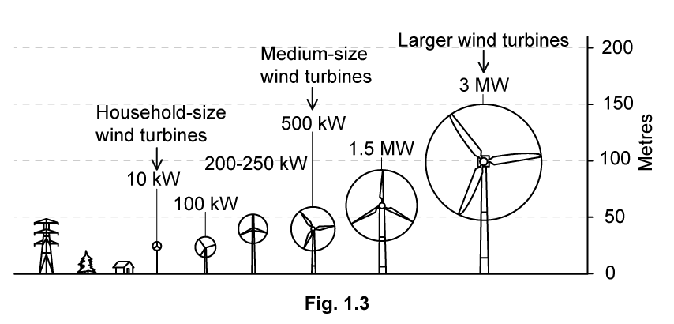

# Exam Questions — SI Units
**1. Physical Quantities & Units** · Cambridge (CIE) AS physics (9702)
> Source: [https://www.savemyexams.com/as/physics/cie/25/topic-questions/](https://www.savemyexams.com/as/physics/cie/25/topic-questions/) · 30 questions across 2 sets

## Multiple Choice Questions (22 questions)

### Q1 — easy — 1 marks

**Q1** [1 mark]

Which unit is **not **an SI base unit?

### Q2 — medium — 1 marks

**Q2** [1 mark]

What is the ratio $\frac{10^{2}\text{THz}}{10^{-4}\text{pHz}}$ ?

### Q3 — easy — 1 marks

**Q3** [1 mark]

Which of the following is not a SI base unit?

### Q4 — medium — 1 marks

**Q4** [1 mark]

What is the ratio $\frac{10^{-3}\mathrm{THz}}{10^{3}\mathrm{kHz}}$ ?

### Q5 — hard — 1 marks

**Q5** [1 mark]

The speed *v* of a liquid leaving a tube depends on the change in pressure Δ*P* and the density *ρ* of the liquid. The speed is given by the equation

$v = k ( \frac{\Delta P}{\\rho } )^{n}$

where *k* is a constant that has no units.

What is the value of *n*?

### Q6 — easy — 1 marks

**Q6** [1 mark]

Which product pair of metric prefixes has the smallest magnitude?

### Q7 — hard — 1 marks

**Q7** [1 mark]

The current $I$ through a semiconductor diode is given by:

$I=I_{0}e^{\frac{-qV}{nT}}$

where $I_{0}$ is the initial current, $q$ is the charge of an electron, $V$ is the applied potential difference, $T$ is the temperature, and $n$ is a constant.

What is the unit of $n$* *when expressed in SI base units?

### Q8 — medium — 1 marks

**Q8** [1 mark]

Which of the following correctly expresses the volt in terms of SI base units?

### Q9 — hard — 1 marks

**Q9** [1 mark]

Which formula could be correct for the speed *v* of ocean waves in terms of the density *ρ* of sea-water, the acceleration of free fall g, the height *h* of the wave and the wavelength *λ*?

### Q10 — hard — 1 marks

**Q10** [1 mark]

The frictional force *F* on a sphere falling through a fluid is given by the formula

$F=6πrηv$

where *r* is the radius of the sphere, *η* is a constant relating to the fluid and *v* is the velocity of the sphere.

What are the units of *η *?

### Q11 — easy — 1 marks

**Q11** [1 mark]

Which statement includes a correct unit?

### Q12 — hard — 1 marks

**Q12** [1 mark]

When a constant braking force is applied to a vehicle moving at speed *v*, the distance *d* moved by the vehicle as it comes to rest is given by the expression

$d=kv^{2}$

where* k* is a constant.

When *d* is measured in metres and *v* is measured in metres per second, the constant has a value of *k**1*.

What is the value of the constant *k* when the distance is measured in metres, and the speed is measured in kilometres per hour?

### Q13 — easy — 1 marks

**Q13** [1 mark]

Which quantity can be measured in electronvolts (eV)?

### Q14 — medium — 1 marks

**Q14** [1 mark]

The equation relating pressure and density is $P=ρgh$

How can both sides of this equation be written in terms of base units?

### Q15 — easy — 1 marks

**Q15** [1 mark]

Five energies are listed below.

5kJ

5mJ

5MJ

5nJ

Starting with the smallest first, what is the order of increasing magnitude of these energies?

### Q16 — medium — 1 marks

**Q16** [1 mark]

The units of all physical quantities can be expressed in terms of SI base units.

Which pair contains quantities with the same base units?

### Q17 — medium — 1 marks

**Q17** [1 mark]

The table contains some quantities, together with their symbols and units.

| **Quantity** | **Symbol** | **Unit** |
|---|---|---|
| Gravitational field strength | *g* | N kg**–**1 |
| Density of liquid | *ρ* | kg m**–**3 |
| Vertical height | *h* | m |
| Volume of part of liquid | *V* | m3 |

Which expression has the units of energy?

### Q18 — easy — 1 marks

**Q18** [1 mark]

Which product-pair of metric prefixes has the greatest magnitude?

### Q19 — medium — 1 marks

**Q19** [1 mark]

The average kinetic energy *E* of a gas molecule is given by the equation

$E=\frac{3}{2}kT$

where *T* is the thermodynamic (kelvin) temperature.

What are the SI base units of *k*?

### Q20 — hard — 1 marks

**Q20** [1 mark]

The equation for the terminal velocity of a sphere of radius *r* falling under acceleration due to gravity, *g*, through a liquid with density *⍴* and viscosity *ɳ*, measured in kg m−1 s−1 is:

$v_{t}=\frac{2}{9}\frac{gr^{n}ρ}{η}$

What is the value of *n*?

### Q21 — hard — 1 marks

**Q21** [1 mark]

The drag coefficient *C**d* is a number with no units. It is used to compare the drag on different cars at different speeds. It is given by the equation

$C_{d}=\frac{2F}{ρv^{n}A}$

where *F* is the drag force on the car, *ρ* is the density of the air, *A* is the cross-sectional area of the car and *v* is the speed of the car.

What is the value of *n*?

### Q22 — easy — 1 marks

**Q22** [1 mark]

Which of the following is an SI base unit?

## Structured Questions (8 questions)

### Q1 — medium — 10 marks

**Q1** [5 marks]

Fig 1.2 shows a turbine that is used to generate electrical power *P* from wind travelling with velocity *v*.

The useful power output *P* of the turbine is given by

$P=C_{P}L^{2}ρv^{3}$

Where *L *is the length of each blade, *ρ* is the density of air, *v* is the wind velocity and *C**P* is a constant.

Show that the constant *C**P* has no units.

**Q1** [5 marks]

**Extract:**

The useful power output P of the turbine is given by P = C_P L^2 ρ v^3 Where L is the length of each blade, ρ is the density of air, v is the wind velocity and C_P is a constant.

A local council is looking into building wind turbines to supply power to 2500 households in a village. The average energy consumption of a household in the village is 2800 kWh a year.

Fig. 1.3 shows an image from a catalogue detailing the different sizes and power outputs of available wind turbines.

They decide to build 8 identical wind turbines to supply the entire village with electricity.

(i) Determine which of the wind turbines in Fig. 1.3 the council decided to build.

[3]

(ii) The chosen turbine delivers the power specified at a* C**P* value of 0.45. This value can only be achieved above certain wind velocities.

Estimate the average wind velocity needed to power the village for a year. The density of air is 1.3 kg m−3.

[2]

### Q2 — easy — 10 marks

**Q2** [4 marks]

Table 1.1 shows some SI base quantities and their corresponding unit.

**Table 1.1**

| **quantity** | **SI base unit** |
|---|---|
| mass | kg |
| time |   |
| length |   |

(i) Complete Table 1.1 to show the SI base unit of each quantity.

[2]

(ii) State two other SI base quantities and their corresponding units.

[2]

**Q2** [2 marks]

Newton's second law of motion describes the relationship between force *F* mass *m* and acceleration *a*:

$F=ma$

The derived unit for force is the newton (N).

Use Newton's second law to write 1 N in SI units.

**Q2** [2 marks]

The kinetic energy equation describes the relationship between energy *E*, mass, *m*, and velocity, *v*.

$E_{k}=\frac{1}{2}mv^{2}$

The derived unit for energy is the joule (J).

Use the equation linking kinetic energy and speed to write 1 J in SI base units.

**Q2** [2 marks]

**Extract:**

The kinetic energy equation describes the relationship between energy E, mass, m, and velocity, v. E_k = (1/2) m v^2. The derived unit for energy is the joule (J). 1 J = kg m^2 s^-2

The derived unit for power *P* is the watt W.

Given that power is the energy transferred *E* per unit time *t*, deduce the SI base units for power

### Q3 — easy — 14 marks

**Q3** [3 marks]

In the following list, underline all the units that are SI base units

kilogram ‎ ‎ ‎ ‎ ‎ ‎ ‎ ‎ ‎ newton ‎ ‎ ‎ ‎ ‎ ‎ ‎ ‎ ‎ metre ‎ ‎ ‎ ‎ ‎ ‎ ‎ ‎ ‎ coulomb ‎ ‎ ‎ ‎ ‎ ‎ ‎ ‎ ‎ volt ‎ ‎ ‎ ‎ ‎ ‎ ‎ ‎ ‎ ampere

**Q3** [3 marks]

Complete Table 1.1 to show the name and symbol of each prefix and the corresponding power of ten.

**Table 1.1**

| **prefix** | **power of ten** |
|---|---|
| tera (T) |   |
|   | 109 |
|   | 103  |
| centi (c) | 10−2 |
| milli (m) |   |
| micro (μ) |   |
|   | 10−9 |
| pico (p) | 10−12 |

**Q3** [4 marks]

**Extract:**

Table 1.1 prefixes and powers of ten: tera (T) 10^12; giga (G) 10^9; kilo (k) 10^3; centi (c) 10^−2; milli (m) 10^−3; micro (μ) 10^−6; nano (n) 10^−9; pico (p) 10^−12

Convert the following measurements into standard form and to the specified number of significant figures.

i) 0.71 GJ to 3 s. f.

[1]

ii) 24.5 kW to 4 s .f.

[1]

iii) 0.003823 mm to 1 s. f.

[1]

iv) 644.9 pN to 2 s.f.

[1]

**Q3** [4 marks]

Convert the following from their standard form into measurements with the most suitable prefixes

9.3 × 106 J = ......................... J

7.4 × 103 W = ......................... W

1.0 × 10−2 m = ......................... m

5.3 × 10−9 C = ......................... C

### Q4 — medium — 4 marks

**Q4** [2 marks]

Derive the SI base unit of force.

**Q4** [2 marks]

As a spherical object of radius $r$ moves through the air at speed $v$, it experiences a force $F$ due to air resistance.

The resistive force $F$ is given by

$F=krv$

Where $k$ is a constant.

Derive the SI base unit of the constant $k$.

### Q5 — easy — 11 marks

**Q5** [5 marks]

Scientists around the world use the same internationally agreed system of units. These are called the fundamental SI base units and are listed in Fig. 1.1. ** **

| **Quantity** | **Name** | **Symbol** |
|---|---|---|
| length |   |   |
|   | kilogram |   |
|   |   | s |
|   | ampere |   |
| temperature |   | K |

**Fig. 1.1**

Complete the missing quantities, names and symbols in Fig. 1.1.

**Q5** [2 marks]

Use the equation linking kinetic energy and speed to write 1 Joule in SI base units.

**Q5** [2 marks]

**Extract:**

Scientists around the world use the same internationally agreed system of units. These are called the fundamental SI base units. length - metre - m; mass - kilogram - kg; time - second - s; current - ampere - A; temperature - kelvin - K.

Use the equation *Charge* = *Current *× *Time* to write 1 Coulomb in SI base units.

**Q5** [2 marks]

**Extract:**

Use the equation linking kinetic energy and speed to write 1 Joule in SI base units. 1 joule = kg m^2 s^–2

Use the equation Charge = Current × Time to write 1 Coulomb in SI base units. 1 coulomb = 1 A s

Use the equation *Energy* = *Charge* × *Potential Difference* to write 1 volt in SI base units.

### Q6 — hard — 12 marks

**Q6** [2 marks]

The diameter of a proton is approximately 1 fm.

Estimate the time it takes light to cross the nucleus of a hydrogen atom.

1 fm = 1 × 10-15 m

**Q6** [4 marks]

A foil made from gold has a thickness of 0.132 µm. A gold atom has a radius of 146 pm.

(i) Estimate the number of layers of atoms in the gold foil to the nearest hundred.

[1]

(ii) The radius of a gold nucleus is about 20 000 times smaller than its atomic radius. The cross-sectional area of a nucleus is commonly measured using the unit *barn*, which is represented by the symbol *b*.

Estimate the cross-sectional area of a gold nucleus in barns (b).

1 b = 100 fm2

[3]

**Q6** [3 marks]

The atomic mass unit *u* is a common unit used in nuclear physics. 1*u* is equivalent to 931.5 MeV c–2

Show that 1*u* is approximately equal to the mass of a proton in kg.

**Q6** [3 marks]

An acre is a unit of land measurement approximately equal to 4050 m2, which is roughly equivalent to the size of a football field.

An Astronomical Unit, or 1 AU, is defined as the average distance between the Earth and the Sun and is approximately equal to 150 million km.

Estimate the number of football fields that could fit lengthwise between the Earth and the Sun.

### Q7 — medium — 11 marks

**Q7** [6 marks]

Define the following quantities and state their SI base units

(i) velocity

[2]

(ii) acceleration

[2]

(iii) density

[2]

**Q7** [2 marks]

The pressure $P$ due to a liquid of density $ρ$ is related to the depth $h$ by the expression

$P=ρgh$

where $g$ is the acceleration of free fall.

Use this expression to determine the derived units of pressure $P$.

**Q7** [3 marks]

The speed $v$ of a sound wave through a gas of pressure $P$ and density $ρ$ is given by the equation

$v=\sqrt{\frac{γP}{ρ}}$

where $γ$ is a constant.

Show that the constant $γ$ has no unit.

### Q8 — hard — 13 marks

**Q8** [6 marks]

Convert the following measurements

(i) 42 km3 into mm3

[2]

(ii) 25 light-years into nm

[2]

(iii) 0.05 kWh into PeV

[2]

**Q8** [3 marks]

The frequency *f* of a stationary wave on a string is given by

$f^{k}=\frac{T}{4mL^{2}}$

where *L* is the length of the string, *T* is the tension in the string, *m* is the mass per unit length of the string and *k* is a dimensionless constant.

By considering the homogeneity of the equation, determine the value of *k*.

**Q8** [4 marks]

The current $I$ through a semiconductor diode given by

$I=I_{0}e^{-\frac{qV}{nT}}$

where $I_{0}$ is the initial current, *q* is the charge of an electron, *V* is the applied potential difference, *T* is the temperature and *n* is a constant.

(i) By considering the homogeneity of the equation, determine the units of *n*.

[3]

(ii) Use the datasheet to determine the name of this constant.

[1]
