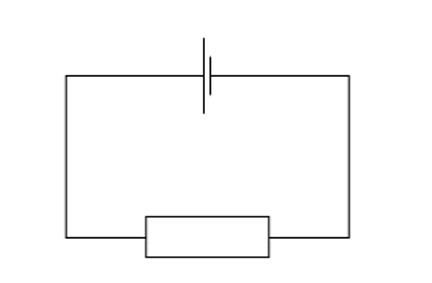
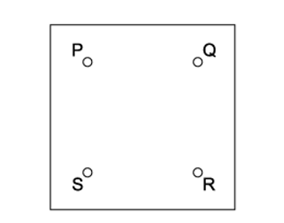
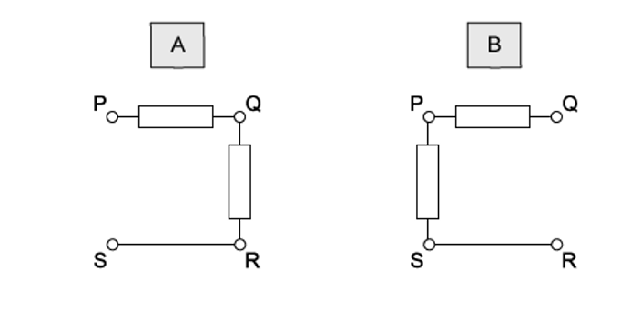
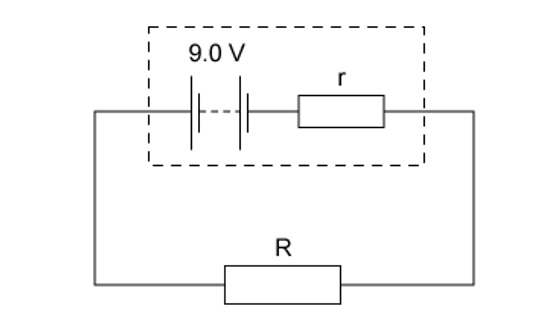
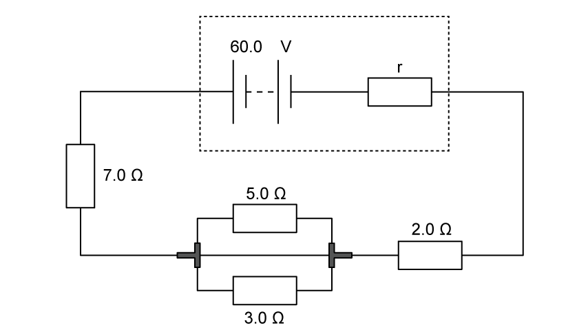
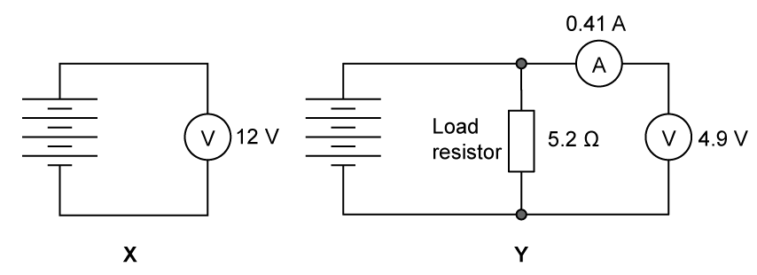

# Exam Questions — Practical Circuits
**10. D.C. Circuits** · Cambridge (CIE) AS physics (9702)
> Source: [https://www.savemyexams.com/as/physics/cie/25/topic-questions/](https://www.savemyexams.com/as/physics/cie/25/topic-questions/) · 21 questions across 2 sets

## Multiple Choice Questions (16 questions)

### Q1 — easy — 1 marks

**Q1** [1 mark]

A cell is connected to a resistor.

At any given moment, the potential difference across the cell is less than its electromotive force.

Which statement explains this ?

### Q2 — medium — 1 marks

**Q2** [1 mark]

A resistor of resistance $R$ is connected to the terminals of a battery of emf 9.0 V and internal resistance $r$.

A charge of 240 C flows through the resistor in two minutes. The energy dissipated in the resistor as a result is 1440 J.

What is the internal resistance $r$ of the battery?

### Q3 — medium — 1 marks

**Q3** [1 mark]

A battery of e .m .f. 12 V and internal resistance 2.0 Ω is connected in series with an ammeter of negligible resistance and an external resistor. External resistors of various different values are used.

Which combination of current and resistor value is **not** correct?

| ** ** | **Current / A** | **External resistor value / Ω** |
|---|---|---|
| **A**  **B**  **C**  **D** | 1.0  1.2  1.5  1.8 | 10.0  8.0  6.0  4.0 |

### Q4 — easy — 1 marks

**Q4** [1 mark]

A battery is marked 9.0 V.

What does this mean ?

### Q5 — medium — 1 marks

**Q5** [1 mark]

A battery and a resistor are in series. The e.m.f of the circuit is 15 V and the resistance of the resistor is 8.0 Ω.

Given that the current through the circuit is 1.5 A, what is the value of the lost volts from the battery?

### Q6 — hard — 1 marks

**Q6** [1 mark]

A box with four terminals P, Q, R and S contains two identical resistors.

When a battery of electromotive force (e .m. f.) *E* and negligible internal resistance is connected across PS, a high-resistance voltmeter connected across QR reads  $\frac{E}{2}$

Which diagram shows the correct arrangement of the two resistors inside the box ?

### Q7 — easy — 1 marks

**Q7** [1 mark]

Which symbol represents a component whose resistance is designed to change with temperature?

### Q8 — medium — 1 marks

**Q8** [1 mark]

A simple circuit is formed by connecting a resistor of resistance *R* between the terminals of a battery of electromotive force (e .m .f.) 9.0 V and constant internal resistance *r *.

A charge of 6.0 C flows through the resistor in a time of 2.0 minutes, causing it to dissipate 48 J of thermal energy.

What is the internal resistance *r* of the battery ?

### Q9 — easy — 1 marks

**Q9** [1 mark]

In the circuit shown, a light-dependent resistor (LDR) is connected to two resistors R1 and R2.

The potential difference (p. d.) across R1 is *V**1* and the p .d. across R2 is *V**2*. The current in the circuit is *I *.

Which statement about this circuit is correct ?

### Q10 — hard — 1 marks

**Q10** [1 mark]

A power supply of electromotive force (e .m .f.) 12 V and internal resistance 2 Ω is connected in series with a load resistor. The value of the load resistor is varied from 0.5 Ω to 4 Ω.

Which graph shows how the power *P* dissipated in the load resistor varies with the resistance of the load resistor ?

### Q11 — easy — 1 marks

**Q11** [1 mark]

Four statements about potential difference or electromotive force are listed.

| **1** | It involves the transfer of energy to components |
|---|---|
| **2** | It involves the transfer of energy into the circuit |
| **3** | It is the energy per unit charge to move charge right round a circuit |
| **4** | It is the work done per unit charge by the charge moving from one point to another |

Which statements apply to potential difference and which apply to electromotive force?

| ** ** | **Potential difference** | **Electromotive force** |
|---|---|---|
| **A**  **B**  **C**  **D** | 1 and 3  1 and 4  2 and 3  2 and 4 | 2 and 4  2 and 3  1 and 4  1 and 3 |

### Q12 — easy — 1 marks

**Q12** [1 mark]

A cell of e. m .f. *E *delivers a charge *Q* to an external circuit.

Which statement is correct?

### Q13 — hard — 1 marks

**Q13** [1 mark]

The diagram shows the electric motor for a garden pump connected to a 24 V power supply by an insulated two-core cable.

The motor does not work so, to find the fault, the negative terminal of a voltmeter is connected to the negative terminal of the power supply, and its other end is connected in turn to terminals X and Y at the motor.

Which row represents two readings and a correct conclusion?

|   | **Voltmeter reading when connected to X / V** | **Voltmeter reading when connected to Y / V** | **Conclusion** |
|---|---|---|---|
| **A** | 24 | 0 | break in positive wire of cable |
| **B** | 24 | 12 | break in negative wire of cable |
| **C** | 24 | 24 | break in connection within the motor |
| **D** | 24 | 24 | break in negative wire of cable |

### Q14 — medium — 1 marks

**Q14** [1 mark]

Which answer option summarises the difference between potential difference and e.m.f?

### Q15 — hard — 1 marks

**Q15** [1 mark]

In the circuit below, a voltmeter of resistance *R**V* and an ammeter of resistance *R*A are used to measure the resistance *R* of the fixed resistor.

Which condition is necessary for an accurate value to be obtained for *R *?

### Q16 — hard — 1 marks

**Q16** [1 mark]

A relay is required to operate 800 m from its power supply. The power supply has negligible internal resistance. The relay requires 16.0 V and a current of 0.60 A to operate.

A cable connects the relay to the power supply, and two of the wires in the cable are used to supply power to the relay.

The resistance of each of these wires is 0.0050 Ω per meter.

What is the minimum output e .m .f. of the power supply ?

## Structured Questions (5 questions)

### Q1 — medium — 11 marks

**Q1** [4 marks]

A battery of e.m.f. 60.0 V and internal resistance, *r*, is connected in a circuit as shown in Fig. 1.1.

**Fig 1.1**

The current in the battery is 2.3 A.

Calculate the internal resistance *r*.

**Q1** [2 marks]

**Extract:**

A battery of e.m.f. 60.0 V and internal resistance, r, is connected in a circuit as shown in Fig. 1.1. The current in the battery is 2.3 A. Calculate the internal resistance r. [Answer: r = 15.2 Ω, current I = 2.3 A]

Calculate the energy dissipated in the battery in 4.0 minutes.

**Q1** [2 marks]

**Extract:**

A battery of e.m.f. 60.0 V and internal resistance, r, is connected in a circuit as shown in Fig. 1.1. The current in the battery is 2.3 A.
Energy dissipated in the battery in 4.0 minutes = 19297.92 J (Energy = (2.3)^2 × 15.2 × 240 = 19297.92 J).

Calculate the percentage of the total energy transformed by the battery that is dissipated in the battery in 4.0 minutes.

**Q1** [3 marks]

The internal resistance of the battery affects the efficiency of the transfer of energy from the battery to the circuit.

Explain what causes internal resistance and why this affects the efficiency.

### Q2 — medium — 13 marks

**Q2** [3 marks]

Explain why the terminal potential difference (p.d) of a cell with internal resistance may differ from the electromotive force (e.m.f) of the cell.

**Q2** [5 marks]

A battery of e.m.f 6.2 V and internal resistance 7.0 Ω is connected in series with a resistor of resistance 11 Ω as shown in Fig 1.1.

The current $I$ flows through the circuit

Determine

(i) the current $I$ in the circuit,

[3]

(ii) the terminal p.d. of the battery.

[2]

**Q2** [2 marks]

**Extract:**

A battery of e.m.f 6.2 V and internal resistance 7.0 Ω is connected in series with a resistor of resistance 11 Ω as shown in Fig 1.1. The current I flows through the circuit.

A second identical resistor is added in series with the resistor in Fig 1.1.

Quantitatively explain the change in the current in the circuit.

**Q2** [3 marks]

**Extract:**

A battery of e.m.f 6.2 V and internal resistance 7.0 Ω is connected in series with a resistor of resistance 11 Ω as shown in Fig 1.1. The current I flows through the circuit.

A second identical resistor is added in series with the resistor in Fig 1.1.

The second 11 Ω resistor is now connected in parallel to the initial 11 Ω resistor in Fig 1.1.

Qualitatively explain the effect this has on the battery.

### Q3 — easy — 9 marks

**Q3** [2 marks]

Explain why the electromotive force (e.m.f) of a cell with internal resistance may be more than the terminal potential difference (p.d.) of the cell.

**Q3** [3 marks]

Compare the definitions of e. m .f and p. d.

**Q3** [1 mark]

For a cell, explain the term *internal resistance*.

**Q3** [3 marks]

A battery of e.m.f 15.2 V and internal resistance *r* is connected to a resistor A, as shown in Fig 1.1.

**Fig 1.1**

The current in resistor A is 400 mA and the power dissipated by it is 6 W.

Calculate *r *of the battery.

### Q4 — medium — 13 marks

**Q4** [3 marks]

Two circuits X and Y shown in Fig 1.1 were used by a student to test a battery of four identical cells. In circuit X the battery is connected to a voltmeter registering 12 V and there was no load resistor. In circuit Y a load resistor of 5.2 Ω is connected in parallel with an ammeter registering 0.41 A and a voltmeter registering 4.9 V. Assume that the meters in the circuits are ideal.

**Fig. 1.1**

Explain why there is a difference in voltages recorded in the two circuits.

**Q4** [3 marks]

**Extract:**

Two circuits X and Y shown in Fig 1.1 were used by a student to test a battery of four identical cells. In circuit X the battery is connected to a voltmeter registering 12 V and there was no load resistor. In circuit Y a load resistor of 5.2 Ω is connected in parallel with an ammeter registering 0.41 A and a voltmeter registering 4.9 V. Assume that the meters in the circuits are ideal.

Calculate the internal resistance of a single cell from Fig. 1.1.

**Q4** [3 marks]

**Extract:**

Two circuits X and Y shown in Fig 1.1 were used by a student to test a battery of four identical cells. In circuit X the battery is connected to a voltmeter registering 12 V and there was no load resistor. In circuit Y a load resistor of 5.2 Ω is connected in parallel with an ammeter registering 0.41 A and a voltmeter registering 4.9 V. Assume that the meters in the circuits are ideal.
Calculate the internal resistance of a single cell from Fig. 1.1.
Total internal resistance, r = 17.32 Ω (from part (b))

One of the cells in the battery is reversed.

Determine the new reading on the ammeter in circuit** **Y.

**Q4** [4 marks]

**Extract:**

Two circuits X and Y shown in Fig 1.1 were used by a student to test a battery of four identical cells. In circuit X the battery is connected to a voltmeter registering 12 V and there was no load resistor. In circuit Y a load resistor of 5.2 Ω is connected in parallel with an ammeter registering 0.41 A and a voltmeter registering 4.9 V. Assume that the meters in the circuits are ideal.

In circuit Y, the resistance of the load resistor *R*  is altered so that a series of values on the voltmeter and the corresponding values of the current on the ammeter are obtained.

**Fig. 1.2**

Using the axes in Fig.1.2, sketch the graph you would expect to obtain as *R * is changed. State how the values of *ε  *and *r*  can be obtained from the graph.

### Q5 — easy — 14 marks

**Q5** [3 marks]

The electromotive force, *E  *is defined by the equation

*E *= *I *(*R* + *r*)

State the definition of the following variables and an appropriate unit for each.

(i) *I*

[1]

(ii) *R*

[1]

(iii) *r*

[1]

**Q5** [5 marks]

**Extract:**

The electromotive force, E is defined by the equation E = I (R + r). State the definition of the following variables and an appropriate unit for each. (i) I - Current (Amps). (ii) R - Load resistance / resistance of load (Ohms). (iii) r - Internal resistance (Ohms).

A circuit connecting a cell with internal resistance to a resistor is shown in Fig. 1.1. ** **

**Fig. 1.1**

Place in each of the grey boxes one of the following variables:

| ***V*** | ***r*** | ***E*** | ***I*** | ***R*** |
|---|---|---|---|---|

**Q5** [3 marks]

**Extract:**

A circuit connecting a cell with internal resistance to a resistor is shown in Fig. 1.1. Fig. 1.1

A current of 0.6 mA flows through the circuit in Fig. 1.1 and the resistor has a resistance of 2.5 kΩ.

Calculate the terminal potential difference of the circuit.

**Q5** [3 marks]

**Extract:**

A current of 0.6 mA flows through the circuit in Fig. 1.1 and the resistor has a resistance of 2.5 kΩ. Calculate the terminal potential difference of the circuit.
Current, I = 0.6 mA = 0.6 × 10^–3 A; Resistance, R = 2.5 kΩ; V = IR = (0.6 × 10^–3) × (2.5 × 10^3) = 1.5 V

The internal resistance of the cell is 1.3 kΩ.

Calculate the emf of the cell using the equation E.m.f. *E *= *I *(*R* + *r*).
