# Exam Questions — Potential Dividers
**10. D.C. Circuits** · Cambridge (CIE) AS physics (9702)
> Source: [https://www.savemyexams.com/as/physics/cie/25/topic-questions/](https://www.savemyexams.com/as/physics/cie/25/topic-questions/) · 38 questions across 2 sets

## Multiple Choice Questions (29 questions)

### Q1 — medium — 1 marks

**Q1** [1 mark]

A potential divider consisting of resistors of resistance *R*1 and *R*2 is connected to an input potential difference of *V*0 and gives an output p .d. of *V*.

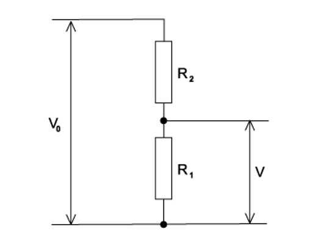

What is the value of *V *?

### Q2 — hard — 1 marks

**Q2** [1 mark]

The contact is connected one at a time to points X, Y and Z to test the circuit. The lamps do not light up because lamp L is blown.

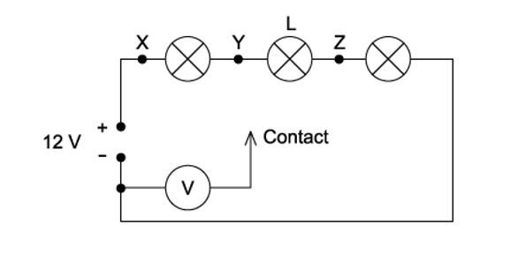

Which of the following are the readings of the voltmeter when the contact is connected to each of the points?** **

| ** ** | **X** | **Y** | **Z** |
|---|---|---|---|
| **A**  **B**  **C**  **D** | 12 V  8 V  12 V  8 V | 8 V  8 V  12 V  12 V | 4 V  0 V  0 V  4 V |

### Q3 — medium — 1 marks

**Q3** [1 mark]

In the circuit below, P is a potentiometer of total resistance 10 Ω and Q is a fixed resistor of resistance 10 Ω. The battery has an e .m f. of 4.0 V and negligible internal resistance. The voltmeter has a very high resistance .

The slider on the potentiometer is moved from X to Y, and a graph of voltmeter reading *V* is plotted against slider position.

Which graph would be obtained ?

### Q4 — medium — 1 marks

**Q4** [1 mark]

In the circuit below, the ammeter reading is *I,* and the voltmeter reading is *V*.

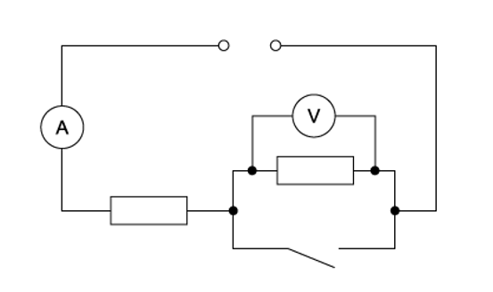

When the switch is closed, which row describes what happens to *I* and *V*?

| ** ** | ***I*** | ***V*** |
|---|---|---|
| **A**  **B**  **C**  **D** | decreases  increases  increases  stays the same | decreases to zero  stays the same  decreases to zero  increases |

### Q5 — medium — 1 marks

**Q5** [1 mark]

A 12 V battery is in series with an ammeter, a 2 Ω fixed resistor and a 0 – 10 Ω variable resistor. High-resistance voltmeters P and Q are connected across the variable resistor and the fixed resistor, respectively, as shown.

The resistance of the variable resistor is changed from its maximum value to zero.

Which graph shows the variation with current of the voltmeter readings?

### Q6 — easy — 1 marks

**Q6** [1 mark]

A potential divider consists of a fixed resistor R and a light-dependent resistor (LDR)

What happens to the voltmeter reading, and why does it happen, when the intensity of light on the LDR increases?

### Q7 — hard — 1 marks

**Q7** [1 mark]

The resistance *R* of an unknown resistor is compared with a fixed 100 Ω resistor using the circuit as shown in the diagram.

The balance length *l* is 30.0 cm and 48.3 cm when P is connected to Q and R, respectively.

The length of the wire XY is 100 cm and has a resistance of 40 Ω. The two cells E1 and E2, have negligible internal resistances.

What is the value of resistance *R *?

### Q8 — hard — 1 marks

**Q8** [1 mark]

A potential divider has a constant supply of 6.0 V, as shown in the diagrams.

Which circuit will provide a potential difference between X and Y that can be varied between zero and 3.0 V ?

### Q9 — medium — 1 marks

**Q9** [1 mark]

The diagram shows a potential divider circuit which, by adjustment of the contact X, can be used to provide a variable potential difference between the terminals P and Q.

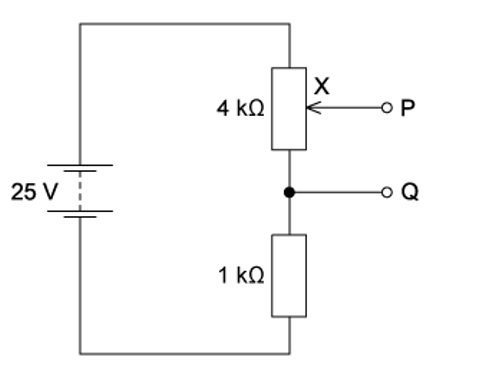

What are the limits of this potential difference?

### Q10 — easy — 1 marks

**Q10** [1 mark]

A source of e.m.f. 9.0 mV has an internal resistance of 6.0 Ω.

It is connected across a galvanometer of resistance 30 Ω.

What is the current in the galvanometer?

### Q11 — easy — 1 marks

**Q11** [1 mark]

The circuit is designed to trigger an alarm system when the input voltage exceeds some preset value. It does this by comparing *V *out with a fixed reference voltage, which is set at 4.8 V .

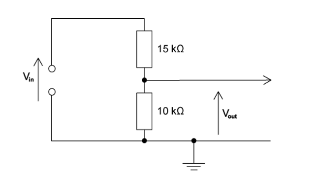

*V *out is equal to 4.8 V.

What is the input voltage *V*in?

### Q12 — hard — 1 marks

**Q12** [1 mark]

In the potentiometer circuit shown, the reading on the ammeter is zero.

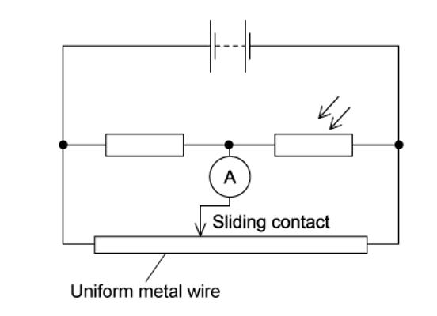

The light-dependent resistor (LDR) is then covered up, and the ammeter gives a non-zero reading.

Which change could return the ammeter reading to zero?

### Q13 — medium — 1 marks

**Q13** [1 mark]

A potential divider consists of resistors of resistance *R*1 and *R*2 connected in series across a source of potential difference *V*0. The potential difference across *R*1 is *V *out .

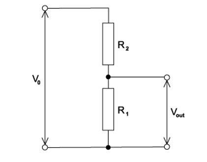

Which changes to *R*1 and *R*2 will increase the value of *V *out ?

| ** ** | ***R*****1** | ***R*****2** |
|---|---|---|
| **A**  **B**  **C**  **D** | doubled  doubled  halved  halved | doubled  halved  doubled  halved |

### Q14 — easy — 1 marks

**Q14** [1 mark]

Which diagram shows a potential divider circuit that can vary the voltage across the lamp ?

### Q15 — medium — 1 marks

**Q15** [1 mark]

A potentiometer is used as shown to compare the e.m.f. of two cells.

The balance points for cells X and Y are 0.70 m and 0.90 m respectively.

If the e.m.f. of cell X is 1.1 V, what is the e.m.f. of cell Y ?

### Q16 — easy — 1 marks

**Q16** [1 mark]

The unknown e.m.f. *E* of a cell is to be determined using a potentiometer circuit. The balance length is to be measured when the galvanometer records a null reading.

What is the correct circuit to use ?

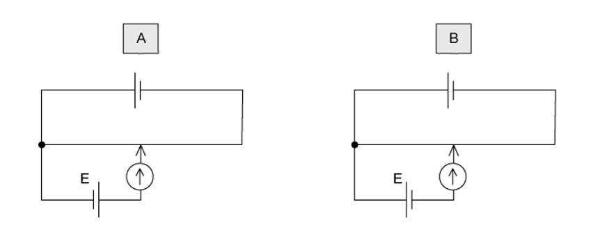

### Q17 — hard — 1 marks

**Q17** [1 mark]

The graph below shows how resistance *R* of a thermistor varies during part of a day.

The thermistor is connected to the potential divider circuit as shown.

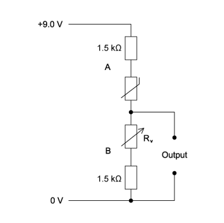

At 0730, an output of 6.0 V is required.

What value of the variable resistor should be set at this time?

### Q18 — medium — 1 marks

**Q18** [1 mark]

A potential divider circuit consists of fixed resistors of resistance 2.0 Ω and 4.0 Ω connected in series with a 3.0 Ω resistor fitted with a sliding contact. These are connected across a battery of e.m.f. 9.0 V and zero internal resistance, as shown.

What are the maximum and minimum output voltages of this potential divider circuit?

| ** ** | **Maximum voltage / V** | **Minimum  voltage / V** |
|---|---|---|
| **A**  **B**  **C**  **D** | 4.0  5.0  9.0  9.0 | 2.0  2.0  0  2.0 |

### Q19 — easy — 1 marks

**Q19** [1 mark]

A low-voltage supply with an e. m. f. of 20 V and an internal resistance of 1.5 Ω is used to supply power to a heater of resistance 6.5 Ω in a fish tank.

What is the power supplied to the water in the fish tank ?

### Q20 — hard — 1 marks

**Q20** [1 mark]

A power supply and a solar cell are compared using the potentiometer circuit shown.

The e.m.f. produced by the solar cell is measured on the potentiometer.

The potentiometer wire PQ is 100.0 cm long and has a resistance of 5.00 Ω. The power supply has an e. m .f. of 2.000 V, and the solar cell has an e .m. f. of 5.00 mV.

Which resistance *R* must be used so that the galvanometer reads zero when PS = 40.0 cm ?

### Q21 — medium — 1 marks

**Q21** [1 mark]

A battery with e.m.f. *E* and internal resistance *r* is connected in series with an external variable resistor.

The value of the external resistance *R* is slowly increased from zero.

Which statement is correct ? (Ignore any temperature effects.)

### Q22 — easy — 1 marks

**Q22** [1 mark]

The diagram shows a potentiometer circuit.

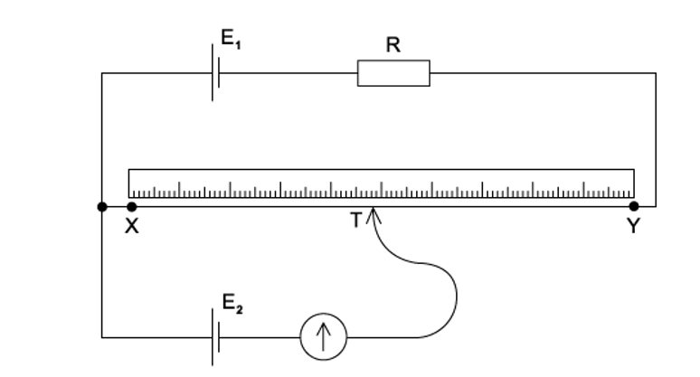

The contact T is placed on the wire and moved along the wire until the galvanometer reading is zero. The length XT is then noted.

In order to calculate the potential difference per unit length of the wire XY, which value must also be known?

### Q23 — medium — 1 marks

**Q23** [1 mark]

The diagram shows a potential divider connected to a 9.0 V supply of negligible internal resistance.

What range of voltages can be obtained between P and Q?

### Q24 — hard — 1 marks

**Q24** [1 mark]

In the circuit shown, XY is a length *L* of uniform resistance wire. R1 and R2 are unknown resistors. J is a sliding contact that joins the junction of R1 and R2 to points on XY through a small signal lamp S.

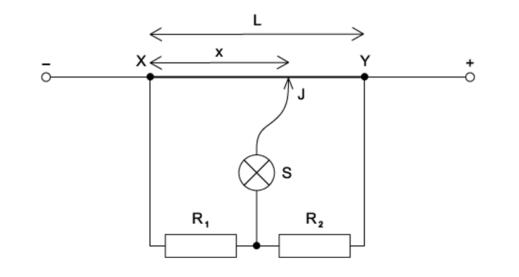

To determine the ratio  $\frac{V_{1}}{V_{2}}$  of the potential differences across R1 and R2, a point is found on XY at which the lamp is off. This point is at a distance *x* from *X*.

What is the value of the ratio $\frac{V_{1}}{V_{2}}$   ?

### Q25 — easy — 1 marks

**Q25** [1 mark]

The diagram shows a potential divider circuit designed to provide a variable output p. d.

Which gives the available range of output p. d ?

| ** ** | Maximum output | Minimum output |
|---|---|---|
| **A**  **B**  **C**  **D** | 3.0 V  4.5 V  9.0 V  9.0 V | 0  0  0  4.5 V |

### Q26 — hard — 1 marks

**Q26** [1 mark]

The diagrams show the same cell, ammeter, potentiometer and fixed resistor connected in different ways.

The distance *d* between the sliding contact and a particular end of the potentiometer is varied. The current measured is then plotted against the distance *d*.

For which two circuits will the graphs be identical ?

### Q27 — easy — 1 marks

**Q27** [1 mark]

In the circuit shown, the 6.0 V battery has negligible internal resistance. Resistors R1 and R2 and the voltmeter have resistance 100 kΩ.

What is the current in the resistor R2?

### Q28 — easy — 1 marks

**Q28** [1 mark]

Which electrical component is represented by the following symbol ?

### Q29 — hard — 1 marks

**Q29** [1 mark]

In the potentiometer circuit below, the moveable contact is placed at N on the bare wire XY, such that the galvanometer shows zero deflection.

The resistance of the variable resistor is now increased.

What is the effect of this increase on the potential difference across the wire XY and on the position of the moveable contact for zero deflection ?

| ** ** | **Potential difference across XY** | **Position of moveable contact** |
|---|---|---|
| **A**  **B**  **C**  **D** | increases  increases  decreases  decreases | nearer to X  nearer to Y  nearer to X  nearer to Y |

## Structured Questions (9 questions)

### Q1 — medium — 9 marks

**Q1** [1 mark]

State Kirchhoff’s second law.

**Q1** [2 marks]

A battery with negligible internal resistance is connected in series with two resistors of resistances $R_{1}$ and $R_{2}$, as shown in Fig. 7.1.

**Fig. 7.1**

The potential differences (p.d.s) across $R_{1}$ and $R_{2}$ are $V_{1}$ and $V_{2}$, respectively.

The p.d. across the combination of resistors is $V$.

The current in the circuit is $I$.

Use Kirchhoff’s laws to show that the total resistance $R_{T}$ of the combination is given by

$R_{T}=R_{1}+R_{2}$

**Q1** [3 marks]

The resistor $R_{2}$ in Fig. 7.1 is replaced by a light-dependent resistor (LDR). The battery has an electromotive force (e.m.f.) of 12.0 V. The resistor $R_{1}$ has a fixed resistance of 2.40 kΩ.

A voltmeter is connected across the fixed resistor, as shown in Fig. 7.2. The reading on the voltmeter is 9.00 V.

**Fig. 7.2**

(i) Calculate the current in the circuit.

[1]

(ii) Calculate the resistance $R_{L}$ of the LDR.

[2]

**Q1** [3 marks]

**Extract:**

The resistor \$\$R_{2}\$\$ in Fig. 7.1 is replaced by a light-dependent resistor (LDR). The battery has an electromotive force (e.m.f.) of 12.0 V. The resistor \$\$R_{1}\$\$ has a fixed resistance of 2.40 kΩ. A voltmeter is connected across the fixed resistor, as shown in Fig. 7.2. The reading on the voltmeter is 9.00 V.

The intensity of the light illuminating the LDR decreases.

By reference to the current in the circuit, state and explain the change, if any, to the voltmeter reading.

### Q2 — medium — 8 marks

**Q2** [2 marks]

Fig 1.1 shows a potential divider circuit with a battery of electromotive force (e.m.f.) 24.0 V connected to two resistors R1 and R2.

**Fig 1.1**

When the resistance of R1 is 6.5 Ω, the voltage across it is 7.0 V.

Show that the resistance of R2 is 16 Ω.

**Q2** [1 mark]

**Extract:**

Fig 1.1 shows a potential divider circuit with a battery of electromotive force (e.m.f.) 24.0 V connected to two resistors R~1~ and R~2~.

The resistors are replaced with identical filament lamps A and B and the battery is connected in parallel to a linear potentiometer XY, as shown in Fig 1.2.

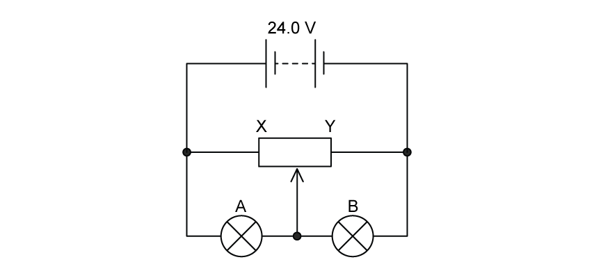

**Fig 1.2**

The lamps each have the same* I–V *characteristic shown in Fig. 1.3.

**Fig 1.3**

When the slider of the potentiometer is at its midpoint, as shown in Fig. 1.2, the current *I* in the battery is 4.12 A.

Determine the current in lamp B.

**Q2** [3 marks]

**Extract:**

The resistors are replaced with identical filament lamps A and B and the battery is connected in parallel to a linear potentiometer XY, as shown in Fig 1.2. The lamps each have the same I–V characteristic shown in Fig. 1.3. When the slider of the potentiometer is at its midpoint, as shown in Fig. 1.2, the current I in the battery is 4.12 A. Determine the current in lamp B.
Since the slider is exactly in the middle, both lamps have a potential difference of 24.0/2 = 12 V. The current through lamp B at 12 V is 3.10 A. E.m.f of the battery = 24.0 V.

Calculate the total resistance in the circuit.

**Q2** [2 marks]

**Extract:**

The resistors are replaced with identical filament lamps A and B and the battery is connected in parallel to a linear potentiometer XY, as shown in Fig 1.2. The lamps each have the same I–V characteristic shown in Fig. 1.3. When the slider of the potentiometer is at its midpoint, as shown in Fig. 1.2, the current I in the battery is 4.12 A. The battery has an e.m.f. of 24.0 V.

The slider of the potentiometer in (c) is moved to end X. State and explain the effect on the current of lamps A and B.

### Q3 — hard — 16 marks

**Q3** [3 marks]

A circuit is set up as shown in Fig. 1.1 below:

**Fig. 1.1**

The cells in Fig. 1.1 have negligible internal resistance. The cell at the top has an e.m.f. of 5 V and the cell at the bottom has an e.m.f. of 6 V.

$R_{1}$ is a variable resistor with a resistance that varies between 0 and 10 Ω, and $R_{2}$  and $R_{3}$  are fixed resistors with a resistance of 10 Ω and 30 Ω respectively.

Initially, $R_{1}$  is set such that its resistance is 0 Ω.

By labelling the direction of current on Fig. 1.1, write down the relationship between three currents $I_{1}$ , $I_{2}$  and $I_{3}$  at the junction between $R_{1}$ and $R_{2}$ .

**Q3** [3 marks]

**Extract:**

A circuit is set up as shown in Fig. 1.1 below: The cells in Fig. 1.1 have negligible internal resistance. The cell at the top has an e.m.f. of 5 V and the cell at the bottom has an e.m.f. of 6 V. R1 is a variable resistor with a resistance that varies between 0 and 10 Ω, and R2 and R3 are fixed resistors with a resistance of 10 Ω and 30 Ω respectively. Initially, R1 is set such that its resistance is 0 Ω.

Determine the current through the resistor $R_{2}$ .

**Q3** [4 marks]

**Extract:**

A circuit is set up as shown in Fig. 1.1 below. The cells in Fig. 1.1 have negligible internal resistance. The cell at the top has an e.m.f. of 5 V and the cell at the bottom has an e.m.f. of 6 V. R_1 is a variable resistor with a resistance that varies between 0 and 10 Ω, and R_2 and R_3 are fixed resistors with a resistance of 10 Ω and 30 Ω respectively. Initially, R_1 is set such that its resistance is 0 Ω.

State and explain what happens to the potential difference across $R_{2}$  as the resistance of $R_{1}$  is gradually increased from zero.

**Q3** [6 marks]

**Extract:**

A circuit is set up as shown in Fig. 1.1 below. The cells in Fig. 1.1 have negligible internal resistance. The cell at the top has an e.m.f. of 5 V and the cell at the bottom has an e.m.f. of 6 V. R1 is a variable resistor with a resistance that varies between 0 and 10 Ω, and R2 and R3 are fixed resistors with a resistance of 10 Ω and 30 Ω respectively. By labelling the direction of current on Fig. 1.1, write down the relationship between three currents I1, I2 and I3 at the junction between R1 and R2. Using Kirchhoff's first law, the sum of currents into a junction must equal the sum of currents out of the junction. Therefore, I1 + I2 = I3.

Calculate the current flowing through each resistor when *R*1 is set to a resistance of 10 Ω.

### Q4 — medium — 11 marks

**Q4** [2 marks]

A battery of negligible internal resistance is connected to a light-dependent resistor, a switch X and two fixed resistors, as shown in Fig. 1.1.

**Fig 1.1**

Resistor R1 has resistance 8.0 kΩ and resistor R2 has resistance 12.0 kΩ. When switch X is open, the potential difference across R2 is 18 V.

Show that the e.m.f of the battery is 30 V.

**Q4** [3 marks]

**Extract:**

A battery of negligible internal resistance is connected to a light-dependent resistor, a switch X and two fixed resistors, as shown in Fig. 1.1. Resistor R~1~ has resistance 8.0 kΩ and resistor R~2~ has resistance 12.0 kΩ. When switch X is open, the potential difference across R~2~ is 18 V. Show that the e.m.f of the battery is 30 V.

Switch X is now closed. The current in the battery is 1.94 mA.

Calculate the resistance of the LDR.

**Q4** [3 marks]

**Extract:**

A battery of negligible internal resistance is connected to a light-dependent resistor, a switch X and two fixed resistors, as shown in Fig. 1.1. Resistor R1 has resistance 8.0 kΩ and resistor R2 has resistance 12.0 kΩ. When switch X is open, the potential difference across R2 is 18 V. Show that the e.m.f of the battery is 30 V.

The switch X in the circuit in (a) remains closed. The light intensity on the LDR increases.

By reference to the current in the battery, state and explain the effect, if any, of the increase in light intensity on the power produced by the battery.

**Q4** [3 marks]

**Extract:**

A battery of negligible internal resistance is connected to a light-dependent resistor, a switch X and two fixed resistors, as shown in Fig. 1.1. Resistor R~1~ has resistance 8.0 kΩ and resistor R~2~ has resistance 12.0 kΩ. When switch X is open, the potential difference across R~2~ is 18 V.

The light intensity on the LDR decreases.

State and explain what happens to the potential difference across R1.

### Q5 — medium — 8 marks

**Q5** [2 marks]

A battery is connected in series with resistors P and Q, as shown in Fig 1.1.

The resistance of P is 7.5 Ω. The resistance of Q is constant. A variable resistor of resistance *R* is connected in parallel with Q.

The current *I* from the battery is changed by varying *R* from 5 Ω to 20 Ω. The variation with *R* of *I* is shown in Fig 1.2.

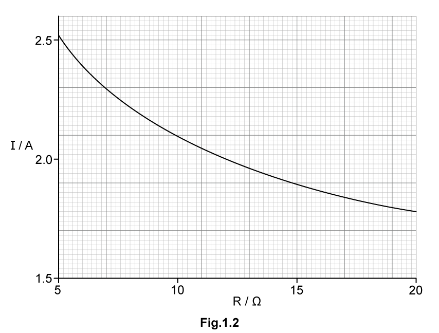

Use Fig 1.2 to state and explain the variation of the p.d. across resistor P as *R* is **decreased**. Numerical values are not required.

**Q5** [2 marks]

**Extract:**

A battery is connected in series with resistors P and Q, as shown in Fig 1.1. The resistance of P is 7.5 Ω. The resistance of Q is constant. A variable resistor of resistance R is connected in parallel with Q. The current I from the battery is changed by varying R from 5 Ω to 20 Ω. The variation with R of I is shown in Fig 1.2. [Fig 1.2 graph: I/A on y-axis (1.5 to 2.5+), R/Ω on x-axis (5 to 20); at R=7.0 Ω, I=2.3 A]

For *R* = 7.0 Ω, calculate the p.d. between points Y and Z.

**Q5** [3 marks]

**Extract:**

A battery is connected in series with resistors P and Q, as shown in Fig 1.1. The resistance of P is 7.5 Ω. The resistance of Q is constant. A variable resistor of resistance R is connected in parallel with Q. The current I from the battery is changed by varying R from 5 Ω to 20 Ω.
For R = 7.0 Ω, calculate the p.d. between points Y and Z. I = 2.3 A. P.d across YZ = 32 – (2.3 × 7.5) = 14.75 = 15 V

Show that the resistance of Q is 95 Ω.

**Q5** [1 mark]

**Extract:**

A battery is connected in series with resistors P and Q, as shown in Fig 1.1. The resistance of P is 7.5 Ω. The resistance of Q is constant. A variable resistor of resistance *R* is connected in parallel with Q. The current *I* from the battery is changed by varying *R* from 5 Ω to 20 Ω. The variation with *R* of *I* is shown in Fig 1.2.

State and explain qualitatively how the power provided by the battery changes as the resistance *R* is decreased.

### Q6 — easy — 8 marks

**Q6** [4 marks]

A variable resistor is used to control the circuit shown in Fig. 1.1.

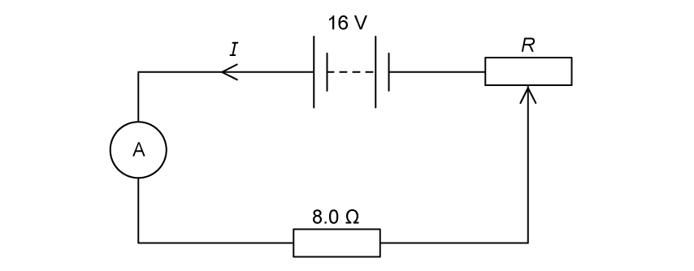

**Fig. 1.1**

The variable resistor is connected in series with a 16 V power supply of negligible internal resistance, an ammeter and an 8.0 Ω resistor.

The resistance *R* of the variable resistor can be varied between 0 to 12 Ω.

Calculate

(i) the minimum possible current

[2]

(ii) the maximum possible current

[2]

**Q6** [2 marks]

**Extract:**

A variable resistor is used to control the circuit shown in Fig. 1.1. The variable resistor is connected in series with a 16 V power supply of negligible internal resistance, an ammeter and an 8.0 Ω resistor. The resistance R of the variable resistor can be varied between 0 to 12 Ω. Calculate (i) the minimum possible current (ii) the maximum possible current. Minimum current = 0.8 A, Maximum current = 2.0 A.

On Fig 1.2, sketch the variation with *R* of current *I *in the circuit.

**Fig. 1.2**

**Q6** [2 marks]

Galvanometers are used in* null methods. *

Explain how a galvanometer is used in *null methods*.

### Q7 — easy — 11 marks

**Q7** [2 marks]

Sketch the circuits symbols for

(i) the potentiometer

[1]

(ii) the galvanometer

[1]

**Q7** [3 marks]

Fig. 1.1 shows a circuit with a potentiometer.

**Fig. 1.1**

Fixed ends AC are connected across the battery so that there is a full battery voltage across the whole resistor.

State the voltage output, *V*out when the sliding connect is at

(i) A

[1]

(ii) B

[1]

(iii) C

[1]

**Q7** [2 marks]

**Extract:**

Fig. 1.1 shows a circuit with a potentiometer. Fixed ends AC are connected across the battery so that there is a full battery voltage across the whole resistor. State the voltage output, V_out when the sliding connect is at (i) A - 0 V (ii) B - 14 V (iii) C - 28 V

The resistor is now replaced with a uniform resistance wire connected between ends AC, as shown in Fig. 1.2a. The 28 V cell is replaced with a cell of unknown e.m.f.

**Fig. 1.2a**

Sketch a graph of Fig 1.2b to show the voltmeter reading *V* against length *l* as the jockey is moved from point A to point C.

**Fig 1.2b**

**Q7** [4 marks]

**Extract:**

The resistor is now replaced with a uniform resistance wire connected between ends AC, as shown in Fig. 1.2a. The 28 V cell is replaced with a cell of unknown e.m.f.

A potentiometer can be used to compare e.m.fs of cells or potential differences.

A test cell is added to the circuit in Fig. 1.2a. A student sets up the circuit shown in Fig. 1.3.

**Fig. 1.3**

(i) State why the student will not be able to find a point where the current is zero.

[1]

(ii) The student fixes the issue from **(a)(i)** and achieves a balance point when the length of the wire AB is 25.6 cm.

They repeat the experiment with a standard cell of e.m.f 1.545 V. The balance point using this cell is 37.2 cm.

Calculate the e.m.f of the test cell.

[3]

### Q8 — easy — 8 marks

**Q8** [2 marks]

Fig 1.1 shows a potential divider circuit containing a fixed resistor and thermistor.

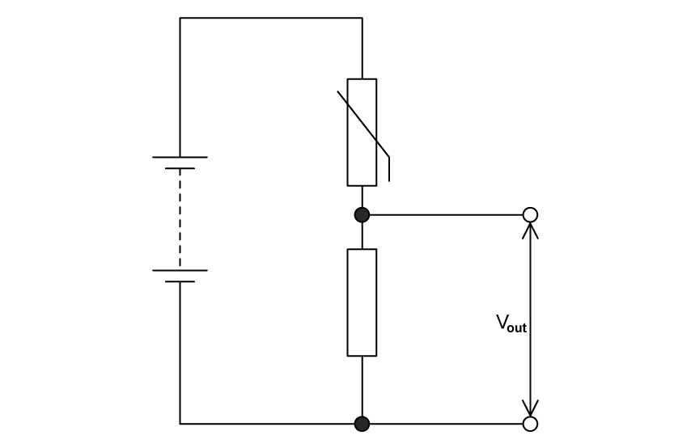

**Fig 1.1**

** **Explain what happens to *V*out as the temperature of the thermistor increases.

**Q8** [1 mark]

The thermistor is now replaced with an LDR and the output voltage is now taken from the LDR, as shown in Fig. 1.2a.

**Fig. 1.2a**

Using Fig. 1.2b, determine the resistance of the LDR when the light intensity is 120 lux.

**Fig. 1.2b**

**Q8** [3 marks]

**Extract:**

The thermistor is now replaced with an LDR and the output voltage is now taken from the LDR, as shown in Fig. 1.2a. Using Fig. 1.2b, determine the resistance of the LDR when the light intensity is 120 lux.

The resistance of the LDR when the light intensity is 120 lux is 8 kΩ.

Using your answer to part **(b)**, calculate *V*out when the light intensity is 120 lux.

**Q8** [2 marks]

**Extract:**

Using your answer to part (b), calculate Vout when the light intensity is 120 lux.

List the known quantities: Resistance of the LDR, R1 = 8.0 kΩ (from part b); Resistance of the fixed resistor, R2 = 6.0 kΩ; Voltage of the power supply, Vin = 32 V. Vout = R1/(R1+R2) × Vin = 8.0/(8.0+6.0) × 32 = 18.2857 = 18 V

Using your answer to part **(c)**, determine the voltage across the 6.0 kΩ resistor at a light intensity of 120 lux.

### Q9 — hard — 9 marks

**Q9** [2 marks]

Fig. 1.1 shows a potentiometer in action. The wire in the potentiometer is represented by a fixed resistor of resistance 10 Ω and the sliding contact C can move from one end of the wire (at position P) to the other end of the wire (position Q). This allows the output potential difference (p.d.) to be varied. The potentiometer is in series with another fixed resistor of 5 Ω.

**Fig. 1.1**

This circuit is powered by a 9 V power supply and is used to supply a variable potential difference to another circuit.

Sketch a graph on the axes provided in Fig. 1.2 to show how the supplied potential difference *V* varies as the moving contact C is moved from position P to position Q.

**Fig. 1.2**

Sketch a graph on the axes provided in Fig. 1.2 to show how the supplied potential difference *V* varies as the moving contact C is moved from position P to position Q.

**Q9** [4 marks]

Potential divider circuits generally comprise of two or more resistors in series with each other.

Some potential divider circuits have multiple branches connected in parallel, such as that shown in Fig. 1.3:

**Fig. 1.3**

Show that the potential difference between X and Y, *V**OUT* , is 1 V.

**Q9** [3 marks]

Fig. 1.4 shows another potential divider circuit which includes a thermistor with resistance *R*.

**Fig. 1.4**

The battery has an EMF of 12 V, with negligible internal resistance. At room temperature, the resistance of the thermistor is 5 kΩ.

Calculate the current in the battery at room temperature.
