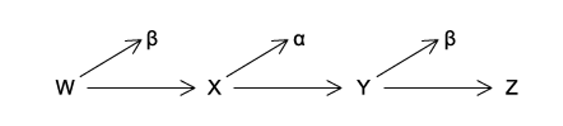
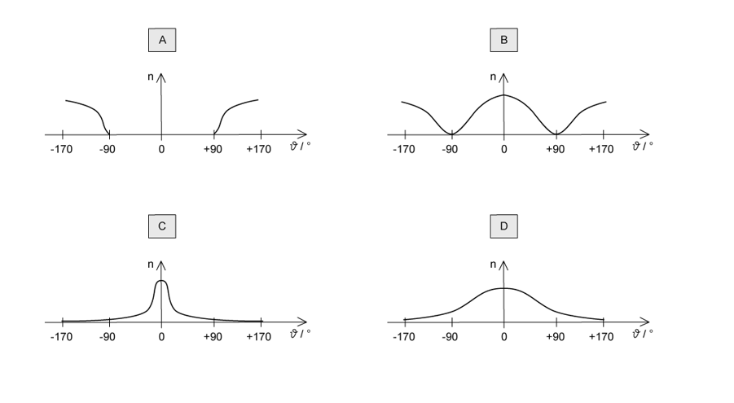
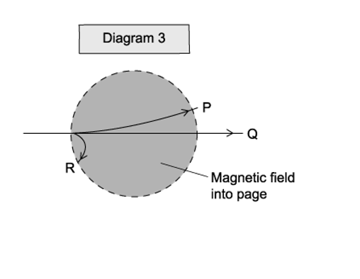
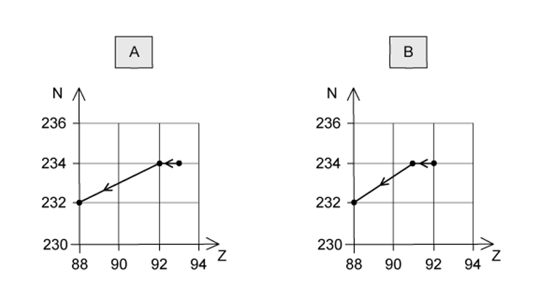
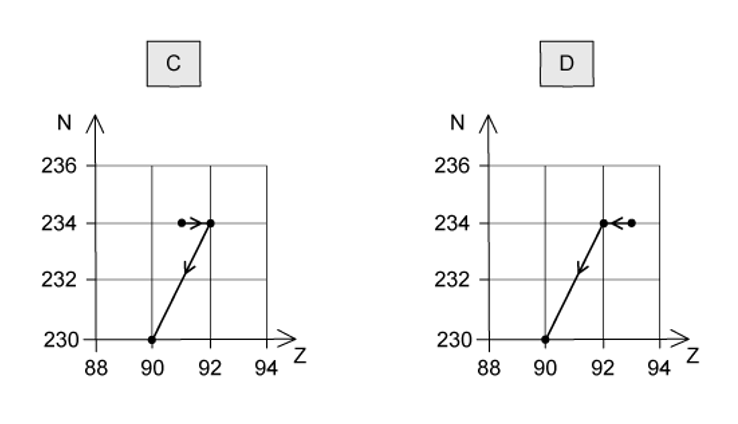
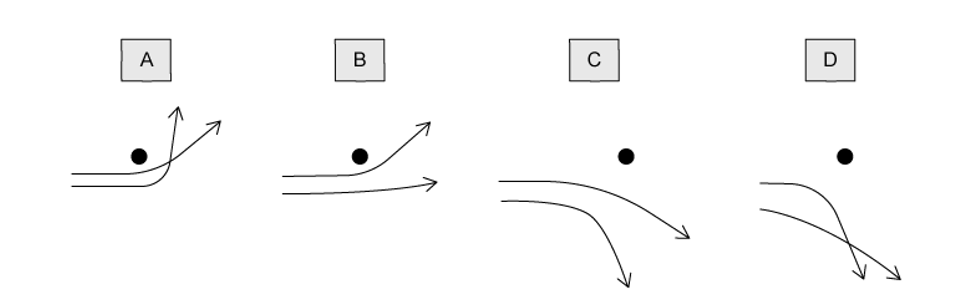

# Exam Questions — Atoms, Nuclei & Radiation
**11. Particle Physics** · Cambridge (CIE) AS physics (9702)
> Source: [https://www.savemyexams.com/as/physics/cie/25/topic-questions/](https://www.savemyexams.com/as/physics/cie/25/topic-questions/) · 43 questions across 2 sets

## Multiple Choice Questions (35 questions)

### Q1 — medium — 1 marks

**Q1** [1 mark]

Nucleus X decays in two stages to produce nucleus Y.

Which decay sequence will result in the highest number of neutrons in nucleus Y ?

### Q2 — easy — 1 marks

**Q2** [1 mark]

The atom `C presubscript 55 presuperscript 133 s` is a neutral atom

How many protons, neutrons and electrons are in this atom?

| ** ** | **Protons** | **Neutrons** | **Electrons** |
|---|---|---|---|
| **A**  **B**  **C**  **D** | 133  55  78  55 | 55  78  55  133 | 133  55  78  55 |

### Q3 — hard — 1 marks

**Q3** [1 mark]

A stationary decay `P presubscript 84 presuperscript 210 o` of  by *α*-emission has a total kinetic energy of *E**k*

$P_{84}^{210} o \rightarrow P_{82}^{206} b + \\alpha$

What is the kinetic energy of the daughter nucleus `P presubscript 82 presuperscript 206 b` ?

### Q4 — medium — 1 marks

**Q4** [1 mark]

When α-particles are directed at gold leaf

| **1** | almost all α-particles pass through without deflection, |
|---|---|
| **2** | a few α-particles deviate through large angles. |

What are the reasons for these effects?

| ** ** | **1** | **2** |
|---|---|---|
| **A** | the positive charge in an atom is not concentrated enough to deflect an α-particle | occasionally an α-particle experiences many small deflections in the same direction |
| **B** | the gold nucleus is very small so  most α-particles miss all nuclei | occasionally the path of an α-particle is close to a nucleus |
| **C** | most α-particles miss all gold atoms | a few α-particles bounce off gold atoms |
| **D** | most α-particles have enough energy to pass right through the gold leaf | gold is very dense so a few low energy  α-particles bounce back from the gold surface |

### Q5 — easy — 1 marks

**Q5** [1 mark]

Plutonium-239 $( P_{94}^{239} u )$ decays by emitting α-radiation.

Which nuclide is formed from one of these decay reactions? (The product nuclides are represented by X.)

### Q6 — medium — 1 marks

**Q6** [1 mark]

The isotope `R _ 86 ^ 222 n` decays in a sequence of emissions to form the isotope `P _ 82 ^ 206 b`.

It will either emit an α-particle or a β-particle at each stage of the decay sequence.

What is the number of stages in the decay sequence?

### Q7 — easy — 1 marks

**Q7** [1 mark]

When β− particles are emitted from identical nuclei in a substance, which of the following remain constant?

### Q8 — medium — 1 marks

**Q8** [1 mark]

Three successive radioactive decays are shown in the diagram below; each one results in a particle being emitted.

The first decay results in the emission of a β-particle. The second decay results in the emission of an α-particle. The third decay results in the emission of another β-particle.

Nuclides W and Z are compared.  Which statement is correct ?

### Q9 — medium — 1 marks

**Q9** [1 mark]

An element with an unstable nucleus decays by emitting an alpha particle to become the nucleus of a different element.

The nucleus of the new element is unstable and will emit either an α-particle or a β− particle. This process continues until an isotope of the original element is formed.

What is the minimum possible number of the particles emitted ?

### Q10 — easy — 1 marks

**Q10** [1 mark]

The following statements are about α-particles.

Which is correct?

### Q11 — easy — 1 marks

**Q11** [1 mark]

When aluminium `A presubscript 13 presuperscript 27 l` was bombarded with α-particles the first radioactive substance was made. The product of this reaction was an unstable isotope of phosphorus, `P presubscript 15 presuperscript 30`.

Which of the following is a by-product of this reaction?

### Q12 — hard — 1 marks

**Q12** [1 mark]

Thorium `T presubscript 90 presuperscript 232 h` decays through a series of transformations. The particles emitted in successive transformations are

$αββγα$

The resulting nuclide may be represented by

### Q13 — easy — 1 marks

**Q13** [1 mark]

New insights were discovered when α-particles were fired at a sheet of gold foil.

Which conclusion can be drawn from the results of the experiment?

### Q14 — hard — 1 marks

**Q14** [1 mark]

In an *α*-particle scattering experiment, a student set up the apparatus below to determine the number *n* of *α*-particles incident per unit time on a detector held at various angles *θ*.

Which of the following graph best represents the variation of *n* with *θ *?

### Q15 — medium — 1 marks

**Q15** [1 mark]

A thorium isotope has a nucleon number of 232 and a proton number of 90. It decays to form another isotope of with a nucleon number of 228.

How many alpha particles and beta particles are emitted during this decay?

| ** ** | **Alpha particles** | **Beta particles** |
|---|---|---|
| **A**  **B**  **C**  **D** | 0  1  1  2 | 4  2  1  1 |

### Q16 — easy — 1 marks

**Q16** [1 mark]

Most α-particles pass straight through when fired at a thin sheet of metal foil, but a few are deflected by a large angle.

Which change would increase the **proportion** of α-particles deflected by a large angle?

### Q17 — hard — 1 marks

**Q17** [1 mark]

Which of the following equations correctly shows an *α*-particle causing a nuclear reaction ?

### Q18 — easy — 1 marks

**Q18** [1 mark]

Which statement about alpha, beta and gamma radiation is correct?

### Q19 — medium — 1 marks

**Q19** [1 mark]

A radioactive substance with a nucleon number of 234 and a proton number of 90, decays by β-emission into a daughter product which in turn decays by further β-emission into a granddaughter product.

Which letter in the diagram represents the granddaughter product ?

### Q20 — easy — 1 marks

**Q20** [1 mark]

Alpha, beta and gamma radiations have various depths of penetration in matter and different charges.

Which row in the table best shows the penetration and charge of each radiation?

|   | **Alpha** | **Beta** | **Gamma** |
|---|---|---|---|
| **A** | absorbed by a sheet of card  negative charge | absorbed by several mm of aluminium  no charge | not fully absorbed by several mm of lead  no charge |
| **B** | absorbed by several mm of aluminium  positive charge | not fully absorbed by several mm of lead  negative charge | absorbed by a sheet of card  no charge |
| **C** | absorbed by a sheet of card  negative charge | absorbed by several mm of aluminium  positive charge | not fully absorbed by several mm  of lead  no charge |
| **D** | absorbed by a sheet of card  positive charge | absorbed by several mm of aluminium  negative charge | not fully absorbed by several mm of lead  no charge |

### Q21 — easy — 1 marks

**Q21** [1 mark]

One of the rows in the table shows a pair of nuclei that are isotopes of one another.

Which row is it?

|   | **Nucleon number** | **Number of neutrons** |
|---|---|---|
| **A** | 186  180 | 112  118 |
| **B** | 184  187 | 110  110 |
| **C** | 186  182 | 112  108 |
| **D** | 186  186 | 110  112 |

### Q22 — easy — 1 marks

**Q22** [1 mark]

A Geiger-muller tube held at a distance of about 12 cm from a radioactive source. The radiation emitted from the nuclear isotope was entirely stopped by a 2 mm thick sheet of lead.

Which of the statements can be deduced from the above information about the emission from the isotope?

### Q23 — medium — 1 marks

**Q23** [1 mark]

An element emits an alpha particle from its radioactive nucleus.

The daughter nucleus then emits a beta particle, and then the daughter nucleus of that reaction emits another beta particle.

Which statement describes the final nuclide that is formed ?

### Q24 — easy — 1 marks

**Q24** [1 mark]

Which of the following statements about the nucleus of the atom is correct?

### Q25 — medium — 1 marks

**Q25** [1 mark]

Alpha, beta and gamma radiations:

| **1** | are absorbed to different extents in solids |
|---|---|
| **2** | behave differently in an electric field |
| **3** | behave differently in a magnetic field |

Diagrams 1, 2 and 3 illustrate these behaviours .

Which three labels on these diagrams refer to the **same** kind of radiation?

### Q26 — medium — 1 marks

**Q26** [1 mark]

A sequence of radioactive decays is shown in the graph of neutron number against proton number.

Nucleus S is at the start of the sequence and, after the decays have occurred, nucleus T is formed.

What is emitted during the sequence of decays?

### Q27 — easy — 1 marks

**Q27** [1 mark]

Four nuclei are represented below

$Q_{13}^{24} E_{14}^{28} G_{15}^{25} M_{12}^{25}$

Which of the following statements about these nuclei is correct?

### Q28 — medium — 1 marks

**Q28** [1 mark]

A radioactive nucleus is formed by β-decay. This nucleus then decays by α-emission.

The graphs below show the nucleon number N plotted against proton number Z. Which one shows the β-decay followed by the α-emission?

### Q29 — medium — 1 marks

**Q29** [1 mark]

Antimatter is a particle that is an antiparticle to the corresponding particle. A positron is the antiparticle of an electron.

What is the difference between a positron and an electron ?

### Q30 — hard — 1 marks

**Q30** [1 mark]

An unknown isotope `X presubscript Z presuperscript A` decays through a series of transformations into Thorium-228. The atomic number of thorium is 90.

The successive transformations are:

$γβ^{-}ααγ$

Which row states the correct isotope name, atomic number and mass number of the unknown isotope `X presubscript Z presuperscript A`?

|   | **Isotope name** | **Atomic number / Z** | **Mass number / A** |
|---|---|---|---|
| **A.** | Neptunium | 93 | 235 |
| **B.** | Plutonium | 94 | 237 |
| **C.** | Neptunium | 93 | 236 |
| **D.** | Uranium | 92 | 232 |

### Q31 — medium — 1 marks

**Q31** [1 mark]

Astatine is a radioactive substance; it has a nucleon number of 218 and a proton number of 85. When it decays it forms a polonium nucleus, emitting a β− particle and an α-particle.

What are the nucleon number and the proton number of the polonium nucleus?

| ** ** | **Nucleon number** | **Proton number** |
|---|---|---|
| **A**  **B**  **C**  **D** | 214  214  216  215 | 84  83  83  82 |

### Q32 — medium — 1 marks

**Q32** [1 mark]

Two α-particles with equal energies are deflected by a gold nucleus.

Which diagram best represents their paths ?

### Q33 — medium — 1 marks

**Q33** [1 mark]

The nuclides shown in the grid below are arranged according to the number of protons and neutrons in each.

A nucleus of the nuclide `L presubscript 3 presuperscript 8 i`  decays by emitting a β-particle.

What is the resulting nuclide ?

### Q34 — easy — 1 marks

**Q34** [1 mark]

A nucleus Q decays into a nucleus R by emitting an alpha particle followed by two beta particles.

Which statement about this nuclear decay is correct?

### Q35 — easy — 1 marks

**Q35** [1 mark]

When an α-particle is produced by `U presubscript 92 presuperscript 258` it produces a new atom X.

What are the values of the proton number and nucleon number for atom X?

| ** ** | **Protons** | **Nucleons** |
|---|---|---|
| **A**  **B**  **C**  **D** | 92  90  92  88 | 256  254  250  254 |

## Structured Questions (8 questions)

### Q1 — medium — 3 marks

**Q1** [3 marks]

In the alpha-particle scattering experiment, a beam of alpha particles was directed at a thin gold foil.

State the conclusion that can be drawn about the structure of the atom from

(i) the observation that most alpha-particles pass through the foil

[1]

(ii) the observation that very few alpha-particles were deflected through angles greater than 90°.

[2]

### Q2 — medium — 3 marks

**Q2** [2 marks]

A nucleus X decays by emitting a β+ particle to form a new nucleus, $Na_{11}^{23}$.

State the number of protons and the number of neutrons in nucleus X.

number of protons = ..........................................................

number of neutrons = ...........................................................

*Source: Specimen 2022 Paper 2 Q7A*

**Q2** [1 mark]

State **one** similarity between a β+ particle and a β– particle.

*Source: Specimen 2022 Paper 2 Q7B*

### Q3 — easy — 8 marks

**Q3** [2 marks]

The equation below represents the decay of tungsten-184.

Complete the equation by writing the correct number in each of the **two** boxes.

`W _ 74 ^ 184 -> Po _ square ^ square + alpha particle`

**Q3** [3 marks]

Beta decay does **not** cause the mass number of an atom to change.

Explain why not.

**Q3** [2 marks]

The equation representing the decay of iodine-128 to xenon is shown below.

Complete the equation by writing the correct number in each of the **two** boxes.

`I _ 53 ^ 128 -> Xe _ square ^ square + beta particle`

**Q3** [1 mark]

State another particle emitted in beta minus decay.

### Q4 — medium — 11 marks

**Q4** [2 marks]

The deflection of α-particles by a thin metal foil is investigated with the arrangement shown in Fig 1.1.

**Fig 1.1**

The detector of α-particles, D, is moved around the path labelled WXY.

State the environment the apparatus must be enclosed in and explain why this is required for the experiment.

**Q4** [4 marks]

**Extract:**

The deflection of α-particles by a thin metal foil is investigated with the arrangement shown in Fig 1.1. Fig 1.1. The detector of α-particles, D, is moved around the path labelled WXY.

Explain the readings detected by D and the conclusions that were made about the nature of atoms at points

(i) W,

[2]

(ii) X.

[2]

**Q4** [2 marks]

**Extract:**

The deflection of α-particles by a thin metal foil is investigated with the arrangement shown in Fig 1.1. Fig 1.1 The detector of α-particles, D, is moved around the path labelled WXY.

State what the readings detected by D at position Y conclude about the charge of the nucleus. Explain why.

**Q4** [3 marks]

A beam of α-particles produces a current of 3.5 pA. Calculate the number of α-particles per second passing a point in the beam.

### Q5 — hard — 10 marks

**Q5** [2 marks]

A radioactive nucleus `X _ 85 ^ 229` undergoes a beta−minus decay followed by an alpha decay to form a daughter nucleus $\mathrm{Y} pre_{Z} pre^{A}$.

Write a decay equation for this interaction and hence determine the values of A and Z.

**Q5** [3 marks]

Thorium, `Th presubscript 90 presuperscript 232` decays to an isotope of Radium (Ra) through a series of transformations. The particles emitted in successive transformations are:

$αββγα$

Determine the resulting nuclide after these successive transformations.

**Q5** [3 marks]

Through a combination of successive alpha and beta decays, the isotope of any original nucleus can be formed.

Explain the simplest sequence of alpha and beta decays required to do this.

**Q5** [2 marks]

A nucleus of Bohrium $\text{Bh} pre_{Y} pre^{X}$ decays to Mendelevium `Md presubscript 101 presuperscript 255` by a sequence of three alpha particle emissions.

Determine the number of neutrons in a nucleus of $\text{Bh} pre_{Y} pre^{X}$.

### Q6 — easy — 10 marks

**Q6** [4 marks]

Ionising radiation often comes in three forms: alpha, beta and gamma.

Table 1.1 below shows information about the properties of each type of radiation.

| **Type** | **Nuclear notation** | **Relative charge** |
|---|---|---|
| **Alpha** |   | +2 |
| **Beta** | `beta _ - 1 ^ 0` |   |
| **Gamma** |   |   |

**Table 1.1   **

Complete the missing information in Table 1.1.

**Q6** [2 marks]

Identify **one** similarity and **one** difference between alpha particles and beta particles**.**

**Q6** [1 mark]

The properties of ionising radiation that make it so useful is related to the study of the structure of atoms.

Evidence that atoms had an internal structure was confirmed by Ernest Rutherford. He was able to show that a thin sheet of gold foil scattered ionising radiation in ways that could not be explained by accepted models of atomic structure at the time.

State the type of ionising radiation that was scattered by gold foil in Rutherford’s experiment.

**Q6** [3 marks]

Each of the observations from Rutherford’s experiment had profound implications about how atoms were structured.

In the space provided below, match each observation from Rutherford’s experiment to its corresponding conclusion about atomic structure.

| **Observation** |   | **Conclusion** |
|---|---|---|
| A small proportion of radiation is slightly deflected by the gold foil | The atom is mostly empty space |   |
| The majority of radiation is undeflected by the gold foil | The mass of a nucleus is concentrated in a very small volume |   |
| A very small proportion of radiation is deflected back on itself | The nucleus carries a positive charge |   |

### Q7 — medium — 11 marks

**Q7** [3 marks]

When a nucleus of plutonium-239 absorbs a neutron, the following reaction may take place.

$Pu_{94}^{239} + \mathrm{n} pre_{b} pre^{a} \rightarrow \text{Xe} pre_{54} pre^{x} + \text{Zr} pre_{y} pre^{103} + 3 \mathrm{n} pre_{b} pre^{a}$

State the values of *a*, *b*, *x* and *y*.

**Q7** [2 marks]

**Extract:**

When a nucleus of plutonium-239 absorbs a neutron, the following reaction may take place. \$\$\_{94}^{239}Pu + \_{b}^{a}n \rightarrow \_{54}^{x}Xe + \_{y}^{103}Zr + 3 \_{b}^{a}n\$\$

State two quantities, other than the proton and neutron number, that are conserved in the fission reaction in part (a).

**Q7** [3 marks]

A Plutonium-239 nucleus has a mean density of 1.3 × 1017 kg m–3.

Show that the radius of a Plutonium-239 nucleus is 9.0 × 10–15 m.

**Q7** [3 marks]

Plutonium-239 is an α-emitter whilst Uranium-237 is a β-emitter.

Aside from their structure, distinguish between an α-particle and a β-particle.

### Q8 — hard — 10 marks

**Q8** [3 marks]

The study of beta decay provided early hints to the existence of a yet undiscovered particle.

Scientists were interested in the energy distribution of the beta particles emitted when a radioactive source decayed. The source has an activity of 120 Bq.

The energy released by each decaying nucleus was labelled as X and the total energy released each second by the source was measured to be 7.5 × 10–11 J.

Sketch a graph to show the energy distribution of the beta particles and indicate X on the diagram.

**Q8** [2 marks]

**Extract:**

The source has an activity of 120 Bq. The energy released by each decaying nucleus was labelled as X and the total energy released each second by the source was measured to be 7.5 × 10^–11^ J.

Determine the value of X to an appropriate degree of accuracy.

**Q8** [2 marks]

**Extract:**

The study of beta decay provided early hints to the existence of a yet undiscovered particle. Scientists were interested in the energy distribution of the beta particles emitted when a radioactive source decayed. The source has an activity of 120 Bq. The energy released by each decaying nucleus was labelled as X and the total energy released each second by the source was measured to be 7.5 × 10^–11^ J.

Explain why no beta particles had an energy equal to X.

**Q8** [3 marks]

**Extract:**

The study of beta decay provided early hints to the existence of a yet undiscovered particle. Scientists were interested in the energy distribution of the beta particles emitted when a radioactive source decayed.

Suggest the standard form of the two possible equations that represent this decay and define all the terms used.
