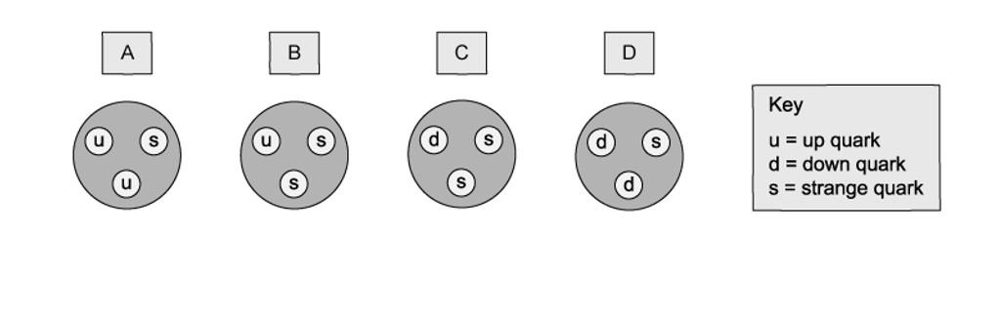
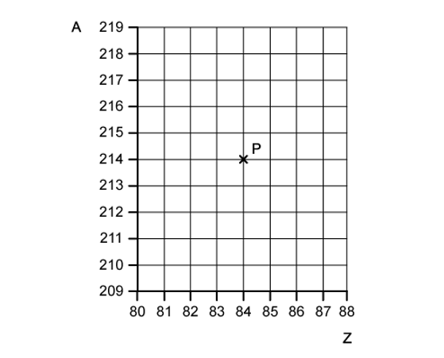

# Exam Questions — Fundamental Particles
**11. Particle Physics** · Cambridge (CIE) AS physics (9702)
> Source: [https://www.savemyexams.com/as/physics/cie/25/topic-questions/](https://www.savemyexams.com/as/physics/cie/25/topic-questions/) · 29 questions across 2 sets

## Multiple Choice Questions (22 questions)

### Q1 — easy — 1 marks

**Q1** [1 mark]

How many quarks make up a proton ?

### Q2 — hard — 1 marks

**Q2** [1 mark]

The equation for β– decay is

$n \rightarrow p + e^{-} + \vec{v}_{e}$

Using your knowledge of antiparticles and the weak interaction, what is the equation for β+ decay?

### Q3 — medium — 1 marks

**Q3** [1 mark]

Which of the following sentences about antimatter is **incorrect **?

### Q4 — easy — 1 marks

**Q4** [1 mark]

Light is made up of which type of elementary particle?

### Q5 — medium — 1 marks

**Q5** [1 mark]

In a nucleus of Tritium, `H presubscript 1 presuperscript 3` , how many ‘down’ quarks are there?

### Q6 — hard — 1 marks

**Q6** [1 mark]

A CERN detector shows a signal only in the hadronic calorimeter. No signal is observed in the tracker, electromagnetic calorimeter or muon chambers.

Which particle must be responsible for this signal?

### Q7 — easy — 1 marks

**Q7** [1 mark]

What type of elementary particles are electrons ?

### Q8 — medium — 1 marks

**Q8** [1 mark]

What are the numbers of hadrons, baryons and mesons in an atom of  `L presubscript 3 presuperscript 7 i`?

|   | **Hadrons** | **Baryons** | **Mesons** |
|---|---|---|---|
| **A** | 7 | 3 | 3 |
| **B** | 7 | 4 | 4 |
| **C** | 7 | 7 | 0 |
| **D** | 10 | 7 | 0 |

### Q9 — medium — 1 marks

**Q9** [1 mark]

Which row in the table gives the correct quark combination for the particle?

|   | **Particle** | **Category** | **Quark combination** |
|---|---|---|---|
| **A** | neutron | baryon | $\vec{u} d$ |
| **B** | neutron | meson | $udd$ |
| **C** | proton | baryon | $uud$ |
| **D** | positive pion | meson | $\vec{u} d$ |

### Q10 — medium — 1 marks

**Q10** [1 mark]

Fundamental or elementary particles are particles that aren't made up of smaller particles.

What is the most common type of fundamental particle in the universe ?

### Q11 — hard — 1 marks

**Q11** [1 mark]

The composition of four different hadrons are shown in the diagram below. One of the hadrons is a Σ +  particle. It has a charge of +*e*, where is *e *is the elementary charge.

Which hadron could be the Σ +  particle ?

### Q12 — easy — 1 marks

**Q12** [1 mark]

What are the fundamental particles of an atom ?

### Q13 — easy — 1 marks

**Q13** [1 mark]

What elementary particles are the building blocks for protons and neutrons ?

### Q14 — easy — 1 marks

**Q14** [1 mark]

How many types of quark are there ?

### Q15 — easy — 1 marks

**Q15** [1 mark]

Which particle is made up of two 'down' quarks and one 'up' quark?

### Q16 — hard — 1 marks

**Q16** [1 mark]

A graph of nucleon number A against proton number Z is shown in the diagram below.

The graph shows a cross that represents a nucleus P.

Nucleus P decays by emitting an *α*-particle to form a nucleus Q.

Nucleus Q then decays by emitting a *β**–* particle to form a nucleus R.

The quark composition of one nucleon in Q is changed during the emission of the *β**–* particle.

What is the corresponding change in quark composition from nucleus Q to nucleus R ?

### Q17 — hard — 1 marks

**Q17** [1 mark]

When high-speed hadrons collide in particle accelerators, a positive pion (π+) is an unstable particle produced. The π+ particle has a charge of +*e*.

What is the quark combination of the π+ particle?

### Q18 — easy — 1 marks

**Q18** [1 mark]

What are mesons ?

### Q19 — easy — 1 marks

**Q19** [1 mark]

What is a particle that is **not** made of any smaller particles?

### Q20 — hard — 1 marks

**Q20** [1 mark]

Some particles are made up of a combination of three quarks.

Which particle would **not** give a particle a charge of either +1.6 × 10−19 C or zero?

### Q21 — hard — 1 marks

**Q21** [1 mark]

Quarks are thought to make up protons and neutrons.

The 'up' quark has a charge of  $\frac{2}{3}e$ ; a 'down' quark has a charge of $-\frac{1}{3}e$ , where *e* is the elementary charge (+ 1.6 × 10–19 C)

How many up quarks and down quarks must a proton contain ?

| ** ** | **Up quarks** | **Down quarks** |
|---|---|---|
| **A** | 0 | 3 |
| **B** | 2 | 1 |
| **C** | 1 | 2 |
| **D** | 1 | 1 |

### Q22 — easy — 1 marks

**Q22** [1 mark]

Which elementary particle is a lepton ?

## Structured Questions (7 questions)

### Q1 — medium — 3 marks

**Q1** [3 marks]

State the quark composition of:

(i) a proton

[1]

(ii) a neutron

[1]

(iii) an alpha-particle.

[1]

### Q2 — medium — 7 marks

**Q2** [1 mark]

State the number of 'up' quarks in the nucleus of `Al presubscript 13 presuperscript 27`.

**Q2** [2 marks]

The $D$ particle has a quark structure $u\overline{c}$ .

Determine

(i) the classification of the $D$ particle,

[1]

(ii) the charge on the $D$ particle.

[1]

**Q2** [1 mark]

Using the quark model, show that the magnitude of the charge of a proton is equal to the charge of an electron.

**Q2** [3 marks]

Using the quark model for β+ decay, show that charge is conserved in this decay.

### Q3 — medium — 10 marks

**Q3** [4 marks]

Carbon–10 `( C _ 6 ^ 10 )` is an isotope that decays to an isotope of boron (symbol $B$) by the emission of a β+ particle.

(i) Complete the nuclear equation for this decay, including the proton and nucleon numbers of all the particles involved.

`C _ 6 ^ 10 ->`

[3]

(ii) During the decay, a quark in the carbon-10 nucleus changes into a different type.

State the change of quark that occurs.

[1]

**Q3** [2 marks]

**Extract:**

Carbon–10 (_{6}^{10}C) is an isotope that decays to an isotope of boron (symbol B) by the emission of a β^+^ particle. The nuclear equation for the decay is: _{6}^{10}C → _{5}^{10}B + _{1}^{0}β^(+) + _{0}^{0}ν

State the two leptons in this decay.

**Q3** [3 marks]

State and explain why a hadron with charge –3*e *cannot exist.

*e* is the elementary charge.

**Q3** [1 mark]

**Extract:**

Quarks can either have a charge of ±1/3 e or ±2/3 e; A meson contains a quark and an anti-quark; (Hence) mesons can only have a charge of 0 or ±1 e; A baryon contains three (anti)quarks; (Hence) baryons can only have a charge of 0 or ±2 e. State and explain why a hadron with charge –3e cannot exist. e is the elementary charge.

State the possible quark combination for a hadron of charge +2*e*.

### Q4 — easy — 10 marks

**Q4** [3 marks]

A student is listing the flavours of quarks they can recall from memory. Their list is below:

- Bottom
- Strange
- Down

Name the flavours of quarks missing from their list.

**Q4** [4 marks]

Complete Table 1.1 below. The right hand column is in units of the elementary charge, *e*.

**Table 1.1**

| **Quark Flavour** | **Charge / *****e*** |
|---|---|
| Strange |   |
| Charm |   |
| Down |   |
| Top |   |

**Q4** [2 marks]

Explain why a proton is not a fundamental particle.

**Q4** [1 mark]

Describe the difference between quarks and antiquarks.

### Q5 — medium — 8 marks

**Q5** [2 marks]

State the quark composition of an alpha particle.

**Q5** [2 marks]

Use the quark model to show that the charge on the anti-neutron is 0.

**Q5** [3 marks]

A sigma baryon Σ is a hadron that consists of an up (u) quark, a down (d) quark and a strange (s) quark.

State the quark composition of Σ+ , Σ0 and Σ– .

**Q5** [1 mark]

Explain why a baryon with the quark composition $u\overline{d}s$ cannot exist.

### Q6 — easy — 12 marks

**Q6** [2 marks]

State the particles that form a meson.

**Q6** [3 marks]

A student proposes an undiscovered baryon with the following structure:

$\text{tt} \vec{b}$

State whether it is possible for this baryon to exist.

Explain your answer.

**Q6** [3 marks]

Describe the changes to a proton's quark composition when it undergoes beta plus decay.

**Q6** [4 marks]

Show that an anti-proton has a relative charge of −*e*, where *e*  is the elementary charge, using its quark composition.

### Q7 — medium — 3 marks

**Q7** [1 mark]

State the quark composition of a meson.

*Source: Specimen 2022 Paper 2 Q7C*

**Q7** [2 marks]

A hadron consists of two down quarks and a charm quark.

Determine the charge of the hadron. Show your working.

charge = ..................................... C

*Source: Specimen 2022 Paper 2 Q7D*

