# Mark Schemes — Equations of Motion
**2. Kinematics** · Cambridge (CIE) AS physics (9702)

## Multiple Choice Questions (32 questions)

### Q1
**Final answer:** **The correct answer is B**

- List the known quantities:

  - $u=2\times10^{3}\text{m s}^{-1}$
  - $s=400\mathrm{km}=400\times10^{3}\text{m}$
  - $v=6\times10^{3}\text{m s}^{-1}$
  - $a$ = ?
- The equation that links *u*, *v*, *s,* and *a* is

$v^{2}=u^{2}+2as$

- Rearrange to find *a*

$2as=v^{2}-u^{2}$

$a=\frac{v^{2}-u^{2}}{2s}$

- Substitute in known values to calculate *a*

$a = \frac{( 6 \times 10^{3} )^{2} - ( 2 \times 10^{3} )^{2}}{2 \times ( 400 \times 10^{3} )}$

$a=40\text{m s}^{-2}$

$a = 4 \times 10^{1 \mathrm{m} \mathrm{s}^{-2} } ( 1 \mathrm{s} . \mathrm{f} . )$

### Q2
**Final answer:** **The correct answer is C**

- Velocity is equal to change in displacement / time
- Looking at a displacement-time graph we can see

$\frac{Δy}{Δx}=\frac{\Deltas}{t}=\frac{\mathrm{change} \mathrm{in} \mathrm{displacement}}{\mathrm{time}}$

- Therefore, velocity is equal to the slope of the graph

**A** is incorrect because the area under a displacement-time graph is displacement × time which is not a physical quantity that has any use in physics

**B** is incorrect because the area under a velocity-time graph is equal to displacement since displacement = velocity × time

**D** is incorrect because the slope of a velocity-time graph is equal to acceleration since acceleration = change in velocity / time

### Q3
**Final answer:** **The correct answer is ****A**** because:**

- The horizontal and vertical components of velocity and acceleration can be treated independently
- In the absence of air resistance, the horizontal component of velocity is constant while the vertical component of velocity downwards increases at a constant acceleration of 9.81 m s−2 (due to the force of gravity)

**B & D **are incorrect because once the stone has been thrown, it is no longer being acted on by the force that propelled it into the air so there is no horizontal acceleration. The force of gravity causes the stone to decelerate upwards and accelerate downwards at a constant rate meaning the vertical velocity is not constant

**C **is incorrect because the stone has a constant upward **deceleration** followed by a constant downward acceleration

### Q4
**Final answer:** **The correct answer is ****A**** because:**

- From P to Q, the weight of the ball causes it to accelerate uniformly. Therefore, the increase in speed is uniform so the gradient is constant
- From Q to R, the motion of the ball is horizontal, so the acceleration of free fall does not affect its motion which is shown on the graph as a horizontal line
- After the collision with the wall, the kinetic energy decreases since the collision is inelastic, this results in a decrease in speed (KE =  ½  *mv**2*)
- Therefore, the ball will take longer to return to the slope, meaning the negative horizontal velocity should be longer

**B** is incorrect because the gradient of the graph in the final section is too steep. Since the gradient represents the acceleration due to gravity, it should be the same as the gradient in the first section.

**C & D **are incorrect because the negative horizontal velocities on these graphs are too short, and the value of the negative velocity in graph D has not decreased.

### Q5
**Final answer:** **The correct answer is ****C**** because:**

- There are two parts to this motion

  - Motion with constant acceleration of 2.5 m s–2
  - Motion with constant speed of 10 m s–1
- If the duration of the acceleration is *t**1* then we want to use an equation to find this, where: *t = t**1*, *a* = 2.5 m s–2, *u* = 0 m s–1, *v* = 10 m s–1

  - $v=u+at$
  - $t_{1}=\frac{v-u}{a}$
  - $t_{1}=\frac{10}{2.5}=4s$
- If the distance travelled during the acceleration is *s**1* then we want to use a different equation to find this

  - $v^{2}=u^{2}+2as$
  - $s_{1}=\frac{v^{2}-u^{2}}{2a}$
  - $s_{1}=\frac{10^{2}}{2\times2.5}=20m$
- The remainder of the 200m race is run at a constant speed of 10 m s–1, so the remaining distance is equal to 200 – 20 = 180 m
- If the time taken to cover the remaining distance is *t**2*, then we can use

  - $\mathrm{speed}=\frac{\mathrm{distance}}{\mathrm{time}}$
  - $t_{2}=\frac{180}{10}=18s$
- Total time = *t**1** + t**2* = 4 + 18 = 22 s

### Q6
**Final answer:** **The correct answer is ****B**** because:**

- At the skier’s maximum height, the speed is at a minimum since gravitational potential is at a maximum and kinetic energy is at a minimum
- The speed does not reach zero since it still has horizontal velocity
- Just before landing, the speed is not zero. Since Y is higher than Z, the person has both potential energy and kinetic energy at Y
- Because of the conservation of energy, kinetic energy is higher at Z so the speed is higher here

**A **is incorrect because this graph shows the skier has maximum kinetic energy (highest *v*) and minimum gravitational energy at the top of the path, which is the opposite to what really happens

**C **is incorrect because the speed doesn’t reach zero as the skier still has horizontal velocity at the top of the path

**D **is incorrect because the change in *v* and *x* is not uniform due to the acceleration due to gravity

### Q7
**Final answer:** **The correct answer is ****D**** because:**

- As the ball falls further from its starting position, the displacement increases meaning the gradient increases
- Terminal velocity is the maximum velocity reached by the falling sphere, meaning the first section of the graph should curve upwards to show the initial acceleration and the second section should be a straight line to show the constant velocity

**A & B **are incorrect because the gradients of these graphs are negative

**C **is incorrect because the horizontal straight line means the velocity is zero and the ball has stopped moving which is not the case

### Q8
**Final answer:** **The correct answer is ****C**** because:**

- From the origin to marker M1:
- Initially the ball is at rest, so:

  - *u* = 0 m s-1
  - *t *= *t**1*
  - *s* = *x*
- The equation that links *s, u, t* and *a* is

  - $s=ut+\frac{1}{2}at^{2}$
  - $x=0+\frac{1}{2}at_{1}^{2}$
  - $x=\frac{1}{2}at_{1}^{2}$                   **(1)**
- From the origin to marker M2:

  - u = 0 m s-1
  - t = t2
  - s = x + h
- Using the same equation as before:

  - $s=ut+\frac{1}{2}at^{2}$
  - $x+h=0+\frac{1}{2}at_{2}^{2}$
  - $x+h=\frac{1}{2}at_{2}^{2}$               **(2)**
- If we take equation **(1)** from **(2)**:

  - $x+h-x=\frac{1}{2}at_{2}^{2}-\frac{1}{2}at_{1}^{2}$
  - $h = 1 \frac{1}{2} a ( t_{2}^{2} - t_{1}^{2} )$
  - $a = \frac{2 h}{( t_{2}^{2} - t_{1}^{2} )}$

### Q9
**Final answer:** **The correct answer is ****D**** because:**

- Let’s consider the quantities we have been given

  - The initial speed of the train is *u*
  - The distance between the red and yellow lights is *x*
  - Final speed of train = 0
- The equation that links *u, s, v* and *a* is

  - $v^{2}=u^{2}+2as$
  - $0=u^{2}+2ax$
  - $u^{2}αx$
- If the initial speed increases by 25 % : 100 % + 25 % = 125 %
- Therefore, new speed unew = 1.25*u*
- So, new distance  $x_{n e w } \\alpha u^{2}_{n e w} = ( 1.25 u )^{2} = 1.56 u^{2} = 1.56 x$

### Q10
**Final answer:** **The correct answer is ****D**** because:**

- Acceleration is equal to change in velocity / time
- Looking at a velocity-time graph we can see $\frac{\Deltay}{\Deltax}$ is equal to  $\frac{v-u}{t}$ which is equivalent to $\frac{changeinvelocity}{time}$
- Therefore, acceleration is equal to the slope of the graph

**A **is incorrect because the area under a displacement-time graph is displacement × time which is not a physical quantity that has any use in physics

**B **is incorrect because the area under a velocity-time graph is equal to displacement since displacement = velocity × time

**C **is incorrect because the slope of a displacement-time graph is equal to velocity since velocity = displacement / time

### Q11
**Final answer:** **The correct answer is ****C**** because:**

- Displacement describes an objects change in position, measuring from its starting position to the final position
- The objects both finish at the same position so despite taking different routes, they have the same displacement

**A **is incorrect because the distance travelled by the second object is greater than the first one but it reaches Z in a shorter time, since average speed = total distance / total time its average speed should be greater

**B **is incorrect because the time taken for the second object to reach Z is less than the first and they both have the same displacement, since average velocity = displacement / time the second object has a greater velocity

**D **is incorrect because the first object travels directly from X to Z which is a shorter distance than X to Y to Z

### Q12
**Final answer:** **The correct answer is ****C**** because:**

- Displacement is equal to velocity × time
- This can be found from the area under the velocity - time graph
- Area under the graph =  ½ × base × height = ½ × Δ *v* × Δ *t*
- Displacement =  ½ × 20 × 5 = 50 m

### Q13
**Final answer:** **The correct answer is ****B**** because:**

- The gradient of the velocity-time graph gives the acceleration and the area under the graph gives the displacement
- The velocity is always positive, so the displacement is always positive
- The gradient of the displacement-time graph gives the velocity

### Q14
**Final answer:** **The correct answer is ****D**** because:**

- First it is a good idea to write down all the quantities that we know

  - Initial velocity, *u* = 7.1 m s–1
  - *a* = 1.62 m s–2
  - the final velocity, *v* = 0 m s–1 (at the maximum height)
  - *t = ?*
- The equation that relates *u, v, a* and *t* is

  - $v=u+at$
  - $v-u=at$
  - $t=\frac{v-u}{a}=\frac{7.1}{1.62}=4.4s$
- It takes 4.4 s for the object to reach its maximum height, and it will take the same time to reach the ground since the acceleration is the same, and the final velocity will be the same, so:

  - Total time = 4.4 × 2 = 8.8 s

### Q15
**Final answer:** **The correct answer is ****B**** because:**

- Speed is equal to $\frac{displacement}{time}$  which is given by the gradient of the graph $\frac{\Deltay}{\Deltax}$
- Between 0 – 50 s and 100 – 140 s, when the lines are horizontal, the car is stationary
- Between 50 – 100 s the car is moving with constant speed and is displaced by 70 – 30 = 40 m
- The speed when the car is moving is equal to $\frac{40m}{50s}$ = 0.8 m s-1

### Q16
**Final answer:** **The correct answer is ****D**** because:**

- A friction-free horizontal air track means that no work needs to be done against friction, therefore, the kinetic energy does not decrease
- A perfectly elastic buffer means the collision of the glider is perfectly elastic, therefore, both momentum and energy are conserved
- This means the magnitude of the velocity should not decrease, so the height of the peaks on the graph should be the same
- Since the speed remains constant, the time between each collision should be the same, so the gaps between each peak should be the same

**A & B **are incorrect because these graphs show the magnitude of the velocity changes as the peaks are different sizes

**C **is incorrect because this graph shows the time between collisions varies as the gaps between some of the peaks are not the same

### Q17
**Final answer:** **The correct answer is ****A**** because:**

- To determine the measurements needed to determine the acceleration of free fall, we will need to consider the equation

  - $s=ut+\frac{1}{2}at^{2}$
- We need to outline the quantities that we know

  - $s=h$ (height)
  - $a=g$ (acceleration of free fall)
  - *  *$t$* *(time)
- Since the falling body will initially be at rest, i.e. *u* = 0 we can simplify this to

  - $h=\frac{1}{2}gt^{2}$
- Rearranging the equation above we can see

  - $g=\frac{2h}{t^{2}}$
- So, the only measurements required are the height and time of the fall

### Q18
**Final answer:** **The correct answer is ****C ****because:**

- We can use trigonometry to deduce

  - Horizontal (→) component = *u* cos *α*
  - Vertical (↑) component = *u* sin *α*
- Because of gravity, we have to consider the free fall of acceleration, which is equal to *g*
- This only affects the vertical component of velocity, and acts in the opposite direction to the motion
- So, at a time, t, the vertical component of velocity = *u* sin *α* – *gt*
- The horizontal component is not influenced by gravity so is equal to *u* cos *α*

### Q19
**Final answer:** **The correct answer is ****B**** because:**

- $Averagespeed=\frac{totaldistance}{totaltime}$
- Let distance travelled for outward flight, which is equal to the distance travelled for inward flight = *d*
- So, the total distance travelled = 2*d*
- For each flight speed, the time will be different since the speed is different for the flights
- Let time for outward flight = $t_{out}=\frac{d}{700}$
- Let time for inward flight = $t_{in}=\frac{d}{300}$
- Total time, $t=t_{out}+t_{in}=\frac{d}{300}+\frac{d}{700}=\frac{d}{210}$
- $Averagespeed=\frac{totaldistance}{totaltime}$
- $Averagespeed=\frac{2d}{d/210}=420\mathrm{km}h^{-1}$

### Q20
**Final answer:** **The correct answer is ****D**** because:**

- The acceleration of freefall is downwards and has no effect on horizontal motion
- We can find the horizontal distance travelled using

  - distance = speed × time
  - $s_{H}=vt$ **(1)**
- Since the bullet is fired in a horizontal direction, the vertical component of the velocity is initially zero
- We can find the vertical distance using

  - $s=ut+\frac{1}{2}at^{2}$
- *u *= 0 and *a* = *g*, so

  - $s_{V}=\frac{1}{2}gt^{2}$* ***(2)**
- Combining equations **(1)** and **(2)** leads to

  - $\frac{\mathrm{horizontal} \mathrm{distance} \mathrm{travelled} \mathrm{in} \mathrm{time}t}{\mathrm{vertical} \mathrm{distance} \mathrm{travelled} \mathrm{in} \mathrm{time}t}=\frac{s_{H}}{s_{V}}$
  - $\frac{s_{H}}{s_{V}}=\frac{vt}{\frac{1}{2}gt^{2}}=\frac{2v}{gt}$

### Q21
**Final answer:** **The correct answer is ****D**** because:**

- Train 2 leaves the station as train 1 passes, so the station can be taken as the origin for the time and distance
- For train 2 to overtake train 1, the distance, *s*, travelled by both trains must be equal and the time, *t*, is how long it takes for this to happen

### Q22
**Final answer:** **The correct answer is ****C**** because:**

- First, we must write down the variables that we know:

  - *s* = 1000 m
  - *a* = –1.1 m s–2
  - *v* = 0
  - *u* = ?
- The equation that links* s, a, v *and* u *is: Rearrange for *u *and calculate:

  - $v^{2}=u^{2}+2as$

  - $u^{2}=v^{2}-2as$
  - $u^{2} = 0 - ( 2 \times - 1.1 \times 1000 ) = 2200$
  - $u=\sqrt{2200}=46.9=47ms^{-1}$ (2 s.f.)

### Q23
**Final answer:** **The correct answer is ****C**** because:**

- When the golf ball is struck upwards, the force of gravity will always bring it back to the surface
- The force of gravity is much higher on the Earth so the golf ball is pulled towards the surface faster which is why it has a much shorter range than the ball on the Moon
- The shape of the golf ball’s path depends on air resistance – on Earth, gravity pulls the ball down while air resistance opposes its motion leading to a path which is not symmetrical
- On the Moon, however, there is no atmosphere, so there is no air resistance acting on the ball. This means the path of the golf ball will be symmetrical, as shown in C

**A & B **are incorrect because these paths are asymmetrical which implies there is an opposing force acting on the ball, such as air resistance, but since there is no atmosphere on the Moon, this is not possible

**D **is incorrect because the gravity on the Moon is small but it is not zero, so the ball would return to the surface

### Q24
**Final answer:** **The correct answer is ****B ****because:**

- If we take the point when the ball is at rest as the origin and the horizontal surface as its maximum displacement
- The graph shows an increasing and decreasing gradient as the ball accelerates and decelerates with each bounce, which is indicative of a displacement-time graph
- Each time the ball strikes the surface, it loses some energy through sound and heat, which is why its displacement decreases each time but does not come to zero as it does not reach its original height

**A **is incorrect because the acceleration is constant, so the lines would be straight, not curved

**C & D **are incorrect because when the ball hits the surface, its velocity at that moment is zero. So, its kinetic energy at that moment would also be zero. The graph does not reduce to zero, so y cannot be kinetic energy or velocity

### Q25
**Final answer:** **The correct answer is ****C**** because:**

### Q26
**Final answer:** **The correct answer is ****D**** because:**

- The gradient of a speed-time graph is acceleration
- Between points X and Z the gradient is decreasing so the acceleration is decreasing until the raindrop reaches a steady speed
- Force is directly proportional to acceleration
- The magnitude of the acceleration is lower at Y is less than at X, therefore, the magnitude of the resultant force is lower at Y too

**A **is incorrect because the magnitude of air resistance is beginning to increase around point X so the acceleration is less than 9.81 m s–2

**B **is incorrect because at point Z, it is correct that the force on the raindrop due to air resistance has reached its maximum value but this means the acceleration of the raindrop has reached its **minimum** value as the resultant force is at a minimum

**C **is incorrect because at point Z, it is correct that the force due to air resistance is equal and opposite to the weight of the raindrop but the speed of the raindrop is **not** zero, it has reached a steady speed and is no longer accelerating

### Q27
**Final answer:** **The correct answer is ****D**** because:**

- There are two clear sections on this displacement-time graph
- At first the object moves with a constant velocity and at a later time it accelerates briefly until reaching a higher velocity, which it continues to travel at for the remainder of the distance

**A **is incorrect because if it was accelerating continuously, the line would curve upwards. Instead, it travels constantly at two different velocities

**B **is incorrect because it starts from a velocity which is equal to the gradient of the line, if it started from rest, the line would be horizontal and curve upwards to show an acceleration

**C **is incorrect because the displacement is proportional to time for the sections of the graph which are straight but it is not proportional the entire time

### Q28
**Final answer:** **The correct answer is ****C**** because:**

### Q29
**Final answer:** **The correct answer is ****D**** because:**

- $Averagespeed=\frac{v+u}{2}$
- $D i s t a n c e = s p e e d \times t i m e = \frac{( v + u ) t}{2}$
- D would be correct if it had a plus sign

| **A **is incorrect as | this equation is equal to displacement $s=ut+\frac{1}{2}at^{2}$ |
|---|---|
| **B **is incorrect as | if we combine the equations $s=ut+\frac{1}{2}at^{2}andv=u+at$  $u=v-at$  $s = ( v - a t ) t + 1 \frac{1}{2} a t^{2}$  $s=vt-at^{2}+\frac{1}{2}at^{2}$  $s=vt-\frac{1}{2}at^{2}$ |
| **C **is incorrect as | if we take the equation $v^{2}=u^{2}+2as$  $2as=v^{2}-u^{2}$  $s=\frac{v^{2}-u^{2}}{2a}$  we can factorise $( v^{2} - u^{2} ) = ( v + u ) ( v - u )$ so, $\frac{( v + u ) ( v - u )}{2 a}$ |

### Q30
**Final answer:** **The correct answer is ****B**** because:**

- Write down all the known information:

  - Initial velocity, *u* = 2.2 m s–1
  - At the maximum height, the final velocity is *v* = 0 m s–1
  - As the ball moves upwards, *a* = -*g* = -9.81 m s-2
  - Maximum height, s = ?
- The equation which relates *u, v, s* and *a* is

  - $v^{2}=u^{2}+2as$
- Rearranging for *s* gives:

  - $2as=v^{2}-u^{2}$
  - $s=\frac{v^{2}-u^{2}}{2a}$
  - $s=\frac{2.2^{2}-0}{2\times9.81}=0.25m$
- This is equivalent to 25 cm

### Q31
**Final answer:** **The correct answer is ****D ****because:**

- First let’s write out the quantities we have been given

  - *u* = 4 × 105 m s–1
  - *s* = 10 mm = 10 × 10-3 m
  - *v* = $3\times10^{8}\times\frac{1}{10}=3\times10^{7}ms^{-1}$
  - *a* = ?
- The equation that links *u, v, s* and *a* is

  - $v^{2}=u^{2}+2as$
- We need to rearrange this to find *a*

  - $2as=v^{2}-u^{2}$
  - $a=\frac{v^{2}-u^{2}}{2s}$
  - $a = \frac{( 3 \times 10^{7 )^{2} - ( 4 \times 10^{5} )^{2}}{2 \times 10 \times 10^{-3} } } = 4.5 \times 10^{16 \mathrm{m} \mathrm{s}^{-2} }$

### Q32
**Final answer:** **The correct answer is ****A**** because:**

- Acceleration is represented by the gradient of the velocity-time graph
- The steeper the gradient the higher the acceleration, so to find the maximum acceleration we need to estimate the gradient of the steepest line

## Structured Questions (13 questions)

### Q1
> **[mark-scheme]**
> Velocity is defined as:
> 
> - The rate of change of displacement **OR** The change in displacement per unit time **[1 mark]**
(i) To determine an expression, in terms of $u$, $v$ and $t$, for the area under the graph:

- Identify the areas under the graph:

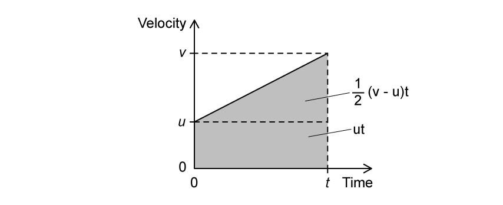

- Write an expression for the area under the graph:

area = $u t + 1 \frac{1}{2} ( v - u ) t$ **[1 mark]**

> **[mark-scheme]**
> Any **one **from:
> 
> - area = $u t + 1 \frac{1}{2} ( v - u ) t$
> - area = $v t - 1 \frac{1}{2} ( v - u ) t$
> - area = $1 \frac{1}{2} ( u + v ) t$
> 
> **[1 mark]**

> **[mark-scheme]**
> (ii) The physical quantity represented by the area under the graph is:
> 
> - Displacement **[1 mark]**

### Q2
(i) The significance of the negative values of *s* is that its direction is:

- Upwards / away from the Moon is taken as positive **OR** downwards / towards the Moon is taken as negative; **[1 mark]** ** **

(ii) An assumption about the motion of the object is:

- There is no effect of air resistance; **[1 mark]**
- There is no gravitational effect from the Earth / another body; **[1 mark]**

**[Total: 3 marks]**
Use the graph to determine a value for *g* close to the surface of the Moon:

- Take a point on the curve:

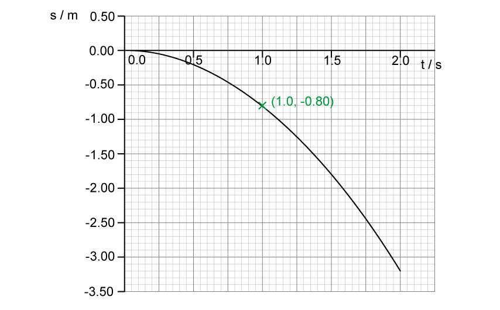

- A suitable point labelled on the graph **OR** <u>coordinates stated,</u> e.g. when *t* = 1.0 s, *s *= –0.80 m; **[1 mark]**

Substitute coordinates into the equation of motion to find *a*:

- $s=ut+\frac{1}{2}at^{2}$
- $- 0.80 = 0 + ( 1 \frac{1}{2} \times a \times 1.0 )$
- $a$ = (2 × –0.80) = –1.6 m s–2 **[1 mark]**

**[Total: 2 marks]**

> *Any object accelerating uniformly is described by the equation *$s=ut+\frac{1}{2}at^{2}$

> *You should realise that this is **the equation of a graph**, specifically, a displacement-time graph – as shown in this question. This is because *$s\propto-t^{2}$* and the graph of *$y\propto-x^{2}$* is a 'n' shape.*

> *Hence, each coordinate on the graph satisfies this equation for **s** and **t** (where **a** is the acceleration due to free fall and **u** is the initial velocity)*
Use the graph to estimate the instantaneous velocity:

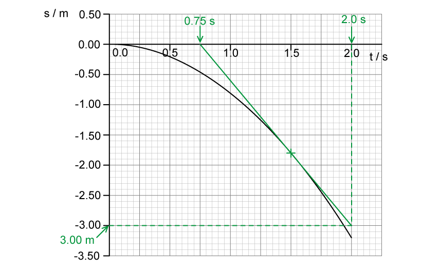

- Tangent drawn at *t* = 1.5 s **[1 mark]**

Determine the gradient of the tangent:

- Gradient of the tangent = instantaneous velocity at that point
- $\mathrm{gradient}=\frac{\Deltas}{\Deltat}$
- $\mathrm{gradient}=\frac{-3.00-0}{2.0-0.75}$ **[1 mark]**
- Instantaneous velocity:  *v* = –2.4 m s–1 **[1 mark]**

**[Total: 3 marks]**

> *The gradient of a displacement-time graph represents the **velocity** of the object*

> *Therefore, the gradient of the tangent at **t** = 1.5 s estimates the** instantaneous velocity** of the object*
(i) Sketch a displacement-time graph that would show the same object released close to the surface of Earth:

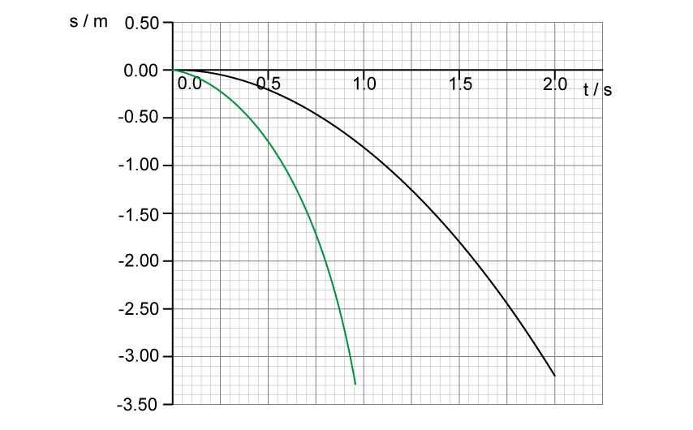

- A smooth parabola (judged by eye, as shown); **[1 mark]**
- A line <u>always below the Moon curve</u> (as shown); **[1 mark]** ** **

(ii) Describe and explain the features of the sketch:

- The line is parabolic** **because the displacement *s* is proportional to *t*2 / $s\proptot^{2}$ **[1 mark]**
- The line is below the Moon curve because the acceleration due to gravity / *g* on Earth is <u>larger</u> than on the Moon; **[1 mark]**

**[Total: 4 marks]**

> *If you're ever stuck on a question after part (a), make sure to look at the previous parts for clues to help you answer the question further along. From (b) we calculated the acceleration due to gravity on the moon and this is much less than the Earth. With your knowledge of **s**-**t** graphs (the gradient is the velocity) then the rate of change of that gradient (the acceleration) must be bigger for the graph for Earth i.e a steeper curve.*

### Q3
The vertical component of velocity:

- <u>Decreases</u> with height; **[1 mark]**
- At maximum height, the (vertical) velocity is zero; **[1 mark]**

The horizontal component of velocity:

- Does not change; **[1 mark]**

**[Total: 3 marks]**
Show that the time taken for the arrow to reach its maximum height is about 1.2 s:

List the known quantities:

- Initial velocity, *u* = 62 m s−1
- Final vertical velocity, *v* = 0
- Acceleration, *a* = −*g* = −9.81 m s−2
- Time to reach maximum height = *t*

Resolve the initial velocity into its vertical component:

- *u* = 62 sin (11°) **[1 mark]**

Substitute into the appropriate SUVAT equation and evaluate:

- SUVAT:  $v=u+at$
- 0 = 62 sin (11°) − *gt ***[1 mark]**
- *t = *$\frac{62 \sin ( 11^{\circ} )}{9.81}$ = 1.21 s **[1 mark]**

**[Total: 3 marks]**
Calculate the horizontal distance by which the arrow misses the target:

List the known quantities:

- Initial velocity, *u* = 62 m s−1
- Horizontal acceleration, *a* = 0
- Time to reach maximum height, *t* = 1.21 s (from **(b)**)
- Horizontal distance = *s*

Determine the total time of flight:

- Time of flight, *t* = 2 × 1.21 = 2.42 s **[1 mark]**

Resolve the initial velocity into its horizontal component:

- *u*(→) = 62 cos (11°)

Substitute into the chosen SUVAT equation and evaluate:

- SUVAT:  $s=ut+\frac{1}{2}at^{2}\Rightarrows=ut$
- *s* = 62 cos (11°) × 2.42 = 147 m **[1 mark]**

Determine the distance by which the arrow misses the target

- Horizontal distance = 147 – 100 = 47 m **[1 mark]**

**[Total: 3 marks]**

- *Always write down all your working, even if you get a bit lost there are lots of opportunities to gain marks even if your final answer is incorrect*

  - *As long as you multiplied your time from part (b) by 2, and correctly followed the rest of the steps, then you would likely score all the marks*
  - *If you didn't multiply your time by 2, you would only be able to score 1 mark if 1.2 × 62 cos (11°) were seen*

- *Notice that since you were already awarded a mark in part (b) for resolving the velocity component, you wouldn't be awarded another mark for doing it correctly in this part*

### Q4
Calculate the vertical velocity of the ball just before it hits the ground:

List the known quantities:

- Horizontal displacement, $s_{x}$= 40 m
- Horizontal initial velocity, $u_{x}$= 27.0 m s–1
- Horizontal acceleration, $a_{x}$= 0
- Vertical initial velocity, $v_{y}$ = 0
- Vertical acceleration, $a_{y}$ = *g* = 9.81 m s–2

Calculate the time taken to hit the ground, *t*:

- SUVAT:  $s=ut+\frac{1}{2}at^{2}\Rightarrows_{x}=u_{x}t$
- $t=\frac{s_{x}}{u_{x}}=\frac{40}{27}$ **[1 mark]**
- *t* = 1.481 s **[1 mark]**

Calculate the vertical final velocity:

- SUVAT: * *$v=u+at\Rightarrowv_{y}=gt$
- *v* = 9.81 × 1.481 **[1 mark]**
- *v* = 14.53 = 15 m s–1 **[1 mark]**

**[Total: 4 marks]**

> *Remember you can only use speed = *$\frac{distance}{time}$* for objects moving at **constant** velocity (0 acceleration) or if acceleration **a** is constant as long as **average speed** is used.*
Calculate the height of the cliff:

List the known quantities:

- Vertical acceleration, $a_{y}$= *g* = 9.81 m s–2
- Vertical initial velocity, $u_{y}$ = 0
- Time taken, *t* = 1.481 s (from **(a)**)

Substitute values into SUVAT equation to calculate $s_{y}$:

- $s=ut+\frac{1}{2}at^{2}\Rightarrows=\frac{1}{2}gt^{2}$
- $s_{y}$= $\frac{1}{2}$ × 9.81 × (1.481)2 **[1 mark]**
- $s_{y}$= 10.758 = 11 m (2 s.f.) **[1 mark]**

**[Total: 2 marks]**

> *This mark scheme has assumed that the downwards direction is positive, it could also be negative, meaning **g** = –9.81 m s**–2** which would make the vertical displacement –11 m. This is fine, as long as the positive and negative directions are consistent throughout the question.*
Sketch the graphs to show the variation of vertical and horizontal velocity with time:

List the known quantities:

- Time taken, *t* = 1.481 s = 1.5 s (from **(a)**)
- Horizontal velocity, $v_{x}$= 27 m s–1
- Maximum vertical velocity, $v_{y}$= 15 m s–1  (from **(a)**)

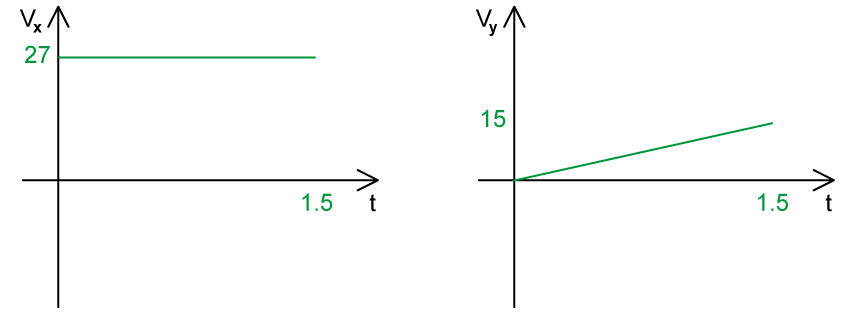

- Horizontal line for $v_{x}$– t graph; **[1 mark]**
- Straight line upwards for $v_{y}$– t graph; **[1 mark]**
- Values for $v_{x}$, $v_{y}$ and *t* all labelled correctly; **[1 mark]**

**[Total: 3 marks]**

> *The diagonal line for the *$v_{y}$*– t graph can be downwards as well as upwards, this would be the case if you have considered the downwards direction as negative, instead of positive. The graph would look like this:*

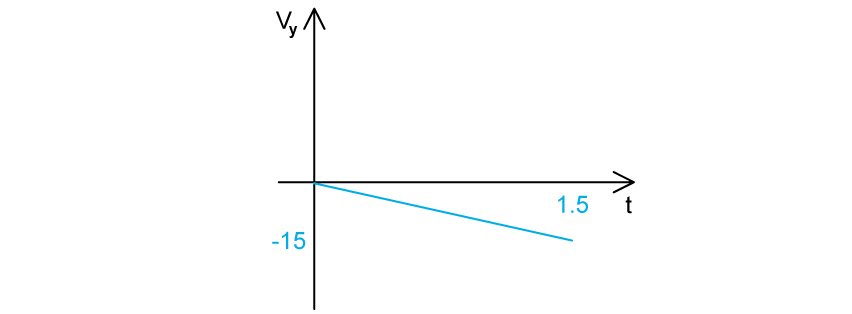

> *This is fine, as long as you are consistent with the positive and negative signs throughout the question.*
Calculate the resultant velocity of the ball:

List the known quantities:

- Horizontal velocity, $v_{x}$= 27 m s–1
- Maximum vertical velocity, $v_{y}$= 15 m s–1

Calculate the resultant velocity, *v*:

- $v=\sqrt{v_{x}^{2}+v_{y}^{2}}=\sqrt{15^{2}+27^{2}}$ **[1 mark]**
- *v* = 31 m s–1 **[1 mark]**

**[Total: 2 marks]**

> *Up until this point, velocity has always been considered in terms of its horizontal and vertical components. At this point, the resultant velocity is always calculated using Pythagoras (which is the case for all resultant vectors split into horizontal and vertical components)!*

### Q5
(i) Derive $v=u+at$

- Acceleration is defined as

  - $a=\frac{\mathrm{change} \mathrm{in} \mathrm{velocity}}{\mathrm{time} \mathrm{taken}}=\frac{\Deltav}{\Deltat}$ **[1 mark]**
- The change in velocity in this case is from *u* to *v*
- Substitute in $\Deltav=v-u$:

  - $a=\frac{v-u}{t}$ **[1 mark]**
- Rearrange into the required form:

  - $at=v-u$
  - $v=u+at$

(ii) Derive $s=ut+\frac{1}{2}at^{2}$

- Average velocity is defined as:

  - $\overline{v}=\frac{\mathrm{distance} \mathrm{travelled}}{\mathrm{time} \mathrm{taken}}=\frac{s}{t}$ **[1 mark]**
- The average velocity in this case is the average of *u* and *v*

  - $\overline{v}=\frac{u+v}{2}$
- Equate the expressions:

  - $\frac{s}{t}=\frac{u+v}{2}$
  - $s=\frac{u+v}{2}t$ **[1 mark]**
- Substitute in $v=u+at$:

  - $s = \frac{u + ( u + a t )}{2} t$ **[1 mark]**
- Simplify:

  - $s=\frac{2ut+at^{2}}{2}$
  - $s=ut+\frac{1}{2}at^{2}$

(iii) Derive $v^{2}=u^{2}+2as$

- Rearrange:

  - $v=u+at$
  - $t=\frac{v-u}{a}$
- Substitute:

  - $s=ut+\frac{1}{2}at^{2}$
  - $s = u ( \frac{v - u}{a} ) + 1 \frac{1}{2} a ( \frac{v - u}{a} )^{2}$ **[1 mark]**
- Multiply both sides by 2*a*:

  - $s = \frac{u ( v - u )}{a} + \frac{a ( v - u )^{2}}{2 a^{2}}$
  - $2 a s = 2 u ( v - u ) + ( v - u )^{2}$ **[1 mark]**
- Expand and simplify:

  - $2as=2uv-2u^{2}+v^{2}-2uv+u^{2}$
  - $2as=v^{2}-u^{2}$ **[1 mark]**
- Rearrange into the required form:

  - $v^{2}=u^{2}+2as$

**[Total: 8 marks]**
(i) In the interval *t* = 0 to *t* = 0.35 s:

- The ball accelerates; **[1 mark]**
- (Because) the separation of dots becomes larger / increases between each interval; **[1 mark]**

(ii) In the interval *t* = 0.35 to *t* = 0.55 s:

- The ball reaches a constant speed; **[1 mark]**
- (Because) the separation of dots becomes constant / does not continue to increase; **[1 mark]**

**[Total: 4 marks]**

> *It is very useful to annotate the diagram with the times to see that there is a clear distinction between the two time intervals in terms of the gaps between each dot*

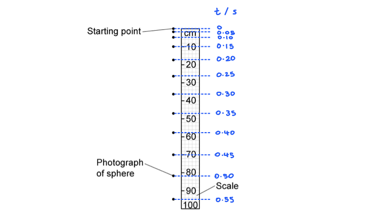
Determine the total time of flight for the ball:

- The ball falls from the starting point to 95 cm in 0.55 s
- Therefore, after 0.55 s, it falls 160 + 5 = 165 cm** [1 mark]**

  - Hence, distance, *s* = 165 cm
- At constant speed, distance travelled in 0.1 s = 25 cm **OR** in 0.05 s = 12.5 cm **[1 mark]** *Acceptable range for distance travelled in 0.1 s = 24 to 26 cm or distance travelled in 0.05 s = 11 to 13 cm*

  - Hence, speed, *v* = 250 cm s−1

Calculate the time during the fall at constant speed: speed 220 - 260

- Speed equation:  $v=\frac{s}{t}\Rightarrowt=\frac{s}{v}$
- $t=\frac{165}{250}=0.66s$ **[1 mark]** *Acceptable range for t = 0.63 to 0.75 s*
- Total time of flight = 0.55 + 0.66 = 1.21 s **[1 mark]**

**[Total: 4 marks]**
Determine the number of photographs that will be observed against the 100 cm scale:

List the known quantities:

- Initial speed, *u* = 0
- Distance, *s* = 100 cm = 1 m
- Acceleration, *a* = *g* = 9.81 m s−2
- time = *t*

Use a SUVAT equation to find time *t*:

- $s=ut+\frac{1}{2}at^{2}\Rightarrows=\frac{1}{2}gt^{2}$
- $t=\sqrt{\frac{2\times1}{9.81}}$ **[1 mark]**
- *t* = 0.45 s **[1 mark]**

Determine the number of photographs:

- The camera takes a photo every 0.05 s
- Number of photographs = $\frac{0.45}{0.05}+1$
- Number of photographs = 10 **[1 mark]**

**[Total: 3 marks]**

### Q6
List the known quantities:

- Initial acceleration, $a_{1}$= 5.0 m s–2
- Time for acceleration, *t* = 2.5 s
- Deceleration, $a_{2}$= – 4.0 m s–2
- Initial velocity, *u* = 3.0 m s–1

Calculate the distance travelled by the bus whilst accelerating, $S_{1}$:

- *s*  = $S_{1}$ = ?, *u*  = 3.0 m s–1, *v*  = not given, *a*  =  $a_{1}$= 5.0 m s–2, *t* = 2.5 s
- From the data booklet: *s* = *ut *+ $\frac{1}{2}$*at**2*
- $S_{1}$= (3.0 ×* *2.5)* *+ ($\frac{1}{2}$×* *5.0* *× (2.5)2) = 23.125 m **[1 mark]**

Calculate final velocity after acceleration, *v*:

- *s* = $S_{1}$ , *u* = 3.0 ms–1, *v* = ?, *a* = $a_{1}$= 5.0 m s–2, *t* = 2,5 s
- Recall: *v* = *u + at*
- *v* = 3.0 + (5.0 × 2.5) = 15.5 m s–1 **[1 mark]**

Calculate the distance travelled by the bus whilst decelerating, $S_{2}$:

- The bus reaches a maximum velocity of 15.5 m s–1 when accelerating. This is the new initial velocity for when it starts to decelerate
- *s*  = $S_{2}$, *u*  = 15.5 m s–1, *v* = 0, *a* = $a_{2}$ = –4.0 m s–2, *t*  = not given
- From the data booklet: *v**2* = *u**2** + 2as*
- $S_{2}=\frac{v^{2}-u^{2}}{2a_{2}}$
- $S_{2} = \frac{0 - ( 15.5 )^{2}}{2 \times - 4.0}$ = 30.0 m **[1 mark]**

Calculate the total distance travelled before stopping at the traffic lights, *s*:

- *s* = $S_{1}$+ $S_{2}$ = 23.125 + 30.0 = 53.125 = 53 m (2 s. f) **[1 mark]**** **

**[Total: 4 marks]**** **

> *This question is split into two parts – when the bus is accelerating, and when it is decelerating. The velocity of the bus is increasing whilst it accelerates, therefore when we use the kinematics equation for deceleration, we need to make sure to have the correct **initial** velocity for this. This is equal to the **final** velocity **after** the **acceleration**. Remember that a deceleration is just a negative acceleration, so make sure a deceleration has a minus sign (e.g. ­–4 m s**–2**) before substituting it into the kinematics equations!*

> * Using multiple kinematics equations is a common expectation in harder questions, so make sure to think through the modelling of the scenario before substituting any numbers! *
List the known quantities:

- Initial velocity = 3.0 m s–1
- Final velocity after acceleration = 15.5 m s–1 (from part a)
- Deceleration = –4.0 m s–2
- Time for acceleration, *t**1*  = 2.5 s
- Final velocity after deceleration = 0 m s–1 (at traffic lights)

Calculate the time taken to decelerate *t**2*:

- *s* = $S_{2}$ = not given in question, *u*  = 15.5 m s–1, *v* = 0, *a* = –4.0 m s–2, *t*  = *t**2*  = ?
- Recall: *v* = *u *+* at*
- 0 = 15.5 – 4.0*t**2*
- *t**2*  =$\frac{15.5}{4.0}$ = 3.875 = 3.9 s **[1 mark]**** **

A graph that would score 3 marks should look like:

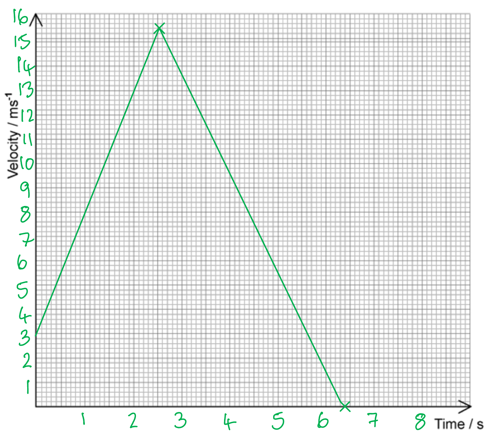

- Appropriate scale on time and velocity axis;** [1 mark]**
- Straight diagonal line upwards from 3 m s–1 to 15.5 m s–1 in 2.5 s;** [1 mark]**
- Straight diagonal line downwards from 15.5 m s–1 to 0 m s–1 at 6.4 s (2.5 + 3.9);** [1 mark]**

**[Total: 4 marks]**

> *When not given the axes on a table, think about the minimum and maximum values you need to plot (in this case 0 – 15.5 m s**–1** and 0 – 6.4 s) and then pick an appropriate scale. This should be in either multiples of 1, 2, 5 or 10 for each large square and your graph must take up at least half the scales on both axes for full marks. *

> *It can be helpful to mark the coordinates you know with an 'x' and then add in your straight lines with a ruler. *

> *Error carried forward marks will apply here from part (a), although you will not get full marks in part (a). Therefore, make sure the shape of your graph is accurate and axes are all correctly labelled as per your value, and don’t worry too much about getting the correct values if you are running out of time. This will help you get as many marks as possible.*

### Q7
Calculate the minimum initial velocity the motorcyclist requires in order to reach the other ramp:

List the known quantities:

- Angle of incline, θ = 25º
- Height of first ramp = 3 m
- Height of second ramp = 1 m
- Horizontal distance, x = 24 m

Determine an expression for the initial velocity, u in terms of time t:

- In the horizontal direction:  $x$ = 24 m, $u_{h}=u\mathrm{cos}25^{\circ}$, $a$ = 0, $t$ = ?
- In the horizontal direction:  $x=u_{h}t$
- $x = ( u \cos 25^{\circ} ) t \Leftrightarrow u = \frac{x}{t \cos 25^{\circ}}$
- $u=\frac{24}{t\mathrm{cos}25^{\circ}}$ **[1 mark] ** **[Eq. 1]**

Determine equation for time t from the vertical direction:

- In the vertical direction:  $\Deltas$ = –2 m, $u_{v}=u\mathrm{sin}25^{\circ}$, $a$ = –9.81 m s–2, $t$ = ?
- In the vertical direction:  $s=ut+\frac{1}{2}at^{2}\Rightarrow\Deltas=u_{v}t-\frac{1}{2}gt^{2}$
- $- 2 = ( u \sin 25^{\circ} ) t - ( \frac{9.81}{2} ) t^{2}$ **[1 mark]  ****[Eq. 2]**

Calculate *t* using simultaneous equations:

- Substitute *u* from **[Eq. 1]** into **[Eq. 2]**
- $- 2 = \frac{24 t \sin 25^{\circ}}{t \cos 25^{\circ}} - ( \frac{9.81}{2} ) t^{2}$
- $( \frac{9.81}{2} ) t^{2} = 24 \tan 25^{\circ} + 2 \Leftrightarrow t^{2} = \frac{48 \tan 25^{\circ} + 4}{9.81}$
- $t=\sqrt{\frac{48\mathrm{tan}25^{\circ}+4}{9.81}}$ = 1.64 s **[1 mark]**

Calculate initial velocity using **[Eq. 1]**:

- $u=\frac{24}{1.64\times\mathrm{cos}25^{\circ}}$ = 16 m s–1 **[1 mark]**

**[Total: 4 marks]**

> *The key to this kind of problem is to consider the** total vertical displacement **due to the difference in initial and final heights*

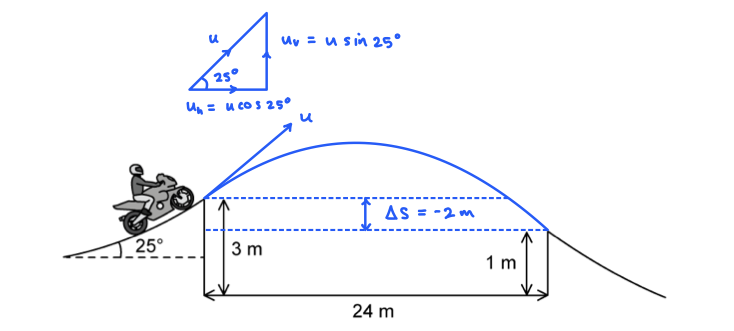
Deduce whether the rider lands on the other side of the river:

List the known quantities:

- Required horizontal distance, $x$ = 100 m
- Vertical height above ground, $h$ = 3.00 m
- Initial velocity, $u$ = 35 m s−1
- Angle of incline of ramp, $θ$ = 25°
- Horizontal acceleration = 0
- Vertical acceleration, $a$ = $-g$ = −9.81 m s−2

Determine the horizontal and vertical components of the initial velocity:

- Resolving horizontally (→):  $u_{x}=35\times\mathrm{cos}25^{\circ}$ = 31.7 m s−1
- Resolving vertically (↑): * *$u_{y}=35\times\mathrm{sin}25^{\circ}$ = 14.8 m s−1

Determine the time taken to travel 100 m horizontally:

- Horizontal motion:  $s=u_{x}t$
- $t=\frac{100}{31.7}$ = 3.155 s **[1 mark]**

Determine the vertical distance fallen in this time:

- Vertical motion:  $s=u_{y}t+\frac{1}{2}at^{2}$
- $s = ( 14.8 \times 3.155 ) - 1 \frac{1}{2} \times ( 9.81 \times 3.155^{2} )$ = −2.13 m **[1 mark]**
- Vertical distance fallen = 2.1 m **[1 mark]**

Write a concluding statement:

- When the rider has travelled 100 m horizontally, they have fallen a distance of 2.1 m which is less than 3.0 m, hence the rider lands on the other side of the river; **[1 mark]**

**[Total: 4 marks]**

> *The method shown above is by far the simplest way to tackle this question and requires the fewest calculation steps with no need for a quadratic formula*

> *There are other methods which give equally clear results but are more prone to calculation errors along the way*

- *Alternative method 1: compare the times of flight **Expected conclusion: it takes the rider 3.16 s to travel 100 m horizontally which is less than 3.22 s, the total time of flight, hence the rider lands on the other side of the river*
- *Alternative method 2: compare the horizontal distances **Expected conclusion: the rider travels a total horizontal distance of 102 m which is greater than 100 m, hence the rider lands on the other side of the river*

> *It can be useful to draw a clear sketch to help yourself to visualise the situation:*

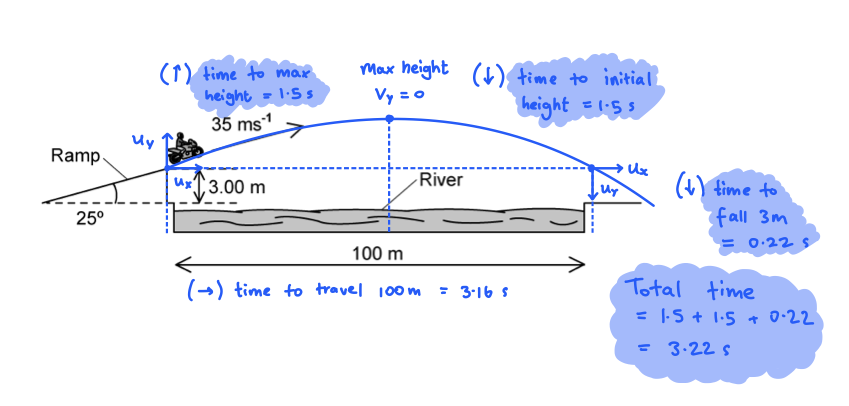
The effect of air resistance on the rider's motion would be:

- Air resistance acts to oppose the motion of the motorcyclist; **[1 mark]**

**Final answer:** **Max ****one**** from:**

- It decreases the time for which the motorcyclist is in the air; **[1 mark]**
- It causes deceleration in the horizontal direction; **[1 mark]**
- It reduces speed in the horizontal direction; **[1 mark]**
- It reduces the (maximum) height reached by the motorcyclist; **[1 mark]**

**If any mark is gained from the above, max ****one**** for: **

- It reduces the horizontal distance travelled; **[1 mark]**

**[Total: 3 marks]**

> *You could also use a diagram to aid your description - a clearly annotated sketch could earn you some marks*

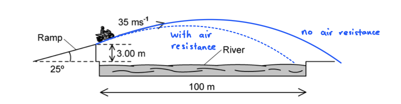

### Q8
A correctly completed table is as follows:

|   | **velocity** | **speed** | **distance** | **displacement** | **acceleration** |
|---|---|---|---|---|---|
| vector | **Final answer:** **✓** |   |   | **Final answer:** **✓** | **Final answer:** **✓** |
| scalar |   | **Final answer:** **✓** | **Final answer:** **✓** |   |   |

- Vectors: velocity, displacement, acceleration; **[1 mark]**
- Scalar: speed, distance; **[1 mark]**

**[Total: 2 marks]**
(i) Uniform acceleration is defined as:

**Final answer:** **Any ****one**** from:**

- When an object's velocity increases (or decreases) at a constant rate; **[1 mark]**
- Acceleration in which the rate of change of velocity is constant; **[1 mark]**
- When the velocity of an object changes by equal amounts in equal time periods; **[1 mark]**

(ii) The two other equations of motion are:

- $v=u+at$ **[1 mark]**
- $s = \frac{( u + v )}{2} t$ **[1 mark]**

**[Total: 3 marks]**
(i) The variation of the velocity of the load from *t* = 0 to 4.0 s is:

| **time interval** | **magnitude of velocity** | **direction of velocity** |
|---|---|---|
| *t* = 0 to 2.0 s | **Final answer:** **0.4 m s****−1** | **Final answer:** **upwards / positive ** |
| *t *= 2.0 to 3.5 s | **Final answer:** **0** | **Final answer:** **none** |
| *t* = 3.5 to 4.0 s | **Final answer:** **0.8 m s****−1** | **Final answer:** **downwards / negative** |

- **One mark for each correct row**

(ii) The velocity-time graph is as follows:

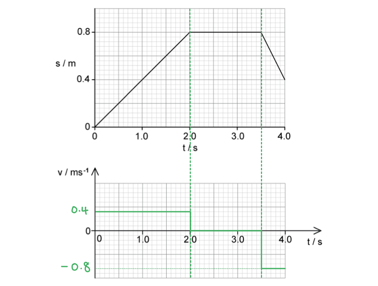

- All lines drawn straight and horizontal; **[1 mark]**
- Values +0.4 m s−1 and −0.8 m s−1 in correct places on the *v*-axis; **[1 mark]**

*Example of calculation:*

- Upwards velocity:  $v=\frac{\Deltas}{\Deltat}=\frac{0.8}{2.0}=0.4ms^{-1}$
- Downwards velocity:  $v=\frac{\Deltas}{\Deltat}=\frac{0.4-0.8}{4.0-3.5}=-0.8ms^{-1}$

**[Total: 5 marks]**
Calculate the velocity of the load just before it hits the ground:

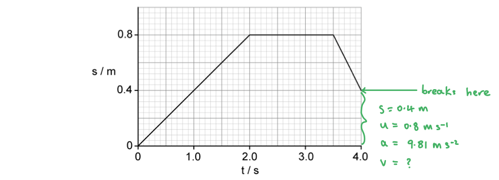

List the known quantities, now defining downwards as the positive direction (*u* is now positive):

- Initial velocity, *u* = 0.80 m s−1 (from **(c)**)
- Acceleration, *a* =* g* = 9.81 m s−2
- Distance, *s* = 0.40 m
- Final velocity = *v*

Select the correct SUVAT equation:

- $v^{2}=u^{2}+2as$

Substitute the values and evaluate:

- *v**2* = 0.802 + (2 × 9.81 × 0.40) **[1 mark]**
- $v=\sqrt{8.488}$
- *v* = 2.913 = 2.9 m s−1 (2 s.f.) **[1 mark]**

**[Total: 2 marks]**

> *Make sure to use the correct initial velocity here - the 0.40 m s**–1** was the velocity as the load was being lifted **up** (not down, as this question is asking about.)*

> *For questions like this, you can choose which direction is the positive direction, just be **clear** which you are doing in your calculations and don't mix your directions up.  In this question, if we were going to keep **up **as the positive direction, our values would be:*

- *Initial velocity, u = −0.80 m s**−1*
- *Acceleration, a = g = −9.81 m s**−2*
- *Distance, s = −0.40 m*

> *Distance is covered downwards, acceleration acts downwards and initial velocity is downwards - all in the negative direction. It can be easier to just say "downwards is the positive direction" and avoid all those minus signs. *

### Q9
List the known quantities:

- Vertical height, *s* = 175 m
- Horizontal distance, *x* = 105 m
- Acceleration due to free-fall, *a *= 9.81 m s−2

Determine the final vertical velocity, *v*y:

- From the data booklet: *v**2** *= *u**2** *+ 2*as *
- $v_{y}=\sqrt{0^{2}+2\times9.81\times175}$
- $v_{y}=58.60$ ms−1** [1 mark]**

Calculate the time to fall, *t*:

- Recall the equation: *v *= *u *+ *at*
- $t=\frac{v-u}{a}$
- $t=\frac{58.6-0}{9.81}$
- $t=5.97$ s ** [1 mark]**

Calculate the horizontal velocity, *v**x*:

- Recall: $v=\frac{x}{t}$
- $v_{x}=\frac{105}{5.97}$
- $v_{x}=17.59$* *m s−1 ** [1 mark]**

Calculate the resultant velocity, *v*:

- Use Pythagoras: *a**2** *+ *b**2* = *c**2*
- $v=\sqrt{v_{x}^{2}+v_{y}^{2}}$
- $v=\sqrt{17.59^{2}+58.60^{2}}$
- $v=61.18$ m s−1 ** [1 mark]**

**[Total: 4 marks]**** **

> *Time **t** is the **same** for the equations representing the horizontal motion or the vertical motion of the ball and this key point is often vital for more complicated projectile motion questions. Anything in projectile motion has a constant horizontal velocity (hence you can use **distance **= **speed** **× time**), but a changing vertical velocity. This is because the acceleration due to gravity is only in the vertical direction.*
If the stone was thrown with a greater horizontal velocity then:

- The adjacent side of the triangle *v**x* will be bigger; **[1 mark]**
- $\mathrm{tan}θ=\frac{\mathrm{opp}}{\mathrm{adjacent}}=\frac{v_{y}}{v_{x}}$ **[1 mark]**
- So, $\frac{v_{y}}{v_{x}}$ will be smaller, hence, *θ* will be smaller; **[1 mark]**

**[Total: 3 marks]**

> *It can be helpful to draw a diagram to show this situation and make it easier to figure out the relationship between the angle and horizontal velocity. *

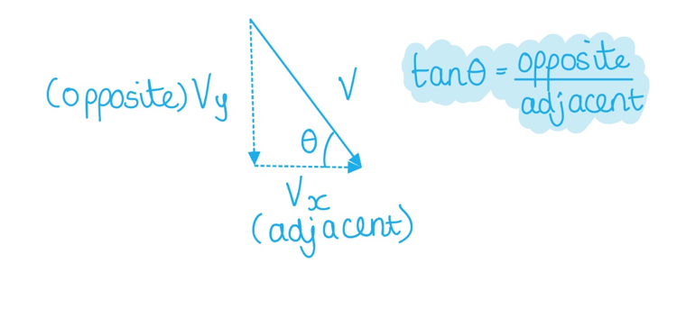
List the known quantities:

- Angle, *θ*  = 30°
- Speed, *u* = 29 m s–1
- Horizontal distance, *x* = 50 m
- Vertical height of the wall, *h*  = 15 m

Calculate time taken to reach the wall, *t*:

- In the horizontal direction:* Distance* = *speed × time*
- *x*  = $u_{x}$× *t* therefore *t*  = $\frac{x}{u_{x}}$
- *t*  = $\frac{50}{29 \cos ( 30 )}$= 1.99 s **[1 mark]**

Calculate vertical height of the projectile, *s*:

- In the vertical direction: *s  *= ?, *u* = 29sin(30), *v*  = not given, *a*  = –9.81 m s–2, *t*  = 1.99 s
- From the data booklet: *s* = *ut* + $\frac{1}{2}$*at**2*
- *s*  = (29sin(30) × 1.99) + ($\frac{1}{2}$× –9.81 × (1.99)2) = 9.43 m **[1 mark]**

Conclusion:

- Since *s*  = 9.43 < *h  *= 15 m, the rock <u>does not</u> make it over the wall; **[1 mark]**** **

**[Total: 3 marks]**** **

> *If you define the upwards (initial velocity) as positive, then downwards (**g**) must be negative and vice versa. It doesn't matter which direction you define as positive or negative as long as you are consistent throughout the question*
Determine the equation for the distance in the horizontal direction:

- $u_{x}$= *u*cos(*θ*)
- In the horizonal direction: *distance *= *speed* × *time*
- Horizontal distance, *x* = *u*cos(*θ*) *t*

Determine the equation for time, *t*:

- In the vertical direction: *s* = not given, $u_{y}$= *u* sin (*θ*),  $v_{y}$= – *u* sin (*θ*), *a* = – *g*, *t* = *t*
- Recall: *v* = *u *+ *at*
- *t*  = $\frac{v-u}{a}$ = $\frac{- u \sin ( \\theta ) - u \sin ( \\theta )}{- g}$ **[1 mark]**
- *t  *= $\frac{2 u \sin ( \\theta )}{g}$**[1 mark]**

Substitute the equation for *t* into the horizontal distance equation:

- *x* = *u *cos (*θ*) *t  *=* u *cos (*θ*)$( \frac{2 u \sin ( \\theta )}{g} )$= $\frac{2 u^{2} \cos ( \\theta ) \sin ( \\theta )}{g}$ **[1 mark]**
- Using the double angle formula: sin(2A) = 2sin(A)cos(A)
- *x*  = $\frac{u^{2} \sin ( 2 \\theta )}{g}$ **[1 mark]**

Determine the maximum value of *θ*:

- sin(2*θ*)* *= 1 therefore, 2*θ* = $\sin ^{- 1} ( 1 )$ **[1 mark]**
- 2*θ* = 90°
- *θ *= $\frac{90}{2}$= 45° **[1 mark]**** **

**[Total: 6 marks]**** **

> *Don’t be too alarmed if you didn’t manage this on your first go, it would be an incredibly harsh exam question. The key to this derivation is the final and initial vertical velocities are equal in magnitude and opposite in direction for a projectile starting and ending at the ground level.*

> *The final vertical velocity, **v, will equal** the initial vertical velocity **u** but in the **opposite** **direction **because of the symmetry of the parabola. Remember, that the greatest value of sin(**θ**) is equal to 1.*

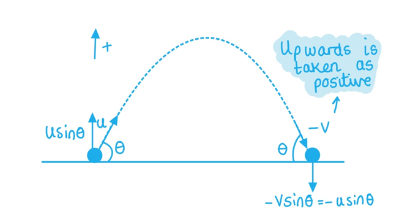

> *You will not be expected to remember the double angle formula in your A–level physics exam. Any formulas that are not required will be given in the question, as is done here, which you will be expected to use.*

### Q10
Acceleration is defined as:

- The rate of change of velocity **OR**
- The change in velocity ÷ time taken; **[1 mark]**

**[Total: 1 mark]**
List the known quantities:

- Horizontal displacement, $x$ = 24 m
- Time, $t$ = 1.5 s
- Angle of projection, $θ$ = 28°

(i) Calculate the initial horizontal component *v*x of the velocity of the ball:

- $v=\frac{x}{t}$
- $v_{x}=\frac{24}{1.5}$ = 16 m s−1 **[1 mark]**

(ii) Show that the initial vertical component $v_{Y}$ of the velocity of the ball is 8.5 m s–1:

**Method 1: Using the tan function**

- `tan ( 28 deg ) = v _ Y / v _ x` **[1 mark]**
- $v_{Y} = 16 \tan ( 28^{\circ} )$
- $v_{Y} = 8.507 \mathrm{m} \mathrm{s}^{- 1} = 8.5 \mathrm{m} \mathrm{s}^{- 1} ( 2 \mathrm{s} . \mathrm{f} . )$ **[1 mark]**

**Final answer:** **OR**

**Method 2: Resolve **$v$** in both directions**

- $v_{x} = v \cos ( 28^{\circ} )$  **AND ** $v_{Y} = v \sin ( 28^{\circ} )$ **[1 mark]**
- $v_{Y} = v_{x} \times \frac{\sin ( 28^{\circ} )}{\cos ( 28^{\circ} )} = 16 \times \frac{\sin ( 28^{\circ} )}{\cos ( 28^{\circ} )}$
- $v_{Y} = 8.507 \mathrm{m} \mathrm{s}^{- 1} = 8.5 \mathrm{m} \mathrm{s}^{- 1} ( 2 \mathrm{s} . \mathrm{f} . )$ **[1 mark]**

(iii) Calculate the time taken for the ball to reach its maximum height above the ground:

List the known quantities:

- Initial vertical velocity, $u ( \uparrow )$ = 8.5 m s−1
- Final velocity at maximum height, $v$ = 0 m s−1
- Vertical acceleration, $a=g=$ 9.81 m s−2
- Time = $t$

Select the correct equation of motion and substitute the known quantities:

- $v=u+at$ **[1 mark]**
- $0 = 8.5 + ( - 9.81 \times t )$
- $t=\frac{8.5}{9.81}=0.866s$
- $t=0.87s$ **[1 mark]**

(iv) On Fig. 1.2, sketch the variation with time t of *v*y for the time until the ball hits the wall:

- The known co-ordinates are:

  - $( t , v_{Y} )$
  - (0, 8.5)
  - (0.87, 0)
  - The ball hits the wall at $t$ = 1.5 s

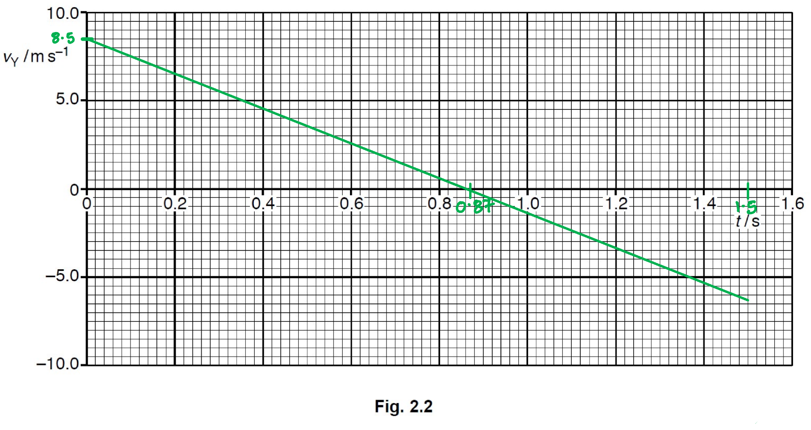

- Straight line drawn from positive $v_{Y}$ at $t$ = 0 to negative $v_{Y}$ at $t$ = 1.5 s **[1 mark]**
- Line starts at $( 0 , 8.5 )$, passes through $( 0.87 , 0 )$ and finishes at $t$ = 1.5 s **[1 mark]**

**[Total: 7 marks]**

- *Draw a **triangle** and label as below, to resolve for *$v$* as the **quickest** way to do part (ii)*

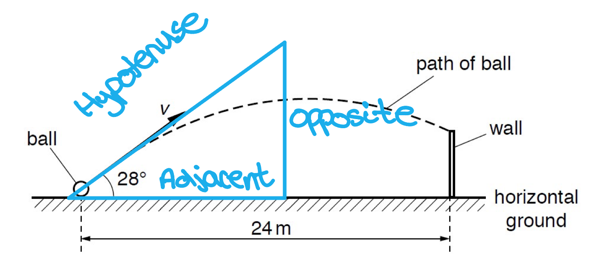
List the known quantities:

- Initial vertical velocity, $u ( \uparrow )$ = 8.5 m s−1
- Final velocity, $v$ = 0 m s−1
- Acceleration of free fall, $a$ = −9.81 m s−2
- Time to maximum height, $t$ = 0.87 s (from part bii)
- Maximum height = $s$
- Maximum gravitational potential energy of ball, $E$ = 22 J

(i) Calculate the maximum height above the ground of the ball in **(b)**:

- SUVAT:  $v^{2}=u^{2}+2as$ **[1 mark]**
- $0^{2} = 8.5^{2} + ( 2 \times - 9.81 \times s )$
- $s = \frac{( - 8.5 )^{2}}{2 \times ( - 9.81 )}$
- $s=3.68m=3.7m$ **[1 mark]**

(ii) Calculate the mass of the ball $m$:

- $\DeltaE=mg\Deltah\Rightarrowm=\frac{\DeltaE}{g\Deltah}$
- $m=\frac{22}{9.81\times3.7}$ **[1 mark]**
- $m = 0.606 kg = 0.61 kg ( 2 s. f. )$ **[1 mark]**

**[Total: 4 marks]**

- *For part (i), since you have all 5 quantities, you could use any of the following to gain both marks as they lead to the same final answer:*

  - $s = u t + 1 \frac{1}{2} a t^{2} = ( 8.5 \times 0.87 ) + 1 \frac{1}{2} ( - 9.81 \times 0.87^{2} )$
  - $s = v t - 1 \frac{1}{2} a t^{2} = 0 - 1 \frac{1}{2} ( - 9.81 \times 0.87^{2} )$
  - $s = 1 \frac{1}{2} ( u + v ) t = 1 \frac{1}{2} \times 8.5 \times 0.87$
If the mass is increased, the time taken to reach a maximum height will:

- Stay the same / not be affected

This is because:

- The acceleration (of free fall) is the same / constant for all objects on Earth **OR**
- The acceleration (of free fall) is not dependent on mass, so it has no effect on the time taken; **[1 mark]**

**[Total: 1 mark]**

### Q11
(i) Determine the magnitude of the initial velocity of the pellet:

Consider the motion from launch $( t = 0 )$ to the maximum height $( t = 2.5 \mathrm{s} )$:

- Initial velocity = *u*
- Final velocity, *v* = 0
- Acceleration, *a* = −9.81 m s−2
- (From Fig. 1.1) time taken, *t* = 2.5 s

Select an appropriate SUVAT equation to calculate *u*:

- SUVAT:  $v=u+at$ **[1 mark]**
- Substitute:  0 = *u* − (9.81 × 2.5) **[1 mark]**
- Rearrange & calculate:  *u* = 24.5 m s−1 **[1 mark]**

(ii) Determine the final velocity of the pellet:

Consider the motion from the maximum height $( t = 2.5 \mathrm{s} )$ to the final position $( t = 6.0 \mathrm{s} )$:

- Initial velocity, *u* = 0
- Final velocity= *v*
- Acceleration, *a* = 9.81 m s−2
- Time taken, *t* = 6.0 − 2.5 = 3.5 s

Select an appropriate SUVAT equation to calculate *v*:

- SUVAT:  $v=u+at$
- Substitute:  *v* = 0 + (9.81 × 3.5) **[1 mark]**
- Calculate:  *v* = 34.3 m s−1 **[1 mark]**

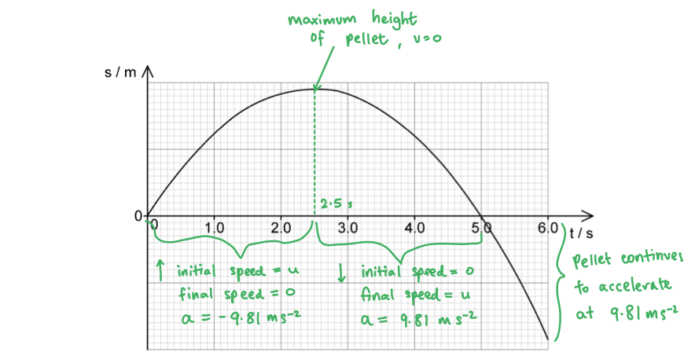

(iii) The assumption made in both calculations is:

- There is no / minimal air resistance **OR** the pellet has constant acceleration; **[1 mark]**

**[Total: 6 marks]**
The variation of velocity *v* of the pellet with time *t* is as follows:

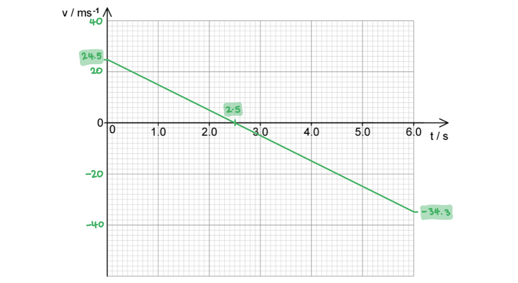

- Straight line starting at a positive value of *v* **AND **negative gradient; **[1 mark]**
- Line passes time axis at *t* = 2.5 s (when *v* = 0); **[1 mark]**
- Values from (a) correctly labelled i.e. 24.5 m s−1 at *t* = 0 and −34.3 m s−1 at *t* = 6.0 s; **[1 mark]**

**[Total: 3 marks]**
(i) Determine the maximum height reached by the pellet:

- The maximum height is reached when *v* = 0 at *t* = 2.5 s
- Displacement = area under the velocity-time graph

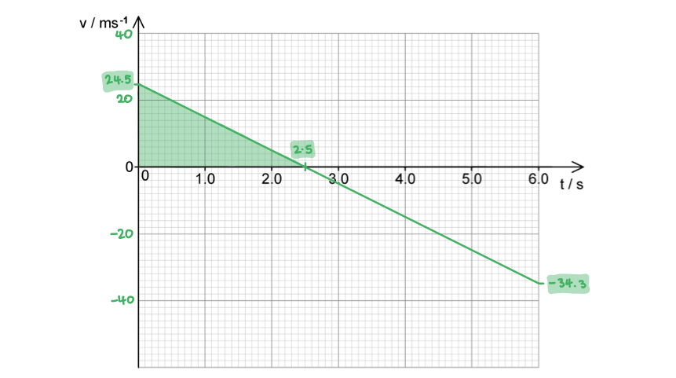

- Area = $\frac{1}{2}\times24.5\times2.5$ **[1 mark]**
- Maximum height = 30.625 = 30.6 m **[1 mark]**

(ii) Show that the final position of the pellet after 6.0 s is about 30 m below its initial position:

- After the pellet reaches the maximum height of 30.6 m, it falls 30.6 m back to the starting point and then travels in the negative direction as it falls towards the ground under the cliff edge
- The pellet passes the starting point at *t* = 5.0 s
- So, the final displacement is the displacement between 5.0 and 6.0 s

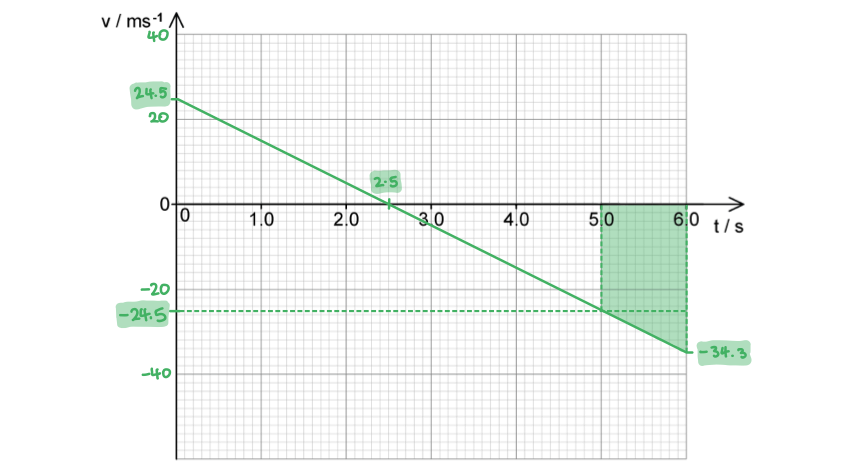

- Area of triangle = $1 \frac{1}{2} \times ( 6.0 - 5.0 ) \times ( 24.5 - 34.3 )$
- Area of rectangle = $( 6.0 - 5.0 ) \times - 24.5$
- Total area = $- [ 1 \frac{1}{2} ( 34.3 - 24.5 ) + 24.5 ]$ **[1 mark]**
- Final position = −29.4 m **[1 mark]**

**[Total: 4 marks]**

> *For part (ii), you could also calculate the total displacement between 2.5 and 6.0 s and then subtract your answer from (i), this would give the same result*

> *The minus sign is very important in part (ii) because the question asks you to show that the final position is **below the starting point**. This means that the pellet is travelling in the **opposite direction** to its initial direction of motion, which is directly down from its starting point, hence the need for the minus sign*
(i) The pellet which hits the ground first is:

- The horizontally fired pellet; **[1 mark]**

(ii) Calculate the time difference between the pellets hitting the ground:

List the known quantities:

- Height of cliff, *s* = 29.4 m
- Initial vertical velocity, *u* = 0
- Acceleration, *a* = 9.81 m s−2
- Time taken = *t*

Select an appropriate SUVAT equation to calculate *u*:

- SUVAT:  $s=ut+\frac{1}{2}at^{2}$ **[1 mark]**
- Substitute & rearrange:  $29.4=0+\frac{1}{2}\times9.81\timest^{2}\Rightarrowt=\sqrt{\frac{2\times29.4}{9.81}}$ **[1 mark]**
- Time of flight of horizontal pellet: * t* = 2.448 = 2.4 s **[1 mark]**
- Time between pellets hitting the ground = 6.0 − 2.4 = 3.6 s **[1 mark]**

**[Total: 5 marks]**

### Q12
(i) The difference between distance and displacement is:

- Distance is defined as the total length between two points regardless of direction **OR** distance is a scalar quantity; **[1 mark]**
- Displacement is defined as the net change in an object's position **OR** displacement is a vector quantity; **[1 mark]**

(ii) The difference between speed and velocity is:

- Speed is defined as the total distance travelled per unit of time **OR** speed is a scalar quantity; **[1 mark]**
- Velocity is defined as the rate of change of displacement of an object **OR** velocity is a vector quantity; **[1 mark]**

**[Total: 4 marks]**
The correctly complected table is as follows:

|   | **displacement-time** | **velocity-time** | **acceleration-time** |
|---|---|---|---|
| gradient represents | **Final answer:** **velocity** | **Final answer:** **acceleration** | ✘ |
| area under curve represents | **Final answer:** **✘** | **Final answer:** **displacement** | **Final answer:** **change in velocity** |
| y-intercept represents | **Final answer:** **initial position** | **Final answer:** **initial velocity** | **Final answer:** **initial acceleration** |
| horizontal line represents | zero velocity | **Final answer:** **constant velocity** | **Final answer:** **constant / uniform acceleration** |
| straight section represents | **Final answer:** **constant velocity** | **Final answer:** **constant / uniform acceleration** | **Final answer:** **✘** |
| curved section represents | **Final answer:** **changing velocity / acceleration** | non-uniform acceleration | **Final answer:** **✘** |

- **One mark for each correct row**

**[Total: 6 marks]**
For an object moving with constant velocity:

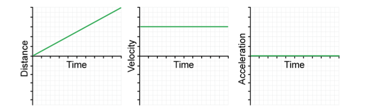

- Distance-time graph: straight, diagonal line starting from zero drawn; **[1 mark]**
- Velocity-time graph: straight, horizontal non-zero line drawn; **[1 mark]**
- Acceleration-time graph: straight, horizontal drawn at zero; **[1 mark]**

**[Total: 3 marks]**
For an object moving with uniform acceleration:

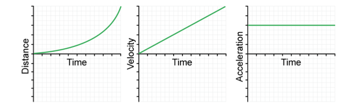

- Distance-time graph: curved / parabolic line starting from zero drawn; **[1 mark]**
- Velocity-time graph: straight, diagonal line starting from zero drawn; **[1 mark]**
- Acceleration-time graph: straight, horizontal non-zero line drawn; **[1 mark]**

**[Total: 3 marks]**

### Q13
This measurement of time can be used to find the depth of the well because:

- The initial velocity *u* is zero **AND**** **the acceleration (due to gravity) is *g* = 9.81 m s−2 **[1 mark]**
- Final velocity *v* can be found from $v=u+at$ **OR****  **$a=\frac{\Deltav}{t}$ **[1 mark]**
- The depth *s *can be found using $v^{2}=u^{2}+2as$ and**  **$s=ut+\frac{1}{2}at^{2}$ **OR **from the area under a graph of *v* against *t*; **[1 mark]**

**[Total: 3 marks]**
To calculate the velocity of the stone when it hits the water:

List the known quantities:

- Time, $t$ = 3.2 s
- Acceleration, $g$ = 9.81 m s−1
- Initial velocity, $u$ = 0

Calculate the final velocity *v*:

- $v=u+at$
- $v$ = 0 + (9.81 × 3.2) **[1 mark]**
- $v$ = 31.392 = 31 m s−1 (downward) **[1 mark]**

**[Total: 2 marks]**
On Fig. 1.1, sketch the variation of time with velocity for the stone as it falls down the well.

List the known quantities:

- Final speed, *v* = 31 m s–1 (from part **(b)**)
- Time taken, *t* = 3.2 s

The variation of time with velocity for the stone is as follows:

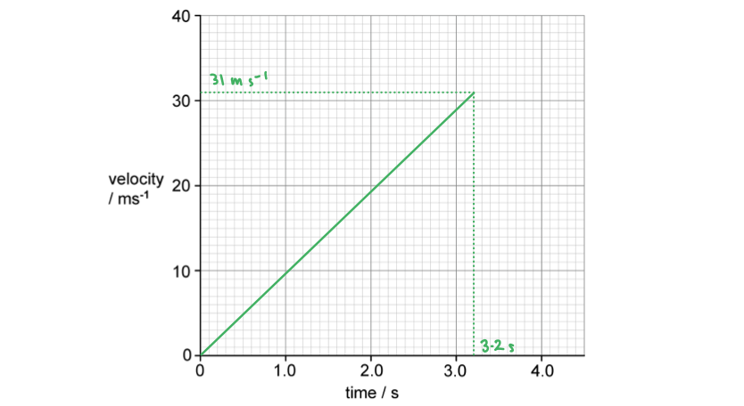

- Straight line drawn starting from zero; **[1 mark]**
- Line stops at *t* = 3.2 s, *v* = 31 m s−1; **[1 mark]**

**[Total: 2 marks]**
Determine the depth of the well from the graph:

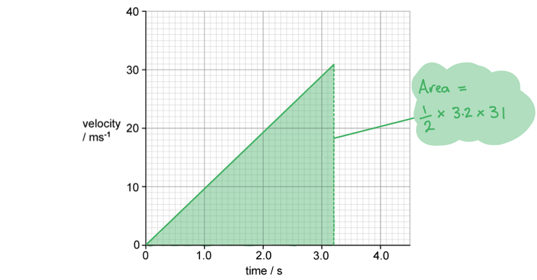

- Displacement = area under the velocity-time graph
- Depth = $\frac{1}{2}\times3.2\times31$ **[1 mark]**
- Depth = 49.6 = 50 m **[1 mark]**

**[Total: 2 marks]**
