# Exam Questions — Equations of Motion
**2. Kinematics** · Cambridge (CIE) AS physics (9702)
> Source: [https://www.savemyexams.com/as/physics/cie/25/topic-questions/](https://www.savemyexams.com/as/physics/cie/25/topic-questions/) · 45 questions across 2 sets

## Multiple Choice Questions (32 questions)

### Q1 — medium — 1 marks

**Q1** [1 mark]

A spacecraft is launched from Earth's surface and accelerates uniformly in a straight line from an initial speed of $2\times10^{3}\text{m s}^{-1}$ to a final speed of $6\times10^{3}\text{m s}^{-1}$ over a distance of 400 km.

What is the acceleration of the spacecraft?

### Q2 — easy — 1 marks

**Q2** [1 mark]

Which feature of a graph allows velocity to be determined?

### Q3 — medium — 1 marks

**Q3** [1 mark]

A stone is thrown upwards and follows a curved path.

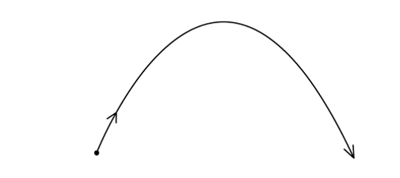

Air resistance is negligible.

Why does the path have this shape?

### Q4 — hard — 1 marks

**Q4** [1 mark]

A ball is released from rest on a smooth slope PQR.

It moves down the slope, along a smooth horizontal surface QR and rebounds inelastically at R.

Then it moves back to Q and comes to rest momentarily somewhere on PQ.

Which velocity-time graph represents the motion of the ball?

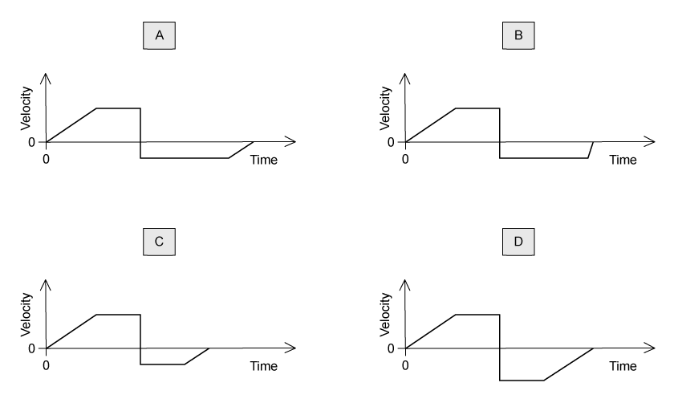

### Q5 — hard — 1 marks

**Q5** [1 mark]

A sprinter runs a 200 m race in a straight line. He starts from rest and accelerates at 2.5 m s–2 until reaching a maximum speed of 10 m s–1. He maintains this speed until he crosses the finish line.

How long does it take the sprinter to run the race?

### Q6 — hard — 1 marks

**Q6** [1 mark]

The dotted line shows the path of a competitor in a ski-jumping competition.

Ignoring air resistance, which graph best represents the variation of his speed *v* with the horizontal distance *x* covered from the start of his jump at Y before landing at Z?

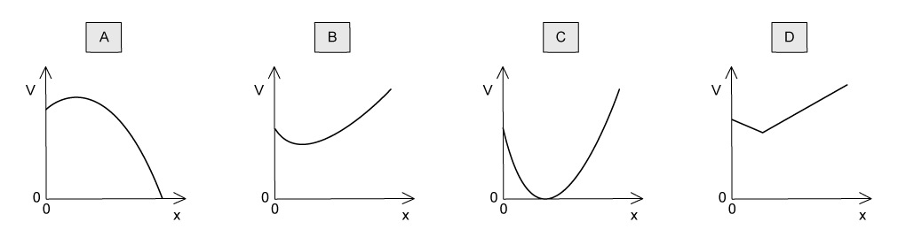

### Q7 — medium — 1 marks

**Q7** [1 mark]

A sphere is released and falls. Its initial acceleration reduces until it eventually begins to travel at constant terminal velocity.

Which displacement-time graph best represents the motion of the sphere?

### Q8 — hard — 1 marks

**Q8** [1 mark]

Two markers *M**1* and *M**2* are set up a vertical distance *h* apart.

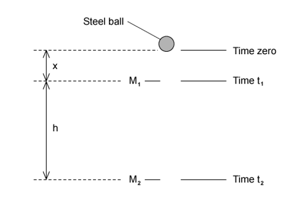

A steel ball is released at time zero from a point a distance *x* above *M**1*. The ball reaches *M**1* at time *t**1* and reaches *M**2* at time *t**2*. The acceleration of the ball is constant.

Which expression gives the acceleration of the ball?

### Q9 — hard — 1 marks

**Q9** [1 mark]

In order that a train can stop safely, it will always pass a signal showing a yellow light before it reaches a signal showing a red light.

Drivers apply the brake at the yellow light and this results in a uniform deceleration to stop exactly at the red light. The distance between the red and yellow lights is *x*.

What must be the minimum distance between the lights if the train speed is increased by 25 %, without changing the deceleration of the trains?

### Q10 — easy — 1 marks

**Q10** [1 mark]

Which feature of a graph allows acceleration to be determined?

### Q11 — easy — 1 marks

**Q11** [1 mark]

An object moves directly from X to Z

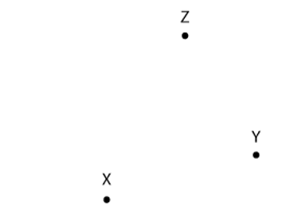

In a shorter time, a second object moves from X to Y to Z.

Which statement about the two objects is correct for the journey from X to Z?

### Q12 — easy — 1 marks

**Q12** [1 mark]

The velocity of an object during the first five seconds of its motion is shown on the graph

What is the displacement of the object in this time?

### Q13 — medium — 1 marks

**Q13** [1 mark]

The graph of velocity against time for an object moving in a straight line is shown

What is the corresponding graph of displacement against time?

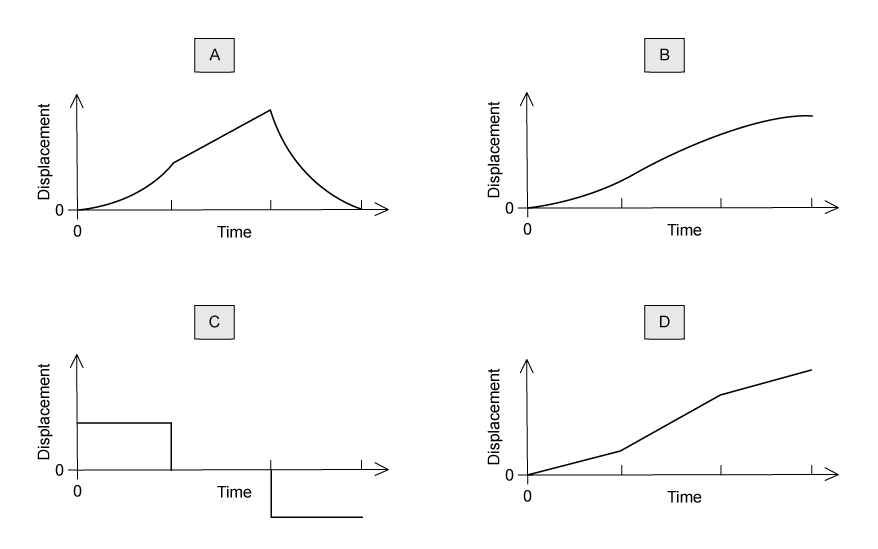

### Q14 — easy — 1 marks

**Q14** [1 mark]

An object is thrown with velocity 7.1 m s–1 vertically upwards on the Moon. The acceleration due to gravity on the Moon is 1.62 m s–2

What is the time taken for the object to return to its starting point?

### Q15 — easy — 1 marks

**Q15** [1 mark]

A car at rest in a traffic queue moves forward in a straight line and then comes to rest again. The graph shows how the car’s displacement varies with time

What is its speed while it is moving?

### Q16 — hard — 1 marks

**Q16** [1 mark]

A small glider moves along a friction-free horizontal air track as shown below.

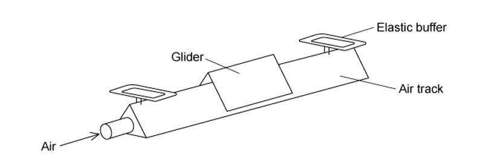

At each end of the air track there is a perfectly elastic buffer.

Which graph represents the variation with time *t* of the velocity *v* of the glider as it moves between the two buffers?

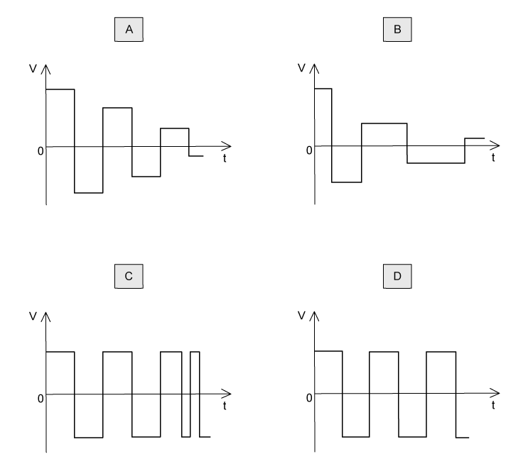

### Q17 — easy — 1 marks

**Q17** [1 mark]

An experiment is done to measure the acceleration of free fall of a body from rest.

Which measurements are needed?

### Q18 — medium — 1 marks

**Q18** [1 mark]

A projectile is fired at an angle *α* to the horizontal at a speed *u*, as shown.

What are the vertical and horizontal components of its velocity after a time *t*?

Assume that air resistance is negligible. The acceleration of free fall is *g*.

|   | **Vertical component** | **Horizontal component** |
|---|---|---|
| **A**  **B**  **C**  **D** | *u* sin *α*  *u* sin *α* – *gt*  *u* sin *α* – *gt*  *u* cos *α* | *u* cos *α*  *u* cos *α* – *gt*  *u* cos *α*  *u* sin *α* – *gt* |

### Q19 — hard — 1 marks

**Q19** [1 mark]

An aeroplane travels at an average speed of 700 km h–1 on an outward flight and at 300 km h–1 on the return flight over the same distance.

What is the average speed of the whole flight?

### Q20 — medium — 1 marks

**Q20** [1 mark]

A bullet is fired horizontally with speed *v* from a rifle. For a short time *t* after leaving the rifle, the only force affecting its motion is gravity. The acceleration of free fall is *g*.

Which expression gives the value of  $\frac{\mathrm{horizontal} \mathrm{distance} \mathrm{travelled} \mathrm{in} \mathrm{time}t}{\mathrm{vertical} \mathrm{distance} \mathrm{travelled} \mathrm{in} \mathrm{time}t}$ ?

### Q21 — medium — 1 marks

**Q21** [1 mark]

A train passes through a station at a constant speed of 20 m s–1

A second train is at rest at the station. It begins to leave the station with a uniform acceleration of 1.0 m s–2  just as the first train goes past.

How much time passes before the second train overtakes the first train?

### Q22 — easy — 1 marks

**Q22** [1 mark]

On a particular railway, a train driver applies the brake of the train at a yellow signal, a distance of 1.0 km from a red signal, where the train stops.

The maximum deceleration of the train is 1.1 m s–2

Assuming uniform deceleration, what is the maximum safe speed of the train at the yellow signal?

### Q23 — easy — 1 marks

**Q23** [1 mark]

A golf ball is hit with the same force and direction on the Earth and on the Moon.

Which diagram best represents the shapes of the paths taken by the golf ball?

### Q24 — medium — 1 marks

**Q24** [1 mark]

A ball is released from rest above a horizontal surface and bounces several times.

The graph shows how, for this ball, a quantity *y* varies with time.

What is the quantity *y*?

### Q25 — hard — 1 marks

**Q25** [1 mark]

A cannon fires a cannonball with an initial speed *v* at an angle α to the horizontal.

Which equation is correct for the maximum height H reached?

### Q26 — hard — 1 marks

**Q26** [1 mark]

A raindrop falls vertically from rest in air. The variation with time of the speed of the raindrop is shown in the graph.

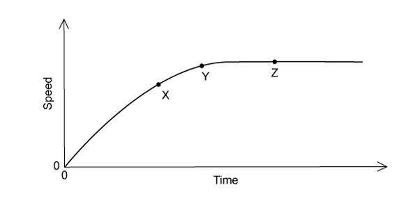

Which statement about the raindrop is correct?

### Q27 — easy — 1 marks

**Q27** [1 mark]

The variation with time *t* of the displacement *s* moved by a body is shown below.

What can be deduced from the graph about the motion of the body?

### Q28 — medium — 1 marks

**Q28** [1 mark]

The acceleration of free fall on the Moon is one-sixth of that on Earth. On Earth it takes time *t* for a stone to fall from rest a distance of 2 m.

What is the time taken for a stone to fall from rest a distance of 2 m on the Moon?

### Q29 — hard — 1 marks

**Q29** [1 mark]

A body having uniform acceleration *a* increases its velocity from *u* to *v* in time *t*.

Which expression would **not** give a correct value for the body’s displacement during time *t *?

### Q30 — easy — 1 marks

**Q30** [1 mark]

A ball is thrown upwards with an initial vertical velocity of 2.2 m s–1.

What is the maximum height reached by the ball?

### Q31 — medium — 1 marks

**Q31** [1 mark]

In a cathode-ray tube, an electron is accelerated uniformly in a straight line from a speed of 4 × 105 m s–1 to one tenth of the speed of light over a distance of 10 mm

What is the acceleration of the electron?

### Q32 — medium — 1 marks

**Q32** [1 mark]

The graph shows how the speed *v* of a sprinter changes with time *t* during a 100 m race.

What is the best estimate of the maximum acceleration of the sprinter?

## Structured Questions (13 questions)

### Q1 — easy — 3 marks

**Q1** [1 mark]

Define *velocity*.

**Q1** [2 marks]

Fig. 1.1 shows the velocity–time graph for the car as it travels along a straight road.

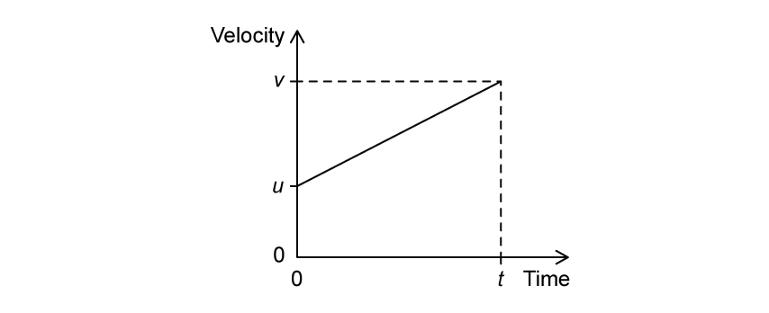

**Fig. 1.1**

(i) Determine an expression, in terms of $u$, $v$ and $t$, for the area under the graph.

[1]

(ii) State the physical quantity represented by the area under the graph.

[1]

### Q2 — hard — 12 marks

**Q2** [3 marks]

An object is released near the surface of the Moon at time *t* = 0. Fig. 1.1 shows the variation of displacement *s* with time *t* of the object from the point of release.

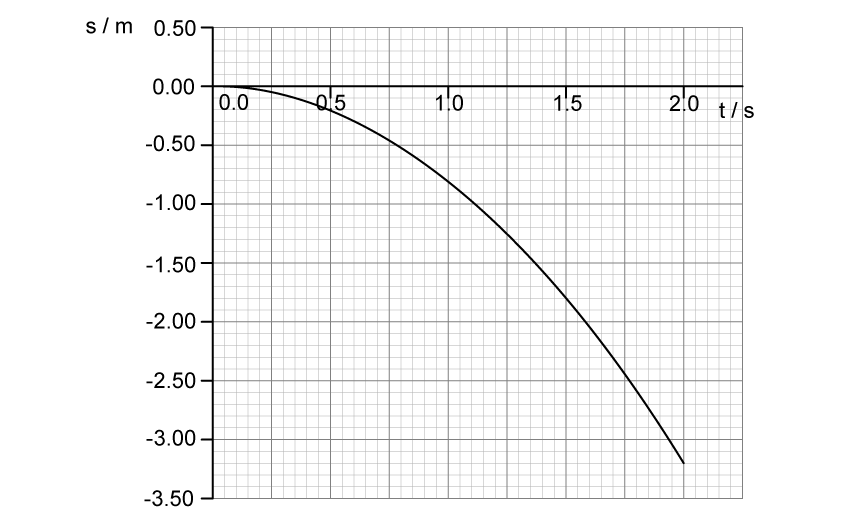

**Fig. 1.1**

(i) State the significance of the negative values of *s.*

[1]

(ii) State two assumptions about the motion of the object.

[2]

**Q2** [2 marks]

**Extract:**

An object is released near the surface of the Moon at time t = 0. Fig. 1.1 shows the variation of displacement s with time t of the object from the point of release.

Use the graph in Fig. 1.1 to determine a value for the acceleration of free fall close to the surface of the Moon.

**Q2** [3 marks]

**Extract:**

An object is released near the surface of the Moon at time *t* = 0. Fig. 1.1 shows the variation of displacement *s* with time *t* of the object from the point of release. **Fig. 1.1** (displacement-time graph showing s in m against t in s, a downward curve from 0 reaching about -3.00 m at t = 2.0 s)

Use Fig. 1.1 to estimate the instantaneous velocity of the object when *t* = 1.5 s.

**Q2** [4 marks]

**Extract:**

An object is released near the surface of the Moon at time *t* = 0. Fig. 1.1 shows the variation of displacement *s* with time *t* of the object from the point of release. Fig. 1.1

(i) On Fig. 1.1, sketch the variation of displacement *s* with time *t* if the same object was released close to the surface of the Earth instead.

[2]

(ii) Describe and explain the features of your sketch.

[2]

### Q3 — medium — 9 marks

**Q3** [3 marks]

An archer fires an arrow towards a target as shown in Fig. 1.1.

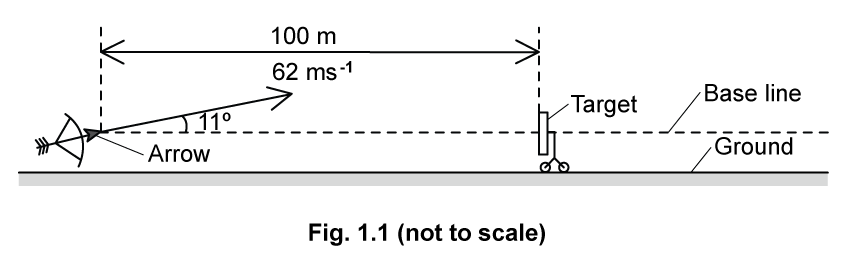

The centre of the target is at the same height as the initial position of the arrow.

The target is a distance of 100 m from the arrow. The arrow has an initial velocity of 62 m s–1 and is fired at an angle of 11° to the horizontal.

Describe how the vertical and horizontal components of the arrow's velocity change from when it is fired until it reaches its maximum height.

Assume that the effect of air resistance is negligible.

**Q3** [3 marks]

**Extract:**

An archer fires an arrow towards a target. The centre of the target is at the same height as the initial position of the arrow. The target is a distance of 100 m from the arrow. The arrow has an initial velocity of 62 m s^–1^ and is fired at an angle of 11° to the horizontal. Assume that the effect of air resistance is negligible.

Show that the time taken for the arrow to reach its maximum height is about 1.2 s.

**Q3** [3 marks]

**Extract:**

An archer fires an arrow towards a target. The centre of the target is at the same height as the initial position of the arrow. The target is a distance of 100 m from the arrow. The arrow has an initial velocity of 62 m s^–1 and is fired at an angle of 11° to the horizontal. Assume that the effect of air resistance is negligible.

The time taken for the arrow to reach its maximum height is about 1.2 s (t = 1.21 s).

Calculate the horizontal distance, measured along the base line, by which the arrow misses the target.

### Q4 — medium — 11 marks

**Q4** [4 marks]

A ball is projected horizontally at 27 m s–1 from a vertical cliff. It travels a horizontal distance of 40 m before hitting the ground.

Assume that air resistance is negligible.

Calculate the vertical velocity of the ball just before it hits the ground.

**Q4** [2 marks]

**Extract:**

A ball is projected horizontally at 27 m s^–1^ from a vertical cliff. It travels a horizontal distance of 40 m before hitting the ground. Assume that air resistance is negligible. Calculate the vertical velocity of the ball just before it hits the ground.

(From mark scheme) Time taken to hit the ground, t = 1.481 s (t = s_x/u_x = 40/27).

Calculate the height of the cliff.

**Q4** [3 marks]

**Extract:**

A ball is projected horizontally at 27 m s^–1^ from a vertical cliff. It travels a horizontal distance of 40 m before hitting the ground. Assume that air resistance is negligible. Calculate the vertical velocity of the ball just before it hits the ground.

From the mark scheme (a): Time taken, t = 1.481 s = 1.5 s; Horizontal velocity, v_x = 27 m s^–1^; Maximum vertical velocity, v_y = 14.53 = 15 m s^–1^.

Sketch the graphs to show how the horizontal and vertical components of the velocity of the ball, $v_{x}$ and $v_{y}$ change with time *t* just before the ball hits the ground.

Label any appropriate values on the axes.

**Q4** [2 marks]

**Extract:**

A ball is projected horizontally at 27 m s^–1^ from a vertical cliff. It travels a horizontal distance of 40 m before hitting the ground. Assume that air resistance is negligible. Calculate the vertical velocity of the ball just before it hits the ground.

[From mark scheme: vertical final velocity v = 14.53 = 15 m s^–1^]

Calculate the resultant velocity of the ball just before it hits the ground.

### Q5 — medium — 19 marks

**Q5** [8 marks]

A particle moves in a straight line with a constant acceleration, *a*. The initial velocity of the particle at *t* = 0 is *u*.  After a further time *t*, its velocity has increased to *v*.

(i) Using the definition of acceleration, show that

$v=u+at$

[2]

(ii) Using the definition of average velocity, show that

$s=ut+\frac{1}{2}at^{2}$

[3]

(iii) Using these two equations, show that

$v^{2}=u^{2}+2as$

[3]

**Q5** [4 marks]

A student investigates the motion of a light ball bearing as it falls from rest alongside a vertical 100 cm scale.

The student sets up a camera to take flash photographs of the ball at 0.05 s intervals, as shown in Fig. 1.1.

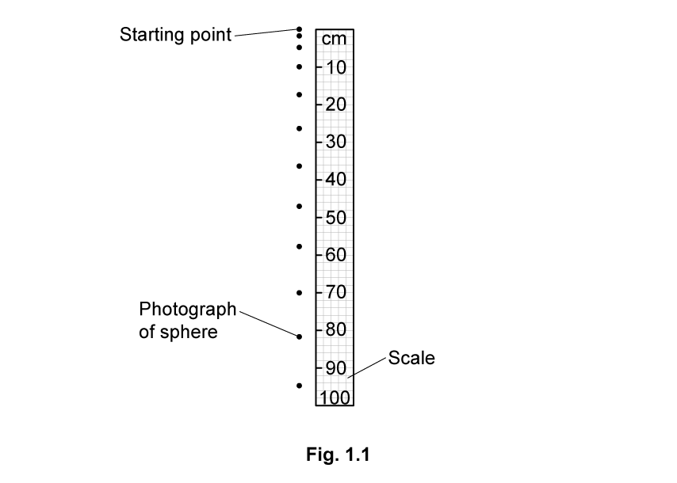

The first photograph is taken at time *t* = 0.

Using Fig. 1.1, describe and explain the motion of the ball

(i) in the interval *t* = 0 to *t* = 0.35 s

[2]

(ii) in the interval *t* = 0.35 to *t* = 0.55 s.

[2]

**Q5** [4 marks]

**Extract:**

A student investigates the motion of a light ball bearing as it falls from rest alongside a vertical 100 cm scale. The student sets up a camera to take flash photographs of the ball at 0.05 s intervals. The first photograph is taken at time t = 0. In the interval t = 0 to t = 0.35 s the ball accelerates (the separation of dots increases). In the interval t = 0.35 to t = 0.55 s the ball reaches a constant speed (the separation of dots becomes constant).

The 100 cm scale is suspended 160 cm above the ground.

Determine the total time of flight for the ball after it is dropped from the starting point of the 100 cm scale.

**Q5** [3 marks]

**Extract:**

A student investigates the motion of a light ball bearing as it falls from rest alongside a vertical 100 cm scale. The student sets up a camera to take flash photographs of the ball at 0.05 s intervals, as shown in Fig. 1.1. The first photograph is taken at time t = 0.

The student repeats the experiment with a lead sphere that falls with constant acceleration and does not reach a constant speed.

Determine the number of photographs, including the photograph at *t* = 0, that will be observed against the 100 cm scale.

### Q6 — hard — 8 marks

**Q6** [4 marks]

A bus driver drives with a constant acceleration of 5.0 m s–2 from an initial velocity of 3.0 m s–1. After 2.5 seconds, they slow down to stop at a set of traffic lights at 4.0 m s–2, eventually coming to a complete stop.  Assume that air resistance is negligible.

Calculate the distance between where the bus began to accelerate and the traffic lights where the bus stops.

**Q6** [4 marks]

**Extract:**

A bus driver drives with a constant acceleration of 5.0 m s^–2^ from an initial velocity of 3.0 m s^–1^. After 2.5 seconds, they slow down to stop at a set of traffic lights at 4.0 m s^–2^, eventually coming to a complete stop. Assume that air resistance is negligible.

On Fig. 1.1 draw the velocity­–time graph for the motion of the bus.

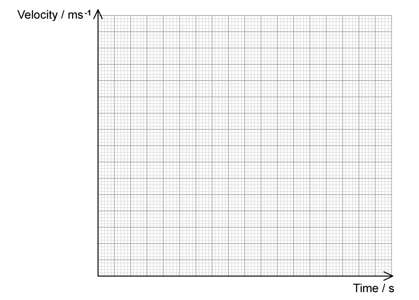

**Fig. 1.1**

### Q7 — hard — 11 marks

**Q7** [4 marks]

A motorcyclist practices a stunt on a ramp inclined such that they leave it at an angle of 25º and 3 m high as shown in Fig. 1.1.

The other ramp is 24 m away and has a height of 1 m, as shown.

**Fig. 1.1**

Calculate the minimum initial velocity the motorcyclist requires in order to reach the other ramp.

**Q7** [4 marks]

The stunt motorcyclist's ultimate goal is to jump across a river and land on the other side. Fig. 1.3 shows the motorcyclist driving off a ramp at the edge of a river.

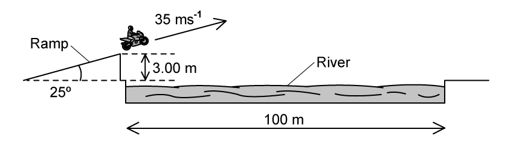

**Fig. 1.3**

The ramp is at an angle of 25° to the horizontal and the height at the end of the ramp is 3.0 m. The width of the river is 100 m. The initial velocity of the motorcyclist is 35 m s−1.

Deduce whether the motorcyclist lands on the other side of the river.

**Q7** [3 marks]

**Extract:**

The stunt motorcyclist's ultimate goal is to jump across a river and land on the other side. Fig. 1.3 shows the motorcyclist driving off a ramp at the edge of a river. The ramp is at an angle of 25° to the horizontal and the height at the end of the ramp is 3.0 m. The width of the river is 100 m. The initial velocity of the motorcyclist is 35 m s^−1^. Deduce whether the motorcyclist lands on the other side of the river.

Explain how air resistance would affect the jump.

### Q8 — easy — 12 marks

**Q8** [2 marks]

Place ticks (**✓**) in the table in Table 1.1 to indicate which of the quantities are vectors and which are scalars.

**Table 1.1**

|   | **velocity** | **speed** | **distance** | **displacement** | **acceleration** |
|---|---|---|---|---|---|
| vector |   |   |   |   |   |
| scalar |   |   |   |   |   |

**Q8** [3 marks]

Two of the equations of uniformly accelerated motion are

$s=ut+\frac{1}{2}at^{2}$

$v^{2}=u^{2}+2as$

(i) the definition of uniform acceleration,

[1]

(ii) the **two** other equations of motion that can be used to derive the above equations.

[2]

**Q8** [5 marks]

Fig. 1.2 shows an electric motor which is used to lift and lower heavy loads.

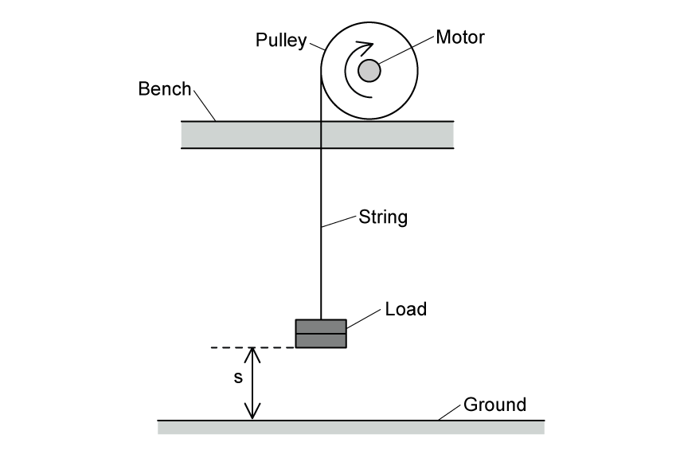

**Fig. 1.2**

Initially, the load is on the ground. Fig. 1.3 shows the variation of the displacement* s* of the load with time* t*.

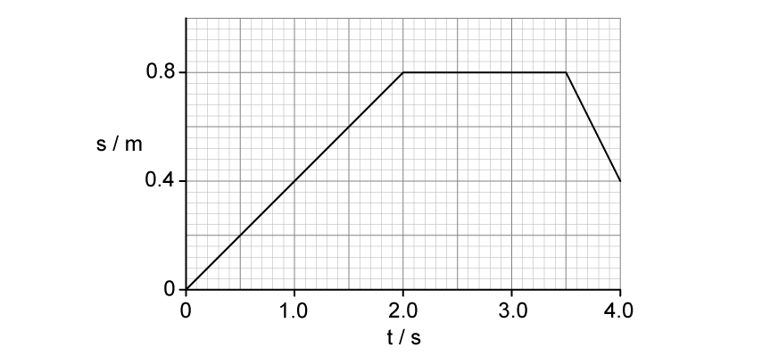

**Fig. 1.3**

(i) Complete Table 1.4 to show the magnitude and direction of the velocity of the load during the time intervals shown.

**Table 1.4**

| **time interval** | **magnitude of velocity** | **direction of velocity** |
|---|---|---|
| *t* = 0 to 2.0 s |   |   |
| *t *= 2.0 to 3.5 s |   |   |
| *t* = 3.5 to 4.0 s |   |   |

[3]

(ii) On Fig. 1.5, sketch a graph to show the variation of the velocity *v* of the load with time *t*.

Include values for velocity on the *v*-axis.

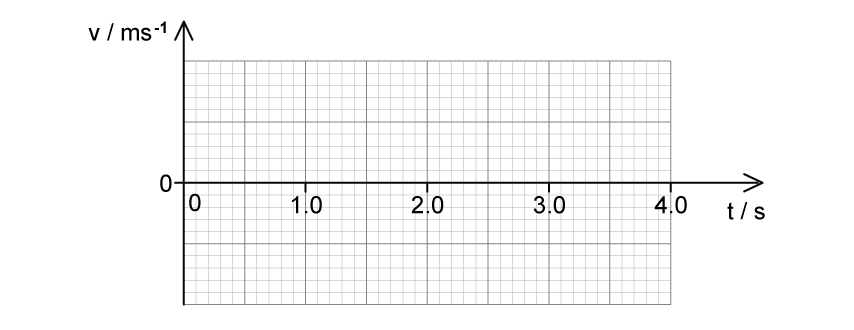

**Fig. 1.5**

[2]

**Q8** [2 marks]

**Extract:**

Fig. 1.2 shows an electric motor which is used to lift and lower heavy loads. Initially, the load is on the ground. Fig. 1.3 shows the variation of the displacement s of the load with time t.

(i) Complete Table 1.4 to show the magnitude and direction of the velocity of the load during the time intervals shown.

time interval t = 0 to 2.0 s: magnitude 0.4 m s^−1, direction upwards
time interval t = 2.0 to 3.5 s: magnitude 0, direction none
time interval t = 3.5 to 4.0 s: magnitude 0.8 m s^−1, direction downwards

As the load is lowered towards the ground, the string breaks when *t* = 4.0 s. It then falls vertically toward the ground.

Calculate the velocity* *of the load just before it hits the ground.

Assume air resistance is negligible.

### Q9 — hard — 16 marks

**Q9** [4 marks]

A rock is thrown horizontally off a 175 m high cliff and lands 105 m away.

Calculate the resultant velocity at which it hits the ground, assuming air resistance is negligible.

**Q9** [3 marks]

**Extract:**

A rock is thrown horizontally off a 175 m high cliff and lands 105 m away.

The rock hits the ground at an angle *θ*  to the horizontal.

Determine, without calculation, how the angle will change if the stone is thrown in the same way with a greater velocity.

**Q9** [3 marks]

The rock is now attached to a catapult and launched at a castle wall. The rock is launched at an angle of 30° from the horizontal at a speed of 29 m s–1. The castle wall is 50 m away and is 15 m high.

Determine whether the rock makes it over the wall.

**Q9** [6 marks]

The double angle formula is given by sin(2A) = 2sin(A)cos(A).

Justify that, in the absence of air resistance, the maximum range of any projectile that starts and ends at ground level is achieved when it is launched at 45° to the horizontal.

### Q10 — medium — 13 marks

**Q10** [1 mark]

Define acceleration.

*Source: Specimen 2022 Paper 2 Q2A*

**Q10** [7 marks]

A ball is kicked from horizontal ground towards a vertical wall, as shown in Fig. 1.1.

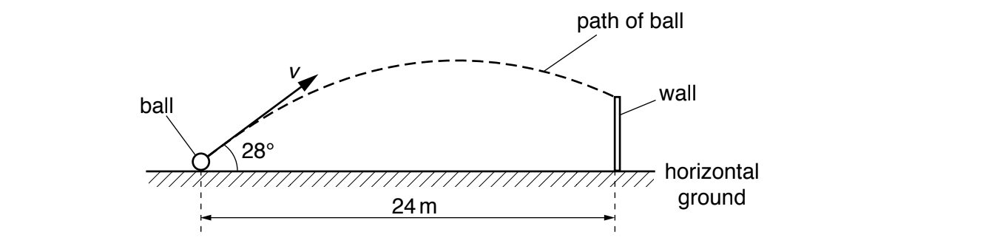

**Fig. 1.1** (not to scale)

The horizontal distance between the initial position of the ball and the base of the wall is 24 m. The ball is kicked with an initial velocity *v* at an angle of 28° to the horizontal. The ball hits the top of the wall after a time of 1.5 s. Air resistance is negligible.

(i) Calculate the initial horizontal component *v*x of the velocity of the ball.

*v*x = ................................................. m s–1 [1]

(ii) Show that the initial vertical component *v*y of the velocity of the ball is 8.5 m s–1.

[2]

(iii) Calculate the time taken for the ball to reach its maximum height above the ground.

time = ....................................................... s [2]

(iv) The ball is kicked at time t = 0. Assume that the vertical component *v*y of the velocity of the ball is positive in the upwards direction.

On Fig. 1.2, sketch the variation with time t of *v*y for the time until the ball hits the wall.

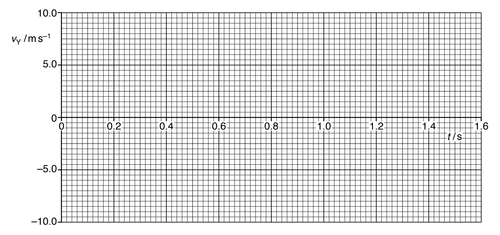

**Fig. 1.2**

[2]

*Source: Specimen 2022 Paper 2 Q2B*

**Q10** [4 marks]

**Extract:**

A ball is kicked from horizontal ground towards a vertical wall. The horizontal distance between the initial position of the ball and the base of the wall is 24 m. The ball is kicked with an initial velocity v at an angle of 28° to the horizontal. The ball hits the top of the wall after a time of 1.5 s. Air resistance is negligible.

(ii) The initial vertical component v_y of the velocity of the ball is 8.5 m s^–1.

(iii) Time taken for the ball to reach its maximum height above the ground: t = 0.87 s (from v = u + at, 0 = 8.5 + (−9.81 × t))

(i) Calculate the maximum height above the ground of the ball in **(b)**.

maximum height = ...................................................... m  [2]

(ii) The maximum gravitational potential energy of the ball above the ground is 22 J.

Calculate the mass of the ball.

mass = ..................................................... kg  [2]

*Source: Specimen 2022 Paper 2 Q2C*

**Q10** [1 mark]

**Extract:**

A ball is kicked from horizontal ground towards a vertical wall, as shown in Fig. 1.1. The horizontal distance between the initial position of the ball and the base of the wall is 24 m. The ball is kicked with an initial velocity *v* at an angle of 28° to the horizontal. The ball hits the top of the wall after a time of 1.5 s. Air resistance is negligible.

A ball of greater mass is kicked with the same velocity as the ball in **(b)**.

Air resistance is still negligible.

State and explain the effect, if any, of the increased mass on the time taken by the ball to reach its maximum height.

*Source: Specimen 2022 Paper 2 Q2D*

### Q11 — medium — 18 marks

**Q11** [6 marks]

A boy standing on a cliff shoots a pellet from his pellet gun vertically upwards. The variation of displacement *s* of the pellet with time *t* is shown in Fig. 1.1.

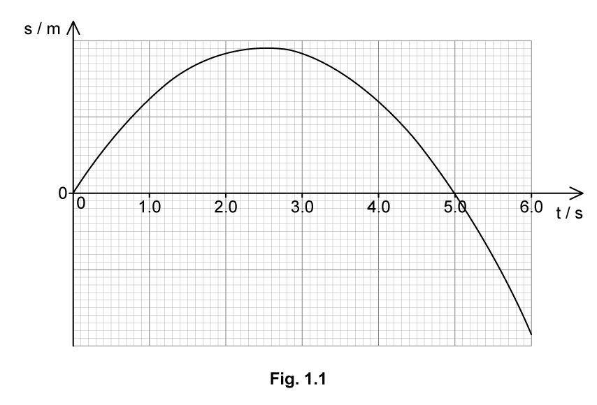

(i) Determine the magnitude of the initial velocity of the pellet, at *t* = 0 s.

[3]

(ii) Determine the magnitude of the velocity of the pellet at *t* = 6.0 s.

[2]

(iii) State an assumption made in these calculations.

[1]

**Q11** [3 marks]

**Extract:**

A boy standing on a cliff shoots a pellet from his pellet gun vertically upwards. The variation of displacement *s* of the pellet with time *t* is shown in Fig. 1.1.

(i) Determine the magnitude of the initial velocity of the pellet, at *t* = 0 s. → *u* = 24.5 m s^−1^ (at t = 0, and pellet reaches maximum height at t = 2.5 s)

(ii) Determine the magnitude of the velocity of the pellet at *t* = 6.0 s. → *v* = 34.3 m s^−1^

On Fig. 1.2, sketch the variation of velocity *v* of the pellet with time *t*.

Include your values from **(a) **on the axes.

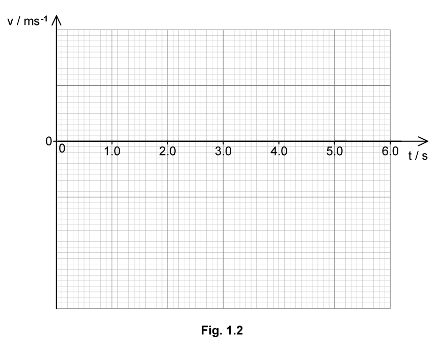

**Q11** [4 marks]

**Extract:**

A boy standing on a cliff shoots a pellet from his pellet gun vertically upwards. The variation of displacement s of the pellet with time t is shown in Fig. 1.1. (a)(i) Determine the magnitude of the initial velocity of the pellet, at t = 0 s: u = 24.5 m s^−1. (a)(ii) Determine the magnitude of the velocity of the pellet at t = 6.0 s: v = 34.3 m s^−1. The maximum height is reached when v = 0 at t = 2.5 s.
On Fig. 1.2, sketch the variation of velocity v of the pellet with time t. Include your values from (a) on the axes. Straight line starting at a positive value of v with negative gradient; Line passes time axis at t = 2.5 s (when v = 0); Values from (a) correctly labelled i.e. 24.5 m s^−1 at t = 0 and −34.3 m s^−1 at t = 6.0 s.

Using Fig. 1.2

(i) Determine the maximum height reached by the pellet.

[2]

(ii) Show that the final position of the pellet after 6.0 s is about 30 m below its initial position.

[2]

**Q11** [5 marks]

**Extract:**

A boy standing on a cliff shoots a pellet from his pellet gun vertically upwards.

Show that the final position of the pellet after 6.0 s is about 30 m below its initial position: Final position = −29.4 m (the height of the cliff).

An identical pellet gun is fired horizontally off the edge of the cliff at the exact same time the other gun is fired vertically upwards. The vertically fired pellet is in motion for exactly 6.0 s before hitting the ground below the edge of the cliff.

Both pellets have the same initial speed.

(i) State which pellet hits the ground first.

[1]

(ii) Calculate the time difference between the pellets hitting the ground.

[4]

### Q12 — easy — 16 marks

**Q12** [4 marks]

State the difference between

(i) distance and displacement,

[2]

(ii) speed and velocity.

[2]

**Q12** [6 marks]

Complete the table in Table 1.1 to describe the features of displacement-time, velocity-time and acceleration-time graphs represent.

Place a cross (✘) in any grid space which does not represent anything. Some grid spaces have been completed for you.

**Table 1.1**

|   | **displacement-time** | **velocity-time** | **acceleration-time** |
|---|---|---|---|
| gradient represents |   |   | ✘ |
| area under curve represents |   |   |   |
| y-intercept represents |   |   |   |
| horizontal line represents | zero velocity |   |   |
| straight section represents |   |   |   |
| curved section represents |   | non-uniform acceleration |   |

**Q12** [3 marks]

On Fig. 1.2, sketch the variation of time with distance, velocity, and acceleration for an object moving with **constant velocity**.

Take the initial position to be zero.

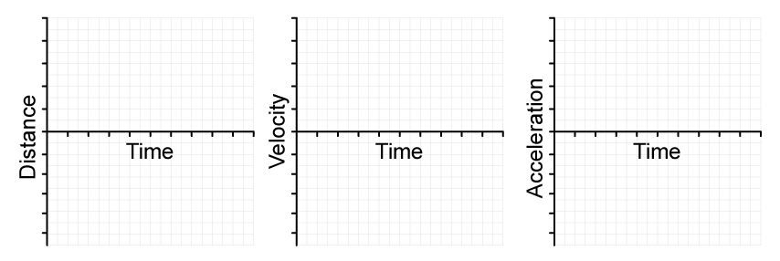

**Fig. 1.2**

**Q12** [3 marks]

On Fig. 1.3, sketch the variation of time with distance, velocity, and acceleration for an object moving with **uniform acceleration**.

Take the initial position to be zero.

**Fig. 1.3**

### Q13 — easy — 9 marks

**Q13** [3 marks]

A student drops a stone into a well and measures the time it takes to hear the stone splash at the bottom.

Explain how this measurement of time can be used to find the depth of the well.

**Q13** [2 marks]

**Extract:**

A student drops a stone into a well and measures the time it takes to hear the stone splash at the bottom.

It takes 3.2 s for the stone to drop from rest and splash into the water at the bottom.

Calculate the velocity of the stone when it hits the water.

**Q13** [2 marks]

**Extract:**

It takes 3.2 s for the stone to drop from rest and splash into the water at the bottom. Calculate the velocity of the stone when it hits the water. v = u + a t; v = 0 + (9.81 × 3.2); v = 31.392 = 31 m s^−1 (downward)

On Fig. 1.1, sketch the variation of time with velocity for the stone as it falls down the well.

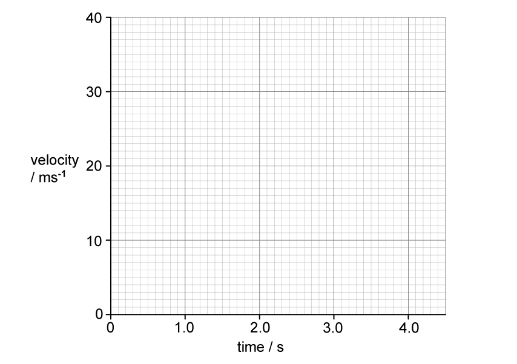

**Fig. 1.1**

**Q13** [2 marks]

**Extract:**

It takes 3.2 s for the stone to drop from rest and splash into the water at the bottom. Calculate the velocity of the stone when it hits the water. v = u + at; v = 0 + (9.81 × 3.2); v = 31.392 = 31 m s^−1 (downward)
On Fig. 1.1, sketch the variation of time with velocity for the stone as it falls down the well. Final speed, v = 31 m s^–1 (from part (b)); Time taken, t = 3.2 s. Straight line drawn starting from zero; Line stops at t = 3.2 s, v = 31 m s^−1.

Use your graph from **(c)** to determine the depth of the well.
