# Mark Schemes — Momentum & Newton’s Laws of Motion
**3. Dynamics** · Cambridge (CIE) AS physics (9702)

## Multiple Choice Questions (23 questions)

### Q1
**Final answer:** **The correct answer is D**

- Newton's third law states that whenever two bodies interact, the forces they exert on each other are equal and opposite and of the same type
- In other words, if object A exerts a force on object B, then object B exerts an **equal** but **opposite** force on object A
- Therefore, the forces must:

  - act on **different** objects
  - be the same **type **of force
  - be** opposite** in direction
  - be **equal** in magnitude
- The only force pair that satisfies all these conditions is option **D**

**A** is incorrect, as the driving force from the engine and air resistance are different types of forces (driving force is mechanical and air resistance is a fluid friction force). They also act on the same object (the car), so they cannot be a Newton's third law pair.

**B** is incorrect, as weight and normal reaction are two different types of forces (weight is gravitational and normal reaction is a contact force), and they also act on the same body (the car). Therefore, they cannot be a Newton's third law force pair. This is a common misconception of this law.

**C** is incorrect as these forces act on the same object (the wheels/car system) and are both contact forces in the same direction during acceleration, so they do not form a Newton's third law pair.

### Q2
**Final answer:** **The correct answer is B **

- The gradient of a momentum-velocity graph is equal to

$\frac{Δy}{Δx}=\frac{\text{change in momentum}}{\text{change in velocity}}=\frac{Δp}{Δv}$

- Momentum is equal to  $p = m v$

$\frac{Δp}{Δv}=\frac{Δ(mv)}{Δv}$

- For constant mass:

$\frac{Δ(mv)}{Δv}=m\frac{Δv}{Δv}=m$

- Therefore, the gradient is equal to the mass of the tennis ball

### Q3
**Final answer:** **The correct answer is ****C**** because:**

- The force *F* is applied to block X, which in turn applies a force to block Y
- As a result, both blocks accelerate
- Total mass being accelerated = *m* + 4 *m* = 5 *m*
- The acceleration of the blocks is therefore equal to

  - $a=\frac{F}{5m}$
- We can use Newton’s Second Law again to calculate the force on block Y only

  - $F_{y} = ( 4 m ) a = ( 4 m ) ( \frac{F}{5 m} ) = \frac{4 F}{5}$

### Q4
**Final answer:** **The correct answer is ****C**** because:**

- The mass of a body is constant and does not change, so it will be 2.5 kg on both planets
- The weight, however, changes depending on the strength of the gravitational field of a planet. This can be found using

  - $W=mg$

- Where *g* on planet S is 8 times greater than on planet R
- So, the weight of the body on planet S is

  - $W=12.5\times8=100N$

**A **is incorrect because the mass is correct but the weight has been calculated using 2.5 × 8 = 20 which is wrong

**B & D **are incorrect because the mass should be unchanged

### Q5
**Final answer:** **The correct answer is ****C**** because:**

- Force is equal to the rate of change of momentum, and therefore, it is directly proportional to the rate of change of velocity F ∝ ∆v/∆t
- Before the ball hits the table:

  - There is no force between the ball and the table, so the force is initially zero
  - Therefore, options **B** & **D** can be eliminated
- When the ball comes into contact with the table:

  - The ball's speed temporarily reduces to zero, this means there is a change in momentum, so F increases, which is shown by the initial positive gradient on the graph
  - When the speed is zero, it is no longer changing, so the change in momentum, and hence force, reaches a maximum, which is represented on the graph by the maximum point on the curve
  - Then, the speed of the ball increases in the opposite direction as it bounces away from the table (but the force acts only while the ball is still in contact with the table)
  - This increase in speed causes a change in momentum, and a force, but in the opposite direction, so as the ball moves away from the table, the force exerted by it gradually decreases, as seen on graph C
- At the moment the ball is about to leave the surface of the table, it has the same maximum speed as before and since the velocity/momentum is no longer changing, the force reduces to zero

**A **is incorrect because this graph implies that the force continues to increase, even after the ball leaves the table, which is not possible

**B & D **are incorrect because there is no force between the ball and the table before the ball comes into contact with it, hence the force is initially zero

### Q6
**Final answer:** **The correct answer is ****A**** because:**

- Momentum is a vector quantity
- Initial momentum = *mv*, final momentum = – *mv*
- Even though the magnitude of the momentum remains the same, the direction of the velocity changes
- The momentum of the object is not conserved but the momentum of the **whole system **should be conserved. The question asks which ‘property of the object’ is not conserved, not the whole system, so this is an important distinction

**B, C & D **are incorrect because these are scalar quantities, and the magnitudes of *m* and *v* stay the same so kinetic energy, speed and mass are all conserved

### Q7
**Final answer:** **The correct answer is ****D**** because:**

- If all the external forces cancel out, that means the resultant force on the body is zero
- If the resultant force is zero then the acceleration is also zero

  - $F=ma$
- Zero acceleration means that the velocity is not changing

  - $a=\frac{v}{t}$
- Hence, the momentum of the body remains unchanged

  - $p=mv$

**A **is incorrect because if a body is not moving then its velocity is zero, however, if acceleration is zero then that does not necessarily mean the velocity is zero. The body may be moving at a constant velocity, but its acceleration would still be zero

**B **is incorrect because force and energy are not equivalent, so if the resultant force is zero this doesn’t mean the energy will be unchanged

**C **is incorrect because, for a stationary body in equilibrium, its velocity must remain constant but its speed can be either zero or a constant non-zero value

### Q8
**Final answer:** **The correct answer is ****C because****:**

- When the ball hits the ground, it rapidly slows down and then speeds up again as it bounces
- This is due to a changing contact force exerted by the ground on the ball
- According to Newton’s third law:

  - When two bodies interact, they exert forces on each other that are equal in magnitude and opposite in direction
- Therefore, the ball must exert a force on the ground which is equal in magnitude and opposite in direction to the force the ground exerts on the ball

**A** is incorrect as the downward force that the ball exerts on the ground is the third law force pair of the upward contact force (i.e. it exists because of it). Since this contact force changes during the collision (as the ball decelerates and then accelerates upwards), the downward force must also change. Therefore, it is not always equal to the ball's weight.

**B** is incorrect because to accelerate the ball upwards, the ground must exert an upward contact force that is greater than the ball’s weight. By Newton’s third law, the downward force the ball exerts on the ground must also be greater than its weight. Therefore, it is not always less than the ball's weight.

**D **is incorrect because the weight of the ball is constant and always acts downwards (towards the ground), but the contact force from the ground (and therefore the force on the ball) changes during the collision.

### Q9
**Final answer:** **The correct answer is ****C**** because:**

- **Mass** is the property of an object that resists a change in motion

  - It is a constant quantity and does not change with location
- **Weight** is the force exerted on an object due to a gravitational field

  - The weight of the object depends on its mass and the strength of the gravitational field at that location

**A **is incorrect because while the work done lifting an object 1.0 m vertically is numerically related to weight $( W = m g h )$, it describes energy, whereas weight is a force.

**B **is incorrect because these definitions are correct, but are the wrong way around.

**D **is incorrect because an object's mass is related to the amount of matter it contains rather than the number of atoms.

### Q10
**Final answer:** **The correct answer is ****D**** because:**

- According to Newton’s Second Law, a force causes an object to accelerate in the same direction it is applied

**A, B & C **are incorrect because Newton’s First Law states that an object will remain at rest or at the same constant speed unless a resultant force acts upon it. This means a force could be applied in the same direction as an object’s motion, causing it to accelerate, or an opposing force could be applied, to cause it to decelerate. Therefore, the direction of the velocity does not have to be the same direction as the force or acceleration

### Q11
**Final answer:** **The correct answer is ****D**** because:**

- The question tells you a key statement about Newton’s Third Law (that the force is equal and opposite)
- But there are two key pieces of information about the forces in Newton's Third Law you will need to answer this question
- Firstly, the force acts between the same two objects. So, if one force is from the back wheel on the road, the other **must** be from the road on the back wheel
- Secondly, the two forces must be the same kind of force.  In this particular case, the force on the wheel on the road is a friction force, so the force of the road on the wheel must be a friction force, too

**A, B & C **are incorrect because the force must act between the same two objects (the back wheel and the road), and be the same force (frictional) whereas these options all reference different bodies and different forces

### Q12
**Final answer:** **The correct answer is ****A**** because:**

- The weight of the car and passenger causes the lift to move downwards, while the weight of the balancing weight causes the lift to move upwards

  - Resultant (upward) force on car, *F* = 1320 *g* – 1200 *g* – 80 *g* = 40 *g*
  
    - where *g* = 9.81 N kg−1
  - *F* = 40 × 9.81 = 392 N
- This resultant force is responsible for the acceleration of the passenger car, the balancing weight and the passenger, so we must use the total mass of the system, not just the mass of the lift and passenger

  - Total mass, *m* = 1320 + 1200 + 80 = 2600 kg
- *F = ma* rearranges to

  - $a=\frac{F}{m}=\frac{392}{2600}=0.15ms^{-2}$

### Q13
**Final answer:** **The correct answer is ****C ****because:**

- Mass is a constant quantity which does not change with a change of position or location, so the mass is 60 kg on planet X and on Earth
- The weight, however, changes depending on the strength of the gravitational field of a planet. This can be found using

  - $W=mg$

- Where $g=9.81ms^{-2}$ on Earth and* *$g = \frac{9.81}{6} ( = 1.63 \mathrm{m} \mathrm{s}^{- 2} )$on planet X
- The weight of the body on planet X is

  - $W=\frac{60\times9.81}{6}=98N$

### Q14
**Final answer:** **The correct answer is ****B**** because:**

- The gradient of a momentum-time graph is equal to

  - $\frac{\Deltay}{\Deltax}=\frac{\Deltap}{\Deltat}$
- Momentum is equal to $\Deltap=m\Deltav$

  - $\frac{\Deltap}{\Deltat}=\frac{m\Deltav}{\Deltat}$
- Acceleration is equal to $a=\frac{\Deltav}{\Deltat}$

  - $m\frac{\Deltav}{\Deltat}=ma$
- From Newton's second law, $F=ma$
- Therefore, the gradient is equal to the resultant force on the car

### Q15
**Final answer:** **The correct answer is ****D**** because:**

- Weight = mass × acceleration due to gravity, or $W=mg$
- So, $g=\frac{W}{m}$

**A & C **are incorrect because gravity/weight is a force, whereas *g *is the acceleration

**B **is incorrect because while air resistance reduces the acceleration of a falling body, it does not change the value of *g* itself.

### Q16
**Final answer:** **The correct answer is ****B ****because:**

- The water that emerges from the hose has momentum, so it exerts a force on the person as it shoots out
- From Newton’s Third Law, the person should exert a force of the same magnitude and in the opposite direction to prevent the hose from moving backwards
- Using Newton’s Second Law

  - $F=ma=\frac{m\Deltav}{t}=\frac{\Deltap}{t}$ (force = rate of change of momentum)
  - $\frac{\Deltam}{t}$ = rate of water being pumped = 80 kg / min
- In one second, $\frac{80}{60}=1.33\mathrm{kg}$
- So, 1.3 kg of water is pumped out every second

  - $\frac{\Deltam}{t}$ = rate of water being pumped = $1.33\mathrm{kg}s^{-1}$
  - $F=\frac{\Deltap}{t}=\frac{\Deltam}{t}\timesv=1.33\times30=40N$

### Q17
**Final answer:** **The correct answer is ****C**** because:**

- Momentum is equal to

  - $\Deltap=m\Deltav$
- Force is related to momentum by

  - $F$=$\frac{\Deltap}{\Deltat}$
- Combining these leads to

  - $F=\frac{m\Deltav}{\Deltat}$
- Rearranging for Δ*t*

  - $\Deltat=\frac{m\Deltav}{F}$
  - $\Delta t = \frac{( 6.7 \times 10^{7} ) ( 18.9 - 0 )}{880000}$
  - $\Deltat=1439s$
- Divide by 60 to convert to minutes

  - $\Deltat=\frac{1439}{60}=24\mathrm{minutes}$

### Q18
**Final answer:** **The correct answer is ****B**** because:**

- The weight of the 4.0 kg mass pulls the 10.0 kg box to the right with a force equal to its weight

  - Weight = *mg* = 4.0 × 9.8 = 39.2 N
- The frictional force of 12.0 N opposes the motion of the 10.0 kg box, so it acts to the left

  - The resultant force is thus equal to 39.2 – 12.0 = 27.2 N
- It is important to remember that the mass and the box move as a system, so their masses must be added together
- Total mass of the system = 10.0 + 4.0 = 14.0 kg

  - Resultant force, $F=ma$
  - $a=\frac{F}{m}=\frac{27.2}{14}=1.9ms^{-2}$

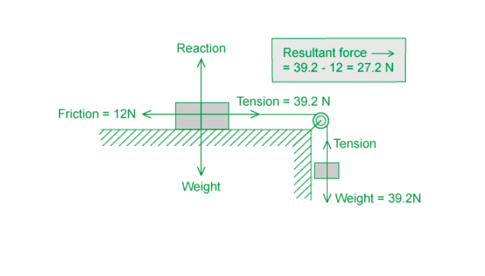

### Q19
**Final answer:** **The correct answer is ****A**** because:**

- Solving problems on a plane is similar to solving problems vertically and horizontally, but instead, we resolve the forces parallel and perpendicular to the plane
- Since we are trying to find the acceleration of the block, we need to resolve the forces parallel to the plane

  - Weight = *mg* = 1.8 × 9.8 = 17.6 N
  - Resultant force (down the plane) = W sin 30 = 17.6 sin 30 = 8.8 N
- The frictional force opposes the motion of the brick, so it acts up the plane
- So, the resultant force on the brick = 8.8 – 3.0 = 5.8 N

  - Acceleration of the brick, $a=\frac{F}{m}=\frac{5.8}{1.8}=3.2ms^{-2}$

### Q20
**Final answer:** **The correct answer is ****C**** because:**

- The resultant force is equal to the rate of change of momentum, which is the same as saying the change in momentum of the body per unit time
- This is given by Newton’s second law:

  - $F=ma=\frac{m\Deltav}{t}=\frac{\Deltap}{t}$

**A **is incorrect because 'acceleration per unit mass' is equivalent to $\frac{a}{m}$. According to Newton's second law, force is the product of mass and acceleration $( F = m a )$.

**B **is incorrect because a change in kinetic energy per unit time (rate of change of energy) is equivalent to power $( P = \frac{E}{t} )$.

**D **is incorrect because a 'change in velocity per unit time' (rate of change of velocity) is equivalent to acceleration $( a = \frac{\Delta v}{\Delta t} )$.

### Q21
**Final answer:** **The correct answer is ****C**** because:**

- This is the principle of conservation of momentum which is a direct consequence of Newton’s Third Law, but it does not describe it
- Newton's Third Law states that for every force there is an equal and opposite force, from this we can derive conservation of momentum, which tells us that a change in momentum in one of two objects colliding is equal and opposite to the change in momentum in the other colliding object

**A **is incorrect because this is Newton’s Third Law

**B **is incorrect because this is Newton’s Second Law, $F=ma=\frac{m\Deltav}{t}=\frac{\Deltap}{t}$

**D **is incorrect because this is Newton’s First Law

### Q22
**Final answer:** **The correct answer is ****D**** because:**

- Newton’s Third Law says: when body A exerts a force on body B, body B exerts an equal and opposite force on body A of the **same type**
- For gravity, the Earth attracts the cup and the cup attracts the Earth with the same magnitude but opposite direction. Both forces are of the same type – gravitational attraction
- Consider a falling object – it is not just the object that is falling towards the earth but rather the earth too is falling towards the object. Given the huge difference in mass, the Earth’s movement towards the object is so negligible it can be ignored

**A & B **are incorrect because the push of the table on the cup (and vice versa) is a result of the repulsive forces between the electrons on the surface of the table and the electrons on the surface of the bottom of the cup, both of these are electrostatic forces

**C **is incorrect because the pull of the Earth on the cup is the same as the weight

### Q23
**Final answer:** **The correct answer is ****C**** because:**

- We are looking for the vertical acceleration, so the horizontal components of force can be ignored
- The resultant upward force is equal to

  - $8\mathrm{cos}33^{\circ}+6\mathrm{cos}62^{\circ}=6.71+2.82=9.53N$

- The resultant downward force is equal to the weight of the block

  - W = mg = 3.2 × 9.81 = 31.4 N

- The overall resultant force is equal to

  - F = 31.4 – 9.53 = 21.9 N
  - Acceleration = $\frac{F}{m}=\frac{21.9}{3.2}=6.8ms^{-2}$

## Structured Questions (11 questions)

### Q1
Calculate the tension in the rope connecting blocks A and B:

List the known quantities:

- Frictional force on A, $F_{A}=\frac{1}{3}R_{A}$
- Mass of A, $m_{A}$ = 2.4 kg
- Constant velocity, so acceleration $a=0$

Consider the vertical forces acting on box A:

- Resultant force:  $R_{A}-m_{A}g=0$
- Therefore, $R_{A}=m_{A}g=2.4\times9.81=23.5N$ **[1 mark]**
- Hence frictional force:  $F_{A}=\frac{1}{3}\times23.5=7.8N$ **[1 mark]**

Consider the horizontal forces acting on box A:

- Resultant force:  $T_{AB}-F_{A}=0$
- Therefore,  $T_{AB}=F_{A}=7.8N$ **[1 mark]**

**[Total: 3 marks]**

> *It's always best to spend some time drawing the free-body diagram first before jumping into any calculations*

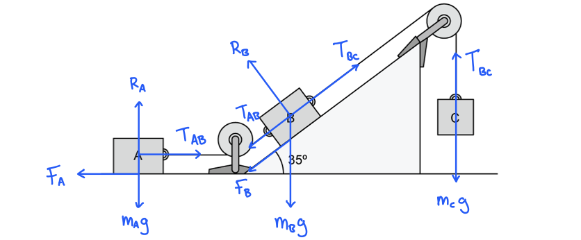
Determine the tension in the rope connecting boxes B and C:

List the known quantities:

- Frictional force on B, $F_{B}=\frac{1}{3}R_{B}$
- Mass of B, $m_{B}$ = 2.4 kg
- Constant velocity, so acceleration $a=0$
- Tension in rope AB, $T_{AB}$ = 7.8 N (from **(a)**)
- Angle of inclination of ramp, $θ$ = 35°

Consider the forces acting perpendicular to the slope on box B:

- Resultant force:  $R_{B}-m_{B}g\mathrm{cos}35^{\circ}=0$
- Therefore, $R_{B}=m_{B}g\mathrm{cos}35^{\circ}=2.4\times9.81\times\mathrm{cos}35^{\circ}=19.3N$ **[1 mark]**
- Hence frictional force:  $F_{B}=\frac{1}{3}\times19.3=6.4N$ **[1 mark]**

Consider the forces acting parallel to the slope on box B:

- Resultant force:  $T_{BC}-T_{AB}-m_{B}g\mathrm{sin}35^{\circ}-F_{B}=0$ **[1 mark]**
- $T_{BC}=T_{AB}+m_{B}g\mathrm{sin}35^{\circ}+F_{B}$
- $T_{B C} = 7.8 + ( 2.4 \times 9.81 \times \sin 35^{\circ} ) + 6.4$
- $T_{BC}=27.7N$ **[1 mark]**

**[Total: 4 marks]**
Determine the mass of box C:

- Box C descends with a constant velocity, so resultant force:  $T_{BC}-m_{C}g=0$
- Therefore, $T_{BC}=m_{C}g=27.7N$
- Mass of C:  $m_{C}=\frac{27.7}{9.81}=2.8\mathrm{kg}$ **[1 mark]**

**[Total: 1 mark]**
Calculate the acceleration of block C:

List the known quantities:

- Mass of B, $m_{B}$ = 2.4 kg
- Mass of C, $m_{C}$ = 2.8 kg (from **(c)**)
- Weight of C, $m_{C}g$ = 27.7 N (from **(c)**)
- Frictional force on B, $F_{B}$ = 6.4 N (from **(b)**)
- New tension in BC = $T$

Determine the new resultant forces on B and C:

- Resultant force on B:  $T-m_{B}g\mathrm{sin}35^{\circ}-F_{B}=m_{B}a$ **[Eq. 1]  ****[1 mark]**
- Resultant force on C:  $m_{C}g-T=m_{C}a$ **[Eq. 2]  ****[1 mark]**

Add [Eq. 1] and [Eq. 2] together and rearrange for *a*:

- $T-m_{B}g\mathrm{sin}35^{\circ}-F_{B}+m_{C}g-T=m_{B}a+m_{C}a$
- $m_{C} g - m_{B} g \sin 35^{\circ} - F_{B} = ( m_{B} + m_{C} ) a$
- $a=\frac{m_{C}g-m_{B}g\mathrm{sin}35^{\circ}-F_{B}}{m_{B}+m_{C}}$ **[1 mark]**

Substitute in the known quantities and calculate:

- $a = \frac{27.7 - ( 2.4 \times 9.81 \times \sin 35^{\circ} ) - 6.4}{2.4 + 2.8}$
- $a$ = 1.499 = 1.5 m s−2 **[1 mark]**

**[Total: 4 marks]**

> *There is a change in the tension in the rope between B and C because the forces acting on block B have changed. *

### Q2
The area under the graph represents:

- Change in momentum / $\Delta ( m v )$ / $\Deltap$; **[1 mark]**
- Newton's second law:  $F=ma\RightarrowF=\frac{m\Deltav}{\Deltat}\RightarrowF\Deltat=m\Deltav$ **OR** force = rate of change of momentum; **[1 mark]**

**[Total: 2 marks]**
Calculate the initial speed of the bicycle:

List the known quantities:

- Mass of cyclist, $m$ = 82 kg

Calculate the area under the graph:

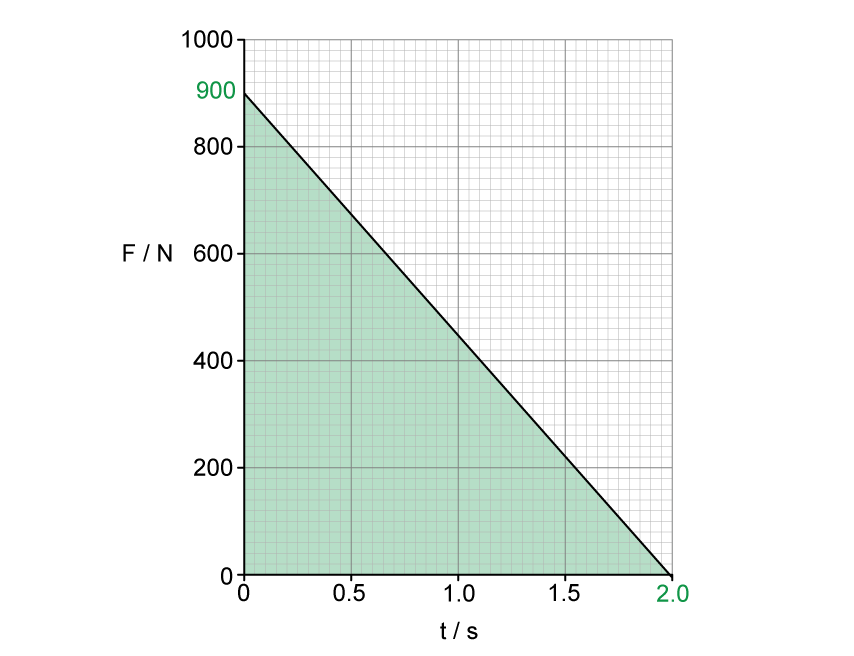

- Area under graph = change in momemtum
- Area under graph = $\frac{1}{2}\timesF\times\Deltat$
- Area under graph = $\frac{1}{2}\times2.0\times900$ = 900 N s **[1 mark]**

Calculate the initial speed:

- Change in momentum:  $\Deltap=mv\Rightarrowu=\frac{\Deltap}{m}$
- $u=\frac{900}{82}$ **[1 mark]**
- *u* = 10.98 = 11 m s−1 (2 s.f.) **[1 mark]**

**[Total: 3 marks]**
The variation of the speed of the bicycle from *t* = 0 to *t* = 2.0 s is as follows:

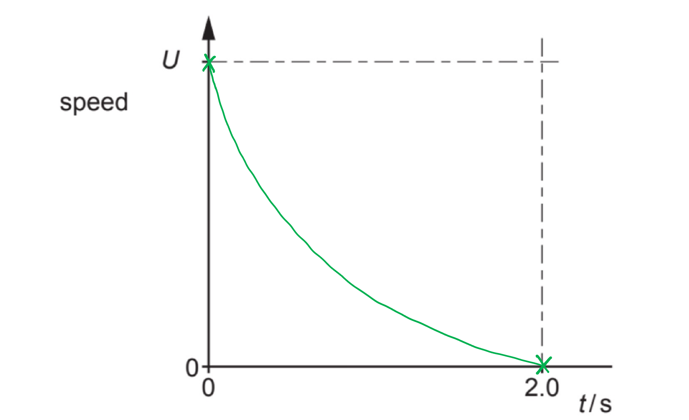

- Smooth curve with decreasing gradient; **[1 mark]**
- Curve starts at (0, *u*) and ends at (2.0, 0) **NOT**** **tending towards axes but meeting them; **[1 mark]**

**[Total: 2 marks]**

> *It helps when sketching graphs to plot any points which you already know *

> *From the graph in the previous parts of the question, we know that the breaking force applied decreases uniformly*

> *Consider Newton's second law: when the force decreases, so does the acceleration *$\downarrowF\propto\downarrowa$

> *By drawing two tangents to the graph we can see that the acceleration (and hence gradient) becomes less steep:*

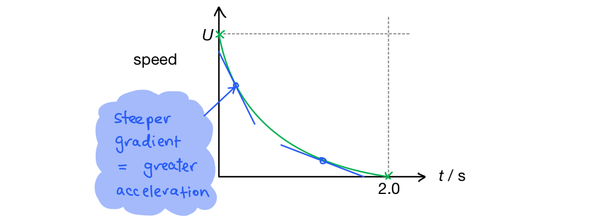
The safest seat is:

- Seat D

This is because:

**Final answer:** **Any ****four ****from:**

- Due to Newton's second law, passengers C and D will stay in their seats; **[1 mark]**
- (Due to Newton's second law) the resultant force acts on passengers C and D **OR** the seats exert a (decelerating) force on C and D **OR** C and D will decelerate; **[1 mark]**
- Due to Newton’s first law, passengers A and B will continue to move at the same speed (**NOT **thrown / thrust / pushed forward); **[1 mark]**
- (Due to Newton’s first law) passenger A will collide with the back of seat B; **[1 mark]**
- (Due to Newton’s first law) passenger B will collide with C; **[1 mark]**

**[Total: 4 marks]**

### Q3
The forces acting on the balloon are:

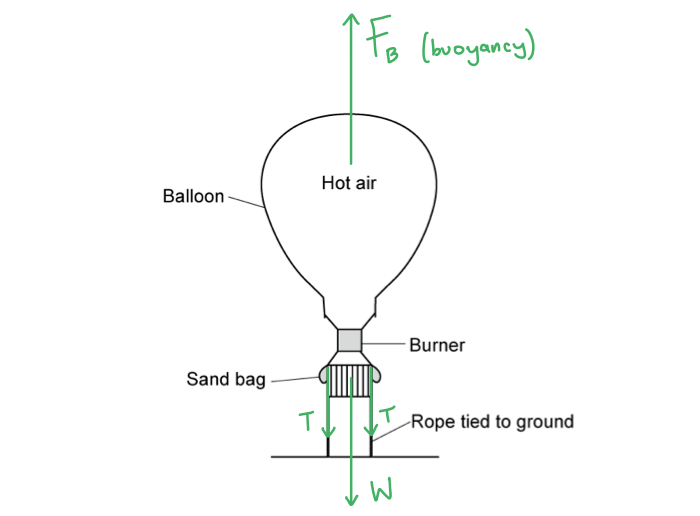

- Upward force / buoyancy force drawn;** [1 mark]**
- Weight / *W* acting downwards from centre; **[1 mark]**
- <u>Two</u> tension / *T* arrows acting downwards on ropes; **[1 mark]**

**[Total: 3 marks]**
List the known quantities:

- Total mass of the balloon and contents, *m* = 1500 kg
- Gravitational field strength, *g* = 9.81 N kg−1
- Tension in each rope, *T* = 400 N

(i) Calculate the weight of the balloon:

- Weight:  $W=mg$ **[1 mark]**
- *W* = 1500 × 9.81 = 14 715 N
- *W* = 14 700 N **[1 mark]**

(ii) Calculate the resultant force acting on the balloon:

- Resultant force = upward forces − downward forces
- Resultant force = 2*T ***OR** 15 500 − 14 700 **[1 mark]**
- Resultant force = 800 N **[1 mark]**

**[Total: 4 marks]**

> *For part (ii), the key points to realise are:*

- *When the ropes are tied to the ground, resultant force = 0*

  - *Resultant: ** F**B** − (**W** + 2**T**) = 0 *
  - *Buoyancy:**  F**B** = 14 700 + (2 × 400) = 15 500 N *

- *When the ropes are untied, resultant force = 2**T**, since the tension is no longer acting downwards*

  - *Resultant:  **F**B** − **W** = 2**T*
  - *Resultant:  15 500 − 14 700 = 800 N*
(i) Calculate the initial acceleration of the balloon:

List the known quantities:

- Mass of the balloon, *m* = 1500 kg
- Initial resultant force, *F *= 800 N

Substitute values into the acceleration equation:

- $F=ma$ **[1 mark]**
- $a=\frac{F}{m}=\frac{800}{1500}$
- $a$* *= 0.5333 = 0.53 m s−2 **[1 mark]**

(ii) The changes to the upwards acceleration during the first few seconds are:

- The speed (of the balloon) increases; **[1 mark]**
- The drag forces / downward forces (also) start to increase; **[1 mark]**
- (Hence), acceleration <u>decreases</u>; **[1 mark]**

**[Total: 5 marks]**

> *We know that acceleration is the rate of change of velocity, so a simplistic approach would be to consider the motion as uniform acceleration.*

> *However, in this situation, we have to consider the effects of drag. As velocity increases, drag forces act in the opposing direction to the motion of the balloon as it starts to move upwards.*

> *Therefore, as drag forces increase, the **magnitude** of the acceleration decreases *
When sand is released from the bags:

- The acceleration <u>increases</u>; **[1 mark]**

This is because:

**Final answer:** **Any ****one**** from:**

- The upward / resultant force (on the balloon) increases; **[1 mark]**
- The downward force / weight (of the balloon) decreases; **[1 mark]**
- The mass (of the balloon) decreases; **[1 mark]**

**[Total: 2 marks]**

### Q4
List the known quantities:

- Mass of the climber, $m$ = 80 kg
- Stretched length of rope = 24 m
- Unstretched length of rope, $L$ = 19 m
- Stiffness of rope, $k$ = 560 N m–1

(i) Calculate the resultant force acting on the climber when he reaches the lowest point in the fall:

- The lowest point is when the rope reaches its maximum extension
- $\Deltax_{max}$ = stretched length – unstretched length = 24 – 19 = 5 m **[1 mark]**

Determine the resultant force on the climber:

- Resultant = $F-W$ where $F=k\Deltax$ (Hooke's law) and $W=mg$ (weight)
- Resultant = $k\Deltax_{max}-mg$
- Resultant = (560 × 5) – (80 × 9.81) **[1 mark]**
- Resultant = 2015.2 = 2020 N **[1 mark]**

(ii) Calculate the extension of the rope when the climber’s acceleration is zero:

- When acceleration = 0:  $F=W$
- So, $mg=k\Deltax_{min}\Rightarrow\Deltax_{min}=\frac{mg}{k}$
- $\Deltax_{min}=\frac{80\times9.81}{560}$ **[1 mark]**
- $\Deltax_{min}$ = 1.4 m **[1 mark]**

**[Total: 5 marks]**

> *It's useful to consider the free-body force diagrams of the climber at the different stages of his fall*

> *At the highest point (before falling):*

- *The forces acting on the climber are his weight and the reaction force which are balanced*
- *Hence *$R-mg=0$

> *Between the highest point and **L**:*

- *The climber freefalls under gravity, only his weight acts (as air resistance/drag is ignored)*

> *Between **L** and Δ**x**max**:*

- *The rope begins to stretch, and we are assuming extension is proportional to tension, so the restoring force is equal to Hooke's law*
- *Hence the resultant force is *$k\Deltax_{max}-mg=ma$
- $\Deltax_{max}$* is the point where the climber comes to rest*

> *Between Δ**x**max** and Δ**x**min**:*

- *The extension decreases as the resultant force/acceleration decrease to zero*
- $\Deltax_{min}$* is the point where the climber comes to rest again and the forces acting on him are balanced again*
- *Hence *$k\Deltax_{min}-mg=0$

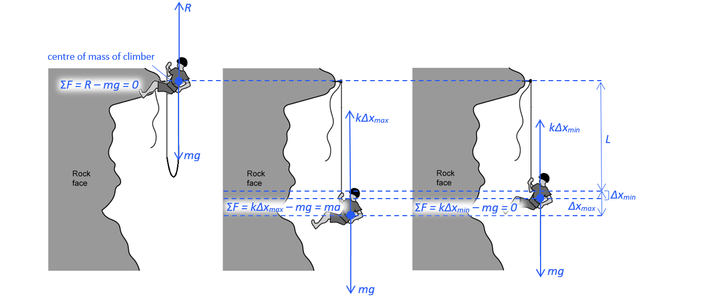
(i) Calculate the maximum speed of the climber before the rope begins to stretch:

- Gain in KE = Change in GPE
- $\frac{1}{2}mv^{2}=mg\Deltah\Rightarrowv^{2}=2g\Deltah$
- $v=\sqrt{2g\Deltah}=\sqrt{2\times9.81\times19}$ **[1 mark]**
- Max speed:  $v$ = 19.3 m s−1 **[1 mark]**

(ii) If the climber used a longer rope:

- They would fall for longer and reach a higher velocity (just before the rope stretches); **[1 mark]**
- (Hence) the climber’s deceleration / force (as the rope stretches) would be greater (not lower); **[1 mark]**

**[Total: 4 marks]**
Determine the average resultant forces exerted by the hemp and nylon ropes:

List the known quantities:

- Mass, *m* = 80 kg
- Initial speed, *u* = 19.3 m s−1 (from **(b)**)
- Final speed, *v* = 0
- Time for nylon, $\Deltat_{nylon}$ = 0.664 s
- Time for hemp, $\Deltat_{hemp}$ = 0.035 s

Use impulse to determine the average resultant force exerted:

- Impulse:  $F\Deltat=\Deltap\RightarrowF=\frac{m\Deltav}{\Deltat}$
- Nylon:  $\DeltaF_{nylon}=\frac{80\times19.3}{0.664}$ = 2325 N **[1 mark]**
- Hemp:  $\DeltaF_{hemp}=\frac{80\times19.3}{0.035}$ = 44 114 N **[1 mark]**

Determine the ratio of the forces:

- $\frac{\DeltaF_{hemp}}{\DeltaF_{nylon}}=\frac{44114}{2325}=18.97$ **[1 mark]**
- Hence, the average resultant force exerted by hemp rope is about 20 times larger than that of the nylon rope

**[Total: 3 marks]**
Nylon ropes are favoured by rock climbers because:

**Final answer:** **Max ****three**** from:**

- When a rock climber falls, they have a large momentum; **[1 mark]**
- The rope brings the climber to a stop / their momentum to zero; **[1 mark]**
- As the nylon rope stretches, the change in momentum occurs over a longer period of time; **[1 mark]**
- (This means that) for the same change in momentum, there is a smaller force applied to the climber (since force is the rate of change in momentum); **[1 mark]**
- (Hence) there is a lower risk of injury to the climber; **[1 mark]**

Compared to a hemp rope:

- A hemp rope would exert the same change in momentum over a shorter period of time; **AND**
- (Therefore) it would apply a large force / injury to the climber; **[1 mark]**

**[Total: 4 marks]**

### Q5
List the known quantities:

- Initial velocity, *u *= 22.5 m s−1 
- Mass, *m *= 150 g = 150 × 10−3 kg = 0.15 kg
- Final velocity, *v *= 12.8 m s−1 

Calculate the impulse from the graph in Fig. 1.1:

- Impulse = change in momentum = area under force-time graph
- For this graph, change in momentum = 0.5 × 145 × (73 × 10−3) = 5.30 N s **[1 mark]**

Calculate the impulse from the given data:

- Momentum before = *mu *= 0.15 × 22.5 = 3.38 N s <u>down</u> **AND**** ** Momentum after = *mv *= 0.15 × 12.8 = 1.92 N s <u>up</u>; **[1 mark]**
- Therefore change in momentum = *mv *− *mu *= 1.92 − (−3.38) = 5.30 N s; **[1 mark]** **OR**
- *I *=* m *(*v* − *u*) = 0.15 × (12.8 − (−22.5))  **[1 mark]**
- *I *= 5.30 N s; **[1 mark]**
- This is the same as the impulse from the graph, therefore, the values given in the question are consistent

**[Total: 3 marks]**

> **[exam-tip]**
> The area under the graph is a triangle shape, so use the formula for the area of a triangle: $\frac{1}{2}\timesbase\timesheight$.
(i) Sketch a graph to show how the momentum of the ball varies for the first 73 ms of the motion:

A sketch that would score one mark looks like this:

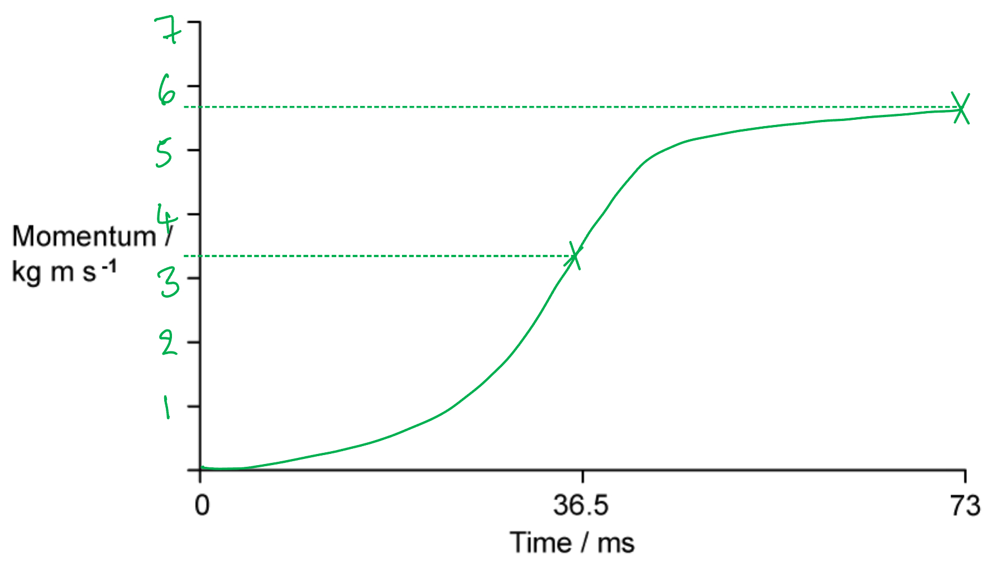

- The shape of the curve is correct **AND**
- The steepest gradient is around the midpoint; **[1 mark]**

(ii) Explain how the ball's momentum varies in the first 73 ms of the motion:

**At least one mark from each section:**

**Final answer:** **Any ****five**** from: **

Describe the overall shape of the graph:

- Change in momentum = area under force-time graph **or **Δ*p *= *F*Δ*t ***[1 mark]**
- Force = rate of change of momentum **or ***F *= $\frac{\Deltap}{\Deltat}$ **[1 mark]**
- The force is the gradient of the momentum-time graph (or the link between force and gradient is clearly made); **[1 mark]**

Explain the shape of the graph for time interval 0 - 36.5 ms:

- (When the ball hits the plate) the force on the ball increases causing it to decelerate; **[1 mark]**
- Force increases linearly / not constant, acceleration is also not constant; **[1 mark]**
- Momentum does not change linearly; **[1 mark]**
- Gradient of momentum-time graph increases; **[1 mark]**

Explain the shape of the graph at 36.5 ms:

- When the force is maximum, the velocity is zero and the acceleration is maximum; **[1 mark]**
- This is where the gradient of the momentum-time graph is steepest; **[1 mark]**

Explain the shape of the graph at  time interval 36.5 - 73 ms:

- (When the ball is leaving the plate) force acts in the negative / opposite direction causing it to accelerate in the negative / opposite direction; **[1 mark]**
- The magnitude of the force decreases linearly, acceleration also decreases; **[1 mark]**
- The velocity of the ball increases rapidly then becomes constant; **[1 mark]**
- Gradient of momentum-time graph decreases; **[1 mark]**

**[Total: 6 marks]**
List the known quantities:

- Initial velocity, *u *= 22.5 m s−1 
- Mass, *m *=  0.15 kg
- Final velocity, *v *= 12.8 m s−1

Calculate the initial *E**k i*  and final kinetic *E**k f*  energy upon impact:

- Recall: Kinetic energy, *E**k* = $\frac{1}{2}mv^{2}$
- *E**k i*  = $\frac{1}{2}mu^{2}=\frac{1}{2}\times0.15\times22.5^{2}=37.97J$
- *E**k f**  *= $\frac{1}{2}mv^{2}=\frac{1}{2}\times0.15\times12.8^{2}=12.29J$ **[1 mark]**

Calculate the fractional change of kinetic energy after each impact:

- $\frac{E_{kf}}{E_{ki}}=\frac{12.29}{37.97}=0.32$ **[1 mark]**

Calculate the percentage change after five bounces:

- $0.32^{5} \times 100 = 0.336 \%$ **[1 mark]**

**[Total: 3 marks]**

> *When the ball falls, it converts its gravitational potential energy into kinetic energy. Therefore, its fractional change in kinetic energy is equal to its fractional change in gravitational potential energy, as energy needs to be conserved by transferring from one store to the other. In this calculation we are ignoring heating effects.*
State the principle of conservation of linear momentum:

- The total momentum before a collision = the total momentum after a collision provided no external forces act

Apply the conservation of momentum to the ball and Earth before the impact:

- Momentum of ball towards the Earth = Momentum of Earth towards the ball; **[1 mark]**

Consider the momentum of the ball and Earth on impact:

- The momentum of both ball and Earth becomes zero; **[1 mark]**

Apply the conservation of momentum to the ball and Earth after impact:

- Momentum of ball away from Earth = Momentum of Earth in opposite direction; **[1 mark]**

**[Total: 3 marks]**

### Q6
Define mass:

- Mass is the property of an object that resists change in motion; **[1 mark]**

**[Total: 1 mark]**

> *Take time to learn key definitions, they are easy marks to pick up in an exam if you know them!*
Total momentum of the rifle and the bullet **before** the rifle is fired, *p**b*:

- *p**b* = 0 (kg m s–1) **[1 mark]**

Give a reason:

- Before the rifle is fired both the rifle and the bullet are stationary; **[1 mark]**
- Therefore, the momentum is zero** **

**[Total: 2 marks]**

> *Remember that momentum is calculated by mass multiplied by velocity. If velocity is zero, then momentum has to be zero too.*
List the known quantities:

- Mass of bullet, *m* = 25 g = 0.025 kg; **[1 mark]**
- Momentum of the bullet **after** being fired, *p**b* = 4.2 kg m s–1

Calculate the velocity of the bullet just **after** the rifle is fired, *v*:

- $p_{b}=mv$
- $v=\frac{p_{b}}{m}=\frac{4.2}{0.025}$ **[1 mark]**
- $v=168$ m s-1 **[1 mark]**

**[Total: 3 marks]**

> *You are not given the equation for momentum in the exam so you will need to learn this.*
List the known quantities:

- Momentum of bullet before hitting target, *p**b* = 3.3 kg m s–1
- Time taken for bullet to stop, ∆*t* = 2.8 ms = 0.0028 s **[1 mark]**

Calculate the change in momentum, ∆*p*, as the bullet is stopped by target:

- ∆*p* = *p**b* – 0 = 3.3 kg m s–1 **[1 mark]**

Calculate the average force needed to stop the bullet, F:

- F = $\frac{\Deltap}{\Deltat}=\frac{3.3}{0.0028}$ **[1 mark]**
- F = 1179 N **[1 mark]**

**[Total: 4 marks]**** **

### Q7
Calculate the magnitude of the reaction force after ascending:

List the known quantities:

- Mass of man, *m* = 65 kg
- Speed of elevator, *v* = 2.5 m s–1
- Time interval, Δ*t* = 1.8 s
- Weight of the man, *W *= *mg* = 65 × 9.81

Calculate the acceleration:

- Acceleration:  $a=\frac{\Deltav}{\Deltat}$
- $a=\frac{2.5}{1.8}$ = 1.39 m s–2 **[1 mark]**

Resolve the forces to determine the reaction force *R*:

- Newton's second law:  $F=ma$
- Resultant force: * *$F=mg-R\Rightarrowma=mg-R$
- Rearrange:  $R = m g - m a = m ( g - a )$* ***[1 mark]**
- *R* = 65 × (9.81 – 1.39) **[1 mark]**
- *R *= 547.3 = 550 N **[1 mark]**

** ****[Total: 4 marks]**

> *Take note that although the elevator is moving upwards, for it to come to **rest** sometime later, this must mean it is **decelerating**. Its acceleration is in the opposite direction to its motion.*

> *Drawing a diagram really helps visualise the situation. Here, **F** is the resultant force. Since this is directed downwards, this must be **mg** – **R**.*

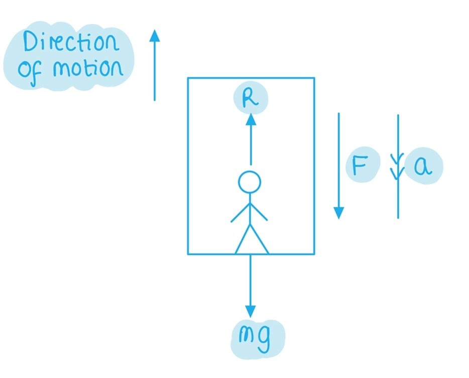
Calculate the reaction force on the man after descending:

List the known quantities:

- Mass of man, *m* = 65 kg
- Deceleration, *a* = 1.39 m s–2 (from **(a)**)

Resolve the forces to determine the reaction force *R*:

- Newton's second law:  $F=ma$
- Resultant force: * *$F=R-mg\Rightarrowma=R-mg$
- Rearrange:  $R = m g + m a = m ( g + a )$* ***[1 mark]**
- *R* = 65 × (9.81 + 1.39) **[1 mark]**
- *R *= 728 = 730 N **[1 mark]**

** ****[Total: 3 marks]**

> *This time, the elevator is moving downwards, for it to come to **rest** sometime later, this must mean it is **decelerating**. This means its acceleration is in the opposite direction to its motion.*

> *Drawing a diagram really helps visualise the situation. Here, **F** is the resultant force. Since this is directed upwards, this must be **R** – **mg**.*

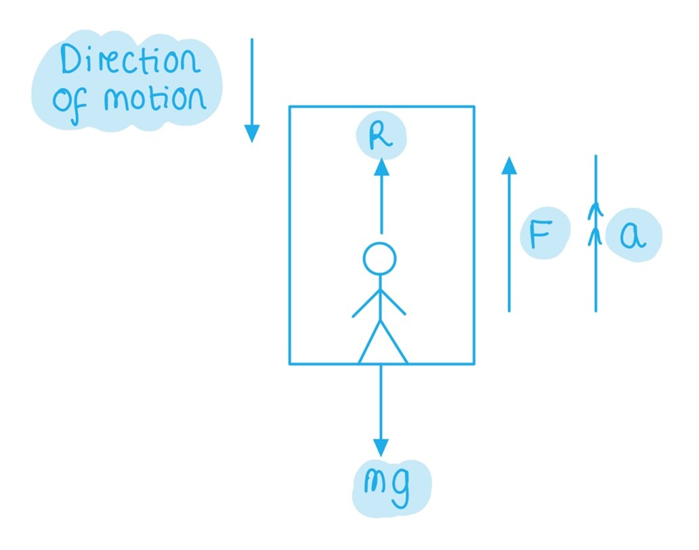
(i) The man would feel lighter when:

- (The elevator is) decelerating while travelling <u>upwards</u>; **[1 mark]**
- Since the reaction force (on him) / *R* is smaller / lower; **[1 mark]**

(ii) The man would feel heavier when:

- (The elevator is) decelerating while travelling <u>downwards</u>; **[1 mark]**
- Since the reaction force (on him) / *R* is larger / higher; **[1 mark]**

** ****[Total: 4 marks]**

> *This question shows why it’s important that you state the forces and acceleration in parts (a) and (b) the correct way around.*

> *The key idea here is that deceleration is **always in the opposite direction to motion.*

> *Hence, ‘decelerating while travelling upwards’ means a resultant force acts **downwards**.*

> *The man feels lighter because the reaction force is smaller (imagine if the reaction force was reduced to zero, the man would suddenly float off the surface of the lift and experience ‘weightlessness’!)*

> *Similarly, ‘decelerating while travelling downwards’ means a resultant force acts **upwards**. The man feels heavier because the reaction force is larger (it sometimes feels like the floor is pushing itself harder into your feet, making you feel ‘heavy’)*
The man feels a sense of weightlessness because:

- The man <u>and</u> the elevator accelerate downwards at the same rate; **[1 mark]**
- This means the man no longer exerts a force on the elevator floor; **[1 mark]**
- (From Newton’s third law, this means) there is no normal (reaction) force acting from the elevator floor on the man; **[1 mark]**

**[Total: 3 marks]**

> *The fact that the man no longer feels the normal force on the elevator is an important point in this question.*

> *The feeling of a person’s weight actually comes from what they are standing on (Earth, an elevator, weighing scales) pushing up on that person with the same force as their weight downwards.*

> *You don’t ‘feel’ your weight downwards on a pair of weighing scales, the scales push upwards on you with a force equal to your weight.*

### Q8
(i) Equilibrium is defined as:

- (When a body or system has) constant velocity / zero acceleration / no resultant force / no resultant torque; **[1 mark]**

(ii) Forces A and B are:

- A is the normal / reaction / contact force **AND**
- B is the weight (of the brick); **[1 mark]**

**[Total: 2 marks]**
(i) Newton’s first law states:

- A body continues at rest or constant velocity unless acted on by a resultant (external) force; **[1 mark]**

(ii) Newton’s first law applies to the brick because:

Any **two **from:

- The brick is at rest / stationary; **[1 mark]**
- (Because) there is no resultant force acting on it; **[1 mark]**
- The upwards force = the downwards force **OR** force A = force B **OR** weight = normal contact / reaction force; **[1 mark]**

**[Total: 3 marks]**
(i) State Newton’s third law:

- If body A exerts a force on body B, then body B will exert a force on body A of equal magnitude but in the opposite direction; **[1 mark]**

(ii) Explain how Newton’s third law applies to one of the forces acting on the brick:

**EITHER**

- The downward force of gravity exerted by the Earth on the brick; **[1 mark]**
- Is equal (in magnitude) and opposite (in direction) to; **[1 mark]**
- The upwards force of gravity exerted by the brick on the Earth; **[1 mark]**

**OR**

- The upwards contact force exerted by the table on the brick; **[1 mark]**
- Is equal (in magnitude) and opposite (in direction) to; **[1 mark]**
- The downward contact force exerted by the brick on the table; **[1 mark]**

**[Total: 4 marks]**

> *It is a common mistake to think that the reaction force and weight are a Newton’s third law pair. Make sure you understand why this is incorrect:*

1. *They both are acting on the same object (the brick)*
2. *They are not of the same type of force*

> *The correct application of Newton's third law for the **contact force** is shown below:*

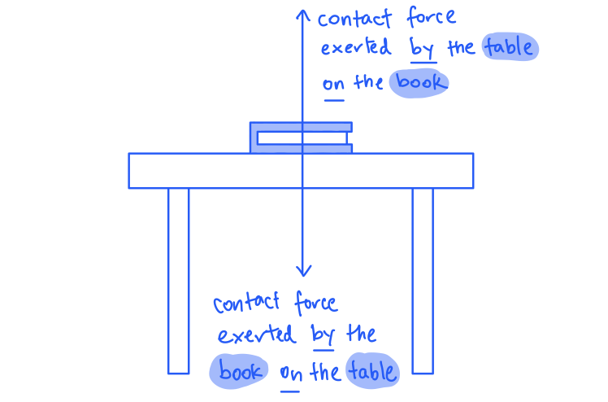

> *The correct application of Newton's third law for **weight** is shown below:*

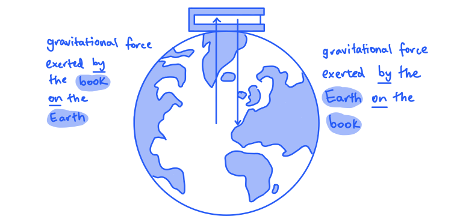
(i) Newton's second law states:

- The (resultant) force (on a body) is equal to its rate of change of momentum, and in the same direction **OR**
- The (resultant) force (on a body) is directly proportional to its acceleration and in the same direction; **[1 mark]**

(ii) Determine the magnitude of the resultant force on the brick:

List the known quantities:

- Mass of the brick, *m* = 2 kg
- Acceleration of the brick, *a *= 0.25 m s−2

Use Newton’s second law to calculate the resultant force on the brick:

- Resultant force:  *F* = *ma*
- *F* = 2 × 0.25 **[1 mark]**
- *F* = 0.5 N **[1 mark]**

**[Total: 3 marks]**

### Q9
State the principle of conservation of momentum:

- The total momentum before a collision = the total momentum after a collision provided no external force acts

Consider whether any external forces act in the explosion:

**Final answer:** **Any ****one**** from:**

- There are no external forces acting on the overall system (thorium plus alpha); **[1 mark]**
- This is because the particles are moving in free space; **[1 mark]**
- They are far from other charges so electrostatic forces are negligible; **[1 mark]**

Consider the momentum before the explosion:

- There is no initial momentum before the explosion because the uranium atom is stationary / at rest; **[1 mark]**

Consider the momentum after the explosion:

- Momentum is conserved because there are no external forces
- Momentum is a vector, so it also has direction
- So for momentum to be conserved:

**Final answer:** **Any ****one**** from:**

- There are equal and opposite forces acting between thorium and the alpha particle;** [1 mark]**
- The thorium atom must move along the original line of movement after the explosion in the opposite direction;** [1 mark]**
- The thorium and alpha particle must travel in opposite directions so there is no overall / net momentum after the decay;** [1 mark]**

**[Total: 3 marks]**
List the known quantities:

- Total energy released, *E *= 6.55 MeV
- Mass of Thorium nucleus, *M**th*  = 228 *u  *(from part (a))
- Mass of alpha particle, *M**α*  = 4 *u  *(from part (a))
- Unified atomic mass unit, *u *= 1.661 × 10−27 kg = 931.5 MeV

Apply the conservation of momentum to the explosion and obtain an expression for the velocity of the Thoriun nucleus, *v**th** *:

- *p**th* = *p**α* therefore *M**th**v**th* = *M*α*v*α  **OR** 0 = *p**α * − *p**th* so 0 = *M*α*v*α − *M**th**v**th*
- So, *v**th* = $\frac{M_{α}v_{α}}{M_{th}}$

Combine the equations, using *v**th* from above, for kinetic energy of alpha-particle, *E**k** **α**  *and kinetic energy of a thorium particle *E**k th *to obtain a ratio for kinetic energy:

- Recall: $E_{k}=\frac{1}{2}mv^{2}$
- $E_{kα}=\frac{1}{2}M_{α}(v_{α})^{2}$ **AND**** ** $E_{kth}=\frac{1}{2}M_{th}(v_{th})^{2}$

- $E_{k} t h = 1 \text{half} M_{t} h ( \frac{M_{ \alpha } v_{ \alpha }}{M_{t} h} ) ^{2}$

- $E_{kth}=\frac{E_{kα}(M_{α})}{M_{th}}$
- Therefore, the ratio for kinetic energy: $\frac{E_{kth}}{E_{kα}}=\frac{M_{α}}{M_{th}}$ **[1 mark]**

Calculate the ratio of the masses and obtain an expression for *E**k th*:

- $\frac{E_{kth}}{E_{kα}}=\frac{4u}{228u}=\frac{1}{57}$
- $E_{kth}=\frac{E_{kα}}{57}$ **[1 mark]** **   **

Calculate the kinetic energy of the Thorium nucleus  and α particle:

- $E_{kth}+E_{kα}=E$
- $\frac{E_{kα}}{57}+E_{kα}=6.55\mathrm{MeV}$
- Therefore  $\frac{58}{57}E_{kα}=6.55\mathrm{MeV}$ **[1 mark]**
- $E_{kα}=\frac{57}{58}\times6.55=6.44$
- Rearrange the equation to calculate *E**k** **th*:

  - *E**k** **th *= *E *− *E**k** **α* = 6.55 − 6.44 = 0.11 MeV **[1 mark]**

**[Total: 4 marks]**
List the known quantities:

- Kinetic energy of Thorium nucleus, *E**k** **th* = 0.11 MeV (from part (b))
- Kinetic energy of α particle, *E**k** **α* = 6.44 MeV (from part (b))
- Mass of Thorium nucleus, *M**th* = 228 *u *(from part (a))
- Mass of α particle, *M**α* = 4 *u *(from part (a))
- Unified atomic mass unit, *u *= 1.661 × 10−27 kg = 931.5 MeV

**Method 1: Calculate the momentum of each nucleus**

Calculate the momentum of the Thorium nucleus:

- $E_{kth}=\frac{1}{2}M_{th}(v_{th})^{2}$
- Rearrange to obtain *v**th*:

  - $v_{th}=\sqrt{\frac{2E_{kth}}{M_{th}}}$
- Convert *M**th* into MeV:

  - *M**th* = 228 *u *= 228 × 931.5 MeV = 212 382 MeV
- Substitute *M**th* into the equation for *v**th*:

  - $v_{th}=\sqrt{\frac{2\times0.11}{212382}}$ = 1.02 × 10−3 m s−1 
- Convert *M**th *into kg:

  - *M**th* = 228 *u *= 228 × (1.661 × 10−27) = 3.787 × 10−25 kg
  - *p**th* = *M**th*vth = (3.787 × 10−25) × (1.02 × 10−3) = 3.9 × 10−28 kg m s−1 **[1 mark]**

Calculate the momentum of the α particle:

- $E_{kα}=\frac{1}{2}M_{α}(v_{α})^{2}$
- Rearrange to obtain *v**α*:

  - $v_{α}=\sqrt{\frac{2E_{kα}}{M_{α}}}$
- Convert *M**α* into MeV:

  - *M**α* = 4 *u *= 4 × 931.5 MeV = 3726 MeV
- Substitute *M**α* into the equation for *v**α*:

  - $v_{α}=\sqrt{\frac{2\times6.44}{3726}}$ = 58.9 × 10−3 m s−1 
- Convert *M**th *into kg:

  - *M**α* = 4 *u *= 4 × (1.661 × 10−27) = 6.644 × 10−27 kg
  - *p**α* = *M**α*v*α* = (6.644 × 10−27) × (58.9 × 10−3) = 3.9 × 10−28 kg m s−1 **[1 mark]**

Conclusion:

- The Uranium nucleus is stationary, so the momentum before the decay = 0
- Both the Thorium nucleus and α particle have the same momentum (but in opposite directions) **AND**
- (Therefore) the momentum after the decay is also 0 / is conserved; **[1 mark]**

**Method 2: Show that the ratio of the momentum of each nucleus equals 1**

Determine the equation for the ratio of the momentum of Thorium and the α particle:

- Ratio of momentum = $\frac{M_{th}v_{th}}{M_{α}v_{α}}$
- $E_{kth}=\frac{1}{2}M_{th}(v_{th})^{2}$
- Rearrange to obtain *v**th*:

  - $v_{th}=\sqrt{\frac{2E_{kth}}{M_{th}}}$
- $E_{kα}=\frac{1}{2}M_{α}(v_{α})^{2}$
- Rearrange to obtain *v**α*:

  - $v_{α}=\sqrt{\frac{2E_{kα}}{M_{α}}}$
- Substitute for the velocities of Uranium and α particle into the ratio of momentum:

  - $\frac{M_{th}\sqrt{\frac{2E_{kth}}{M_{th}}}}{M_{α}\sqrt{\frac{2E_{kα}}{M_{α}}}}=\sqrt{\frac{2M_{th}E_{kth}}{2M_{α}E_{kα}}}=\sqrt{\frac{M_{th}E_{kth}}{M_{α}E_{kα}}}$ **[1 mark]**

Substitute the known values into the ratio of velocities:

- $\sqrt{\frac{228u\times0.11MeV}{4u\times6.44MeV}}=\sqrt{\frac{228\times0.11}{4\times6.44}}$ = 0.9867 = 1 **[1 mark]**

Conclusion:

- Since the Uranium nucleus is stationary, the momentum before the decay = 0
- Both the Thorium nucleus and α particle have the same momentum (in opposite directions) so their ratios are equal to 1 **AND**
- (Therefore) the momentum after the decay is also 0 / is conserved; **[1 mark]**

**[Total: 3 marks]**

> *Units are important in this question. You can either convert the mass in atomic units (u) to MeV or kg, as long as they are the same unit on the numerator and denominator of the fraction. When using the momentum equation **p** = **mv** the mass must be converted into kg from MeV or J so the final units for moments are kg m s**–1**.*

> * *

> *A small algebra trick to combine a variable outside a square root and inside a square root:*

- $m=\sqrt{m^{2}}$
- *Therefore, *$m \sqrt{ \frac{2 E_{k} }{m} } = \sqrt{ \frac{m^{2} 2 E_{k} }{m} } = \sqrt{ \frac{m^{ \cancel{2} } 2 E_{k} }{ \cancel{m} } } = \sqrt{m 2 E_{k} }$
If this was an inelastic collision:

**Final answer:** **Any ****two**** from:**

- The neutrons will be <u>absorbed</u> by the Uranium nucleus; **[1 mark]**
- Both the Uranium nucleus and neutron will continue to travel in the same direction as the initial neutron / won’t change direction; **[1 mark]**
- Kinetic energy is lost;** [1 mark]**

If this was an elastic collision:

**Final answer:** **Any ****two**** from:**

- The neutron will <u>rebound</u> with velocity / momentum to the left;** [1 mark]**
- The momentum transferred to the Uranium nucleus will be greater;** [1 mark]**
- The velocity of the Uranium will be greater (than in an elastic collision) / no kinetic energy is lost;** [1 mark]**

**[Total: 4 marks]**

### Q10
(i) Sketch free-body force diagrams for the periods of acceleration and deceleration:

During acceleration:

- Contact force > weight i.e. the contact force is larger than the weight; **[1 mark]**

During deceleration:

- Contact force < weight i.e. the contact force is smaller than the weight; **[1 mark]**

(ii) The apparent weight of the person during acceleration is:

- Newton's Second Law:  $F=ma$
- $F=R-W$
- $R=mg+ma$ **[1 mark]**

(iii) The apparent weight of the person during deceleration is:

- $F=W-R$
- $R=mg-ma$ **[1 mark]**

**[Total: 4 marks]**

> *Imagine the two forces acting on the person: one upward force due to the normal reaction force from standing on the scale, and one downward force due to their weight.*

> *The weight of the person **is always constant**, but there will be a **resultant force **acting** **upwards or downwards, depending on the direction of the acceleration. The **apparent weight** is therefore referring to the size of the **contact force** experienced by the person as this is the only force that changes.*

> *When drawing free body diagrams, make sure that the size of the weight arrow stays the same size in both diagrams!*
Sketch the expected readings on the scales:

List the known quantities:

- Acceleration, *a* = 0.7 m s−2
- Weight of the person, *W* = 700 N

Calculate the resultant force:

- Newton's Second Law:  $F=ma$
- $F = ( \frac{700}{9.81} ) \times 0.7$
- $F$ = 49.9 = 50 N
- Therefore, reading during acceleration = 700 + 50 = 750 N **[1 mark]**
- Therefore, reading during deceleration = 700 − 50 = 650 N **[1 mark]**

The readings on the scale would be as follows:

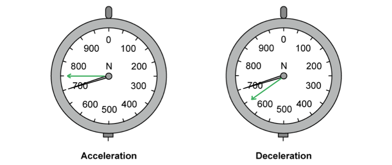

- Readings from calculation correctly marked with a straight line from the centre of the dial; **[1 mark]**

**[Total: 3 marks]**

> *When the lift accelerates, the **upward** **contact force** increases. This is interpreted by the weighing scales as an increased reading.*

> *When the lift decelerates, it's the opposite. Try to imagine a lift moving upward but coming to a stop (i.e., **decelerating**) as it approaches the floor above. You will feel momentarily a bit 'floaty' like you are about to lift off of the floor. This experience is because the upward **contact force **from the floor on your feet **decreases** as the lift slows down. *

> *In this case, there must be a resultant force **downwards** (because the lift is slowing down) but the weight of the person stays constant. Hence, the contact force decreases (and the reading on the spring scale would be **less** than 700 N). *

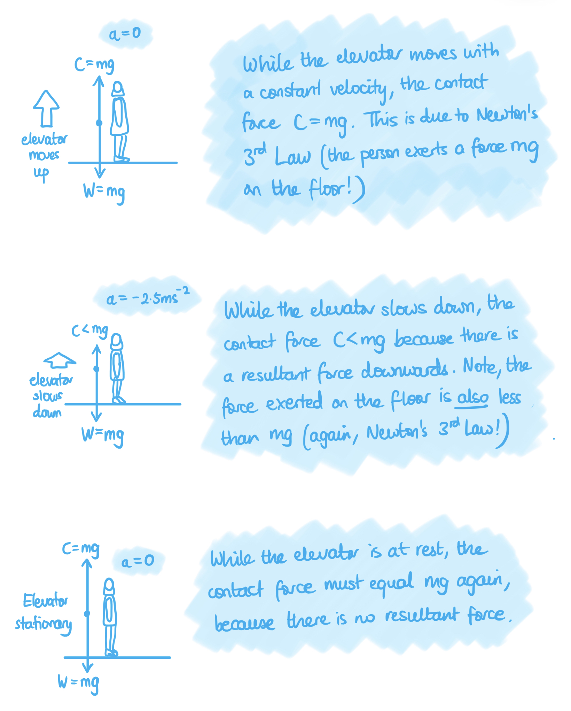
Determine the value of $t_{1}$:

- Distance travelled (height) = average velocity of each segment × time
- Distance travelled:  $( 0.7 t_{1} ) \times t_{1} + ( 0.7 t_{1} ) \times 4 t_{1} + ( 0.7 t_{1} ) \times t_{1} = 24 \mathrm{m}$ **[1 mark]**
- Distance travelled:  $0.7t_{1}^{2}+2.8t_{1}^{2}+0.7t_{1}^{2}=24m$
- Simplify and rearrange:  $4.2t_{1}^{2}=24m\Rightarrowt_{1}=\sqrt{\frac{24}{4.2}}$
- $t_{1}$ = 2.39 = 2.4 s **[1 mark]**

**[Total: 2 marks]**

> *Consider the equation for acceleration:*

> $a=\frac{\Deltav}{t}$* so *$\Deltav=at$

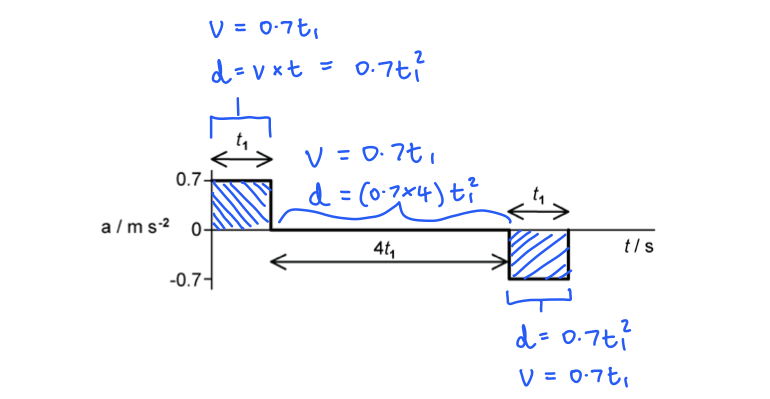

> *During initial constant acceleration:*

- *The lift accelerates from rest at 0.7 m s**−2** for *$t_{1}$* seconds*
- *Hence, average velocity = *$0.7t_{1}ms^{-1}$

> *During the period of constant velocity: *

- *The lift continues at *$0.7t_{1}ms^{-1}$* for *$4t_{1}$* seconds*
- *Hence, (average) velocity = *$0.7t_{1}ms^{-1}$

> *During the final constant deceleration: *

- *The lift decelerates at −0.7 m s**−2** for *$t_{1}$* seconds back to zero velocity*
- *Hence, average velocity = *$-0.7t_{1}ms^{-1}$
The variation of time with the apparent weight for the journey:

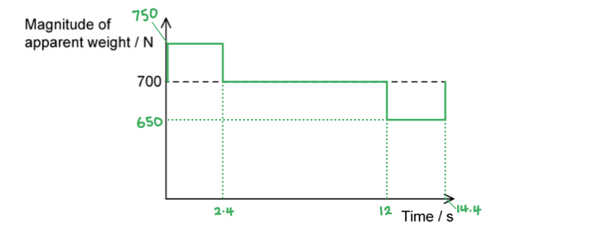

- Same shape as the acceleration-time graph in **(c)**; **[1 mark]**
- Values for apparent weight correctly marked; **[1 mark]**
- Values for time correctly marked (values or multiples of $t_{1}$); **[1 mark]**

**[Total: 3 marks]**

> *The key to figuring out the shape of this graph is to realise that *$F\proptoa$*, so the shape will be exactly the same as the acceleration graph in the previous question.*

> *You have already calculated the magnitude of apparent weight in part (b), so don't calculate them again! *

### Q11
For a pair of forces that obey Newton's third law...

(i) One similarity is that both forces:

**Final answer:** **Any ****one**** from:**

- Have the same line of action; **[1 mark]**
- Have the same magnitude (**not** size); **[1 mark]**
- Are of the same kind / type **OR** both forces are contact forces or non-contact forces; **[1 mark]**

(ii) One difference is that both forces:

**Final answer:** **Any ****one**** from:**

- Act in opposite directions; **[1 mark]**
- Act on different bodies; **[1 mark]**

**[Total: 2 marks]**
List the known quantities:

- Mass of block A, mA = 3 kg
- Mass of block B, mB = 7 kg
- Horizontal force on block B = 200 N

(i) The Newton's third law pairs on B are:

- Reaction (force) of the table on B (*R**B*) **AND** reaction (force) of B on the table (−*R**B*); **[1 mark]**
- Weight / gravitational (force) of the Earth on B (*W**B*) **AND** gravitational force of B on the Earth (−*W**B*); **[1 mark]**
- Tension / pull of the string on B (*T**B*) **AND** tension / pull back of B on the string (−*T**B*); **[1 mark]**
- 200 N force from an external body / object acts on B **AND** −200 N force from B acts on the external body / object; **[1 mark]**

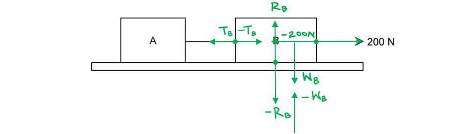

(ii) Calculate the acceleration of the blocks:

Apply Newton’s second law to block A:

- Newton's second law:  $F=ma\RightarrowT=m_{A}a$
- $T=3a$  **[1 mark]**

Apply Newton’s second law to block B:

- $200-T=m_{B}a$
- $200-T=7a$* ***[1 mark]**

Combine the expressions to calculate *a*:

- $200-3a=7a\Rightarrow200=10a$
- $a=\frac{200}{10}$ = 20 m s–2 **[1 mark]**

** ****[Total: 7 marks]**

> *Remember that free-body diagrams treat each object separately. These should include:*

- *Arrows that are drawn relative to the size of the forces*
- *Arrows pointing in the direction of the force*
- *All arrows labelled with the name, or symbol, of the force they represent*
(i) From time *t* = 80 to 100 ms, the magnitude of the acceleration is:

- Constant; **[1 mark]**

(ii) From time *t* = 100 to 120 ms, the magnitude of the acceleration is:

- Zero; **[1 mark]**

**[Total: 2 marks]**
(i) Determine the time interval over which the blocks are in contact:

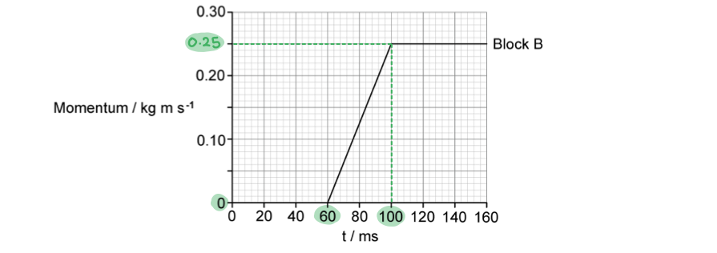

- The interval where there is a change in momentum represents the time the blocks are in contact
- Time in contact:  Δ*t* = 100 − 60 = 40 ms **[1 mark]**

(ii) Determine the magnitude of the force exerted by block A on block B:

- Momentum of B before collision = 0
- Momentum of B after collision = 0.25 kg m s–1
- Change in momentum, Δ*p* = 0.25 kg m s–1
- Force:  $F=\frac{\Deltap}{\Deltat}$ **OR** *F* = gradient of the momentum-time graph; **[1 mark]**
- $F=\frac{0.25}{40\times10^{-3}}$ = 6.25 N **[1 mark]**

(iii) Determine the speed of A after the collision:

List the known quantities:

- Mass of A = 3 kg
- Velocity of A before collision = 0.20 m s–1

Determine the change in momentum Δ*p*:

- Momentum: $p=mv$
- Momentum of A before collision = 3 × 0.20 = 0.60 kg m s–1
- Momentum of A after collision = 0.60 − 0.25 = 0.35 kg m s–1 **[1 mark]**
- Velocity of A after collision = $\frac{p}{m}=\frac{0.35}{3}$ **[1 mark]**
- Velocity of A after collision = 0.12 m s–1 **[1 mark]**

**[Total: 6 marks]**
