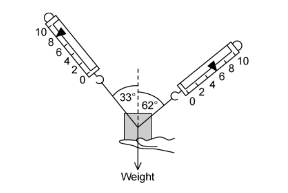
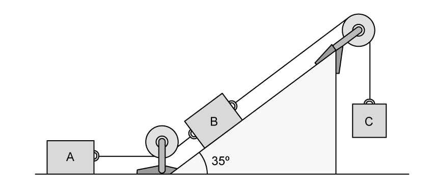
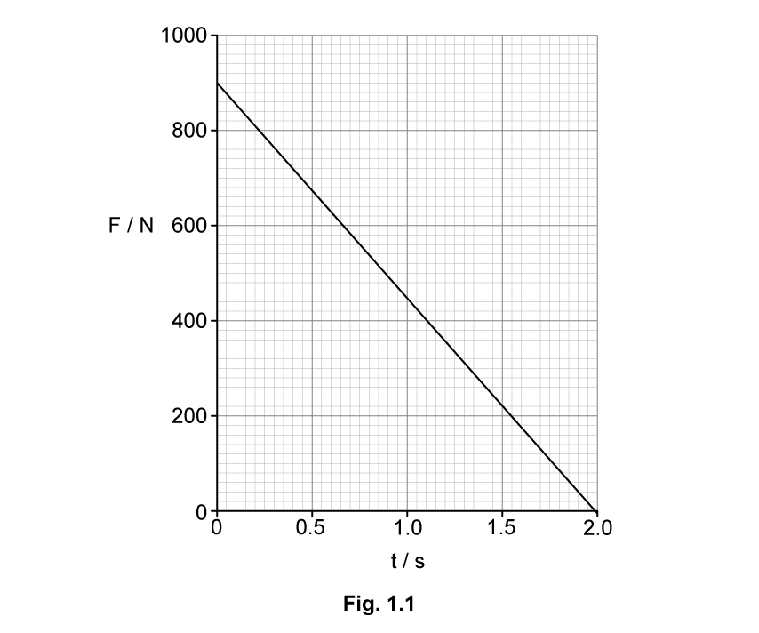
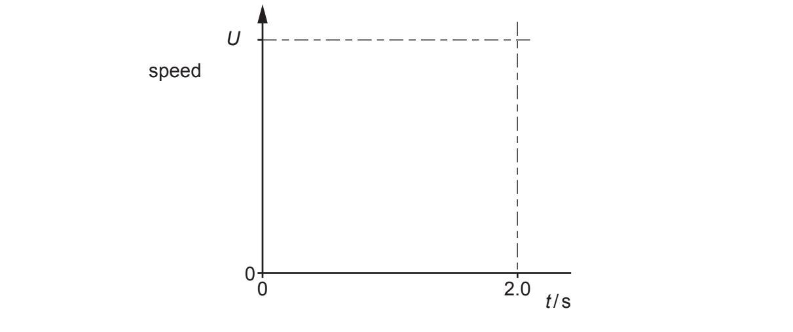
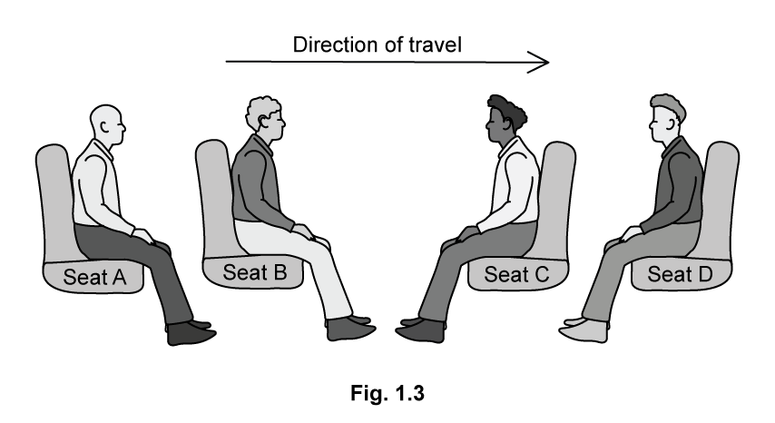
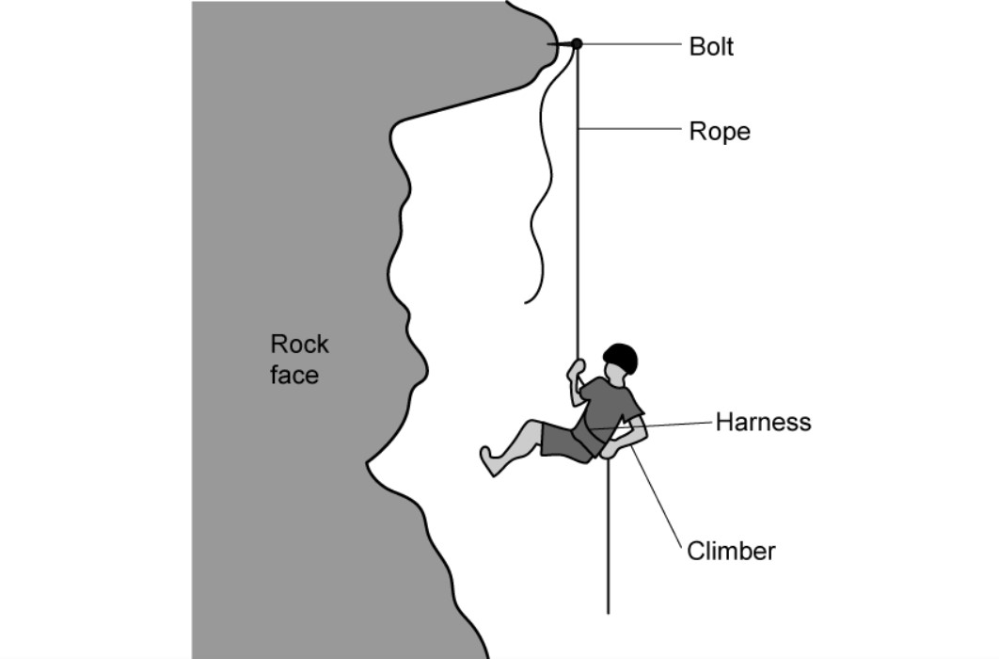
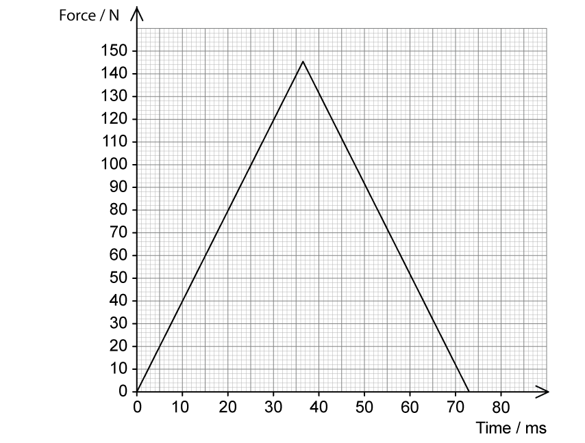
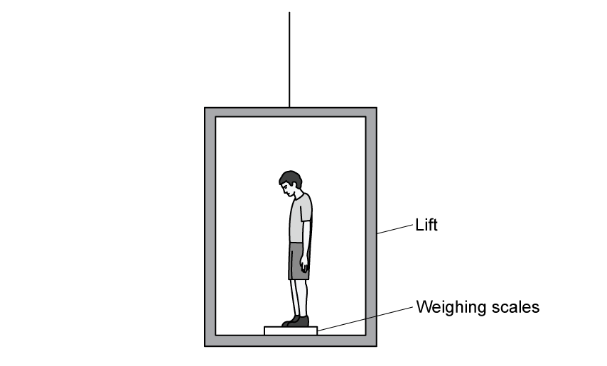
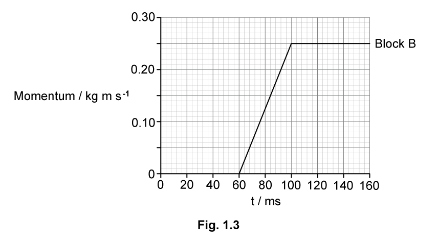

# Exam Questions — Momentum & Newton’s Laws of Motion
**3. Dynamics** · Cambridge (CIE) AS physics (9702)
> Source: [https://www.savemyexams.com/as/physics/cie/25/topic-questions/](https://www.savemyexams.com/as/physics/cie/25/topic-questions/) · 34 questions across 2 sets

## Multiple Choice Questions (23 questions)

### Q1 — medium — 1 marks

**Q1** [1 mark]

A car is travelling at constant velocity on a straight road.

Which row gives the correct Newton's third law force pair?

|   | **Force A** | **Force B** |
|---|---|---|
| **A.** | Driving force from engine | Air resistance on the car |
| **B.** | Weight of the car | Normal reaction from the road |
| **C.** | Driving force from wheels on road | Friction force from air on car |
| **D.** | Weight of the car | Gravitational force of the car on the Earth |

### Q2 — easy — 1 marks

**Q2** [1 mark]

A tennis ball is dropped from different heights and its velocity is measured just before it hits the ground.

A graph is plotted showing the momentum of the tennis ball against its velocity.

What does the gradient of this graph represent?

### Q3 — hard — 1 marks

**Q3** [1 mark]

Two blocks X and Y, of masses *m* and 4 *m* respectively, are accelerated along a smooth horizontal surface by a force *F* applied to block X as shown

What is the magnitude of the force exerted on block Y by block X during this acceleration?

### Q4 — medium — 1 marks

**Q4** [1 mark]

The gravitational field strength on the surface of planet R is one eighth of that on the surface of planet S.

On the surface of R, a body has its mass measured to be 2.5 kg and its weight measured to be 12.5 N

What results are obtained for measurements of the mass and weight of the same body on the surface of planet S?

|   | **Mass on S** | **Weight on S** |
|---|---|---|
| **A**  **B**  **C**  **D** | 2.5 kg  20 kg  2.5 kg  20 kg | 20 N  100 N  100 N  160 N |

### Q5 — hard — 1 marks

**Q5** [1 mark]

A tennis ball is dropped onto a table and bounces back up. The table exerts a force *F *on the ball.

Which graph best shows the variation with time *t* of the force *F* while the ball is in contact with the table?

### Q6 — easy — 1 marks

**Q6** [1 mark]

An object travelling with velocity *v* strikes a wall and rebounds as shown

Which property of the object is **not** conserved?

### Q7 — medium — 1 marks

**Q7** [1 mark]

All external forces on a body cancel out.

Which statement **must** be correct?

### Q8 — medium — 1 marks

**Q8** [1 mark]

A ball falls vertically and bounces on the ground.

Which statement about the forces acting while the ball is in contact with the ground is correct?

### Q9 — easy — 1 marks

**Q9** [1 mark]

What describes the mass and the weight of an object?

|   | **Mass** | **Weight** |
|---|---|---|
| **A** | the ratio of the object's momentum to its velocity | the work done in lifting the object 1.0 m vertically |
| **B** | the force the object experiences due to gravity | the resistance of the object to changes in motion |
| **C** | the resistance of the object to changes in motion | the force the object experiences due to gravity |
| **D** | the total number of atoms in the object | the ratio of the object's mass to the acceleration of free fall |

### Q10 — easy — 1 marks

**Q10** [1 mark]

A force *F* is applied to a freely moving object. At one instant of time, the object has velocity *v* and acceleration *a*.

Which quantities must be in the same direction?

### Q11 — easy — 1 marks

**Q11** [1 mark]

A cyclist is riding at a steady speed on a level road

According to Newton’s third law of motion, what is equal and opposite to the backward push of the back wheel on the road?

### Q12 — hard — 1 marks

**Q12** [1 mark]

A lift consists of a passenger car supported by a cable which runs over a light, frictionless pulley to a balancing weight. The balancing weight falls as the passenger car rises.

Some masses are shown in the table.

|   | **Mass / kg** |
|---|---|
| passenger car  balancing weight  passenger | 1200  1320  80 |

What is the magnitude of the acceleration of the car when carrying just one passenger and when the pulley is free to rotate?

### Q13 — medium — 1 marks

**Q13** [1 mark]

The acceleration of free fall on planet X is  $\frac{1}{6}$  of the acceleration of free fall on Earth.

The mass of a body on planet X is 60 kg.

What is its weight on planet X?

### Q14 — easy — 1 marks

**Q14** [1 mark]

As a car accelerates uniformly, its momentum is measured at regular intervals, and a graph of the car's momentum is plotted against time.

Which quantity is equal to the gradient of the graph at a particular time?

### Q15 — easy — 1 marks

**Q15** [1 mark]

The acceleration of free fall is represented by *g*.

Which statement is correct?

### Q16 — medium — 1 marks

**Q16** [1 mark]

Water is pumped through a hose-pipe at a rate of 80 kg per minute. It emerges from the hose-pipe horizontally with a speed of $30ms^{-1}$

Which force is required from a person holding the hose-pipe to prevent it moving backwards?

### Q17 — hard — 1 marks

**Q17** [1 mark]

A ship of mass 6.7 × $10^{7}$ kg is approaching a harbour with speed 18.9 m s−1

By using reverse thrust it can maintain a constant total stopping force of 880,000 N

How long will it take to stop?

### Q18 — hard — 1 marks

**Q18** [1 mark]

A box of mass 10.0 kg rests on a horizontal rough surface. A string attached to the box passes over a smooth pulley and supports a 4.0 kg mass at its other end.

When the box is released, a frictional force of 12.0 N acts on it.

What is the acceleration of the box?

### Q19 — hard — 1 marks

**Q19** [1 mark]

A brick of mass 1.8 kg rests on a plane inclined at an angle of 30°. The weight of the brick has a component of *F* N parallel with the plane. The brick also experiences a frictional force of 3.0 N

What is the acceleration of the brick down the plane?

### Q20 — easy — 1 marks

**Q20** [1 mark]

A resultant force causes a body to accelerate.

What is equal to the resultant force?

### Q21 — easy — 1 marks

**Q21** [1 mark]

Which is **not** one of Newton's laws of motion?

### Q22 — medium — 1 marks

**Q22** [1 mark]

Newton’s third law of motion is often summarised as

‘Every action has an equal and opposite reaction.’

A cup of tea rests on a table. If the weight of the cup is the ‘action’ force, what is the ‘reaction’ force?

### Q23 — hard — 1 marks

**Q23** [1 mark]

A 3.2 kg mass is supported by a person’s hand and two newton-meters as shown.

When the person’s hand is removed, what is the initial vertical acceleration of the mass?

## Structured Questions (11 questions)

### Q1 — hard — 12 marks

**Q1** [3 marks]

Three boxes A, B, and C are connected using an inextensible rope of negligible mass, as shown in Fig. 1.1.

**Fig. 1.1**

Boxes A and B each have a mass of 2.4 kg, and the magnitude of the frictional force $F$ between each box and the surface is equal to

$F_{x}=\frac{1}{3}R_{x}$

where $R$ is the normal reaction force and $x$ refers to the box in question A, B or C.

Box C descends with constant velocity.

Calculate the tension in the rope connecting boxes A and B.

**Q1** [4 marks]

**Extract:**

Three boxes A, B, and C are connected using an inextensible rope of negligible mass, as shown in Fig. 1.1. Boxes A and B each have a mass of 2.4 kg, and the magnitude of the frictional force F between each box and the surface is equal to F_x = (1/3) R_x where R is the normal reaction force and x refers to the box in question A, B or C. Box C descends with constant velocity. Calculate the tension in the rope connecting boxes A and B. [Answer: T_AB = 7.8 N]

Determine the tension in the rope connecting boxes B and C.

**Q1** [1 mark]

**Extract:**

Three boxes A, B, and C are connected using an inextensible rope of negligible mass. Box C descends with constant velocity.

From part (b): Tension in the rope connecting boxes B and C, T_BC = 27.7 N

Hence, determine the mass of box C.

**Q1** [4 marks]

**Extract:**

Three boxes A, B, and C are connected using an inextensible rope of negligible mass, as shown in Fig. 1.1. Boxes A and B each have a mass of 2.4 kg, and the magnitude of the frictional force F between each box and the surface is equal to F_x = (1/3) R_x where R is the normal reaction force and x refers to the box in question A, B or C. Box C descends with constant velocity.
Angle of inclination of ramp, θ = 35°. Frictional force on B, F_B = 6.4 N. Tension in rope BC, T_BC = 27.7 N.
Mass of C: m_C = 27.7/9.81 = 2.8 kg. Weight of C = 27.7 N.

The rope connecting A and B breaks abruptly.

Calculate the acceleration of block C.

### Q2 — medium — 11 marks

**Q2** [2 marks]

A cyclist carries out tests on the braking system of their bicycle.

At time *t *= 0 the cyclist is travelling at an initial speed of *u* as they apply the brakes and come to a stop at time* t* = 2.0 s.

Fig. 1.1 shows the variation of the braking force *F* on the bicycle with time *t.*

Use Newton’s second law of motion to explain the physical quantity represented by the area under the graph shown in Fig. 1.1.

**Q2** [3 marks]

**Extract:**

A cyclist carries out tests on the braking system of their bicycle. At time t = 0 the cyclist is travelling at an initial speed of u as they apply the brakes and come to a stop at time t = 2.0 s. Fig. 1.1 shows the variation of the braking force F on the bicycle with time t. [Graph: F/N on y-axis from 0 to 1000, starting at 900 N at t=0 and decreasing linearly to 0 N at t=2.0 s; area under graph represents change in momentum]

The total mass of the cyclist and bicycle is 82 kg.  Use Fig. 1.1 to calculate the initial speed *u*.

**Q2** [2 marks]

**Extract:**

A cyclist carries out tests on the braking system of their bicycle. At time t = 0 the cyclist is travelling at an initial speed of u as they apply the brakes and come to a stop at time t = 2.0 s. Fig. 1.1 shows the variation of the braking force F on the bicycle with time t. (Fig 1.1 shows the braking force decreasing uniformly from a maximum at t=0 to 0 at t=2.0 s.)

Complete Fig. 1.2 to show the variation of the speed of the bicycle from *t* = 0 to *t* = 2.0 s.

**Fig. 1.2**

**Q2** [4 marks]

Brakes testing is a crucial part of the manufacturing process of any vehicle.

A train manufacturer wants to determine the effect of a rapid deceleration on passengers riding their new model of train.

Four crash test dummies are placed on different seats on the train as shown in Fig. 1.3. During the test, the train travels at a high speed in the direction shown and after a time, the brakes are applied. Seat belts are not used on trains.

With reference to at least **one** of Newton’s laws of motion, discuss which seat, **A**−**D**, is the safest for a passenger to be sitting on in the event of a rapid deceleration.

You may assume that the seats all remain fixed firmly to the floor and do not break.

### Q3 — easy — 14 marks

**Q3** [3 marks]

A hot-air balloon is tied to the ground by two ropes, as shown in Fig. 1.1.

**Fig. 1.1**

Label Fig. 1.1 to show the forces acting on the balloon.

**Q3** [4 marks]

The tension *T *required to keep the balloon fixed to the ground is 400 N in each rope.

The ropes are untied and the balloon starts to move upwards. The balloon and its contents have a total mass of 1500 kg.

As the balloon begins its ascent, calculate

(i) the weight of the balloon,

[2]

(ii) the resultant force acting on the balloon.

[2]

**Q3** [5 marks]

**Extract:**

The tension T required to keep the balloon fixed to the ground is 400 N in each rope. The ropes are untied and the balloon starts to move upwards. The balloon and its contents have a total mass of 1500 kg. As the balloon begins its ascent, calculate (i) the weight of the balloon, (ii) the resultant force acting on the balloon.
Resultant force = 800 N

(i) Calculate the initial acceleration of the balloon.

[2]

(ii) Explain how the upward acceleration of the balloon changes during the first few seconds of its flight.

[3]

**Q3** [2 marks]

**Extract:**

The tension T required to keep the balloon fixed to the ground is 400 N in each rope. The ropes are untied and the balloon starts to move upwards. The balloon and its contents have a total mass of 1500 kg.

If the passengers want to change the upward acceleration, they can release some sand from the bags.

State and explain how this affects the upward acceleration of the balloon.

### Q4 — hard — 16 marks

**Q4** [5 marks]

A rock climber of mass 80 kg slips after attaching a bolt firmly onto a piece of rock that they are climbing as shown in Fig. 1.1.

At the lowest point of the climber's fall, the length of the rope between the harness and the bolt is 24 m. The climber comes to rest and all the energy from the fall has been absorbed by the rope.

The rope has an unstretched length of 19 m and a stiffness of 560 N m–1.

**Fig. 1.1**

Assume that the extension of the rope is proportional to its tension and the mass of the rope and the effects of air resistance are negligible.

Calculate

(i) the resultant force acting on the climber when he reaches the lowest point in the fall.

[3]

(ii) the extension of the rope when the climber’s acceleration is zero.

[2]

**Q4** [4 marks]

**Extract:**

A rock climber of mass 80 kg slips after attaching a bolt firmly onto a piece of rock that they are climbing as shown in Fig. 1.1. At the lowest point of the climber's fall, the length of the rope between the harness and the bolt is 24 m. The climber comes to rest and all the energy from the fall has been absorbed by the rope. The rope has an unstretched length of 19 m and a stiffness of 560 N m^–1^. Assume that the extension of the rope is proportional to its tension and the mass of the rope and the effects of air resistance are negligible.

(i) Use the principle of conservation of energy to calculate the maximum speed of the climber before the rope begins to stretch.

[2]

(ii) Suggest whether using a longer rope would reduce the force experienced by the climber when the rope begins to stretch.

[2]

**Q4** [3 marks]

**Extract:**

(i) Calculate the maximum speed of the climber before the rope begins to stretch: Gain in KE = Change in GPE; v = √(2gΔh) = √(2 × 9.81 × 19); Max speed: v = 19.3 m s^−1

Hemp is one of the strongest fibres with a very high tensile strength and is extremely rigid. Hemp ropes were the first to be used for ship rigging which adjusted the position of the sails and supported the masts.

However, rock climbers use nylon ropes to break their fall as they can stretch considerably under tension.

A climbing equipment company tests their ropes by attaching an 80 kg mass to an end of the rope and releasing it from a ledge.

Fig. 1.2 shows the results of a test carried out to compare the time it takes for a nylon rope and a hemp rope to return to their unstretched length after beginning to stretch.

**Fig. 1.2**

| **Rope** | **Time to return to unstretched length / s** |
|---|---|
| Nylon | 0.664 |
| Hemp | 0.035 |

In the test, both ropes used had identical unstretched lengths of 19.0 m and diameters of 10 mm.

Show that the average resultant force exerted by the hemp rope is about 20 times larger than the average resultant force exerted by the nylon rope.

**Q4** [4 marks]

**Extract:**

Hemp is one of the strongest fibres with a very high tensile strength and is extremely rigid. Hemp ropes were the first to be used for ship rigging which adjusted the position of the sails and supported the masts.

However, rock climbers use nylon ropes to break their fall as they can stretch considerably under tension.

A climbing equipment company tests their ropes by attaching an 80 kg mass to an end of the rope and releasing it from a ledge.

Fig. 1.2 shows the results of a test carried out to compare the time it takes for a nylon rope and a hemp rope to return to their unstretched length after beginning to stretch.

Rope | Time to return to unstretched length / s
Nylon | 0.664
Hemp | 0.035

In the test, both ropes used had identical unstretched lengths of 19.0 m and diameters of 10 mm.

Discuss in terms of force and momentum, why nylon ropes are favoured by rock climbers compared to hemp ropes.

### Q5 — hard — 15 marks

**Q5** [3 marks]

A baseball is raised from the ground and dropped onto a hard plate to test its properties. A sensor measures the force exerted by the plate on the ball during its collision with the plate.

The variation of force exerted on the baseball with time is shown on the graph in Fig. 1.1.

**Fig. 1.1**

The ball of mass 150 g strikes the plate with a speed of 22.5 m s−1. It leaves the plate with a speed of 12.8 m s−1.

Show that this is consistent with the impulse obtained from the graph.

**Q5** [6 marks]

**Extract:**

A baseball is raised from the ground and dropped onto a hard plate to test its properties. A sensor measures the force exerted by the plate on the ball during its collision with the plate. The variation of force exerted on the baseball with time is shown on the graph in Fig. 1.1. The ball of mass 150 g strikes the plate with a speed of 22.5 m s^−1^. It leaves the plate with a speed of 12.8 m s^−1^. The force-time graph is a triangle shape with peak force 145 N at 36.5 ms, and the collision lasts 73 ms. The impulse (change in momentum) = area under force-time graph = 0.5 × 145 × (73 × 10^−3^) = 5.30 N s.

Considering the first 73 ms of the ball's motion:

(i) Sketch a graph to show how the momentum of the ball varies.

[1]

(ii) Explain how the ball's momentum varies in the first 73 ms of the motion.

[5]

**Q5** [3 marks]

**Extract:**

A baseball is raised from the ground and dropped onto a hard plate to test its properties. The ball of mass 150 g strikes the plate with a speed of 22.5 m s^−1. It leaves the plate with a speed of 12.8 m s^−1.

The ball continues to bounce, each time losing the same fraction of its energy when it strikes the plate. Air resistance is negligible.

Determine the percentage of the original gravitational potential energy of the ball that remains when it reaches its maximum height after bouncing five times.

**Q5** [3 marks]

**Extract:**

A baseball is raised from the ground and dropped onto a hard plate to test its properties. The ball of mass 150 g strikes the plate with a speed of 22.5 m s^−1. It leaves the plate with a speed of 12.8 m s^−1.

Explain, with reference to the conservation of momentum, the effect that the motion of the squash ball has on the motion of the Earth from the instant it is released until it bounces off the plate.

### Q6 — easy — 10 marks

**Q6** [1 mark]

A bullet, of mass 25 g, leaves the barrel of a stationary rifle, of mass 2.1 kg, with a momentum of 4.2 kg m s–1.

Define mass.

**Q6** [2 marks]

**Extract:**

A bullet, of mass 25 g, leaves the barrel of a stationary rifle, of mass 2.1 kg, with a momentum of 4.2 kg m s^–1^.

State the total momentum of the rifle and the bullet **before** the rifle is fired and give a reason for your answer.

**Q6** [3 marks]

**Extract:**

A bullet, of mass 25 g, leaves the barrel of a stationary rifle, of mass 2.1 kg, with a momentum of 4.2 kg m s^–1^.

Calculate the velocity of the bullet just **after** the rifle is fired.

**Q6** [4 marks]

The bullet has a momentum of 3.3 kg m s–1 just before it hits a target.

It takes 2.8 ms for the bullet to be stopped by the target.

Calculate the average force needed to stop the bullet.

### Q7 — medium — 14 marks

**Q7** [4 marks]

A man with a mass of 65 kg stands in an elevator. The elevator initially accelerates uniformly for 1.8 s followed by a period of a constant velocity of 2.5 m s–1 and then a final uniform deceleration for 1.8 s.

Calculate the magnitude of the reaction force on the man from the elevator floor during the time it takes the elevator to come to rest.

**Q7** [3 marks]

**Extract:**

A man with a mass of 65 kg stands in an elevator. The elevator initially accelerates uniformly for 1.8 s followed by a period of a constant velocity of 2.5 m s^–1^ and then a final uniform deceleration for 1.8 s. Acceleration: a = Δv/Δt = 2.5/1.8 = 1.39 m s^–2^

The man uses the elevator again to travel to a lower floor. The elevator descends at the same speed and comes to rest in the same time as in **(a)**.

Calculate the reaction force on the man from the elevator floor during the time it takes to come to rest on the floor below.

**Q7** [4 marks]

**Extract:**

A man with a mass of 65 kg stands in an elevator. The elevator initially accelerates uniformly for 1.8 s followed by a period of a constant velocity of 2.5 m s^–1^ and then a final uniform deceleration for 1.8 s.

Suggest and explain during the deceleration period, which direction of elevator travel would make the man feel

(i) lighter

[2]

(ii) heavier

[2]

**Q7** [3 marks]

**Extract:**

A man with a mass of 65 kg stands in an elevator.

In a stroke of bad luck, the elevator cable snaps and it falls freely under gravity. During the fall, the man experiences a sense of weightlessness.

Explain, using appropriate laws of motion, why the man feels a sense of weightlessness in this situation.

### Q8 — easy — 12 marks

**Q8** [2 marks]

A brick of mass 2 kg is resting on the floor as shown in Fig. 1.1.

**Fig. 1.1**

(i) Define equilibrium.

[1]

(ii) State the names of forces A and B.

[1]

**Q8** [3 marks]

**Extract:**

A brick of mass 2 kg is resting on the floor as shown in Fig. 1.1. Fig. 1.1 (figure shows brick on floor with force A upward and force B downward). Forces A and B are: A is the normal / reaction / contact force AND B is the weight (of the brick).

(i) State Newton’s first law of motion.

[1]

(ii) Explain how Newton’s first law applies to the brick in Fig. 1.1.

[2]

**Q8** [4 marks]

**Extract:**

A brick of mass 2 kg is resting on the floor as shown in Fig. 1.1. (i) Define equilibrium. (ii) State the names of forces A and B. A is the normal / reaction / contact force AND B is the weight (of the brick).

(i) State Newton’s third law of motion.

[1]

(ii) Explain how Newton’s third law can be applied to **one** of the forces acting on the brick.

[3]

**Q8** [3 marks]

**Extract:**

A brick of mass 2 kg is resting on the floor as shown in Fig. 1.1.

The surface is raised at one end to form a slope as shown in Fig. 1.2. This causes the brick to accelerate at a constant rate of 0.25 m s−2.

**Fig. 1.2**

(i) State Newton's second law of motion.

[1]

(ii) Use Newton's second law to determine the magnitude of the resultant force on the brick.

[2]

### Q9 — hard — 14 marks

**Q9** [3 marks]

A stationary uranium nucleus decays by emitting an α particle and thorium nucleus.

Discuss how the principle of conservation of momentum applies in this explosion.

**Q9** [4 marks]

**Extract:**

A stationary uranium nucleus decays by emitting an α particle and thorium nucleus.

Assume that all of the energy released in the emission process is transferred as kinetic energy to the α particle and the recoiling nucleus and is equal to 6.55 MeV.

Calculate the kinetic energy of the Thorium nucleus and α particle in MeV.

**Q9** [3 marks]

**Extract:**

A stationary uranium nucleus decays by emitting an α particle and thorium nucleus.
Mass of Thorium nucleus, M_th = 228 u; Mass of alpha particle, M_α = 4 u; Unified atomic mass unit, u = 1.661 × 10^−27 kg = 931.5 MeV
Assume that all of the energy released in the emission process is transferred as kinetic energy to the α particle and the recoiling nucleus and is equal to 6.55 MeV. Kinetic energy of α particle, E_kα = 6.44 MeV; Kinetic energy of Thorium nucleus, E_kth = 0.11 MeV

Show that momentum is conserved in this decay.

**Q9** [4 marks]

Collisions can occur between neutrons and stationary Uranium nuclei, for example, during nuclear fission.

Discuss how this collision would be if this was inelastic as opposed to elastic.

### Q10 — hard — 12 marks

**Q10** [4 marks]

A person stands on weighing scales in a lift, as shown in Fig. 1.1. The scales are calibrated to give readings in newtons. It reads 700 N when the lift is stationary.

**Fig. 1.1**

When the lift starts to move, it accelerates for a short time. It continues to move upwards at a constant speed and eventually starts to decelerate until it comes to rest.

(i) Draw and label free-body force diagrams for the person during the periods of acceleration and deceleration.

[2]

(ii) By applying one of Newton's laws of motion, determine an expression for the apparent weight of the person during the deceleration.

[1]

(ii) By applying one of Newton's laws of motion, determine an expression for the apparent weight of the person during the acceleration.

[1]

**Q10** [3 marks]

**Extract:**

A person stands on weighing scales in a lift, as shown in Fig. 1.1. The scales are calibrated to give readings in newtons. It reads 700 N when the lift is stationary. When the lift starts to move, it accelerates for a short time. It continues to move upwards at a constant speed and eventually starts to decelerate until it comes to rest.

The magnitude of the lift's acceleration is 0.7 m s−2.

On Fig. 1.2, sketch the expected readings on the weighing scales during acceleration and deceleration of the lift.

**Fig. 1.2**

**Q10** [2 marks]

**Extract:**

The magnitude of the lift's acceleration is 0.7 m s^−2.

Fig. 1.3 shows the variation of acceleration with time for the duration of the journey in the lift.

**Fig. 1.3**

The total height ascended by the lift is 24 m.

Determine the value of $t_{1}$.

**Q10** [3 marks]

**Extract:**

A person stands on weighing scales in a lift. The scales are calibrated to give readings in newtons. It reads 700 N when the lift is stationary. When the lift starts to move, it accelerates for a short time. It continues to move upwards at a constant speed and eventually starts to decelerate until it comes to rest.

The magnitude of the lift's acceleration is 0.7 m s^−2. Weight of the person W = 700 N. Reading during acceleration = 700 + 50 = 750 N; reading during deceleration = 700 − 50 = 650 N.

Fig. 1.3 shows the variation of acceleration with time: the lift accelerates from rest at 0.7 m s^−2 for t1 seconds, continues at constant velocity for 4t1 seconds, then decelerates at −0.7 m s^−2 for t1 seconds. The total height ascended is 24 m, giving t1 = 2.4 s.

On Fig. 1.4, sketch the variation of time with the person's apparent weight over the course of the motion.

Include values on the axes.

**Fig. 1.4**

### Q11 — medium — 17 marks

**Q11** [2 marks]

Newton’s third law refers to pairs of forces.

For a pair of forces that obey Newton's third law, describe:

(i) **one** similarity between them

[1]

(ii) **one** difference between them.

[1]

**Q11** [7 marks]

Two blocks A and B are joined by a string and rest on a frictionless horizontal table as shown in Fig. 1.1. A force of 200 N is applied horizontally on block B.

**Fig. 1.1**

Block A has a mass of 3.0 kg and block B has a mass of 7.0 kg.

(i) Using Fig. 1.1, identify all Newton's third law force pairs acting on box B.

[4]

(ii) Calculate the acceleration of the blocks.

[3]

**Q11** [2 marks]

The string is removed from the blocks. Block A slides along the horizontal frictionless surface towards block B, which is stationary, as illustrated in Fig. 1.2.

There are no resistive forces acting on block A as it moves towards block B. At time *t* = 0, block A has a velocity of 0.20 m s−1. A short time later, the blocks collide and then separate.

The variation with time *t* of the momentum of block B is shown in Fig. 1.3.

Use Fig. 1.3 to describe, without calculation, the magnitude of the acceleration of block B from:

(i) time *t* = 80 to 100 ms

[1]

(ii) time *t* = 100 to 120 ms.

[1]

**Q11** [6 marks]

**Extract:**

Block A has a mass of 3.0 kg and block B has a mass of 7.0 kg.

The string is removed from the blocks. Block A slides along the horizontal frictionless surface towards block B, which is stationary. There are no resistive forces acting on block A as it moves towards block B. At time t = 0, block A has a velocity of 0.20 m s−1. A short time later, the blocks collide and then separate. The variation with time t of the momentum of block B is shown in Fig. 1.3 (a momentum-time graph showing momentum of block B rising linearly from 0 at t = 60 ms to 0.25 kg m s−1 at t = 100 ms, then remaining constant at 0.25 kg m s−1).

Use Fig. 1.3 to determine

(i) the time interval over which the blocks are in contact with each other

[1]

(ii) the magnitude of the force exerted by block A on block B

[2]

(iii) the speed of A after the collision.

[3]
