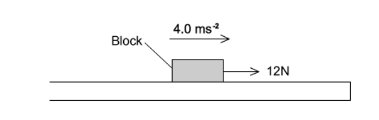
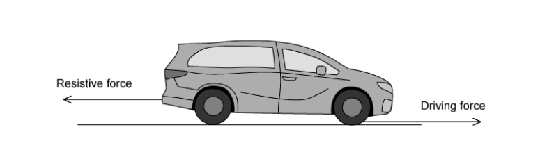
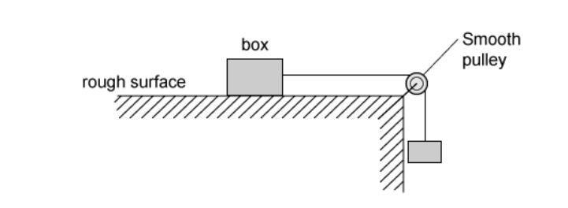
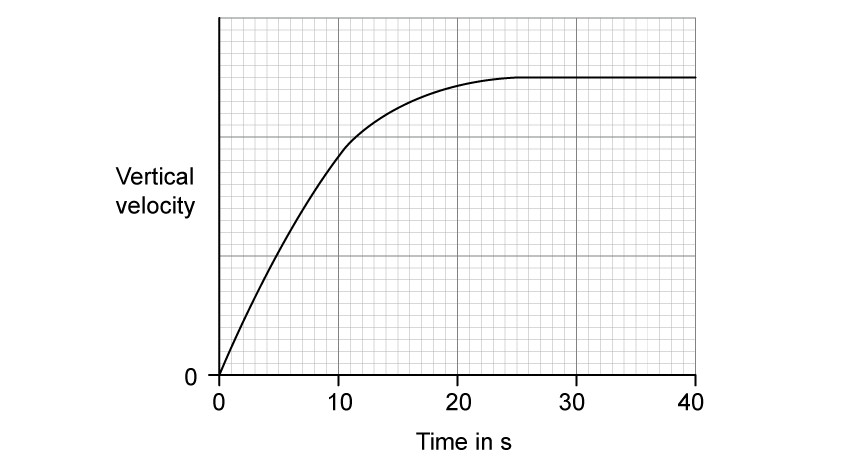
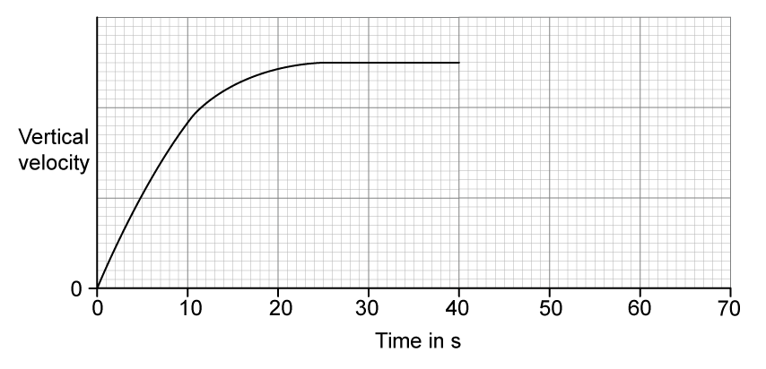
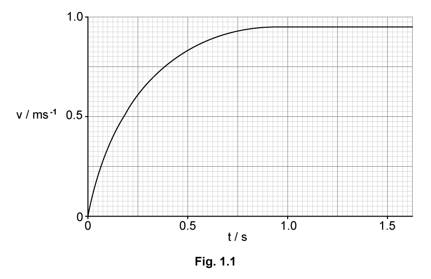

# Exam Questions — Non-Uniform Motion
**3. Dynamics** · Cambridge (CIE) AS physics (9702)
> Source: [https://www.savemyexams.com/as/physics/cie/25/topic-questions/](https://www.savemyexams.com/as/physics/cie/25/topic-questions/) · 22 questions across 2 sets

## Multiple Choice Questions (15 questions)

### Q1 — medium — 1 marks

**Q1** [1 mark]

A boat travels forward in a straight line. The driving force of the boat is less than the water resistance acting on the boat.

Which statement is true?

### Q2 — easy — 1 marks

**Q2** [1 mark]

An object of weight *mg* falls through the air and experiences a drag force *D*.

Which of the following free-body diagrams shows the object when it has reached terminal velocity?

### Q3 — hard — 1 marks

**Q3** [1 mark]

A car of mass $m$* *starts from rest and accelerates uniformly, reaching a velocity of $v$* *over distance $s$. The car experiences a frictional force of $\frac{mg}{2}$.

What is the driving force of the car?

### Q4 — hard — 1 marks

**Q4** [1 mark]

A skydiver falls vertically from a stationary balloon.

She leaves the balloon at time $t=0$. At time $t=T$, she reaches terminal velocity. Beyond the time shown in the graphs, she opens her parachute

Which graph shows the variation with time $t$ of the force $F$ due to air resistance?

### Q5 — hard — 1 marks

**Q5** [1 mark]

The diagram shows two blocks, A and B, that have masses of $3m$ and $2m$ respectively. A force $F$ is applied to Block A, and both blocks accelerate along a horizontal surface. Block B experiences a drag force of $\frac{F}{5}$.

What is the resultant force of Block A on Block B?

### Q6 — easy — 1 marks

**Q6** [1 mark]

A skydiver has a weight of 800 N, and experiences a drag force of 450 N.

What is the magnitude and direction of the resultant force of the skydiver?

|   | **Magnitude / N** | **Direction** |
|---|---|---|
| **A** | 1250 | Downwards |
| **B** | 350 | Upwards |
| **C** | 1250 | Upwards |
| **D** | 350 | Downwards |

### Q7 — medium — 1 marks

**Q7** [1 mark]

A stone of mass *m* is dropped from a tall building. There is significant air resistance. The acceleration of free fall is *g.*

When the stone reaches its terminal velocity, which row is correct?

|   | **Magnitude of the acceleration of the stone** | **Magnitude of the force of gravity on the stone** | **Magnitude of the force of air resistance on the stone** |
|---|---|---|---|
| **A**  **B**  **C**  **D** | zero  *g*  *g*  zero | *mg*  *mg*  zero  zero | *mg*  *mg*  zero  zero |

### Q8 — medium — 1 marks

**Q8** [1 mark]

A block of mass 1.20 kg is on a rough horizontal surface. A force of 12 N is applied to the block and it accelerates at 4.0 m s−2

What is the magnitude of the frictional force acting on the block?

### Q9 — medium — 1 marks

**Q9** [1 mark]

A car has a horizontal driving force of 2.0 kN acting on it and a resistive force a quarter of this size. It has a forward horizontal acceleration of 2.0 m s–2

What is the mass of the car?

### Q10 — easy — 1 marks

**Q10** [1 mark]

A lorry is driving along a horizontal road and experiences a resistive force opposing the forward motion.

Assuming that air resistance is negligible, what is the name of the resistive force?

### Q11 — hard — 1 marks

**Q11** [1 mark]

The three forces acting on a hot air balloon as it moves vertically are its weight, the force due to air resistance and upthrust.

The hot air balloon descends vertically at constant speed. The force of air resistance on the balloon is $F$.

What weight of material must be released from the balloon so that it ascends vertically at the same constant speed?

### Q12 — easy — 1 marks

**Q12** [1 mark]

A box rests on a horizontal, rough surface. A string attached to the box passes over a smooth pulley and supports a mass at its other end.

When the box is released, what forces are acting on it?

### Q13 — hard — 1 marks

**Q13** [1 mark]

Two skydivers, A and B, experience drag forces *D*1 and *D*2 respectively. Skydiver A has mass *m* and reaches terminal velocity *v**1*. Skydiver B has mass 2*m* and reaches terminal velocity *v*2.

Given that $D\proptov^{2}$, what is the value of $\frac{v_{1}}{v_{2}}$?

### Q14 — medium — 1 marks

**Q14** [1 mark]

A wooden block rests on a rough board. The end of the board is then raised until the block slides down the plane of the board at constant velocity *v*

Which row describes the forces acting on the block when sliding with constant velocity?

|   | **Frictional force on block** | **Resultant force on block** |
|---|---|---|
| **A**  **B**  **C**  **D** | down the plane  down the plane  up the plane  up the plane | zero  down the plane  zero  down the plane |

### Q15 — easy — 1 marks

**Q15** [1 mark]

An egg is dropped from the top of a three-storey building. It falls through air until it reaches the ground

What remains constant throughout the fall?

## Structured Questions (7 questions)

### Q1 — easy — 15 marks

**Q1** [4 marks]

A skydiver of mass 75 kg jumps from an aircraft.

(i) State the difference between the mass of a body and its weight.

[2]

(ii) Calculate the weight of the skydiver.

[2]

**Q1** [6 marks]

**Extract:**

A skydiver of mass 75 kg jumps from an aircraft.

The graph in Fig. 1.1 shows the vertical velocity of the skydiver during the first 40 s of the fall before opening his parachute.

**Fig. 1.1**

Explain the shape of the graph

(i) between 0 and 5 s

[2]

(ii) between 5 and 25 s

[2]

(iii) between 25 and 40 s

[2]

**Q1** [3 marks]

**Extract:**

A skydiver of mass 75 kg jumps from an aircraft.

(ii) Calculate the weight of the skydiver: W = m g = 75 × 9.81 = 735.75 = 740 N

Fig. 1.2 shows the skydiver falling at a constant velocity.

Add labelled arrows to Fig. 1.2 to show the forces acting on the skydiver.

**Fig. 1.2**

**Q1** [2 marks]

**Extract:**

A skydiver of mass 75 kg jumps from an aircraft.

The graph in Fig. 1.1 shows the vertical velocity of the skydiver during the first 40 s of the fall before opening his parachute. Between 25 and 40 s the forces of drag and weight are equal/balanced and the skydiver reaches terminal velocity.

The skydiver opens his parachute after 40 s.

On Fig. 1.3 below, complete the graph to show how the skydiver’s vertical velocity changes after 40 s.

**Fig. 1.3**

### Q2 — medium — 18 marks

**Q2** [9 marks]

On an alien planet similar to Earth, a parachutist jumps out of an aircraft.

The graph in Fig. 1.1 shows how the vertical speed of the parachutist changes with time during the first 20 s of his jump. To avoid air turbulence caused by the aircraft, he waits a short time after jumping before pulling the cord to release his parachute.

**Fig. 1.1**

The parachute opens after 12 s.

With reference to the forces acting on the parachutist, explain the shape of:

(i) Region **A**

[3]

(ii) Region **B**

[3]

(iii) Region **C**

[3]

**Q2** [1 mark]

**Extract:**

On an alien planet similar to Earth, a parachutist jumps out of an aircraft. The graph in Fig. 1.1 shows how the vertical speed of the parachutist changes with time during the first 20 s of his jump. To avoid air turbulence caused by the aircraft, he waits a short time after jumping before pulling the cord to release his parachute. Graph showing vertical speed vs time. A to B: Speed increases from 0 to 45 metres per second between 0 and 7 seconds. B to C: Speed increases at a slower rate until the graph plateaus at 50 metres per second. C to D: Speed decreases to 0 m/s between 12 and 16 seconds. After 16 seconds, the graph plateaus at around 6 metres per second. Fig. 1.1. The parachute opens after 12 s.

Determine the acceleration of free fall on this planet.

**Q2** [4 marks]

**Extract:**

On an alien planet similar to Earth, a parachutist jumps out of an aircraft. The graph in Fig. 1.1 shows how the vertical speed of the parachutist changes with time during the first 20 s of his jump. To avoid air turbulence caused by the aircraft, he waits a short time after jumping before pulling the cord to release his parachute. The parachute opens after 12 s. Fig 1.1: A to B: Speed increases from 0 to 45 metres per second between 0 and 7 seconds. B to C: Speed increases at a slower rate until the graph plateaus at 50 metres per second. C to D: Speed decreases to 0 m/s between 12 and 16 seconds. After 16 seconds, the graph plateaus at around 6 metres per second.

On Fig 1.1, draw graph lines for the following scenarios:

(i) Scenario 1: air resistance is zero.

[2]

(ii) Scenario 2: the parachute deployed is half the size of the original scenario. You may assume that air resistance is directly proportional to the surface area of the parachute.

[2]

**Q2** [4 marks]

**Extract:**

On an alien planet similar to Earth, a parachutist jumps out of an aircraft. The graph in Fig. 1.1 shows how the vertical speed of the parachutist changes with time during the first 20 s of his jump. To avoid air turbulence caused by the aircraft, he waits a short time after jumping before pulling the cord to release his parachute. A to B: Speed increases from 0 to 45 metres per second between 0 and 7 seconds. B to C: Speed increases at a slower rate until the graph plateaus at 50 metres per second. C to D: Speed decreases to 0 m/s between 12 and 16 seconds. After 16 seconds, the graph plateaus at around 6 metres per second. The parachute opens after 12 s.

A light breeze exerts a constant horizontal force on the parachutist. He eventually reaches a constant horizontal speed.

Explain why this horizontal terminal speed he reaches is much lower than the vertical terminal speed, before the parachute is opened.

### Q3 — medium — 13 marks

**Q3** [4 marks]

Fig. 1.1 shows a stone block being pulled up a slope at a constant speed by a cable attached to an electric motor.

**Fig. 1.1**

The slope is inclined at an angle of 17° with the horizontal. The mass of the block is 250 kg, and the tension *T* in the cable is 1.2 kN.

On Fig. 1.1, draw and label the forces acting on the block.

**Q3** [2 marks]

**Extract:**

Fig. 1.1 shows a stone block being pulled up a slope at a constant speed by a cable attached to an electric motor. The slope is inclined at an angle of 17° with the horizontal. The mass of the block is 250 kg, and the tension T in the cable is 1.2 kN.

With reference to the motion of the block, discuss whether the block is in equilibrium.

**Q3** [4 marks]

**Extract:**

Fig. 1.1 shows a stone block being pulled up a slope at a constant speed by a cable attached to an electric motor. The slope is inclined at an angle of 17° with the horizontal. The mass of the block is 250 kg, and the tension T in the cable is 1.2 kN.

The total resistive force *R* acting on the box is constant throughout its motion on the slope.

Calculate the magnitude of the resistive force *R*.

**Q3** [3 marks]

**Extract:**

Fig. 1.1 shows a stone block being pulled up a slope at a constant speed by a cable attached to an electric motor. The slope is inclined at an angle of 17° with the horizontal. The mass of the block is 250 kg, and the tension T in the cable is 1.2 kN.

The total resistive force R acting on the box is constant throughout its motion on the slope. R = 483 = 480 N (2 s.f.)

The cable connecting the block to the electric motor abruptly breaks.

Calculate the acceleration of the block as it moves down the slope.

### Q4 — medium — 16 marks

**Q4** [3 marks]

A student uses a motion sensor connected to a laptop to investigate the motion of a hollow ball of mass 1.5 × 10–2 kg falling through the air.

The ball is dropped from rest. It reaches terminal velocity before it reaches the ground.

The upthrust on the ball is negligible.

Explain briefly why the acceleration of the ball

(i) decreases with time

[2]

(ii) is 9.8 m s–2 initially.

[1]

**Q4** [5 marks]

**Extract:**

A student uses a motion sensor connected to a laptop to investigate the motion of a hollow ball of mass 1.5 × 10^–2^ kg falling through the air. The ball is dropped from rest. It reaches terminal velocity before it reaches the ground. The upthrust on the ball is negligible.

The variation with time *t* of the velocity *v* of the ball as it falls towards the ground is shown in Fig. 1.1.

(i) Use Fig. 1.1 to determine the magnitude of the acceleration of the ball at time *t* = 0.25 s.

[3]

(ii) Calculate the resultant force acting on the ball at time *t* = 0.25 s.

[2]

**Q4** [3 marks]

**Extract:**

A student uses a motion sensor connected to a laptop to investigate the motion of a hollow ball of mass 1.5 × 10^–2^ kg falling through the air. The ball is dropped from rest. It reaches terminal velocity before it reaches the ground. The upthrust on the ball is negligible.

(i) Use Fig. 1.1 to determine the magnitude of the acceleration of the ball at time t = 0.25 s. [Acceleration ≈ 1.15 m s^–2^]
(ii) Calculate the resultant force acting on the ball at time t = 0.25 s. [F = ma = 0.015 × 1.15 = 0.017 N]

Use your answers in **(b)** to determine the drag on the ball at time *t* = 0.25 s.

**Q4** [5 marks]

**Extract:**

A student uses a motion sensor connected to a laptop to investigate the motion of a hollow ball of mass 1.5 × 10^–2^ kg falling through the air. The ball is dropped from rest. It reaches terminal velocity before it reaches the ground. The upthrust on the ball is negligible.

The student adds a small amount of sand inside the hollow ball and repeats the experiment. The ball is dropped from rest and reaches terminal velocity before it reaches the ground.

(i) Describe how the forces acting on the ball filled with sand at *v* = 0.50 m s–1 compare with the forces acting on the hollow ball at this speed.

[2]

(ii) State and explain how the terminal velocity of the ball filled with sand will differ from the terminal velocity of the hollow ball.

[3]

### Q5 — hard — 12 marks

**Q5** [3 marks]

Air resistance can be modelled using the following equation:

$F_{v}=kAv^{2}$

where *F**v*  is the force due to air resistance at a given velocity *v *, *A* is the surface area of the object experiencing the air resistance and *k* is a constant.

Two balls are released from a high bridge. Ball A has a volume 27 times larger than ball B.

Compare the forces of air resistance on each ball when they reach a speed of 20 m s−1.

**Q5** [4 marks]

**Extract:**

Air resistance can be modelled using the following equation: \$\$F_{v} = k A v^{2}\$\$ where *F*~*v*~ is the force due to air resistance at a given velocity *v*, *A* is the surface area of the object experiencing the air resistance and *k* is a constant.

The experiment is repeated, but this time with two balls of identical size. One, however, has a greater mass.

A passer-by claims that the mass difference will not affect the balls landing at the same time.

(i) Using Newton's second law and the equation from part (a), explain the relationship between acceleration and mass when air resistance is not ignored.

[3]

(ii) Explain why the passer-by is wrong.

[1]

**Q5** [3 marks]

**Extract:**

Air resistance can be modelled using the following equation: F_v = k A v^2 where F_v is the force due to air resistance at a given velocity v, A is the surface area of the object experiencing the air resistance and k is a constant.

Determine the units of the constant *k* , in terms of SI units.

**Q5** [2 marks]

**Extract:**

Air resistance can be modelled using the following equation: \$\$F_{v} = k A v^{2}\$\$ where F_v is the force due to air resistance at a given velocity v, A is the surface area of the object experiencing the air resistance and k is a constant.

(from part b) Determine the resultant force for the falling ball: \$\$m g - F_{v} = m a\$\$ where m is the ball's mass, g is acceleration of free fall, a is the acceleration of the ball. Write an expression for acceleration at a speed v: \$\$a = \frac{m g - F_{v}}{m} = g - \frac{F_{v}}{m}\$\$

Write an expression for terminal velocity, in terms of area *A* , mass *m* , acceleration of free fall *g* and the constant *k*.

### Q6 — hard — 9 marks

**Q6** [4 marks]

Strongman competitions involve competitors performing various challenges where they have to produce very high forces.

In one particular event, a competitor must drag a cement block across a rough floor, using a rope.

When an object is moving, the frictional force is proportional to the normal reaction force of the object.

In the first round of the competition, the competitor must drag a 200 kg block across the rough surface. In the second round, they must drag a new 280 kg block across the same surface. The force exerted by the competitor in round 2 is 1650 N.

Calculate the difference in the frictional forces between the first and second rounds, when the blocks are in motion.

You may assume the block moves with constant speed and air resistance can be ignored.

**Q6** [3 marks]

**Extract:**

Strongman competitions involve competitors performing various challenges where they have to produce very high forces. In one particular event, a competitor must drag a cement block across a rough floor, using a rope. When an object is moving, the frictional force is proportional to the normal reaction force of the object. In the first round of the competition, the competitor must drag a 200 kg block across the rough surface. In the second round, they must drag a new 280 kg block across the same surface. The force exerted by the competitor in round 2 is 1650 N. You may assume the block moves with constant speed and air resistance can be ignored.

Justify the decision to ignore air resistance in part (a).

**Q6** [2 marks]

Recall from part (a) that the competitor exerts a horizontal force of 1650 N on the 280 kg block.

They pull the rope, however, at a 15° angle to the horizontal plane, as shown in Fig. 1.1.

**Fig. 1.1**

Calculate the vertical force the competitor exerts on the block.

### Q7 — easy — 8 marks

**Q7** [2 marks]

In physics, the motion of an object falling through the atmosphere is often studied. Fig. 1.1 shows a diagram of this motion.

**Fig. 1.1**

The object shown moves vertically downwards through the atmosphere.

Identify the two forces acting on the object and label them on the diagram.

**Q7** [1 mark]

**Extract:**

In physics, the motion of an object falling through the atmosphere is often studied. The object shown moves vertically downwards through the atmosphere. Identify the two forces acting on the object... The two forces are drag OR air resistance, and weight.

Often, a simplifying condition is assumed so that, in these cases, only a single force acts on objects as they move through the atmosphere.

State the simplifying condition that is normally assumed.

**Q7** [2 marks]

**Extract:**

In physics, the motion of an object falling through the atmosphere is often studied. The object shown moves vertically downwards through the atmosphere. The two forces acting on the object are Drag (air resistance) and Weight.

Terminal velocity is only attained if both forces act on the object.

State and explain the magnitude of the resultant force on the object if it moves at its terminal velocity.

**Q7** [3 marks]

Sketch a graph on the axes in Fig. 1.2 to show an object that is released from rest at *t* = 0 s and falls vertically through the atmosphere, attaining terminal velocity, *v*terminal after *t* = 4 s.

**Fig. 1.2**

The line corresponding to *v*terminal is included as guidance.
