# Exam Questions — Linear Momentum & its Conservation
**3. Dynamics** · Cambridge (CIE) AS physics (9702)
> Source: [https://www.savemyexams.com/as/physics/cie/25/topic-questions/](https://www.savemyexams.com/as/physics/cie/25/topic-questions/) · 46 questions across 2 sets

## Multiple Choice Questions (34 questions)

### Q1 — hard — 1 marks

**Q1** [1 mark]

Two trolleys, X and Y, are connected by an elastic cord, of negligible mass, as shown below. Trolley X is twice the mass of trolley Y.

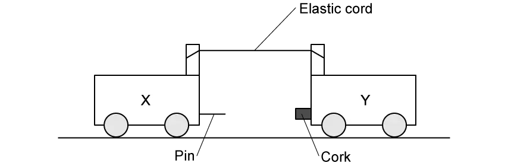

The two trolleys are pulled apart so that the elastic cord is stretched. The trolleys are then released at the same time and move towards each other.  The trolleys stick together on impact.

Just before the trolleys collide, the speed of trolley X is 20 cm s–1.

What is the speed of the trolleys after they collide?

### Q2 — hard — 1 marks

**Q2** [1 mark]

The diagram shows two spherical masses approaching each other head-on at an equal speed *u*. One is of mass *m* and the other of mass 2 *m*.

Which diagram, showing the situation after the collision, is not consistent with the principle of conservation of momentum?

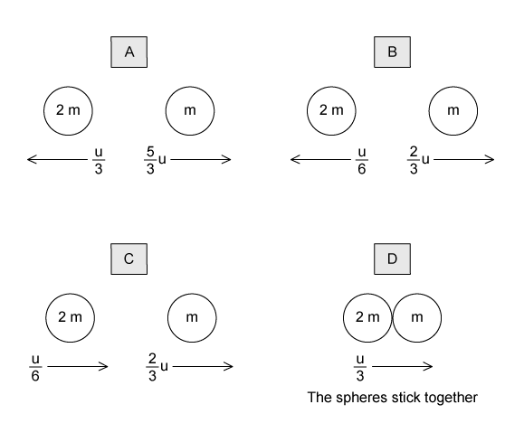

### Q3 — hard — 1 marks

**Q3** [1 mark]

Sand falls vertically on a conveyor belt at a rate of *m* kg s–1

In order to keep the belt moving at constant speed *v*, the horizontal force that must be exerted is equal to

### Q4 — medium — 1 marks

**Q4** [1 mark]

The diagram shows a cannon ball fired from a cannon

The mass of the cannon is 1600 kg and the mass of the cannon ball is 20 kg

The recoil velocity of the cannon is 5 $ms^{-1}$horizontally

What is the horizontal velocity of the cannon ball?

### Q5 — medium — 1 marks

**Q5** [1 mark]

The diagram shows the masses and velocities of two trolleys about to collide

After the impact they move off together

What is the total kinetic energy of the trolleys after the collision?

### Q6 — hard — 1 marks

**Q6** [1 mark]

A stationary nucleus has nucleon number *A*.

The nucleus decays by emitting a proton with speed *v* to form a new nucleus with speed *u*. The new nucleus and the proton move away from one another in opposite directions.

Which equation gives  in terms of *A* and *u*?

### Q7 — medium — 1 marks

**Q7** [1 mark]

A resultant force of 5 N acts on a body for a time of 4.0 s

Which graph could show the variation with time *t* of the momentum *p* of the body?

### Q8 — easy — 1 marks

**Q8** [1 mark]

A car accelerates from rest. The graph shows the momentum of the car plotted against time.

What is the meaning of the gradient of the graph at a particular time?

### Q9 — hard — 1 marks

**Q9** [1 mark]

A stationary body explodes into two components of masses *m* and 3 *m*.

The components gain kinetic energies X and Y respectively.

What is the value of the ratio $\frac{x}{y}$ ?

### Q10 — easy — 1 marks

**Q10** [1 mark]

What is the principle of conservation of momentum?

### Q11 — medium — 1 marks

**Q11** [1 mark]

A tennis ball of mass 60 g is struck by a tennis racket. The velocity of the ball changes as shown

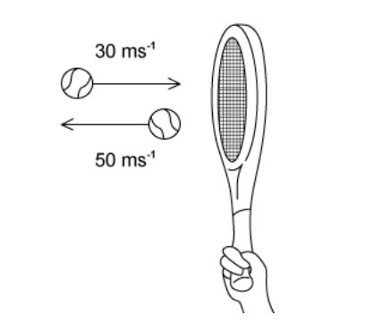

What is the magnitude of the change in momentum of the ball?

### Q12 — easy — 1 marks

**Q12** [1 mark]

Two similar spheres, each of mass *m* and travelling with speed *v*, are moving towards each other

The spheres have a head-on elastic collision

Which statement is correct?

### Q13 — medium — 1 marks

**Q13** [1 mark]

A ball of mass 2 kg travelling at ½ $ms^{-1}$  strikes a ball of mass 3 kg travelling at ⅓ $ms^{-1}$.  Both balls are moving along the same straight line as shown

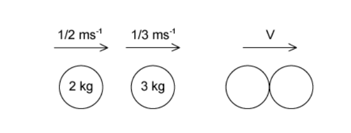

After collision, both balls move at the same velocity *v*

What is the magnitude of the velocity *v*?

### Q14 — easy — 1 marks

**Q14** [1 mark]

The graph shows how the momentum of a motorcycle changes with time.

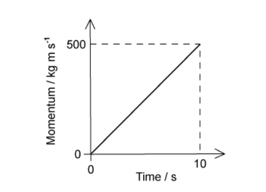

What is the resultant force on the motorcycle?

### Q15 — medium — 1 marks

**Q15** [1 mark]

Two spheres approach each other along the same straight line. Their speeds are $u_{1}$ and $u_{2}$before collision, and $v_{1}$and $v_{2}$ after collision, in the directions shown below

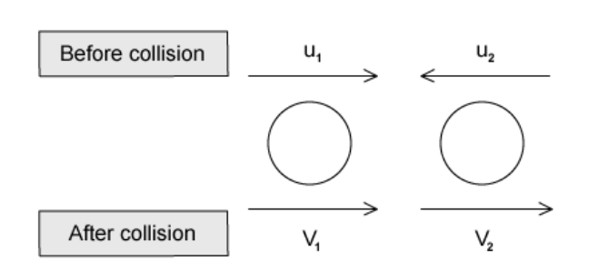

Which equation is correct if the collision is perfectly elastic?

### Q16 — medium — 1 marks

**Q16** [1 mark]

A spacecraft of mass 1000 kg and a fuel module of mass $m$ are initially travelling together at 13 m s-1 in a straight line.

The fuel module separates from the rocket and continues to travel along the same line at 5 m s-1 while the spacecraft continues to travel along the same line at 17 m s-1.

What is the mass $m$ of the fuel module?

### Q17 — easy — 1 marks

**Q17** [1 mark]

Which of the following is a statement of the principle of conservation of momentum?

### Q18 — easy — 1 marks

**Q18** [1 mark]

Two bodies travelling in a straight line collide in a perfectly elastic collision. Which of the following statements must be correct?

### Q19 — easy — 1 marks

**Q19** [1 mark]

Which row correctly states whether momentum and kinetic energy are conserved in an inelastic collision in which there are no external forces?

|   | **Momentum** | **Kinetic energy** |
|---|---|---|
| **A**  **B**  **C**  **D** | conserved  not conserved  conserved  not conserved | conserved  conserved  not conserved  not conserved |

### Q20 — medium — 1 marks

**Q20** [1 mark]

A lorry of mass 18 tones is travelling at 25.0 $ms^{-1}$

A car of mass 800 kg is travelling at 40.0 $ms^{-1}$ towards the lorry.

What is the magnitude of the total momentum?

### Q21 — hard — 1 marks

**Q21** [1 mark]

A wooden block is freely supported on brackets at a height of 4.0 m above the ground, as shown

A bullet of mass 10.0 g is shot vertically upwards into the wooden block of mass 150 g. It embeds itself in the block. The impact causes the block to rise above its supporting brackets.

The bullet hits the block with a velocity of 200 m s–1. How far above the ground will the block be at the maximum height of its path?

### Q22 — medium — 1 marks

**Q22** [1 mark]

A moving object strikes a stationary object. The collision is inelastic. The objects move off together.

Which row shows the possible values of total momentum and total kinetic energy for the system before and after the collision?

|   | **Total momentum before collision / kg m s****–1** | **Total momentum after collision / kg m s****–1** | **Total kinetic energy before collision / J** | **Total kinetic energy after collision / J** |
|---|---|---|---|---|
| **A**  **B**  **C**  **D** | 6  6  6  6 | 6  6  2  6 | 90  30  90  90 | 30  90  30  90 |

### Q23 — hard — 1 marks

**Q23** [1 mark]

A body, initially at rest, explodes into two masses *M**1* and *M**2* that move apart with speeds *v**1* and *v**2* respectively.

What is the ratio  $\frac{v_{1}}{v_{2}}$ ?

### Q24 — easy — 1 marks

**Q24** [1 mark]

Trolley X, moving along a horizontal frictionless track, collides with a stationary trolley Y. The two trolleys become attached and move off together.

Which statement about this interaction is correct?

### Q25 — medium — 1 marks

**Q25** [1 mark]

Two trolleys, A and B, each have a mass of 5000 kg. Trolley A travels at speed $v$ towards trolley B. Trolley B travels at 2.0 m s−1 in the opposite direction, as shown.

The trolleys collide and join together with a combined kinetic energy of 1250 J.

What is the velocity of trolley A before the collision?

### Q26 — medium — 1 marks

**Q26** [1 mark]

A molecule of mass *m* travelling at speed *v* hits a wall in a direction perpendicular to the wall. The collision is elastic.

What are the changes in the momentum and in the kinetic energy of the molecule caused by the collision?

|   | **Change in momentum** | **Change in kinetic energy** |
|---|---|---|
| **A**  **B**  **C**  **D** | 0  *mv*  *mv**2*  *2mv* | 0  *mv**2*  0  0 |

### Q27 — hard — 1 marks

**Q27** [1 mark]

An ice-hockey puck slides along a horizontal, frictionless ice-rink surface. It collides inelastically with a wall at right angles to its path, and then rebounds along its original path.

Which graph shows the variation with time *t* of the momentum *p* of the puck?

### Q28 — easy — 1 marks

**Q28** [1 mark]

Which statement about a ball that strikes a tennis racket and rebounds is **always** correct?

### Q29 — hard — 1 marks

**Q29** [1 mark]

A lead pellet of mass 20.0 g is shot horizontally into a stationary wooden block of mass 80.0 g. The pellet hits the block with an impact velocity of 250 m s–1. It embeds itself in the block and it does not emerge.

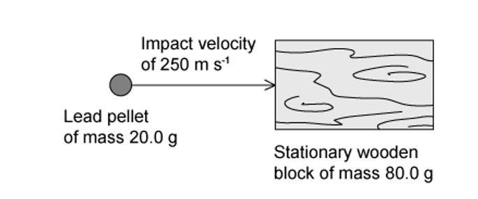

After the impact, the block and the pellet slide along a rough horizontal surface and come to rest in 8.4 s.

How far do the block and the pellet travel before coming to rest?

### Q30 — easy — 1 marks

**Q30** [1 mark]

Which quantity has the same base units as momentum?

### Q31 — hard — 1 marks

**Q31** [1 mark]

A particle X has speed *v* and collides with a stationary identical particle Y. The collision is perfectly elastic.

What are the speed and direction of motion of each of the two particles after the collision?

|   | **X** | **Y** |
|---|---|---|
| **A** | stationary | v to the right |
| **B** | $\frac{v}{2}$  to the right | $\frac{v}{2}$ to the right |
| **C** | $\frac{v}{2}$  to the left | $\frac{v}{2}$  to the right |
| **D** | *v* to the left | stationary |

### Q32 — medium — 1 marks

**Q32** [1 mark]

Two identical billiard balls of mass $m$ are placed on a smooth horizontal surface.

Ball Y is initially at rest. Ball X approaches ball Y with a speed of 30 m s−1 at an angle of 45° to the direction shown.

The balls collide perfectly elastically. After the collision, ball Y moves with speed $v$, and ball X moves at right angles to the direction of motion of ball Y.

What is the speed $v$ of ball Y after the collision?

### Q33 — medium — 1 marks

**Q33** [1 mark]

Two train carriages each of mass 7500 kg roll toward one another on a level track. One is travelling at 3.00 m s−1 and the other at 1.50 m s−1 as shown.

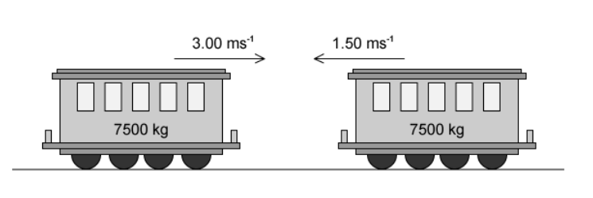

They collide and join together.

What is the kinetic energy lost during the collision?

### Q34 — hard — 1 marks

**Q34** [1 mark]

Two railway trucks of masses *m* and 5 *m* move towards each other in opposite directions with speeds 3 *u* and *u* respectively. These trucks collide and stick together.

What is the speed of the trucks after the collision?

## Structured Questions (12 questions)

### Q1 — medium — 6 marks

**Q1** [2 marks]

State the principle of conservation of momentum.

**Q1** [4 marks]

Two spheres, A and B, are moving in a straight line on a smooth horizontal surface. Sphere A has a mass of 0.20 kg and a velocity of 5.0 m s−1. Sphere B has a mass of 0.30 kg and a velocity of 2.0 m s−1. Both spheres move in the same direction, as shown in Fig. 3.1.

**Fig. 3.1**

Sphere A collides with sphere B. After the collision, sphere A continues to move in the same direction with a velocity of 2.6 m s−1.

(i) Calculate the velocity $v$ of sphere B after the collision.

[2]

(ii) By calculation of kinetic energies, state and explain whether the collision of the spheres is inelastic or perfectly elastic.

[2]

### Q2 — medium — 13 marks

**Q2** [3 marks]

Two identical blocks A and B each of mass 400 g are travelling towards each other along a straight line through their centre, as shown in Fig. 1.1.

Both blocks are moving at a speed of 0.36 m s–1 relative to the surface.

As a result of the collision, the blocks reverse their direction of motion and travel at the same speed as each other. During the collision, 33% of the kinetic energy of the blocks is transferred to the surroundings as thermal energy.

(i) State the total momentum of the blocks before the collision.

[1]

(ii) State and explain whether the collision is elastic or inelastic.

[2]

**Q2** [3 marks]

**Extract:**

Two identical blocks A and B each of mass 400 g are travelling towards each other along a straight line through their centre. Both blocks are moving at a speed of 0.36 m s^–1^ relative to the surface. As a result of the collision, the blocks reverse their direction of motion and travel at the same speed as each other. During the collision, 33% of the kinetic energy of the blocks is transferred to the surroundings as thermal energy.

Calculate the final speed of the blocks.

**Q2** [3 marks]

**Extract:**

Two identical blocks A and B each of mass 400 g are travelling towards each other along a straight line through their centre. Both blocks are moving at a speed of 0.36 m s^–1^ relative to the surface. As a result of the collision, the blocks reverse their direction of motion and travel at the same speed as each other. During the collision, 33% of the kinetic energy of the blocks is transferred to the surroundings as thermal energy.
Calculate the final speed of the blocks: v = 0.29 m s^–1^

The duration of the collision between the blocks is 750 ms.

Determine the average force exerted by one block on the other.

**Q2** [4 marks]

**Extract:**

Two identical blocks A and B each of mass 400 g are travelling towards each other along a straight line through their centre, as shown in Fig. 1.1.

The same blocks are investigated with different initial speeds. Block A is launched towards B at a speed of 0.6 m s−1 and B is launched towards A at a speed of 0.4 m s−1.

Once the blocks collide, they stick together and move as one after the collision.

Determine the speed of the combined blocks after the collision and state the direction.

### Q3 — medium — 10 marks

**Q3** [2 marks]

Ball X has a mass of 50 g and is supported by a long string, as shown in Fig. 1.1.

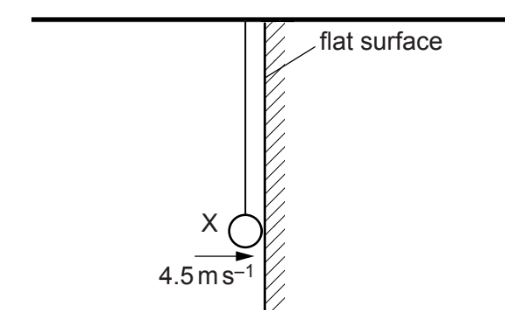

**Fig. 1.1**

The ball is pulled back and released. The ball collides normally with a flat surface at a velocity of 4.5 m s−1 and rebounds elastically.

The positive direction is horizontal and to the right.

Determine the total change in momentum of ball X.

**Q3** [3 marks]

**Extract:**

Ball X has a mass of 50 g and is supported by a long string, as shown in Fig. 1.1. The ball is pulled back and released. The ball collides normally with a flat surface at a velocity of 4.5 m s^−1^ and rebounds elastically. The positive direction is horizontal and to the right.

Ball X is hung next to ball Y which is supported by a string of the same length, as shown in Fig. 1.2.

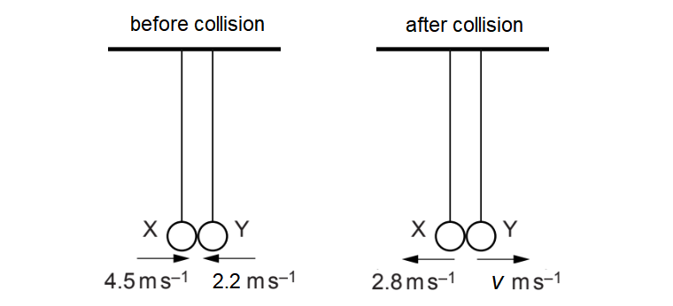

**Fig. 1.2**

Ball Y has a mass of 125 g.

The balls are each pulled back and pushed towards each other. When the balls collide, the strings are vertical. The balls rebound in opposite directions.

The velocities of X and Y just before and just after the collision are shown in Fig. 1.2.

Use the conservation of linear momentum to determine the rebound velocity $v$ of Y.

**Q3** [2 marks]

**Extract:**

Ball X is hung next to ball Y which is supported by a string of the same length. Ball X has a mass of 50 g. Ball Y has a mass of 125 g. The balls are each pulled back and pushed towards each other. When the balls collide, the strings are vertical. The balls rebound in opposite directions.

Known quantities:
- Mass of X = 50 g
- Mass of Y = 125 g
- Initial velocity of X, u_X = 4.5 m s^−1
- Final velocity of X, v_X = −2.8 m s^−1
- Initial velocity of Y, u_Y = −2.2 m s^−1
- Final velocity of Y (rebound velocity v of Y) = 0.7 m s^−1

Deduce whether the collision in **(b)** is elastic or inelastic.

**Q3** [3 marks]

**Extract:**

Ball X is hung next to ball Y which is supported by a string of the same length, as shown in Fig. 1.2. Ball Y has a mass of 125 g. The balls are each pulled back and pushed towards each other. When the balls collide, the strings are vertical. The balls rebound in opposite directions. Ball X has a mass of 50 g.

Use Newton’s laws to explain why the magnitude of the change in momentum of each ball is the same.

### Q4 — hard — 13 marks

**Q4** [2 marks]

A body of mass $M$ and moving with velocity $V$ explodes into three equal fragments each of mass $\frac{M}{3}$, as shown in Fig. 1.1.

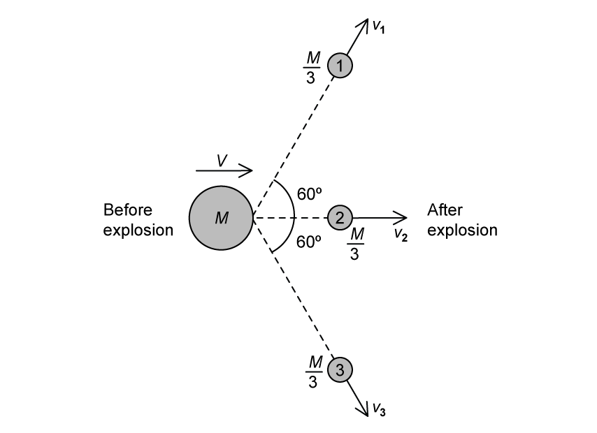

**Fig. 1.1**

Fragment 2 continues to move along the horizontal plane with velocity $v_{2}$, while fragments 1 and 3 move off at an angle of 60° to the horizontal with velocities $v_{1}$ and $v_{3}$ respectively, as shown.

By applying the principle of conservation of momentum in the vertical plane, show that  $v_{1}=v_{3}$

**Q4** [3 marks]

**Extract:**

A body of mass \$\$M\$\$ and moving with velocity \$\$V\$\$ explodes into three equal fragments each of mass \$\$\frac{M}{3}\$\$, as shown in Fig. 1.1. Fragment 2 continues to move along the horizontal plane with velocity \$\$v_{2}\$\$, while fragments 1 and 3 move off at an angle of 60° to the horizontal with velocities \$\$v_{1}\$\$ and \$\$v_{3}\$\$ respectively, as shown.

By applying conservation of momentum in the horizontal plane, show that  $3 V = ( v_{1} + v_{2} )$

**Q4** [4 marks]

**Extract:**

A body of mass \$\$M\$\$ and moving with velocity \$\$V\$\$ explodes into three equal fragments each of mass \$\$\frac{M}{3}\$\$, as shown in Fig. 1.1. Fragment 2 continues to move along the horizontal plane with velocity \$\$v_{2}\$\$, while fragments 1 and 3 move off at an angle of 60° to the horizontal with velocities \$\$v_{1}\$\$ and \$\$v_{3}\$\$ respectively.
By applying conservation of momentum in the horizontal plane, show that \$\$3 V = \left(v_{1} + v_{2}\right)\$\$

The ratio of the kinetic energy of fragment 1 to mass *M* is

$\frac{kineticenergyoffragment1}{kineticenergyofmassM}=\frac{4}{3}$

Express velocities $v_{1}$ and $v_{2}$ in terms of the velocity $V$ of mass $M$.

**Q4** [4 marks]

**Extract:**

A body of mass M and moving with velocity V explodes into three equal fragments each of mass M/3. Fragment 2 continues to move along the horizontal plane with velocity v_2, while fragments 1 and 3 move off at an angle of 60° to the horizontal with velocities v_1 and v_3 respectively.

The ratio of the kinetic energy of fragment 1 to mass M is (kinetic energy of fragment 1)/(kinetic energy of mass M) = 4/3. Express velocities v_1 and v_2 in terms of the velocity V of mass M. Results: Kinetic energy of mass M: KE_i = (1/2)MV^2; v_1 = 2V; v_2 = V; and v_1 = v_3.

(i) Determine the total kinetic energy transferred to the fragments.

[3]

(ii) Suggest why the total kinetic energy of the fragments is greater than the initial kinetic energy of the original mass.

[1]

### Q5 — hard — 22 marks

**Q5** [3 marks]

A stationary firework explodes into three different fragments that move in a horizontal plane. Fig. 1.1. shows the masses and velocities of the fragments A, B and C in terms of *M* and *v*.

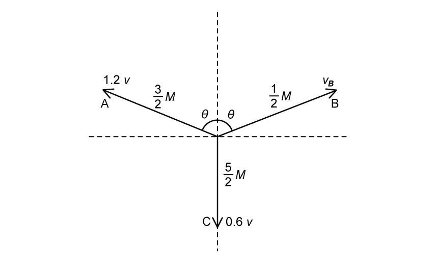

**Fig. 1.1**

Use the principle of conservation of momentum to determine the speed $v_{B}$ of fragment B in terms of *v*.

**Q5** [3 marks]

**Extract:**

A stationary firework explodes into three different fragments that move in a horizontal plane. Fig. 1.1. shows the masses and velocities of the fragments A, B and C in terms of *M* and *v*. Fig. 1.1

Use the principle of conservation of momentum to determine the speed v_B of fragment B in terms of v. (Answer: v_B = 3.6v)

Use the principle of conservation of momentum to determine the angle *θ*.

**Q5** [4 marks]

Another stationary firework explodes into four fragments which travel in different directions in a horizontal plane.

Fig. 1.2 shows the velocity and mass of each fragment.

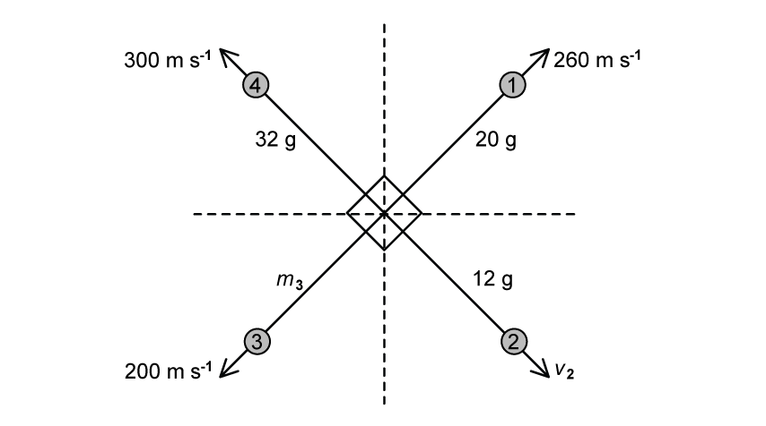

**Fig. 1.2**

Apply the principle of conservation of momentum to determine

(i) the velocity $v_{2}$

[2]

(ii) the mass $m_{3}$

[2]

**Q5** [4 marks]

**Extract:**

A stationary firework explodes into three different fragments that move in a horizontal plane. Fig. 1.1 shows the masses and velocities of the fragments A, B and C in terms of M and v. Fragment A: mass = 3/2 M, velocity = 1.2v. Fragment B: velocity = 3.6v. Fragment C: mass = 5/2 M, velocity = 0.6v.

Another stationary firework explodes into four fragments which travel in different directions in a horizontal plane. Fig. 1.2 shows the velocity and mass of each fragment. Fragment (1): mass = 20 g, velocity = 260 m s^−1. Fragment (2): mass = 12 g, velocity = 800 m s^−1. Fragment (3): mass = 26 g, velocity = 200 m s^−1. Fragment (4): mass = 32 g, velocity = 300 m s^−1.

Both fireworks have the same initial mass and release the same amount of kinetic energy.

Calculate

(i) the value of *M*

[1]

(ii) the magnitude of *v*.

[3]

**Q5** [8 marks]

A firework similar to the one in **(c)** explodes into four fragments.

Fig. 1.3 shows the velocity and mass of each fragment.

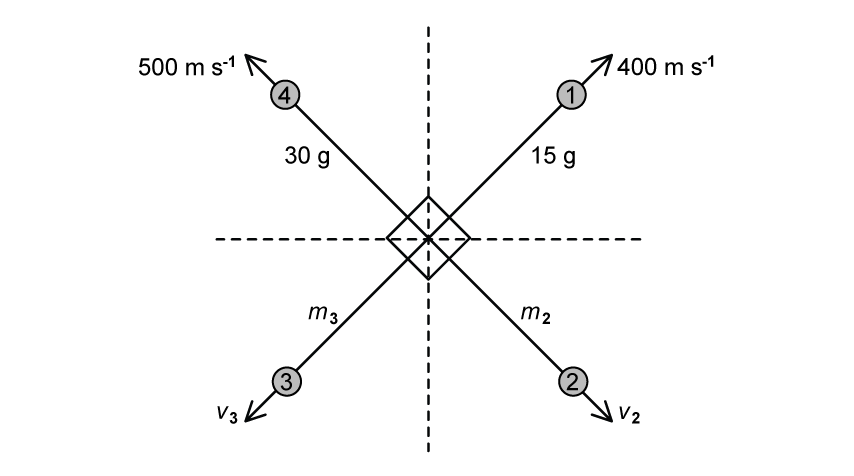

**Fig. 1.3**

(i) By applying the principle of conservation of momentum, show that

$\frac{m_{1}}{m_{2}}=\frac{v_{3}}{v_{4}}=\frac{3}{5}$

$\frac{m_{3}}{m_{4}}=\frac{v_{1}}{v_{2}}=\frac{2}{3}$

[6]

(ii) Hence, determine the values of $m_{2}$, $v_{2}$, $m_{3}$ and $v_{3}$.

[2]

### Q6 — hard — 18 marks

**Q6** [4 marks]

A pellet of mass 2.7 g is fired into a stationary block of mass 540 g suspended from a rigid support as shown in Fig. 1.1.

The pellet becomes completely embedded in the block. The block can swing freely at the end of a light inextensible string of length 1.5 m measured from the pivot to the centre of the block.

**Fig. 1.1**

The centre of mass of the block rises by a height *h* at an angle of 35° to the vertical.

Determine the velocity of the pellet and the block immediately after the pellet is embedded.

**Q6** [3 marks]

**Extract:**

A pellet of mass 2.7 g is fired into a stationary block of mass 540 g suspended from a rigid support as shown in Fig. 1.1. The pellet becomes completely embedded in the block. The block can swing freely at the end of a light inextensible string of length 1.5 m measured from the pivot to the centre of the block. The centre of mass of the block rises by a height h at an angle of 35° to the vertical. Determine the velocity of the pellet and the block immediately after the pellet is embedded. Initial speed of pellet and block: u = 2.306 = 2.3 m s^−1

Calculate the velocity of the pellet just before it strikes the block.

**Q6** [6 marks]

**Extract:**

A pellet of mass 2.7 g is fired into a stationary block of mass 540 g suspended from a rigid support as shown in Fig. 1.1. The pellet becomes completely embedded in the block. The block can swing freely at the end of a light inextensible string of length 1.5 m measured from the pivot to the centre of the block. The centre of mass of the block rises by a height h at an angle of 35° to the vertical.

The block is replaced by a metal block of the same mass. The experiment is repeated with the wooden block and an identical pellet. The pellet rebounds after striking the block.

A student makes an assumption that the angle that the metal block makes with the vertical will be greater than 35° because the block doesn’t have the additional mass of the pellet embedded within it.

Discuss the validity of the student's assumptions.

**Q6** [5 marks]

A popular demonstration of the conservation of momentum and conservation of energy is Newton’s cradle. It features several identical polished steel balls hung in a straight line in contact with each other, as shown in Fig. 1.2.

If one ball is pulled back and allowed to strike the line, one ball is released from the other end whilst the rest are stationary. If two are pulled out, two are released on the other end and so forth.

**Fig. 1.2**

Explain why swinging one ball from the left will not release two balls on the right.

Assume that the demonstration takes place in a vacuum.

### Q7 — medium — 13 marks

**Q7** [4 marks]

A fast-moving asteroid B collides with a slower-moving asteroid A as shown in Fig. 1.1. Asteroid B becomes embedded within asteroid A as shown.

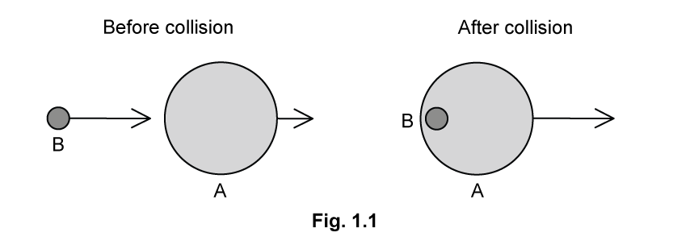

Before the collision, asteroid A had a velocity of 3.61 km s−1 and a momentum of 2.00 × 1017 kg m s−1.

(i) State the principle of conservation of linear momentum.

[2]

(ii) Show that the mass of asteroid A was about 5.5 × 1013 kg.

[2]

**Q7** [3 marks]

**Extract:**

A fast-moving asteroid B collides with a slower-moving asteroid A as shown in Fig. 1.1. Asteroid B becomes embedded within asteroid A as shown. Before the collision, asteroid A had a velocity of 3.61 km s^−1^ and a momentum of 2.00 × 10^17^ kg m s^−1^. (ii) Show that the mass of asteroid A was about 5.5 × 10^13^ kg. Mass of asteroid A: m_A = 5.54 × 10^13 kg

Calculate the combined velocity, in km s−1, of the asteroids after the collision.

mass of asteroid B = 6.40 × 1012 kg

velocity of asteroid B before the collision = 14.0 km s−1

**Q7** [3 marks]

**Extract:**

(ii) Show that the mass of asteroid A was about 5.5 × 10^13 kg. Mass of asteroid A = 5.54 × 10^13 kg.

Calculate the combined velocity, in km s^−1, of the asteroids after the collision. mass of asteroid B = 6.40 × 10^12 kg; velocity of asteroid B before the collision = 14.0 km s^−1. Combined velocity v = 4.69 km s^−1 (3 s.f.).

A short time later, the combined asteroid AB collides with a stationary asteroid C. Immediately following the collision, the asteroids are deflected by the angles shown in Fig. 1.2.

Show that the mass of asteroid C is about 2.0 × 1013 kg.

**Q7** [3 marks]

**Extract:**

Calculate the combined velocity of the asteroids after the collision: v = 4686 = 4.69 km s^−1^ (3 s.f.)

A short time later, the combined asteroid AB collides with a stationary asteroid C. Immediately following the collision, the asteroids are deflected by the angles shown. Asteroid AB travels at 2.6 kilometres per second at an 8-degree angle to the initial direction of AB, and asteroid C travels at 6.5 kilometres per second at a 10-degree angle to the initial direction of AB. Mass of asteroid AB, m_AB = (6.4 × 10^12) + (5.54 × 10^13) = 6.18 × 10^13 kg. Mass of asteroid C, m_C = 2.04 × 10^13 kg.

Determine if the collision in **(c)** is elastic or inelastic.

### Q8 — easy — 9 marks

**Q8** [2 marks]

State the difference between an elastic and an inelastic collision.

**Q8** [2 marks]

A ball collides with a wall at a velocity of 35 m s−1 and rebounds with velocity *v*. The ball has a mass of 0.025 kg.

The motion of the ball is shown in Fig. 1.1.

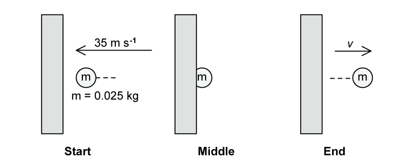

**Fig. 1.1**

Calculate the momentum of the ball at the start, before it hits the wall.

**Q8** [3 marks]

**Extract:**

A ball collides with a wall at a velocity of 35 m s^−1^ and rebounds with velocity *v*. The ball has a mass of 0.025 kg. The motion of the ball is shown in Fig. 1.1. Calculate the momentum of the ball at the start, before it hits the wall: Momentum: p = m v = 0.025 × 35 = 0.875 = 0.88 kg m s^−1^

The collision is perfectly elastic.

Determine

(i) the rebound velocity of the ball

[1]

(ii) the magnitude of the change in momentum of the ball.

[2]

**Q8** [2 marks]

**Extract:**

A ball collides with a wall at a velocity of 35 m s^−1 and rebounds with velocity v. The ball has a mass of 0.025 kg.

The collision is perfectly elastic. Determine the magnitude of the change in momentum of the ball: Change in momentum: Δp = 1.75 = 1.8 kg m s^−1

The ball is in contact with the wall for 0.1 s.

Calculate the force exerted on the ball by the wall.

### Q9 — easy — 10 marks

**Q9** [2 marks]

**Extract:**

When marking this answer:

- "Closed system" alone does not earn the second mark: the condition must state that no (resultant) external force acts, or that the system is isolated
- The first mark needs the total (sum) of the momenta, not the momentum of a single object

State the principle of conservation of linear momentum.

**Q9** [2 marks]

**Extract:**

Question stem:

- Pellet mass 20 g, momentum 1.2 kg m s-1

---

When marking this answer:

- A correct final answer of 60 m s-1 with no working scores both marks
- An answer of 0.06 m s-1 (mass left in grams) scores no marks

A pellet of mass $20 \text{g}$ is fired from an air rifle with a momentum of $1 . 2 \text{kg m s}^{-1}$.

Calculate the velocity of the pellet just after the rifle is fired.

**Q9** [2 marks]

**Extract:**

Question stem:

- Pellet mass 20 g, momentum of the pellet 1.2 kg m s-1

---

When marking this answer:

- In part (i), accept 0, zero or 0 kg m s-1
- In part (ii), a bare 1.2 kg m s-1 with no sign and no stated direction earns the mark: the word "recoil" in the question supplies the direction
- In part (ii), also accept -1.2 kg m s-1, or 1.2 kg m s-1 in the opposite direction to the pellet (backwards)
- In part (ii), 1.2 kg m s-1 stated to be in the same direction as the pellet does not earn the mark

Use the principle of conservation of momentum to state:

(i) the total momentum of the air rifle and the pellet

[1]

(ii) the recoil momentum of the air rifle.

[1]

**Q9** [4 marks]

**Extract:**

Question stem:

- Pellet mass 20 g, momentum 1.2 kg m s-1
- The pellet becomes embedded in a target and comes to rest in 0.0025 s

---

When marking this answer:

- In part (i), accept the relation as a word equation or as F = ∆p / ∆t or F = m(v - u) / t
- In part (ii), a correct final answer of 480 N with no working scores all three marks

The pellet hits a target. It becomes embedded and takes $0 . 0025 \text{s}$ to come to rest.

(i) State the relation between force and momentum.

[1]

(ii) Calculate the average force needed to stop the pellet.

[3]

### Q10 — medium — 10 marks

**Q10** [2 marks]

A shell of mass 30 g is fired from the barrel of a rifle of mass 1.9 kg. Immediately after being fired, the bullet has a momentum of 36 kg m s−1.

State the total momentum of the rifle and the bullet before the rifle is fired and give a reason for your answer.

**Q10** [2 marks]

**Extract:**

A shell of mass 30 g is fired from the barrel of a rifle of mass 1.9 kg. Immediately after being fired, the bullet has a momentum of 36 kg m s^−1^.

Calculate the velocity of the shell just after the rifle is fired.

**Q10** [3 marks]

**Extract:**

A shell of mass 30 g is fired from the barrel of a rifle of mass 1.9 kg. Immediately after being fired, the bullet has a momentum of 36 kg m s^−1^. State the total momentum of the rifle and the bullet before the rifle is fired and give a reason for your answer. [Answer: total momentum before firing is zero / 0 kg m s^−1^, because both rifle and bullet are stationary.]
Momentum of the shell after being fired, p = 36 kg m s^−1^.

(i) Using the principle of conservation of momentum, and your answer to part (a), determine the total momentum of the rifle and the shell.

[1]

(ii) Calculate the recoil momentum of the rifle.

[2]

**Q10** [3 marks]

The shell has a momentum of 9.8 kg m s−1 just before it hits a target.

It takes 4.5 ms for the bullet to be stopped by the target.

Calculate the average force needed to stop the bullet.

### Q11 — easy — 11 marks

**Q11** [3 marks]

A collision can be described as being elastic or inelastic when there are no external forces acting on the collision.

In Table 1.1, place a tick (✓) next to the quantities that are conserved in each type of collision

**Table 1.1**

| **Quantity** | **Elastic Collision** | **Inelastic Collision** |
|---|---|---|
| Momentum |   |   |
| Total Energy |   |   |
| Kinetic Energy |   |   |

**Q11** [3 marks]

A trolley **X** with mass of 400 g is moving on a track with a velocity of 1.2 m s−1 towards a stationary trolley **Y** with mass of 800 g as shown in Fig. 1.1.

**Fig. 1.1**

(i) Calculate the initial momentum of trolley **X**.

[2]

(ii) Trolley **X** collides with trolley **Y** and subsequently, they stick together.

State the combined momentum of the trolleys after the collision.

[1]

**Q11** [4 marks]

**Extract:**

A trolley X with mass of 400 g is moving on a track with a velocity of 1.2 m s^−1^ towards a stationary trolley Y with mass of 800 g as shown in Fig. 1.1.

(i) Calculate the initial momentum of trolley X.
(ii) Trolley X collides with trolley Y and subsequently, they stick together. State the combined momentum of the trolleys after the collision.

Mark scheme: Mass of X = 400 g = 0.4 kg; Velocity of X = 1.2 m s^−1^; Momentum before: p = 0.4 × 1.2 = 0.48 kg m s^−1^; Momentum after: p = 0.48 kg m s^−1^ (mass of Y = 800 g = 0.8 kg).

(i) Calculate the velocity of the two trucks after the collision.

[3]

(ii) State the direction of the velocity of the trolleys after the collision.

[1]

**Q11** [1 mark]

**Extract:**

A trolley X with mass of 400 g is moving on a track with a velocity of 1.2 m s^−1^ towards a stationary trolley Y with mass of 800 g.

(ii) Trolley X collides with trolley Y and subsequently, they stick together.

(from part c) Velocity of the two trucks after the collision: v = 0.4 m s^−1^ in the same direction as trolley X.

Explain why the collision cannot be described as elastic.

### Q12 — medium — 13 marks

**Q12** [3 marks]

A ball X of mass 140 g travelling at constant velocity *v* collides head-on with a stationary ball Y of mass 620 g, as shown in Fig. 1.1.

After the collision, ball X comes to a stop. Ball Y moves off in the same initial direction as X with a velocity of 0.8 m s−1.

Determine the velocity *v* of ball X before the collision.

**Q12** [4 marks]

**Extract:**

A ball X of mass 140 g travelling at constant velocity *v* collides head-on with a stationary ball Y of mass 620 g, as shown in Fig. 1.1. After the collision, ball X comes to a stop. Ball Y moves off in the same initial direction as X with a velocity of 0.8 m s^−1^. Determine the velocity *v* of ball X before the collision. (Answer: v = 3.5 m s^−1^)

(i) Show that the collision in **(a)** is inelastic.

[3]

(ii) Explain why the collision in **(a)** is inelastic.

[1]

**Q12** [3 marks]

The balls are replaced by an aluminium sphere of mass 2.7 kg and a steel sphere of 7.9 kg as shown in Fig. 1.2.

The aluminium sphere has an initial velocity of 10.0 m s–1 when it collides with the stationary steel sphere. Immediately after the collision, the velocity of the steel sphere is 5.1 m s–1.

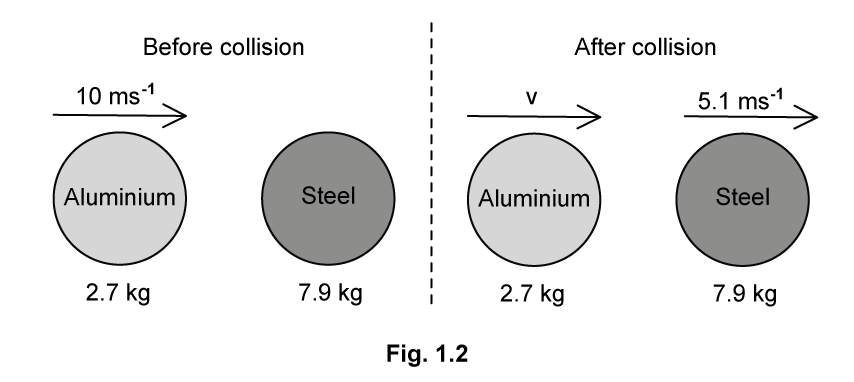

Calculate the velocity *v* of the aluminium sphere immediately after the collision.

**Q12** [3 marks]

**Extract:**

The balls are replaced by an aluminium sphere of mass 2.7 kg and a steel sphere of 7.9 kg. The aluminium sphere has an initial velocity of 10.0 m s^–1 when it collides with the stationary steel sphere. Immediately after the collision, the velocity of the steel sphere is 5.1 m s^–1. Calculate the velocity v of the aluminium sphere immediately after the collision. v = −4.9 m s^−1 (aluminium sphere changes direction).

Verify that the collision in **(c)** is elastic.
