# Mark Schemes — Equilibrium of Forces
**4. Forces, Density & Pressure** · Cambridge (CIE) AS physics (9702)

## Multiple Choice Questions (23 questions)

### Q1
**Final answer:** **The correct answer is ****C**** because:**

- Hopefully you will have quickly guessed that this problem will require trigonometry to solve
- In both cases, the bowstring is in equilibrium, so we can work out the resultant force in each bow using:

  - $F=T\mathrm{cos}\frac{θ}{2}+T\mathrm{cos}\frac{θ}{2}=2T\mathrm{cos}\frac{θ}{2}$
- Where *T* is the tension in the string and *θ* is the angle between the strings
- The 2 *T* is because there is tension on both halves of the string and the ½ *θ* is because you resolve in line with the direction that the archer is pulling, which is half the angle between the halves of the bow

  - Resultant force in X = $2T\mathrm{cos}\frac{θ}{2}=2\times110\mathrm{cos}\frac{120}{2}=220\mathrm{cos}60$
  - Resultant force in Y = $2T\mathrm{cos}\frac{θ}{2}=2\times150\mathrm{cos}\frac{90}{2}=300\mathrm{cos}45$
  - Increase in force = $300\mathrm{cos}45-220\mathrm{cos}60=102N$

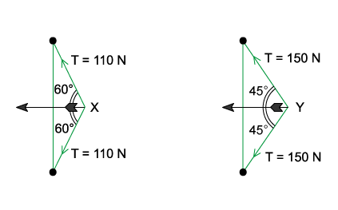

**Exam Tip: **if there is more than one force triangle in a question, always consider each one separately, many students consider the two strings as one and end up with the wrong answer, so be careful!

### Q2
**Final answer:** **The correct answer is ****A**** because:**

- To calculate moments, we will need to use

  - $\mathrm{moment}=\mathrm{force}\times\mathrm{perpendicular} \mathrm{distance} \mathrm{from} \mathrm{pivot}$
- We will look at the clockwise and anticlockwise moments separately
- The metre rule is uniform, meaning its weight acts at the centre mark, 50 cm
- Therefore, the distance between the pivot and the centre of gravity is 10 cm
- The weight of the ruler produces an anticlockwise moment of

  - 4.0 × 0.1 = 0.4 N m
- The 6.0 N weight acts downwards at a distance of 40 cm from the pivot, producing a clockwise moment of

  - 6.0 × 0.4 = 2.4 N m
- Resultant moment = sum of clockwise and anticlockwise moments

  - 2.4 – 0.4 = 2.0 N m
- Therefore, the resultant turning moment is 2.0 N m clockwise

**B & D **are incorrect because a positive value is generally taken as a clockwise moment

**C **is incorrect because this is the answer you get if you add the moments together instead of taking away the anticlockwise moment

### Q3
**Final answer:** **The correct answer is ****A**** because:**

- The moment of a force is equal to

  - $\mathrm{moment}=\mathrm{force}\times\mathrm{perpendicular} \mathrm{distance} \mathrm{from} \mathrm{pivot}$
- Taking moments about the top of the ladder
- **Clockwise moments:**

  - The horizontal frictional force $F$ acting at a perpendicular distance $h$ produces a clockwise moment = $F\timesh$
  - The weight $W$ of the ladder acting at a perpendicular distance $a$ produces a clockwise moment = $W\timesa$
- **Anticlockwise moments:**

  - The vertical reaction force $R=W$ acting at a perpendicular distance $2a$ produces an anticlockwise moment = $W\times2a$
- For equilibrium: Sum of clockwise moments = Sum of anticlockwise moments

  - $Wa+Fh=2Wa$

### Q4
**Final answer:** **The correct answer is ****B**** because:**

- In each case, the sum of the vertical components of the two tensions equals the same weight *W*
- So, the reaction at the nail has the same magnitude in both cases:

  - *R**1** = R**2*
- To determine which is the larger of *T**1** *or *T**2*, we must consider the angles between the strings and the vertical, let’s call these *θ**1* and *θ**2*
- For each diagram, the sum of the vertical downward components of the tensions should be equal to the weight which is also equal to *R*

  - $W=2T_{1}\mathrm{cos}θ_{1}$
  - $W=2T_{2}\mathrm{cos}θ_{2}$
  - $2T_{1}\mathrm{cos}θ_{1}=2T_{2}\mathrm{cos}θ_{2}$
- It is clear from the diagrams that the angle *θ**1* is larger than *θ**2*
- From the graph of cosine, we know that as the angle *θ* increases, the value of cos *θ* decreases
- Since *θ**1* > *θ**2*, cos *θ**1* is smaller than cos *θ**2*, so for the statement to hold true, we can conclude:

  - *T**1** *>* T**2*

**A** is incorrect because this implies that $θ_{1}<θ_{2}$, which is incorrect

**C** & **D** are incorrect because R is equal to the weight of the picture so both of these are incorrect

### Q5
**Final answer:** **The correct answer is ****D**** because:**

- Weight always acts downwards
- Tension is the pull of the cable on the object so it always acts away from the mass
- Since the lamp is at rest, the three forces on point P must be in equilibrium
- That means they form a closed triangle when drawn tip-to-tail:

**A & C **are incorrect because weight always acts downwards but these triangles show the weight acting upwards

**B **is incorrect because the tension in a wire always acts away from the mass whereas this triangle shows it acting towards the mass

### Q6
**Final answer:** **The correct answer is ****C**** because:**

- We are told the mass is stationary in this person’s hand, therefore, the system is in equilibrium
- For a system in equilibrium :

  - Sum of clockwise moments = Sum of anticlockwise moments
- Clockwise moments = $( 25 \times 12 ) + ( 200 \times 35 ) = 7300 \mathrm{N} \text{cm}$
- Anticlockwise moments = $5F$

  - $5F=7300$
  - $F=\frac{7300}{5}=1460N$

### Q7
**Final answer:** **The correct answer is ****A**** because:**

- The minimum resultant force is found by finding the combination of forces which produces the smallest value
- Consider the resultant magnitude of 3 N and 4 N when they are perpendicular to each other:

  - Resultant = $\sqrt{3^{2}+4^{2}}=5N$
- So, if the 5 N force is then placed in the opposite direction to the resultant force of the perpendicular 3 N and 4 N forces, the overall resultant force is zero

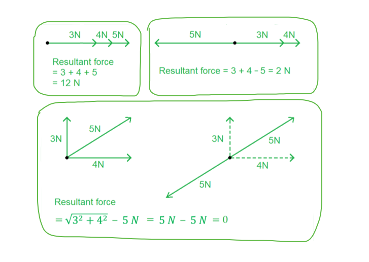

### Q8
**Final answer:** **The correct answer is ****D**** because:**

- For an object to be in equilibrium, it must be experiencing no acceleration. This means that both the net force and the net torque on the object must be zero
- Since the masses are both equal, their weight will be the same and pointing downwards, so the clockwise and anticlockwise moments will be the same, therefore their resultant torque must be zero
- We are told the object moves with uniform speed, or terminal velocity, this means the air resistance on the object will be same as the weight and hence there is no acceleration or resultant force
- Therefore, the object satisfies both conditions for equilibrium

**A & B **are incorrect because both these statements argue that the object cannot be in equilibrium if the object is moving, however, this is not true, as long as an object is not accelerating then it can be in equilibrium

**C **is incorrect because a resultant torque could only occur if the forces were unbalanced, however, the object moves with constant speed so the forces must all be balanced

### Q9
**Final answer:** **The correct answer is ****D**** because:**

- The weight of one ring is equal to *mg*
- In order for the rod to be in equilibrium :
- Clockwise moments = Anticlockwise moments

  - Clockwise moment = $2 \times ( 14 - 9 ) m g = 10 m g$
- Let *x* be the position of the hook where the fourth ring will be hung

  - Anticlockwise moment = $( 9 - 2 ) m g + ( 9 - x ) m g$
- For equilibrium:

  - $7 m g + ( 9 - x ) m g = 10 m g$
  - $( 9 - x ) m g = 3 m g$
  - $( 9 - x ) = 3$
  - $x=9-3=6$

### Q10
**Final answer:** **The correct answer is ****C**** because:**

- To calculate moments, we will need to use

  - $\mathrm{moment}=\mathrm{force}\times\mathrm{perpendicular} \mathrm{distance} \mathrm{from} \mathrm{pivot}$
- The metre rule is uniform, meaning its weight acts at the centre mark, 50 cm
- The 75g mass acts downwards at the 4 cm marker
- The pivot is positioned at 34 cm, so

  - distance to the centre of gravity = 50 – 34 = 16 cm
  - distance to the 75 g mass = 34 – 4 = 30 cm
- Clockwise moment due to the ruler's weight:

  - $Mg\times16$
- Anticlockwise moment due to the 75 g mass:

  - $75g\times30$
- For the system to be in equilibrium, clockwise moment = anticlockwise moment

  - $Mg\times16=75g\times30$
  - $M=\frac{75\times30}{16}=141g$
- Therefore, the metre rule has a mass of 141 g

When dealing with systems in equilibrium (e.g. moments, conservation of momentum) you don’t need to convert units into SI units, you just need to make sure the units are the same on both sides and you need to check your final answer is reported in the correct units, take this question as an example:

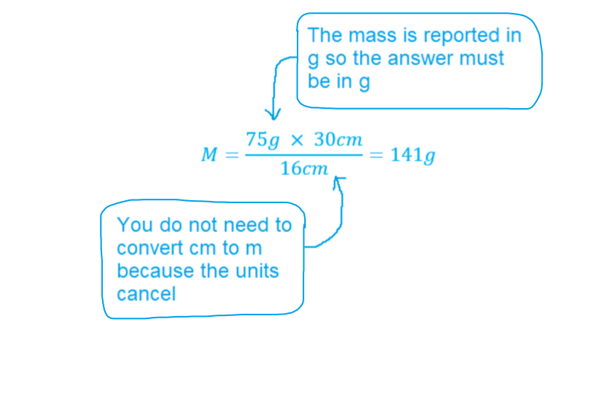

### Q11
**Final answer:** **The correct answer is ****D**** because:**

- To calculate moments, we will need to use

  - $\mathrm{moment}=\mathrm{force}\times\mathrm{perpendicular} \mathrm{distance} \mathrm{from} \mathrm{pivot}$
- Let the torque be equal to *T*, and assume it acts in a clockwise direction unless it is calculated to have a negative sign (which would tell us it acts in an anticlockwise direction)
- Clockwise moments:

  - $( 0.35 \times 5.0 \times g ) + T$
- The beam is uniform, meaning its weight acts at the centre
- The length of the beam is 1.10 m, so the centre mark is at 0.55 m, which is 0.15 m from the pivot
- Anticlockwise moments:

  - $( 0.15 \times 1.2 \times g ) + ( 0.65 \times 5.0 \times g )$
- For the system to be in equilibrium, clockwise moment = anticlockwise moment

  - $( 0.15 \times 1.2 \times g ) + ( 0.65 \times 5.0 \times g ) = ( 0.35 \times 7.0 \times g ) + T$
  - $0.18g+3.25g=2.45g+T$
  - $T=0.98g=9.6Nm$
- Therefore, the torque required to keep the beam in equilibrium is 9.6 N m clockwise

### Q12
**Final answer:** **The correct answer is ****B**** because:**

- Distance of force *F* from the centre of the spindle $=\frac{1.60}{2}=0.80m$
- Both forces produce clockwise moments about the spindle

  - Clockwise moment $= ( F \times 0.80 ) + ( F \times 0.80 ) = 1.60 F$
- The 800 N weight acts at a distance 0.25 m from the spindle which causes an anticlockwise moment

  - Anticlockwise moment $=800\times0.25$
- The minimum force that can be applied when the clockwise moments are equal to the anticlockwise moments

  - $( F \times 0.80 ) + ( F \times 0.80 ) = 800 \times 0.25$
  - $1.60F=200$
  - $F=\frac{200}{1.6}=125N$

### Q13
**Final answer:** **The correct answer is ****C**** because:**

- The component of the tension in each string along the direction XP is $T\mathrm{cos}θ$

  - Where *T* is the tension in the string and *θ* is the angle between segment XY and axis XP
- The elastic string is in equilibrium, so we can work out the resultant force using:

  - $F=T\mathrm{cos}θ+T\mathrm{cos}θ$
  - $F=2T\mathrm{cos}θ$
- The 2*T* arises because there is tension on both halves of the string
- The quantity cos θ can be found using

  - $\mathrm{cos}θ=\frac{\mathrm{adjacent}}{\mathrm{hypotenuse}}=\frac{30}{50}=\frac{3}{5}$
- Since *T* = 4 N, the resultant force is equal to

  - $F=2\times4\times\frac{3}{5}$
  - $F=4.8N$

### Q14
**Final answer:** **The correct answer is ****D**** because:**

- Torque is the moment of a force, it causes a turning effect
- Consider option** D**
- Upward force = 42 + 70 = 112 N
- Downward force = 112 N

  - Resultant force = 112 – 112 = 0
- Clockwise moment = 42 × 50 = 2100 N cm
- Anticlockwise moment = 70 × 30 = 2100 N cm

  - Resultant moment = 2100 – 2100 = 0
- Both the resultant force and moments are zero, so **D** is correct

| **A **is incorrect because | Upward force = 30 + 50 = 80 N  Downward force = 90 N  - Resultant force = 90 – 80 = 10 N downward  Clockwise moment = 30 × 50 = 1500 N cm  Anticlockwise moment = 50 × 30 = 1500 N cm  - Resultant moment = 1500 – 1500 = **0 N cm** |
|---|---|
| **B **is incorrect because | Upward force = 36 + 70 = 106 N  Downward force = 106 N  - Resultant force = 106 – 106 = 0  Clockwise moment = 36 × 50 = 1800 N cm  Anticlockwise moment = 70 × 30 = 2100 N cm  - Resultant moment = 2100 – 1800 = **300 N cm** |
| **C **is incorrect because | Upward force = 28 + 35 = 63 N  Downward force = 63 N  - Resultant force = 63 – 63 = 0  Clockwise moment = 28 × 50 = 1400 N cm  Anticlockwise moment = 35 × 30 = 1050 N cm  - Resultant moment = 1400 – 1050 = **350 N cm** |

### Q15
**Final answer:** **The correct answer is ****A**** because:**

- So far, we have just looked at situations where the object is uniform so the centre of mass acts through the centre of the object
- We are told the position of its centre of gravity G is a third of the length from the hinge at O so the weight acts at a distance of  $\frac{2.7}{3}=0.9m$ from O
- For equilibrium, the clockwise moment should equal the anticlockwise moment
- Let’s consider moments around the pivot O
- The vertical force *F* acts at a perpendicular distance of 2.7 cos 50
- The weight of the trailer acts at a perpendicular distance of 0.9 cos 50
- The vertical force *F* provides a clockwise moment and the weight of the trailer provides an anticlockwise moment

  - Clockwise moment due to force *F = *$F\times2.7\mathrm{cos}50$
  - Anticlockwise moment due to the weight = $30000\times0.9\mathrm{cos}50$
- Sum of clockwise moments = Sum of anticlockwise moments

  - $F\times2.7\mathrm{cos}50=30000\times0.9\mathrm{cos}50$
  - $F=\frac{30000\times0.9\mathrm{cos}50}{2.7\mathrm{cos}50}=10000N$
- The vertical force is therefore equal to 10 000 N or 10 kN

### Q16
**Final answer:** **The correct answer is ****C**** because:**

- Since the metre rule is uniform, its weight acts at its centre, which is 5*x*
- The weight of the ruler causes a clockwise moment at a distance 5*x* – 4*x* = *x* from the pivot

  - Clockwise moment due to the weight of the ruler = 100 *gx*
- Where *g* is the acceleration due to gravity
- The weight of the 20 g mass causes an anticlockwise moment at a distance of 10*x* – 4*x* = 6*x* from the pivot

  - Anticlockwise moment due to 20 g mass = $20g\times6x=120gx$
- For equilibrium, the clockwise moment should equal the anticlockwise moment
- Since the anticlockwise moment is greater, the 50 g mass should contribute to the sum of the clockwise moments, i.e. to the right of the pivot
- Let’s say the 50 g mass acts at a distance *d* from the pivot
- Sum of clockwise moments = Sum of anticlockwise moments

  - $100gx+50gd=120gx$
  - $50gd=20gx$
  - $d=\frac{20x}{50}=0.4x$
- Therefore, the 50g mass should be hung at

  - $4x+0.4x=4.4x$

### Q17
**Final answer:** **The correct answer is ****C**** because:**

- To find the net force for two forces which are perpendicular to each other we can use

  - $F^{2}=F_{N}^{2}+F_{E}^{2}$
  - $F=\sqrt{5^{2}+12^{2}}=13N$

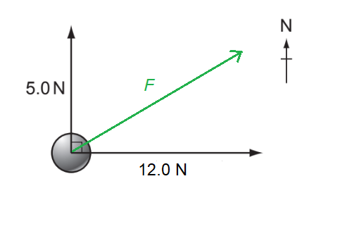

### Q18
**Final answer:** **The correct answer is ****B**** because:**

- The weight *W* always acts downwards
- The reaction force *R *acts in the opposite direction to the weight, upwards
- The ground is said to be icy which means it is** frictionless**, so there are no additional forces acting or opposing the motion
- Before the ladder begins to slide, there is a horizontal force *P* acting to the right where the ladder comes into contact with the rough wall because the ladder exerts a force to the left on the wall
- As the ladder begins to slide, the point of contact of the ladder with the wall begins to move down the wall
- We are told the wall is rough, meaning friction will oppose the motion of the ladder as it begins to move
- So, at the point of contact, *P* is now acting to the right along with the upwards frictional force, which leads to a resultant force as shown in diagram B

**A & C **are incorrect because these diagrams show the force *P* as horizontal on the ladder as before it begins to slide there is initially no friction force acting, however the question asks about the forces on the ladder **as** it begins to slide

**C & D **are incorrect because these diagrams show that there is a frictional force acting on the ground causing the resultant force of *R* to change direction, but this is incorrect since the ground is icy, meaning it is frictionless

### Q19
**Final answer:** **The correct answer is ****D**** because:**

- The moment of a force is given by:

  - $\mathrm{moment}=\mathrm{force}\times\mathrm{perpendicular} \mathrm{distance} \mathrm{from} \mathrm{pivot}$
- The midpoint of the door is at 0.35 m
- So minimum force = moment / distance from hinge to midpoint

  - $\frac{14}{0.35}=40N$

### Q20
**Final answer:** **The correct answer is ****A**** because:**

- If the vector arrows form a closed triangle, the resultant force is zero
- However, for a body to be in equilibrium, the resultant moment must also be zero
- Another way to look at it is that three forces can only be in equilibrium if they all pass through the same point

  - If not, then there will be a turning force (resultant moment) on the object
- So, if we join the vector arrows to see where they meet, we can see that the only option where the three forces do not meet at a singular point is option A

### Q21
**Final answer:** **The correct answer is ****A**** because:**

- The force which will cause the lever to rotate clockwise is the 20 N force
- The forces which will cause the lever to rotate anticlockwise are the 10 N and 15 N forces
- Perpendicular distance of 10 N force : (4 + 2) – 3 = 3 m
- Perpendicular distance of 15 N force : 3 m
- Perpendicular distance of 20 N force : 4 m
- Magnitude of resultant moment = Clockwise moment – Anticlockwise moment
- Magnitude of resultant moment $= ( 20 \times 4 ) - ( 10 \times 3 ) - ( 15 \times 3 ) = 5 \mathrm{N} \mathrm{m}$

### Q22
**Final answer:** **The correct answer is ****B**** because:**

- There is a tension *T* in the rope on each side of the student
- The sum of vertical components of tension should be equal to the weight *W*
- The vertical component of tension is equal to

  - $T\mathrm{sin}θ$
- The student is in equilibrium and the vertical forces are shown as in the diagram below, so:

  - $T\mathrm{sin}θ+T\mathrm{sin}θ=W$
  - $2T\mathrm{sin}θ=W$
  - $T=\frac{W}{2\mathrm{sin}θ}$

### Q23
**Final answer:** **The correct answer is ****D**** because:**

- Since the beam is uniform, its weight acts at the centre which is a distance *x* to the left of the pivot
- For equilibrium : Sum of clockwise moments = Sum of anticlockwise moments
- Clockwise moments $=2W\times4x=8Wx$
- Anticlockwise moments $= ( W \times 6 x ) + ( 10 W \times x ) = 6 W x + 10 W x = 16 W x$
- Since the anticlockwise moment is greater, the 2*W* weight should contribute to the sum of the clockwise moments, i.e. to the right of the pivot
- The 2 *W* weight acts at a distance *d* from the pivot
- Sum of clockwise moments = Sum of anticlockwise moments

  - $8Wx+2Wd=16Wx$
  - $2Wd=8Wx$
  - $d=4x$
- A distance of 4*x* to the right corresponds to option D

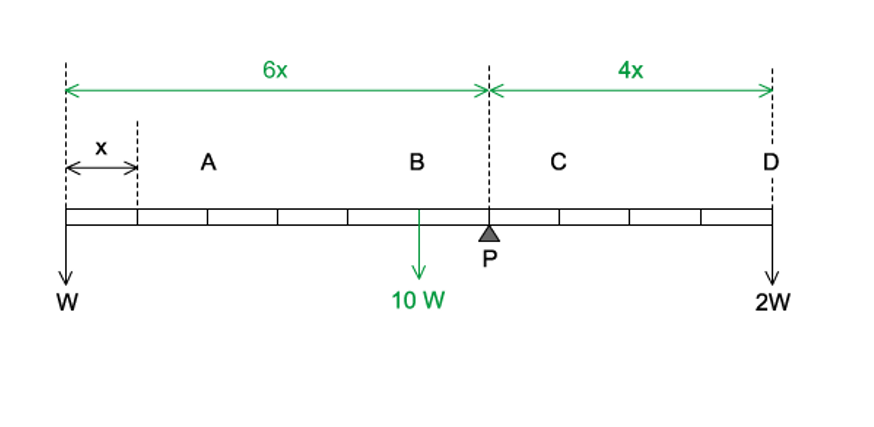

## Structured Questions (10 questions)

### Q1
> **[mark-scheme]**
> The centre of gravity of an object is:
> 
> - The point where the (entire) <u>weight</u> (of an object) is considered to act **[1 mark]**
> **[mark-scheme]**
> The two conditions required for an object to be in equilibrium are:
> 
> - Resultant force is zero **[1 mark]**
> - Resultant moment / torque (about any point) is zero **[1 mark]**
(i) To show that the weight of the cube is about 12 N:

- List the known quantities

  - Side length of the cube, $l$ = 0.075 m
  - Density of the cube, $ρ$ = 2800 kg m−3
  - Acceleration of free fall, $g$ = 9.81 m s−2
- Calculate the volume of the cube:

$V=l^{3}$

$V=0.075^{3}$ **[1 mark]**

- Use the density equation to calculate the weight of the cube:

$ρ=\frac{m}{V}$

$W=mg=ρVg$

$W=2800\times0.075^{3}\times9.81$

$W=11.58...$

$W=$$12N$** **(2 s.f.) **[1 mark]**

(ii) To calculate the tension $T$ in the wire:

- Identify the moments acting about A

Anticlockwise moment = $T\times2.40$

Clockwise moments = $( 50 \times 1.20 ) + ( 11.58 \times 0.80 )$ **[1 mark]**

- Apply the principle of moments and calculate $T$:

Since the beam is in equilibrium, anticlockwise moments = clockwise moments

$T \times 2.40 = ( 50 \times 1.20 ) + ( 11.58 \times 0.80 )$

$T = \frac{( 50 \times 1.20 ) + ( 11.58 \times 0.80 )}{2.40}$

$T=28.86...$

$T=$ $29N$ **[1 mark]**

> **[mark-scheme]**
> 1 mark for $( T \times 2.40 )$ **OR**  $( 50 \times 1.20 )$ **OR**  $( 11.58 \times 0.80 )$
> 
> 1 mark for the correct application of the principle of moments to calculate $T$
> **[mark-scheme]**
> State the effect of this change on the magnitude and direction of the resultant moment of the forces on the beam about A:
> 
> - Resultant/net moment is anticlockwise (no longer zero) **[1 mark]**
> 
> Explanation:
> 
> - The clockwise moment decreases as the apparent weight of the cube decreases **[1 mark]**

> **[exam-tip]**
> It would be incorrect to say that the anticlockwise moment increases due to upthrust acting on the cube. This is because the upthrust does not act directly on the beam; therefore, it does not introduce a new clockwise moment about A on the beam; it simply reduces the tension in the cube's support. Hence, it is the clockwise moment on the beam that decreases.

### Q2
List the known quantities:

- Mass of Ruby, *M*R = 72 kg
- Mass of Luke, *M*L = 85 kg
- Mass of the plank, *M*P = 15 kg
- Length of plank, AD = 2.7 m
- Acceleration due to gravity, *g* = 9.81 m s–2

Sketch a simplified diagram showing measurements and point masses:

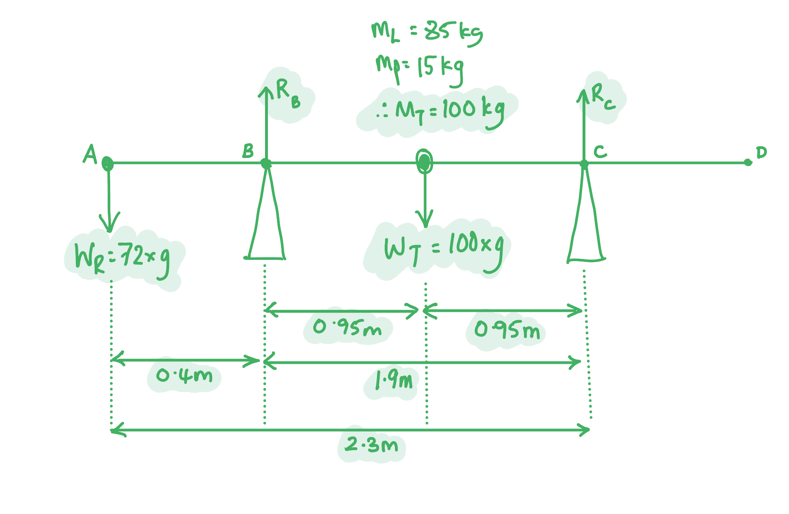

(i) Calculate the magnitude of the normal reaction force at **B**

Apply the principle of moments to take moments about point **C**:

- sum of clockwise moments = sum of anticlockwise moments
- $( R_{B} \times 1.9 ) = ( W_{R} \times ( 2.7 - 0.4 ) ) + ( W_{P} + W_{L} ) \times 0.95$ **[1 mark]**
- $R_{B} = \frac{( 72 g \times 2.3 ) + ( 100 g \times 0.95 )}{1.9}$ **[1 mark]**
- $R_{B} = 1346 = 1300 \mathrm{N} ( 2 \mathrm{s} . \mathrm{f} . )$ **[1 mark]**

(ii) Calculate the magnitude of the normal reaction force at **C**

Equate vertical forces:

- Since the plank is in equilibrium, the sum of upwards forces upwards = sum of forces downwards /** **$ΣF_{up}=ΣF_{down}$/** **$R_{B}+R_{C}=W_{R}+W_{L}+W_{P}$ **[1 mark]**

Calculate normal reaction force at **C**:

- $R_{C} = ( W_{R} + W_{L} + W_{P} ) - R_{B}$
- $R_{C} = ( 72 g + 85 g + 15 g ) - 1346$ **[1 mark]**
- $R_{C} = 341 = 340 \mathrm{N} ( 2 \mathrm{s} . \mathrm{f} . )$ **[1 mark]**

**[Total: 6 marks]**

> *It's very common for students to think that creating their own diagrams is a waste of time since 'it doesn't get any marks'. *

> *It's true that the diagram isn't marked by the examiner directly, **but **it allows you to get the correct answer quickly, meaning you not only get these marks, but have **time** to answer the rest of the paper too!*

> *For part (ii) you may have decided to take moments again. Any correct method that gets a correct answer will score full marks in the exam. *

> *If you chose this method, your calculation should look like:*

- *Apply the principle of moments to take moments about point **B**:*

  - *sum of clockwise moments = sum of anticlockwise moments*
  - $( W_{P} + W_{L} ) \times 0.95 = ( R_{C} \times 1.9 ) + ( W_{R} \times 0.4 )$* [1 mark]*
  - $R_{C} = \frac{( 100 g \times 0.95 ) - ( 72 g \times 0.4 ) }{1.9}$* [1 mark]*
  - $R_{C} = 342 = 340 \mathrm{N} ( 2 \mathrm{s} . \mathrm{f} . )$* [1 mark]*
List the known quantities:

- Mass of Ruby, *M*R = 72 kg
- Mass of Luke, *M*L = 85 kg
- Mass of the plank, *M*P = 15 kg
- Length of plank, **AD** = 2.7 m
- Acceleration due to gravity, *g* = 9.81 m s–2

Sketch a simplified diagram showing the new position of Luke:

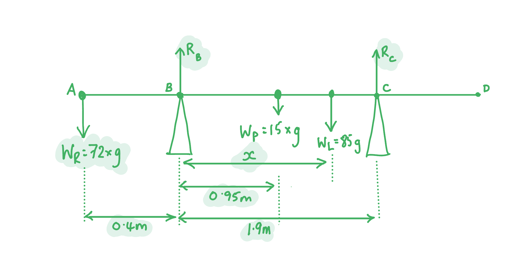

Equate vertical forces:

- Since the plank is in equilibrium, the sum of upwards forces upwards = sum of forces downwards /** **$ΣF_{up}=ΣF_{down}$/** **$R_{B}+R_{C}=W_{R}+W_{L}+W_{P}$

Write an expression, in terms of *R*C, the reaction force at **C**:

- $( 2 \times R_{C} ) + R_{C} = ( W_{R} + W_{L} + W_{P} )$
- $3 \times R_{C} = ( W_{R} + W_{L} + W_{P} )$**[1 mark]**
- $R_{C} = \frac{( 72 g + 85 g + 15 g )}{3} = 562.44$
- $R_{C} = 560 \mathrm{N} ( 2 \mathrm{s} . \mathrm{f} . )$ **[1 mark]**

Determine distance **BX** by taking moments about **B**:

- $( W_{P} \times 0.95 ) + ( W_{L} \times x ) = ( R_{C} \times 1.9 ) + ( W_{R} \times 0.4 )$
- $x = \frac{( R_{C} \times 1.9 ) + ( W_{R} \times 0.4 ) - ( W_{P} \times 0.95 )}{W_{L} }$
- $x = \frac{( 560 \times 1.9 ) + ( 72 \times 9.81 \times 0.4 ) - ( 15 \times 9.81 \times 0.95 )}{( 85 \times 9.81 )}$ **[1 mark]**
- $x = 1.45 = 1.5 \mathrm{m} ( 2 \mathrm{s} . \mathrm{f} . )$ **[1 mark]**

**[Total: 4 marks]**** **

### Q3
Calculate the mass of the ship

- Weight:  $W=mg\Rightarrowm=\frac{W}{g}$
- Mass:  $m=\frac{4.6\times10^{4}}{9.81}$ = 4689 kg **[1 mark]**** **
- Mass:  $m$ = 4700 kg (2 s.f.) **[1 mark]**** **

**[Total: 2 marks]**
Calculate the moment of the ship’s weight about point **P**:

- Moment about point **P** = Weight × Distance
- Moment = 46 000 × 6.0 = 2.8 × 105 **[1 mark]** N m **[1 mark]**** **

**[Total: 2 marks]**

> *When quoting a unit for moments, it is crucial to get the capitalisation correct i.e. do not write NM / nM / nm*
Calculate the minimum vertical force *T*:

- Total clockwise moments (tension in rope) about P = *T *× 15
- Total anticlockwise moments (weight of the ship) about P = *W* × 6.0

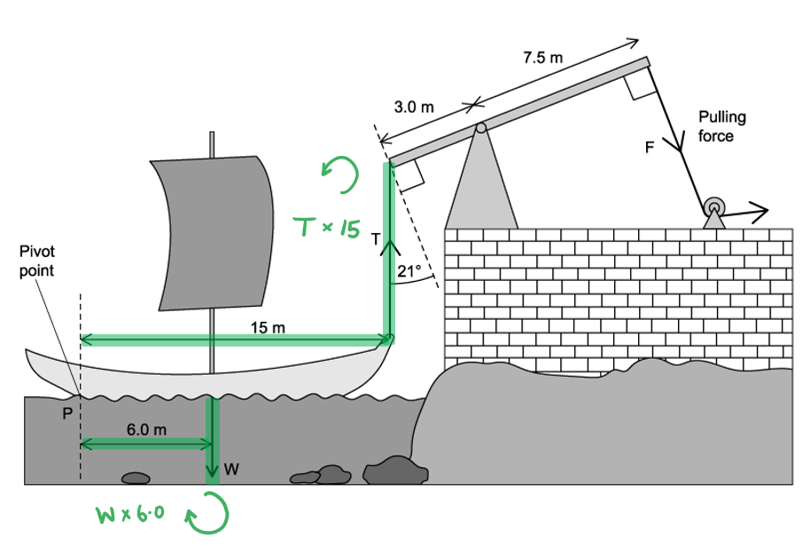

Use the principle of moments to find tension *T*:

- Total clockwise moments = Total anticlockwise moments
- *T *× 15 = (4.6 × 104) × 6.0 **[1 mark]**
- $T = \frac{( 4.6 \times 10^{4} ) \times 6.0}{15}$ = 1.8 × 104 N **[1 mark]**** **

*Allow T = 1.9 × 10**4** N if 2.8 × 10**5** used*** **

**[Total: 2 marks]**
Calculate the minimum force *F*:

- Perpendicular component of *T *= *T* cos (21°) **[1 mark]**

The front of the ship will raise when...

- Total clockwise moments (pulling force *F*) > Total anticlockwise moments (perpendicular component of *T*)
- *F* × 7.5 > *T* cos (21°) × 3.0

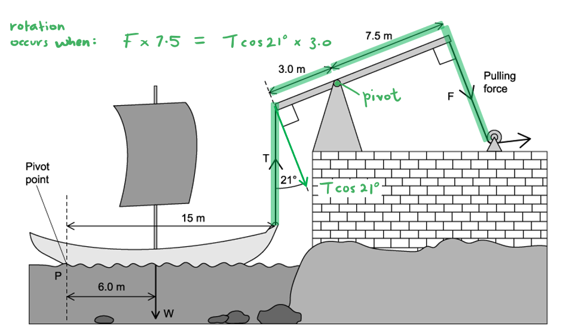

The minimum force required to raise the ship is...

- Total clockwise moments = Total anticlockwise moments
- *F* × 7.5 = *T* cos (21°) × 3.0 **[1 mark]**
- $F = \frac{( 1.8 \times 10^{4} ) \cos 21^{\circ} \times 3.0}{7.5}$* *= 6722 = 6700 N (2 s.f.) **[1 mark]**** **

*Allow F = 7100 N if 1.9 × 10**4** used*** **

**[Total: 3 marks]**

### Q4
To calculate the moment:

List the known quantities:

- Force, *F* = 10 N
- Distance of force from the end of the ruler = 8.0 cm
- Therefore distance of force from pivot, $d=50-8=42\mathrm{cm} \mathrm{or}0.42m$ **[1 mark]**

Recall the equation for a moment and calculate:

- $M=Fd$
- $M=10\times0.42$**[1 mark]**
- $M=4.2Nm$** [1 mark]**

**[Total: 3 marks]**

> *In a question like this one the first mark is for identifying the correct distance, so at that stage you could answer in cm or m and still get the mark.*

> *However the question specifies N**m** as the final unit, so to get the next two marks you have to convert to **metres**.*

> *Keep an eye on units in moments questions as they can be tricky.*
On Fig. 1.1, draw an arrow to show the position of the mass and the direction of the force it exerts.

A correctly annotated diagram looks like:

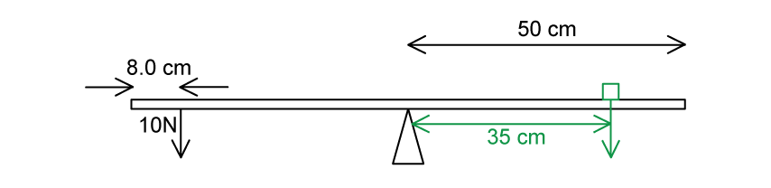

- Downwards arrow marked on the right of the pivot (so it causes a clockwise moment); **[1 mark]**
- Mass / force arrow 35 cm from pivot (distance labelled or by eye); **[1 mark]**

**[Total: 2 marks]**
Calculate the **mass **which has been placed to balance the ruler in part (a):

Use the diagram and distances from parts (a) and (b):

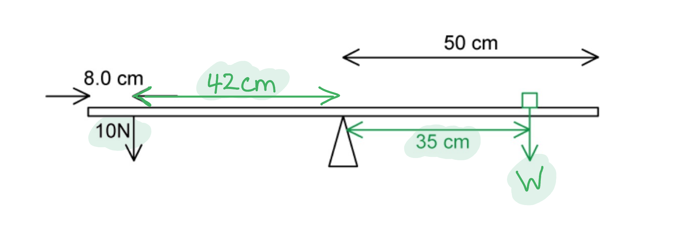

Apply the principle of moments since the ruler is in equilibrium:

- sum of clockwise moments = sum of anti-clockwise moments
- $W\times35=10\times42$ **[1 mark]**
- $W=\frac{420}{35}=12N$ **[1 mark]**

Convert weight to mass:

- $m=\frac{W}{g}=\frac{12}{9.81}$** [1 mark]**
- $m=1.2\mathrm{kg}$** [1 mark]**

**[Total: 4 marks]**

### Q5
(i) A moment of a force is defined as:

- The turning effect of a force; **[1 mark]**
- Moment = Force × perpendicular distance from the pivot **OR **$M=Fd$;** [1 mark]**

(ii) Centre of gravity is defined as:

- The single point where the weight (of a body) can be taken as acting from; **[1 mark]**

**[Total: 3 marks]**
For the arrangement in Fig. 1.1.

(i) State why the broom is hanging horizontally:

- The broom is in equilibrium; **[1 mark]**
- The string is fixed at the centre of mass;** [1 mark]**

(ii) State what measurement the students should make to start their investigation to find the weight of the broom:

- Distance from either end to the string;** [1 mark]**

**[Total: 3 marks]**

> *The students will need to know the position of the centre of mass, so they definitely need the distance from one end to the string, which must be at the centre of mass for equilibrium.*
(i) Determine the distance between the centre of mass of the broom and the point where the string is attached:

- Total distance from end of handle to centre of mass = 0.75 m

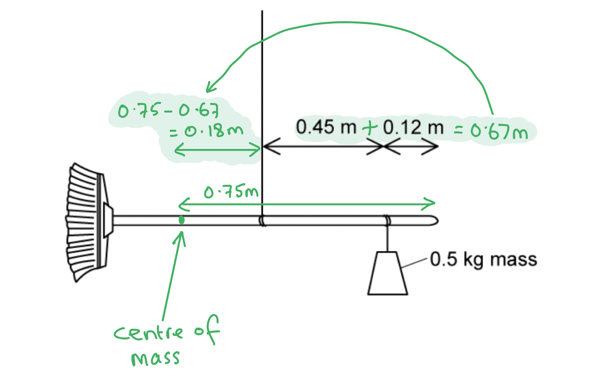

- Distance to centre of mass, $d = 0.75 - ( 0.45 + 0.12 ) = 0.18 \mathrm{m}$; **[1 mark]**

(ii) Determine the force exerted by the 0.5 kg mass:

- force exerted = weight acting downwards
- $W=mg=0.5\times9.81=4.9N$ **[1 mark]**

**[Total: 2 marks]**
Calculate the weight of the broom:

Sketch a diagram to show the forces and distances:

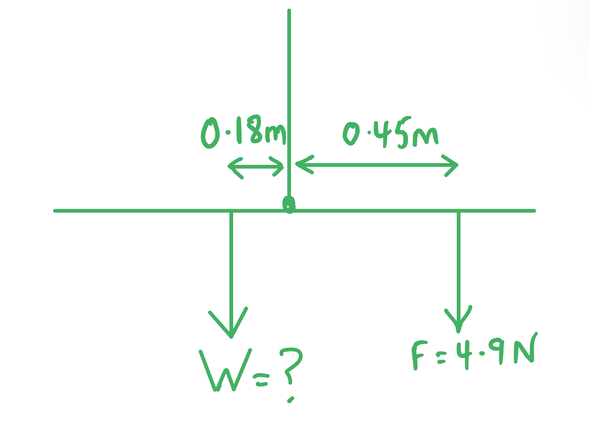

Apply the principle of moments to the point where the string is attached to the broom:

- Sum of anti-clockwise moments = sum of clockwise moments
- $W\times0.18=4.9\times0.45$ **[1 mark]**
- $W=\frac{4.9\times0.45}{0.18}=12.25$
- $W = 12 \mathrm{N} ( 2 \mathrm{s} . \mathrm{f} . )$ **[1 mark]**

**[Total: 2 marks]**

> *Many students are reluctant to 'waste time' sketching diagrams which don't get marks. This is not a waste of time!*

> *The diagram ensures you write the correct values in your calculation.*

> *Although not marked directly, it is an essential part of the process to find the solution.*

### Q6
Calculate the value of *W*

Write an expression for *T*P in terms of *T*Q :

- $T_{Q}=6T_{P}$ **[1 mark]**

Determine the value of *W* by setting up simultaneous equations:

Apply the principle of moments around **P**:

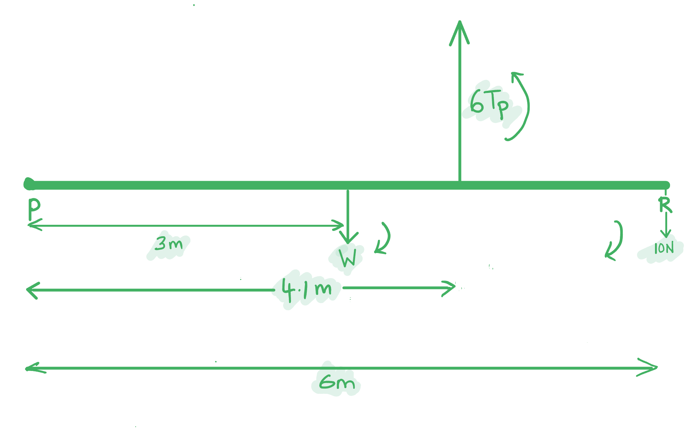

- sum of the clockwise moments = sum of the anti-clockwise moments
- $3 W + ( 10 \times 6 ) = ( 4.1 \times 6 T_{P} )$
- $3W+60=24.6T_{P}$
- $T_{P}=\frac{3W+60}{24.6}$ *(equation 1)*** [1 mark] **

Apply the principle of moments around **Q**:

Sketch a diagram showing measurements and forces:

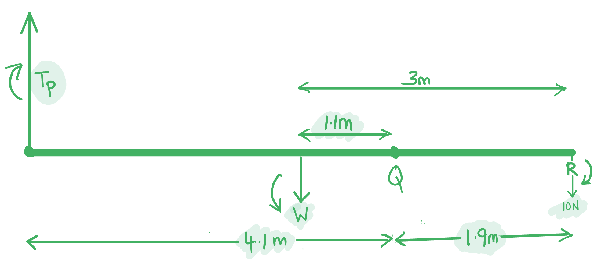

- sum of the clockwise moments = sum of the anti-clockwise moments
- $( 10 \times 1.9 ) + 4.1 T_{P} = 1.1 W$
- $4.1T_{P}=1.1W-19$
- $T_{P}=\frac{1.1W-19}{4.1}$ *(equation 2)*** [1 mark]**

Combine *equations 1* and* 2* to find *W*:

- $\frac{3W+60}{24.6}=T_{P}=\frac{1.1W-19}{4.1}$ **[1 mark]**
- $4.1 \times ( 3 W + 60 ) = 24.6 \times ( 1.1 W - 19 )$
- $12.3W+246=27.06W-467.4$
- $( 27.06 - 12.3 ) W = 246 + 467.4 \rightarrow 14.76 W = 713.4$
- $W = 48 \mathrm{N} ( 2 \mathrm{s} . \mathrm{f} . )$ **[1 mark] **

**[Total: 5 marks]**

> *Without a clear sketch showing all the distances and forces, you have a **much** smaller chance of setting up the correct simultaneous equations, especially with the different distances. It also helps clearly see which forces are clockwise or anticlockwise depending on where you take moments from. Although the sketch doesn't earn marks directly, it is good practice for getting the calculation right.*
Find the range of possible positions on the beam where the load can be attached without the rope at Q.

List the known quantities:

- Weight of load, *F* = 10 N
- Distance **PR** = 6.0 m
- Distance **QR** = 0.8 m
- Weight of the pole, *W* = 48 N (from part a)
- Maximum tension in rope at **Q**, *T*Qmax = 32 N

Make a sketch showing the forces and distances:

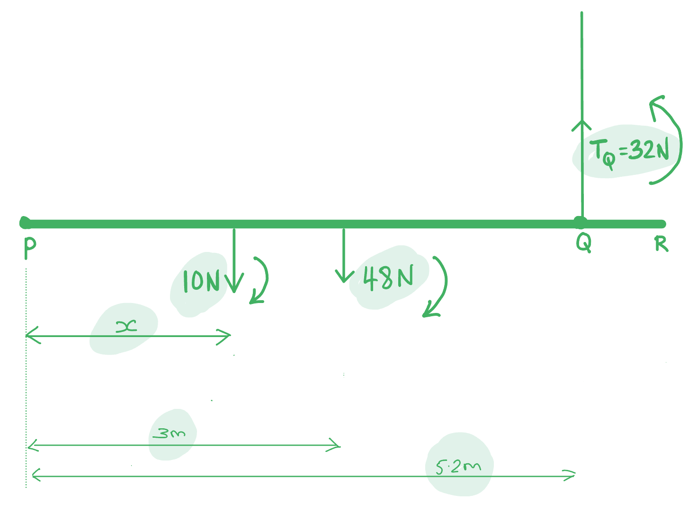

Apply principle of moments by taking moments about **P**:

- sum of clockwise moments = sum of anti-clockwise moments
- $( 10 x ) + ( 3 \times 48 ) = ( 5.2 \times T_{Q m a x} )$
- $10x+144=166.4$ **[1 mark]**
- $10x=166.4-144=22.4m$
- $x=\frac{22.4}{10}=2.24m$ **[1 mark]**

Deduce the range:

- $0m\leqx\leq2.24m$ **[1 mark]**

**[Total: 3 marks]**

> *Notice that the question asks for a **range**, meaning just an answer of 2.24 m will not get you full marks. **x = **2.24 m is just the maximum distance before exceeding the tension limit of the rope at **Q**. The load could be placed at a smaller **x** (i.e. closer to **P**).*

> *If you used the unrounded answer for weight from part a),  the calculated range would be *$0m\leqx\leq2.14m$* which would be awarded a mark.*

### Q7
(i) State the reason that the bus would topple to the left:

The bus begins to topple because:

- The line of action of the centre of gravity falls outside the base of the bus **OR** the anticlockwise moment (of the bus) is greater than the clockwise moment; **[1 mark]**

(ii) Explain what effect adding weights to the underside of the bus would be:

- Lower the centre of gravity; **[1 mark]**
- It could tilt more before toppling (to the left); **[1 mark]**
- Increases stability;** [1 mark]**

**[Total: 4 marks]**
Determine the height above the ground of the centre of mass of the bus when it is empty and normally parked:

Redraw the diagram as a triangle:

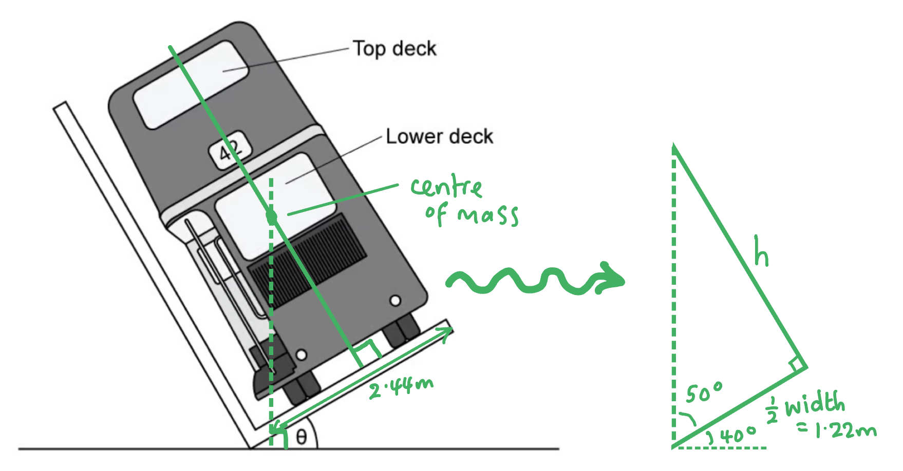

Either on the diagram or seen in later calculation

- Angle to be used in calculation = 50° **OR **short side of triangle = 1.22 m **[1 mark]**

Calculate the height of the centre of mass:

- $h = 1.22 \times \tan ( 50 ) = 1.5 \mathrm{m}$ **[1 mark]**

**[Total: 2 marks]**

> *Since A-level questions are more complex there are often 'intermediary' or 'working' marks for numbers seen within a calculation. In this case you are being awarded one mark for correctly deriving at least one of the values you will need to calculate.*

> *Your working is being rewarded so it's well worth showing it.*

> *The bus is not of uniform density, so it's centre of mass will not be in the centre of the object.*
(i) Calculate the new height of the centre of mass of the bus:

Determine the total mass of the 'passengers' and the empty bus:

- Mass of 'passengers', $m_{p}=65\mathrm{kg}\times60\mathrm{passengers}=3900\mathrm{kg}$
- Mass of empty bus, $m_{b}=7.47\mathrm{tons}\times1000\mathrm{kg}=7470\mathrm{kg}$

Model the bus as a horizontal rod and take moments:

**Method 1: take moments around the new centre of mass and calculate:**

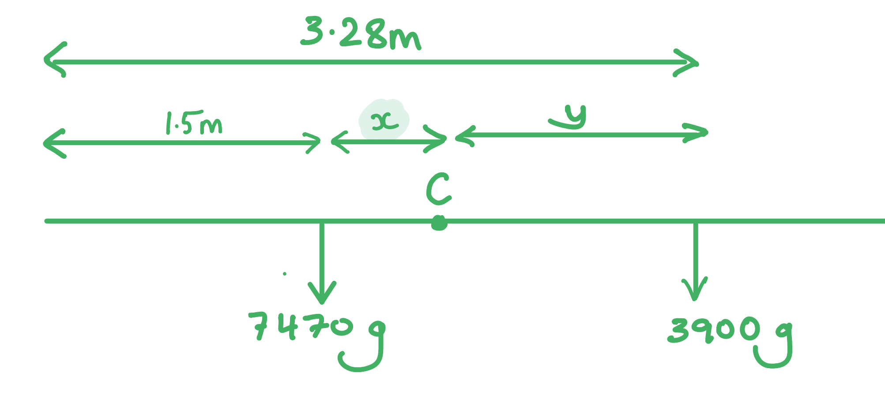

Set up simultaneous equations for *x* and *y*:

- In equilibrium, $7470g\timesx=3900g\timesy\rightarrow7470x=3900y$ (*equation 1*)
- Taking distance measurements, $1.5+x+y=3.28\rightarrowy=1.78-x$ (*equation 2*)

Substitute *equation 2* into *equation 1* and calculate:

- $7470x=3900y$
- $7470 x = 3900 \times ( 1.78 - x )$
- $7470x+3900x=6942$
- $x=0.61m$ **[1 mark]**

Add distances together to find the height of C above the road:

- new height, $h=1.5+0.61=2.11m$ **[1 mark]**

**Method 2: take moments about the road, assuming a combined mass, and calculate:**

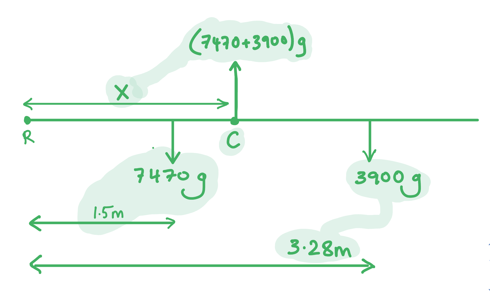

Apply the principle of moments around **R**::

- In equilibrium, $( 7470 g \times 1.5 ) + ( 3900 g \times 3.28 ) = ( 7470 g + 3900 g ) \times X$ **[1 mark]**

Calculate:

- $( 11 205 \cancel{g} ) + ( 12 792 \cancel{g} ) = ( 11 370 \cancel{g} ) \times X$
- $X=2.11m$ **[1 mark]**

(ii) Suggest why the test is done with the top deck weighted to capacity and the bottom deck left empty:

- This moves the centre of mass to the highest position / makes the bus the least stable it could be; **[1 mark]**

**[Total: 3 marks]**
(i) Deduce whether the bus has passed the safety test:

Set up a triangle to calculate the angle using trigonometry:

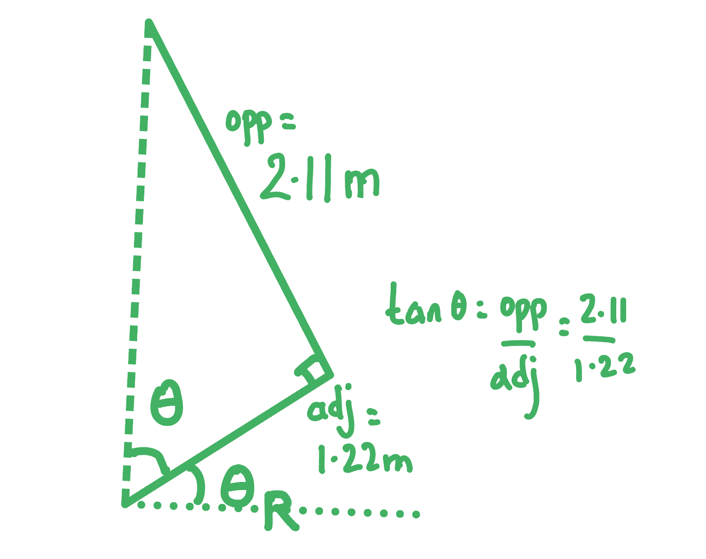

- Angle inside triangle, $\\theta = \tan ^{- 1} ( \frac{2.11}{1.22} ) = 60^{\circ}$
- Angle between bus and road, $θ_{R}=90-60=30^{\circ}$ **[1 mark]**

Draw a conclusion:

- The bus <u>tilted to more than 28°</u> without tipping so <u>yes</u> it does pass the safety test; **[1 mark]**

(ii) Explain whether all the passengers upstairs standing will make the bus fail its safety test.:

Calculate new angle between bus and road by moving the centre of mass 40 cm higher:

- $\\theta = \tan ^{- 1} ( \frac{2.11 + 0.4}{1.22} ) = 64^{\circ}$
- New angle between bus and road, $θ_{R}=90-64=26^{\circ}$

Draw a conclusion:

- The bus <u>tilts to less than 28°</u> without tipping so <u>yes</u> it will fail the safety test; **[1 mark]**

**[Total: 3 marks]**

> *For the final part of the question you could have recalculated the new centre of mass due to the passengers standing up. However, for only one mark, there is probably a quicker way.*

> *By simply moving the centre of mass up by the full 40 cm (which is the maximum it could possibly shift) we still find that the bus fails the safety test, so the question has been answered without the need for further calculation.*

### Q8
Centre of gravity is defined as...

- The point on an object at which a (resultant) force acts such that it will not create a moment / will not cause rotation
**OR**
The point at which all the (object’s) mass / weight acts; **[1 mark]**

**[Total: 1 mark]**

> *Careful with your wording, do **not** use definitions such as:*

- *Where mass is most concentrated*
- *It has the same mass on both sides*
- *All forces act through this point*
Calculate the vertical supporting force from the rock:

- The weight of 40 × *g* occurs at the centre of the (uniform) plank so *d* = ½ × 5.0
- Moment of plank from the bank = *mg* × *d*
- Moment of plank from the bank = (40 × *g*) × (½ × 5.0)
- Moment of plank from the bank = 40 × 9.81 × 2.5 = 981 N m **[1 mark]**

This moment is balanced by the reaction force from the rock

- Moment of plank from the rock = *F* × (5.0 – 1.1)
- Moment of plank from the rock = *F* × 3.9 **[1 mark]**

- Vertical force from rock:  $F=\frac{981}{3.9}$ = 251.5 = 250 N **[1 mark]**

**[Total: 3 marks]**
The forces acting on the plank when the boy has crossed some of the plank are:

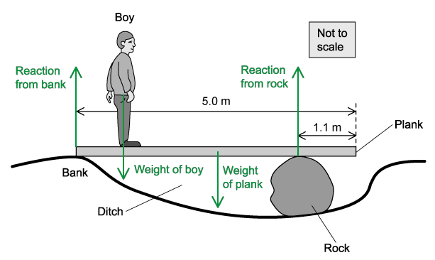

- Correctly drawn arrows; **[1 mark]**
- Correctly labelled arrows; **[1 mark]**

**[Total: 2 marks]**

> *When labelling the weight of an object, make sure to draw from the centre of mass of the object.*
Determine whether the boy can walk to the far end of the plank without it tipping:

- (At the point of tipping) there is no (reaction) force from the bank; **[1 mark]** *This point must be in words, not implied from a calculation*
- So, moments on the RHS of the rock must be lower than moments on the LHS

**Supporting calculation 1:**

- Taking moments about the rock to show RHS < LHS; **[1 mark]**
- 540 N m < 550 N m, therefore, plank will not tilt; **[1 mark]** *Example of calculation:*

  - LHS = (2.5 – 1.1) × 40 × *g *= 56 × 9.81 = 549.36 = 550 N m
  - RHS = 1.1 × 50 × *g *= 55 × 9.81 = 539.6 = 540 N m

**OR   Supporting calculation 2:**

- Showing a moment calculation that gives the maximum boy’s weight / mass that can be supported on the far edge of the plank (500 N / 51 kg) **[1 mark]**
- 50 kg < 51 kg, therefore, plank will not tilt; **[1 mark]** *Example of calculation:*

  - Maximum weight = $\frac{40\times9.81\times1.4}{1.1}$ = 499 = 500 N (or 51 kg)

**OR   Supporting calculation 3:**

- Showing a moment calculation that gives the maximum distance the boy can be from the rock without tipping (1.12 m) **[1 mark]**
- 1.1 m < 1.12 m, therefore, plank will not tilt; **[1 mark]** *Example of calculation:*

  - Maximum distance = $\frac{40\times1.4}{50}$ = 1.12 m

**[Total: 3 marks]**

### Q9
List the known quantities:

- Mass of rabbit, $m_{R}$= 2.5 kg
- Mass of quail, $m_{Q}$= 4.3 kg
- Mass of the plank, $m_{P}$= 20 kg
- Acceleration due to gravity, *g* = 9.81 m s–2

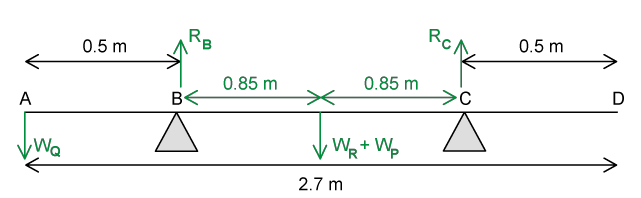

(i) The magnitude of the normal reaction force at B

Take moments about point C:

- Principle of moments: Sum of anti–clockwise moments = sum of clockwise moments about a pivot
- Anti­–clockwise moments about C = ($( W_{Q} \times d_{Q} )$+ ( $W_{R}+W_{P}$ ) × $d_{P}$) where $d_{C}$ and $d_{P}$ are perpendicular distances from the pivot to the weight of the quail and the plank, respectively
- Clockwise moment about C = $R_{B}$× $d_{B}$

Calculate the normal reaction force at B, $R_{B}$:

- (4.3*g* × (2.7 – 0.5)) + ((2.5*g + *20*g*) × (0.85) = $R_{B}$× (0.85 + 0.85) **[1 mark]**
- 9.46*g* + 19.125*g* = $R_{B}$× 1.7
- $R_{B}$= $\frac{9.46g+19.125g}{1.7}$= 16.81*g* = 16.81 × 9.81 = 164.9 = 165 N **[1 mark]**

(ii) The magnitude of the normal reaction force at C

Equate vertical forces:

- Since the plank is in equilibrium, all the forces upwards = all forces downwards
- Forces upwards =$R_{B}$+ $R_{c}$
- Forces downwards = $W_{Q}$+ $W_{R}$ +$W_{P}$

Calculate normal reaction force at C, $R_{c}$:

- 16.81*g *+$R_{c}$ = 4.3*g* + 2.5*g *+ 20*g *= 26.8*g ***[1 mark]**
- $R_{c}$= 26.8*g* – 16.81*g* = 9.99*g* = 9.99 × 9.81 = 98.00 = 98 N (2 s. f.) **[1 mark] **

**[Total: 4 marks]**** **

> *This question gives the masses of the animals instead of their weight. Whether you multiply by **g** to get the weight during the calculation or at the end is up to you. In some instances where there are a lot of calculations, it is easier to only multiply by **g **(to calculate their weight) at the very end to avoid numerical errors. *

> *Students often forget about the fact that the vertically upwards forces must also equal the vertically downwards forces for a system to be in equilibrium too. Therefore, you do not need to take moments again for part (ii).*
List the known quantities:

- Mass of rabbit, $m_{R}$= 2.5 kg
- Mass of quail, $m_{Q}$= 4.3 kg
- Mass of the plank, $m_{P}$= 20 kg
- Acceleration due to gravity, *g* = 9.81 m s–2

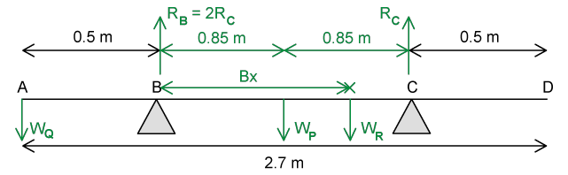

Equate vertical forces:

- Since the plank is in equilibrium, all the forces upwards = all forces downwards
- Forces upwards = $R_{B}$+ $R_{c}$= 2$R_{c}$+ $R_{c}$= 3$R_{c}$
- Forces downwards = $W_{Q}$+ $W_{R}$+ $W_{P}$

Calculate normal reaction force at C, $R_{c}$:

- 3$R_{c}$= 4.3*g* + 2.5*g *+ 20*g *= 26.8*g ***[1 mark]**
- $R_{c}$= $\frac{26.8g}{3}$= 8.933*g* (= 87.636 N) **[1 mark]**

Take moments about** **B:

- Anti–clockwise moments about B = ( $W_{Q}\timesd_{Q}$) + ( $R_{c}\timesd_{c}$ )
- Clockwise moments about B = ($W_{P}\timesd_{P}$ ) + ($W_{R}\timesd_{R}$)

Calculate distance BX, $d_{R}$:

- (4.3*g* × 0.5) + (8.933*g *× (0.85 + 0.85) = (20*g *× 0.85) + (2.5*g *× $d_{R}$) **[1 mark]**
- 2.15*g* + 15.1861*g* = 17*g* + (2.5*g *×$d_{R}$)
- $d_{R}$= BX** **= $\frac{2.15g+15.1861g-17g}{2.5g}$ = 0.13 m **[1 mark]**** **

**[Total: 4 marks]**** **

> *Labelling all the forces and distances on the diagram in your exam is essential for moments questions. This helps calculate any missing distances. *

> *Whenever any point moves in a moments question, the reaction forces upwards will also change. Therefore, *$R_{c}$* and *$R_{B}$* are not the same as in part (a) for this part (b). *

> *The point where the pivot is taken from doesn’t actually matter (because the Principle of Moments will always be true, about any pivot), so you will still get the same final answer. However, since we do not know in this question (it is different to part (a)), then if we take moments about B then we do not need to worry about this force. The key is to take moments about a point where you don’t know the value of the force: this way, the unknown force will not appear in your moments equations (since **d** will be 0).*
List the known quantities:

- Weight of load, *F* = 17 N
- Distance PR = 4 m
- Distance QR = 4 − 2.4 = 1.6 m
- $T_{Q}=7T_{P}$

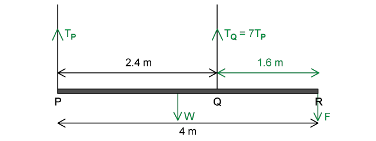

Equate vertical forces:

- Since the plank is in equilibrium, all the forces upwards = all forces downwards
- Forces upwards: $T_{P}$+ $T_{Q}$ = $T_{P}$ + 7$T_{P}$= 8$T_{P}$
- Forces downwards: *W* + *F*
- 8$T_{P}$= *W* + *F* = *W* + 17 **[1 mark]**

Determine the equation for the tension in the rope at P, $T_{P}$:

- Taking moments about point Q
- Anti­–clockwise moment about Q = (*W* × $d_{W}$ ) where $d_{W}$ is the distance of the weight *W* from Q
- Clockwise moments about Q = ($T_{P}$× $d_{P}$) + (*F *× $d_{F}$) where $d_{P}$ and $d_{F}$ are the distance of P and the force from the load *F* from Q respectively
- (*W* × (2.4 – 2)) = ($T_{P}$× 2.4) + (17 × 1.6)
- 0.4*W* = 2.4$T_{P}$+ 27.2 **[1 mark]**

Calculate the weight of the pole, *W*:

- 8$T_{P}$ = *W* + 17 and 0.4*W* = 2.4$T_{P}$+ 27.2
- $T_{P}$ = $\frac{W}{8}$+ 2.125
- 0.4*W* = 2.4($\frac{W}{8}$+ 2.125) + 27.2 = 0.3*W* + 5.1 + 27.2 ** [1 mark]**
- 0.1*W* = 32.3
- *W* = 323 N **[1 mark]**** **

**[Total: 4 marks]**** **

> *Look out for simultaneous equations! This is where you can set up the same number of unique equations as there are unknown variables. In this question, there are two equations with two unknowns (**W** and *$T_{P}$*). *

> *If you’d like to refresh your maths skills on this topic, then check out the Save My Exams GCSE Maths revision notes on ‘Linear Simultaneous Equations’.*
List the known quantities:

- Weight of load, *F* = 17 N
- Distance PR = 4 m
- Distance QR = 0.8 m
- Distance PQ = 3.2 m
- Weight of the pole, *W* = 323 N (from part c)
- Max $T_{Q}$ = 212 N

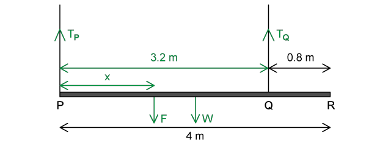

Determine equation for tension at Q, $T_{P}$:

- Take moments about P
- Anti­–clockwise moment about P =$T_{Q}$ × $d_{Q}$  where $d_{Q}$ is the distance of Q from P
- Clockwise moments about P = (*F* × $d_{F}$) + (*W *× $d_{W}$) where $d_{F}$ and $d_{W}$ are the distance of the force *F* and the weight *W* from P respectively
- $T_{Q}$ × 3.2 = 17*x *+ (323 × 2) **[1 mark]**
- 3.2 $T_{Q}$= 17*x *+ 646
- $T_{Q}$= 5.31*x* + 202 **[1 mark]**

Calculate the range of values for *x*:

- $T_{Q}$< 212 therefore, 5.31*x* + 202 < 212
- *x *< 1.88
- 0 < *x *< 1.88 m **[1 mark]**** **

**[Total: 3 marks]**** **

> *When you are asked for a ‘range’ of values, there is likely to be inequality. These are equations with the ‘less than’ (<) or ‘more than’ (>) symbols, and they can be rearranged exactly like regular equations. Just remember if you multiply or divide both sides of an inequality by a negative number, the direction of the inequality sign switches! *

> *The details of the rearranging for the inequality are shown below:*

> *5.31**x** + 202 < 212*

> *Subtract 202 from both sides:*

> *5.31**x** < 10*

> *Divide both sides by 5.31:*

> *x** < 1.88 *

### Q10
Describe what the student could do to ensure that the ruler is horizontal:

**Final answer:** **Any one ****pair ****from:**

- Measure height from bench to ruler in several places; **[1 mark]**
- Check the measurements are all the same; **[1 mark]**
- Place spirit level on the ruler; **[1 mark]**
- Bubble should be central; **[1 mark]**
- Measure angle between the ruler and the stand; **[1 mark]**
- Check it is a right angle; **[1 mark]**
- Place set square (triangle) at the join of the ruler and stand; **[1 mark]**
- Make sure the angle is a right angle; **[1 mark]**
- Set a marker level with the pivot; **[1 mark]**
- Ensure it is the same height as the end of the ruler; **[1 mark]**

**[Total: 2 marks]**
The student intends to investigate moments around the pivot:

(i) State the equation linking moment, force and distance from the pivot:

- $M=F\timesd$ **OR **moment = force × distance; **[1 mark]**
- Where *F* = force / applied load and *d* = <u>perpendicular</u> distance from the pivot; **[1 mark]**

(ii) Calculate the moment of the 3.0 N weight:

List the known quantities:

- *F* = 3.0 N
- *d* = 70 cm = 0.7 m

Calculate the moment and write final answer with units:

- $M=3.0\times0.7$ **[1 mark]**
- $M=2.1\mathrm{Nm}$ **[1 mark]**

**[Total: 4 marks]**

> *When calculating moments it is acceptable to calculate distance using centimetres rather than metres (unless stated otherwise), but you **must **state the unit, which would be N cm in that case.*
(i) Infer, showing your calculation, why the student made this assumption:

Apply the principle of moments:

- clockwise moment = anti-clockwise moment **OR **$2.1\mathrm{Nm}=F_{m}\times0.15m$ **[1 mark]**
- Force read from forcemeter, $F_{m}=\frac{2.1}{0.15}=14N$ **[1 mark]**

(ii) Explain why the correct reading should be **larger **than 14 N:

- The mass / weight of the ruler; **[1 mark]**
- Acts in the clockwise direction / has been ignored;** [1 mark]**

(iii) Explain why the actual reading is only 10 N:

- The scale on the forcemeter only goes up to 10 N; **[1 mark]**

**[Total: 5 marks]**

> *If you found yourself stuck for the final part of this question, then you had forgotten that in part (a) the question told you the forcemeter **only went up to 10 N**.*

> *When you find yourself at a loss to answer any question it is **always **worth going back to the start and reading the previous subparts again. Often you will have forgotten small details which didn't seem important but are relevant now.*
Student **A** feels more force on their hands than student **B **because:

- The desk is in <u>equilibrium</u> so the clockwise moment = anti-clockwise moment; **[1 mark]**
- The books are closer to **A** / further from **B** **OR ***d*A < *d*B; **[1 mark]**
- Therefore force at A is larger / force at B is smaller /** ***F*A > *F*B  / force and distance are inversely proportional to create the same moment; **[1 mark]**

**[Total: 3 marks]**

> *If you are writing your mark scheme with reference to **d**A** < **d**B** and **F**A** > **F**B**, make sure these are correctly labelled on Fig 1.2 so the examiner can see exactly what you're referring to. You should avoid stating variables that you have no stated the meaning of or annotated on a diagram.*
