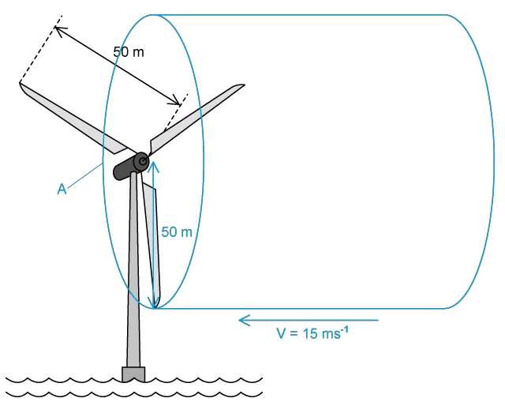
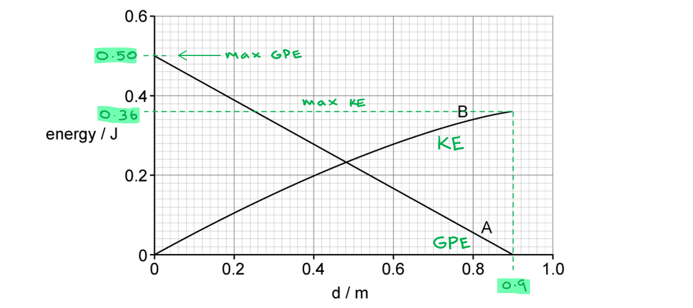
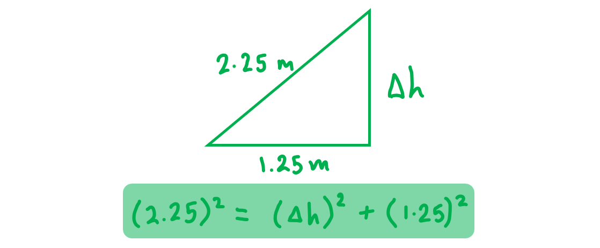
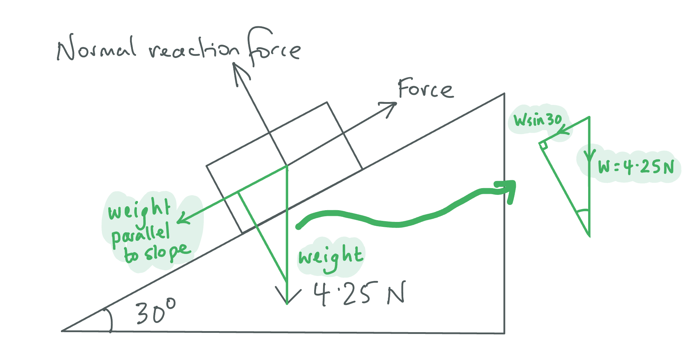
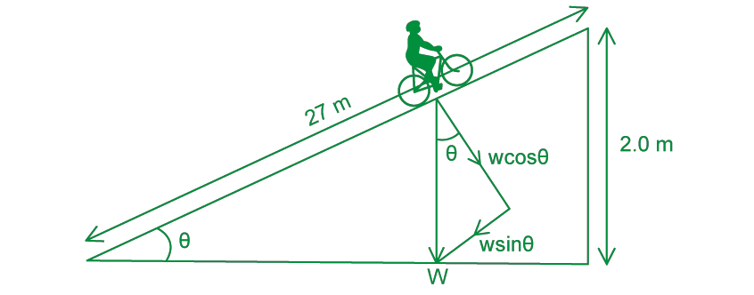
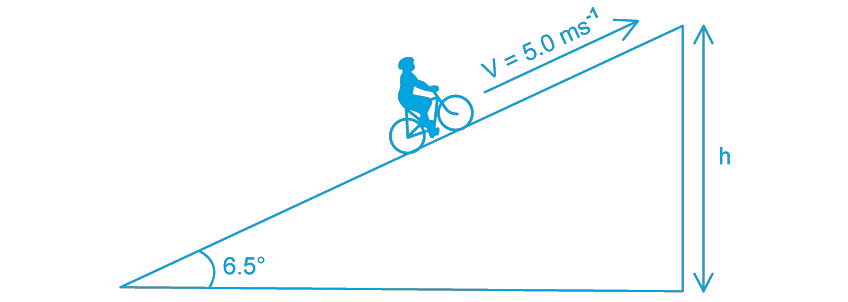
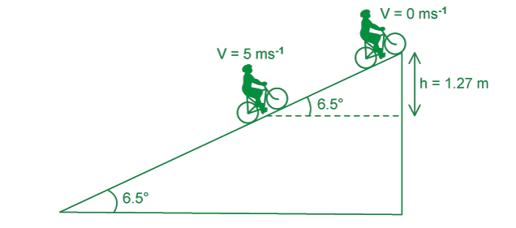
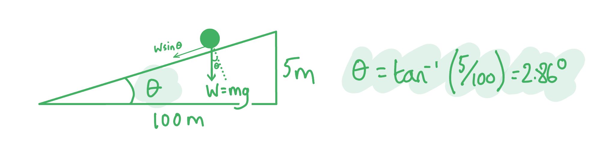

# Mark Schemes — Energy Conservation
**5. Work, Energy & Power** · Cambridge (CIE) AS physics (9702)

## Multiple Choice Questions (34 questions)

### Q1
**Final answer:** **The correct answer is B **

- The kinetic energy of the flowing water causes the turbine to rotate, which is then converted to electrical power
- Kinetic energy is given by

$E_{k}=\frac{1}{2}mv^{2}$

- The speed is known, so to find the mass flow rate:

Mass flow rate = density × volume flow rate

- Where

  - density of water = 1000 kg m-3
  - volume flow rate = 15 m3 s-1

Mass flow rate = 1000 × 15 = 15 000 kg s-1

- Power from flowing water is

$P = \frac{ \text{energy} }{ \text{time} } = \frac{m v^{2}}{2 t} = 1 \frac{1}{2} ( \frac{m}{t} ) v^{2}$

- Efficiency = 40%, so only 40% of the power of the flowing water is converted to electrical power
- Electrical power is

$P = 0.40 \times ( 0.5 \times 15000 \times 8.0^{2} ) = 192 000 \text{ W} = 192 \text{ kW}$

$P \approx 190 \text{ kW} ( 2 \mathrm{s} . \mathrm{f} . )$

### Q2
**Final answer:** **The correct answer is ****C**** because:**

- Efficiency$= \frac{u s e f u l m e c h a n i c a l o u t p u t p o w e r}{t o t a l e l e c t r i c a l p o w e r} = 80 \%$
- Useful mechanical output power = 120 W
- Input power $=\frac{usefulmechanicaloutputpower}{efficiency}=\frac{120}{0.8}=150W$
- Waste heat power = input – output = 150 – 120 = 30 W

### Q3
**Final answer:** **The correct answer is ****B**** because:**

- Efficiency = $\frac{usefuloutputpower}{totalpowerinput}$
- We know the power output is = 150 kW = 150 × 103 W
- Power input = $20\times40MJ=20\times40\times10^{6}$
- We must convert the fuel consumption into litres per second

  - In one hour, the fuel consumed is 20 litres
  - In one minute, the fuel consumed is  $\frac{20}{60}$ litres
  - In one second, the fuel consumed is  $\frac{20}{60\times60}$ litres
- So, power input = $\frac{20\times40\times10^{6}}{60\times60}$
- Efficiency = $\frac{outputpower}{powerinput}=\frac{150\times10^{3}}{\frac{20\times40\times10^{6}}{60\times60}}=\frac{150\times10^{3}\times60\times60}{20\times40\times10^{6}}$

### Q4
**Final answer:** **The correct answer is ****C**** because:**

- Work done = Force applied × displacement in the direction of force
- The question asks how much energy is converted to heat energy; this energy comes from the friction experienced by mass *m* moving up the rough plane
- In this case the forces acting on the mass are its weight W, the frictional force F and the tension T in the string holding the mass which is equal to the weight of mass *M*, so we can write

  - Vertical force on mass *M *: $T=Mg$
  - Weight of mass *m *: $W=mg$
  - Vertical forces on mass *m *: $F+W=T$
  - Therefore, the frictional force is : $F=T-W=Mg-mg$
- Vertical displacement by mass *M = *$x$
- Work done by mass *M = *$Mgx$
- Vertical displacement by mass * *$m=y$
- Work done by mass *m *$m=mgy$
- Amount of energy converted to heat : $Mgx-mgy$

### Q5
**Final answer:** **The correct answer is ****B**** because:**

- Power is defined as the rate of transfer of energy or work done
- In equation form this can be written as

  - Power, $P=\frac{energy}{time}$  or $P=\frac{workdone}{time}$
- Work done = Force × displacement =$F\timess$

  - $P=\frac{workdone}{time}=\frac{Fs}{t}=Fv$
  - Where speed, $v=\frac{s}{t}$
- Therefore, $P=Fv$

### Q6
**Final answer:** **The correct answer is ****B**** because:**

- In this question we need to consider conservation of energy since energy is being transformed form one form into another
- The kinetic energy of the water is being converted into gravitational potential energy of the water
- However, since the efficiency of the pump is only 10%, only 10% of the kinetic energy is converted into GPE
- 10% of KE of the water = GPE of water lifted

  - $0.1\times\frac{1}{2}mv^{2}=m_{w}g\Deltah$
- Where *m**w* is the mass of the water lifted

  - $0.1\times\frac{1}{2}\times500\times2^{2}=m_{w}\times9.81\times15$
  - $m_{w}=\frac{0.1\times500\times4}{2\times9.81\times15}=0.68\mathrm{kg}$
- Therefore, 0.68 kg of water could be lifted by 15 m

### Q7
**Final answer:** **The correct answer is D because:**

- Power is equal to = $P=\frac{E}{t}=\frac{Fs}{t}=Fv$
- Force is defined as the rate of change of momentum, so, we first need to find an expression for force in order to find the power
- sand drops vertically on to the belt at a rate of $m\mathrm{kg}s^{-1}$

  - Therefore, the rate at which the sand falls is = $\frac{\Delta m a s s}{t i m e} = ( \frac{\Delta m}{t} ) = \mathrm{m} \text{kg} \mathrm{s}^{- 1}$
- Next, consider the momentum : $p=Mv$
- Rate of change of momentum = $\frac{\Delta p}{t} = \frac{M v}{t} = ( \frac{\Delta M}{t} ) v = m v$

  - Therefore, in one second, the momentum of mass m of sand increases from Zero to mv
- Recall the force is defined as the rate of change of momentum, so the force involved is mv
- Force = rate of change of momentum = $mv$

  - so, Power = $Fv=mv\timesv=mv^{2}$

### Q8
**Final answer:** **The correct answer is ****C**** because:**

- Power $=\frac{workdone}{timetaken}=\frac{force\timesdisplacement}{timetaken}$
- Since the anchor is fixed to the pier, the boy will not be able to move it, regardless of how much force he applies, he can only move the boat towards the pier
- Hence, the work done and power will be close to zero in Diagram (a)
- For the freely floating boat Q, there is a higher chance that the boy will be able to move himself and boat Q for a distance
- A higher force will be required by the boy to travel the same distance as in Diagram (a)
- Hence, more work is done and a power output substantially larger than zero will be required in Diagram (b)
- Therefore, both work done *W**b* and power output *P**b* will be higher than work done *W**a* and power output *P**a*

  - $W_{a}<W_{b}andP_{a}<P_{b}$

**A **is incorrect because this is statement is telling us that it requires less energy and power output to pull the boat towards the pier than boat Q

**B & D **are incorrect because since the mass of the pier and boat Q vary greatly, the work done and power outputs to pull boat P towards them cannot be the same

### Q9
**Final answer:** **The correct answer is ****B**** because:**

- To stack the blocks on top of each other, we only need to lift three of them, as the bottom block is already on the table
- When on the ground, a block has zero gravitational potential energy
- When at a height *x* above the ground, the gravitational potential energy of a block is *mgx*
- So, the work that needs to be done to lift a block from the ground to a height *x* is *mgx*, where *x *will equal *h*, 2*h*, 3*h*

  - The first block is lifted by a height *h*, so, work done = *mgh*
  - The second block is lifted by a height 2 *h*, so, work done = 2 *mgh*
  - The third block is lifted by a height 3 *h*, so, work done = 3 *mgh*
- Total work done = *mgh *+ 2 *mgh* + 3 *mgh* = 6 *mgh*

### Q10
**Final answer:** **The correct answer is ****C**** because:**

- Power is defined as the rate of transfer of energy or work done
- In equation form this can be written as

  - Power, $P=\frac{energy}{time}$ or $P=\frac{workdone}{time}$

**A **is incorrect because this equation describes how to calculate work done

**B **is incorrect because this is a correct formula for power but it derived from $Power=\frac{workdone}{time}$

**D **is incorrect because this is not a correct formula, it doesn’t have a physical equivalent

### Q11
**Final answer:** **The correct answer is C because:**

- We are told the resistive force F is proportional to $v^{2}$

  - $Fαv^{2}$
  - $F=kv^{2}$     where k is constant
- When F=800 N, V = 20 m s−1

  - $k = \frac{F}{v^{2}} = \frac{800}{( 20 )^{2}} = 2$
- so, $F=2v^{2}$
- Power output is equal to $P=Fv$
- Since $F=2v^{2}$ we have :

  - Output power $P = F v = ( 2 v^{2} ) \times v = 2 v^{3}$
- So, when $V=40ms^{-1}$

  - Output power $P = 2 v^{3} = 2 \times ( 40 )^{3} = 128 000 \mathrm{W}$
- Therefore, the effective power output is 128 kW

### Q12
**Final answer:** **The correct answer is ****B**** because:**

- From conservation of energy:
- The potential energy (PE) lost in falling from P to T = Kinetic energy (KE) of mass at T

  - $E = 1 \frac{1}{4} m ( 4 )^{2} = 8 m$
- Since the mass is at rest at P, its KE is zero and its PE is at a maximum
- Since T is the lowest point, PE is zero here
- So, the total energy of the mass in the system is *E*
- In general, PE lost at a point = KE at that point
- From above, *E* = 8*m*, so, a PE loss of $\frac{E}{4}=2m$

  - At R : $E_{k} = 1 \frac{1}{2} m ( 2 )^{2} = 2 m = E_{p} l o s t$
- Therefore, when the mass is at R, it has half the final speed and so has gained a kinetic energy of $\frac{E}{4}$, this is when it has lost a potential energy of  $\frac{E}{4}$

**A **is incorrect because  At Q : $E_{k} = 1 \frac{1}{2} m ( 1 )^{2} = 0.5 m = E_{p} l o s t$ , this is a loss of $\frac{E}{16}$

**C **is incorrect because At S :$E_{k} = 1 \frac{1}{2} m ( 3 )^{2} = \frac{9}{2} = E_{p} l o s t$, this is a loss of $\frac{16E}{9}$

**D **is incorrect because At R : $K E = 1 \frac{1}{2} m ( 2 )^{2} = 2 m = P E l o s t$, this is a loss of  $\frac{E}{4}$

### Q13
**Final answer:** **The correct answer is ****C**** because:**

- Power $\frac{workdone}{timetaken}=\frac{force\timesdistance}{timetaken}=force\timesvelocity$
- The track is frictionless, so, no frictional force acts on the mass
- If the track was horizontal the power required to give the mass *m* a forward acceleration *a* when it is moving with velocity *v* is given by

  - Power $P = F v = ( m a ) \times v = m a v$              **(1)**
- But in this case, the track is inclined at an angle *θ* to the horizontal
- The component of the weight of the mass (against motion) along the track is equal to $=mg\mathrm{sin}θ$
- Therefore, a force is required to keep the mass stationary and prevent it from moving down along the inclined track
- This force should be equal in magnitude to the component of the weight so that the resultant acceleration (when considering only the component of the weight and this force) is zero
- This force would result in a power equal to

  - Power $P=mg\mathrm{sin}θ\timesv=mgv\mathrm{sin}θ$     **(2)**
- Total power required is given by adding Equation **(1)** and Equation **(2)**:

  - Total power = $mav+mgv\mathrm{sin}θ$

### Q14
**Final answer:** **The correct answer is ****C**** because:**

- The Principle of Conservation of Energy states that energy cannot be created or destroyed, it can only be transferred from one form to another
- In other words, the total energy of an **isolated** system remains constant
- An isolated system is defined as a system that is closed off from its surroundings and this means that a system always has the same amount of energy, unless it's added from an external source
- Identifying the system is the most difficult part of conservation questions. Let’s take a look at an example of a ball tossed up in the air:
- *During the throw:*

  - Chemical energy from your muscles → kinetic energy of the ball
- *As the ball reaches its maximum height:*

  - Kinetic energy of the ball → gravitational potential energy of the ball
- *As the ball falls down:*

  - Gravitational potential energy of the ball → kinetic energy of the ball
- The isolated system in this scenario is simply the ball, the muscles in the person’s arm, and the Earth’s gravitational field. It’s not necessary to consider the chemical energy from the food the person ate or the gravitational fields of other bodies such as the sun or moon, for example

**A & D **are incorrect because these describe equations to work out work done and power, but they don’t describe conservation of energy

**B **is incorrect because this is close to the classic definition ‘energy cannot be created or destroyed; it can only be transferred from one form to another’ but if you look closely you will see this definition states that energy cannot be transformed which is incorrect

### Q15
**Final answer:** **The correct answer is ****D**** because:**

- Power is defined as the rate of transfer of energy or work done
- This can be written as $P=\frac{energy}{time}$
- Time = 10 ns = 10 × 10–9 s

  - $P=\frac{0.20}{10\times10^{-9}}=2\times10^{7}W$
- 1 MW = 1 × 106 W

  - $P=2\times10^{7}W=20\mathrm{MW}$
- Therefore, the average power output of the laser 20 MW

### Q16
**Final answer:** **The correct answer is ****B**** because:**

- The kinetic energy of the air causes the wind turbine to rotate which is then converted to electrical power

  - Kinetic energy of air = $\frac{1}{2}mv^{2}$
- The speed is known so we need to find the mass using:

  - Density = $\frac{mass}{volume}$, so, mass = density × volume
  - Density of air = 1.3 kg m–3
- The wind speed is 10 m s–1 and this wind blows on an area of 2000 m2
- This means in one second, a column of air of 10 m in length and with an area of 2000 m2 moves past the blades of the wind turbine

  - This is equivalent to a volume of 10 × 2000 = 20 000 m3 s–1
- The mass of air passing the blades per second = density × volume of air per second
- Mass of air passing the blades per second : $\frac{m}{t}=1.3\times20000=26000\mathrm{kg}s^{-1}$

  - Power from wind = $\frac{e n e r g y}{w i n d} = \frac{m v^{2}}{2 t} = 1 \frac{1}{2} ( \frac{m}{t} ) v^{2}$
- Efficiency = 50%, so, only 50% of the power of the wind is converted to electrical power

  - Electrical Power = $0.50 \times ( 0.5 \times 26 000 \times 10^{2} ) = 650 000 = 650 \text{kW}$

Therefore, the electrical power output of the turbine is 650 kW

### Q17
**Final answer:** **The correct answer is ****C**** because:**

- From the conservation of energy, the sum of energies at position 2 or 3 should be equal to the initial amount of gravitational potential energy the student possesses at position 1
- At position 2, the rope fully unwinds but it does not stretch. So, it does not have elastic potential energy. The kinetic energy is maximum at position 2
- At position 3, the rope is stretched. So, the elastic potential energy will reach a maximum
- At this position, the lowest point of the jump is reached, so, the student will not move any further, thus, the kinetic energy will be at a minimum

### Q18
**Final answer:** **The correct answer is ****D**** because:**

- The efficiency of a transformer is the ratio of the power output of the process to the total power input to the system
- Efficiency$=\frac{usefulpoweroutput}{totalpowerinput}$
- Power can be calculated using : $P=VI$
- Useful power output $=240\times1200=288000$
- Total power input = $11000\times28=308000$

  - % Efficiency = $\frac{u s e f u l p o w e r o u t p u t}{t o t a l p o w e r i n p u t} \times 100 \%$
  - % Efficiency = $\frac{288000}{308000} \times 100 \% = 93.5 \%$
- Therefore, the efficiency of the transformer is 94%

### Q19
**Final answer:** **The correct answer is ****A**** because:**

- Power is the rate of transfer of energy

  - $Power=\frac{energy}{time}$
- Water in the lake possesses gravitational potential energy

  - $P o w e r = \frac{\Delta E_{p} }{t} = \frac{m g \Delta h}{t} = ( \frac{m}{t} ) g \Delta h$
- The mass flow rate of the water $( \frac{m}{t} )$ is 2400 kg min–1
- This means that every minute, 2400 kg of water flows through the turbine

  - In 60 s, 2400 kg of water flows
  - Therefore, in 1 s, $\frac{2400}{60}=40\mathrm{kg}$ of water flows
- The mass flow rate is equal to $\frac{m}{t}$ = 40 kg s-1

  - Power of water = $( \frac{m}{t} ) g \Delta h = 40 \times 9.81 \times 90 = 35 316$ W
- This is the maximum power available from the turbine, however, the turbine has an efficiency of 75%

  - Power output of the turbine = $0.75\times35316=26487=26\mathrm{kW}$

### Q20
**Final answer:** **The correct answer is ****D**** because:**

- Average, or mean, power is defined as the rate of transfer of energy or work done
- In equation form, this can be written as

  - Power, $P=\frac{\mathrm{energy}}{\mathrm{time}}$  or  $P=\frac{\mathrm{work} \mathrm{done}}{\mathrm{time}}$
- Work done = Force × displacement = $Fs$

  - $P=\frac{\mathrm{work} \mathrm{done}}{\mathrm{time}}=\frac{Fs}{t}=Fv$
- In scenario D :

  - Force, *F* = 1.5 kN
  - Speed, *v* = 6 m s–1
- $P=Fv=1.5\times6=9\mathrm{kW}$
- This operation gives the largest mean power, see the incorrect table for the other calculations

**A **is incorrect because $P=Fv=0.4\times20=8\mathrm{kW}$

**B **is incorrect because $P=Fv=3\times2=6\mathrm{kW}$

**C **is incorrect because $P=Fv=5\times1=5\mathrm{kW}$

### Q21
**Final answer:** **The correct answer is ****D**** because:**

- From the conservation of energy, the sum of energies halfway and at the bottom of the jump should be equal to the initial amount of gravitational potential energy the student possesses at the beginning of the jump
- When the jumper is halfway down, the rope will unwind fully but it will not have stretched yet. So, it will have a small elastic potential energy
- The kinetic energy will reach a maximum halfway down
- The graph below might give you a clearer image
- Point X shows the point where the jumper starts to be restricted by the pull of the rope
- Before X, the jumper undergoes free fall and hence the speed and kinetic energy increases
- After X, the elastic potential energy of the elastic rope starts increasing – this corresponds to a drop in the kinetic energy of the jumper, according to the principle of conservation of energy
- When the jumper is halfway down, their possible location is shown on the graph, it can clearly be seen that the kinetic energy is greater than the elastic potential energy at this point, making D the correct answer

### Q22
**Final answer:** **The correct answer is ****D**** because:**

- Let’s consider the motion of the ball from the point of impact with the spring to the maximum compression of the spring
- From the conservation of energy :
- Loss in kinetic energy (KE) + gravitational potential energy (GPE) = work done to compress ball = gain in elastic potential energy in spring
- Loss in ball’s KE $=\frac{1}{2}mv^{2}$
- Gain in GPE = $mgy$
- Work done by ball = $Averageforce\timesdisplacement=F_{av}y$

  - $( 1 \frac{1}{2} m v^{2} - 0 ) + m g y = F_{a v} y$
  - $F_{av}=\frac{\frac{1}{2}mv^{2}+mgy}{y}$
  - $F_{a v} = \frac{m}{2 y} ( v^{2} + 2 g y )$

### Q23
**Final answer:** **The correct answer is ****B ****because:**

- Work done to stop vehicle = kinetic energy = 4.5 × 105 J
- Work done = Force × Distance
- Distance $=\frac{workdone}{force}=\frac{4.5\times10^{5}}{6000}=75m$

### Q24
**Final answer:** **The correct answer is ****D**** because :**

- From the question we are told :

  - Increase in gravitational potential energy =$E_{p}$
  - Increase in kinetic energy $=E_{k}$
  - Time taken $=t$
- Let the total gravitational energy be equal to E
- We know that gravitational energy is the sum of potential energy and kinetic energy so

  - $E=E_{p}+E_{k}$
- Let P be the power input of the mass
- Power is equal to $P=\frac{E}{t}$

  - Therefore : $P=\frac{E}{t}=\frac{E_{p}+E_{k}}{t}$

### Q25
**Final answer:** **The correct answer is ****B**** because:**

- Total weight of passengers = W = 20 mg
- Each passenger is moved a distance of 60 m as the escalator goes up
- The weight of the passengers acts vertically downwards
- There will be a component of weight acting down the slope of the escalator
- Component of weight acting parallel to the slope of the escalator

  - Where θ is the angle the escalator makes with the horizontal
  - $\mathrm{sin}θ=\frac{O}{H}=\frac{30}{60}=0.5$
  - The component of the weight force acting parallel to the slope is mg sin*θ *or* *0.5*mg*
- Work needs to be done against forces. Additionally, work should be done against the component of weight acting down the slope
- $P = \frac{E}{t} = \frac{ W}{t} = \frac{ F d}{t} = F ( \frac{d}{t} ) = F v$
- $P=2000+Fv$
- $P=2000+20mgv\mathrm{sin}θ$
- $P = 2000 + ( 20 \times 60 \times 9.81 \times 0.5 ) ( 0.75 )$ $=6414.5W=6.4\mathrm{kW}$

Therefore, the power required by the escalator is 6.4 kW

**Exam tip:** many calculation questions you will come across have multiple ways in which you can solve them. Another way you could solve this question would be to consider the gain in potential energy of the 20 passengers, try it out! Which method do you find easier ?

### Q26
**Final answer:** **The correct answer is ****B**** because:**

- The force due to the 100 N load causes the right end of the rope to accelerate downwards and simultaneously causes the left end to move upwards
- The force due to the 20 N on the force meter causes the left end to accelerate downwards and simultaneously causes the right end to move upwards
- Even if both the 100 N and the 20 N act downwards, they have opposite effects on the rope and the direction of turning of the wheel
- Since the 100 N load is greater than the 20 N force from the force meter, there is a resultant force acting downwards on the load. This force would cause the wheel to turn in a clockwise direction if not balanced by the motor
- To keep the load from moving, the wheel should also exert a force equal in magnitude and in opposite direction to the rope

  - From Newton's 3rd law since the resultant force of the rope is 100 – 20 = 80 N downwards
- So, the force exerted by the wheel on the rope is 80 N upwards
- The wheel turns in an anticlockwise direction at a rate of 50 revolutions per second
- This means the speed of the motor is 50 revolutions per second, and one revolution is equal to the circumference of the wheel, which is 0.3 m
- So, the distance moved against the force in one second, or its speed is $=50\times0.30=15ms^{-1}$

  - Power provided by motor $=Fv=80\times15=1200W=1.2\mathrm{kW}$
- Therefore, the power provided by the motor is 1.2 kW

### Q27
**Final answer:** **The correct answer is ****A**** because:**

- Efficiency is a quantity that describes a ratio of two similar appropriate quantities, so, the numerator and the denominator must have the same units
- In this scenario, we can give the efficiency in terms of input and output energy per day, we will need to use the following equations:
- $Efficiency=\frac{outputenergyperday}{totalenergyavailableperday}$
- $Power=\frac{energy}{time}$
- $Energy=Power\timesTime$

  - Output energy = Power station output × Number of seconds in one day
  - Output energy = *PS*
  - Total energy available per day = Number of trains per day × Mass of coal on a train × Energy from 1 kg of coal
  - Total energy available per day = *NMJ*
- Efficiency $\frac{outputenergyperday}{totalenergyavailableperday}=\frac{PS}{NMJ}$

### Q28
**Final answer:** **The correct answer is ****C**** because:**

- Work done = Force applied × displacement moved in the direction of force
- In this case the force acting on the mass is the tension in the string holding the mass which is equal to the weight *W* in this case
- The distance moved by the weight in direction of this force is *q*

  - So, work done $=W_{q}$

**A & D **are incorrect because if the force had also been given along the track then the work done could be represented as $F_{p}orF_{r}$  or , but since we do know the force in the vertical direction is weight *W*, then we can only specify the work done by the weight

**B **is incorrect because these displacements are in different directions, whereas work done requires the displacement to be in the same direction as the force

### Q29
**Final answer:** **The correct answer is ****B**** because:**

- At the top of the lake, the water has gravitational potential energy as it is above the ground
- As it passes through the turbine, the energy is converted to electrical energy, however, the system is only 90% efficient, so, not all of the gravitational potential energy becomes electrical energy

  - GPE of water $\DeltaE_{p}=mg\Deltah$
  - Input Power = $\frac{E}{t}=\frac{\DeltaE_{p}}{t}=\frac{mg\Deltah}{t}$
- The water passes through the turbine at a rate of 340 m3 per minute. This quantity represents the volume flow rate and has unit m3 per unit or  $\frac{\DeltaV}{t}$
- Volume flow rate = $\frac{\DeltaV}{t}=340m^{3}\mathrm{min}^{-1}$
- We need to convert this into SI unit

  - In 1 minute, a volume of 340 m3 passes through the turbine
  - In 1 second, a volume of $\frac{340}{60}=5.67m^{3}$ passes through the turbine
- So, the volume flow rate is $\frac{\DeltaV}{t}=5.67m^{3}s^{-1}$
- The formula for the input power above requires the mass, not the volume. We need to convert the volume flow rate into mass flow water or $\frac{\Deltam}{t}$
- Density is equal to $ρ=\frac{mass}{volume}=\frac{m}{v}$ , so , $\Deltam=ρV$
- We must divide by time to get the equivalent mass flow rate :

  - $\frac{\Deltam}{t}=\frac{ρV}{t}=1000\times5.67=5670\mathrm{kg}s^{-1}$
  - Input Power = $\frac{m g \Delta h}{t} = ( \frac{\Delta m}{t} ) g \Delta h$
  - Input Power $5670\times9.81\times30=1.67\times10^{6}W=1.67\mathrm{MW}$
- The overall efficiency of the system is 90%
- Therefore, output power = 0.90 × 1.67 = 1.5 MW

### Q30
**Final answer:** **The correct answer is ****B**** because:**

- From the principle of conservation of energy:

  - The sum of energies of blocks P and Q when Q is at position B should be equal to the initial amount of gravitational potential energy (GPE) the blocks possess when Q is at position A
- When the two blocks are at rest, they are above the ground so they both possess GPE
- After Q is released, it begins to move down and transfers GPE to kinetic energy (KE) as it increases in speed, this pulls block P up the slope with the same speed and hence the same KE
- We are told the surface of the slope is rough so block P does some work against friction
- Overall, the GPE at the beginning transfers to the KE of the blocks minus the heat loss due to friction on the slope, this can be written:

  - Loss in potential energy of the whole system = Gain in kinetic energy of the whole system + work done against friction due to block P moving against a rough surface

**A **is incorrect because this statement is true for block Q if it was not attached to block Q, but since it is you cannot ignore the energy transfers of block P

**C **is incorrect because this statement ignores the work done against friction as the slope is rough

**D **is incorrect because the loss in potential energy of the whole system is equal to (the loss in potential energy of block Q) – (gain in potential energy of block P) but this statement does not take into account the KE gained or the work done due to friction so it is incorrect

### Q31
**Final answer:** **The correct answer is ****A**** because:**

- Work done = Force × displacement in direction of the force
- In situation A, a girl dives from a diving board into a swimming pool
- The direction of the gravitational force is downwards
- The gravitational force acts downward on the girl and the girl moves downward during the fall
- So work is done by the gravitational force, not against it

**B **is correct because a man pushes a car along a level road:

- direction of (electric) force = horizontal ✓
- direction of motion = horizontal ✓

**C **is correct because an electron is accelerated towards a positively-charged plate:

- direction of (electric) force = towards positively charged plate ✓
- direction of motion = electron moves towards the positively charged plate ✓

**D **is correct because a piston is pushed outwards as a gas expands:

- direction of force = on piston (the gas in the atmosphere exerts force on the surface of the piston) ✓
- direction of motion = piston moves outwards ✓

### Q32
**Final answer:** **The correct answer is ****D**** because:**

- Efficiency is given by

  - efficiency = $\frac{\mathrm{useful} \mathrm{energy} \mathrm{output}}{\mathrm{total} \mathrm{energy} \mathrm{input}}$
- The total energy input is equal to the work done by the car, which is given by

  - $W=Fs$
- For constant velocity, the resultant force is zero
- So, the force required to move the car up the slope is equal to the component of weight which acts along the slope

  - Component of weight against $F=mg\mathrm{sin}α$
  - Work done to move car a distance $s = ( m g \sin \\alpha ) s$
- Efficiency $= \frac{useful \text{energy} output}{total \text{energy} input} = \frac{( m g \sin \\alpha ) s}{F s} = \frac{m g \sin \\alpha }{F}$

### Q33
**Final answer:** **The correct answer is ****C**** because:**

- The efficiency of a system is the ratio of the energy used in the process to the total energy input in the system
- Efficiency $=\frac{usefulenergyoutput}{totalenergyinput}$
- Useful energy output = *U*
- Total energy input = *E**in*

  - % Efficiency $= \frac{U}{E} _{i n} \times 100 \%$

### Q34
**Final answer:** **The correct answer is ****D**** because:**

- Efficiency $=\frac{poweroutput}{powerinput}$
- Power output =$IV$
- Power output = $32\times230=7360$
- Water in the top section possesses gravitational potential energy

  - $P o w e r = \frac{\Delta E_{p} }{t} = \frac{m g \Delta h}{t} = ( \frac{m}{t} ) g \Delta h$
- The mass flow rate is equal to $\frac{m}{t}=200\mathrm{kg}s^{-1}$

  - Power input of water = $( \frac{m}{t} ) g \Delta h = 200 \times 9.81 \times 8 = 15 696 \mathrm{W}$
- % Efficiency = $\frac{p o w e r o u t p u t}{p o w e r i n p u t} \times 100 \% = \frac{7360}{15 696} \times 100 = 46.9 \%$
- Therefore, the efficiency of the system is 47%

## Structured Questions (11 questions)

### Q1
List the known quantities:

- Total mass of the cyclist and bicycle, *m* = 80 + 12 = 92 kg
- Change in height, Δ*h* = 20 m
- Final velocity, *v* = 12 m s−1
- Gravitational field strength, *g* = 9.81 m s−2

(i) Calculate the change in gravitational potential energy:

- Gravitational potential energy:  $\DeltaE_{p}=mg\Deltah$
- $\DeltaE_{p}=92\times9.81\times20$ **[1 mark]**
- $\Delta E_{p} = 18 050 = 18 000 \mathrm{J} ( 2 \mathrm{s} . \mathrm{f} . )$** [1 mark]**

(ii) Calculate the gain in kinetic energy:

- Kinetic energy:  $E_{k}=\frac{1}{2}mv^{2}$
- $E_{k}=\frac{1}{2}\times92\times12^{2}$ **[1 mark]**
- $E_{k}$ = 6624 = 6600 J (2 s.f.) **[1 mark]**

**[Total: 4 marks]**
(i) The main resistive forces to the motion are:

- Air resistance **AND **friction between <u>tyres / wheels / bicycle</u> and the <u>road</u>; **[1 mark]**

(ii) Calculate the work done against these forces during the descent:

- Work done = Initial GPE − final KE
- Work done = 18 000 − 6600 = 11 400 J **[1 mark]**

**[Total: 2 marks]**
Calculate the average resistive force on the cyclist during the descent:

List the known quantities:

- Work done, *W* = 11 400 J (from **(b)**)
- Distance travelled, *s* = 650 m

Use the equation relating work done to force and distance:

- Average resistive force:  $W=F\timess\RightarrowF=\frac{W}{s}$
- $F=\frac{11400}{650}$ **[1 mark]**
- $F$ = 17.538 = 18 N (2 s.f.) **[1 mark]**

**[Total: 2 marks]**
Deduce whether the claim that the new tyres *'increase efficiency by 30% compared to your old tyres' *is correct or incorrect:

List the known quantities:

- KE with old tyres = 6600 J
- Change in GPE = 18 000 J
- Top speed with new tyres, *v**new* = 14 m s−1

Determine the efficiency of the old and new tyres:

- Efficiency = $\frac{usefulenergyout}{totalenergyin}$ **[1 mark]**
- In this case, the useful energy is the final kinetic energy, and the total energy is the initial GPE
- Efficiency = $\frac{finalKE}{initialGPE}$ **[1 mark]**
- Efficiency of old tyres = $\frac{6600}{18000}=0.367$
- Efficiency of new tyres = $\frac{\frac{1}{2}\times92\times14^{2}}{18000}=0.501$

Determine the % increase in efficiency:

- Ratio of efficiencies:  $\frac{eff_{new}}{eff_{old}}=\frac{0.501}{0.367}=1.37$ **OR** $\frac{eff_{old}}{eff_{new}}=0.73$ **[1 mark]**
- % increase = 1.37 = 37% **OR** (100 − 73)% = 37%
- % increase = 37% **[1 mark]**

Write a concluding sentence:

- The claim of a 30% increase is correct as the new tyres lead to a 37% increase in efficiency (compared to the old tyres); **[1 mark]**

**[Total: 5 marks]**

> *Note that a 30 % increase does not mean adding 30 % to the original number, it means increasing the original number by 30 % of itself. *

> *To make this question a lot easier, you can use the fact that efficiency is directly proportional to the kinetic energy gained, as this is the sole useful energy output we are interested in. As a result, you can simply plug in the squares of the velocities to get a ratio which is exactly the same as the ratio of the efficiencies, but you don't have to go to the trouble of calculating the new KE or old and new efficiencies. A much more efficient approach!*

- *The initial GPE and the mass of the cyclist stay the same, so: *$efficiency\proptofinalKE\proptov^{2}$* *
- *% increase = *$( \frac{e f f_{n e w} }{e f f_{o l d} } - 1 )$* **OR** *$( \frac{K E_{n e w} }{K E_{o l d} } - 1 )$* **OR** *`( v _ n e w end _ ^2 / v _ o l d end _ ^2 - 1 )`* *
- *% increase = *$( \frac{14^{2}}{12^{2}} - 1 ) \times 100 \% = 36 \%$* *

### Q2
State the principle of conservation of energy:

- Energy cannot be created or destroyed; **[1 mark]**
- It can only be transferred from one store to another; **[1 mark]**

**[Total: 2 marks]**
Explain whether the student is correct, giving your reason:

- The student is not correct;** [1 mark]**
- (Conservation of energy means the) energy in a <u>closed system</u> remains constant;** [1 mark]**
- Heating ice is <u>not closed</u> / <u>energy escapes</u> (from the system / from the heater / through convection / conduction);** [1 mark]**

**[Total: 3 marks]**

### Q3
To calculate the power of the turbine:

List the known quantities:

- Blade length,* r* = 50 m
- Wind speed, *v* = 15 m s–1
- Density of air, $ρ$= 1.2 kg m–3

Determine an equation for the power of one turbine:

- Power, *P* =$\frac{Energy}{time}$
- The type of energy that the turbine converts is the <u>kinetic energy</u>,$E_{k}$
- *P* =$\frac{E_{k}}{t}$ **[1 mark]**

  - Power is the kinetic energy <u>per second</u>

Determine an equation for the kinetic energy per unit volume of air transferred from the wind to the turbine:

- Kinetic energy for a certain mass, $E_{k}$= $\frac{1}{2}$*mv**2*
- Density, *ρ* =$\frac{m}{V}$ therefore, *m* = *ρV*
- Kinetic energy per unit volume of air from the wind, $E_{k}$=  $\frac{1}{2}$ *ρv**2 ***[1 mark]**

Determine an equation for the kinetic energy for the volume of air the turbine sweeps through in one second:

- The volume can be modelled as a cylinder of air passing through the turbine each second, with the turbines sweeping out an area *A* and wind speed *v*
- Therefore, *V* = *vA*
- Kinetic energy per second,$E_{k}$= $\frac{1}{2}$ *ρv**2** × vA* = $\frac{1}{2}$ *ρv*3*A  ***[1 mark]**

Calculate the area swept by the blade, *A *in one second and use this to determine the power:

- The shape of the area that the blades sweep out is a circle
- *A* =$\mathrm{πr}^{2}$ where *r* is the blade length
- Therefore*, P* = $E_{k}$= $\frac{1}{2}$ *ρv*3π*r*2
- *P* = $\frac{1}{2}$ × 1.2 × (15)3 × π × (50)2 **[1 mark]**
- *P *= 15.904 × 106 W = 16 MW **[1 mark]**** **

**[Total: 5 marks]**** **

> *The key point to understand in this question is that the power is the kinetic energy **per second**. In other words, if we calculate the kinetic energy for 1 second, this is equal to the power. *

> *Calculating the volume of air that the blades sweep through can be difficult to visualise. The volume of a cylinder **V** = **A** × *$l$* where **A** is the cross–sectional area (the circle =*$\mathrm{πr}^{2}$* ) and *$l$* **is the longer side of the cylinder. In this case, we are calculating the volume **per second**, therefore we can use the speed **v **for this side instead of *$l$*. *

> *This may be clearer through looking at the units. **A** has units m**2** and **v** units m s**–1** therefore **V** has the units m**3** s**–1** i.e. the volume per second.*

List the known quantities:

- Power of wind turbine, *P**W* = 16 MW = 16 × 106 W (from part a)
- Energy use per year per factory, *E**F* =14 100 kWh = 14.1×103 kWh
- Time = 1 year = 365 days

Calculate the total energy produced by one wind turbine in one year, *E**W*:

- When the wind blows at 15 ms-1, *P**W* = 16 × 106 W
- Which is 16 × 106 J s−1
- In one year, the turbine operates for 60 × 60 × 24 × 365 = 3.15 × 107 s **[1 mark]**
- Therefore the energy it generates in one year is

  - *E**W *= (16 × 106 J s−1) × (3.15 × 107 s) = 5.04 × 1014 J** [1 mark]**

Convert the energy required per factory in one year to J:

- Energy required per factory, *E**F* = 14 100 kWh = 14.1 × 106 Wh
- Convert Wh to Ws

  - (14.1 × 106) × (60 × 60) = 5.076 × 1010 Ws
- $P=\frac{E}{t}$ therefore, $E=Pt$

  - Therefore, 1 J = 1 Ws
  - Hence, *E**F *= 5.076 × 1010 Ws = 5.076 × 1010 J **[1 mark]**

Calculate the number of factories that can be powered by the wind turbine, *N*:

- Number of factories = $\frac{\mathrm{Energy} \mathrm{generated} \mathrm{by} \mathrm{one} \mathrm{wind} \mathrm{turbine} \mathrm{in} \mathrm{one} \mathrm{year}}{\mathrm{Energy} \mathrm{required} \mathrm{by} \mathrm{one} \mathrm{factory} \mathrm{in} \mathrm{one} \mathrm{year}}$
- *N *=$\frac{E_{W}}{E_{F}}$ = $\frac{5.04\times10^{14}}{5.076\times10^{10}}$ = 9900 (2 s.f.) **[1 mark]**

**[Total: 4 marks]**

> *You may think that it is not possible for one wind turbine to power 9900 factories for a year but actually these turbines are much bigger than current turbines and offshore the wind is blowing more quickly meaning more power is generated. The radius of the wind turbine is 50 m, this is the length of an Olympic sized swimming pool. *

> *Don’t be put off by the unit ‘kWh’ (kilo–watt hour). This is just a unit of energy equal to 1 kW (1000 W) of power sustained for 1 hour.*

> *If you correctly used a power of 15.9 MW from part (a), you also would have gained an answer that rounds to 9900 and full marks. The final answer is given to 2 s.f. because the input values from part (a) were to 2 s.f.*
List the known quantities:

- Power output from turbine, *P* = 16 MW = 16 × 106 W (from part a)
- Betz limit = 59.3 %

Calculate the coefficient of power, $C_{p}$:

- 0.70 × 59.3 % = 41.51 % **[1 mark]**

Calculate revised power output:

- Power output =$C_{p}$ × *P* = 0.4151 × (16 × 106) = 6.6 MW **[1 mark]**** **

**[Total: 2 marks]**** **

> *The Betz limit seems like a very low value of energy conservation. Since wind turbines work by slowing down passing wind, if a wind turbine was 100% efficient, then all of the wind would have to stop completely upon contact with the turbine. We know this is not the case because the wind then travels behind it. *

> *In order to stop the wind completely, the air wouldn't move out of the way to the back of the turbine, which would prevent further air from coming in, causing the turbine to stop spinning. However, it would not be generating electricity if it stopped spinning! Other facts such as friction between the parts will also reduce efficiency.*

### Q4
State the definition of work done and write the equation.:

- The energy needed to <u>displace</u> an object by an <u>external force</u> applied in the <u>direction of its displacement</u>;** [1 mark]**
- $W=Fs$;** [1 mark]**

**[Total: 2 marks]**
Write an equation which would be used to calculate the work done on the suitcase by the adult:

- Work done on an incline: $W=Fs\mathrm{cos}θ$ **[1 mark]**
- Where $F\mathrm{cos}θ$ = the component of the force (in the direction of the motion) and $s$ = horizontal displacement
- $W=Fs\mathrm{cos}70$ ** [1 mark]**

**[Total: 2 marks]**
(i) Calculate the work done by the child:

Substitute the values and calculate:

- $W=20\times2.5$ **[1 mark]**
- $W=50J$ **[1 mark]**

(ii) Calculate the work done by the adult:

- $W = ( 20 \times \cos 70 ) \times 2.5$ **[1 mark]**
- $W=17J$ **[1 mark]**

**[Total: 4 marks]**

> *You must have correct values **and **units to get the two 'final answer' marks.*
State whether the child or the adult is more efficient at moving the suitcase, explaining your reasoning:

- The child is more efficient: **[1 mark]**

- They exert the same force over the same distance with the same energy input; **[1 mark]**

- The child pushes horizontally over a smooth floor, so all the 50 J is useful energy output; however, the adult pulls at an angle so only 17 J is useful energy output;** [1 mark]**

**[Total: 3 marks]**

> **[exam-tip]**
> $\mathrm{Efficiency}=\frac{\mathrm{useful} \mathrm{energy} \mathrm{output}}{\mathrm{total} \mathrm{energy} \mathrm{input}}$
> 
> Both exert 20 N over 2.5 m = 50 J total input each.
> 
> The child pushes horizontally on a smooth floor, so all 50 J is useful (efficiency = 100%). The adult pulls at 70°, so only F cos70 × s = 17 J is useful horizontal work (efficiency = 17/50 = 34%).
> 
> Therefore, the child is more efficient.

### Q5
Power is defined as:

- The work done per unit time **AND**
- (The unit of power is) watts / W; **[1 mark]**

**[Total: 1 mark]**
Calculate the average wind speed at Hornsea Two:

List the known quantities:

- Power output of turbine, *P* = 8 MW = 8 × 106 W
- Density of air, *ρ* = 1.225 kg m−3
- Length of blades, *r* = 81 m

Determine the circular area swept out by the blades:

- $A=πr^{2}=π\times81^{2}=20612$
- Area, *A* = 20 600 m2 **[1 mark]**

Use the equation given in the question:

- $P=\frac{1}{2}ρAv^{3}$

Rearrange and substitute:

- $v = \sqrt[3]{ \frac{2 P}{\\rho A} }$
- $v = \sqrt[3]{ \frac{2 \times ( 8 \times 10^{6} )}{1.225 \times 20 600} }$ **[1 mark]**

State the answer to two sig figs and include the unit:

- $v=8.59=8.6ms^{-1}(2s.f.)$ **[1 mark]**

**[Total: 3 marks]**
(i) Calculate the energy from the wind to achieve the desired power output:

- Total power output = 1.4 GW = 1.4 × 109 W
- Efficiency of the turbines = 40% = 0.4

Use the efficiency equation:

- $efficiency=\frac{poweroutput}{powerinput}$
- Power input = $\frac{1.4\times10^{9}}{0.4}$ **[1 mark]**
- Power input = energy transferred each second = 3.5 × 109 J s−1 **[1 mark]**

(ii) It is impossible to transfer all the energy available from the wind because:

- The wind's energy is in the form of <u>kinetic</u> energy; **[1 mark]**
- Transferring all the kinetic energy would mean the wind would stop moving; **[1 mark]**
- (Hence) the blades would stop moving; **[1 mark]**

**[Total: 5 marks]**

### Q6
Plan an investigation to determine the kinetic energy of the car at a point on the ramp:

(i) The additional equipment and the method to be used are:

**Final answer:** **Any ****three ****from:**

- Mark a starting point (so that all readings are taken from the same position); **[1 mark]**
- Release the trolley from rest each time; **[1 mark] **
- Add an interrupt card on the trolley; **[1 mark]**
- Set up a light gate (and timer /** **data logger) at least halfway down the ramp **OR** use a video camera; **[1 mark]**
- Repeat the experiment at least three times; **[1 mark] **

(ii) The measurements to be taken and the measuring instruments to be used are:

**Final answer:** **Any ****two ****from:**

- Measure time using timer **OR **light gates and data logger **OR **from video camera; **[1 mark]**
- Measure distance / ramp length using meter rule **OR **tape measure; **[1 mark]**
- Measure the width of the interrupt card using 30 cm ruler **OR** vernier callipers; **[1 mark]**
- Measure the mass of the trolley using digital balance / scales; **[1 mark]**

(iii) Explain how the data will be analysed:

- Determine <u>average</u> velocity from $v=\frac{distance}{averagetime}$ **[1 mark]**
- Calculate kinetic energy using $E_{k}=\frac{1}{2}mv^{2}$ **[1 mark]**

**[Total: 7 marks]**
(i) Add the labels **GPE** for gravitational potential energy and **KE** for kinetic energy:

- Line **A** labelled **GPE**;** [1 mark]**
- Line **B** labelled **KE**; **[1 mark]**

(ii) Line **A** is linear and line **B** is not because:

- GPE is directly proportional to height (and therefore distance on a straight ramp); **[1 mark]**
- Not <u>all</u> GPE is transferred to KE **AND **<u>friction</u> causes some transfer to <u>heat / thermal</u>; **[1 mark]**

**[Total: 4 marks]**
Use the graph in Fig. 1.2. to estimate the energy transferred to thermal energy:

- (From the graph): max GPE = 0.50 J **AND **max KE = 0.36 J **[1 mark]**
- Energy transferred = 0.50 − 0.36 = 0.14 J **[1 mark]**

**[Total: 2 marks]**
Determine the average resistive force acting on the toy car:

List the known quantities:

- Work done = 0.14 J (from **(c)**)
- (From the graph): distance travelled = 0.9 m

Use the equation for work done to find the force:

- $work=F\timesd$ **[1 mark]**
- $F=\frac{W}{d}=\frac{0.14}{0.9}$ **[1 mark]**
- $F=0.16N$ **[1 mark]**

**[Total: 3 marks]**

### Q7
Work done is defined as:

- Force × displacement in the direction of the force; **[1 mark]**

**[Total: 1 mark]**

> *You may see mark schemes allowing 'distance travelled' or 'distance moved' instead of displacement in this definition.*

> *However, the definition above is the one given in your specification, and you should learn it this way.*
When a heavy bag is pulled across a rough surface:

- Work is done against friction (between the bag and the ground); **[1 mark]**
- This causes it to get hot / heat up **OR** energy is transferred to (the bag's) thermal energy store / internal energy; **[1 mark]**

**[Total: 2 marks]**
Calculate the rate of work done moving the bag:

List the known quantities:

- Mass of the bag, *m* = 64 kg
- Time, *t* = 0.1 minutes = 0.1 × 60 = 6 s

Determine the work done against gravity:

- Vertical height lifted:  $\Delta h = \sqrt{( 2.25 )^{2} - ( 1.25 )^{2}} = 1.871 \mathrm{m}$ **[1 mark]**
- Work done against gravity (GPE):  $W=mg\Deltah$
- $W=64\times9.81\times1.871=1175J$ **[1 mark]**

Calculate the rate of work done using the power equation:

- Rate of work done (power):  $P=\frac{E}{t}=\frac{1175}{6}$
- $P=196=200W$ (2 s.f.) **[1 mark]**

**[Total: 3 marks]**

> *Notice that the question asks for the 'rate of doing work' which is the definition of power, hence the final unit being the watt (W). The units W and J s**−1** are equivalent, so you can use either.*
(i) Calculate the power used by the crane's motor to lift the bag in part (c):

List the known quantities:

- Efficiency = 74% = 0.74
- Useful power = 200 W (from **(c)**)

Calculate the total power used by the motor to lift the bag:

- $efficiency=\frac{usefulpower}{totalpower}\Rightarrowtotalpower=\frac{usefulpower}{efficiency}$
- $totalpower=\frac{200}{0.74}=270W$ **[1 mark]**

(ii) The difference in efficiency would affect the number of bags the crane can lift because:

**Final answer:** **Any ****three ****from:**

- More energy is needed for the same work done; **[1 mark]**
- At 80% efficiency, the motor would need 120 J less per bag; **[1 mark]**
- Total energy difference: 120 J × 400 bags = 48 000 J; **[1 mark]**
- (This is significant because) this is the equivalent of 44 bags per day; **[1 mark]**

(iii) A change which would increase the efficiency of the motor:

**EITHER**

- Lubricate / oil any moving parts; **[1 mark]**
- This would reduce (energy) losses due to friction / heat; **[1 mark]**

**OR**

- Tighten / secure / fasten any parts which move / rattle; **[1 mark]**
- This would reduce (energy) losses due to sound / kinetic energy; **[1 mark]**

**[Total: 6 marks]**

> *In part (ii), the full calculation is as follows:*

- *Energy required per 60 kg bag = **mg**Δ**h** = 60 × 9.81 × 1.871 = 1100 J*
- *At 74% efficiency, it uses 270 × 6 = 1620 J*
- *At 80% efficiency, it would use (200/0.80) × 6 = 1500 J*
- *Energy difference = 1620 − 1500 = 120 J per bag*

- *After lifting 400 bags, this equates to a total energy difference of 120 × 400 = 48 000 J wasted per day*
- *Which is equivalent to (48 000/1100) ≈ 44 bags per day*

> *This means a motor with 80% efficiency could lift 44 more bags per day than a motor working at 74% efficiency.*

> *In part (iii) you are asked to increase the efficiency of the motor, not the process. Responses to do with changing the height of the loading platform won't affect the running of the motor.*

> *To answer a question like this one, where you probably don't know and are having to infer the answers, first think where energy losses could happen. Mostly concentrate on thermal, kinetic and sound energy. Then think how this would happen, and finally how to address the problem.*

### Q8
Calculate the component of the weight of the block which acts parallel to the slope:

Draw a vector triangle to identify the correct component:

Calculate for the component of weight parallel to slope:

- $W_{slope}=W\mathrm{sin}30=4.25\times\mathrm{sin}30$** [1 mark]**
- $W_{s l o p e} = 2.1 \mathrm{N} ( 2 \mathrm{s} . \mathrm{f} . )$ ** [1 mark]**

**[Total: 2 marks]**
Calculate the work done in displacing the block 6.0 m up the slope:

Use the equation for work done:

- $W=Fs$ where *F* = force in the direction of the displacement
- $W=2.1\times6.0$ **[1 mark]**
- $W=13J\mathrm{or}12.6J$ **[1 mark]**

**[Total: 2 marks]**
Calculate the power needed to move the block in this amount of time:

Use the equation for power:

- $P=\frac{W}{t}=\frac{13}{18}\mathrm{or}\frac{12.6}{18}$**[1 mark]**
- $P = 0.72 \mathrm{W} \text{or} 0.70 \mathrm{W} ( 2 \mathrm{s} . \mathrm{f} . )$ **[1 mark]**

**[Total: 2 marks]**

> *Notice that to quote 0.7 to 2 significant figures you need to include the final zero.*

### Q9
List the known quantities:

- Speed, *v* = 5.0 m s–1
- Mass, *m* = 70 kg
- Distance, *s* = 27 m for every 2.0 m gained in height

Determine an equation for the force on the cyclist, *F*:

- The only force on the cyclist is their weight pulling them down the slope
- *F* = *W* sin*θ *= *mg* sin*θ*

  - *W* is the weight of the rider and bicycle

Calculate sin*θ*:

- sin*θ* = $\frac{opposite}{hypotenuse}$= $\frac{2.0}{27}$ **[1 mark]**

Substitute in values to calculate the force, *F*:

- *F* = 70 × 9.81 ×$\frac{2.0}{27}$ = 50.87 N **[1 mark]**

Calculate the power, *P*:

- *P* = *Fv* = 50.87 × 5.0 = 254.35 = 250 W (2 s. f.) **[1 mark]**** **

**[Total: 3 marks]**** **

> *The power is developed by the cyclist as it moves against the resistive force of gravity. In other words, the cyclist must do work **against** the force of gravity to travel up the incline (this is sometimes known as ‘negative’ work). The force is the **component** of the weight that acts **along** the incline, since **P** = **Fv** is derived from **W** = **Fs** where **W** is the work done, **F** is the force and **s** is the distance moved in the direction of the force. *

> *P** = **Fv** is very commonly misused. It can only be used if the object is moving at **constant** velocity (which is the case in this question) and the force must be in the direction **parallel** to the distance moved. Therefore, the most common way students lose marks in this question is by not resolving components of the weight.*

> *You could also have gotten to the same answer by using the work done against the gravitational force (weight) per unit time. This method would also gain full marks.*
List the known quantities:

- Speed, *v* = 5.0 m s–1
- Mass, *m* = 70 kg
- Angle of incline, *θ* = 6.5º

Write an equation with power *P* and work done *W*:

- The work done by cyclist equals their gravitational potential energy gained
- $\DeltaE_{p}=mg\Deltah$
- Power, *P* =$\frac{W}{t}$ =$\frac{mg\Deltah}{t}$

Calculate height, *h*:

- Sin*θ *= $\frac{opposite}{hypotenuse}$=$\frac{\Deltah}{5.0}$
- Δ*h* = 5.0 sin*θ* = 5.0 sin(6.5) **[1 mark]**

Substitute in the values:

- Since power is the change in energy per unit **time**, we can substitute time as 1 second
- *P* = $\frac{70 \times 9.81 \times 5.0 \times \sin ( 6.5 )}{1}$= 390 W **[1 mark]**

Discussion:

- The power output on the steeper incline is <u>higher</u>; **[1 mark]**
- This is because the cyclist has to do more <u>work</u> against gravity; **[1 mark]**** **

**[Total: 4 marks]**

> *This question might look a little confusing as to why we would use the distance of the hypotenuse in m s**–1** (the velocity). This is because we want the unit of power to be in J s**–1** (W) or N m s**–1**, which means we don’t just want the distance but the distance **each second**. This might make more sense when looking at the units: *

> * P **= *$\frac{mg\Deltah}{t}$* = *$\frac{[ k g ] [ N k g^{- 1} ] [ m ]}{s}$*=*$\frac{[ N ] [ m ]}{[ s ]}$

> *Therefore, *$\frac{m}{s}$* or m s**–1** must come from the velocity (which has units m s**–1**)*

> *Since the angle of incline has now changed for this question, make sure **not** to use the value of Δ**h** given in part (a), since this has now changed!*

List the known quantities:

- Speed, *v* = 5.0 m s–1
- Mass, *m* = 70 kg
- Angle of incline, *θ* = 6.5º

Determine the energy transfers:

- The initial kinetic energy of the cyclist is transferred to the gain in gravitational potential energy

Calculate the initial kinetic energy, $E_{k}$:

- $E_{k}$=$\frac{1}{2}$*mv**2* = $\frac{1}{2}$× 70 × (5.0)2 = 875 J
- Therefore, the gain in GPE, $\DeltaE_{p}$ is also 875 J; **[1 mark]**

Calculate the height the cyclist has travelled, *h*:

- $\DeltaE_{p}=mg\Deltah$
- $\Deltah=\frac{\DeltaE_{p}}{mg}$ = $\frac{875}{70\times9.81}$= 1.27 m **[1 mark]**

Calculate displacement, *s*:

- sin*θ *=$\frac{opposite}{hypotenuse}$ =$\frac{h}{s}$
- *s* =$\frac{h}{sinθ}$ =$\frac{1.27}{s i n ( 6.5 )}$ = 11 m **[1 mark]**** **

**[Total: 3 marks]**

### Q10
Calculate the work done against gravity when the glider travels through point **B**:

List the known quantities:

- Mass of the glider and passengers, *m* = 350 kg
- Displacement, *s* = 2.5 m
- Angle, *θ* = 30°

Calculate the vertical displacement:

- $Δh=2.5\times\mathrm{sin}30^{\circ}=1.25m$

Calculate the work done in the direction of motion:

- $W=FΔh=mg\times1.25$ **[1 mark]**
- $W=350\times9.81\times1.25$ **[1 mark]**
- *W* = 4288 = 4300 J (2 s.f.) **[1 mark]**

**[Total: 3 marks]**
(i) Calculate the maximum possible height above **A**:

List the known quantities:

- Mass of the passengers and glider, *m* = 350 kg
- Maximum speed of glider, *v* = 30 m s−1

Equate the equations for kinetic energy and GPE:

- $E_{k}=\frac{1}{2}mv^{2}$ and $\DeltaE_{p}=mg\Deltah$
- Equate and rearrange:  $\frac{1}{2}mv^{2}=mg\Deltah\Rightarrow\Deltah=\frac{v^{2}}{2g}$  **[1 mark]**
- $\Deltah=\frac{30^{2}}{2\times9.81}$ **[1 mark]**
- $\Deltah$ = 45.87 = 46 m (2 s.f.) **[1 mark]**

(ii) The ride is built to 28 m instead of 46 m because:

**Final answer:** **Any ****one**** from:**

- To reach 46 m, all of the kinetic energy would need to be transferred to GPE; **[1 mark]**
- This would require there to be no energy loss (between **A** and **C**), which is not possible; **[1 mark]**
- Energy losses will occur due to sound and heat from friction / drag forces; **[1 mark]**

**[Total: 4 marks]**
Determine the efficiency of the ride:

List the known quantities:

- Mass of the glider and passengers, *m* = 350 kg
- Final speed, *v* = 22 m s−1
- Height of ride, Δ*h* = 28 m

Determine the GPE of the glider at **C**:

- $\DeltaE_{p}=mg\Deltah=350\times9.81\times28$ **[1 mark]**
- GPE at **C** = 96 138 J

Determine the KE of the glider at **D**:

- $E_{k}=\frac{1}{2}mv^{2}=\frac{1}{2}\times350\times22^{2}$ **[1 mark]**
- KE at **D** = 84 700 J

Calculate the efficiency of the ride:

- Efficiency = $\frac{u s e f u l e n e r g y o u t }{t o t a l e n e r g y i n} \times 100 \%$
- Efficiency = $\frac{84 700}{96 138} \times 100 \%$
- Efficiency = 88 % **[1 mark]**

**[Total: 3 marks]**
Calculate the decelerating force on the glider from the water:

List the known quantities:

- Initial velocity, *u* = 22 m s−1
- Final velocity, *v* = 0 m s−1
- Distance, *s* = 8.5 m

Calculate the deceleration:

- SUVAT (missing *t*):  $v^{2}=u^{2}+2as\Rightarrowa=\frac{u^{2}}{2s}$
- $a=\frac{22^{2}}{2\times8.5}$
- $a$ = 28.47 = 28 m s−2 **[1 mark]**

Use Newton's second law to find the decelerating force:

- $F=ma$
- $F=350\times28=9800N$ **[1 mark]**

State any assumptions:

- The decelerating force / acceleration is constant (so SUVAT equations can be used); **[1 mark]**

**[Total: 3 marks]**

### Q11
Calculate the minimum power required from the battery:

List the known quantities:

- Mass, *m* = 72.8 kg
- Weight, *W* = *mg* = 72.8 × 9.81
- Velocity, *v* = 6.0 m s−1

Determine the angle of the slope:

- The force is the weight acting down the slope
- The incline is 5%, therefore for each 100 m travelled height increases by 5 m
- Angle of incline:  $\\theta = \tan ^{- 1} ( \frac{5}{100} ) = 2.86^{\circ}$ **[1 mark]**

Calculate the resistive force *F* due to the bike and cyclist:

- Force parallel to the slope:  $F=W\mathrm{sin}θ$ **[1 mark]**
- $F = ( 72.8 \times 9.81 ) \times \sin ( 2.86^{\circ} )$
- $F=35.6N$ **[1 mark]**

Calculate the power required:

- Power:  $P=Fv$ **[1 mark]**
- $P=35.6\times6.0=213.6$
- $P=210W$ (2 s.f.)  **[1 mark]**

**[Total: 5 marks]**

> *Since the incline of the slope is 5% you may have instinctively assumed that the angle is 5°.*

> *Be careful of making these quick assumptions. Always sketch diagrams (or annotate the diagram you are provided with) to check **before **you start calculating.*
List the known quantities:

- Mass, *m* = 72.8 kg
- Initial velocity, *u* = 6.0 m s−1
- Final velocity, *v* = 0 m s−1
- Time, *t* = 1.6 s
- Component of weight down slope, $mg\mathrm{sin}θ=35.6N$ (from part (a))

(i) Show that the bicycle travels about 5 m before coming to a stop:

- Frictional force is constant, therefore acceleration is constant
- SUVAT (missing *a*):  $s = ( \frac{v + u}{2} ) \times t$ **[1 mark]**
- $s = ( \frac{6.0}{2} ) \times 1.6$
- $s$ = 4.8 m **[1 mark]**

(ii) Calculate the frictional force which slows down the bicycle:

- SUVAT (missing *t*):  $v^{2}=u^{2}+2as\Rightarrowa=\frac{u^{2}}{2s}$
- $a=\frac{6.0^{2}}{2\times4.8}$
- $a$ = 3.75 m s−2** [1 mark]**

Use Newton's second law to find force:

- Frictional force:  $F=ma-mg\mathrm{sin}θ$ **[1 mark]**
- $F$ = (72.8 × 3.75) - 35.6
- $F$ = 237.4 = 240 N (2 s.f.) **[1 mark]**

**[Total: 5 marks]**
List the known quantities:

- Length of hill = 35 m
- Angle of inclination = 2.86° (from **(a)**)
- Mass of cyclist, *m* = 72.8 kg
- Velocity at bottom of hill, *v* = 8.8 m s−1

(i) Calculate the energy the cyclist has at the top of the hill:

- Change in height:  $\Deltah=35\mathrm{sin}(2.86)=1.75m$ **[1 mark]**
- Gravitational potential energy:  $\DeltaE_{p}=mg\Deltah$
- $\DeltaE_{p}=72.8\times9.81\times1.75$
- $\DeltaE_{p}=1250J$ **[1 mark]**

(ii) Calculate the energy the cyclist has at the bottom of the hill:

- Kinetic energy:  $E_{k}=\frac{1}{2}mv^{2}$
- $E_{k}=\frac{1}{2}\times72.8\times8.8^{2}$ **[1 mark]**
- $E_{k}=2819J$ **[1 mark]**

(iii) Compare the two values you have calculated and suggest a reason for the difference:

*Comparison:*

- Energy has increased (between the top and bottom of the hill); **[1 mark]**

*Suggested reason:*

**Final answer:** **Any ****two**** from:**

- Work has been done on the bicycle <u>in addition to the weight / gravity</u> in the direction of motion; **[1 mark]**
- Force has been applied to the bicycle; **[1 mark]**
- The person must have been pedaling **[1 mark]**

**[Total: 7 marks]**
