# Exam Questions — Gravitational Potential Energy & Kinetic Energy
**5. Work, Energy & Power** · Cambridge (CIE) AS physics (9702)
> Source: [https://www.savemyexams.com/as/physics/cie/25/topic-questions/](https://www.savemyexams.com/as/physics/cie/25/topic-questions/) · 39 questions across 2 sets

## Multiple Choice Questions (31 questions)

### Q1 — medium — 1 marks

**Q1** [1 mark]

A steel beam with a rectangular cross-section has dimensions 0.40 m × 0.30 m × 8.0 m and a uniform density of 7.8 × 103 kg m-3. The beam is raised from ground level to a height of 12 m during construction.

What is the change in gravitational potential energy of the beam?

### Q2 — easy — 1 marks

**Q2** [1 mark]

The formula for kinetic energy is $E_{k}=\frac{1}{2}mv^{2}$

Which kinematic equation is used in the derivation of this formula?

### Q3 — hard — 1 marks

**Q3** [1 mark]

A block of mass 12 kg is released from rest and it slides down a 30° frictionless incline plane. It is stopped by a spring with a spring constant *k* as shown below.

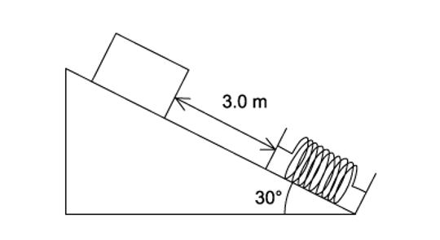

The initial distance between the point of release and the uncompressed spring is 3.0 m. After the block comes to rest momentarily, the spring is compressed by 1.3 m.

What is the value of *k*?

### Q4 — medium — 1 marks

**Q4** [1 mark]

A trolley rolls along a horizontal surface and then travels up a slope before reaching a second horizontal surface. The slope is of length *L*. The trolley has mass *M*. The slope is at an angle *α* to the horizontal surface.

The second horizontal surface is at height *h* above the first surface.

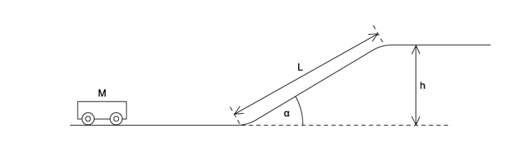

Assume negligible frictional forces. The acceleration of free fall is known.

In order to determine the minimum initial velocity of the trolley for it to reach the top of the slope, which additional values are needed?

### Q5 — easy — 1 marks

**Q5** [1 mark]

A stone of weight 4.0 N in the Earth’s gravitational field is moved from P to Q and then to R along the path shown.

How much potential energy does the stone gain?

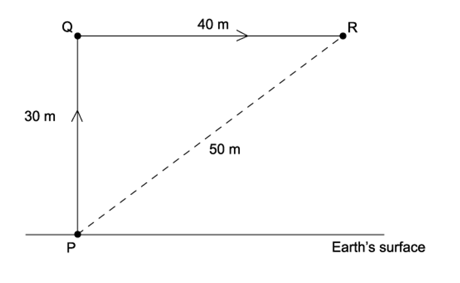

### Q6 — hard — 1 marks

**Q6** [1 mark]

The diagram shows two bodies X and Y connected by a light cord passing over a light, free-running pulley. X starts from rest and moves on a smooth plane inclined at 30° to the horizontal.

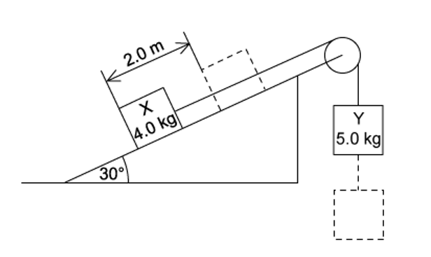

What will be the total kinetic energy of the system when X has travelled 2.0 m along the plane?

### Q7 — easy — 1 marks

**Q7** [1 mark]

The formula for gravitational potential energy is $\DeltaE_{p}=mg\Deltah$

From which concept is this equation derived?

### Q8 — medium — 1 marks

**Q8** [1 mark]

A body travelling with a speed of 20 $ms^{-1}$ has kinetic energy Ek 

If the speed of the body is increased to 80 $ms^{-1}$, what is its kinetic energy?

### Q9 — medium — 1 marks

**Q9** [1 mark]

The diagram shows a lift system in which the elevator (mass *m**1*) is partly counterbalanced by a heavy weight (mass *m**2*)

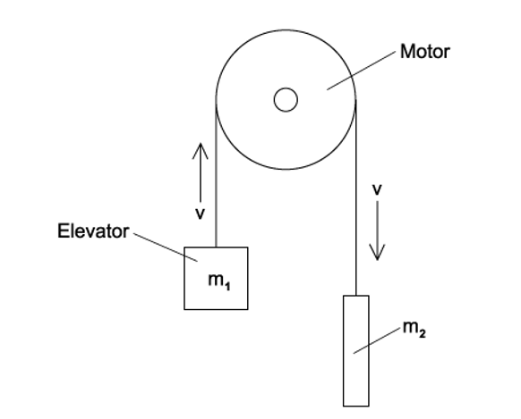

At what rate does the motor provide energy to the system when the elevator is rising at a steady speed *v *? (*g* = acceleration of free fall)

### Q10 — medium — 1 marks

**Q10** [1 mark]

A steel ball is falling at constant speed in oil.

Which graph shows the variation with time of the gravitational potential energy *E**p* and the kinetic energy *E**k* of the ball ?

### Q11 — medium — 1 marks

**Q11** [1 mark]

The diagram shows two identical vessels X and Y connected by a short pipe with a tap.

Initially, X is filled with water of mass *m* to a depth *h*, and Y is empty.

When the tap is opened, water flows from X to Y until the depths of water in both vessels are equal.

How much potential energy is lost by the water during this process? (*g* = acceleration of free fall)

### Q12 — easy — 1 marks

**Q12** [1 mark]

A car of mass 1000 kg travels forward at 25 m s–1 and then backwards at 5 m s–1

What is the magnitude of the change in the kinetic energy of the car?

### Q13 — medium — 1 marks

**Q13** [1 mark]

A truck of mass 500 kg moves from rest at the top of a section of track 400 m long and 30 m high, as shown.

The frictional force acting on the truck is 250 N throughout its journey

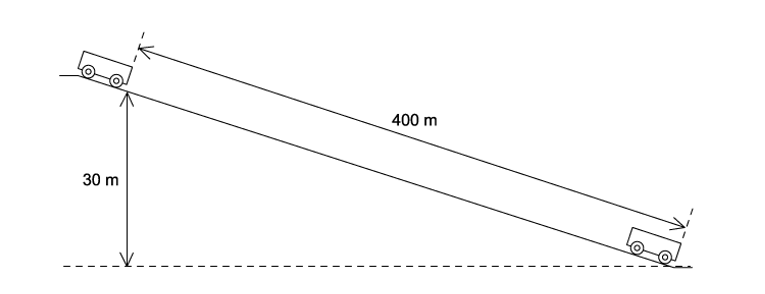

What is the final speed of the truck?

### Q14 — easy — 1 marks

**Q14** [1 mark]

A body travelling with a speed of 10 m s–1 has kinetic energy 1500 J.

If the speed of the body is increased to 40 m s–1, what is its new kinetic energy?

### Q15 — medium — 1 marks

**Q15** [1 mark]

Car X is travelling at half the speed of car Y. Car X has twice the mass of car Y.

Which statement is correct?

### Q16 — easy — 1 marks

**Q16** [1 mark]

To get to his office from the entrance of the building, a man has to walk up six flights of stairs.

The height of each flight is 2.5 m and the man has a mass of 80 kg.

What is the approximate gain in the man’s gravitational potential energy during the climb?

### Q17 — easy — 1 marks

**Q17** [1 mark]

What is the approximate kinetic energy of an Olympic athlete when running at maximum speed during a 100m race?

### Q18 — easy — 1 marks

**Q18** [1 mark]

An object is thrown into the air.

Which graph shows how the potential energy *E**p* of the object varies with height *h* above the ground?

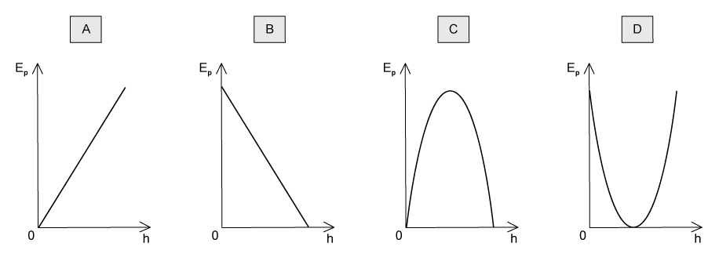

### Q19 — hard — 1 marks

**Q19** [1 mark]

A uniform solid cuboid of concrete of dimensions 0.50m × 1.20m × 0.40m and weight 4000 N rests on a flat surface with the 1.20 m edge vertical as shown in diagram 1.

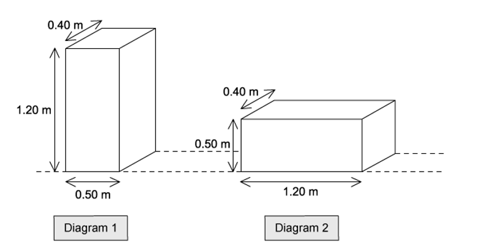

What is the minimum energy required to roll the cuboid through 90° to the position shown in diagram 2 with the 0.50 m edge vertical?

### Q20 — medium — 1 marks

**Q20** [1 mark]

A uniform solid block has weight 500 N, width 0.4 m and height 0.6 m. The block rests on the edge of a step of depth 0.8 m, as shown.

The block is knocked over the edge of the step and rotates through 90° before coming to rest with the 0.6 m edge horizontal.

What is the change in gravitational potential energy of the block?

### Q21 — hard — 1 marks

**Q21** [1 mark]

A 4 kg ball and a 3 kg block of wood were placed in an arrangement as shown below. When the ball was released, it fell through a distance of 5 m, pulling the block of wood up the ramp.

If the pulleys were well oiled and the surface of the ramp exerts a frictional force of 2 N, what is the final speed of the sphere after falling through the 5 m?

### Q22 — hard — 1 marks

**Q22** [1 mark]

An object of mass $m$ passes a point X with a velocity $v$ and slides up a frictionless incline to stop at point Y, which is at a height $h$ above X.

A second object of mass $\frac{m}{2}$ passes X with a velocity of $\frac{v}{2}$.

What height will the second object reach?

### Q23 — medium — 1 marks

**Q23** [1 mark]

A block of mass 2.0 kg is released from rest on a slope. It travels 7.0 m down the slope and falls a vertical distance of 3.0 m

The block experiences a frictional force parallel to the slope of 5.0 N.

What is the speed of the block after falling this distance?

### Q24 — hard — 1 marks

**Q24** [1 mark]

A solid rubber ball has a diameter of 8.0 cm. It is released from rest with the top of the ball 80 cm above a horizontal surface. It falls vertically and then bounces back up so that the maximum height reached by the top of the ball is 45 cm, as shown.

If the kinetic energy of the ball is 0.75 J just before it strikes the surface, what is its kinetic energy just after it leaves the surface?

### Q25 — easy — 1 marks

**Q25** [1 mark]

A cyclist is travelling at a constant speed up a hill. The frictional force resisting the cyclist’s motion is 8.0 N.

The cyclist uses 450 J of energy to travel 20 m.

What is the increase in gravitational potential energy of the cyclist?

### Q26 — hard — 1 marks

**Q26** [1 mark]

A loaded aeroplane has a total mass of 1.2 × 105 kg while climbing after take-off. It climbs at an angle of 23° to the horizontal with a speed of 50 m s–1.

What is the rate at which it is gaining potential energy at this time?

### Q27 — easy — 1 marks

**Q27** [1 mark]

A car with a total mass of 1400 kg is travelling at 108 km h–1

What is the kinetic energy of the car?

### Q28 — medium — 1 marks

**Q28** [1 mark]

A concrete cube of side 0.60 m and uniform density 2.0 × 103 kg m–3 is lifted 5.0 m vertically by a crane.

What is the change in potential energy of the cube?

### Q29 — hard — 1 marks

**Q29** [1 mark]

A steel sphere is dropped vertically onto a horizontal metal plate. The sphere hits the plate with a speed *u*, leaves it at a speed *v*, and rebounds vertically to half of its original height.

Which expression gives the value of  $\frac{v}{u}$ ?

### Q30 — hard — 1 marks

**Q30** [1 mark]

A ball released from a height *h**0* above a horizontal surface rebounds to a height *h**1* after one bounce. The graph that relates *h**0* to *h**1* is shown below.

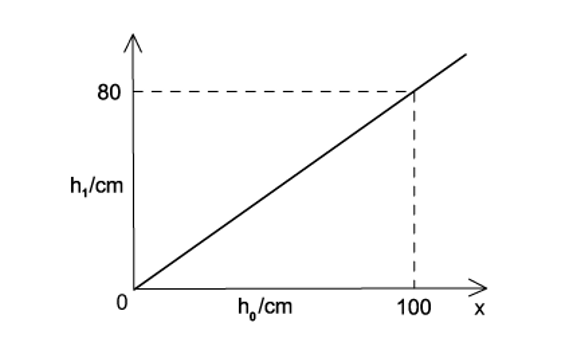

If the ball (of mass *m*) was dropped from an initial height *h* and made three bounces, the kinetic energy of the ball immediately after the third impact with the surface was

### Q31 — hard — 1 marks

**Q31** [1 mark]

A falling mass pulls a trolley from rest on a horizontal table. Given that:

The mass of the trolley = 1.5 kg

The mass of the falling mass = 0.5 kg

The distance the mass falls through = 1.0 m

Frictional force from the table = 0.8 N

The distance the trolley moves = 1.2 m

What is the maximum kinetic energy of the trolley?

## Structured Questions (8 questions)

### Q1 — hard — 13 marks

**Q1** [6 marks]

Fig. 1.1 shows an object at rest at the top of a straight slope which makes a fixed angle with the horizontal at a distance *h* above the ground.

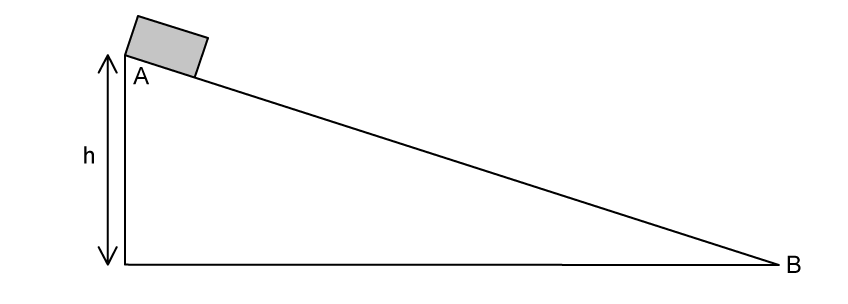

**Fig. 1.1**

The object is released and slides down the slope from **A** to **B** with negligible friction.

Assume that the potential energy is zero at **B**.

Sketch a graph showing:

- The variation of potential energy along the slope. Label this **P**.
- The variation of kinetic energy of the object along the slope. Label this **K**.
- The variation of kinetic energy along the slope when there is a constant frictional force between the object and the surface. Label this **F**.

Explain the important features of the graphs you have drawn.

**Q1** [3 marks]

In a theme park ride, a cage containing passengers falls freely a distance of $x$* *m from **A** to **B** and travels in a circular arc of radius 25 m from **B** to **C**.

Brakes are applied at **C** after which the cage with its passengers travels 70 m along an upward sloping ramp and comes to rest at **D**. The track, together with relevant distances, is shown in Fig. 1.2. **CD** makes an angle of *θ *with the horizontal.

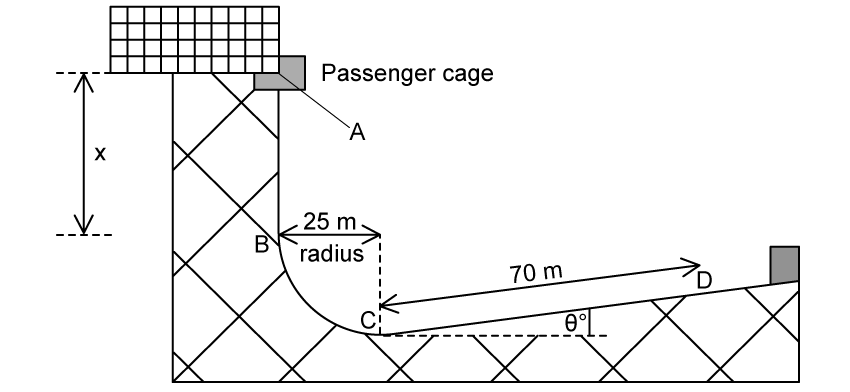

**Fig. 1.2**

alt: For a passenger of mass 70 kg, the force keeping them in circular motion at **C** is 5.4 kN.

The force required for circular motion on a passenger of mass 70 kg at **C** is 5.4 kN.

Calculate height $x$.

Assume that friction is negligible between **A** and **C**.

**Q1** [4 marks]

**Extract:**

In a theme park ride, a cage containing passengers falls freely a distance of x m from A to B and travels in a circular arc of radius 25 m from B to C. Brakes are applied at C after which the cage with its passengers travels 70 m along an upward sloping ramp and comes to rest at D. CD makes an angle of θ with the horizontal. (From part b answer: x = 73 m)

The total mass of the cage and passengers is 720 kg. The average resistive force exerted by the brakes between **C** and **D** is 4.8 kN.

By considering energy changes, calculate the value of *θ*.

### Q2 — easy — 8 marks

**Q2** [2 marks]

A ball of mass 4.2 kg is placed on a post at a height of 2.1 m as shown in Fig. 1.1.

The ball is pushed horizontally so that it falls down, reaching a velocity *v* just before hitting the ground.

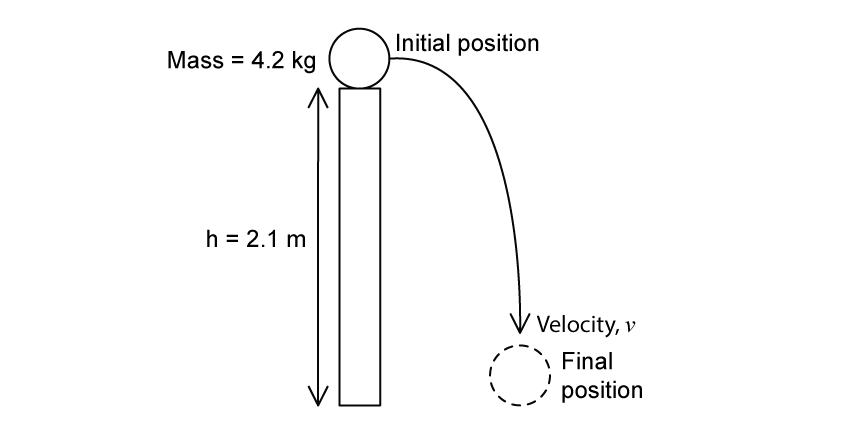

**Fig. 1.1.**

Calculate the gravitational potential energy stored by the ball before it is pushed.

**Q2** [1 mark]

**Extract:**

A ball of mass 4.2 kg is placed on a post at a height of 2.1 m as shown in Fig. 1.1. The ball is pushed horizontally so that it falls down, reaching a velocity v just before hitting the ground. Calculate the gravitational potential energy stored by the ball before it is pushed. ΔE_p = mgΔh = 4.2 × 9.81 × 2.1 = 87 J (2 s.f.)

Hence state the total kinetic energy of the ball just before it hits the floor. Assume that air resistance is negligible.

**Q2** [2 marks]

**Extract:**

A ball of mass 4.2 kg is placed on a post at a height of 2.1 m as shown in Fig. 1.1. The ball is pushed horizontally so that it falls down, reaching a velocity v just before hitting the ground.

Calculate the gravitational potential energy stored by the ball before it is pushed: ΔEp = mgΔh = 4.2 × 9.81 × 2.1 = 87 J (2 s.f.)

Hence the total kinetic energy of the ball just before it hits the floor: From the principle of conservation of energy: Ep = Ek. Kinetic energy = 87 J

Calculate the velocity of the ball just before it hits the ground.

**Q2** [3 marks]

**Extract:**

A ball of mass 4.2 kg is placed on a post at a height of 2.1 m as shown in Fig. 1.1. The ball is pushed horizontally so that it falls down, reaching a velocity *v* just before hitting the ground.

The final speed of the ball in part (a) depends on the height it falls from, but not the mass, as long as air resistance is ignored.

Using the equations for initial gravitational potential energy and final kinetic energy, show that the mass of the ball does not affect the final speed of the ball.

### Q3 — easy — 10 marks

**Q3** [3 marks]

When an object is lifted, energy is transferred to it.

State the reason for this energy transfer.

**Q3** [2 marks]

State the equation for gravitational potential energy, defining all the units mentioned.

**Q3** [3 marks]

**Extract:**

Part (a): When an object is lifted, energy is transferred to it. State the reason for this energy transfer. (Answer: Force is used to move the object against gravity; the object is displaced; therefore work is done on the object OR W = F × s)

Part (b): State the equation for gravitational potential energy, defining all the units mentioned. (Answer: ΔEp = mgΔh, where ΔEp = change in gravitational potential energy, m = mass, g = gravity / gravitational field strength, Δh = change in height)

Referring to your answer to part (a), derive the expression for gravitational potential energy stated in part (b).

**Q3** [2 marks]

A ball of mass 1.2 kg is released from the top of a slope and allowed to roll to the bottom, where it stops. The initial and final positions of the ball are shown in Fig. 1.1.

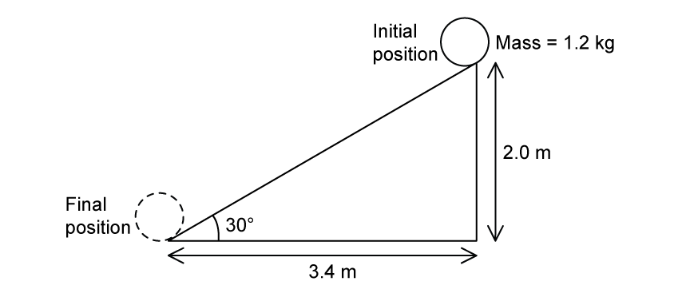

**Fig. 1.1.**

Calculate the change in gravitational potential energy of the ball.

### Q4 — medium — 13 marks

**Q4** [4 marks]

A car on a roller coaster has a mass of 4200 kg and is designed to carry up to 10 passengers each with an average mass of 65 kg.

The car is moving at a speed of 2.0 m s−1 when it starts to descend through a drop of 50 m. It reaches a top speed of 24 m s−1 after travelling 75 m along the track.

For the car with its maximum capacity of passengers, calculate

(i) the loss of potential energy

[2]

(ii) the initial kinetic energy.

[2]

**Q4** [2 marks]

**Extract:**

A car on a roller coaster has a mass of 4200 kg and is designed to carry up to 10 passengers each with an average mass of 65 kg. The car is moving at a speed of 2.0 m s^−1^ when it starts to descend through a drop of 50 m. It reaches a top speed of 24 m s^−1^ after travelling 75 m along the track. For the car with its maximum capacity of passengers... Total mass of the car and passengers = 4200 + (10 × 65) = 4850 kg

Calculate the kinetic energy of the car and passengers after the descent.

**Q4** [5 marks]

**Extract:**

A car on a roller coaster has a mass of 4200 kg and is designed to carry up to 10 passengers each with an average mass of 65 kg. The car is moving at a speed of 2.0 m s^−1 when it starts to descend through a drop of 50 m. It reaches a top speed of 24 m s^−1 after travelling 75 m along the track. (i) the loss of potential energy: Change in GPE = 2.4 MJ (2.379 × 10^6 J). (ii) the initial kinetic energy = 9700 J.
Calculate the kinetic energy of the car and passengers after the descent: Final KE = 1.397 × 10^6 J = 1.4 MJ.

For the roller coaster car and passengers

(i) State the main resistive forces to the motion.

[2]

(ii) Calculate the work done against these forces during the descent.

[3]

**Q4** [2 marks]

**Extract:**

A car on a roller coaster has a mass of 4200 kg and is designed to carry up to 10 passengers each with an average mass of 65 kg. The car is moving at a speed of 2.0 m s^−1^ when it starts to descend through a drop of 50 m. It reaches a top speed of 24 m s^−1^ after travelling 75 m along the track.
(ii) Calculate the work done against these forces during the descent: Work done = 1 009 700 J = 1.0 MJ (2 s.f.)

Calculate the average resistive force that acts on the car during the descent.

### Q5 — easy — 12 marks

**Q5** [3 marks]

When an object is accelerated from rest, energy is stored.

Name the energy store and state the reason for it.

**Q5** [2 marks]

State the equation for kinetic energy, defining all the units mentioned.

**Q5** [5 marks]

**Extract:**

Part (a): When an object is accelerated from rest, energy is stored. Kinetic energy is stored when a force is applied (making an object accelerate) and work is done by the force (energy transferred to the object).

Part (b): The equation for kinetic energy is E_k = 1/2 m v^2, where E_k = kinetic energy, m = mass, v = velocity.

Referring to your answer to part (a), derive the expression for kinetic energy stated in part (b).

**Q5** [2 marks]

A cylinder of mass 2.8 kg is released from rest so that it rolls down a ramp, accelerating to a velocity of 3.5 ms−1. The arrangement is shown in Fig. 1.1.

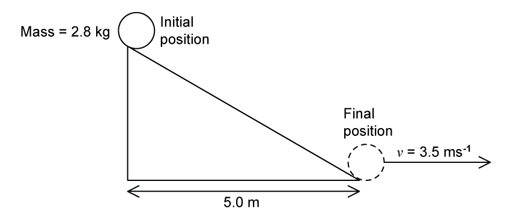

**Fig. 1.1.**

Calculate the change in kinetic energy between the two positions shown.

### Q6 — medium — 10 marks

**Q6** [2 marks]

A BASE jumper of mass 70 kg jumps from the top of a bridge and reaches a speed of 45 m s−1 after falling a distance of 150 m.

Calculate the change in the jumper's gravitational potential energy.

**Q6** [2 marks]

**Extract:**

A BASE jumper of mass 70 kg jumps from the top of a bridge and reaches a speed of 45 m s^−1^ after falling a distance of 150 m.

Calculate the kinetic energy gained by the jumper.

**Q6** [2 marks]

**Extract:**

A BASE jumper of mass 70 kg jumps from the top of a bridge and reaches a speed of 45 m s^−1 after falling a distance of 150 m.
Calculate the change in the jumper's gravitational potential energy. (ΔEp = 103 kJ)
Calculate the kinetic energy gained by the jumper. (Ek = 70.9 kJ)

Explain why the values in **(a)** and** (b)** are not equal.

**Q6** [4 marks]

**Extract:**

A BASE jumper of mass 70 kg jumps from the top of a bridge and reaches a speed of 45 m s^−1^ after falling a distance of 150 m. Change in gravitational potential energy = 103 kJ. Kinetic energy gained = 70.9 kJ.

Calculate the average resistive force acting on the BASE jumper as they fall.

### Q7 — medium — 10 marks

**Q7** [2 marks]

Pumped hydroelectric systems store large bodies of water behind a dam. When electricity is needed in the grid, the dam is lifted, allowing water to flow from the upper reservoir.

One such power station, known as the Cruachan power station, is shown in Fig. 1.1. This facility has been producing hydroelectric power since 1965.

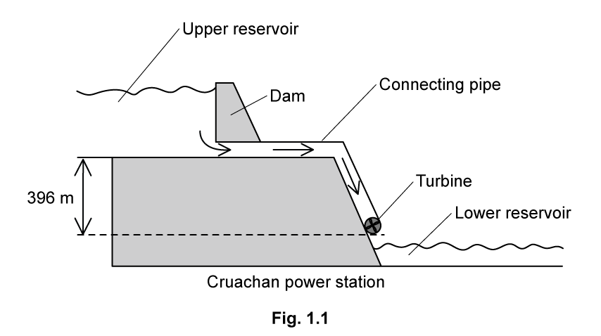

The vertical distance between the base of the upper reservoir and the turbine is 396 m. This arrangement allows Cruachan power station to produce a power output of 0.62 GW with an efficiency of 76%.

Determine the energy transferred by the water each second in order to achieve this power output.

**Q7** [5 marks]

**Extract:**

Pumped hydroelectric systems store large bodies of water behind a dam. When electricity is needed in the grid, the dam is lifted, allowing water to flow from the upper reservoir. One such power station, known as the Cruachan power station... The vertical distance between the base of the upper reservoir and the turbine is 396 m. This arrangement allows Cruachan power station to produce a power output of 0.62 GW with an efficiency of 76%. Determine the energy transferred by the water each second in order to achieve this power output.
Mark scheme: Total power input = 0.62/0.76 = 0.82 GW; Energy transferred each second = 0.82 GJ or 8.2 × 10^8 J

Water is made to flow out of the upper reservoir through connecting pipes at a rate of 200 m3 per second. The density of water is 1.0 × 103 kg m−3.

(i) Use this flow rate to determine the energy transferred by the water each second.

[4]

(ii) Explain why this value is **not **consistent with the energy transfer rate calculated in **(a)**.

[1]

**Q7** [3 marks]

**Extract:**

The vertical distance between the base of the upper reservoir and the turbine is 396 m. This arrangement allows Cruachan power station to produce a power output of 0.62 GW with an efficiency of 76%. Energy transferred each second = 0.82 GJ or 8.2 × 10^8 J.

Water is made to flow out of the upper reservoir through connecting pipes at a rate of 200 m^3 per second. The density of water is 1.0 × 10^3 kg m^−3. Mass flow rate Δm/Δt = 2.0 × 10^5 kg s^−1.

Estimate the depth of the water held in the upper reservoir. State any assumptions made.

### Q8 — hard — 8 marks

**Q8** [2 marks]

Anaisha launches a pebble vertically upwards using a sling shot. The speed of the pebble as it leaves the sling shot is 28 m s−1.

Calculate the height that the pebble gains.

Assume that air resistance is negligible.

**Q8** [1 mark]

**Extract:**

Anaisha launches a pebble vertically upwards using a sling shot. The speed of the pebble as it leaves the sling shot is 28 m s^−1^. Calculate the height that the pebble gains. Assume that air resistance is negligible.
Final height, h_f = 40 m

The mass of the pebble is 300 g. Complete the energy bar chart shown in Fig. 1.1.

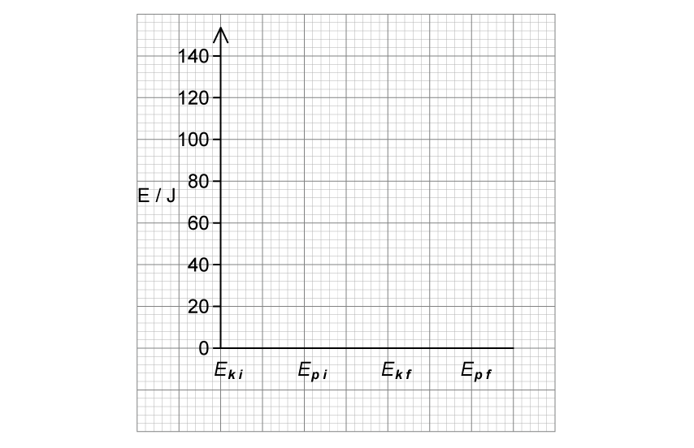

**Fig 1.1**

**Q8** [5 marks]

**Extract:**

The mass of the pebble is 300 g.

Anaisha notices a small basket hanging by a string from a tree. The basket has a mass of 280 g and the length of the string is 85 cm. Anaisha uses her slingshot to fire the pebble horizontally, which lands in the basket. The basket then swings out to an angle of 45°.

Calculate the speed of the pebble as she fired it.

Assume that air resistance is negligible and that there is no breeze.
