# Exam Questions — Elastic & Plastic Behaviour
**6. Deformation of Solids** · Cambridge (CIE) AS physics (9702)
> Source: [https://www.savemyexams.com/as/physics/cie/25/topic-questions/](https://www.savemyexams.com/as/physics/cie/25/topic-questions/) · 35 questions across 2 sets

## Multiple Choice Questions (25 questions)

### Q1 — easy — 1 marks

**Q1** [1 mark]

A metal wire had a tension *F *and extension *x* with a Young modulus of *E*; the wire obeyed Hooke’s law

Which expression represents the elastic strain energy stored in the wire?

### Q2 — hard — 1 marks

**Q2** [1 mark]

The graph below shows how force changes the extension of a spring.

The length of the spring with no force applied was 1 cm.

What is the **increase** in the strain energy stored in the spring when its **length** is increased from 2.0 cm to 3.0 cm ?

### Q3 — easy — 1 marks

**Q3** [1 mark]

A spring is extended with varying forces; the graph below shows the results.

What is the energy stored in the spring when the extension is 30 mm?

### Q4 — medium — 1 marks

**Q4** [1 mark]

A student was investigating the extension in a long thin metal wire. They suspended the wire from a fixed support, and hung it vertically then hung masses from the lower end.

The load was increased and decreased from zero to the maximum and back again.

The graph shows the force-extension of the wire.

Where on the graph would the elastic limit be found?

### Q5 — hard — 1 marks

**Q5** [1 mark]

A wire undergoes elastic deformation; the graph below shows the load-extension graph.

How much work is done on the wire to increase the extension from 10 mm to 20 mm?

### Q6 — medium — 1 marks

**Q6** [1 mark]

A force of 2.0 N is applied to a spring of unextended length 0.50 m and has a new length of 0.90 m.

A graph shows the variation of its length with tension.

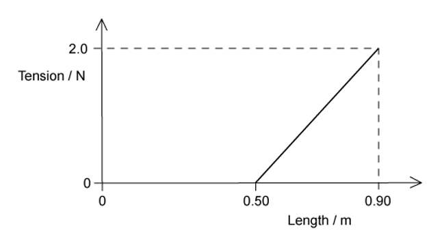

How much strain energy is stored in the spring ?

### Q7 — medium — 1 marks

**Q7** [1 mark]

A student was investigating a rubber band when stretched and relaxed to its original length. The graph shows the force-extension of the rubber band.

As the force is increased, the curve follows the path WXZ to extension *e*. As the force is reduced, the curve follows the path ZYW to return to zero extension.

The area labelled S is between the curves WXZ and ZYW. The area labelled T is bounded by the curve ZYW and the horizontal axis.

Which statement about the process is correct?

### Q8 — medium — 1 marks

**Q8** [1 mark]

A rod is extended with a force so that its length increases. The variation with load *L* of the extension *e* of the rod is shown in the graph.

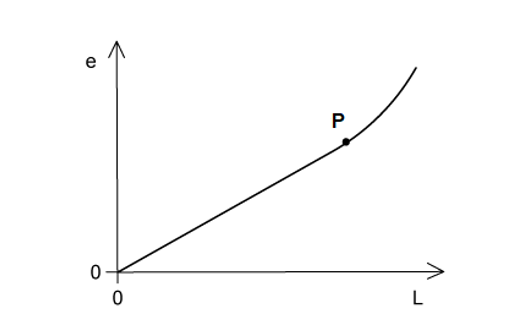

Point **P** is the elastic limit.

Which shaded area represents the work done during the plastic deformation of the rod ?

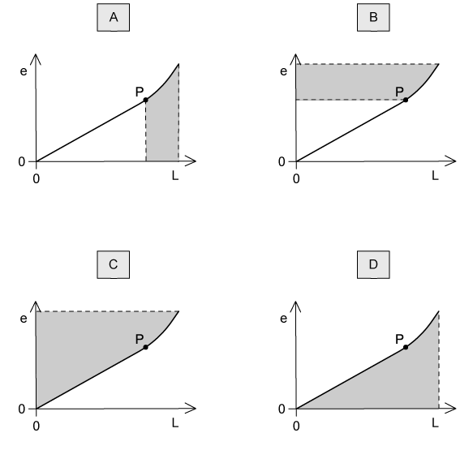

### Q9 — easy — 1 marks

**Q9** [1 mark]

A student experimented on a metal wire; the graph below was plotted.

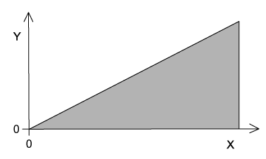

The area under the graph shows the total strain energy stored in the wire when stretched.

How should the axes be labelled?

| ** ** | **Y** | **X** |
|---|---|---|
| **A**  **B**  **C**  **D** | mass  force  strain  stress | extension  extension  energy  strain |

### Q10 — medium — 1 marks

**Q10** [1 mark]

A spring is extended due to a force. The graph shows the effect of changing force on the extension of the spring.

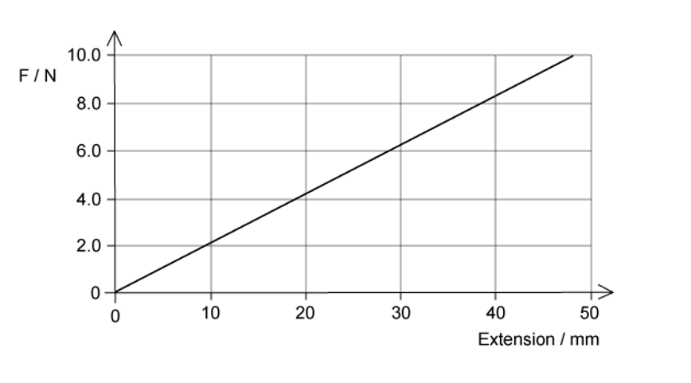

What is the elastic potential energy of the spring with a force of 8.0 N ?

### Q11 — medium — 1 marks

**Q11** [1 mark]

A sample of metal was stretched until it started to go into plastic deformation. The graph below shows the behaviour of the metal.

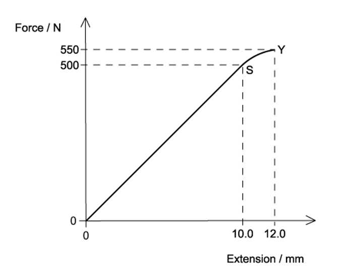

When the sample was stretched from 0 to 12.0 mm extension, what is the work done? Assume that the curve SY is a straight line to simplify the calculation

### Q12 — medium — 1 marks

**Q12** [1 mark]

A student carried out an experiment on a ductile material; stretching it with a tensile force beyond its elastic limit. The force is removed.

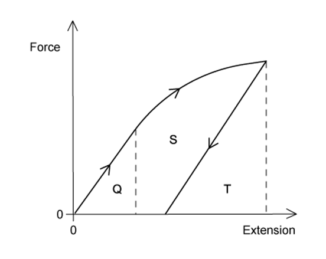

The graph shows the force-extension of this experiment.

Which area represents the net work done on the sample?

### Q13 — medium — 1 marks

**Q13** [1 mark]

A wire made from a new composite material was loaded with masses and the force-extension curve drawn.

What could be the value of the strain energy stored in the wire when it is stretched elastically to point Z ?

### Q14 — easy — 1 marks

**Q14** [1 mark]

Graphs of the stress-strain for four different materials are shown below.

Which one shows the correct graph for a ductile metal ?

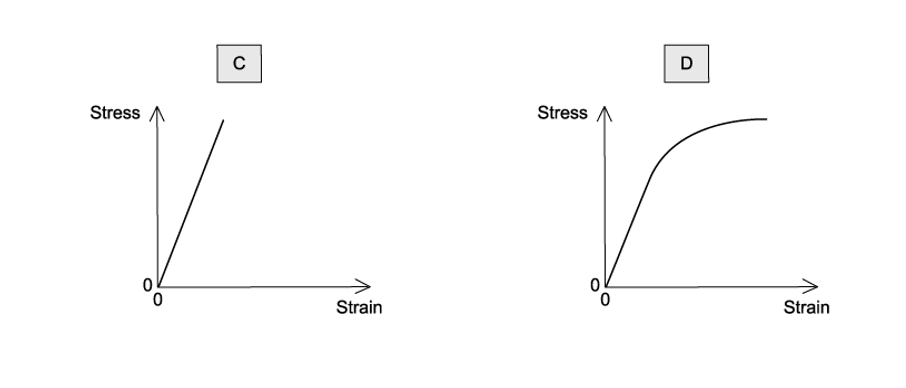

### Q15 — medium — 1 marks

**Q15** [1 mark]

A student was investigating a spring with a spring constant *k* of 3.0 N cm−1, the spring was stretched over a range in which elastic deformation occurred.

Which row, for the stated applied force, gives the correct extension and strain energy?

| ** ** | **Force / N** | **Extension / cm** | **Strain energy / mJ** |
|---|---|---|---|
| **A**  **B**  **C**  **D** | 24.0  12.0  6.0  3.0 | 8.0  3.0  2.0  1.0 | 960  200  120  1.5 |

### Q16 — easy — 1 marks

**Q16** [1 mark]

Which of the following is the correct definition for elastic and plastic behaviour?

|   | **Elastic behaviour of a material** | **Plastic behaviour of a material** |
|---|---|---|
| **A** | returns to its original shape and size | suffers permanent deformation |
| **B** | obeys Hooke’s Law | extends continuously under a steady load |
| **C** | has a linear force-extension curve | has a horizontal force-extension curve |
| **D** | extends only within the limit of proportionality | extends beyond the limit of proportionality |

### Q17 — easy — 1 marks

**Q17** [1 mark]

The graphs below are force-extension graphs, which one is a rubber band this is stretched almost to its breaking point ?

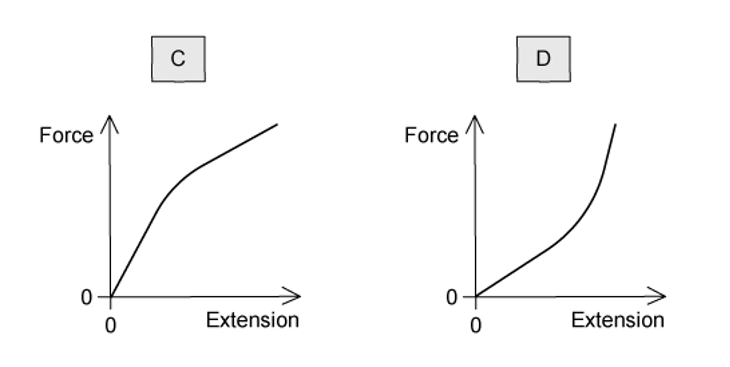

### Q18 — easy — 1 marks

**Q18** [1 mark]

Four rods were made from four different materials; all the rods had the same dimensions.

At room temperature, which of the following would sustain the biggest plastic deformation?

### Q19 — easy — 1 marks

**Q19** [1 mark]

A student drew a force-extension graph for a sample of metal. She subjected the sample to a force that increased to a maximum then decreased to zero.

When the sample contracts it follows the same force-extension curve as when it was being stretched.

What is the behaviour of the metal between S and T?

### Q20 — hard — 1 marks

**Q20** [1 mark]

A graph was drawn of the effect on the length of applying a force to a rubber cord.

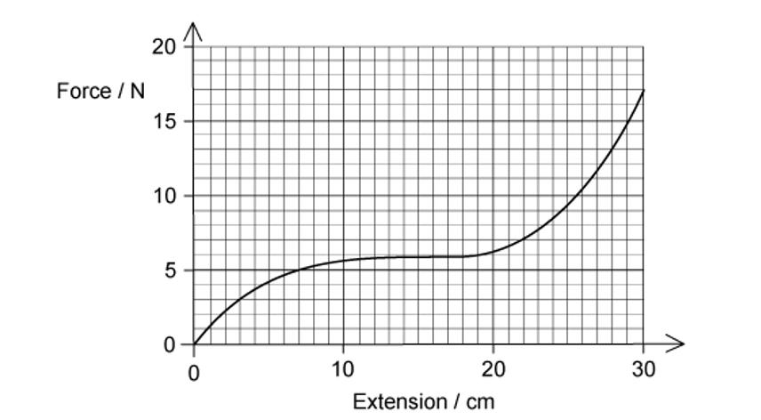

What is the maximum strain energy in this deformed rubber cord?

### Q21 — easy — 1 marks

**Q21** [1 mark]

A weight was attached to the lower end of a length of rubber. The rubber was hung from a solid support. The weight was gradually increased from zero then gradually reduced to zero.

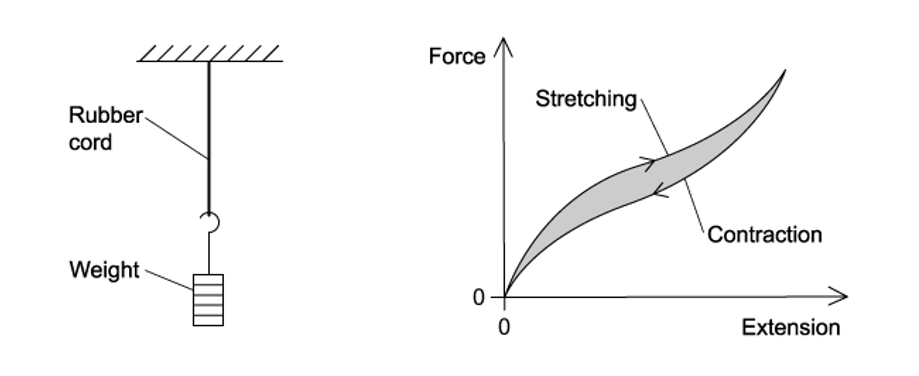

The graph shows the force-extension curve for contraction (below) and the force-extension curve for stretching.

What does the shaded area between the curves represent?

### Q22 — hard — 1 marks

**Q22** [1 mark]

Two springs are attached to a rod, S1 and S2. ­A load is applied to the bottom of S1, and it extends by *x* with an elastic potential energy in the spring of *E*.

The same load is applied to the bottom of S2. The extension of S2 is $\frac{x}{3}$ , as shown in the diagram

Which equation shows the elastic potential energy in S2?

### Q23 — easy — 1 marks

**Q23** [1 mark]

The graphs below all show force-extension graphs; they are all drawn to the same scale.

Which graph shows the object that has been deformed and has the greatest amount of elastic potential energy ?

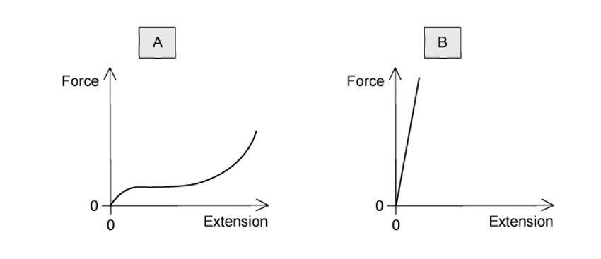

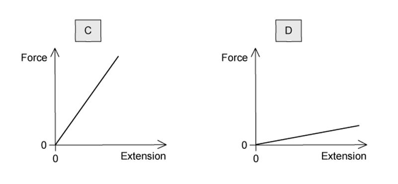

### Q24 — hard — 1 marks

**Q24** [1 mark]

A material with elastic properties that obeys Hooke’s law has a Young modulus *E* and has a tensile stress of *S* applied.

What is the expression for the elastic energy stored per unit volume of the material?

### Q25 — medium — 1 marks

**Q25** [1 mark]

A force compresses a mattress spring by 100 mm. The graph shows the effect of the force *F* on the length *l* of the spring.

What is the energy stored in the spring when the length is 70 mm?

## Structured Questions (10 questions)

### Q1 — easy — 7 marks

**Q1** [2 marks]

Define

(i) stress

[1]

(ii) strain.

[1]

**Q1** [2 marks]

A student performs an experiment to determine the Young modulus of a metal wire.

State **two **measurements, other than the applied load, that are required to determine the Young modulus of the metal.

For each measurement, name a suitable measuring instrument.

**Q1** [3 marks]

A force $F$ is applied to a uniform wire. The variation with extension $x$ of $F$ is shown in Fig. 4.1.

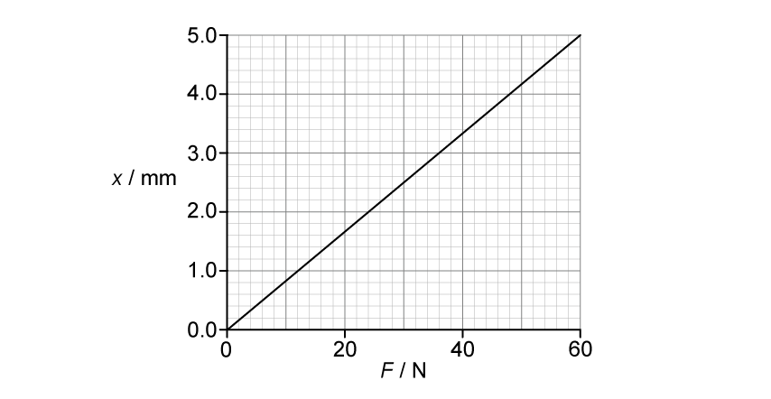

**Fig. 4.1**

The wire obeys Hooke's law up to a force of 60 N.

(i) Calculate the elastic potential energy stored in the wire when $F$ = 60 N.

[2]

(ii) A force of greater than 60 N is now applied to the wire.

Describe how it may be checked that the elastic limit of the wire has not been exceeded.

[1]

### Q2 — medium — 12 marks

**Q2** [8 marks]

**Fig. 1.1** is a graph of stress against strain for two wires, **X** and **Y**. The wires are made from different materials but have the same dimensions.

(i) Describe, giving reasons for your answer, three properties of material **X**.

[6]

(ii) State the meaning of points ***F*****x** and ***F*****y** and explain their significance.

[2]

**Q2** [2 marks]

**Extract:**

**Fig. 1.1** is a graph of stress against strain for two wires, **X** and **Y**. The wires are made from different materials but have the same dimensions. Material X: Larger Young Modulus / is stiffer than material Y; Does not undergo (any) plastic deformation before breaking; Obeys Hooke's Law; Stronger (than Y); Brittle. Material Y undergoes plastic deformation before breaking.

State and explain which wire would be more suitable for use as cables and structural beams.

**Q2** [2 marks]

**Extract:**

**Fig. 1.1** is a graph of stress against strain for two wires, **X** and **Y**. The wires are made from different materials but have the same dimensions.

A group of physics students are told that they will be performing the investigation which leads to the graph in part (a).

State two safety precautions which they must take and explain your answer.

### Q3 — medium — 11 marks

**Q3** [2 marks]

Materials scientists are asked to produce a material which would be suitable to use in constructing the wing of an aeroplane.

The team of scientists work with two materials, an aluminium alloy and a carbon fibre composite.

Suggest a material property which the scientists are likely to investigate and report on, and give a reason.

**Q3** [6 marks]

**Extract:**

Materials scientists are asked to produce a material which would be suitable to use in constructing the wing of an aeroplane. The team of scientists work with two materials, an aluminium alloy and a carbon fibre composite.

Fig. 1.1 shows the stress-strain graph that the scientists obtain for the aluminium alloy.

They have labelled a point **Q **on the graph.

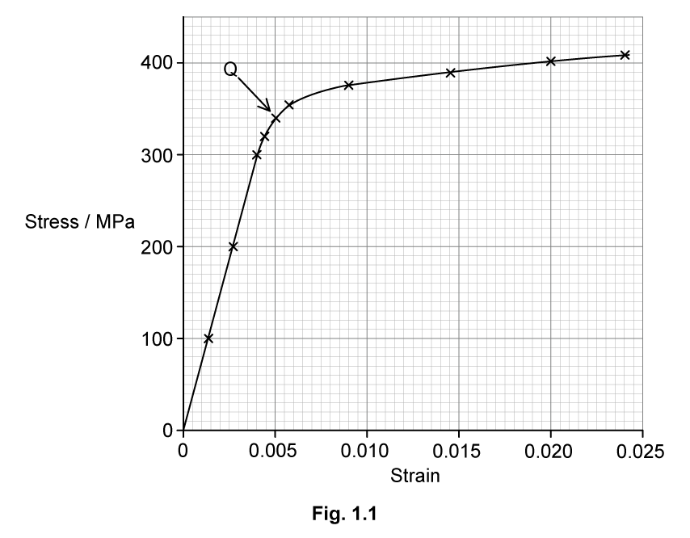

(i) State the name of point **Q** and suggest why the scientists have drawn attention to it.

[3]

(ii) Use the graph to determine the Young modulus of the aluminium alloy. Show your working.

[3]

**Q3** [3 marks]

The aluminium alloy wire has a diameter of 1.2 mm. Calculate the elastic potential energy stored in the wire when it shows an extension of 7.5 cm under a total stress of 190 MPa.

### Q4 — easy — 9 marks

**Q4** [2 marks]

Fig. 1.1 shows an incomplete extension–load graph obtained by adding multiple 1.0 N weights to a spring and recording the extension.

**Fig. 1.1**

The spring obeys Hooke’s law up to point A.

Draw a suitable line on Fig. 1.1 to show the relationship between force and extension up to point A.

**Q4** [1 mark]

**Extract:**

Fig. 1.1 shows an incomplete extension–load graph obtained by adding multiple 1.0 N weights to a spring and recording the extension. The spring obeys Hooke's law up to point A.

State the relevance of point A.

**Q4** [3 marks]

**Extract:**

Fig. 1.1 shows an incomplete extension–load graph obtained by adding multiple 1.0 N weights to a spring and recording the extension.

Use** **Fig. 1.1** **to calculate the energy stored in the spring when it is extended 8.0 cm. Show your working clearly.

**Q4** [3 marks]

**Extract:**

Fig. 1.1 shows an incomplete extension–load graph obtained by adding multiple 1.0 N weights to a spring and recording the extension. Fig. 1.1. The spring obeys Hooke's law up to point A.

Fig. 1.1 shows the spring exhibits *elastic deformation* up to point B.

(i) State the name given to point B.

[1]

(ii) Explain what is meant by elastic deformation.

[2]

### Q5 — easy — 10 marks

**Q5** [2 marks]

Define the term plastic deformation.

**Q5** [2 marks]

A student applies a range of forces to a metal wire and records the extension. The force–extension graph of his results is shown** **Fig. 1.1.

**Fig. 1.1**

(i) Mark the elastic limit on Fig. 1.1. Label this E.

[1]

(ii) Show clearly on the y–axis of Fig. 1.1 the range of forces which cause the wire to exhibit elastic behaviour.

[1]

**Q5** [3 marks]

**Extract:**

A student applies a range of forces to a metal wire and records the extension. The force–extension graph of his results is shown Fig. 1.1. Fig. 1.1 (graph of Force / N vs Extension / cm, showing a straight line section followed by a curve reaching 15.0 N).

After the student has applied 15.0 N to the wire he reduces the force applied to it in small increments and records the extension.

On Fig. 1.2, draw a line to show how the relationship between the force acting on the wire and the extension as all the force is reduced.

**Fig. 1.2**

**Q5** [3 marks]

Another identical spring is loaded with weights.

It has an extension of 8.0 cm and stores 24 J of elastic potential energy.

Calculate the spring constant of this spring.

### Q6 — hard — 16 marks

**Q6** [4 marks]

A light spring of length 2.2 cm is hung from a fixed point. An object of weight 4.0 N is hung from the other end of the spring. Fig. 1.1 shows the length of the spring when the object is in equilibrium.

**Fig. 1.1**

The object is then pulled vertically downwards and is no longer in its equilibrium position. This is shown in Fig. 1.2.

**Fig. 1.2**

The change in elastic potential energy Δ*E*  between the spring in Fig. 1.1 and Fig. 1.2 is 0.30 J.

Calculate the length of the spring in Fig. 1.2.

**Q6** [3 marks]

**Extract:**

A light spring of length 2.2 cm is hung from a fixed point. An object of weight 4.0 N is hung from the other end of the spring. Fig. 1.1 shows the length of the spring when the object is in equilibrium. The object is then pulled vertically downwards and is no longer in its equilibrium position. This is shown in Fig. 1.2. The change in elastic potential energy ΔE between the spring in Fig. 1.1 and Fig. 1.2 is 0.30 J.

From part a: Spring constant, k = 48 N m^–1; Extension of spring in Fig. 1.2, Δx_b = 0.139 m.

The object is released from its position shown in Fig. 1.2.

Calculate its initial acceleration.

**Q6** [6 marks]

**Extract:**

A light spring of length 2.2 cm is hung from a fixed point. An object of weight 4.0 N is hung from the other end of the spring. Fig. 1.1 shows the length of the spring when the object is in equilibrium. The object is then pulled vertically downwards and is no longer in its equilibrium position. This is shown in Fig. 1.2. The change in elastic potential energy ΔE between the spring in Fig. 1.1 and Fig. 1.2 is 0.30 J.
Extension of spring in Fig. 1.1, Δx_a = 0.083 m; Extension of spring in Fig. 1.2, Δx_b = 0.14 m.
The object is released from its position shown in Fig. 1.2. Upwards force = kΔx_b = 48 × 0.139 = 6.672 N (force on spring in Fig. 1.2 = 6.72 N).

Fig. 1.3** **shows a force–extension graph for the spring.

**Fig. 1.3**

Assuming that the spring is not extended beyond its limit of proportionality:

(i) Sketch a graph on Fig. 1.3** **to show the key values from the spring in equilibrium (in Fig. 1.1) and when the spring is extended (in Fig. 1.2).

[4]

(ii) Show that the graph also demonstrates that the change in elastic potential energy stored, Δ*E *is 0.30 J.

[2]

**Q6** [3 marks]

Fig. 3.1 now shows two different springs $S_{1}$ and $S_{2}$ . The top ends of the springs are attached to a rod.

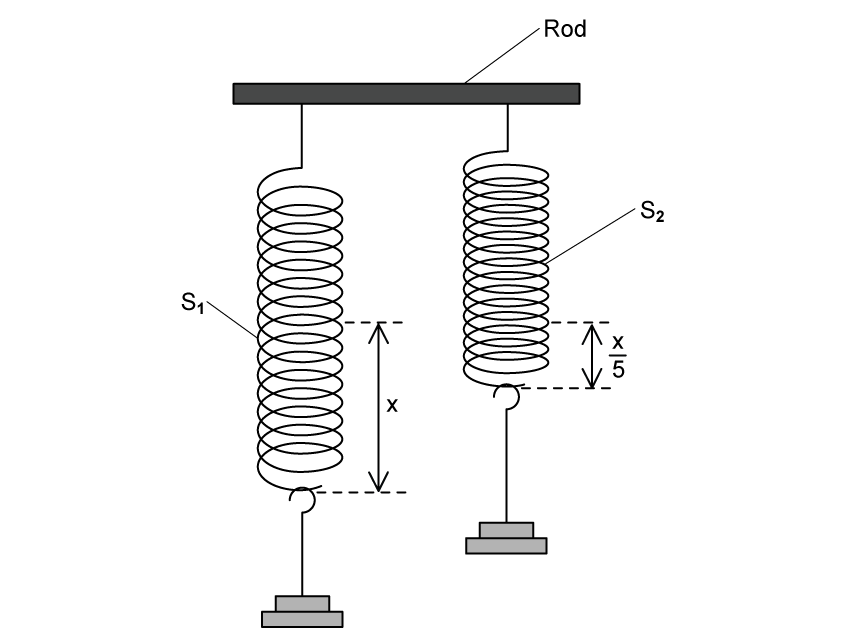

**Fig. 3.1**

A mass is hung from the bottom end of $S_{1}$. The extension of $S_{1}$ is *x* and the elastic potential energy in the spring is 19 mJ. The same mass is hung from the bottom end of $S_{2}$. The extension of $S_{2}$ is $\frac{x}{5}$ and its spring constant is 5 times that of $S_{1}$.

Calculate the elastic potential energy in $S_{2}$.

### Q7 — hard — 11 marks

**Q7** [3 marks]

An adventure experience is shown in Fig. 1.1 below.

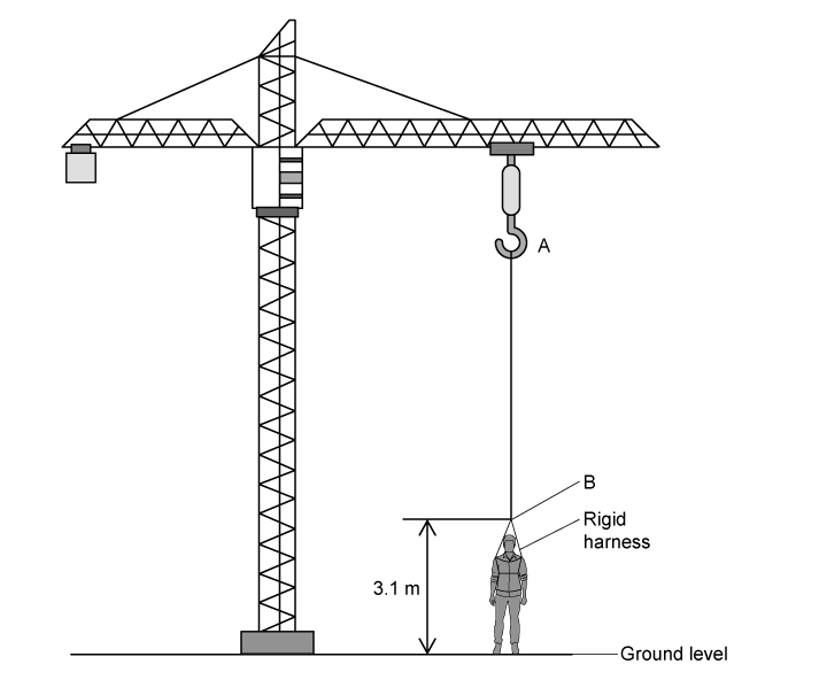

**Fig. 1.1**

The rider is strapped into a rigid harness attached to one end of an elastic rope AB. The rider and the rope behave in the same way as a mass–spring system.

The rope has an unstretched length of 27 m. When stretched, the rope obeys Hooke’s law. The rider and harness have a total mass of 65 kg.

The rider is initially held at rest at ground level. The lower end of rope B is attached to the rigid harness at a point which is 3.1 m above the ground, so the harness doesn’t injure the rider by being too close. The top end of the rope, A, is adjusted so the rope becomes unstretched when the rider is at the highest point of the ride. The rider is released and moves upwards, reaching a maximum height when the rope is at its unstretched (natural) length. The rider then oscillates vertically.

The height of point A above the ground is 51 m.

Calculate the spring constant of the rope neglecting air resistance and ignoring the mass of the rope in this question.

**Q7** [4 marks]

A different ride consists of a 15 m length of rope, stretched into a ‘V’ shape PQR on a frame, as shown in Fig 1.2. The frame is 16 m wide and the rider stands in the middle at position R. The ends of the elastic rope are fixed to the frame at the point P and Q.

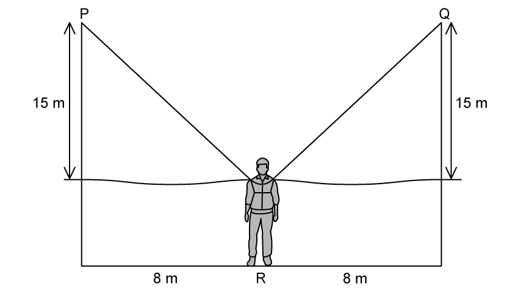

**Fig. 1.2**

The rider is attached to the midpoint of the elastic rope at** **R. The Young Modulus of the rope is 1920 Pa, and the cross-sectional area of the rope is 1 m2.

Calculate the elastic potential energy of the elastic rope in the initial position shown in the diagram.

**Q7** [4 marks]

The elastic bungee cord is replaced with an elastic which can also provide mechanical resistance when performing fitness exercises. The graph of load against extension for the chord is shown in Fig. 1.3** **below.

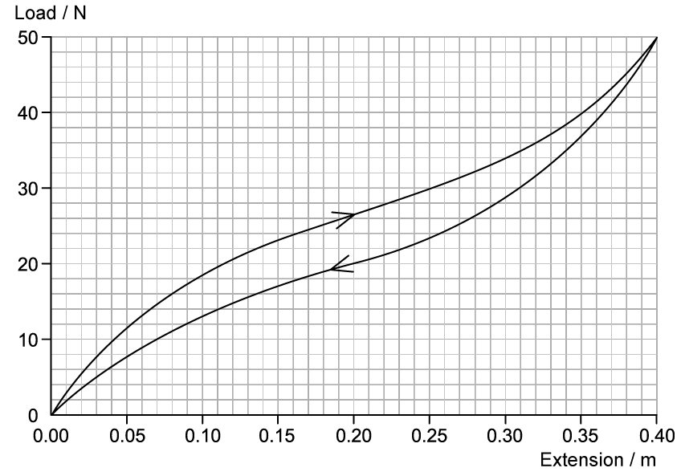

**Fig. 1.3**

Estimate the minimum energy required to stretch the elastic to an extension of 0.40 m.

### Q8 — medium — 7 marks

**Q8** [2 marks]

A steel bar is 40 mm long and has cross-sectional area 4.5 × 10−4 m2.

The bar is compressed using a vice so that the length is reduced by 0.20 mm.

The Young Modulus of steel = 2.1 × 1011 Pa.

Calculate the compressive force exerted on the bar.

**Q8** [2 marks]

**Extract:**

A steel bar is 40 mm long and has cross-sectional area 4.5 × 10^−4 m^2. The bar is compressed using a vice so that the length is reduced by 0.20 mm. The Young Modulus of steel = 2.1 × 10^11 Pa. Calculate the compressive force exerted on the bar. F = 4.7 × 10^5 N. Compression of bar, Δx = 0.20 mm.

Calculate the work done compressing the bar.

**Q8** [3 marks]

**Extract:**

A steel bar is 40 mm long and has cross-sectional area 4.5 × 10^−4^ m^2^. The bar is compressed using a vice so that the length is reduced by 0.20 mm. The Young Modulus of steel = 2.1 × 10^11^ Pa. Calculate the compressive force exerted on the bar.

For the compression described in part (a)

(i) Sketch a graph to show the compression, assuming that the elastic limit has not been reached.

[2]

(ii) Suggest how the elastic potential energy could be ascertained from the graph.

[1]

### Q9 — medium — 12 marks

**Q9** [3 marks]

A manufacturer produces springs for use in school laboratory investigations. As part of quality control the springs are spot-checked by measuring the extension produced for certain applied loads.

The graph of the testing data is shown in Fig. 1.1

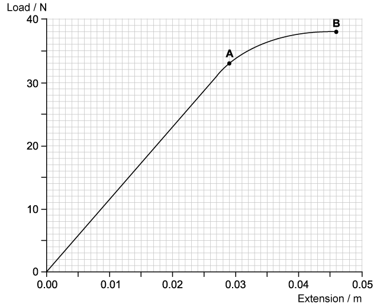

**Fig. 1.1**

Use a graphical method to calculate the spring constant of the spring.

Show your working.

**Q9** [3 marks]

**Extract:**

A manufacturer produces springs for use in school laboratory investigations. As part of quality control the springs are spot-checked by measuring the extension produced for certain applied loads. The graph of the testing data is shown in Fig. 1.1 (Load / N against Extension / m, showing a curve that is linear up to point A and then curves to point B).

Show that the work done in extending the spring up to point **A** is approximately 0.5 J.

**Q9** [3 marks]

**Extract:**

A manufacturer produces springs for use in school laboratory investigations. As part of quality control the springs are spot-checked by measuring the extension produced for certain applied loads. The graph of the testing data is shown in Fig. 1.1 (Load / N on y-axis, Extension / m on x-axis; the line rises straight from the origin to point A at approximately (0.029, 33), then curves to point B at approximately (0.046, 38)).

When the spring reaches an extension of 0.046 m, the load on it is gradually reduced to zero.

On the graph in Figure 1.1, sketch how the extension of the spring will vary with load as the load is reduced to zero.

Explain why the graph has this shape.

**Q9** [3 marks]

**Extract:**

When the spring reaches an extension of 0.046 m, the load on it is gradually reduced to zero. On the graph in Figure 1.1, sketch how the extension of the spring will vary with load as the load is reduced to zero. Explain why the graph has this shape. (Answer: Straight line from point B to the x-axis, ending on x-axis in range 0.013 m - 0.014 m; the spring does not return to its original length because it has been permanently deformed / has undergone plastic deformation.)

Without further calculation, compare the total work done by the spring when the load is removed with the work that was done by the load in producing the extension of 0.046 m.

Explain how this is represented on the graph drawn in part (c).

### Q10 — medium — 15 marks

**Q10** [4 marks]

Fitness equipment often uses springs as a method of creating resistance. One example is the Push Down Bar, which the manufacturer says can help a person who uses it to 'increase strength and burn calories'.

To use a Push Down Bar a person applies force by pushing the handles towards each other as shown in Fig. 1.1.

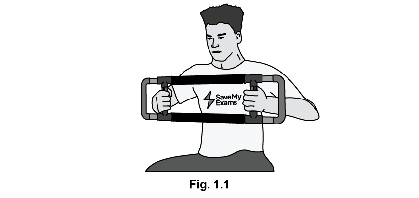

Fig. 1.2 shows the construction of the Push Down Bar.

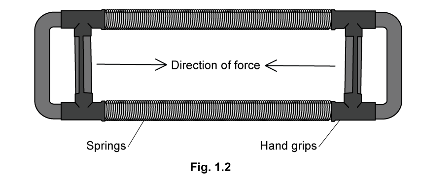

(i) State the type of force used when exercising with this equipment.

[1]

(ii) Explain why using this equipment would help the person burn calories.

[3]

**Q10** [5 marks]

The relationship between applied force and change in length of the springs was measured for a range of values of force.

The results are plotted on the graph in Fig. 1.3.**   **

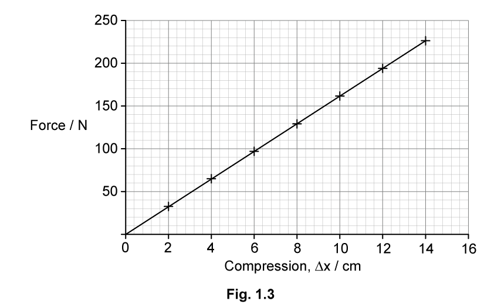

(i) State, with a reason, whether the spring obeys Hooke’s law over the range of values tested.

[2]

(ii) Use the graph in Fig. 1.3 to calculate the spring constant, stating an appropriate unit.

[3]

**Q10** [4 marks]

**Extract:**

The relationship between applied force and change in length of the springs was measured for a range of values of force. The results are plotted on the graph in Fig. 1.3.

Derive the formula for the elastic potential energy stored by the spring from the graph of force against extension.

**Q10** [2 marks]

**Extract:**

Fitness equipment often uses springs as a method of creating resistance. One example is the Push Down Bar, which the manufacturer says can help a person who uses it to 'increase strength and burn calories'. To use a Push Down Bar a person applies force by pushing the handles towards each other as shown in Fig. 1.1.

State and explain whether the material chosen for the spring for the equipment in Fig. 1.1 should exhibit elastic or plastic behaviour.
