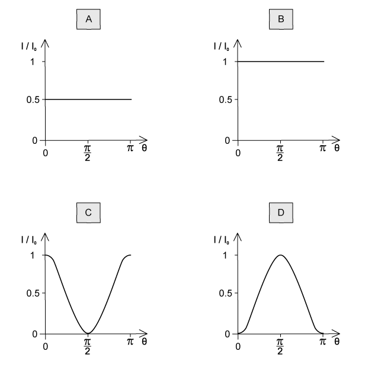
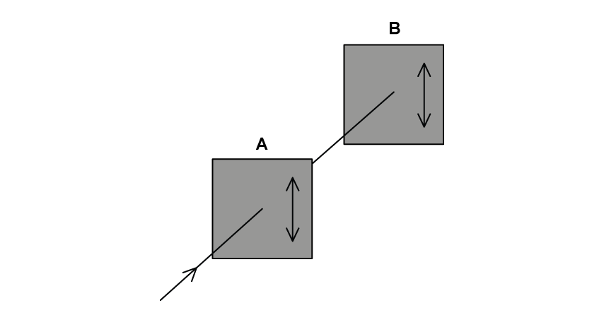
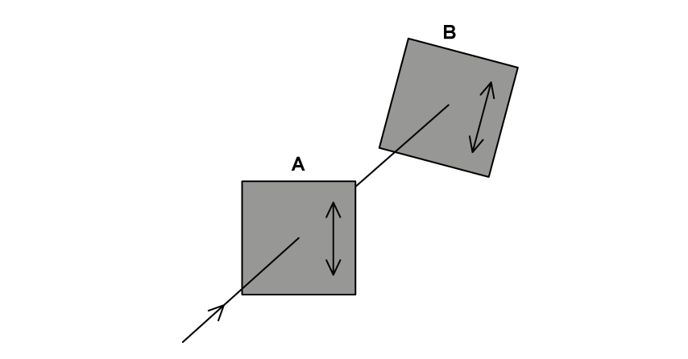
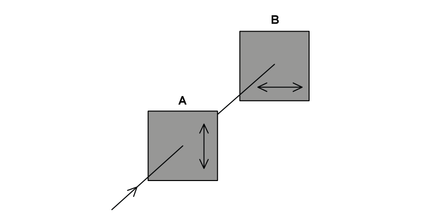
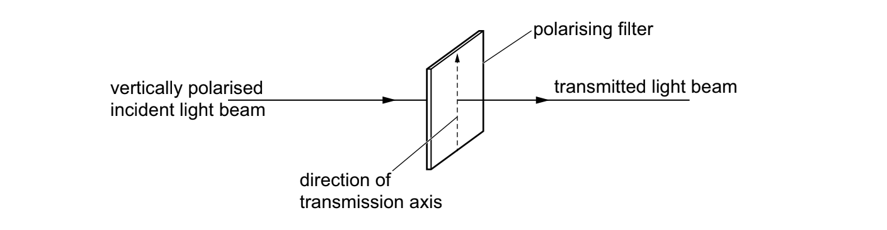
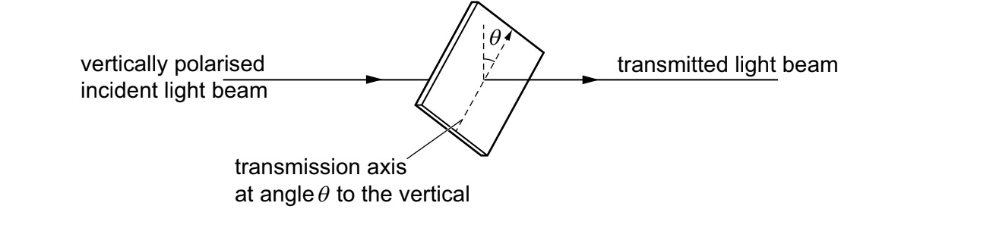
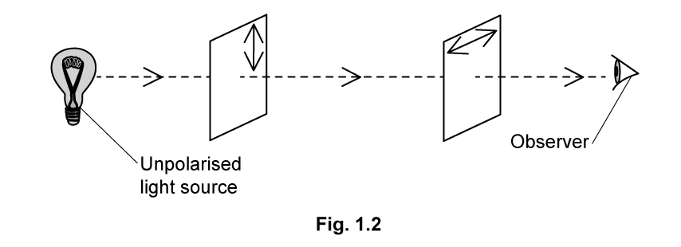

# Exam Questions — Polarisation
**7. Waves** · Cambridge (CIE) AS physics (9702)
> Source: [https://www.savemyexams.com/as/physics/cie/25/topic-questions/](https://www.savemyexams.com/as/physics/cie/25/topic-questions/) · 21 questions across 2 sets

## Multiple Choice Questions (14 questions)

### Q1 — easy — 1 marks

**Q1** [1 mark]

The following are statements about waves. Which statement below describes a situation in which polarisation would not happen?

### Q2 — hard — 1 marks

**Q2** [1 mark]

A beam of unpolarised light is incident on the first of two parallel polarisers. The transmission axis of the two polarisers are initially parallel.

The first polariser is now rotated about the direction of the incident beam by an angle smaller than 90°.

Which row in the table describes the changes to the intensity and polarisation of the light transmitted through both polarisers?

| ** ** | **Intensity** | **Polarisation** |
|---|---|---|
| **A**  **B**  **C**  **D** | no change  no change  different  different | no change  different  different  no change |

### Q3 — easy — 1 marks

**Q3** [1 mark]

A polarised light beam emerges from a polariser. It is then transmitted onto an analyser, which is at angle ? to the polariser.

What does the value of the angle ? need to be, so that the light emerging from the analyser is at maximum intensity?

### Q4 — medium — 1 marks

**Q4** [1 mark]

A linearly polarised electromagnetic beam has an intensity of 16 W m–2 with an angle of incidence of 45° to the vertical.

What is the intensity of the transmitted beam?

### Q5 — medium — 1 marks

**Q5** [1 mark]

The quality of the sound produced by a portable radio can be improved by changing the orientation of the aerial.

Which statement will correctly describe the explanation of this improvement?

### Q6 — easy — 1 marks

**Q6** [1 mark]

A student looked at the liquid crystal display on their calculator with a polarising film. They observed that as they rotated the film, the display changed.

Which property of the radiation from the calculator display is described correctly?

### Q7 — medium — 1 marks

**Q7** [1 mark]

Unpolarised light of intensity *I**0* is incident on a polariser with a vertical transmission axis. The transmitted light is incident on a sheet of material X. After transmission through X the intensity of light is $\frac{I_{0}}{2}$.

It is suggested that X could be

| **1** | a polariser with a vertical transmission axis |
|---|---|
| **2** | a polariser with a horizontal transmission axis |
| **3** | non-polarising glass |

### Q8 — hard — 1 marks

**Q8** [1 mark]

Unpolarised light of intensity *I**0** *is incident on the first of two polarising sheets. Initially the planes of polarisation of the sheets are perpendicular.

** **Which sheet must be rotated and by what angle *θ*, so that light intensity  $\frac{I_{0}}{4}$   can emerge from the second sheet ?

| ** ** | **Rotated sheet** | **Angle θ of rotation** |
|---|---|---|
| **A** | 1 or 2 | $\mathrm{cos}^{-1}\frac{1}{2}$ |
| **B** | 1 or 2 | $\mathrm{cos}^{-1}\frac{\sqrt{2}}{2}$ |
| **C** | 2 only | $\mathrm{cos}^{-1}\frac{1}{2}$ |
| **D** | 1 only | $\mathrm{cos}^{-1}\frac{\sqrt{2}}{2}$ |

### Q9 — hard — 1 marks

**Q9** [1 mark]

Unpolarised light is incident on a polariser. The light transmitted by the first polariser is then incident on a second polariser. The polarising axis of the second sheet is 60˚ to that of the first.

The intensity emerging from the second polariser is *I**2*.

Which of the following gives the intensity incident on the first polariser?

### Q10 — medium — 1 marks

**Q10** [1 mark]

Unpolarised light of intensity 8 W m-2 is incident upon a polariser. The light is then transmitted to a second polariser at an angle of 25° to that of the first polariser.

What is the intensity of the light beam emerging from the second?

### Q11 — hard — 1 marks

**Q11** [1 mark]

Unpolarised light of intensity *I**0* is incident on a polariser that has a vertical transmission axis, as shown in the diagram below.

Which graph shows the intensity of the transmitted light ?

### Q12 — easy — 1 marks

**Q12** [1 mark]

Malus’s law shows the intensity of polarised light as it emerges through an analyser. Which is the correct equation to calculate the intensity?

### Q13 — medium — 1 marks

**Q13** [1 mark]

Unpolarised light of intensity $I$* *is incident upon a polariser. The light is then transmitted to a second polariser and then a third. The polarisers have the same orientation.

Which statement is true?

### Q14 — easy — 1 marks

**Q14** [1 mark]

Which of the following waves can be polarised?

## Structured Questions (7 questions)

### Q1 — easy — 9 marks

**Q1** [2 marks]

State** two** ways that light can be polarised other than by a polarising filter.

**Q1** [2 marks]

Fig. 1.1 shows unpolarised light of intensity 64 W m−2 incident on polariser A.

**Fig. 1.1**

Determine the intensity of the light leaving the analyser B.

**Q1** [3 marks]

**Extract:**

Fig. 1.1 shows unpolarised light of intensity 64 W m^−2 incident on polariser A. When unpolarised light passes through a polariser, the intensity of the light falls by half. Therefore, the intensity of the polarised light incident on analyser B, I1 = I0/2 = 64/2 = 32 W m^−2.

Fig. 1.2 shows that analyser B has been rotated by 35° with respect to the polariser A.

**Fig. 1.2**

Determine the intensity of the light leaving analyser B.

**Q1** [2 marks]

**Extract:**

Fig. 1.1 shows unpolarised light of intensity 64 W m⁻² incident on polariser A. When unpolarised light passes through a polariser, the intensity of the light falls by half, therefore the intensity of the polarised light incident on analyser B, I₁ = I₀/2 = 64/2 = 32 W m⁻².

Fig. 1.3 shows that analyser B has been rotated to 90° with respect to polariser A.

**Fig. 1.3**

Show that there is no light passing through analyser B.

### Q2 — medium — 6 marks

**Q2** [3 marks]

Unpolarised light is passed through a pair of polarising sunglasses as shown in Fig. 1.1.

The light becomes plane polarised.

Explain the difference between unpolarised and plane polarised light.

**Q2** [3 marks]

Polarisation can be used to identify when some materials are under stress. Placing the material under stress causes the plane of polarisation of the light passing through the material to be rotated. The greater the stress, the greater the rotation of the plane of polarisation of the light.

A piece of transparent material under stress is positioned between two polarising filters. There is an angle of 90o between the planes of polarisation of the two polarising filters.

Explain how this photograph can be used to identify areas of the material with different amounts of stress.

### Q3 — hard — 12 marks

**Q3** [4 marks]

A transverse wave passes straight through a polariser. A and B are two points on the wave a distance of $\frac{3}{2}λ$ apart. The displacement of the wave at the point when A passes through the polariser is at its maximum.

Sketch a possible graph to show the displacement of the wave against phase angle $θ$ as it passes through the polariser, and label points A and B.

**Q3** [3 marks]

Electromagnetic waves are transverse waves that carry energy through the vacuum of space as progressive transverse waves.

Discuss the motion of an electromagnetic wave with reference to the appropriate fields.

**Q3** [3 marks]

Plane-polarised electromagnetic waves are incident on an aerial positioned to give a maximum response.

High winds cause the aerial to rotate anti-clockwise about the plane of the incident wave until it makes an angle of 40° to the plane of wave oscillation.

Calculate the percentage reduction in the amplitude of the signal received by the aerial following the high winds.

**Q3** [2 marks]

The high winds cause permanent damage to the aerial. After the aerial is repaired, it remains at an angle of 15° to the plane of wave oscillation and is found to oscillate with an amplitude of 54.0 μm. The intensity of the electromagnetic waves received at this angle is measured to be 0.056 mW m-2.

When the aerial is positioned to give a maximum response, it is found to oscillate with an amplitude of 55.9 μm.

Determine the intensity of the incident electromagnetic waves.

### Q4 — medium — 5 marks

**Q4** [1 mark]

A beam of vertically polarised monochromatic light is incident on a polarising filter, as shown in Fig. 5.1.

**Fig. 5.1**

The transmission axis of the filter is initially vertical and the transmitted light beam has the same intensity as the incident light beam.

The filter may be rotated about the direction of the light beam to change the angle of the transmission axis against the vertical.

State one angle of the transmission axis to the vertical that results in no transmitted light beam.

angle = ................................... °

*Source: Specimen 2022 Paper 2 Q5A*

**Q4** [4 marks]

**Extract:**

A beam of vertically polarised monochromatic light is incident on a polarising filter, as shown in Fig. 5.1. The transmission axis of the filter is initially vertical and the transmitted light beam has the same intensity as the incident light beam. The filter may be rotated about the direction of the light beam to change the angle of the transmission axis against the vertical.

The filter is now positioned with its transmission axis at angle *θ* to the vertical, as shown in Fig. 5.2.

**Fig. 5.2**

The ratio  $\frac{\mathrm{intensity} \mathrm{of} \mathrm{transmitted} \mathrm{light}}{\mathrm{intensity} \mathrm{of} \mathrm{incident} \mathrm{light}}$  is equal to 0.75.

(i) Calculate angle *θ*.

*θ* = ...................................... °** **[2]

(ii) Calculate the ratio

$\frac{\mathrm{amplitude} \mathrm{of} \mathrm{transmitted} \mathrm{light}}{\mathrm{amplitude} \mathrm{of} \mathrm{incident} \mathrm{light}}$.

ratio = ..................................... [2]

*Source: Specimen 2022 Paper 2 Q5B*

### Q5 — medium — 7 marks

**Q5** [2 marks]

Fig. 1.1. shows two ways in which a wave can be made to travel along a slinky spring.

Use arrows to show how points Q and R will move next as the two waves move to the right.

**Q5** [3 marks]

**Extract:**

Fig. 1.1. shows two ways in which a wave can be made to travel along a slinky spring. 

Use the diagram in Fig. 1.1.

(i) State which wave in Fig. 1.1 can be used to model an electromagnetic wave.

[1]

(ii) Hence explain why it is important to correctly align a radio antenna in order to receive the strongest signal.

[2]

**Q5** [2 marks]

Light from a filament lamp is viewed through two polarising filters **A** and **B** as shown in Fig. 1.2.

The direction of plane polarisation is indicated on each filter using a double-headed arrow.

Explain why the observer cannot see light from the filament lamp.

### Q6 — hard — 11 marks

**Q6** [2 marks]

When electromagnetic waves are reflected from a shiny surface, such as a road sign, they often become polarised.

Suggest how to determine experimentally if visible light reflected from a road sign is polarised.

**Q6** [3 marks]

Three polaroid filters P1, P2 and P3 are aligned as shown in Fig. 1.1.

Unpolarised light is incident on P1 and subsequently passes through each of the three polaroid filters. P1 and P2 are fixed, with P2 at 20° to P1, but P3 can be rotated to any angle *θ  *to that of P1.

**Fig. 1.1**

Determine the angles of *θ* at which minima and maxima of emergent light intensity occur.

**Q6** [2 marks]

Table 1.1 lists different waves, whether they are polarised or unpolarised and a reason.

State, by completing the spaces in the table whether the waves listed are polarised or unpolarised, and give a reason for your answer.

**Table 1.1**

| **Wave** | **Polarised or Unpolarised** | **Reason** |
|---|---|---|
| Light from the sun | ** ** | ** ** |
| Compression waves caused by an earthquake | Unpolarised | Longitudinal waves cannot be polarised |
| Electromagnetic waves from the sun passing through a sunglass lens | ** ** | ** ** |
| Ultra-sonic waves from an echo sounder | ** ** | ** ** |

**Q6** [4 marks]

Electromagnetic waves, being transverse, can also be polarised.

A light source is viewed through two pieces of polarisers, P and Q, with their axes initially at $\frac{π}{2}$ radians from each other, as shown in Fig. 1.1.

**Fig. 1.1**

Using the axes below, sketch the variation of the intensity of light reaching the eye with angular displacement of Q with respect to P when polariser Q is rotated.

### Q7 — easy — 8 marks

**Q7** [2 marks]

Transverse waves such as light can be polarised.

Define the term *polarised*.

**Q7** [3 marks]

Explain why longitudinal waves cannot be polarised by a polarising filter.

**Q7** [2 marks]

Fig. 1.1 shows unpolarised light directed towards a polarising filter A.

**Fig. 1.1**

Polarising filter B is placed directly after A and is identical except rotated by 90º.

State and explain what happens to the light after it has passed through polarising filter B.

**Q7** [1 mark]

**Extract:**

Fig. 1.1 shows unpolarised light directed towards a polarising filter A.

3-1-s-q--q2c-easy-aqa-a-level-physics

Fig. 1.1

In Fig. 1.1 the incident light has an intensity of $I_{0}$.

State the intensity of the polarised light exiting polarising filter A.
