# Mark Schemes — Stationary Waves
**8. Superposition** · Cambridge (CIE) AS physics (9702)

## Multiple Choice Questions (31 questions)

### Q1
**Final answer:** **The correct answer is A **

- There are 9 nodes
- The distance between adjacent nodes is $\frac{λ}{2}$
- From node 1 to node 9, there are 8 node–node intervals

$\frac{1}{2}λ=\frac{18.0}{8}=2.25\mathrm{cm}$

$\frac{λ}{2}=2.25\mathrm{cm}$

- Therefore

$λ=2.25\times2=4.50\mathrm{cm}$

### Q2
**Final answer:** **The correct answer is ****A**** because:**

- The diagram shows one complete wave is produced with a frequency of 650 Hz

  - The wave equation is given by $v=fλ$
- In order for the wavelength to stay the same as the frequency increases, the speed of the wave also needs to be increased

**B **& **C **are incorrect because in order to maintain the same wave pattern, the wavelength must stay the same

**D **is incorrect because if the speed is decreased, then the wavelength will decrease changing the wave pattern

### Q3
**Final answer:** **The correct answer is ****A**** because:**

- For a stationary wave to be produced, there should be a node at the fixed end and an antinode at the loudspeaker
- For the demonstration in the question, the frequency is *f* and formed in the length of pipe *l*, for a fundamental mode the wave formed is a quarter of a wavelength

  - For a closed pipe :
  - $L=\frac{λ}{4}$ gives a wavelength of *λ* = 4*L*

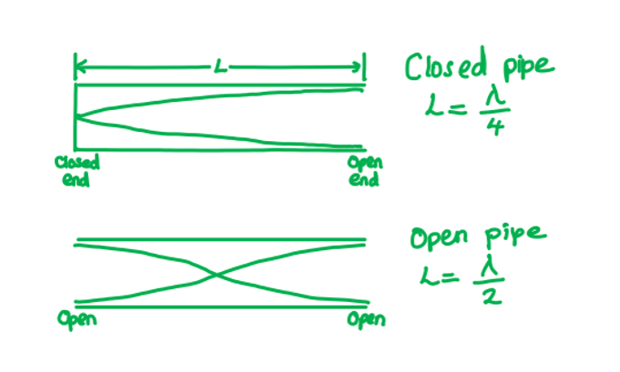

- Option **A** shows a pipe with length 2*L* with two open ends

  - This would create half a wavelength, for this case, $\frac{λ}{2}=2L$
  - Hence the wavelength is *λ* = 4*L*, which is the same as the demonstration in the question

**B** is incorrect  because a node will form at the closed end of the pipe and an antinode at the speaker, this is a quarter of a wave $\frac{λ}{4}=2L$ , therefore, *λ* = 8*L*

**C** is incorrect because there will be an antinode at both the speakers giving half a wavelength $\frac{λ}{2}=L$  , therefore, *λ* = 2*L*

**D **is incorrect because there would be an antinode at the speaker and an antinode at the open end giving half a wavelength $\frac{λ}{2}=L$ , therefore, λ = 2L

### Q4
**Final answer:** **The correct answer is ****A**** because:**

- There are five nodes in 30 cm and each has half a wavelength between each one

  - 30 cm divided by 5 = 6 cm
  - So, $\frac{λ}{2}=6.0\mathrm{cm}$
- Therefore, *λ* = 12.0 cm

Another method you can use to determine the wavelength in this question is to count up the number of wavelengths from the diagram (2.5) and then divide 30 cm by this number.

### Q5
**Final answer:** **The correct answer is ****B**** because:**

- A standing or stationary wave is formed from the superposition of two travelling waves with the same frequency, polarisation and amplitude
- The organ pipe is open at both ends, in order for it to have the lowest (fundamental) frequency it will have two antinodes, with a single node in the middle

- The wavelength can be measured by measuring the length between 3 consecutive nodes, the distance between the 1st and 2nd nodes give half the wavelength

  - So, in the organ pipe $L=\frac{λ}{2}$
  - Speed of a wave, $v=λf$
  
    - Therefore, the fundamental frequency is $f_{f}=\frac{v}{λ}=\frac{v}{2L}$

### Q6
**Final answer:** **The correct answer is ****B**** because:**

- A standing or stationary wave is formed from the superposition of two travelling waves with the same frequency, polarisation and amplitude

- In an open-ended pipe there will be half a wavelength, so for pipe Y:

  - $L=\frac{x}{2}\timesλ$
  - $50=\frac{x}{2}\times20$
  - $x=5$
- There is an odd whole number produced

  - Therefore, a standing wave will be created
- In a close-ended pipe there will be a quarter of a wavelength, so for pipe X:

  - $L=\frac{x}{4}\timesλ$
  - $35=\frac{x}{4}\times20$
  - $x=7$
- There is an odd whole number produced

  - Therefore, a standing wave will be created
- So, both X and Y will produce a standing wave

### Q7
**Final answer:** **The correct answer is ****A**** because:**

- A standing or stationary wave is formed from the superposition of two travelling waves with the same frequency, polarisation and amplitude
- The question states that a node is formed at the mouthpiece and an antinode at the bell of the horn
- The lowest or fundamental note produced will have only one node at the mouthpiece and an antinode at the bell, creating a quarter of a wavelength

- The first higher note will have a node at the mouthpiece, then a node, followed by an antinode at the bell, giving  $\frac{3}{4}$ of a wavelength

  - So, the frequency is 3 times that of the lowest note
  - Therefore, frequency $=3\times75=225\mathrm{Hz}$
- The second-highest note would be $\frac{5}{4}$    of a wavelength

  - So, the frequency is 5 times that of the lowest note
  - Therefore, frequency $=5\times75=375\mathrm{Hz}$

### Q8
**Final answer:** **The correct answer is ****B**** because:**

- Wave speed = frequency × wavelength

  - $v=fλ$
- Frequency = 13 Hz
- Wavelength: in the diagram there are 1.5 waves in 90 cm

  - $\frac{90}{1.5}=60\mathrm{cm}=0.6m$
- Therefore, $v=13\times0.6=7.8ms^{-1}$

### Q9
**Final answer:** **The correct answer is ****D**** because:**

- A standing or stationary wave is formed from the superposition of two travelling waves with the same frequency, polarisation and amplitude
- When air is blown over the top of an empty bottle, the bottom of the bottle has a fixed end, creating a wave travelling in the opposite direction with the same frequency and wavelength

**A **is incorrect because a single slit would diffract the wave into semicircular waves

**B **is incorrect because this would create the characteristic fringes caused by the superposition of the overlapping light from the two slits

**C **is incorrect because this would create an echo, which is a reflection of a sound wave

### Q10
**Final answer:** **The correct answer is ****A**** because:**

- A standing or stationary wave is formed from the superposition of two travelling waves with the same frequency, polarisation and amplitude
- A node is produced with zero displacement and an antinode at maximum displacement
- The distance between two nodes is half a wavelength, and there is an antinode at the middle of two successive nodes

  - Therefore, a node is a quarter of a wavelength from an adjacent antinode

**B **is incorrect because stationary waves do not oscillate

**C **is incorrect because a node would be formed at the metal sheet

**D **is incorrect because in a stationary wave, the points a loop are in phase and out of phase with adjacent loops

### Q11
**Final answer:** **The correct answer is ****C**** because:**

- The principle of superposition is applied when two or more waves are travelling through the same medium at the same time
- Noise-cancelling headphones use destructive interference to cancel out the external noise
- Therefore, the headphone will need to produce a wave with the same frequency and amplitude but with a phase difference of 180°

**A **is incorrect because a phase difference of 360° will mean that the waves are in phase and this will cause constructive interference making the external noise louder

**B **& **D** are incorrect because a phase difference of 90° and 270° will cause a comb filter effect, alternating constructive and destructive peaks and troughs

### Q12
**Final answer:** **The correct answer is ****C**** because:**

- A standing or stationary wave is formed from the superposition of two travelling waves with the same frequency, polarisation and amplitude
- The points that are equidistant from Q2 will vibrate with the same frequency and amplitude

**A **is incorrect because not all the points on the wave vibrate in phase. Points within the loops will vibrate in phase but vibrate out of phase with the adjacent loop

**B **is incorrect because not all the points on the string vibrate with the same amplitude. Points closer to the nodes have a smaller amplitude than those as the crest of the loop

**D **is incorrect because points that an equidistant from Q2 are not in phase as points in adjacent loops are out of phase

### Q13
**Final answer:** **The correct answer is ****A**** because:**

- The diagram is a transverse wave as the displacement is vertical and the direction of travel is horizontal
- 1 loop is half a wave
- 100 cm has 2.5 waves

  - $100=2.5λ$
  - $λ=\frac{100}{2.5}=40\mathrm{cm}$
- So the wavelength is 40 cm
- There are nodes present that remain still, hence it is a stationary wave

**B **is incorrect because the diagram shows a stationary wave, not a progressive wave

**C **&** D **are incorrect because there are 2.5 waves in 100 cm, so the wavelength is 40 cm, not 20 cm

### Q14
**Final answer:** **The correct answer is ****C**** because:**

- N and P are vibrating in phase

  - This means they are vibrating up and down at the same time

**A **is incorrect because there are 1.5 wavelengths between M and Q

**B **is incorrect because a wave with the lowest frequency will be half a wave

**D **is incorrect because point O is at an antinode

### Q15
**Final answer:** **The correct answer is ****A**** because:**

- A standing or stationary wave is formed from the superposition of two travelling waves with the same frequency, polarisation and amplitude
- A standing wave is one in which two waves combine constructively giving an amplitude of twice the original wave

  - Therefore, the waves must have equal speed, frequency and wavelength

**B** & **D **are incorrect because  if the waves had a different wavelengths, then they would not be in phase

**C **is incorrect because the waves must have the same frequency to create a standing wave

### Q16
**Final answer:** **The correct answer is ****A**** because:**

- A standing or stationary wave is formed from the superposition of two travelling waves with the same frequency, polarisation and amplitude
- Tube S is a close-ended pipe, with a node at the closed-end, and an antinode at the open end
- Tube T is an open-ended pipe, with an antinode at both ends

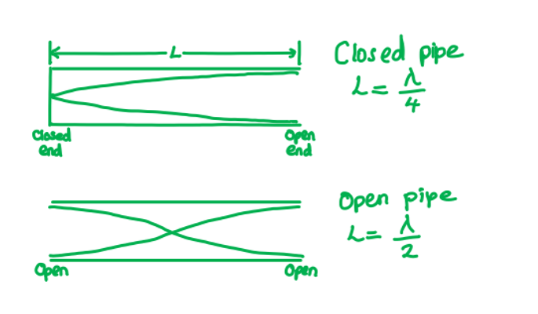

- In a closed tube, the lowest or fundamental note produced will have only one node at the fixed end and an antinode at the open, creating a quarter of a wavelength

  - So $L=\frac{λ}{4}$, giving, $λ=4L$
- In an open tube, the lowest or fundamental note produced will have an antinode at each end with a node in the middle, creating half of a wavelength

  - So $L=\frac{λ}{2}$, giving, $λ=2L$
- For the closed tube S, the resonant frequencies are equal to:

  - $f_{c}=\frac{nv}{4L}$
  - Where *v* = speed of the wave, *L* = length of the tube and *n* = 1,3,5…
- For the open tube T, the resonant frequencies are equal to:

  - $f_{o}=\frac{nv}{2L}$
  - Where *n* = 1,2,3…
- So, the resonant frequency for the open tube T (when *n* = 1):

  - $f_{o}=2f_{c}$

### Q17
**Final answer:** **The correct answer is ****D**** because:**

- A standing or stationary wave is formed from the superposition of two travelling waves with the same frequency, polarisation and amplitude 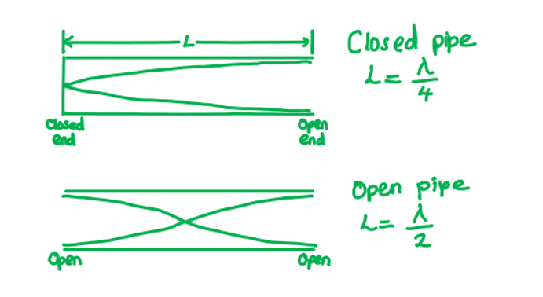
- In this open-ended pipe, there are six nodes in 1.5 m each have half a wavelength between each one

  - 1.5 m divided by 6 = 0.25 m
  - So, $\frac{λ}{2}=0.25m$
- Therefore, λ = 0.5 m

### Q18
**Final answer:** **The correct answer is ****C**** because:**

- The wave is a sound wave, which is a longitudinal wave

  - Longitudinal waves travel parallel to the direction of travel
- The wave created by constructive combining of the sound waves created the largest amplitude, so the loudest sound

  - Hence the wave created is a stationary wave

**A** &** B **are incorrect because sound waves are not transverse waves; transverse waves travel perpendicular to the direction of travel

**D **is incorrect because superposition of the wave has occurred creating a standing wave, so the wave is not progressive

### Q19
**Final answer:** **The correct answer is ****B**** because:**

- A standing or stationary wave is formed from the superposition of two travelling waves with the same frequency, polarisation and amplitude
- A node would be present at the wall, the same as in a closed tube

- The distance between a node and antinode is equal to $\frac{λ}{4}$

  - So, $\frac{λ}{4}=x$, so, wavelength $λ=4x$
- The wave equation is equal to $c=fλ$

  - Therefore, frequency : $f=\frac{c}{λ}=\frac{c}{4x}$

### Q20
**Final answer:** **The correct answer is ****A**** because:**

- A standing or stationary wave is formed from the superposition of two travelling waves with the same frequency, polarisation and amplitude
- The pile of dust will correspond to a node
- One wavelength is equal to three nodes, so, the distance formed by three successive heaps is equal to one wavelength

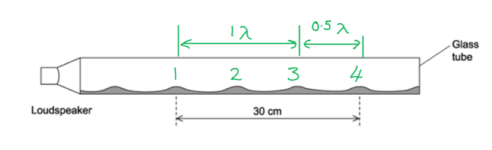

- So, the wavelength of the sound wave is :

  - $\frac{3}{2}λ=0.3$
  - $λ=0.3\times\frac{2}{3}=0.2m$
- The wave equation is given by $v=fλ$

  - Therefore, frequency, $f=\frac{v}{λ}=\frac{330}{0.2}=1650\mathrm{Hz}$

### Q21
**Final answer:** **The correct answer is ****D**** because:**

- The diagram shows $\frac{3}{4}$   of a wavelength is formed in a 60 cm tube

  - Therefore, one wavelength is equal to $λ=80\mathrm{cm}=0.8m$
- The wave equation is given by $v=fλ$

  - $f=\frac{v}{λ}=\frac{330}{0.8}=412.5\mathrm{Hz}$
- Therefore, the frequency of the wave is $413\mathrm{Hz}$

### Q22
**Final answer:** **The correct answer is ****B**** because:**

- In a progressive wave, the wavefronts move through the medium transferring energy from one point to the next
- A standing or stationary wave is formed from the superposition of two travelling waves with the same frequency, polarisation and amplitude
- The wave speed of a standing wave is the speed that one of the progressive wave travels that is producing the standing wave

**A **is incorrect because the wave speed is, $v=fλ$, at a node the wave speed = 0

**C **is incorrect because a standing wave does not transfer energy

**D **is incorrect because the distance between two antinodes would be the wavelength of the wave. The period of the wave is the time it takes for one wave to travel

### Q23
**Final answer:** **The correct answer is ****B**** because:**

- A standing or stationary wave is formed from the superposition of two travelling waves with the same frequency, polarisation and amplitude
- The wave equation is equal to $c=λf$
- Where:

  - Speed of electromagnetic waves : *c* = 3.0 × 108 m s−1
  - Frequency : *f* = 1 GHz = 1 × 109 Hz
  - Wavelength : $λ=\frac{v}{f}=\frac{3.0\times10^{8}}{1\times10^{9}}=0.3m$
- The distance between the transmitter and the reflective surface = 45 cm

  - So, the number of periods =$\frac{0.45}{0.30}=1.5$
- One antinode is half a period, so, in 1.5 periods there are 3 antinodes

### Q24
**Final answer:** **The correct answer is ****B**** because:**

- A wavelength is the length of one complete wave

  - Each loop is the equivalent of one-half of a wavelength
- A node is the point on a standing wave of minimum amplitude

**A **& **C **are incorrect because there are not two wavelengths in the diagram

**D **is incorrect because the antinode is the point of maximum amplitude of the wave and found at the crest of the loop

### Q25
**Final answer:** **The correct answer is ****B**** because:**

- A standing or stationary wave is formed from the superposition of two travelling waves with the same frequency, polarisation and amplitude
- The pipe is closed at one end; there are two nodes present, therefore, the length of the tube is equal to $\frac{3}{4}λ$

- The maximum pressure change happens at the displacement node, where the particles are stationary, but density fluctuates the most

### Q26
**Final answer:** **The correct answer is ****D**** because:**

- In order for the displacement to be zero the sum of the displacements needs to be zero
- One wave has zero displacement, one negative and one positive, giving a resultant displacement of zero

**A** & **B **are incorrect because they both give a negative displacement

**C **is incorrect because two of the three waves will have a negative displacement but will still leave one wave; therefore the resultant wave will not be zero

### Q27
**Final answer:** **The correct answer is ****D**** because:**

- A standing or stationary wave is formed from the superposition of two travelling waves with the same frequency, polarisation and amplitude
- A standing wave is one in which two waves combine constructively giving an amplitude of twice the original wave

  - Therefore, the stationary wave in the cylinder is caused by the superposition of two waves moving in opposite directions

**A **is incorrect because sound waves can’t be polarised

**B **is incorrect because the waves will meet at a node at the fixed end of the cylinder

**C **is incorrect because decreasing the length of the column (done by adding water to the cylinder) will increase the fundamental frequency of the system

### Q28
**Final answer:** **The correct answer is ****A**** because:**

- In a progressive wave, the wavefronts move through the medium transferring energy from one point to the next
- A standing or stationary wave is formed from the superposition of two travelling waves with the same frequency, polarisation and amplitude

  - The waves in a standing wave are one wavelength apart and vibrate in phase
  - Particles in a progressive wave can also be one wavelength apart and vibrate in phase

**B **is incorrect because in a standing wave, adjacent particles are vibrating in phase with each other

**C **is incorrect because only a progressive wave transfers energy, in a standing wave there is no net transfer of energy

**D **is incorrect because in a standing wave adjacent points each oscillate with a different amplitude

### Q29
**Final answer:** **The correct answer is ****D**** because:**

- A standing or stationary wave is formed from the superposition of two travelling waves with the same frequency, polarisation and amplitude
- The waves are moving in opposite directions, and the standing wave results from alternately constructive and destructive interference
- A node is represented by a dot on the diagram, which shows zero displacement
- The arrows show the direction of travel of the wave

  - Hence diagram **D** shows two nodes and two antinodes

**A **is incorrect because the diagram only shows one node

**B **is incorrect because the diagram only shows one antinode

**C **is incorrect because a stationary wave is produced by the superposition of the wave travelling in the opposite direction. This diagram shows the waves all travelling in the same direction

### Q30
**Final answer:** **The correct answer is ****C**** because:**

- A standing or stationary wave is formed from the superposition of two travelling waves with the same frequency, polarisation and amplitude
- The lowest or fundamental note produced will have only one node at the closed end and an antinode at the open end, creating ¼ of a wavelength

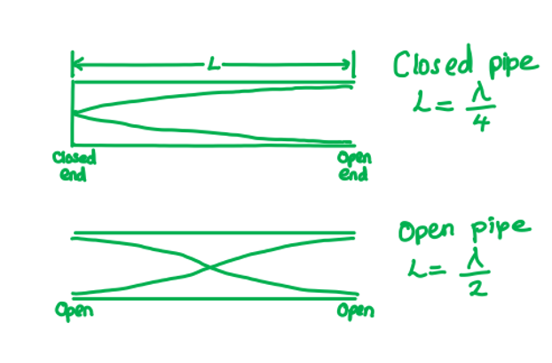

- A quarter of a wavelength is formed in a 10 m pipe

  - Therefore, one wavelength = 40 m
- The wave equation is given by $v=fλ$

  - $f=\frac{v}{λ}=\frac{320}{40}=8\mathrm{Hz}$

### Q31
**Final answer:** **The correct answer is ****A**** because:**

- A standing or stationary wave is formed from the superposition of two travelling waves with the same frequency, polarisation and amplitude
- In the diagram 1 loop is formed (1st harmonic) and this is half a wave so on the length of the wire, *L*

  - $L=\frac{λ_{1}}{2}$so, wavelength $λ_{1}=2L$
  - Where λ is the wavelength of the wave
- The wave equation is given by $v=fλ$

  - So, frequency,$f_{1}=\frac{v}{λ_{1}}=\frac{v}{2L}$
- For 2 loops to be formed (2nd harmonic) on the same length of wire:

  - $λ_{2}=L$, as a complete wave will be formed
- Therefore, the new frequency is equal to :

  - $f_{2}=\frac{v}{λ_{2}}=\frac{v}{L}=2f_{1}=2f$

## Structured Questions (8 questions)

### Q1
(i) On a progressive transverse wave:

- Two adjacent points vibrate with different phases; **[1 mark]**

(ii) On a stationary wave:

**Final answer:** **Any ****one**** from:**

- All points between two adjacent nodes vibrate in phase; **[1 mark]**
- If separated by an even number of nodes, two adjacent points vibrate in phase; **[1 mark]**
- If separated by an odd number of nodes, two adjacent points vibrate out of phase; **[1 mark]**

**[Total: 2 marks]**** **

> *On **both **progressive and stationary waves, the phase of a particle constantly changes as it vibrates up or down through its cycle*

> *On a **progressive **wave, the phase difference between two points is constantly changing*

- *This phase difference can be described by *$\frac{2πd}{λ}$*, where *$d$* is the distance between the two points*
- *This expression does **not **apply to stationary waves*

> *On a **stationary **wave, two points are either completely in phase or completely out of phase:*

- *When two points are on either side of a node, they are out of phase (phase difference = π)*
- *When two points have none or a factor of two nodes (i.e. 2 nodes, 4 nodes) in between them, they are in phase (phase difference = 0)*

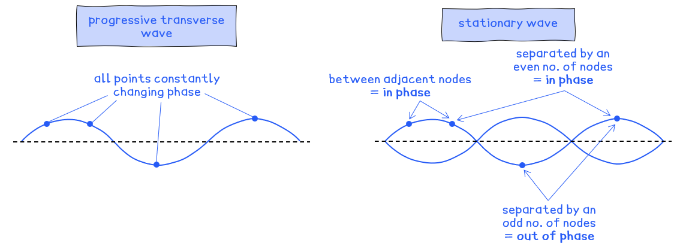
The pairs of waves which superpose are:

- Wave 1 and wave 3; **[1 mark]**
- This is destructive interference

- Wave 2 and wave 2; **[1 mark]**
- This is constructive interference

- Wave 1 and wave 2; **[1 mark]**
- This is a mix of constructive and destructive interference**  **

**[Total: 3 marks]**

> *Complete destructive interference, as in part (i), occurs when the peaks of one wave line up with the troughs of the other. This results in a wave with no amplitude.*

> *Complete constructive interference, as in part (ii), occurs when the peaks of one wave line up with the peak of another. This results in a wave with double the amplitude.*

> *Superposition can also occur with any two waves, it doesn’t have to be completely constructive or destructive, as in part (iii).*
Determine the wavelength of the stationary wave:

List the known quantities:

- Length of string, *L* = 0.58 m

Determine the number of wavelengths:

- Over the length of the string, there is half a wavelength, or $L=\frac{λ}{2}$
- So, the wavelength is $λ=2L$ **[1 mark]**** **

Calculate the wavelength:

- $λ$ = 2 × 0.58 = 1.16 m = 1.2 m **[1 mark]**** **

**[Total: 2 marks]**
Calculate the speed of the stationary wave:

List the known quantities:

- Frequency, $f$ = 276 Hz
- Wavelength, $λ$ = 1.16 m (from part c)

Substitute the values into the wave equation:

- Wave speed:  $v=fλ$ **[1 mark]**
- Substitute:  $v$ = 276 × 1.16 ** **
- $v$ = 320 m s–1 (2 s.f.) **[1 mark]**** **

**[Total: 2 marks]**

> *You would also get both marks if you used **λ** = 1.2 m and obtained **v** = 330 m s**–1** (2 s.f.)*

### Q2
(i) A transverse wave is defined as:

- (Particle) vibrations / oscillations that are <u>perpendicular</u> to the direction of energy transfer; **[1 mark]**

(ii) The principle of superposition states that:

- Waves meet / overlap at a point; **[1 mark]**
- The resultant displacement is the sum of the individual displacements; **[1 mark]**

**[Total: 3 marks]**

### Q3
The principle of superposition states that:

- When two or more waves move with the <u>same frequency</u> arrive at a point; **[1 mark]**
- The resultant displacement is the <u>sum</u>** **of the displacements of each wave; **[1 mark]**** **

**[Total: 2 marks]**** **

> *When writing definitions and principles remember to include the key words from the topic. In this case ‘frequency’ and ‘displacement’ instead of ‘at the same time’ or ‘the same size’.*
Two conditions for a stationary wave are:

**Final answer:** **Any ****two**** from:**

- Two waves of the <u>same</u> frequency / wavelength; **[1 mark]**
- Moving in opposite directions; **[1 mark]**
- Reflected at the end of the string; **[1 mark]**
- With the same / similar amplitude; **[1 mark]**
- There is an integer number of $\frac{1}{2}$ wavelengths between the walls; **[1 mark]**** **

**[Total: 2 marks]**** **

> *This is an extremely common exam question, so make sure to remember these conditions! Most importantly, two waves must have the same frequency (and therefore wavelength) and same or similar amplitude to superpose and become a stationary wave. Avoid saying ‘**it** has the same frequency’, always refer to ‘waves’ or the ‘reflected wave’ at the end of the string.*
(i) A node represents the points where:

- There are no vibrations / oscillations (of the wave); **[1 mark] ****OR**
- Two waves between a boundary <u>destructively</u> interfere; **[1 mark]**

(ii) An antinode the points where:

- The vibrations / oscillations are at their maximum amplitude; **[1 mark] ** **OR**
- Two waves between a boundary <u>constructively</u> interfere; **[1 mark]**** **

**[Total: 2 marks]**
The correct positions of the nodes and antinodes are as follows:

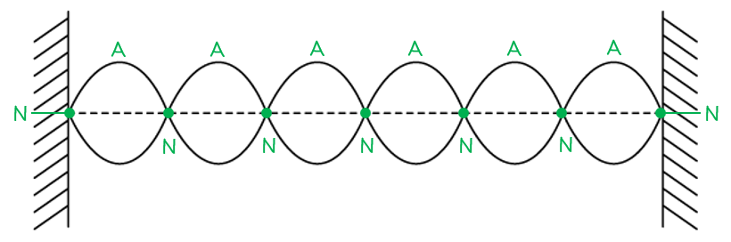

- A:  6 antinodes at the maximum displacement (positive or negative); **[1 mark]**
- N:  7 nodes at the points of zero displacement; **[1 mark]**** **

**[Total: 2 marks]**** **

> *Remember that the points of zero displacement where the string is fixed to the boundaries also count as nodes!*

### Q4
Explain how the wave is formed, referring to the principle of superposition in your answer:

Explain how the wave is formed:

- Travelling waves move (from the centre of the string) to the fixed end(s) and then <u>reflect</u> back into the centre; **[1 mark]**
- Two travelling waves move in opposite directions along the string having the same / similar frequency / wavelength / amplitude; **[1 mark]**

Use the principle of superposition:

- (The two waves) superpose/interfere to produce the stationary wave; **[1 mark]**
- The (maximum) displacement in the centre is twice the initial maximum displacement / equal to the sum of the displacements of the individual waves; **[1 mark]**

**[Total: 4 marks]**
On Fig. 1.1, draw the stationary wave that would be formed on the string in part (a) with two more nodes and two more antinodes.

Count the nodes and antinodes:

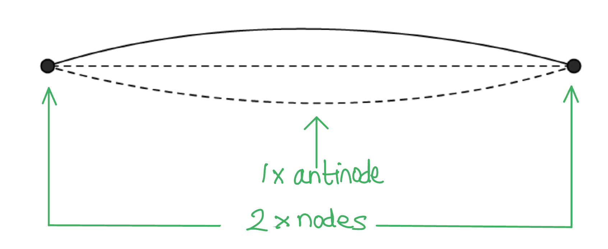

Draw a stationary wave with 4 nodes and three antinodes:

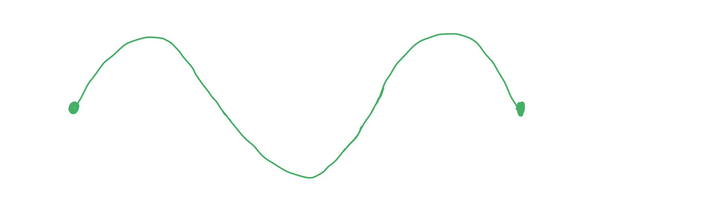

- Diagram as shown above; **[1 mark]**

**[Total: 1 mark]**
A correctly annotated diagram looks like:

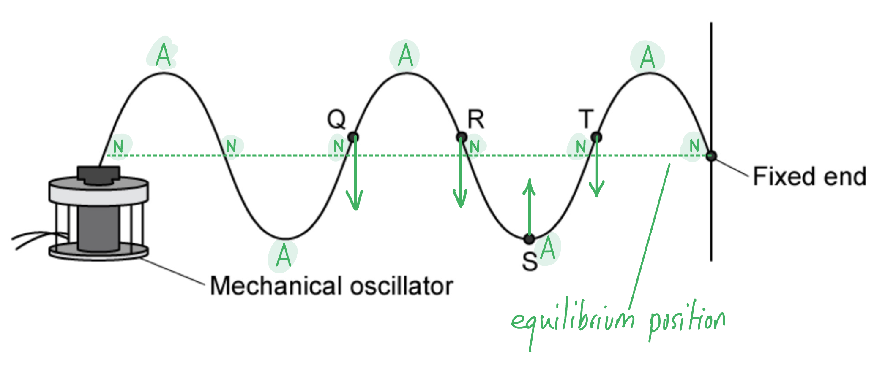

(i) Mark clearly on the diagram the equilibrium position

- Equilibrium position horizontal and meets fixed end; **[1 mark]**

(ii) Mark clearly on the diagram at least two nodes by labelling them **N**, and two antinodes by labelling them **A**

- At least two correct **N** **[1 mark]**
- At least two correct **A** **[1 mark]**

(iii) Mark clearly on the diagram the direction in which points **Q**, **R**, **S** and **T** are about to move.

- **Q**, **R** and **T** moving downwards;** [1 mark]**
- **S** moving upwards; **[1 mark]**

**[Total: 5 marks]**
(i) Calculate the time period the stationary wave on the string:

Use the equation relating frequency and time period:

- $T=\frac{1}{f}=\frac{1}{180}=5.6\times10^{-3}s\mathrm{or}5.6\mathrm{ms}$ **[1 mark]**

(ii) Calculate the length of the string:

List the known quantities:

- Frequency, *f* = 180 Hz
- Speed, *v* = 60 m s–1
- Number of complete wavelengths = 2.5 (counted from the diagram)

Use the wave equation to find wavelength:

- $v=fλ$
- $λ=\frac{v}{f}=\frac{60}{180}=0.33m$** [1 mark]**

Multiply λ by the number of wavelengths:

- Length = 2.5 × 0.33 = 0.83 m or 83 cm **[1 mark]**

**[Total: 3 marks]**

### Q5
The difference between progressive waves and stationary waves are:

- In a progressive wave, energy is transferred along the wave (without transferring the medium);** [1 mark]**
- In a stationary wave, energy is <u>stored</u> / not transferred; **[1 mark]**** **

**[Total: 2 marks]**
A stationary wave is formed on the string because:

**Final answer:** **Any ****three**** from:**

- A (progressive) wave travels from the centre to the ends and reflects; **[1 mark]**
- Two (progressive) waves travel in opposite directions along the string; **[1 mark]**
- The waves have the same frequency / wavelength; **[1 mark]**
- The waves have the same / similar amplitude; **[1 mark]**
- Superposition occurs / the two waves superpose; **[1 mark]**** **

**[Total: 3 marks]**** **

> *Try not to say that just ‘interference’ occurs. Although this is correct, ‘superposition’ is the term that sums up both the destructive and constructive interference that occurs to gain full marks.*
The correct stationary waves and corresponding wavelengths are as follows:

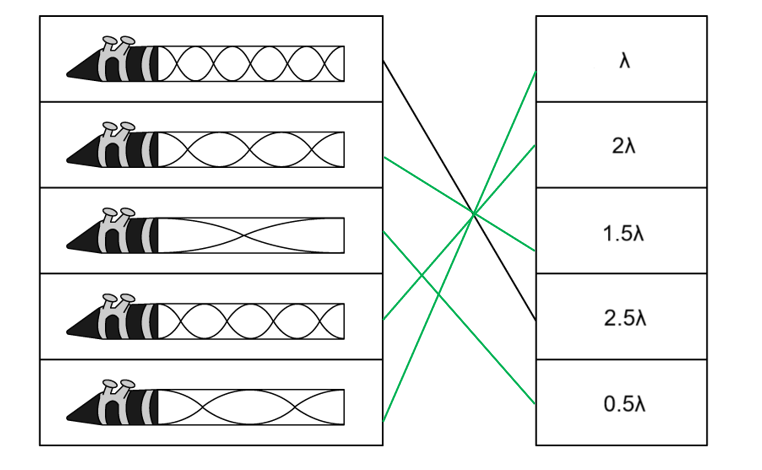

- **[1 mark]** for each correct match** **

**[Total: 4 marks]**

> *When figuring out the number of wavelengths of a stationary wave, count the number of half wavelengths you can see first. In a tube with two open ends, there will always be a quarter of a wavelength at each end, so both ends make a half wavelength.*

> *For example, here we can see 2 half wavelengths plus the two-quarter wavelengths at each end. This gives a total of 3 half wavelengths, or 1.5λ*

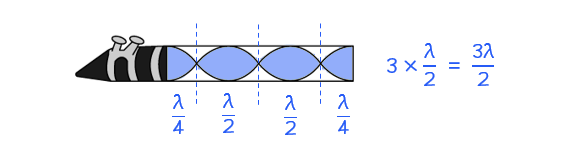
The number of wavelengths that would produce the highest note is:

- 2.5λ; **[1 mark]**** **

Explanation:

- A note (or pitch) refers to the frequency of a wave; **[1 mark]**
- The shortest wavelength corresponds to the highest frequency; **[1 mark]**

**[Total: 3 marks]**

### Q6
Describe the wave which is formed:

- The wave will be a <u>stationary</u> wave **AND **with an <u>anti-node</u> at the open end; **[1 mark]**

Explain how the wave is formed:

- <u>Longitudinal</u> waves from the loudspeaker <u>reflect at the closed end</u> of the tube **AND** The reflected wave travels in the <u>opposite direction</u> to the incident wave, causing <u>interference /  superposition</u>; **[1 mark]**

Describe the condition which must be met:

- A wave forms if the length of the tube is equivalent to $\frac{nλ}{4}$ /  an integral multiple of one-quarter of the wavelength; **[1 mark]**

**[Total: 3 marks]**

> *Remember a node is always formed at the closed end of a tube and an anti-node at the open end.*
To construct a diagram linking aspects of the wave:

Start with three sections and complete in the first one the shape of the third harmonic:

- A diagram which would score one mark looks like:

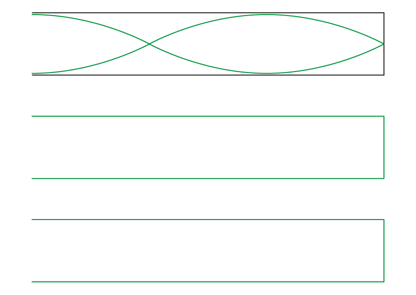

- Third harmonic drawn correctly **AND** three identical tubes 'stacked' above each other; **[1 mark]**

Sketch the formation of nodes and antinodes so they can be linked to the wave shape:

- A diagram which would score two marks looks like:

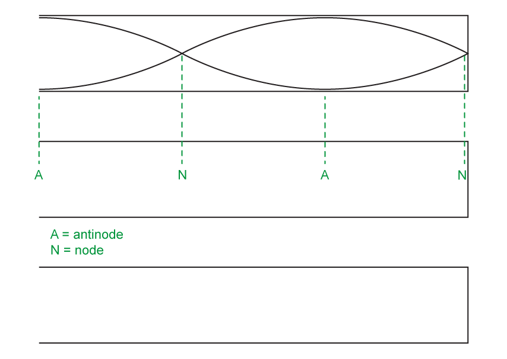

- Antinodes and nodes are all marked correctly; **[1 mark]**
- The antinode / node pattern is (by eye) situated correctly relative to the wave shape above; **[1 mark]**

Sketch the compressions and rarefactions so they can be linked to the wave shape:

- A diagram which would score two marks looks like:

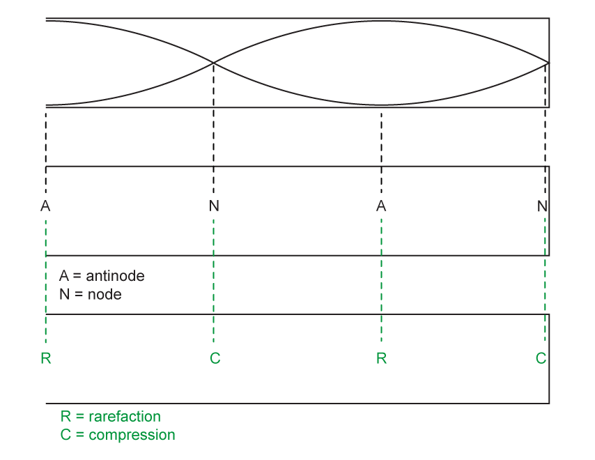

- Compressions and rarefactions marked correctly and labelled as either a compression / rarefaction or high pressure / low pressure (<u>not</u> C and R unless a key explains the meaning); **[1 mark]**
- The pattern is (by eye) situated correctly relative to either the wave shape or the antinodes / nodes above; **[1 mark]**

**[Total: 5 marks]**

> *A 3-part diagram basically means three lots of Fig. 1.1 need to be drawn. It is much clearer to draw three separate pipes to show the information but you would still gain the marks for showing this information on one pipe.*

> *It can be helpful in long questions like this to tick off each requirement:*

- *Wave shape*
- *Node formation*
- *Pressure difference*

> *Drawing accurate diagrams is a key skill. With any diagram, you are communicating a great deal. If your diagram is wrong, then what it communicates is also wrong. So it really matters!*

> *Note that although the mark scheme says parts of the diagram should stack up 'by eye', in the example ruled, dashed lines are shown. Why not take that extra moment to be sure that both you (and the Examiner) are clear how the parts of the diagram connect?*

> *Finally, although a key is not mentioned in the question, one is shown in the solution. This is because using the abbreviations A, N, C and R makes for a neater diagram, but as with defining variables in equations, they must be explained.*

> *Try not to get confused with sketching standing waves for harmonics. A second harmonic standing wave does not exist for a pipe open at one end, so the third harmonic must have an anti-node at the open end. *
List the known quantities:

- Speed of sound in the tube, *v* = 340 m s−1
- Frequency of the wave, *f* = 920 Hz

(i) Calculate the wavelength using the wave equation:

- $λ=\frac{v}{f}=\frac{340}{920}=0.3696=0.40m$ **[1 mark]**

Calculate the length of the tube:

- Length, $L=\frac{3}{4}λ=0.75\times0.3696=0.2772$
- *L* = 0.28 m = 28 cm **[1 mark]**

(ii) Express wavelength in terms of *n* and *L* for the seventh harmonic:

- $λ=\frac{4L}{n}$**[1 mark]**
- $λ=\frac{4\times0.28}{7}=0.16$
- *λ* = 0.16 m **[1 mark]**

**[Total: 4 marks]**

> *It is important to realise that part (i) of this question requires you to use the information about the third harmonic and diagram from part b). *
List the known quantities:

- Wavelength of sound, *λ *= 0.16 m (from part c)
- Length of pipe, *L *= 0.28 m (from part c)
- Speed of sound in the closed-ended pipe, *v *= 340 m s−1 (from part c)

Calculate the new frequency of sound for the seventh harmonic in the closed pipe, *f**c*:

- Recall: $f_{c}=\frac{nv}{4L}$
- $f_{c}=\frac{7\times340}{4\times0.28}$
- $f_{c}=2125$Hz **[1 mark]**

Calculate the frequency of sound in the open-ended pipe, *f**o*:

- $f_{c}=\frac{nv}{4L}$ and recall $f_{o}=\frac{nv}{2L}$
- So, $f_{c}=\frac{1}{2}f_{o}$
- and $f_{o}=2\times2125=4250$ Hz **[1 mark]**

Calculate the speed of sound, *v *in the open-ended pipe:

- *v *= *fλ *
- *v *= 4250 × 0.16 = 680 m s−1 **[1 mark]**

Calculate the harmonic of the sound, *n*:

- $f_{c}=\frac{nv}{4L}$ $\rightarrow$ $n=\frac{f_{c}\times4L}{v}$
- $n=\frac{4250\times4\times0.28}{680}=7$** [1 mark]**

**[Total: 4 marks]**

> *It can be tricky to visualise the seventh harmonic, so make a quick sketch to help. *

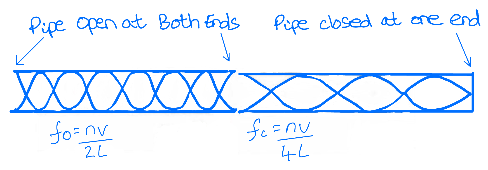

### Q7
Explain why a stationary wave is formed on the string:

**Final answer:** **Any ****three ****from:**

- The travelling waves of the string move (from the centre) to the ends / points P and Q and reflect back into the centre; **[1 mark]**
- Two travelling waves move in opposite directions along the string; **[1 mark]**
- (The two waves have) the same frequency / wavelength; **[1 mark]**
- (The two waves have) the same / similar amplitude; **[1 mark]**
- (The two waves) superpose / interfere to produce the stationary wave; **[1 mark]**

**[Total: 3 marks]**
Calculate the time taken for the string at point **X** to move from maximum displacement to its next maximum displacement:

List the known quantities:

- Frequency, *f* = 146.83 Hz

Determine how much time elapses between maxima:

- The next maximum displacement is after ½ a cycle; **[1 mark]** 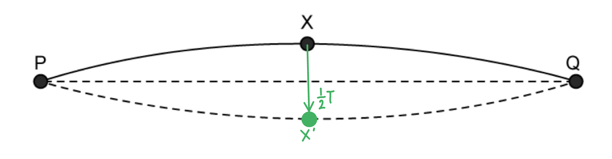

Calculate the time taken:

- Time period for one cycle, $T=\frac{1}{f}=\frac{1}{146.83}=6.8\times10^{-3}s$ **[1 mark]**
- Time period for ½ a cycle = $0.5 \times ( 6.8 \times 10^{- 3} ) = 3.4 \times 10^{- 3} \mathrm{s}$ **[1 mark]**

**[Total: 3 marks]**
Calculate length of the D string:

List the known quantities:

- Frequency, *f* = 146.83 Hz
- Speed, *v* = 190 m s–1

Determine the wavelength using the wave equation:

- $v=fλ$
- $λ=\frac{v}{f}=\frac{190}{146.83}=1.29m$ **[1 mark]**

Count the number of wavelengths and calculate the length of the string:

- Fig 1.1 shows half a wavelength
- Length of string, $L=0.5\times1.29=0.65m\mathrm{or}65\mathrm{cm}$ **[1 mark]**

**[Total: 2 marks]**

> *In a question like this one you can use a certain amount of common sense. You may not play guitar, but you have some idea of how large they are.*

> *A person holding a guitar is nearly twice as long as the whole instrument, so a guitar must be about a metre long. The strings take up much less than the full length, so they must be less than one metre.*

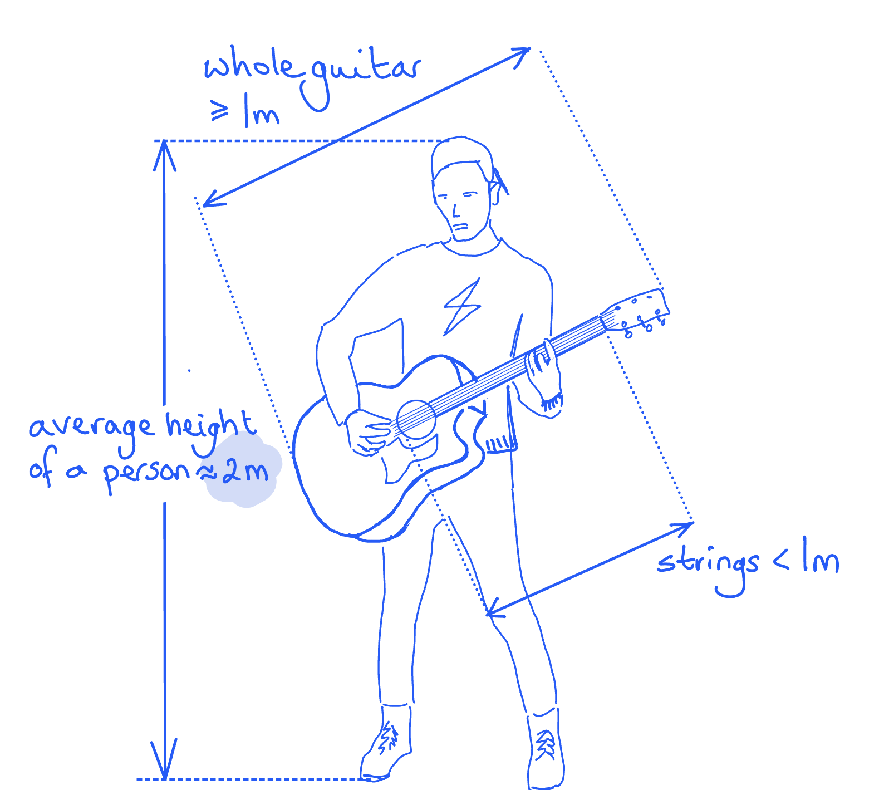

> *Picturing a guitar player in this way shows that the strings are very likely much less than a meter long, not quite a lot more. This should remind you to halve the wavelength. Try to become confident estimating real-life values by practicing visualisation, and even by measuring things to check your estimate!*
Calculate the frequency of note E:

List the known quantities:

- Speed of the wave, *v* = 190 m s–1
- Distance RQ = 0.29 m

Determine the wavelength:

- wavelength = 2 × length of string (RQ) **[1 mark]**
- $λ=2\times0.29=0.58m$** [1 mark]**

Frequency calculation:

- $f=\frac{v}{λ}=\frac{190}{0.58}=327.586=330\mathrm{Hz}$ **[1 mark]**

**[Total: 3 marks]**

### Q8
List the known quantities:

- Cross-sectional area of the tube = 4.0 × 10–3 m2
- Volume of water between two sound maxima = 3.2 × 10–3 m3

Calculate the length of the water column between the first and second maxima of sound:

- $length=\frac{volume}{area}$
- Therefore, the length of the water column between the first maxima and second maxima = $\frac{3.2\times10^{-3}}{4.0\times10^{-3}}$= 0.8 m **[1mark]**

Calculate the wavelength:

- The length of the water column corresponds to $\frac{1}{2}$*λ*
- Therefore $\frac{1}{2}$*λ *= 0.8 m
- *λ = *0.8 × 2 = 1.6 m **[1 mark]**

**[Total: 2 marks]**** **

> *The first maxima of sound is heard when some water is already inside the tube. This is sketched below:*

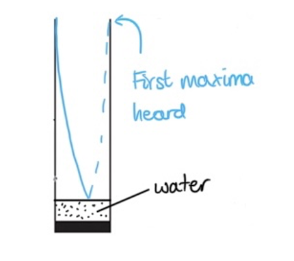

> *The second maxima of sound is heard when some more water is poured in – according to the question, an additional volume of 3.2 × 10**–3** m**3**.*
Labels which would gain full credit are shown in the sketch below:

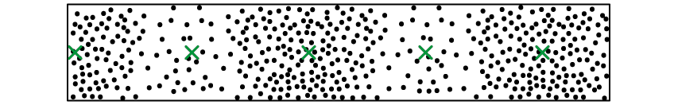

- A displacement node is labelled at the closed end of the tube; **[1 mark]**
- Displacement nodes are labelled in the middle of each compression and rarefaction; **[1 mark]**
- All displacement nodes (5) correctly identified; **[1 mark]**

**[Total: 3 marks]*** *

> *Displacement nodes are places where the air does not move (zero displacement). It is displacement antinodes where the air moves the most.*

> *Since sound waves are longitudinal, it helps to consider an analogy of a slinky spring to understand the displacement anti-nodes in this question. *

> *A slinky spring fixed at one end and pushed back and forth is sketched below. Note: the fixed end corresponds to the closed end of the tube – which, in this case, is ‘closed’ by the surface of the water!*

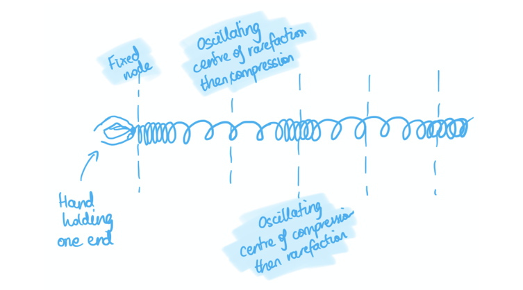

> *Using this sketch, you should be able to visualise a gas molecule in the centre of each compression / rarefaction which doesn’t move (because the compression / rarefaction oscillates around it). Hence, the centre of compressions and rarefactions act as displacement nodes.*
State the meaning of a displacement node:

- A displacement node is a position in the tube where the <u>air is not displaced</u> / the <u>displacement</u> of air <u>is zero</u>; **[1 mark]**

Refer to the position of displacement nodes in the tube using Fig. 1.2:

- Displacement nodes are always set up <u>at the closed end of a tube</u> as shown in Fig. 1.2 **OR** Fig. 1.2 shows displacement nodes at the centre of <u>compressions</u> and <u>rarefactions </u>of air; **[1 mark]**

Link displacement nodes to pressure:

- Therefore, displacement nodes must exist where the pressure is maximum / displacement nodes are <u>pressure antinodes</u>; **[1 mark]**

**[Total: 3 marks]**

> *This is a tricky concept to grasp. That pressure nodes = displacement anti-nodes and vice versa. This diagram below should help. *

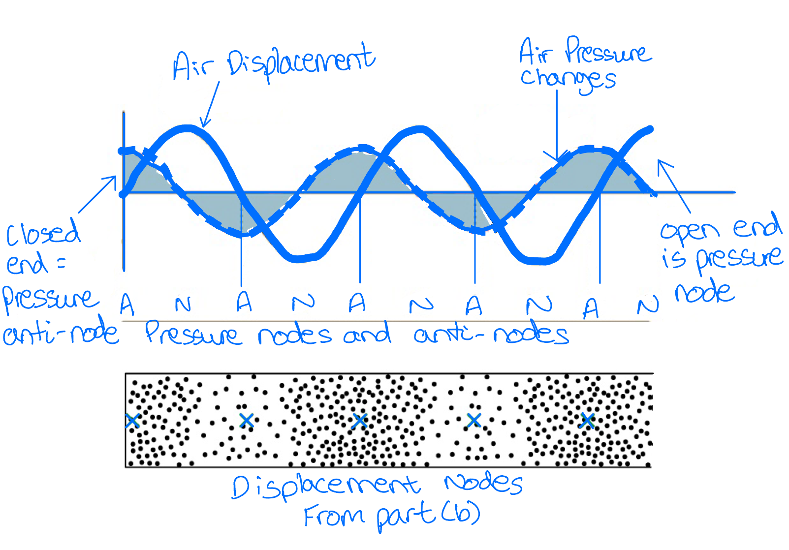
A sketch which would gain full credit is shown below:

- Standing wave shape with node at the closed end of the tube; **[1 mark]**
- 5 displacement nodes; **[1 mark]**
- Dotted line indicating oscillating wave; **[1 mark]**
- Displacement anti-node at the open end of the tube; **[1 mark]**

**[Total: 4 marks]**

> *It is important to realise for this part of the question that a displacement anti-node will form the anti-node part of the standing wave and the node part will form the node part of the standing wave. You should sketch here a standing wave as normally expected in a pipe closed at one end and open at the other. *
