# Exam Questions — Interference
**8. Superposition** · Cambridge (CIE) AS physics (9702)
> Source: [https://www.savemyexams.com/as/physics/cie/25/topic-questions/](https://www.savemyexams.com/as/physics/cie/25/topic-questions/) · 24 questions across 2 sets

## Multiple Choice Questions (16 questions)

### Q1 — medium — 1 marks

**Q1** [1 mark]

Red light with a wavelength of 650 nm is used in a Young's double-slit experiment. The distance between the double slit and the screen is 2.5 m and the separation of the slits is 0.80 mm.

What would be the fringe separation on the screen?

### Q2 — medium — 1 marks

**Q2** [1 mark]

Monochromatic light produces interference fringes with a separation of *x* on a screen a distance *D* from a pair of slits with separation *a*.

The student doubles *a *and *D*.

What would be the new fringe separation?

### Q3 — hard — 1 marks

**Q3** [1 mark]

An experiment was set up to investigate two-source interference. Microwaves of wavelength *λ* are passed through S1 and S2.

The detector is moved in the direction of the arrow from Y to W. The signal detected is decreased to zero at point W and then starts to increase again as it continues past W.

Which of the following would be the equation to determine the position of point W?

### Q4 — easy — 1 marks

**Q4** [1 mark]

Two loudspeakers are connected to a signal generator, as shown in the diagram.

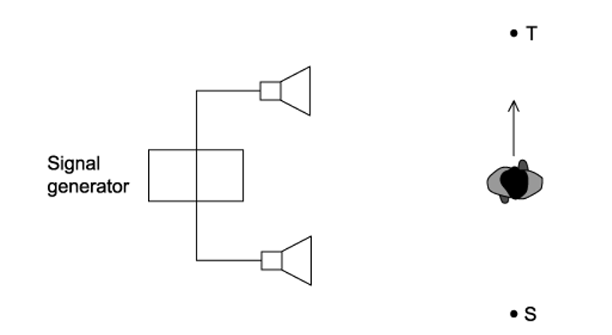

As the student walks between S to T she notices that the loudness of the sound increases then decreases repeatedly.

Why does the loudness change?

### Q5 — easy — 1 marks

**Q5** [1 mark]

Monochromatic light of wavelength λ is incident upon a double slit and forms an interference pattern on a screen.

What is a possible path difference for a minima that appears on the screen?

### Q6 — medium — 1 marks

**Q6** [1 mark]

A student is investigating the interference of waves. They set up coherent waves produced at points S and T that travel outwards in all directions.

The line XY is halfway between S and T and perpendicular to the joining line S and T. The distance XY is much greater than the distance ST.

Which line or lines would an interference pattern be seen on?

### Q7 — medium — 1 marks

**Q7** [1 mark]

Certain circumstances will produce visible interference fringes from two light sources.

Which of the following conditions will enable visible interference fringes to be seen?

### Q8 — easy — 1 marks

**Q8** [1 mark]

Two fringes were created on a screen in a double-slit experiment; the distances were too small to measure.

Which of the following would increase the distance between the fringes?

### Q9 — medium — 1 marks

**Q9** [1 mark]

The equipment was set up as in the diagram to investigate the interference of a double slit.

Which of the following changes would increase the fringe spacing?

### Q10 — hard — 1 marks

**Q10** [1 mark]

A student carried out an experiment on Young's slits using a laser light. There is also a section of the pattern produced with a ruler placed next to it.

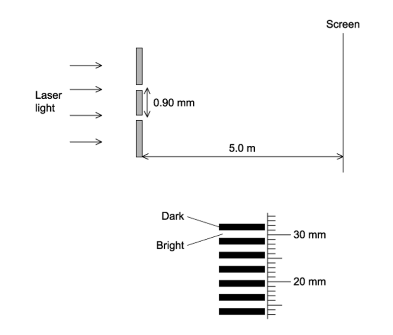

What is the wavelength of the light?

### Q11 — easy — 1 marks

**Q11** [1 mark]

Fig 1.1 shows two waves

**Fig 1.1**

Which of the following statements is true?

### Q12 — medium — 1 marks

**Q12** [1 mark]

The effect of a double slit on monochromatic light is observed by set up in the diagram

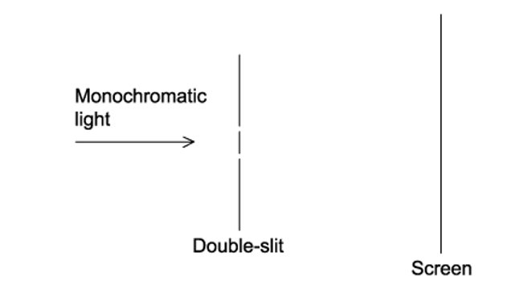

Interference fringes are seen on the screen.

Which of the following changes would increase the distance between the adjacent fringes?

### Q13 — hard — 1 marks

**Q13** [1 mark]

A beam of monochromatic light with wavelength *λ* is shone through a double slit at distance *D* away from a screen. An interference pattern is produced where the distance between the fringes is $x$.

What would the distance between the double slit and the screen need to be for the fringe distance to remain $x$ when a light beam of wavelength $\frac{3}{4}λ$ is used instead?

### Q14 — hard — 1 marks

**Q14** [1 mark]

Yellow light with a wavelength of 600 nm is used in an experiment to show interference fringes produced by double-slit interference. The fringe separation is 4.0 mm on the screen.

What would be the fringe spacing if the wavelength is changed to 400 nm and the separation of the slits is doubled?

### Q15 — easy — 1 marks

**Q15** [1 mark]

A student investigates the interference of light using two identical green LEDs.

Which statement would explain why the investigation will not work?

### Q16 — hard — 1 marks

**Q16** [1 mark]

Yellow light with a wavelength of 600 nm is used in an experiment to show interference fringes produced by double-slit interference. The fringe separation is 4.0 mm and the separation of the slits is 0.60 mm.

What would be the distance between the double slit and the screen?

## Structured Questions (8 questions)

### Q1 — hard — 10 marks

**Q1** [3 marks]

Two coherent sources, A and B, which are in phase with each other, emit microwaves of wavelength 40.0 mm.

A detector is placed at the point P where it is 0.93 m from A and 1.19 m from B, as shown in Fig. 1.1. The centre axis is normal and a bisector to the straight line joining A and B.** **

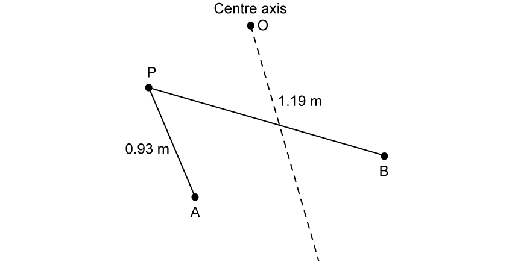

**Fig. 1.1**

Deduce whether the detected signal at P is a maximum or minimum.

**Q1** [3 marks]

**Extract:**

Two coherent sources, A and B, which are in phase with each other, emit microwaves of wavelength 40.0 mm. A detector is placed at the point P where it is 0.93 m from A and 1.19 m from B, as shown in Fig. 1.1. The centre axis is normal and a bisector to the straight line joining A and B. Deduce whether the detected signal at P is a maximum or minimum. [Answer: Path difference BP – AP = 1.19 – 0.93 = 0.26 m; Number of wavelengths = 0.26/(40×10^-3) = 6.5; Since path difference = 6.5λ, microwaves arrive at P with a phase difference of 180° and interfere destructively, so the signal at P is a minimum. Point O lies on the bisector so AO = BO, path difference = 0, giving a maximum at O.]

The amplitude of the waves emitted from source B is twice that of the waves emitted from source A.

Calculate the ratio of the intensity at** **P to the intensity at O.

**Q1** [2 marks]

**Extract:**

Two coherent sources, A and B, which are in phase with each other, emit microwaves of wavelength 40.0 mm. A detector is placed at the point P where it is 0.93 m from A and 1.19 m from B, as shown in Fig. 1.1. The centre axis is normal and a bisector to the straight line joining A and B.

Path difference BP – AP = 1.19 – 0.93 = 0.26 m; Number of wavelengths: n = path difference / wavelength = 0.26 / (40 × 10⁻³) = 6.5. Since path difference = 6.5λ, the signal at P is a minimum.

The path difference between AO and BO is zero, therefore the amplitude at O is a maximum.

Determine the total number of maxima and minima detected by the detector as it moves from P to O.

**Q1** [2 marks]

**Extract:**

Two coherent sources, A and B, which are in phase with each other, emit microwaves of wavelength 40.0 mm. A detector is placed at the point P where it is 0.93 m from A and 1.19 m from B, as shown in Fig. 1.1. The centre axis is normal and a bisector to the straight line joining A and B. Deduce whether the detected signal at P is a maximum or minimum.
Path difference BP – AP = 1.19 – 0.93 = 0.26 m; Number of wavelengths = 0.26/(40×10⁻³) = 6.5. Since path difference = 6.5λ, microwaves arrive at P with a phase difference of 180° (π rad) and interfere destructively; therefore, the magnitude of the signal at P is a minimum.

Source B is altered to emit waves that are 180° out of phase with source A.

Describe and explain the change in the appearance of the interference pattern at P.

### Q2 — medium — 12 marks

**Q2** [3 marks]

Fig. 1.1 shows an arrangement for observing the interference pattern produced by laser light passing through two narrow slits S1 and S2.

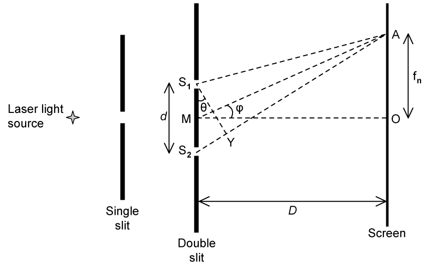

**Fig. 1.1**

The distance S1S2 is *d*, and the distance between the double slit and the screen is *D,* where *D *≫ *d*, so angles *θ* and *ϕ* are small.

M is the midpoint of S1S2 and it is observed that there is a bright fringe at point A on the screen, a distance *f**n* from point O on the screen. Light from S2 travels a distance S2Y further to point A than light from S1.

The wavelength of light from the laser is 650 nm and the angular separation of the bright fringes on the screen is 5.00 × 10−4 rad.

Calculate the distance between the two slits.

**Q2** [3 marks]

**Extract:**

Fig. 1.1 shows an arrangement for observing the interference pattern produced by laser light passing through two narrow slits S~1~ and S~2~. The distance S~1~S~2~ is *d*, and the distance between the double slit and the screen is *D,* where *D* ≫ *d*, so angles *θ* and *ϕ* are small. M is the midpoint of S~1~S~2~ and it is observed that there is a bright fringe at point A on the screen, a distance *f~n~* from point O on the screen. Light from S~2~ travels a distance S~2~Y further to point A than light from S~1~.

A bright fringe is observed at A.

(i) Explain the conditions required in the paths of the rays coming from S1 and S2 to obtain this bright fringe.

[2]

(ii) State an equation in terms of wavelength for the distance S2Y.

[1]

**Q2** [4 marks]

**Extract:**

Fig. 1.1 shows an arrangement for observing the interference pattern produced by laser light passing through two narrow slits S1 and S2. The distance S1S2 is d, and the distance between the double slit and the screen is D, where D ≫ d, so angles θ and ϕ are small. M is the midpoint of S1S2 and it is observed that there is a bright fringe at point A on the screen, a distance fn from point O on the screen. Light from S2 travels a distance S2Y further to point A than light from S1.

Deduce expressions for the following angles in the double-slit arrangement shown in part a:

(i) *θ* in terms of S2Y and *d*

[2]

(ii) *ϕ* in terms of *D* and *f**n*

[2]

**Q2** [2 marks]

**Extract:**

Fig. 1.1 shows an arrangement for observing the interference pattern produced by laser light passing through two narrow slits S1 and S2. The distance S1S2 is d, and the distance between the double slit and the screen is D, where D ≫ d, so angles θ and ϕ are small. M is the midpoint of S1S2 and it is observed that there is a bright fringe at point A on the screen, a distance fn from point O on the screen. Light from S2 travels a distance S2Y further to point A than light from S1.

(ii) State the equation for the distance S2Y: S2Y = nλ (where n is an integer).

(i) Deduce an expression for θ in terms of S2Y and d: θ = S2Y/d

The separation of the slits S1 and S2 is 1.30 mm.

The distance MO is 1.40 m.

The distance *f**n* is the distance of the ninth bright fringe from O and the angle *θ *is 3.70 × 10−3 radians.

Calculate the wavelength of the laser light.

### Q3 — medium — 11 marks

**Q3** [6 marks]

A student is conducting a series of investigations on diffraction and interference with two slits.

In the first investigation, monochromatic light passes through a double-slit arrangement. The intensity of the fringes varies with distance from the central fringe. This is observed on a screen, as shown in Fig. 1.1.

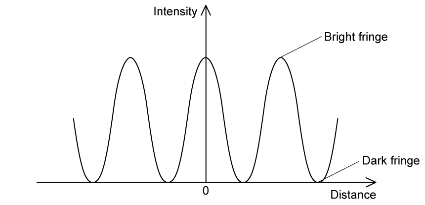

**Fig. 1.1**

The intensity of the monochromatic light passing through one of the slits is reduced.

Explain the effect of this change on the appearance of

(i) The dark fringes.

[3]

(ii) The bright fringes.

[3]

**Q3** [2 marks]

In another experiment, the monochromatic light is replaced by orange light of wavelength 600 nm. The double-slit has a separation of 0.350 mm and the screen is 6.35 m away.

Calculate the distance between the central and first maximum as seen on the screen.

**Q3** [3 marks]

**Extract:**

In another experiment, the monochromatic light is replaced by orange light of wavelength 600 nm. The double-slit has a separation of 0.350 mm and the screen is 6.35 m away.

The light source is now changed to a blue LED of wavelength 450 nm.

Explain the features of the interference pattern that will now be observed on the screen.

### Q4 — medium — 8 marks

**Q4** [3 marks]

Fig. 1.1 shows schematically an arrangement for producing interference fringes using a double slit.

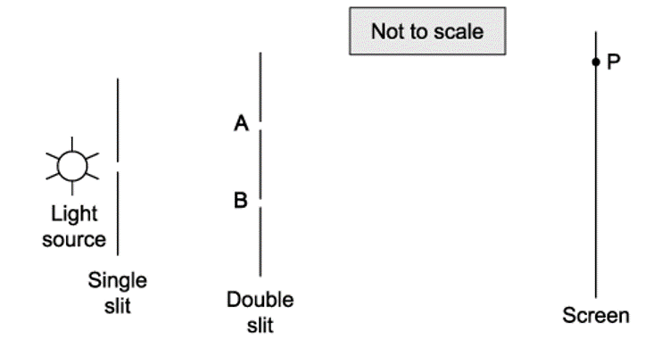

**Fig. 1.1**

There are two slits at points A and B and a bright fringe (maximum intensity) is observed at the point labelled P.

Explain how the path difference determines that the light intensity at point P is a maximum.

**Q4** [3 marks]

**Extract:**

Fig. 1.1 shows schematically an arrangement for producing interference fringes using a double slit. There are two slits at points A and B and a bright fringe (maximum intensity) is observed at the point labelled P.

The light source has a wavelength of 45 mm.

The distance from A to P = 1.13 m and from B to P is 1.40 m.

Show that the light intensity at point P is a maximum.

**Q4** [2 marks]

**Extract:**

Fig. 1.1 shows schematically an arrangement for producing interference fringes using a double slit. There are two slits at points A and B and a bright fringe (maximum intensity) is observed at the point labelled P.

The light source used in Fig. 1.1 is monochromatic but not coherent.

Explain the purpose of the single slit to observe clear interference fringes.

### Q5 — hard — 12 marks

**Q5** [3 marks]

A student designs an experiment to replicate Young’s double-slit demonstration.

The student uses a candle as a light source, with a piece of coloured filter paper to produce monochromatic light. They consider additional apparatus required to observe an interference pattern.

Sketch a diagram of the experimental setup the student should use to observe an interference pattern.

Label all apparatus and relevant measurements to be taken.

**Q5** [4 marks]

**Extract:**

A student designs an experiment to replicate Young's double-slit demonstration. The student uses a candle as a light source, with a piece of coloured filter paper to produce monochromatic light. They consider additional apparatus required to observe an interference pattern. Sketch a diagram of the experimental setup the student should use to observe an interference pattern. Label all apparatus and relevant measurements to be taken.

The student labels the two slits on the double-slit grating slit X and slit Y.

The student then paints over slit X, such that the intensity of light emerging from it is 50% of the intensity emerging from slit Y.

Discuss the effects, if any, this will have on the student’s observations.

**Q5** [3 marks]

**Extract:**

A student designs an experiment to replicate Young's double-slit demonstration. The student uses a candle as a light source, with a piece of coloured filter paper to produce monochromatic light. They consider additional apparatus required to observe an interference pattern.

Slit separation a labelled as the distance between the centre of the slits; Distance between the double slit and the screen labelled D.

The student finishes setting up their apparatus and makes a quick note of two separate measurements in a lab book as shown in Fig. 1.1. ** **

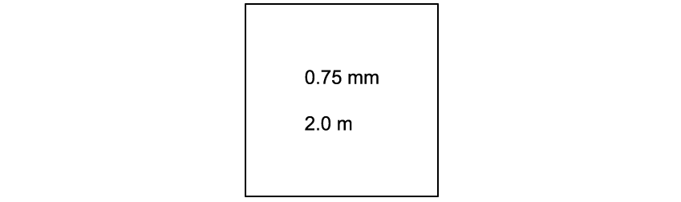

**Fig. 1.1**

They then plot a graph of the intensity of light against the distance from the centre of the screen, represented by the origin as shown in Fig. 1.2.** **

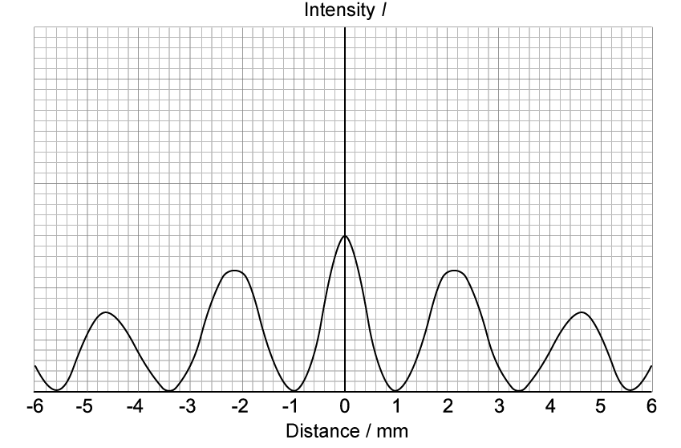

**Fig. 1.2**

Determine which colour of filter paper the student most likely chose for this experiment, using the information in Fig. 1.1 and Fig. 1.2.

**Q5** [2 marks]

**Extract:**

They then plot a graph of the intensity of light against the distance from the centre of the screen, represented by the origin as shown in Fig. 1.2. Fig. 1.2 [graph of Intensity vs Distance/mm showing Max intensity at 2.2 mm and Half max intensity at 2.8 mm]

Determine the phase angle between the waves meeting at the point that is 2.8 mm from the centre of the screen.

### Q6 — easy — 9 marks

**Q6** [3 marks]

The distance between the bright fringes in a double-slit interference pattern can be determined by the double-slit equation

$x=\frac{λD}{a}$

Draw lines to match each quantity to its associated symbol.

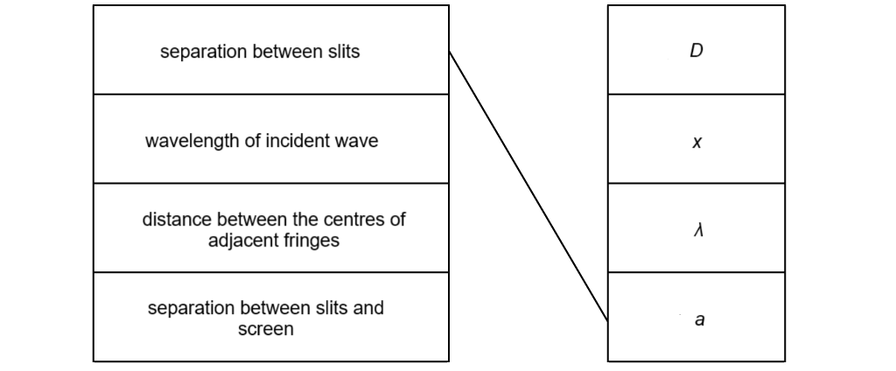

**Q6** [2 marks]

Red laser light is used to form a double-slit interference pattern on a screen, as shown in Fig. 1.1.

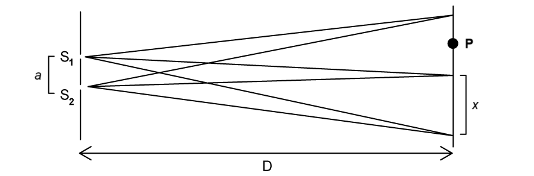

**Fig. 1.1**

The distance between the bright fringes depends on the wavelength of the incident light.

Describe how the interference pattern would change if blue laser light were used.

**Q6** [2 marks]

**Extract:**

The distance between the bright fringes in a double-slit interference pattern can be determined by the double-slit equation x = λD/a

When red laser light of wavelength 650 nm is used to form a double-slit interference pattern on the screen, the separation between the slits is 0.2 mm, and the distance between the slits and the screen is 1.2 m.

Calculate the separation between the fringes on the screen*.*

**Q6** [2 marks]

**Extract:**

Red laser light is used to form a double-slit interference pattern on a screen, as shown in Fig. 1.1. The distance between the bright fringes depends on the wavelength of the incident light.

Explain why there is no bright fringe at point P.

### Q7 — easy — 11 marks

**Q7** [2 marks]

Define *coherence*.

**Q7** [4 marks]

In an experiment, a monochromatic light source is incident upon a single slit before passing through two slits, as shown in Fig. 1.1.

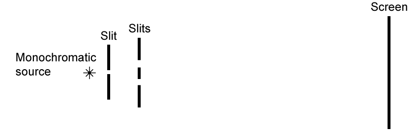

**Fig. 1.1**

Bright and dark fringes are produced on the screen.

State

(i) the **two **conditions required for the fringes to be observed.

[2]

(ii) what the bright and dark fringes on the screen represent.

[2]

**Q7** [1 mark]

**Extract:**

In an experiment, a monochromatic light source is incident upon a single slit before passing through two slits, as shown in Fig. 1.1. Fig. 1.1. Bright and dark fringes are produced on the screen.

Give a reason why a single slit is included in the experimental setup in Fig. 1.1.

**Q7** [4 marks]

Fig. 1.2 shows two different waves from sources s1 and s2 meeting on the screen at point P.

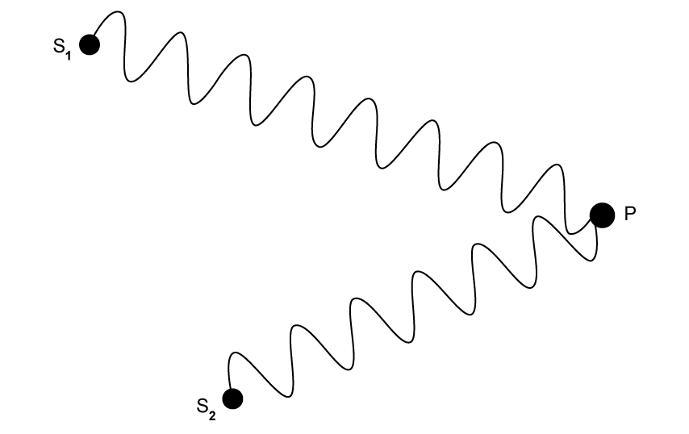

**Fig. 1.2**

For the waves meeting at point P, determine:

(i) the path difference.

[3]

(ii) whether a bright or dark fringe forms at P.

[1]

### Q8 — easy — 8 marks

**Q8** [1 mark]

State what is meant by the term *monochromatic source*.

**Q8** [1 mark]

Describe the conditions for destructive interference.

**Q8** [4 marks]

Fig. 1.1 shows the wavefronts emitted from two point sources s1 and s2.

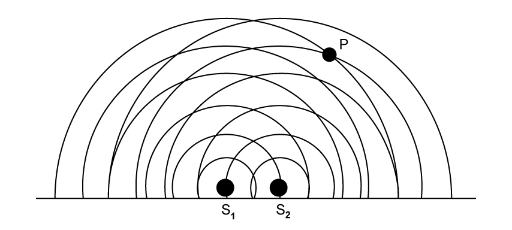

**Fig. 1.1**

At point P, determine

(i) the path difference between the waves

[3]

(ii) whether constructive or destructive interference occurs.

[1]

**Q8** [2 marks]

Fig. 1.2 shows two sources of coherent light producing a double-slit interference pattern.

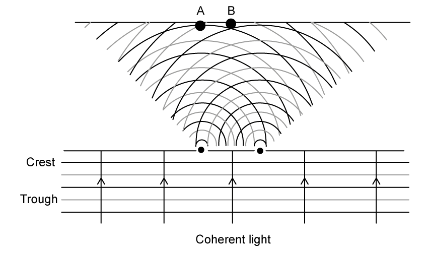

**Fig. 1.2**

Determine whether constructive or destructive interference occurs at:

(i) point A

[1]

(ii) point B.

[1]
