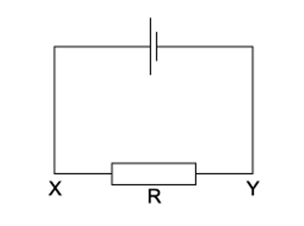
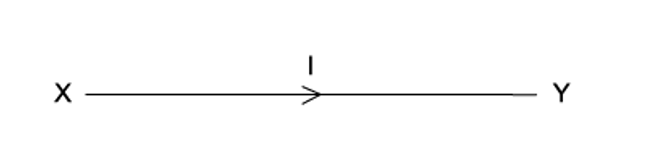
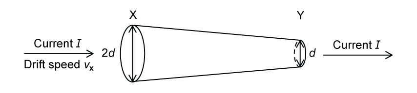
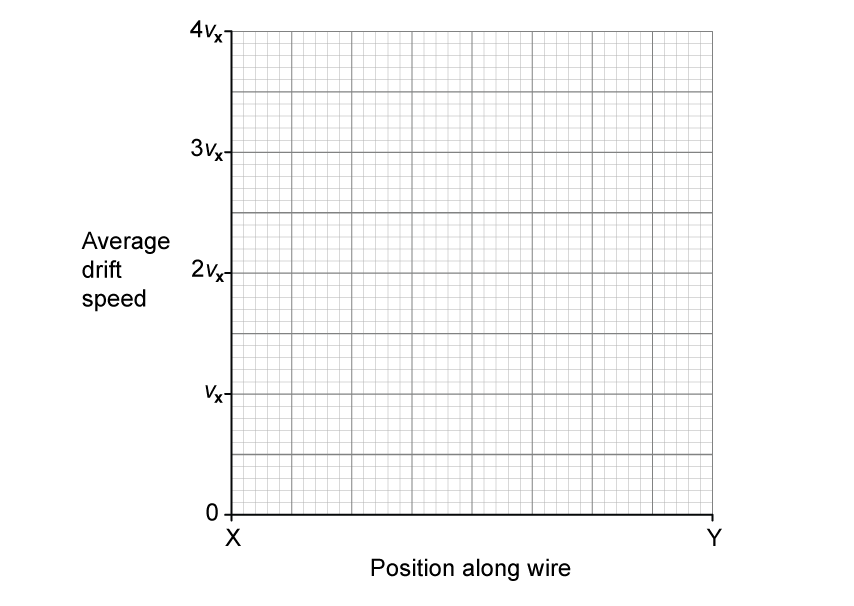
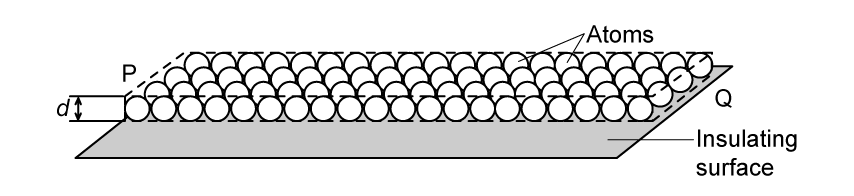

# Exam Questions — Electric Current
**9. Electricity** · Cambridge (CIE) AS physics (9702)
> Source: [https://www.savemyexams.com/as/physics/cie/25/topic-questions/](https://www.savemyexams.com/as/physics/cie/25/topic-questions/) · 27 questions across 2 sets

## Multiple Choice Questions (20 questions)

### Q1 — medium — 1 marks

**Q1** [1 mark]

A beam of electrons, each carrying charge *e*, moves through a vacuum tube of uniform cross-sectional area *A* with uniform velocity *v*. The beam produces a current *I*.

What is the number density of electrons in the beam?

### Q2 — medium — 1 marks

**Q2** [1 mark]

A 3.0 Ω resistor has 7.5 × 1018 electrons pass through it in 5.0 s.

What is the potential difference and charge of the resistor?

|   | **Charge / C** | **Potential difference / V** |
|---|---|---|
| **A.** | 1.2 | 0.24 |
| **B.** | 1.2 | 0.72 |
| **C.** | 12 | 2.4 |
| **D.** | 12 | 7.2 |

### Q3 — medium — 1 marks

**Q3** [1 mark]

The current in the circuit shown is 4.8 A.

What is the direction of flow and the rate of flow of electrons through the resistor *R *?

|   | **Direction of flow** | **Rate of flow** |
|---|---|---|
| **A** | X to Y | 3.0 × 1019 s–1 |
| **B** | X to Y | 6.0 × 1018 s–1 |
| **C** | Y to X | 3.0 × 1019 s–1 |
| **D** | Y to X | 6.0 × 1018 s–1 |

### Q4 — easy — 1 marks

**Q4** [1 mark]

When will 1 C of charge pass a point in an electrical circuit?

### Q5 — hard — 1 marks

**Q5** [1 mark]

A slice of germanium of cross-sectional area 1.0 cm2 carries a current of 56** **µA. The number density of charge carriers in the germanium is 2.0 × 1013 cm–3.

Each charge carrier has a charge equal to the charge on an electron.

What is the average drift velocity of the charge carriers in the germanium?

### Q6 — medium — 1 marks

**Q6** [1 mark]

A milliammeter shows a reading of 20 mA.

How many electrons flow through the milliammeter in 10 seconds?

### Q7 — hard — 1 marks

**Q7** [1 mark]

Four point charges, each of charge *Q*, are placed on the edge of an insulating disc of radius *r*.

The frequency of rotation of the disc is *f*.

What is the equivalent electric current at the edge of the disc ?

### Q8 — easy — 1 marks

**Q8** [1 mark]

There is a current of 10 mA in a conductor for half an hour.

How much charge passes a point in the conductor in this time?

### Q9 — easy — 1 marks

**Q9** [1 mark]

A copper wire of cross-sectional area 2.0 mm2 carries a current of 10 A.

How many electrons pass through a given cross-section of the wire in one second?

### Q10 — easy — 1 marks

**Q10** [1 mark]

Which equation that links some of the following terms is correct?

| potential difference (p.d.) | *V* |
|---|---|
| current | *I* |
| resistance | *R* |
| charge | *Q* |
| energy | *E* |
| power | *P* |
| time | *t* |

### Q11 — hard — 1 marks

**Q11** [1 mark]

*I**1* and *I**2* are currents flowing through two different circuits, as shown in the diagram below.

Calculate the difference in the total charge that flows through the two circuits in the first 7 seconds.

### Q12 — hard — 1 marks

**Q12** [1 mark]

An electron beam of current 50 μA flows in a cathode-ray oscilloscope. The time-base causes the beam to sweep horizontally across the screen at 1.0 × 104 cm s–1

What is the number of electrons arriving at the screen in one centimetre length of the horizontal trace?

### Q13 — hard — 1 marks

**Q13** [1 mark]

A high potential is applied between the electrodes of an ionised gas. The gas carries a current of 8.16 mA and the number of electrons passing any point in the gas per unit time is 2.58 × 1016 s–1

If the charge on each positive particle is 3.2 × 10–19 C, what is the number of positively charged particles passing any point in the gas per unit time?

### Q14 — easy — 1 marks

**Q14** [1 mark]

When there is **no** current in a wire, which statement about the conduction electrons in that wire is correct?

### Q15 — hard — 1 marks

**Q15** [1 mark]

The diagram shows a model of an atom in which two electrons move round a circular orbit. The electrons complete 1.0 × 1015 revolutions around the nucleus every second.

What is the current caused by the motion of the electrons in the orbit?

### Q16 — easy — 1 marks

**Q16** [1 mark]

The diagram shows the symbol for a wire carrying a current *I*

What does this current represent?

### Q17 — medium — 1 marks

**Q17** [1 mark]

A wire with a resistance of 2.0 Ω has 8.2 × 1028 electrons pass through it at an average drift speed of 0.09 mm s-1. The potential difference of the resistor is 12 V.

What is the cross-sectional area of the wire?

### Q18 — hard — 1 marks

**Q18** [1 mark]

The Atlantic torpedo is a large electric fish capable of generating a voltage of 220 V between its tail and its head. This drives a pulse of current of 15 A lasting for a time of 2.0 ms. The fish produces 200 pulses per second.

What is the average power output of the fish?

### Q19 — medium — 1 marks

**Q19** [1 mark]

Two copper wires of the same length but different diameters carry the same current.

Which statement about the flow of charged particles through the wires is correct?

### Q20 — hard — 1 marks

**Q20** [1 mark]

A parallel beam of protons, each with charge *e*, travel at uniform velocity *v*. This results in current *I* being formed.

What is the number of protons present in a unit length of the beam?

## Structured Questions (7 questions)

### Q1 — medium — 4 marks

**Q1** [1 mark]

Define the *coulomb*.

**Q1** [1 mark]

An electric current is a flow of charge carriers.

In the following list, underline the possible charges for a charge carrier.

1.6 × 10–20 C ‎ ‎ ‎ ‎ ‎ ‎ ‎ ‎ ‎ 1.6 × 10–19 C ‎ ‎ ‎ ‎ ‎ ‎ ‎ ‎ ‎ 4.0 × 10–19 C ‎ ‎ ‎ ‎ ‎ ‎ ‎ ‎ ‎ 8.0 × 10–19 C

**Q1** [2 marks]

The diameter of a wire XY varies linearly with distance along the wire as shown in Fig. 6.1.

**Fig. 6.1**

There is a current $I$ in the wire. At end X of the wire, the diameter is $2d$ and the average drift speed of the free electrons is $v_{X}$. At end Y of the wire, the diameter is $d$.

On Fig. 6.2, sketch a graph to show the variation of the average drift speed with position along the wire between X and Y.

**Fig. 6.2**

### Q2 — medium — 11 marks

**Q2** [4 marks]

The smallest conductor within a computer processing chip can be represented as a rectangular block that is one atom high, four atoms wide and twenty atoms long. One such block is shown in Fig. 1.1.

**Fig. 1.1.**

The block is made from phosphorus atoms of diameter *d* = 3.8 × 10–10 m. The atoms are deposited on an insulating surface. This ensures that the atoms touch each other.

The processing chip has a resistance, measured from **P** to **Q**, of 220 Ω.

(i) Define current.

[1]

(ii) Describe for this processing chip the properties which will affect the current.

[3]

**Q2** [1 mark]

**Extract:**

The block is made from phosphorus atoms of diameter d = 3.8 × 10^–10 m. The atoms are deposited on an insulating surface. This ensures that the atoms touch each other.

Calculate the number density of free electrons within the block.

Assume that each phosphorus atom contributes one free electron.

**Q2** [3 marks]

**Extract:**

The smallest conductor within a computer processing chip can be represented as a rectangular block that is one atom high, four atoms wide and twenty atoms long. The block is made from phosphorus atoms of diameter d = 3.8 × 10^–10 m. The atoms are deposited on an insulating surface. This ensures that the atoms touch each other. The processing chip has a resistance, measured from P to Q, of 220 Ω.

Calculate the number density of free electrons within the block. Assume that each phosphorus atom contributes one free electron. n = 1/d^3 = 1/(3.8 × 10^–10)^3 = 1.8 × 10^28 m^-3

Calculate the current between P and Q when the mean drift velocity of free electrons in the block is 1.9 × 10–5 m s–1.

**Q2** [3 marks]

**Extract:**

The processing chip has a resistance, measured from P to Q, of 220 Ω.
Calculate the current between P and Q when the mean drift velocity of free electrons in the block is 1.9 × 10^–5^ m s^–1^: I = 3.2 × 10^−14^ A

There are about 109 of these tiny conductors in a single chip each carrying the current calculated in part (c).

Estimate the total power dissipated in these conductors in a single chip.

### Q3 — medium — 10 marks

**Q3** [2 marks]

Nancy is testing a new type of light bulb. She records the amount of current and the relative brightness of the light coming from the bulb.

Sketch a possible circuit diagram to show this experimental setup.

**Q3** [3 marks]

**Extract:**

Nancy is testing a new type of light bulb. She records the amount of current and the relative brightness of the light coming from the bulb. Sketch a possible circuit diagram to show this experimental setup.

Explain why the ammeter needs to be connected in series.

**Q3** [3 marks]

**Extract:**

Nancy is testing a new type of light bulb. She records the amount of current and the relative brightness of the light coming from the bulb.

Explain the results Nancy should expect to obtain, assuming the resistance of the bulb, ammeter and circuit remain constant.

**Q3** [2 marks]

**Extract:**

Nancy is testing a new type of light bulb. She records the amount of current and the relative brightness of the light coming from the bulb.

Nancy sets up her circuit and begins to conduct her experiment. Her first readings are negative values of current.

Identify the problem and suggest a solution.

### Q4 — easy — 9 marks

**Q4** [2 marks]

The Standard International System of Units (SI) is a system of measurement based on seven base units.

State the **symbol **and the **SI unit **for electric charge.

**Q4** [2 marks]

In a circuit, a current of 2.0 A flows through a resistor for 90 minutes.

Calculate the total charge passing through the resistor in this time.

**Q4** [2 marks]

**Extract:**

In a circuit, a current of 2.0 A flows through a resistor for 90 minutes. Calculate the total charge passing through the resistor in this time. Q = 2.0 × 5400 = 10 800 C

Determine the number of electrons that pass a point in the resistor in part (b).

**Q4** [3 marks]

When a copper wire is exposed to a potential difference, a current is detected in it.

Explain, with reference to charge carriers and electric fields, why there is a current detected in the wire.

### Q5 — medium — 6 marks

**Q5** [1 mark]

A power source is connected across a component. The current in the component is 40 mA.

Calculate the total charge that flows past a point in the component in 3 minutes.

**Q5** [1 mark]

**Extract:**

A power source is connected across a component. The current in the component is 40 mA. Calculate the total charge that flows past a point in the component in 3 minutes. Q = It = (40 × 10^−3) × 180 = 7.2 C

Calculate the number of electron charge carriers passing the same point in the conductor in this time.

**Q5** [4 marks]

**Extract:**

A power source is connected across a component. The current in the component is 40 mA.
Calculate the total charge that flows past a point in the component in 3 minutes.
Q = It = (40 × 10^−3) × 180 = 7.2 C

8.6 J of energy are transferred to the conductor in this time.

(i) Calculate the potential difference across the component.

[2]

(ii) Calculate the resistance of the conductor.

[2]

### Q6 — easy — 11 marks

**Q6** [2 marks]

Define the amp.

**Q6** [2 marks]

A charge of 60 × 10–6 C flows through a given section of a conductor in 140 × 10–3 s. Calculate the electric current, stating the final answer in mA.

**Q6** [4 marks]

Use words from the list below to complete the description of the movement of charge carriers in a conductor.

| **average current** | **delocalised** | **electric force** |
|---|---|---|
| **electric field** | **randomly** | **drift** |

The charge carriers in a metal conductor are ...................... electrons.

Normally the electrons move ..................... in all directions, but if a potential difference is applied between two points on the conductor, then an ..................... is created.

This causes an ..................... to act on the charge carriers, causing them to ..................... along the conductor in a resultant direction.

Therefore we can say that a steady ..................... flows through the conductor.

**Q6** [3 marks]

**Extract:**

A charge of 60 × 10^–6 C flows through a given section of a conductor in 140 × 10^–3 s. Calculate the electric current, stating the final answer in mA. I = Q/t = (60 × 10^–6)/(140 × 10^–3) = 4.286 × 10^−4 A; I = 4.3 × 10^-4 A = 0.43 mA

The conductor described in part (d) has a cross-sectional area of 1.1 × 10−7 m2 and the electrons have an average drift speed of 18 mm s−1.

Calculate the number density of electrons in this conductor.

### Q7 — easy — 11 marks

**Q7** [3 marks]

Electric current is defined as the rate of flow of electric charge.

(i) State the particle responsible for carrying electric charge around a circuit

[1]

(ii) Calculate the total electric charge carried by ten million of these particles

[2]

**Q7** [3 marks]

A lamp forms part of a circuit. A current of 0.3 mA passes through the lamp for a period of 5 minutes.

Calculate the amount of charge which passes a point in the lamp over those 5 minutes.

**Q7** [2 marks]

**Extract:**

A lamp forms part of a circuit. A current of 0.3 mA passes through the lamp for a period of 5 minutes. Calculate the amount of charge which passes a point in the lamp over those 5 minutes. Current, I = 0.3 mA = 0.3 × 10^–3 A (i.e. 3.0 × 10^−4 A).

A section of wire in the lamp in part (b) has a cross-sectional area of 4.5 × 10−5 m2.

Using the current calculated in part (b), calculate the average drift velocity of the electrons when the number density of electrons in this section of wire is 3.6 × 1022 m−3.

**Q7** [3 marks]

Fig. 1.1 shows a typical electric circuit involving a battery, lamp and two resistors.** **

There is a gap in the circuit between points **X** and **Y**.

**Fig. 1.1**

Draw on** **Fig. 1.1:

(i) An **ammeter** between **X** and **Y** that would measure the current in the circuit

[2]

(ii) The direction of **conventional current** in the circuit

[1]
