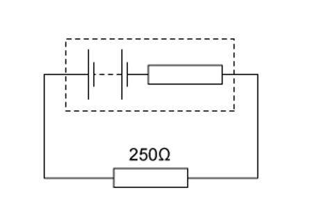
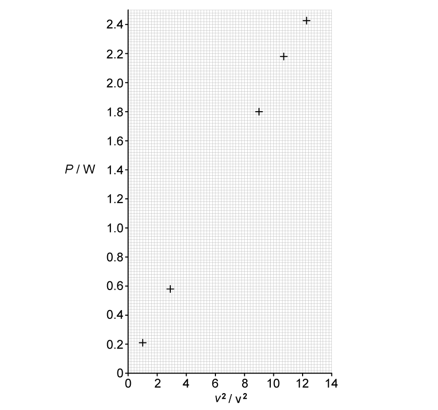

# Exam Questions — Potential Difference & Power
**9. Electricity** · Cambridge (CIE) AS physics (9702)
> Source: [https://www.savemyexams.com/as/physics/cie/25/topic-questions/](https://www.savemyexams.com/as/physics/cie/25/topic-questions/) · 24 questions across 2 sets

## Multiple Choice Questions (18 questions)

### Q1 — hard — 1 marks

**Q1** [1 mark]

A battery with an electromotive force (e.m.f.) of 240 V and an internal resistance of 2.0 Ω is connected to a heating element. The element draws a current of 8.7 A.

The power dissipated by the heating element is the same as the power that would be dissipated by a 12 Ω resistor carrying a current of *I*.

What is the value of *I*?

### Q2 — hard — 1 marks

**Q2** [1 mark]

Two resistors, **X** and **Y**, are in series with a cell that has a potential difference of *V*. The resistance of **X** and **Y **is *R* and $\frac{R}{2}$ respectively.

Given that the charge through both resistors is 6 C, what is the power and work done of Resistor **X**?

|   | **Power** | **Work done** |
|---|---|---|
| **A.** | 2V | $\frac{8V^{2}}{9R}$ |
| **B.** | 3V | $\frac{V^{2}}{2R}$ |
| **C.** | 4V | $\frac{4V^{2}}{9R}$ |
| **D.** | 6V | $\frac{V^{2}}{R}$ |

### Q3 — easy — 1 marks

**Q3** [1 mark]

A 12 V battery is charged for 20 minutes by connecting it to a source of electromotive force (e.m.f.). The battery is supplied with 7.2 × 104 J of energy in this time.

How much charge flows into the battery?

### Q4 — hard — 1 marks

**Q4** [1 mark]

The amount of energy transferred when 10 C of charge passes through a p. d. of 20 V is the same as the energy needed to raise a 2 kg mass through a distance *x*.

Take gravitational field strength to be 10 N kg–1.

What is the value of *x*?

### Q5 — medium — 1 marks

**Q5** [1 mark]

The diagrams show two different circuits.

The cells in each circuit have the same electromotive force and zero internal resistance. The three resistors each have the same resistance *R*.

In the circuit on the left, the power dissipated in the resistor is *P*.

What is the total power dissipated in the circuit on the right?

### Q6 — medium — 1 marks

**Q6** [1 mark]

A battery, with a constant internal resistance, is connected to a resistor of resistance 250 Ω, as shown.

The current in the resistor is 40 mA for a time of 60 s. During this time 6.0 J of energy is lost in the internal resistance.

What is the energy supplied to the external resistor during the 60 s and the e.m.f of the battery ?

|   | **Energy / J** | **E. m. f / V** |
|---|---|---|
| **A**  **B**  **C**  **D** | 2.4  2.4  24  24 | 2.4  7.5  10.0  12.5 |

### Q7 — medium — 1 marks

**Q7** [1 mark]

In a simple electrical circuit, the current in a resistor is measured as (2.50 ± 0.05) mA. The resistor is marked as having a value of 4.7Ω  ± 2 %.

If these values were used to calculate the power dissipated in the resistor, what would be the percentage uncertainty in the value obtained?

### Q8 — medium — 1 marks

**Q8** [1 mark]

The charge that an electric battery can deliver is specified in ampere-hours.

For example, a battery of capacity 40 ampere-hours could supply, when fully charged, 0.2 A for 200 hours.

What is the maximum energy that a fully charged 12 V, 40 ampere-hour battery could supply ?

### Q9 — easy — 1 marks

**Q9** [1 mark]

The diagram shows four heaters and the current in each.

Which heater has the greatest power dissipation ?

### Q10 — hard — 1 marks

**Q10** [1 mark]

Two lightbulbs, **X** and **Y**, are in parallel and are attached to a cell which has a potential difference of 75 V. Lightbulb **X** has a resistance of 350 Ω and Lightbulb **Y **has a resistance of 500 Ω. The power of Lightbulbs **X** and **Y** are *P*X and *P*Y respectively.

What is the value of the ratio $\frac{P_{X}}{P_{Y}}$?

### Q11 — easy — 1 marks

**Q11** [1 mark]

A filament lamp has a resistance of 180 Ω when the current in it is 500 mA.

What is the power transformed in the lamp?

### Q12 — medium — 1 marks

**Q12** [1 mark]

The potential difference across a component in a circuit is 2.0 V.

How many electrons must flow through this component in order for it to be supplied with 4.8 J of energy?

### Q13 — easy — 1 marks

**Q13** [1 mark]

What is the correct definition for potential difference?

### Q14 — easy — 1 marks

**Q14** [1 mark]

What describes the electric potential difference between two points in a wire that carries a current?

### Q15 — hard — 1 marks

**Q15** [1 mark]

The ratings of two lamps are as follows:

| **X** | 230 V, 100 W |
|---|---|
| **Y** | 230 V, 60 W |

During normal operation, which of the lamps will have larger current and resistance?

### Q16 — hard — 1 marks

**Q16** [1 mark]

What is the effect on the current and power of a fixed resistor when the voltage across the resistor doubles?

|   | **Current** | ** Power** |
|---|---|---|
| **A.** | Quadruples | Doubles |
| **B.** | Doubles | Doubles |
| **C.** | Doubles | Quadruples |
| **D.** | Halves | Doubles |

### Q17 — medium — 1 marks

**Q17** [1 mark]

A power cable X has resistance *R* and carries current I.

A second cable Y has resistance 2*R* and carries current $\frac{I}{2}$

What is the ratio $\frac{powerdissipatedinY}{powerdissipatedinX}$  ?

### Q18 — medium — 1 marks

**Q18** [1 mark]

Two lamps are connected in series to a 250V power supply. One lamp is rated 240V, 60W and the other is rated 10V, 2.5W.

Which statement most accurately describes what happens ?

## Structured Questions (6 questions)

### Q1 — medium — 10 marks

**Q1** [3 marks]

The table in Fig. 1.1 shows the power output of three heaters. All the manufacturers claim that the heaters are rated to 1500 W.

**Fig. 1.1**

Determine the most efficient heater.

**Q1** [2 marks]

**Extract:**

The table in Fig. 1.1 shows the power output of three heaters. All the manufacturers claim that the heaters are rated to 1500 W.

Explain how these heaters can be made more efficient.

**Q1** [3 marks]

**Extract:**

The table in Fig. 1.1 shows the power output of three heaters. All the manufacturers claim that the heaters are rated to 1500 W.
Heater A: I = 17 A, V = 90 V (P_A = 17 × 90 = 1530 W)

Calculate the work done by heater A when operating for 20 minutes.

**Q1** [2 marks]

Two different heaters X and Y with the same internal resistance, 5*R* use currents of *I* and 2*I *respectively.

State the magnitude of the power of Y in terms of *I *and *R*.

### Q2 — easy — 8 marks

**Q2** [1 mark]

State the correct arrangement for the equation linking power, current and resistance.

**Q2** [3 marks]

**Extract:**

State the correct arrangement for the equation linking power, current and resistance. P = I^2 R

A current of 3.6 A passes through a 20 Ω resistor.

Calculate the power transferred to the resistor. Give your answer to 2 significant figures.

**Q2** [3 marks]

Complete the sentences.

Choose answers from the box.

Each answer can be used once, more than once or not at all.

| **current** | **kinetic** | **potential difference** |
|---|---|---|
| **thermal** | **gravitational** | **resistance** |

When the .............................. is increased, more energy is transferred to each coulomb of charge passing through the cell.

For a given potential difference, if .............................. is increased, then the power transferred to a component is increased.

A high current means that more power is wasted to the .............................. store of the surroundings.

**Q2** [1 mark]

Draw a voltmeter, connected correctly, to the circuit diagram in Fig 1.1 to measure the **combined **potential difference across the bulb and the variable resistor.

**Fig 1.1**

### Q3 — easy — 13 marks

**Q3** [4 marks]

The table shows a range of household appliances, supplied with 230 V, and their power ratings.

| Appliance | Power rating | Current drawn |
|---|---|---|
| Desk lamp | 14 W |   |
| 55 inch OLED TV | 125 W |   |
| Toaster | 480 W |   |
| Microwave | 900 W |   |

Complete the table by adding the values for the current required for each appliance.

**Q3** [3 marks]

**Extract:**

The table shows a range of household appliances, supplied with 230 V, and their power ratings. Toaster power rating: 480 W.

Calculate the electrical work done by using the toaster on full power for 3 minutes.

**Q3** [3 marks]

**Extract:**

The table shows a range of household appliances, supplied with 230 V, and their power ratings. Toaster power rating = 480 W.

Calculate the electrical work done by using the toaster on full power for 3 minutes: Toaster power, P = 480 W; Time, t = 3 minutes = 180 s; W = P t = 480 × 180 = 86 400 J

Calculate the amount of charge that flowed through the toaster circuit during the 3 minutes of use. Give your answer to 2 significant figures.

**Q3** [3 marks]

**Extract:**

The table shows a range of household appliances, supplied with 230 V, and their power ratings.
Toaster power rating = 480 W (supplied at 230 V).

Calculate the resistance of the toaster.

### Q4 — medium — 11 marks

**Q4** [4 marks]

A student is investigating the brightness of light bulbs in different arrangements connected to a 230 V power supply. One such arrangement is shown in Fig. 1.1.

**Fig. 1.1**

All the lightbulbs are identical. They are all rated 15 W and 230 V. The student claims the bulbs in this arrangement are all of equal brightness.

Determine and then explain whether the student is correct.

**Q4** [3 marks]

A different experimental arrangement is shown in Fig. 1.2. Two bulbs are connected in series with a corresponding voltmeter in parallel.

**Fig. 1.2**

Calculate the current needed for both lamps to operate.

**Q4** [2 marks]

**Extract:**

A different experimental arrangement is shown in Fig. 1.2. Two bulbs are connected in series with a corresponding voltmeter in parallel.

Explain why the voltmeter must be connected in parallel with the bulb.

**Q4** [2 marks]

In a further experimental set-up as shown in Fig. 1.3. Four identical bulbs are all connected in parallel with each other and to a power supply of 230 V.

**Fig. 1.3**

State and explain the value of the potential difference across each bulb assuming there is no internal resistance in the power supply, the bulbs or the wires.

### Q5 — easy — 9 marks

**Q5** [2 marks]

State the **symbol** and the **SI unit **for potential difference.

**Q5** [3 marks]

Electric charge and potential difference are related.

(i) State an equation that relates electric charge and potential difference

[1]

(ii) Write one **joule** in terms of units of **potential difference** and **electric charge**

[2]

**Q5** [2 marks]

A lamp is powered by a 3.0 V cell.

Calculate the work done on the lamp by a single electron in this circuit.

**Q5** [2 marks]

**Extract:**

A lamp is powered by a 3.0 V cell. Calculate the work done on the lamp by a single electron in this circuit. Work done by an electron with one cell, W = 4.8 × 10^−19 J

Three more identical 3.0 V cells are added in series to the circuit.

Calculate the new work done per electron.

### Q6 — medium — 17 marks

**Q6** [3 marks]

The power *P* dissipated in a resistor of resistance *R* is measured for a range of values of the potential difference *V* across it.

The results are shown in the table in Fig. 1.1.

| ***V***** / ** | ***V *****2**** / ** | ***P***** / ** |
|---|---|---|
| 1.00 | 1.0 | 0.214 |
| 1.71 | 2.9 | 0.58 |
| 2.25 |   | 1.011 |
| 2.67 |   | 1.43 |
| 3.00 | 9.0 | 1.80 |
| 3.27 | 10.7 | 2.176 |
| 3.50 | 12.3 | 2.43 |

**Fig. 1.1.**

For the table in Fig. 1.1

i) Add the correct units.

[1]

ii) Complete the missing data.

[1]

iii) Identify errors in the recorded the data and correct them.

[1]

**Q6** [7 marks]

**Extract:**

The power P dissipated in a resistor of resistance R is measured for a range of values of the potential difference V across it. The results are shown in the table in Fig. 1.1.

V / V | V^2 / V^2 | P / W
1.00 | 1.0 | 0.21
1.71 | 2.9 | 0.58
2.25 | 5.1 | 1.01
2.67 | 7.1 | 1.43
3.00 | 9.0 | 1.80
3.27 | 10.7 | 2.18
3.50 | 12.3 | 2.43

Complete the graph of the data on Fig. 1.2. below.

** Fig. 1.2.**

i) Plot the two missing points **and **complete the graph.

[3]

ii) Determine the gradient of the graph.

[3]

iii) Use the gradient of the graph to obtain a value for *R*.

[1]

**Q6** [7 marks]

**Extract:**

The power P dissipated in a resistor of resistance R is measured for a range of values of the potential difference V across it. The results are shown in the table in Fig. 1.1.
V / V, V^2 / V^2, P / W:
1.00, 1.0, 0.21
1.71, 2.9, 0.58
2.25, 5.1, 1.01
2.67, 7.1, 1.43
3.00, 9.0, 1.80
3.27, 10.7, 2.18
3.50, 12.3, 2.43

iii) Use the gradient of the graph to obtain a value for R: R = 1/0.198 = 5.05 = 5.1 Ω

The rest of this question is based on the data in the table Fig. 1.1 in part (a).

i) Determine the value of *R* when *V* = 3.50 V.

[1]

ii) The uncertainty in *V* is ± 0.01 V.

The uncertainty in P is ± 0.05 W.

Calculate the percentage uncertainty in the value of R calculated in part (i).

[3]

iii) Hence calculate the uncertainty in the value of *R*.

[1]

iv) State and explain whether the value of *R* you calculated in part (i) is consistent with the value of *R* you determined from the gradient in part (b).

[2]
