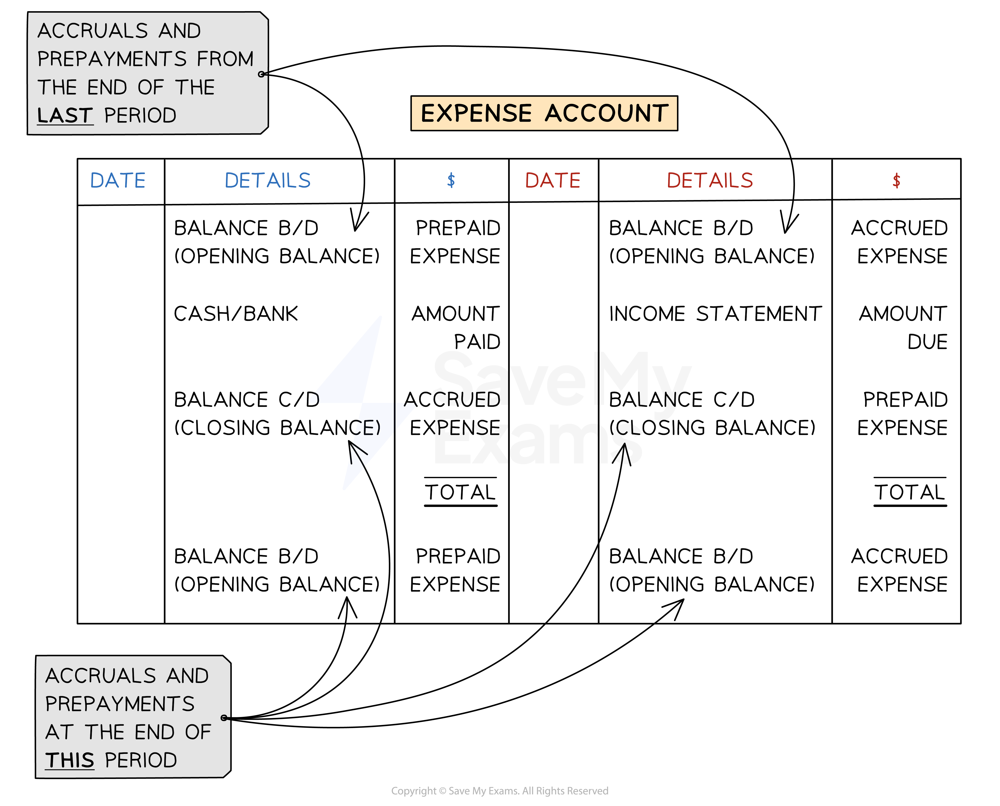
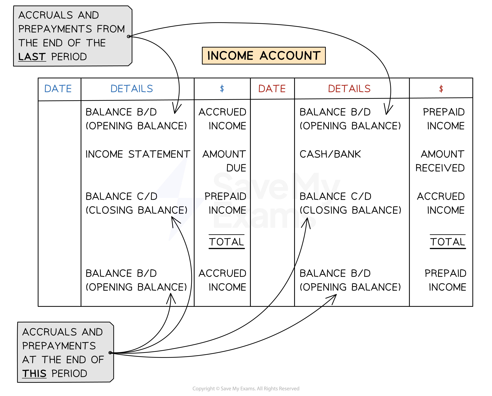

# Mark Schemes — Other Payables & Other Receivables
**4. Accounting Procedures** · Cambridge (CIE) IGCSE accounting (0452 & 0985)

## Multiple Choice Questions (12 questions)

### Q1
**Final answer:** **The correct answer is B**

- The rates account is an expense account
- An opening balance on the credit side means that money is still owed at the start of the year from the previous year

  - So the \$240 balance b/d on Jan 1 on the credit side means that rates were accrued at the start of the year
- An opening balance on the debit side means that money has been prepaid towards the account in the preceding year

  - The \$110 balance c/d on Dec 31 on the credit side will become a \$110 balance b/d on the debit side on Jan 1 in the following year
  - So that means the rates were prepaid at the end of the year
- You could also read the account this way

  - The \$2770 income statement credit entry on 31 December means that rates charges for the year were \$2770
  - Adding in the accrued amount at the start of the year (the \$240 balance b/d entry), the total payable during the year was
  
    - \$2770 + \$240 = \$3010
  - The \$3120 bank debit entry means that \$3120 was paid on the account during the year
  - That is an overpayment of
  
    - \$3120 - \$3010 = \$110
  - So at the end of the year there was a \$110 prepayment towards the following year

**A** is incorrect; rates are prepaid at the end of the year

**C** is incorrect; rates are accrued at the start of the year

**D** is incorrect; both of these are the wrong way round

### Q2
**Final answer:** **The correct answer is C**

- The \$530 rent receivable accrued is rent that had been due, but had not been paid, during the preceding financial year

  - It is an accrued income
- Of the rent received during the year, \$530 would have paid off the rent owed from the previous year

  - So of the rent received, the amount which could pay for rent incurred during the financial year is
  
    - \$7500 - \$530 = \$6970
  - If that exactly paid off all the rent for the year, then there would not have been a rent received in advance balance on 31 August 2024
- The \$270 rent received in advance at the end of the year means that the \$6970 calculated above was \$270 too much for what was incurred during the financial year

  - So the total for rent incurred during the financial year is
  
    - \$6970 - \$270 = \$6700
- So \$6700 is the amount that should be shown on Cai's income statement for the year

  - The accounting principle of matching says that only income made during the year should be shown on the income statement
  
    - It does not matter that the year started with rent still owed from the previous year
    - Or that the year ended with rent prepaid towards the following year
  - Sources of income increase profit, and are shown as credit entries on the income statement
  
    - The corresponding entry is a debit entry on the rent receivable account

**A** is incorrect; debit and credit are the wrong way round

**B** and **D** are incorrect; \$7240 is the amount you would get if you subtracted the difference of \$530 and \$270 (\$530 - \$270 = \$260), from \$7500 (\$7500 - \$260 = \$7240)

### Q3
**Final answer:** **The correct answer is A**

- The amount Alex prepaid against his phone bill is a prepaid expense

  - Prepaid expenses appear as current assets in the statement of financial position
  - This already rules out options C and D
- Recall the layout of an expense account

*Layout of an expense account showing the entries on each side for accruals and prepayments*

- At the start of the *following* financial year (1 November 2024), the amount of the prepaid expense will appear as an opening balance on the debit side of the account
- But at the end of the current financial year (31 October 2024), the prepaid expense will appear as a balance carried down on the credit side

  - So option A is correct

**B** is incorrect; a prepaid expense appears as a credit balance carried down, not a debit balance carried down

**C** and **D** are incorrect; a prepaid expense is a current asset, not a current liability

### Q4
**Final answer:** **The correct answer is B**

- Identify the items on the list that are current liabilities

  - trade payables (\$4800)
  - bank overdraft (\$600)
  - accrued wages (\$2300)
  
    - this is money owed to employees in wages that had not been paid by the end of the financial year
    - it is an accrued expense, and is considered a current liability
  - rent receivable prepaid (\$450)
  
    - this is rent pre-paid to the business that will not actually be due until the following financial year
    - it is a prepaid income, and is considered a current liability
  - The total of the current liabilities is
  
    - \$4800 + \$600 + \$2300 + \$450 = \$8150
- As for the other items on the list

  - trade receivables is a current asset
  - the long-term loan is a non-current liability
  
    - these are liabilities that are not expected to be repaid within a year
  - prepaid insurance is a current asset
  
    - prepaid expenses are considered to be current assets

**A** is incorrect; this is the sum of trade receivables, bank overdraft, accrued wages and prepaid insurance

**C** is incorrect; this is the sum of the long-term loan, trade payables, accrued wages and rent receivable prepaid

**D** is incorrect; this is the sum of the long-term loan, trade payables, bank overdraft and accrued wages

### Q5
**Final answer:** **The correct answer is C**

- Recall the layout of an income account

*Layout of an income account showing the entries on each side for accruals and prepayments*

- In Brian's rent receivable account

  - The \$500 balance b/d on the credit side is rent that was prepaid in the previous financial year
  - The \$4500 bank entry on the credit side is the amount received for rent during the current year
  
    - So that's \$500 + \$4500 = \$5000 received that could have been applied to the current year's rent due
  - The \$200 balance c/d on the debit side is rent that has been prepaid during the current financial year
  
    - This means that the \$5000 calculated above was \$200 too much for what was actually due in the current year
- The missing amount that will balance the account will appear on the debit side

  - This will be the amount of rent due for the current financial year
  - As a source of income, it will also be entered as a credit on the income statement
- The total of credits is \$500 + \$4500 = \$5000

  - This has to be balanced on the debit side, so
  
    - rent due for year + \$200 = \$5000
    - rent due for year = \$5000 - \$200
    - rent due for year = \$4800
- Therefore the entry on the income statement will be a \$4800 credit

**A** and **B** are incorrect; \$4200 is what you would get if you subtracted the difference between \$200 and \$500 (\$500-\$200=\$300), from \$4500 (\$4500 - \$300 = \$4200)

**D** is incorrect; the amount is correct, but it is given as a debit instead of a credit (note that it will appear as a debit in the rent receivable account, but as a credit on the income statement)

### Q6
**Final answer:** **The correct answer is C**

- Of the fees received during the year, \$1900 would have paid off the fees owed from the previous year

  - So of the fees received, the amount which was for fees incurred during the financial year is
  
    - \$35 200 - \$1900 = \$33 300
- If that paid off all the fees for the year, then there would have been no fees owed at the end of the year
- The \$3100 owed at the end of the year means that fees of \$3100 more than \$33 300 were incurred during the year

  - So the total for fees incurred during the financial year is
  
    - \$33 300 + \$3100 = \$36 400
- That is the amount that should be shown on Alfred's income statement for the year

  - The accounting principle of matching says that only income made during the year should be shown on the income statement
  
    - It does not matter that all of the fees had not actually been received by the end of the year
    - Or that the year started with fees still owed from the previous year

**A** is incorrect; this is the difference of \$1900 and \$3100 (\$3100 - \$1900 = \$1200), subtracted from \$35 200 (\$35 200 - \$1200 = \$34 000)

**B** is incorrect; this is just the fees received during the year

**D** is incorrect; this is the sum of \$1900 and \$3100 (\$3100 + \$1900 = \$5000), added to \$35 200 (\$35 200 + \$5000 = \$40 200)

### Q7
**Final answer:** **The correct answer is B**

- Interest charged on the loan is a profit for Donovan's business

  - The interest was incurred during the financial year
  
    - So it will increase the profit for the year
  - It doesn't matter that the interest has not been paid yet
  
    - The profit still belongs to the financial year in which it was made
    - This accords with the accounting principle of matching
- The accrued interest has not been paid by the employee yet

  - It represents money owed to the business
  - Therefore it is entered as a current asset on the statement of financial position

**A** is incorrect; the loan interest increases the profit for the year

**C** and **D** are incorrect; a current liability would be money owed *by* the business, not money owed *to* the business

### Q8
**Final answer:** **The correct answer is B**

- The income statement for 2023 should only include electricity used during that year
- The \$200 credit balance on the electricity account at 1 January 2023 means that the business still owed that much from the previous year

  - I.e. it is an accrued expense
  - A credit balance on an expense account indicates an amount owed
  - (A debit balance would indicate a pre-paid expense instead)
- Of the \$4100 payments made during the year

  - \$200 went toward paying off the credit balance
  - The rest went towards paying for electricity used in 2023
  
    - \$4100 - \$200 = \$3900
- In addition to that \$3900, another \$1200 of electricity was used during 2023

  - \$3900 + \$1200 = \$5100

**A** is incorrect; this is what you would get if you subtracted \$200 and \$1200 from \$4100

**C** is incorrect; this is the sum of \$4100 and \$1200, and doesn't take account of the \$200 credit balance at the start of the year

**D** is incorrect; this is just the sum of \$200, \$1200 and \$4100

### Q9
**Final answer:** **The correct answer is B**

- Salima should only include the parts of the insurance payments that belong to the year ended 31 March 2024

  - i.e. the year from 1 April 2023 to 31 March 2024
- Find the monthly amount for the 1 January 2023 premium by dividing by 12

  - \$1740 ÷ 12 = \$145
- That premium payment covered 1 January - 31 December 2023

  - 9 months from that premium period belonged to the year ended 31 March 2024
  
    - April, May, June, July, August, September, October, November, December 2023
  - \$145 ✕ 9 = \$1305
- Find the monthly amount for the 1 January 2024 premium by dividing by 12

  - \$1860 ÷ 12 = \$155
- That premium payment covered 1 January - 31 December 2024

  - 3 months from that premium period belonged to the year ended 31 March 2024
  
    - January, February, March 2024
  - \$155 ✕ 3 = \$465
- Add together the two contributions to find the total

  - \$1305 + \$465 = \$1770

**A** is incorrect; this is just the premium paid on 1 January 2023

**C** is incorrect; this is just the premium paid on 1 January 2024

**D** is incorrect; this is the difference between the two premiums (\$1860 - \$1740 = \$120) added onto the premium paid on 1 January 2024

### Q10
**Final answer:** **The correct answer is B**

- Start by figuring out the total amount due from Basil during the year

  - The annual rent is \$5400
  - But the \$300 accrued rent was rent from the previous year that he still owed at the start of the current year
  - So the total owed during the year is
  
    - \$5400 + \$300 = \$5700
- If he had paid \$5700 during the year, he wouldn't owe anything at the end of the year

  - But he still owes two months' rent at the end of the year
  - The amount he actually paid during the year is the difference between \$5700 and that two months' rent
- To find how much two months' rent is

  - Divide the annual rent by 12 to find one month
  
    - \$5400 ÷ 12 = \$450
  - Multiply by 2 to find two months
  
    - \$450 ✕ 2 = \$900
- So the amount the business received during the year is

  - \$5700 - \$900 = \$4800

**A** is incorrect; this is what you would get if you subtracted \$300 from \$5700 (instead of adding it) to find the total amount owed by Basil during the year

**C** is incorrect; this would result from calculating \$5400 - \$300 +\$900, instead of \$5400 + \$300 -\$900

**D** is incorrect; this is what you would get if you added \$900 to \$5700 at the end, instead of subtracting it

### Q11
**Final answer:** **The correct answer is B**

- This is a rent receivable account

  - Therefore the rent referred to is an income for the business
- Consider the different entries

  - The \$4200 debit entry is the amount owed to the business for the year
  - The \$150 credit entry on 1 Jan is rent that had been pre-paid during the previous year
  
    - This is money the business owed to the customer at the start of the year
  - The \$3850 credit entry on 31 Dec is the amount paid to the business by the customer during the year
  - The \$200 balance on 31 Dec is the difference between what the business is owed for the year and what the business has received for the year
  
    - So it means the business is still owed that \$200 on 31 December
- Because that \$200 is an income that is still owed to the business at the end of a financial period, it is an accrued income

  - At the start of the next financial year it will be carried across as a balance b/d in the debit column
  - It will thus be an asset for the company at the start of the next financial year

**A** and **C** are incorrect; the balance is an income, not an expense

**D **is incorrect; the balance is an accrued income, not a prepaid income

### Q12
**Final answer:** **The correct answer is A**

- An accrued income is an income that is still owed to the business at the end of a financial period
- An accrued income is an asset to the business

  - The business is owed money by its customers

**B** is incorrect; the commission owed is an asset, not a liability

**C** and **D** are incorrect; a prepaid income is an income for the next financial period that has been paid inadvance

## Structured Questions (3 questions)

### Q1
Logan 
Rent payable account

| Date | Details | \$ | Date | Details | \$ |
|---|---|---|---|---|---|
| 2022 |   |   | 2023 |   |   |
| Oct 1 | Balance b/d **[1]** | 820 | Sep 30 | Income statement **[1]** | 4 940 |
| Dec 1 | Bank **[1]** | 2 460 |   | Balance c/d | 830 |
| 2023 |   |   |   |   |   |
| Jun 1 | Bank **[1]** | 2 490 |   |   |   |
|   |   | <u>5 770</u> |   |   | <u>5 770</u> |
| Oct 1 | Balance b/d **[1]** | 830 |   |   |   |

All dates correct **[1 mark]**

> **[mark-scheme]**
> 6 marks in total:
> 
> - 1 mark the for correct details and amount for:
> 
>   - Balance b/d 2022
>   - Bank in Dec 2022
>   - Bank in Jun 2023
>   - Income statement
> - 1 mark for using your **own figure** from balance c/d for the balance b/d 2023.
> - 1 mark for entering all the dates correctly.

### Q2
Find the prepaid rates at the end of the year

- Calculate the amount per month

$2560\div16=160$

- Identify the number of months that are prepaid

*Jan 2017 = 1 month*

- Calculate the prepaid amount

$160\times1=160$

Find the prepaid insurance at the end of the year

- Calculate the amount per month

$2400\div12=200$

- Identify the number of months that are prepaid

*Jan 2017 to Apr 2017 = 4 months*

- Calculate the prepaid amount

$200\times4=800$

Calculate the amount to charge to the income statement

- Rates is 12 months of the cheque paid

$160\times12=1920$

- Insurance is 8 months of the cheque paid plus the four months prepaid from the previous year

$200\times8+700=2300$

Amla 
Rates and insurance account

| Date | Details | \$ | Date | Details | \$ |
|---|---|---|---|---|---|
| 2016 |   |   | 2016 |   |   |
| Jan 1 | Balance b/d (insurance) **[1]** | 700 | Jan 1 | Balance b/d (rates) **[1]** | 480 |
| Dec 31 | Bank (rates) **[1]** | 2 560 | Dec 31 | Income statement (rates 1 920) **[1]** (insurance 2 300) **[1]** | 4 220 |
|   | Bank (insurance) **[1]** | 2 400 |   | Balance c/d (rates 160) (insurance 800) | 960 |
|   |   | <u>5 660</u> |   |   | <u>5 660</u> |
| 2017 |   |   |   |   |   |
| Jan 1 | Balance b/d (rates 160) **[1]** (insurance 800) **[1]** | 960 |   |   |   |

All dates correct **[1 mark]**

> **[mark-scheme]**
> 9 marks in total.
> 
> - 1 mark for entering all the dates correctly.
> - 8 marks for the correct details and amounts explained below.
> 
> **Explanation**
> 
> - Accrual of rates at the start of 2016
> 
>   - Balance b/d on the credit side as it is still owed by Alma
>   - Dated Jan 1 2016
> - Prepayment of insurance at the start of 2016
> 
>   - Balance b/d on the debit side as it reduces the amount owed by Alma
>   - Dated Jan 1 2016
> - Bank payments for rates and insurance
> 
>   - Bank on the debit side as it reduces the amount owed by Alma
>   - Dated Dec 31 2016
>   - 1 mark for each correct figure
> - Amount transferred to the income statement
> 
>   - Income statement on the credit side
>   - 1 mark for each correct figure
> - Prepayment of rates and insurance at the start of 2017
> 
>   - Balance b/d on the debit side as it reduces the amount owed by Alma
>   - Dated Jan 1 2017
>   - 2 marks for the correct figure **or **1 mark for using your **own figures**

> **[exam-tip]**
> There are many ways to do this. The example above shows how all the figures are found. However, you only need three values from:
> 
> - Accrual/prepayment at the start of the year
> - The actual amount paid
> - The amount due for the year
> - Accrual/prepayment at the end of the year
> 
> The fourth can be found as the balancing figure.
Section of statement of financial position: Current assets **[1 mark]**

Reason: The rates and insurance are both prepaid at the end of the year **[1 mark]**

> **[mark-scheme]**
> 1 mark for the section and 1 mark for the reason.
> 
> You can get the reason mark by stating that the account has a debit balance.

### Q3
Calculate the amount per month

$4800\div12=400$

Calculate the amount received for the two months

$400\times2=800$

Calculate the amount due for the accounting year

*Oct 2016 to Dec 2016 = 3 months*

$400\times3=1200$

Calculate the amount accrued at the end of the year

*3 months - 2 months = 1 month*

$400\times1=400$

Amla 
Rent receivable account

| Date | Details | \$ | Date | Details | \$ |
|---|---|---|---|---|---|
| 2016 |   |   | 2016 |   |   |
| Dec 31 | Income statement **[1]** | 1 200 | Oct 1 | Bank **[1]** | 800 |
|   |   |   | Dec 31 | Balance c/d | 400 |
|   |   | <u>1 200</u> |   |   | <u>1 200</u> |
| 2017 |   |   |   |   |   |
| Jan 1 | Balance b/d **[1]** | 400 |   |   |   |

All dates correct **[1 mark]**

> **[mark-scheme]**
> 4 marks in total.
> 
> - 1 mark for entering all the dates correctly.
> - 3 marks for the correct details and amounts explained below.
> 
> **Explanation**
> 
> - Bank receipt for rent
> 
>   - Bank on the credit side as it reduces the amount owed to Amla
> - Amount transferred to the income statement
> 
>   - Income statement on the debit side
> - Accrual of rent at the start of 2017
> 
>   - Balance b/d on the debit side as it is owed to Alma
Section of statement of financial position: Current assets **[1 mark]**

Reason: Alma is owed the rent at the end of the year **[1 mark]**

> **[mark-scheme]**
> 1 mark for the section and 1 mark for the reason.
> 
> You can get the reason mark by stating that the account has a debit balance **or **for stating that it is an accrual of income.
