# Mark Schemes — Characteristics, Classification & Features of Organisms
**1. Characteristics & Classification of Living Organisms** · Cambridge (CIE) IGCSE biology (0610 & 0970)

## Alternative To Practical Questions (3 questions)

### Q1
(i) One variable that needs to be kept constant is...

Any **one **from the following:

- Volume of water; **[1 mark]**
- Person dipping their fingers; **[1 mark]**
- Time finger is immersed/dipped in water for; **[1 mark]**

(ii) The student could make the test more reliable by...

- Repeating the experiment at least three times;** [1 mark]**

**[Total: 2 marks]**

> *You cannot make a mean calculation as there are no measurements made, the subject is merely recording their observations on the sensations felt in their fingers. However, by repeating the experiment the subject can be sure that their observations are accurate and reliable. *
(i) The dependent variable is..

- The number of prongs felt; **[1 mark]**

(ii) A source of error is..

Any **one **of the following:

- The student may not have closed their eyes; **[1 mark]**
- The hair pin may not have been / not have stayed at the measured gap; **[1 mark]**
- The student may have pressed one prong when they should have pressed two / vice versa; **[1 mark]**

***Accept ****other sensible suggestions*

(iii) To overcome the error...

Any **one **of the following:

- (The student may not have closed their eyes): wear a blindfold; **[1 mark]**
- (The hair pin may not have been / not have stayed at the measured gap) use tape to hold the hairpin apart **OR **hold the hairpin firmly **OR **any other sensible suggestion; **[1 mark]**
- (The student may have pressed one prong when they should have pressed two / vice versa): student to make a note of how many prongs they should press each time **OR **the student to look closely at how many prongs are touching (their partner's) skin **OR **any other sensible suggestion; **[1 mark]**

**[Total: 3 marks]**
A graph of the results is...

- x and y axes labelled; **[1 mark]**
- Bar chart drawn; **[1 mark]**
- Bars correctly plotted +/- 1 small square; **[1 mark]**
- Key used / bars labelled / bars distinguishable; **[1 mark]**

**[Total 4 marks]**

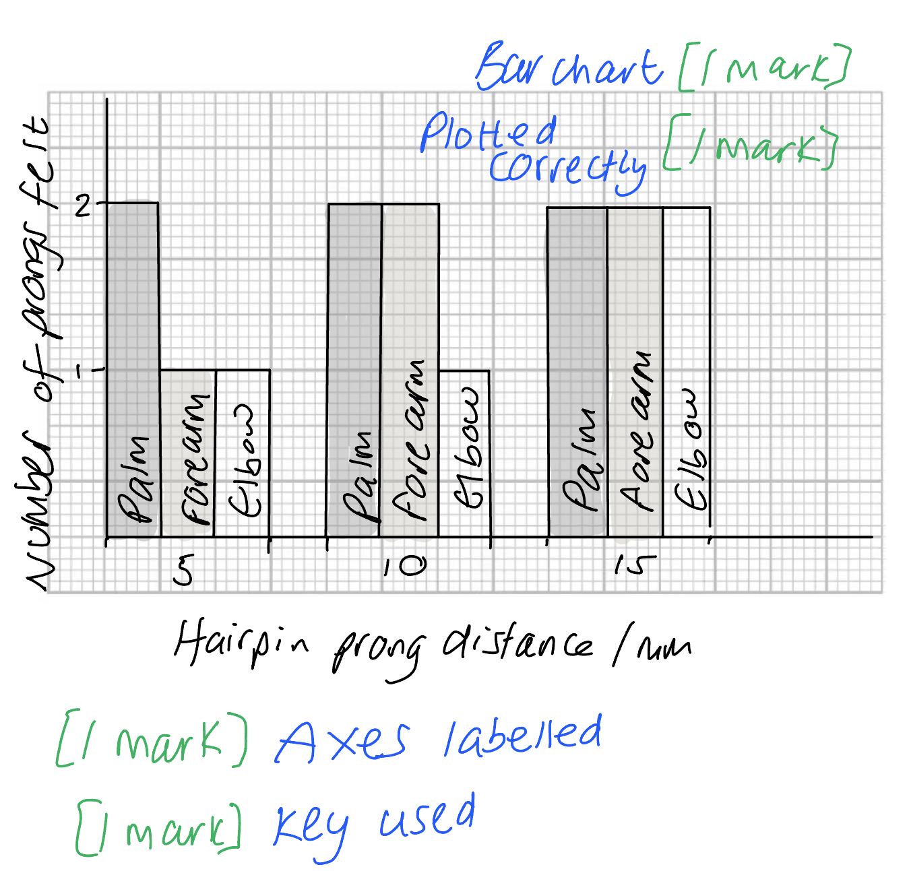

### Q2
(i) The student left the woodlice for 10 minutes before taking measurements because...

- To allow the woodlice to acclimatise **OR **to allow the woodlice to move to their preferred chamber/section/area; **[1 mark]**

(ii) Two variables that should be kept constant are...

Any **two **of the following:

- Temperature; **[1 mark]**
- Number of woodlice used for each repeat; **[1 mark]**
- Time the woodlice are left / 10 minutes before taking measurements; **[1 mark]**

(iii) To keep the control variable constant you should..

Any **one **of the following:

- (Temperature) carry out in the same room/same place in the room **OR **use of a constant heat source/heat lamp/pad; **[1 mark]**
- (Number of woodlice using each repeat) count the woodlice as they are placed into the choice chamber **AND** ensure that the same number are used each time; **[1 mark]**
- (Time the woodlice are left) use a stopwatch **AND** allow the same period of time for each repeat; **[1 mark]**

**[Total: 4 marks]**
(i) One hazard could be...

Any **one **from the following:

- Allergy to woodlice; **[1 mark]**
- Transfer of bacteria/virus/fungi from handling woodlice; **[1 mark]**

***Accept ****other sensible suggestion*

(ii) The safety precaution would be

Any **one **from the following:

- Wash hands after handling woodlice; **[1 mark]**
- Wear gloves while handling woodlice; **[1 mark]**
- Do not eat or drink near woodlice container; **[1 mark]**
- Avoid putting hands in mouth / to face before washing hands; **[1 mark]**

(iii) The ethical considerations when handling living organisms are...

- Woodlice/animals should be returned promptly to their natural environment or a suitable holding tank after being tested; **[1 mark]**
- Handle woodlice/animals gently **OR **handle woodlice/animals as little as possible; **[1 mark]**

**[Total:4 marks]**

> *There are specific ethical approaches in field work where animals are used and handled and it is important that animals are treated with respect; these rules may differ slightly depending on the country where you are studying.  *

> *It is very unlikely there will be any health issues when handling organisms such as woodlice but it is important to take note of and follow health and safety guidelines.*
A table for recording of results is...

Any **three** of the following:

- Two columns **AND **a line separating the headings from the recording space; **[1 mark]**
- Independent variable correctly identified as one heading: condition in choice chamber; **[1 mark]**
- Dependent variable correctly identified as one heading: Number of woodlice (in each condition); **[1 mark]**
- Four conditions (of the independent variable) identified; **[1 mark]**

**[Total: 3 marks]**

> *The table could look like this...*

| condition in choice chamber **[1 mark]** | number of woodlice **[1 mark]** |
|---|---|
| light and dry |   |
| light and moist |   |
| dark and dry |   |
| dark and moist **[1 mark]** |   |
To adapt the method to investigate the effect of temperature on woodlice sensitivity you could...

Description of relevant method steps given in part (a):

Any **two** from the following:

- Use of choice chamber; **[1 mark]**
- Use of 15 woodlice / set number of woodlice between 10 and 30; **[1 mark]**
- Leave woodlice to acclimatise for a specific amount of time (between 5 and 15 minutes); **[1 mark]**
- Repeat the experiment at least three times; **[1 mark]**
- Count woodlice in each chamber after a given time (dependent variable)**; [1 mark]**

Additions to the method to include the effect of temperature:

Any **three **of the following:

- Use of heat lamp / heat pad / other sensible heating source (to vary the temperature); **[1 mark]**
- Up to one half of choice chamber heated only (to see which chamber woodlice prefer); **[1 mark]**
- Use a range of at least three different temperatures (independent variable); **[1 mark]**
- Temperatures in range of 10°C to 30°C; **[1 mark]**
- Idea of keeping temperature constant for a specified time period; **[1 mark]**

Other relevant points:

Any **one **of the following:

- Safe / respectful handling of woodlice at all times; **[1 mark]**
- Return woodlice to the natural habitat/tank after use; **[1 mark]**
- Wash hands after handling woodlice **OR **wear gloves whilst handling woodlice; **[1 mark]**
- Do not allow woodlice to be heated above 30°C **OR **keep woodlice at temperatures that will cause no harm; **[1 mark]**
- Same light / moisture / pH conditions throughout **OR **light / moisture / pH are control variables; **[1 mark]**

***Accept ****other named controlled variables for*** [1 mark]**

**[Total: 6 marks]**

> *When asked to describe an alternative method be sure to always include variables: independent, dependent and some control variables (three is a good number). *

> *Give method details such as how long to carry out the experiment, how to control or measure variables through the use of specific equipment, as well as any health and safety precautions. *

### Q3
The mark allocation for the drawing of the hindwing would be...

*Outline: *

- Single clear line and no shading;** [1 mark]**

*Size of drawing: *

- Use at least half of the available space;** [1 mark]**

*Details: *

- Dots are visible;** [1 mark]**
- 7/8/9 sections visible; **[1 mark]**

**[Total: 4 marks]**

> *When making drawings, remember to make sure your lines are single, clear and continuous with no sketching. Avoid the urge to shade any part of the drawing as this will cost you a mark. Use most of the space provided on the question paper to make the drawing, this will ensure you always receive a mark for size.*

> *Your drawing could look something like this:*

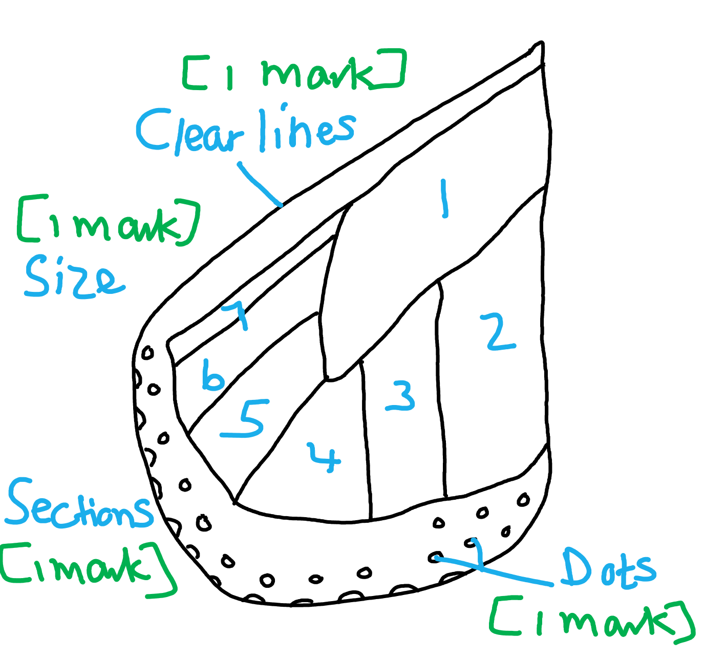
Comparing the viceroy and monarch butterflies' wings would include...

*Similarities: *

Any **one** from the following:

- Both have dots; **[1 mark]**
- Both have bars / sections; **[1 mark]**
- Number of wings are the same / both have four/two pairs of wings; **[1 mark]**
- Colours of the wings are the same;** [1 mark]**
- Antennae / head (situated above the wings); **[1 mark]**

*Differences: *

Any **two** from the following:

- Wing shape / position (are different between them); **[1 mark]**
- Wing pattern (is different) / the viceroy butterfly has a dark horizontal band in lower half of hindwing (which monarch butterfly does not have); **[1 mark]**
- Shape of dots; **[1 mark]**
- Number of dots / monarch has more dots than viceroy / viceroy has less dots than monarch; **[1 mark]**
- The monarch's wings are larger / the viceroy's wings are smaller; **[1 mark]**

**[Total: 3 marks]**

> *You need to carefully observe the similarities and differences between the wings of the two species of butterfly in order to receive full marks here. Good observational skills are important in science.*
(i) The mark allocation for the graph would be as follows...

*Axes: *

- Labels with units: mass / g **and** length / mm; **[1 mark]**

*Scale: *

- Suitable even scale and data occupies more than half the grid in at least one direction; **[1 mark]**

*Plot: *

- All points plotted accurately ± half a small square; **[1 mark]**

*Line: *

- Suitable line drawn through points; **[1 mark]**

*Reject a line drawn through zero.*

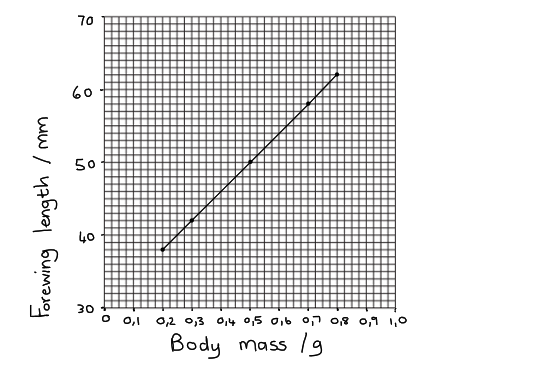

(ii) The relationship shown on the graph can be described as follows...

- As body mass increases wing length increases / body mass is directly proportional to wing length; **[1 mark]**

(iii) The mark allocation for estimating the body mass of a butterfly with a forewing length of 55 mm is...

- Correct use of the graph; **[1 mark]**
- Correct value / 0.625; **[1 mark]**

*Error carried forward would apply for the value determined at 2(c)(iii) if the graph was incorrectly plotted at 2(c)(i).*

**[Total: 7 marks]**

> *It is important not to extrapolate a graph i.e. drawing a line through zero if you are not given a data point for that. Only connect the dots that you have data for. For this graph, the y-axis does not have to start at zero, since most of the values lie between 30 and 60. Having the y-axis start at 30 would ensure more accurate plotting of data points, since the available grid space would be better utilised.*

> *Reading the body mass from the graph for c) iii):*

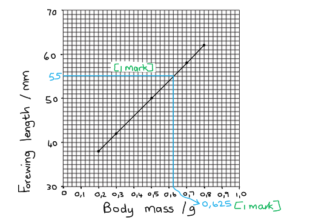

## Multiple Choice Questions (28 questions)

### Q1
**Final answer:** **The correct answer is ****C.**

- The organism has the key features of an insect:

  - six legs
  - one pair of antennae
  - a body divided into head, thorax and abdomen

**A **is incorrect because arachnids have four pairs of legs and no antennae.

**B*** *is incorrect because crustaceans have more than three pairs of legs and two pairs of antennae.

**D** is incorrect because myriapods have many body segments with many legs.

### Q2
**Final answer:** **The correct answer is ****B****.**

- **1 = nutrition**: taking in glucose is taking in material for energy
- **2 = excretion**: releasing carbon dioxide produced by cells is removing a waste product of metabolism
- **3 = sensitivity**: moving away from a harmful chemical is detecting and responding to a change in the environment
- **4 = growth**: increasing in dry mass over time matches the definition of growth

While it is possible to link statement 2 with respiration, and statement 3 with movement, the combination given by option B is the only one that is correct for all four statements.

### Q3
**Final answer:** **The correct answer is A.**

- Hares and rabbits belong to different species, meaning that they cannot interbreed to produce fertile offspring.

**B** is incorrect as both hares and rabbits belong to the animal kingdom, so this cannot explain why they are unable to interbreed.

**C** is incorrect as living in different habitats does not prevent two organisms from interbreeding to produce fertile offspring.

**D** is incorrect as all organisms have different DNA base sequences to one another, including members of the same species, so this alone cannot explain why hares and rabbits are unable to interbreed.

### Q4
**Final answer:** **The correct answer is C.**

- Sensitivity is the ability of an organism to detect or sense stimuli in its internal or external environment and to make appropriate responses

**A** is incorrect as movement is an action by an organism or part of an organism causing a change of position or place.

**B** is incorrect as excretion is the removal of toxic material, waste products of metabolism and substances in excess from an organism.

**D** is incorrect as nutrition is the taking in of materials for energy, growth and development.

### Q5
**Final answer:** **The correct answer is ****D****.**

- This is because flowers from monocotyledons contain petals in multiples of 3 and the flower in image D has 6 petals, which is a multiple of 3

**A**, **B** and **C** are incorrect because flowers from dicotyledons contain petals in multiples of 4 or 5.

### Q6
**Final answer:** **The correct answer is ****A.**

- The two organisms that are most distantly related to each other are W and X because they have the smallest number of bases in common with each other. W and X only have 5 matching bases.

**B** is incorrect because there are 7 matching bases between W and Z.

**C** is incorrect because there are 7 matching bases between X and Y

**D** is incorrect because there are 6 matching bases between X and Z

### Q7
**Final answer:** **The correct answer is ****D****.**

- This description points specifically to myriapods, a group of arthropods that includes millipedes and centipedes, which have a segmented body with two pairs of legs on each segment.

**A **is incorrect because arachnids, like spiders and scorpions, have a body divided into two main parts and only four pairs of legs total, not on each segment.

**B **is incorrect because crustaceans, such as crabs and lobsters, often have a hard exoskeleton and a variable number of legs, but not two pairs per segment.

**C **is incorrect because insects have a three-part body (head, thorax, abdomen) with only three pairs of legs total, they do not have two pairs of legs per segment, nor are they as segmented as myriapods.

### Q8
**Final answer:** **The correct answer is ****C****.**

- Both options 1 and 2 share the same genus name of *Camelus.*

**A **and **D** are incorrect because the genus name of option 3 is *Equus* which is not the same as any of the other species listed.

**B** is incorrect because the genus name of option 4 is *Struthio *which is not the same as any of the other species listed.

### Q9
**Final answer:** **The correct answer is D**

- This is because sensitivity is a characteristic of all living organisms, which refers to the ability to respond to environmental stimuli, like light, heat, sound, or chemical signals. For example, a plant detects a light stimulus and carries out a growth response to the stimulus by growing toward the light source

**A** is incorrect because breathing does not occur in all living organisms. For example, plants perform gas exchange but do not breathe.

**B** is incorrect because the circulation of blood or fluids is not essential in all living organisms. For example, single-celled organisms do not have a circulatory system.

**C** is incorrect because egestion is the removal of undigested waste and is not a process carried out by all living things.

### Q10
**Final answer:** **The correct answer is A.**

### Q11
**Final answer:** **The correct answer is A.**

### Q12
**Final answer:** **The correct answer is C.**

### Q13
**Final answer:** **The correct answer is B**

### Q14
**Final answer:** **The correct answer is A because:**

*Homo* is the genus to which humans belong and sapiens is the species name of humans

**B** is incorrect because ‘group’ is not a term used to classify humans using the scientific classification method.

**C** and **D** are incorrect because the kingdom humans are part of is Animalia.

### Q15
**Final answer:** **The correct answer is D because:**

The plant is sensitive to the light stimulus, which it detects and responds to by growing towards the light source

**A** is incorrect because excretion is the removal of metabolic waste from the organism.

**B** is incorrect because reproduction is the process that makes more of the same kind of organism.

**C** is incorrect because respiration is the chemical reactions that break down nutrient molecules in living cells to release energy for metabolism.

### Q16
**Final answer:** **The correct answer is ****D**** (sensitivity and growth) because:**

The seed is developing roots and shoots – this demonstrates growth. The roots are growing downwards towards gravity and away from light, while the shoot is growing upwards away from gravity and towards light – this demonstrates sensitivity.

**A** is incorrect because reproduction has already occurred with the formation of the seed and nutrition will not start to occur until the seed develops leaves and starts photosynthesising.

**B** is incorrect because reproduction has already occurred with the formation of the seed.

**C** is incorrect because nutrition will not start to occur until the seed develops leaves and starts photosynthesising.

### Q17
**Final answer:** **The correct answer is ****B ****because:**

- Respiration is a set of chemical reactions (referred to collectively as a chemical process) that take place in cells. It involves the breakdown of nutrient molecules (such as glucose) to release energy for the cell to function
- Nutrition is the taking in of materials that are required for energy, growth and development
- The chemical process above shown is aerobic respiration (the energy released from the breakdown of glucose is not shown in this version of the respiration equation)

Remember that plants respire too! They obtain their food via photosynthesis, unlike animals who must consume food to obtain their nutrition.

### Q18
**Final answer:** **The correct answer is ****B**** (****Felis chaus**** & ****Felis lybica****) because:**

- Both share the same genus name (*Felis*) so must be the most closely related. They are both types of cat (see below)
- Organisms that are in the same genus share many characteristics and are more similar than organisms that are not in the same genus

**A**, **C** and **D** are all incorrect because they are in different genera.

Note that <u>you don't have to remember the binomial names</u> of species, but for information, the species are commonly known as:

*Canis lupus* - wolf 
*Cygnus buccinator* - trumpeter swan 
*Dasypus novemcinctus* - Nine-banded armadillo 
*Dasyurus maculatus* - Tiger quoll (a kind of marsupial) 
*Equus burchelli* - Plains zebra 
*Eumetopias jubatus* - Northern sea lion 
*Felis chaus* - Jungle cat 
*Felis lybica* - African wildcat

### Q19
**Final answer:** **The correct answer is ****B**** (respiration, respiration, nutrition) because:**

- Process **W **shows oxygen being absorbed by the green plant; oxygen is needed for aerobic respiration
- **X **shows carbon dioxide being released to the atmosphere; this also occurs during respiration
- **Y **shows the plant being consumed by the rabbit which demonstrates nutrition

Watch out - you might think process **W **is photosynthesis as it's being carried out by a green plant, but oxygen is being consumed, not carbon dioxide. Remember that plants respire too.

### Q20
**Final answer:** **The correct answer is ****C ****because:**

Birds are animals that, like mammals, maintain a constant body temperature, and their skins are covered in feathers. Birds lay eggs covered with a hard shell on land, and don’t have external ears.

### Q21
**Final answer:** **The correct answer is ****C**** (****Mus****) because:**

- In the binomial system of naming developed by Linnaeus, the first name of the two is the genus that the organism belongs to. It is always written with a capital letter
- The second name is the name of its species and always has a small initial letter. Both should be *italic*ised

**A** is incorrect because mammal is the class that the house mouse belongs to.

**B** is incorrect because musculus is the species name (it begins with a lower case m).

**D** is incorrect because a vertebrate is the phylum that the house mouse belongs to.

### Q22
**Final answer:** **The correct answer is group ****C ****because:**

Fish do not have fur, lay eggs without shells, reproduce in water, and have scales.

Group A would be birds, as birds lay eggs with hard shells.

Group B would be reptiles, as reptiles lay their eggs on land.

Group D would be amphibians, as they have smooth skin.

### Q23
**Final answer:** **The correct answer is ****A**** (****F. americana****) because:**

The leaf shown is not in one piece, the start of the question states ‘the diagram shows a leaf’ which means a single leaf. Therefore this leaf is in more than one piece. The leaf edge is smooth.

### Q24
**Final answer:** **The correct answer is ****D**** (photosynthesis) because:**

Photosynthesis is a characteristic shown only by green plants and algae; this is how they obtain their food. It is not a characteristic shown by all organisms.

**A** is incorrect because all cellular life on Earth has the ability to reproduce itself in some way.

**B** is incorrect because all cellular life on Earth must be able to respire in some way to release energy to fuel cellular activities.

**C** is incorrect because all cellular life on Earth must be capable of removing waste products to prevent them from building up and becoming toxic or harmful to the organism.

### Q25
**Final answer:** **The correct answer is ****D**** because:**

- Arthropod 1 has five pairs of legs, a cephalothorax and abdomen, and two pairs of antennae, so it falls into class Z; it is a crustacean
- Arthropod 2 has many pairs of legs, and its body plan is made up of a head and body that contains many body segments; it is a myriapod

Class W is the insect class; insects have three pairs of legs.

Class Y is the arachnid class; arachnids have 4 pairs of legs, a cephalothorax and abdomen, and no antennae.

### Q26
**Final answer:** **The correct answer is ****D**** (species) because:**

Members of the same species usually look similar or share similar features, and crucially, can reproduce to produce offspring that can in turn go on to produce fertile offspring themselves.

**A** is incorrect because a kingdom is an extremely large group containing different phyla. For example, animals make up one kingdom, plants make up another.

**B** is incorrect because a genus is a group containing several different species with similar characteristics and evolutionary history.

**C** is incorrect because a family is a taxonomic classification between order and genus; a family contains many different genera.

### Q27
**Final answer:** **The correct answer is ****B**** (respiration) because:**

Yeast is a living organism that can respire both aerobically and anaerobically. The gas carbon dioxide (CO2) is always produced as one of the waste products, the main point of the reaction being to release energy. The bubbles of gas seen after one hour are bubbles of carbon dioxide (CO2).

**A** is incorrect because reproduction is the process by which more of the same kind of organism is made and doesn’t directly result in the release of carbon dioxide.

**C** is incorrect because growth is a permanent increase in size and dry mass caused by an increase in cell number or cell size (or both).

**D** is incorrect because sensitivity is the ability to detect or sense stimuli in the internal or external environment and to make appropriate responses.

### Q28
**Final answer:** **The correct answer is ****A**** (mammals) because:**

Mammals are generally the only group of vertebrates to give birth to live young.

**B, C** and **D** are all incorrect because all other vertebrate classes tend to lay eggs.

## Theory Questions (19 questions)

### Q1
> **[mark-scheme]**
> - A = cell wall **[1 mark]**
> - B = vacuole / permanent vacuole **[1 mark]**
> - C = chloroplast** [1 mark]**

> **[exam-tip]**
> The most common error  is misidentifying the large central vacuole (B) as the nucleus. In a plant leaf cell, the vacuole is the largest structure
To calculate the magnification of Fig. 1.1:

- Use the magnification equation:

magnification = image size ÷ actual size

- Substitute with the values:

= 60 ÷ 0.03 **[1 mark]**

= **2000** **[1 mark]**

> **[mark-scheme]**
> Award full marks for the correct answer in the absence of calculations.
> 
> Accept x2000 or 2000x.

> **[exam-tip]**
> Note that because both the image size and the specimen size have been given in mm here, you do not need to do any unit conversions before carrying out the calculation.
> **[mark-scheme]**
> (i) Plant A is:
> 
> - *Bellis perennis* **[1 mark]**
> 
> (ii) Plant B is:
> 
> - *Plantago major* **[1 mark]**
> 
> Ignore use of italics and incorrect capitalisation

> **[exam-tip]**
> When using a key, you must start at statement 1 for every single plant. If you skip steps, you will likely choose the wrong species.
> **[mark-scheme]**
> (i) The first word, *Bellis*, represents:
> 
> - Genus **[1 mark]**
> 
> (ii) The second word, *perennis*, represents:
> 
> - Species **[1 mark]**
> 
> (iii) The kingdom to which daisies belong is:
> 
> - Plant / Plantae **[1 mark]**

> **[exam-tip]**
> The binomial system is a universal way of naming organisms. The first name is always the genus (capitalised) and the second is the species (lowercase).
> **[mark-scheme]**
> (i) The characteristic of living organisms that involves an increase in size or cell number is:
> 
> - Growth **[1 mark]**
> 
> (ii) The characteristic of living organisms that involves the removal of toxic waste products is:
> 
> - Excretion **[1 mark]**
> 
> (iii) Features of the plant kingdom visible in Fig. 1.1 include:
> 
> Any **two** from:
> 
> - Chloroplasts
> - Cell wall
> - Large / permanent / central vacuole
> 
> **[2 marks]**

> **[exam-tip]**
> When a question asks for features visible in a diagram, name structures you can actually see in it.
> 
> Traits like eukaryotic or multicellular, and processes like photosynthesis or the characteristics of living things, cannot be seen in a single cell, so they will not score.

### Q2
Any six from:

***Similarities:***

Maximum of four from:

- Single cell / unicellular; **[1 mark]**
- (Cell) wall / A; **[1 mark]**
- Cytoplasm / D; **[1 mark]**
- Ribosomes / H;**[1 mark]**
- Cell membrane / B; **[1 mark]**
- DNA / genetic material; **[1 mark]**

***Differences:***

Maximum of four from:

| (bacteria have) | (yeast have) |
|---|---|
| no nucleus / no **G** / has nucleoid | nucleus / **G**; [1 mark] |
| loop / coil of DNA | linear DNA / chromosome; [1 mark] |
| no (rough) endoplasmic reticulum / ER | (rough) endoplasmic reticulum; [1 mark] |
| no mitochondria / no **E** | mitochondria / **E**; [1 mark] |
| no (large / permanent) vacuole / no** C** | (large / permanent) vacuole / **C**; [1 mark] |
| plasmid(s) | no plasmids; [1 mark] |
| no membrane-bound cell structures / organelles | membrane-bound cell structures / organelles; [1 mark] |

Remember when you are comparing you must discuss both options in the same sentence. Writing a paragraph about bacteria and then a separate paragraph about yest would not allow you to gain marks.

Use comparison words like **whereas** to connect the sentence e.g. “bacteria does not have a nucleus** whereas** yeast cells do have a nucleus”.

**[Total: 6 marks]**

### Q3
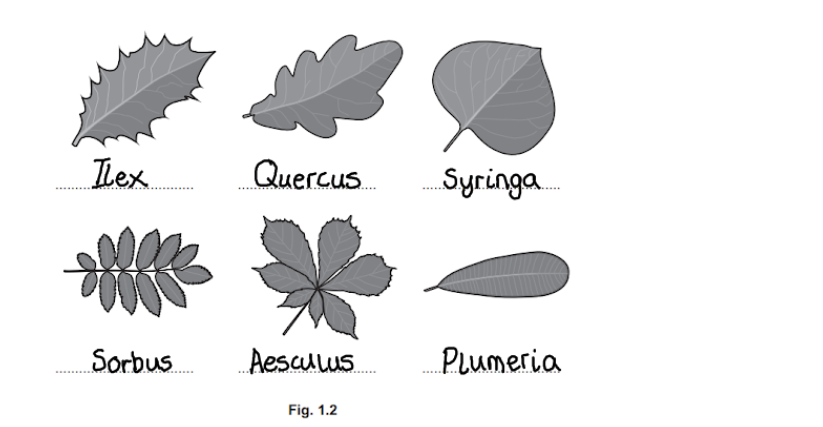

*Here you are awarded marks as follows:*

- *[5 marks] for all answers in the correct place*
- *[4 marks] for 4 or 5 answers in the correct place*
- *[3 marks] for 3 answers in the correct place*
- *[2 marks] for 2 answers in the correct place*
- *[1 mark] for 1 answer in the correct place*

**[Total for question 1: 5 marks]**

### Q4
(i)

- (Dry) scaly skin;** [1 mark]**
- Leathery / rubbery / soft-shelled eggs; **[1 mark]**

(ii) Any **two** from:

- Cellulose / cell wall; **[1 mark]**
- Chloroplast / chlorophyll; **[1 mark]**
- (Large / permanent / central) vacuole;** [1 mark]**

Comparing plant and animal cells is a very common question so you need to make sure you are confident with naming these features.

**[Total: 4 marks]**

> **[exam-tip]**
> Watch out, as hard-shelled eggs are a feature of birds, not reptiles.
> 
> When classifying, give features unique to the group rather than shared ones such as being cold-blooded or simply laying eggs.

### Q5
A feature that can be used to classify an animal as an arthropod is...

Any **one **of the following:

- (Pairs of) jointed legs; **[1 mark]**
- Exoskeleton / external skeleton; **[1 mark]**
- Segmented/sectioned body; **[1 mark]**

**[Total: 1 mark]**
(i) A visible feature that arthropods A, B and C have that arthropods** **D, E and F do not have is...

Any **one **of the following:

- 3 pairs of / 6 legs; **[1 mark]**
- Wings; **[1 mark]**
- Body in three sections / has a head **AND** thorax **AND** abdomen; **[1 mark]**
- Compound eyes; **[1 mark]**

(ii) The letter of the organism in Fig. 1 that is a crustacean is...

- E; **[1 mark]**

This is because...

- (E has) 5 pairs of legs
- *(Accept other valid points here such as a hard exoskeleton); ***[****1 mark]**

**[Total: 3 marks]**
(i) The letter of the organism in Fig. 1 that shows *Araneus diadematus *is...

- F; **[1 mark]**

(ii) The name of the group of arthropods that includes *Araneus diadematus *is...

- Arachnids; **[1 mark]**

**[Total: 2 marks]**
The number of living groups found within the phylum arthropod is...

- Four; **[1 mark]**

**[Total: 1 mark]**

> *There are four groups within the phylum arthropod: insects, myriapods, arachnids and crustaceans.*

### Q6
Characteristics matched to their definitions are:

One mark for each correct match/link:

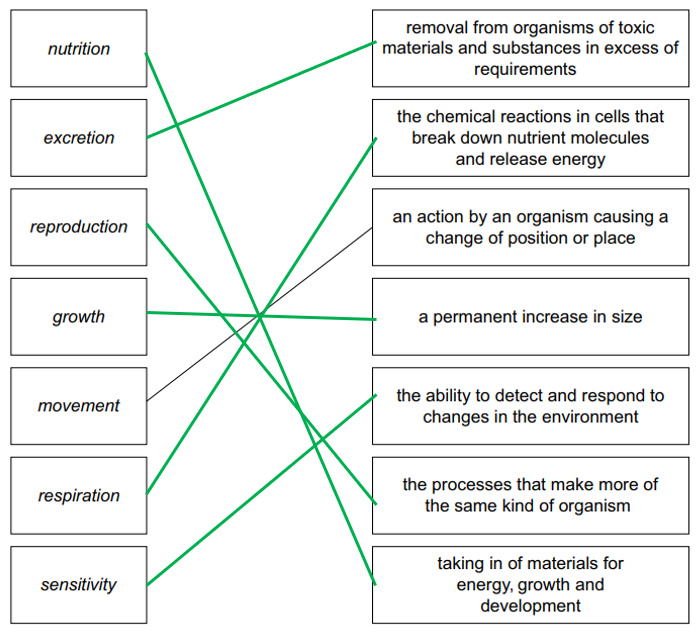

**[Total: 6 marks]**

> *You **must **draw lines with a ruler to avoid confusion. If you draw wiggly lines that aren't clear the examiner will give you zero marks. *

> *It is important you learn definitions, such as these, off by heart.  They are easy marks to achieve in questions like this. *
The mean growth is...

- 4.6 (cm); **[1 mark]**

*Do not allow 4 (cm)*

**[Total: 1 mark]**

> *All the data in the table is expressed to 1 decimal place so you need to take note of this and also give your answer to 1 decimal place.*

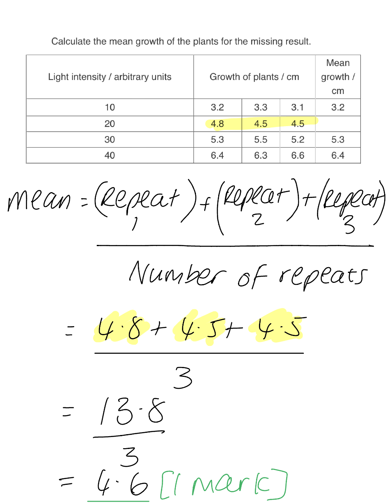

### Q7
The benefits of classifying organisms in a hierarchical system are...

Any** four **from the following:

- Ability to explain evolution; **[1 mark]**
- To spot evolutionary relationships between species; **[1 mark]**
- To identify candidate animals/organisms for human medical treatments e.g. pig or cow tissues in heart valve replacements; **[1 mark]**
- To anticipate and deal effectively with pathogens/pests/epidemics; **[1 mark]**
- To better understand diversity and promote global biodiversity / sustainable farming etc; **[1 mark]**

**[Total: 4 marks]**

> *Many of the benefits arise from complex DNA analysis of different species. Differences and similarities that are not apparent in morphology (appearance) can show in an organism's DNA sequence.*
The more recent a common ancestor between two species, the more closely related those two species are because:

Any **two **of the following:

- Common ancestor is an older/extinct species that both species evolved from; **[1 mark]**
- For two species to evolve from it, there would be not much difference in DNA / alleles / genes / characteristics; **[1 mark]**
- Organisms that share more similar features are said to be more closely related; **[1 mark]**

**[Total: 2 marks]**
The primates that are most closely related are...

Any **two **of the following:

- *Homo sapien* and *Pan troglodytes*; **[1 mark]**
- **Because **the DNA sequence is most closely matched; **[1 mark]**
- **Because **they are closest in the phylogenetic tree/evolutionary branches; **[1 mark]**

**[Total: 2 marks]**

> *Although you do not need to specifically know about phylogenetic trees as part of your course or to answer this question, here you can apply your knowledge of how DNA base sequences are used to classify organisms and how this reflects evolutionary relationships; this can help you interpret the diagram and answer the question. *
Fig. 1 can tell you the following about the relationship between the ancestors of primates:

- Primates that share a more recent ancestor are more closely related; **[1 mark]**
- Primates that have more similar DNA sequences are more closely related; **[1 mark]**

***Accept ****the converse for each marking point ****Accept ****named examples from the diagram for each marking point*

**[Total: 2 marks]**

### Q8
The organism belongs to the Kingdom...

- Fungi; **[1 mark]**

**[Total: 1 mark]**

> *You can tell this is a fungus as it is multicellular, so it is therefore not bacterial or protoctist. It has a nucleus giving further evidence it is not bacterial. It has a chitin cell wall so therefore it is not an animal cell or a plant cell or protoctist. It also does not photosynthesise so more evidence that it cannot be a plant cell.*
The scientist used DNA sequencing because...

- Sequences of bases in DNA are used as a means of classification; **[1 mark]**
- Recent ancestors will be able to be identified **OR **recent ancestors will show a similar base sequence; **[1 mark]**

**[Total: 2 marks]**
The two species that are most closely related are...

- African leopard **and** cheetah; **[1 mark]**
- **Because **their DNA base sequences are most similar; **[1 mark]**

**[Total: 2 marks]**
A comparison of the main features of animals and prokaryotes are...

**Similarities**

Maximum of **two** of the following:

- Both cells contain a ribosomes / cytoplasm / cell membrane; **[1 mark]**
- Both cells do not contain chloroplasts; **[1 mark]**
- Both carry out respiration; **[1 mark]**

**Differences**

Maximum of **two** of the following:

- Prokaryotes are (mostly) unicellular **whereas **animals are multicellular; **[1 mark]**
- Prokaryotic cells do not contain a nucleus/have loop of DNA **whereas **animal cells have a nucleus; **[1 mark]**
- Prokaryotic cells do not contain mitochondria **whereas **animal cells do contain mitochondria; **[1 mark]**

***Accept ****other named organelles for differences such as endoplasmic reticulum*

***Accept**** other differences such as mode of cell division*

**[Total: 4 marks]**

### Q9
(i) One visible feature which identifies the lion as a mammal could include:

- Fur/hair; **[1 mark]**

(ii) The genus of this mammal is:

- *Panthera*; **[1 mark]**

**[Total: 2 marks]**

> *All other features of the lion which identify it as a mammal are not visible in the image given.*

> *The genus of an organism is the word preceding the species name.*
(i) The vertebrate group which lays soft-shelled eggs is:

- Reptiles; **[1 mark]**

(ii) The vertebrate group which has feathers is:

- Birds; **[1 mark]**

(iii) The vertebrate group which has smooth, moist skin is:

- Amphibians; **[1 mark]**

**[Total: 3 marks]**
(i) The diagram can be labelled as follows:

- **A** is the cytoplasm; **[1 mark]**
- **B** is the cell membrane; **[1 mark]**
- **C** is the nucleus; **[1 mark]**

(ii) Two structures that plant cells have and animal cells do not include:

Any** two** from the following:

- The chloroplast; **[1 mark]**
- The cell wall; **[1 mark]**
- A (permanent) vacuole; **[1 mark]**

(iii) The cell structure which is present in bacterial and plant cells but not in animal cells is:

- The cell wall; **[1 mark]**

**[Total: 6 marks]**

> *Remember that other cells may have vacuoles which are temporary, they form and then disappear after a short time. This is why the word 'permanent' is often included when describing the features of a plant cell.*
(d) The specialised cells should be matched with their functions as follows:

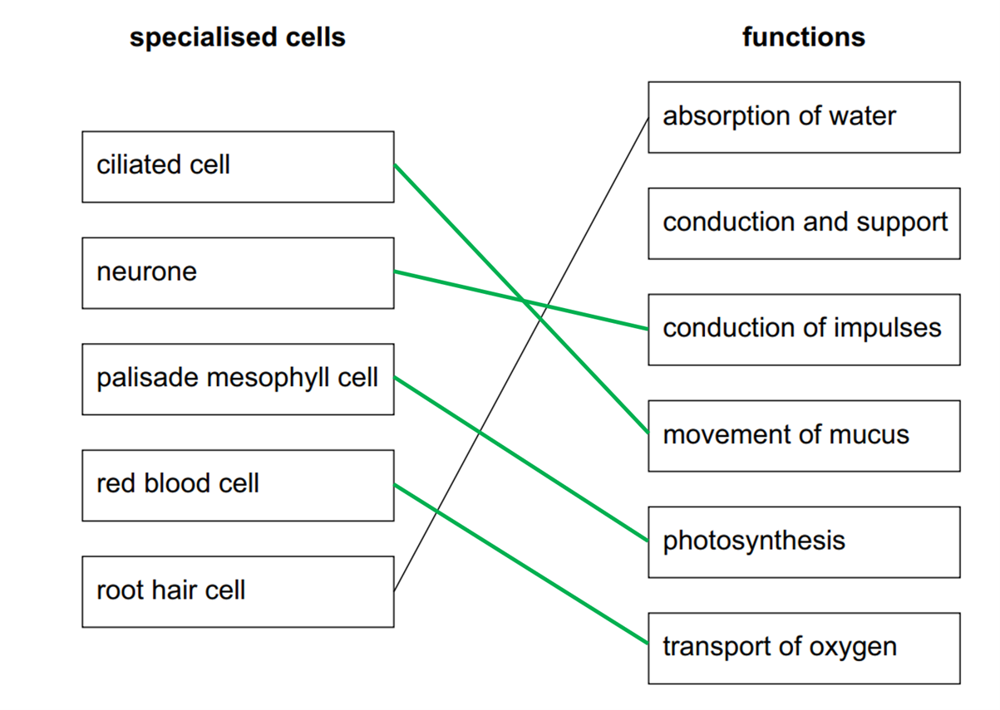

*Award ***[1 mark] ***for each correctly drawn line*

**[Total: 4 marks]**

### Q10
A dichotomous key for the leaves in Fig. 1 is...

- All three leaves (except beech) able to be identified; **[1 mark]**
- Statements given refer to leaf features shown in Fig. 1; **[1 mark]**
- Answer/instruction refers to the statements given; **[1 mark]**

**[Total: 3 marks]**

> *An example of a dichotomous key for Fig. 1 could be...*

|   | statement | answer / instruction |   |
|---|---|---|---|
| 1 | a | leaf is oval shaped | beech |
|   | b | leaf is not oval shaped | go to 2 |
| 2 | a | many leaves on one stem | ash |
|   | b | only one leaf | go to 3 |
| 3 | a | leaf has rounded tips | oak |
|   | b | leaf has pointed tips | field maple |
The dichotomous key to show the classification of arthropods into their four sub groups is...

- Four arthropod groups identified: myriapods, insects, arachnids, crustaceans; **[1 mark]**
- At least one feature identified for each arthropod group, such as body in many segments for myriapods; **[1 mark]**
- Correct placement within dichotomous key for each group; **[1 mark]**
- Logical identification statements for each group such as '3 body parts'; **[1 mark]**

**[Total: 4 marks]**

> *The completed dichotomous key could look something like this model answer, but there are various ways the information could be presented in a dichotomous key.*

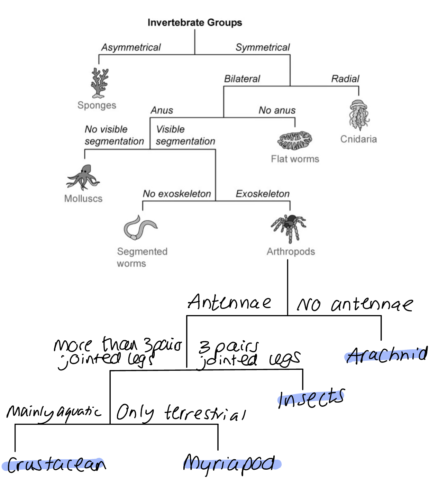
(i) The plants labelled **A**-**C** are...

- **A** = monocotyledon; **[1 mark]**
- **B** = dicotyledon; **[1 mark]**
- **C** = dicotyledon; **[1 mark]**

> *Remember that it is important that you know the features of mono- and dicotyledons that allow you to identify them. For example, A-C above can be identified for the reasons below:*

- *A = a monocotyledon because it has narrow, grass-like leaves*
- *B = a dicotyledon because it has petals in multiples of 5*
- *C = a dicotyledon because it has broad leaves*

(ii) Plant D is a...

- Fern; **[1 mark]**

This is because...

- Spores are present on the underside (of the leaf); **[1 mark]**

**[Total: 5 marks]**

### Q11
(i) The two groups of flowering plants are...

- Monocotyledons **and **dicotyledons; **[1 mark]**

*Answer can be in either order*

(ii) To distinguish between the two groups...

Any **three **of the following from:

- Flowers from monocotyledons contain petals in multiples of 3; **[1 mark]**
- Flowers from dicotyledons contain petals in multiples of 4 or 5; **[1 mark]**
- Leaves from monocotyledons have parallel leaf veins; **[1 mark]**
- Leaves from dicotyledons have reticulated/branched leaf veins; **[1 mark]**

**[Total: 4 marks]**
The plant shown in Fig. 1 would be classified as...

- A fern; **[1 mark]**
- **Because **the leaves are <u>fronds</u>; **[1 mark]**

**[Total: 2 marks]**

> *Take note of the command word here, explain, so you need to go that bit further with your answer. The number of marks is always a good indicator of how much detail you need to give too. *
A graph of the data is as follows:

- Correctly labelled axis - y-axis 'number of leaves', x-axis 'site'; **[1 mark]**
- Bar chart; **[1 mark]**
- Correct heights of bars; **[1 mark]**
- Gaps between bars; **[1 mark]**

***Allow ****plotting error of +/- 1mm for marking point 3*

**[Total: 4 marks]**

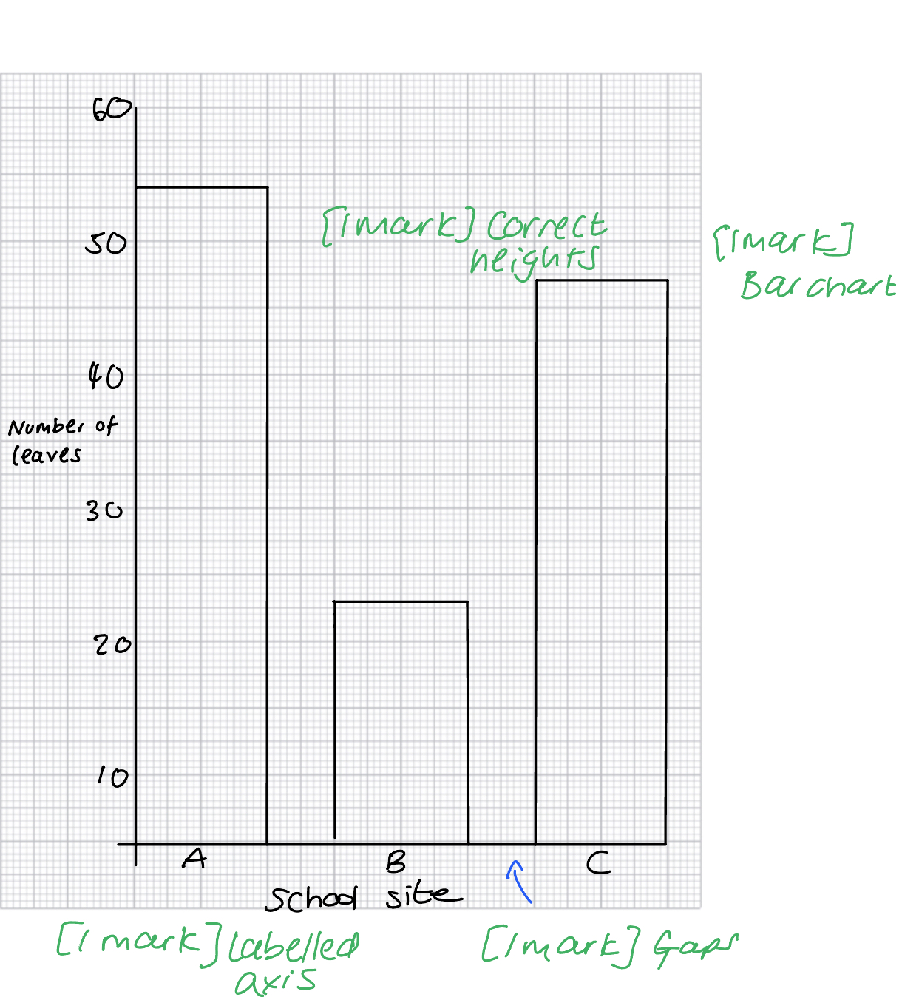
The student could improve the reliability of their data by...

Any **one **from the following:

- Counting the leaves on more than one plant / at least three plants; **[1 mark]**
- Using more than three sites; **[1 mark]**

**[Total: 1 mark]**

### Q12
(i) The species of bacteria can be identified as follows...

- Top row in order from left to right = F,** **A, E
- Bottom row in order from left to right = C, B, D

6 correct; **[5 marks]** 
4/5 correct; **[4 marks]** 
3 correct; **[3 marks]** 
2 correct; **[2 marks]** 
1 correct; **[1 mark]**

(ii) The name of the kingdom that bacteria belong to is...

- Prokaryote; **[1 mark]**

**[Total: 6 marks]**

> *Bacteria belong to the kingdom prokaryote. Be careful not to mix this up with the protoctist kingdom; protoctists can be unicellular like the prokaryotes, but the protoctists have a nucleus while the prokaryotes do not.*
One similarity between the structure of bacteria and the structure of viruses is that...

Any **one **from the following:

- Both contain genetic material / DNA / RNA; **[1 mark]**
- Both contain protein; **[1 mark]**

**[Total: 1 mark]**

> *Note that the question asks for a **structural** similarity, so answers relating to size or effects on other cells will not be credited.*
(i) The formula that would be used to calculate the actual length of the bacterium (not including the flagellum) in Fig. 3 is...

Any **one **from the following:

- (Actual length of bacterium =) image size/length ÷ magnification; **[1 mark]**

(ii) 0.0026 mm converted to micrometres is...

- 2.6 (µm); **[1 mark]**

**[Total: 2 marks]**

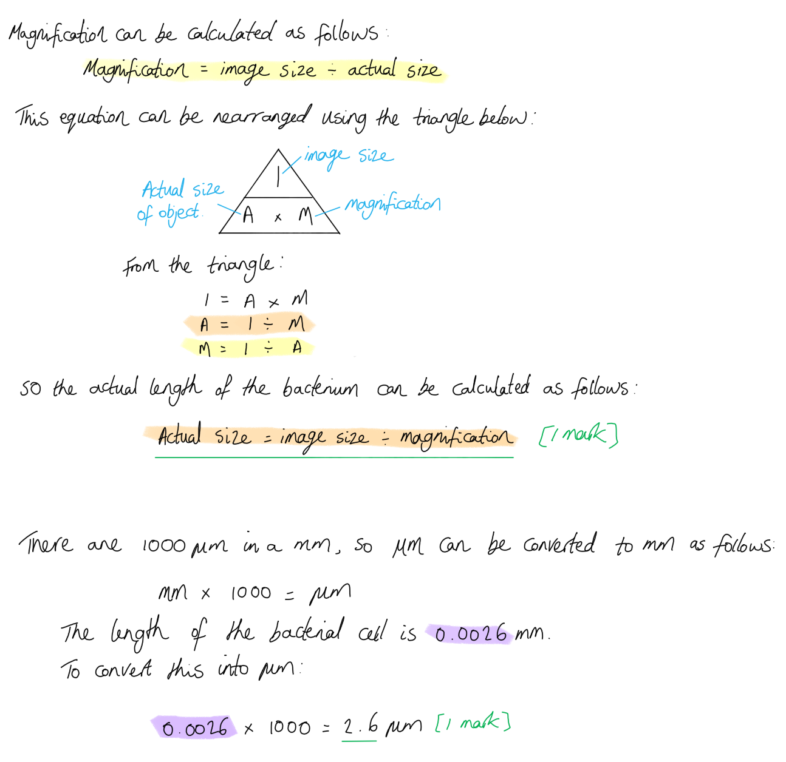
The labels A-F are:

- **A** = cell wall; **[1 mark]**
- **B** = ribosomes; **[1 mark]**
- **C** = cell membrane; **[1 mark]**
- **D** = cytoplasm; **[1 mark]**
- **E** = plasmid(s); **[1 mark]**
- **F** = circular DNA/DNA loop; **[1 mark]**

**[Total: 6 marks]**

### Q13
(i) The main group of vertebrates the chimpanzee belongs to is:

- Mammals; **[1 mark]**

(ii) **Two** features visible that show it belongs to this group are:

- Hair; **[1 mark]**
- External ears; **[1 mark]**

**[Total: 3 marks]**
(i) Chimpanzee population has decreased because:

Any **two **from the following:

- Habitat loss / deforestation; **[1 mark]**
- Competition from humans / *(accept description of this here); ***[1 mark]**
- Hunting; **[1 mark]**

*Accept other valid points/ideas such as pollution, disease*; **[1 mark]**

(ii) A captive breeding programme can help conserve chimpanzees in the wild because:

- It increases the numbers (of chimpanzees because there would be more offspring and less infant death); **[1 mark]**
- They can later be reintroduced to the wild*; ***[1 mark]**

(iii) Two other methods of conserving chimpanzee numbers are:

Any **two **from the following:

- Monitoring / protecting habitats (from deforestation for example); **[1 mark]**
- Monitoring / protecting species (from hunting for example); **[1 mark]**
- Education (on the importance of conservation); **[1 mark]**
- Seed banks (to preserve their habitats); **[1 mark]**

**[Total 6 marks]**

> *This is a synoptic question applying your knowledge to topic 20 of your specification. *
The binomial system of naming species is...

- An <u>internationally</u> agreed system; **[1 mark]**
- (The name of an organism) is made up of two parts showing the <u>genus</u> and <u>species</u>; **[1 mark]**

**[Total: 2 marks]**
The term species means...

- A group of organisms that can reproduce to produce <u>fertile</u> offspring; **[1 mark]**

**[Total: 1 mark]**

> *This is a definition you need to be very precise with your words, so be sure to take time to learn this. *

### Q14
The completed table in sequential order is...

| **1st** | **2nd** | **3rd** | **4th** | **5th** |
|---|---|---|---|---|
| D | B | A | E | C |

**[Total: 1 mark]**
The same gene has to be selected from each species for sequencing because ...

Any **two **from the following:

- Allows comparisons; **[1 mark]**
- Of alleles/versions of the same gene; **[1 mark]**
- To show how closely-related the two species are; **[1 mark]**

**[Total: 2 marks]**

> *This is a synoptic question that draws together your knowledge of DNA and GM technologies. *
The calculation of how long ago the evolution of frogs diverged from that of humans is as follows:

- Frogs = 67 amino acids different; Gibbons = 2 amino acids different
- 2 amino acids ≡ 18 million years; **[1 mark]**
- (67 ÷ 2) × 18 million = 603 million years; **[1 mark]**
- In standard form 6.03 × 108 / 6 × 108 years; **[1 mark]**

**[Total: 3 marks]**

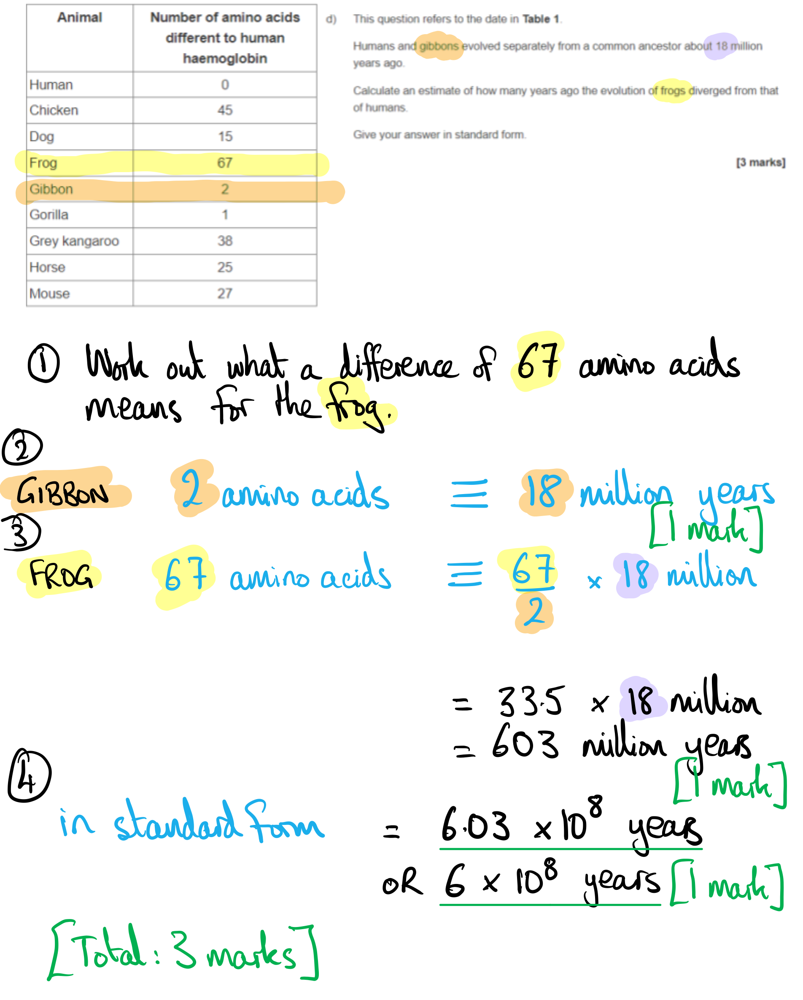

> *An alternative method for working out the correct answer to this question is to take 18 million and divide it by two to work out how many years it takes for one change to occur.*

> *18 ÷ 2 = 9 million years per amino acid change*

> *The frog had 67 differences in amino acids so you can work out how many years it will take by doing:*

> *9 million x 67 = 603 million years*

> *Don't forget to convert to standard form!*

### Q15
One feature that is used to identify vertebrates is:

- Bony skeleton / internal skeleton / endoskeleton / bones / vertebral column / backbone / spine / vertebrae / skull; **[1 mark]**

**[Total: 1 mark]**
(i) The name of the vertebrate group to which emus belong and one feature of this group are:

- Group: birds; **[1 mark]**
- Visible feature: feathers / beaks/bill / <u>hard-shelle</u>d eggs; **[1 mark]**

(ii) The name of the vertebrate group to which crocodiles belong and one feature of this group are:

- Group: reptiles; **[1 mark]**
- Visible feature: <u>dry</u> scales / <u>leathery</u> eggs; **[1 mark]**

(iii)  Evidence from Fig. 1 for and against** **classifying the duck-billed platypus as a mammal are:

Evidence **for** (being a mammal)

- It has fur/hair; **[1 mark]**

Evidence **against**

Any **two **from the following:

- Lays eggs / external eggs; **[1 mark]**
- Young develop outside the body; **[1 mark]**
- Has a beak/bill; **[1 mark]**

**[Total: 7 marks]**
The two groups of vertebrates which lay eggs that develop in water are:

- Fish; **[1 mark]**
- Amphibians; **[1 mark]**

**[Total: 2 marks]**

> *The question asks for** groups **of organisms, so naming individual species within these groups cannot allow you to gain marks. *
The completed sentences are as follows:

**One **mark for each correct word:

- Vertebrates belong to the kingdom <u>animals</u> **[1 mark]**.  All vertebrates have a <u>backbone/spine</u> **[1 mark]**. There are <u>five</u> **[1 mark]** classes of vertebrates; one class is mammals.

There are four other kingdoms which include plants, <u>fungi</u> **[1 mark]**, <u>prokaryotes</u> **[1 mark] **and <u>protists/protoctists</u> **[1 mark]**.

*The answers for the other kingdoms may be listed in any order*

**[Total: 6 marks]**

### Q16
The organism belongs to the Kingdom

- Protoctists; **[1 mark]**

**[Total: 1 mark]**

> *The cell shows an amoeba which is a member of the Kingdom **Protoctista**. *
The features of the organism in Fig. 1 that distinguish it from other organisms are...

Any **two** from the following:

- Unicellular **so **it is not animal or plant or fungi; **[1 mark] **
- Presence of a nucleus **so **it is not bacterial; **[1 mark]**
- Contractile vacuole **so **it is not an animal or plant; **[1 mark]**
- No cell wall so not plant or fungi; **[1 mark]**

**[Total: 2 marks]**

> *Food vacuoles, although less common, can be found in animal, plants, protists, animals and fungi.*
(i) The process that allows water to move in and out of the cell is...

- Osmosis; **[1 mark]**

(ii) Nutrients in the cell lowering the water potential affects the movement of water by...

Any **two **of the following:

- <u>More</u> water moves into the cell; **[1 mark]**
- By osmosis; **[1 mark]**
- From high water potential (outside the cell) to low water potential (inside the cell); **[1 mark]**

(iii) The contractile vacuole carries out...

- Excretion; **[1 mark]**

**[Total: 4 marks]**

> *This question asks you to apply your knowledge from Topic 3 to the context of the cell shown in part (a) and the seven life processes. The removal of water from the cell isn't excretion because it has not been involved in the metabolism of the cell, however, the other waste products are excreted. *
The characteristics of living organisms that would be expressed in this process are...

- Movement because the cell is moving toward it's prey; **[1 mark]**
- Nutrition because the cell will digest it's prey (by phagocytosis); **[1 mark]**
- Sensitivity because the cell detects it's prey; **[1 mark]**

**Final answer:** **[Total 3 marks]**

### Q17
The correct placing of ticks in Table 1 is:

| **Characteristic** | **Arthropod group** |   |   |
|---|---|---|---|
| **Arachnids** | **Crustaceans** | **Myriapods** |   |
| Four pairs of legs | **Final answer:** **✓** |   |   |
| One pair of antennae |   |   | **Final answer:** **✓** |
| Body divided into two main parts | **Final answer:** **✓** |   |   |

**[1 mark]** *for each correct row.*

**[Total: 3 marks]**
The characteristics shown by all living organisms are:

**Final answer:** **Any ****four ****of the following:**

- Movement / moving; **[1 mark]**
- Respiration; **[1 mark]**
- Sensitivity / sensing (the environment); **[1 mark]**
- Growth / growing / getting larger; **[1 mark]**
- Reproduction / producing young/offspring; **[1 mark]**
- Excretion / removal of metabolic waste; **[1 mark]**
- Nutrition / gaining nutrients / named nutrients, e.g. carbohydrates; **[1 mark]**

**[Total: 4 marks]**

> *A common mnemonic to remember these seven features is MRS GREN or MRS NERG.*
(i) The drop of red dye moved towards the arthropods because:

**Final answer:** **Any ****three ****of the following:**

- Oxygen was used by the arthropods; **[1 mark]**
- Correct reference to (aerobic) respiration e.g. oxygen is required for (aerobic) respiration; **[1 mark]**
- Carbon dioxide / water (vapour), is given out / released (by the arthropods); **[1 mark]**
- Carbon dioxide / water (vapour), is absorbed (by the chemicals in the container); **[1 mark]**
- (So the) volume of air (in the container) decreases / pressure in the container decreases; **[1 mark]**

(ii) The trend shown in** **Fig. 2 is:

- As the temperature increases, the (rate of) dye movement increases **OR** the rate of dye movement is directly proportional to temperature; **[1 mark]**

(iii) The percentage increase in the rate of dye movement between 10°C and 20°C is calculated as:

- Change from 10°C to 20°C  = 9.5 - 5.0 = 4.5
- 4.5 ÷ 5.0 = 0.9 = 90%; **[2 marks]**

*Full marks awarded for the correct answer in the absence of calculations.*

**[Total: 6 marks]**

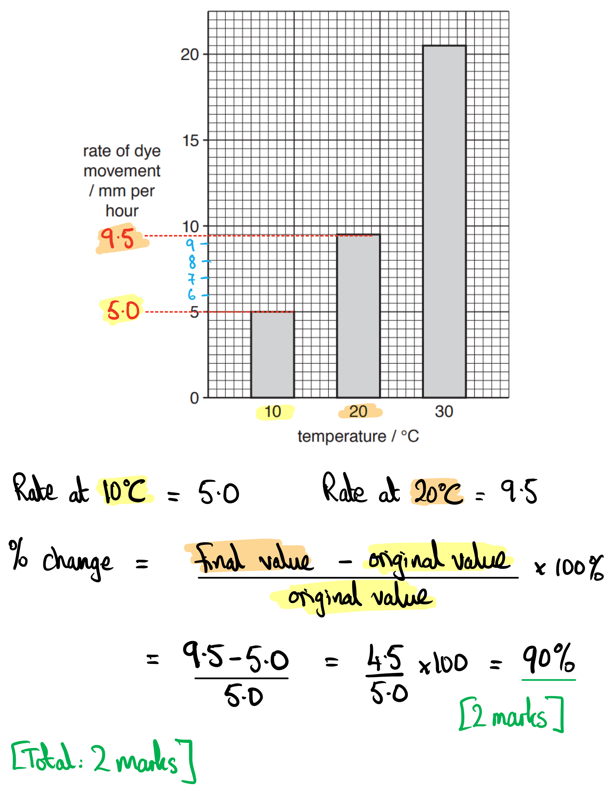

> *A common error is to work out (5 ÷ 9.5) ×100% = 52.6%, which is the answer to a different question... that question would be, 'What proportion of the rate of movement of dye at 20°C was achieved at 10°C?' *

> *Avoid trying to see a question that isn't actually there!*

> *Tips:*

> *1. Revise the formula for percentage change until you have it off by heart:*

$\text{Percentage} \text{change} = \frac{final \text{value} - \text{original} value}{original value} \times 100 \%$

> *2. Then think about which data point is the original value and which is the final value - this will be apparent from **careful reading **of the question. *
(i) The group of arthropods that the student used is...

- Insects; **[1 mark]**

(ii) The visible features that identify this group are...

- Six legs/three pairs of legs; **[1 mark]**
- Three body parts/segments; **[1 mark]**
- Antennae; **[1 mark]**

**[Total: 4 marks]**

### Q18
The characteristics of living organisms reflected in this investigation are...

Any **three** from the following:

- Growth; **[1 mark]**
- Movement; **[1 mark]**
- Sensitivity; **[1 mark]**
- Nutrition; **[1 mark]**

**[Total: 3 marks]**
(i) The student calculated the growth of the seedlings rather than use the final height because...

- Allows comparison; **[1 mark]**
- Seedlings started at difference heights / had different starting heights; **[1 mark]**

(ii) The percentage change of the control group and red light seedlings is...

- (Change in height) 2 ÷ (initial height) 14 = 0.14; **[1 mark]**
- (Change) 0.14 x 100 = 14 %; **[1 mark]**

(iii) The need for control is because...

Any **one **of the following:

- To see if what is tested / change in light has an effect on the experimental groups; **[1 mark]**
- To show a comparison between the control group and the experimental group; **[1 mark]**
- To measure the effect of the treatment / change in light; **[1 mark]**

**[Total: 5 marks]**

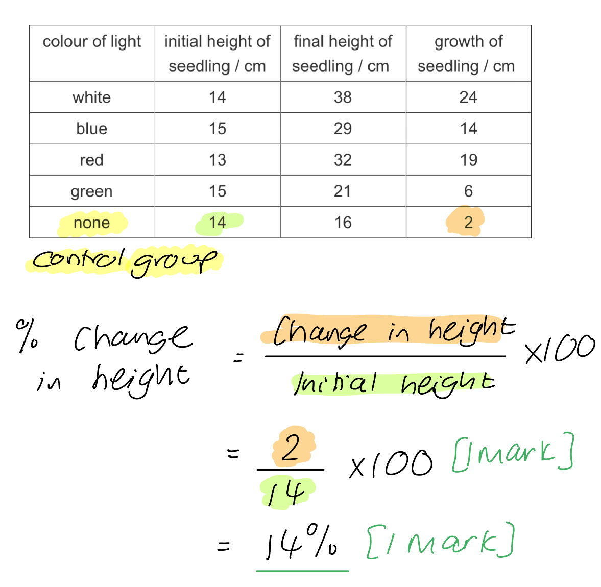
The gardener should use...

- Blue light; **[1 mark]**
- (This is because) blue light gave the seedlings the greatest height (for all varieties of vegetable); **[1 mark]**

**[Total: 2 marks]**

> *You do not need to have an understanding of the intricacies of photosynthesis here and the reasons why the plants had different growth in different coloured light, in order to answer the question. You simply need to 'say what you see' when looking at the data. *
The gardener's experimental method compared with the student's is...

Any **four **from the following:

- The gardner used more than one type of plant/vegetable **whereas **the student only used strawberry seedlings; **[1 mark]**
- The gardener did not test white light **whereas **the student did not test orange or violet light **OR **the gardener used a greater range of <u>coloured</u> light **whereas **the student only tested three <u>colours</u> of light; **[1 mark]**
- The gardener did not use a control group **whereas **the student did use a control group **OR **the student grew seedlings in no light **whereas **the gardener only used different light sources/colours; **[1 mark]**
- The gardener took repeat readings **whereas **the student only grew one seedling (for each light source); **[1 mark]**
- The student controlled the volume of water the seedlings received **whereas **the gardener did not control the volume of water given; **[1 mark]**

**[Total: 4 marks]**

> *It is important to give a contrasting statement for each of your points when answering a 'compare' type question. This shows the examiner you understand the question and you are able to draw information out by referring to both sets of information. *

### Q19
The common features of arachnids visible in Fig. 1 are...

- Four pairs of legs / eight legs; **[1 mark]**

**[Total: 1 mark]**

> *Although arachnids have other common features, such as two body parts, this is not clearly visible from the sample shown in Fig. 1.*
The arachnids shown in Fig. 1 are...

- **A** = *Scorpiones*; **[1 mark]**
- **B** = *Pseudoscorpiones*; **[1 mark]**
- **C** = *Ixodida*; **[1 mark]**
- **D** = *Pholcidae*; **[1 mark]**
- **E** = *Lycosidae*; **[1 mark]**

**[Total: 5 marks]**
The purpose of classification systems is...

- To reflect evolutionary relationships; **[1 mark]**
- To determine which species an organism belongs to; **[1 mark]**

**[Total: 2 marks]**
