# Exam Questions — Characteristics, Classification & Features of Organisms
**1. Characteristics & Classification of Living Organisms** · Cambridge (CIE) IGCSE biology (0610 & 0970)
> Source: [https://www.savemyexams.com/igcse/biology/cie/23/topic-questions/](https://www.savemyexams.com/igcse/biology/cie/23/topic-questions/) · 50 questions across 3 sets

## Alternative To Practical Questions (3 questions)

### Q1 — medium — 9 marks

**Q1** [2 marks]

A student wanted to investigate the sensitivity of the skin to temperature change.

Fig. 1 shows part of their experimental set up.

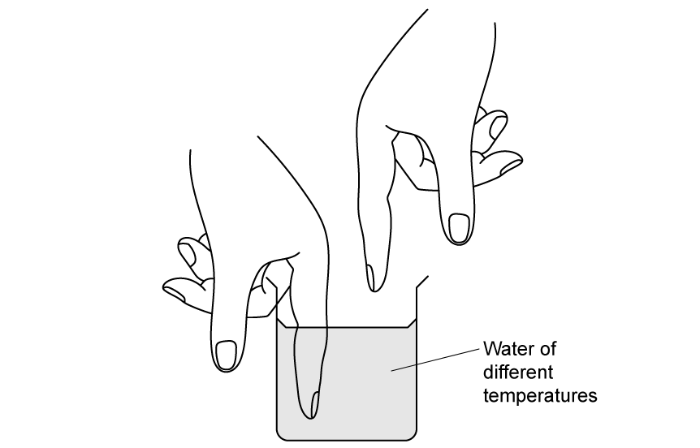

**Fig. 1**

The students followed the following method:

1. Fill three beakers with water of a different temperatures: one with cold water at 10-15°C, one with warm water at 25°C, and one with hot water at 40-50°C.
2. Place the index finger of the left hand into the cold water and the index finger of the right hand into the hot water. Leave submerged for 2 minutes.
3. After 2 minutes remove both fingers from the hot and cold water and place them repeatedly, but alternately, into and out of the warm for one second at a time. Do this for 1 minute.
4. Record your observations of the sensations felt.

(i)

Identify **one **variable that needs to be kept constant throughout the experiment.

[1]

(ii)

Suggest how the student could make the test more *reliable.*

[1]

**Q1** [3 marks]

**Extract:**

A student wanted to investigate the sensitivity of the skin to temperature change.

Fig. 1 shows part of their experimental set up.

The students followed the following method:

1. Fill three beakers with water of a different temperatures: one with cold water at 10-15°C, one with warm water at 25°C, and one with hot water at 40-50°C.
2. Place the index finger of the left hand into the cold water and the index finger of the right hand into the hot water. Leave submerged for 2 minutes.
3. After 2 minutes remove both fingers from the hot and cold water and place them repeatedly, but alternately, into and out of the warm for one second at a time. Do this for 1 minute.
4. Record your observations of the sensations felt.

A second student also investigated the sensitivity of the skin. They used a hairpin to determine whether one or two prongs of a hairpin could be felt on different areas of the hand and arm.

1. One student closed their eyes whilst another used the hairpin to gently but firmly touch the skin with either one or two prongs for 1 second.
2. The student with their eyes closed guessed how many prongs were being pressed onto their skin.
3. The test was repeated with increasing gaps of the hair pin prongs on different areas of the hand and arm.

The aim was to determine the most sensitive area of those tested.

Fig. 2 shows the forearm being tested.

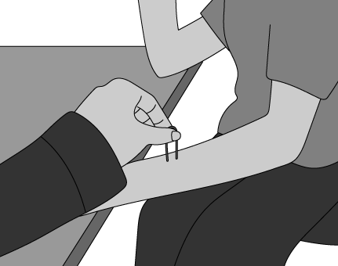

**Fig. 2**

Their results are shown in Table 1.

**Table 1**

| **distance of hairpin prongs / mm** | **area of arm or hand** | **number of occasions on which the prong number was detected correctly** |
|---|---|---|
| 5 | palm | 2 |
| forearm | 1 |   |
| elbow | 1 |   |
| 10 | palm | 2 |
| forearm | 2 |   |
| elbow | 1 |   |
| 15 | palm | 2 |
| forearm | 2 |   |
| elbow | 2 |   |

(i)

Identify the variable that is measured (the dependent variable).

[1]

(ii)

Describe a source of error associated with the student's experiment.

[1]

(iii)

Explain improvements that could be made to overcome the source of error.

[1]

**Q1** [4 marks]

**Extract:**

Table 1

distance of hairpin prongs / mm | area of arm or hand | number of occasions on which the prong number was detected correctly
5 | palm | 2
   | forearm | 1
   | elbow | 1
10 | palm | 2
   | forearm | 2
   | elbow | 1
15 | palm | 2
   | forearm | 2
   | elbow | 2

Draw a graph of the students results shown in Table 1.

### Q2 — medium — 17 marks

**Q2** [4 marks]

Woodlice were used to investigate their sensitivity to different conditions. A choice chamber was set up with four different compartments: light and dry, light and moist, dark and dry, dark and moist.

A student placed 15 woodlice into the choice chamber and then recorded the number of woodlice in each compartment after a period of 10 minutes. They then removed all the woodlice and repeated the experiment twice more.

Choice chambers allow us to know what environmental conditions animals prefer when looking for suitable habitats.

Fig. 1 shows the experimental set up of the choice chamber used.

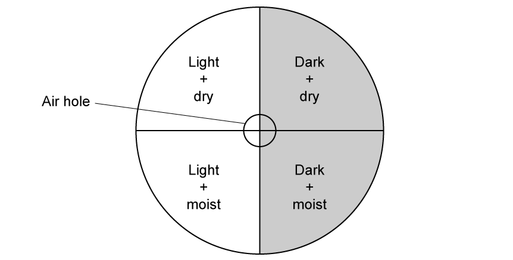

**Fig. 1**

(i)

Explain why the student left the woodlice in the choice chamber for 10 minutes before counting the woodlice in each chamber.

[1]

(ii)

State **two **variables that should be kept constant throughout the investigation.

[2]

(iii)

For **one** of the variables stated in part (ii), describe how to keep this constant.

[1]

**Q2** [4 marks]

**Extract:**

Woodlice were used to investigate their sensitivity to different conditions. A choice chamber was set up with four different compartments: light and dry, light and moist, dark and dry, dark and moist.

A student placed 15 woodlice into the choice chamber and then recorded the number of woodlice in each compartment after a period of 10 minutes. They then removed all the woodlice and repeated the experiment twice more.

Choice chambers allow us to know what environmental conditions animals prefer when looking for suitable habitats.

(i)

Identify **one **possible** **hazard associated with carrying out the experiment.

[1]

(ii)

Describe the safety precautions associated with the hazard identified in part (i).

[1]

(iii)

Describe the ethical considerations when using living organisms such as woodlice.

[2]

**Q2** [3 marks]

**Extract:**

Woodlice were used to investigate their sensitivity to different conditions. A choice chamber was set up with four different compartments: light and dry, light and moist, dark and dry, dark and moist.

A student placed 15 woodlice into the choice chamber and then recorded the number of woodlice in each compartment after a period of 10 minutes. They then removed all the woodlice and repeated the experiment twice more.

Create a table in which the student could record their results

**Q2** [6 marks]

**Extract:**

Woodlice were used to investigate their sensitivity to different conditions. A choice chamber was set up with four different compartments: light and dry, light and moist, dark and dry, dark and moist.

A student placed 15 woodlice into the choice chamber and then recorded the number of woodlice in each compartment after a period of 10 minutes. They then removed all the woodlice and repeated the experiment twice more. 

Choice chambers allow us to know what environmental conditions animals prefer when looking for suitable habitats.

Describe how you could adapt this experiment to investigate the sensitivity of woodlice to temperature changes.

### Q3 — medium — 14 marks

**Q3** [4 marks]

Fig. 1 shows an image of a monarch butterfly, *Danaus plexippus*.

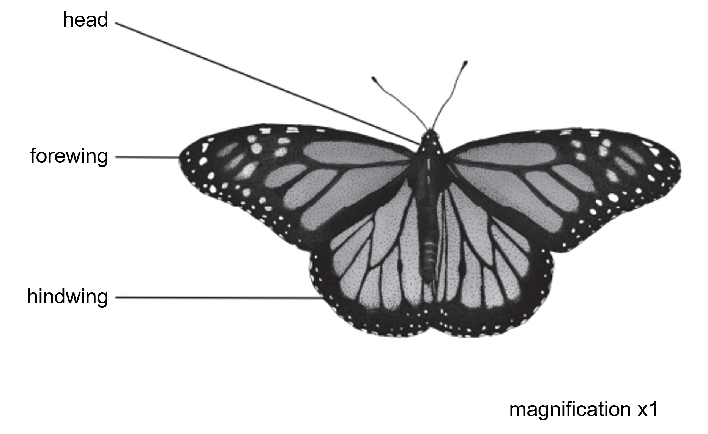

**Fig. 1**

Sketch a large drawing of **one** of the hindwings of the monarch butterfly shown in Fig. 1.

*Source: 2018 0610/63 Q2A*

**Q3** [3 marks]

Fig 2 shows an image of a viceroy butterfly, *Limenitis archippus*.

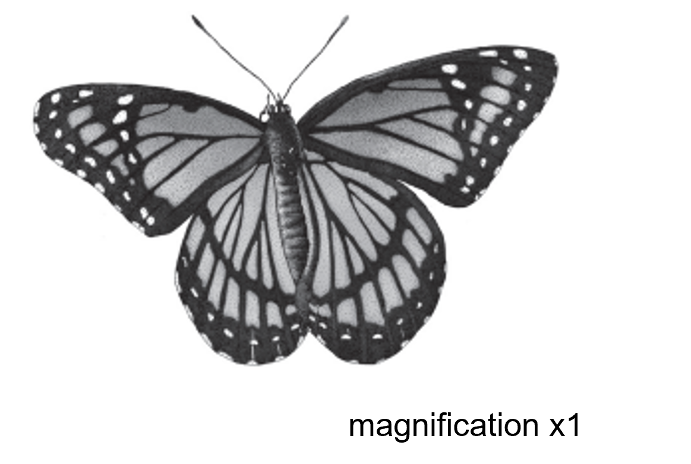

**Fig. 2**

Describe **one** visible similarity and **two** visible differences between the viceroy and the monarch butterflies’ **wings**.

*Source: 2018 0610/63 Q2B*

**Q3** [7 marks]

**Extract:**

A student investigated the relationship between the body mass of monarch butterflies and the length of their forewings. The student recorded the data for five butterflies in Table 1.

Table 1

| Butterfly | Body mass / g | Forewing length / mm |
| --- | --- | --- |
| A | 0.2 | 38 |
| B | 0.3 | 42 |
| C | 0.5 | 50 |
| D | 0.7 | 58 |
| E | 0.8 | 62 |

A student investigated the relationship between the body mass of monarch butterflies and the length of their forewings. The student recorded the data for five butterflies in Table 1.

**Table 1**

| Butterfly | Body mass / g | Forewing length / mm |
|---|---|---|
| **A** | 0.2 | 38 |
| **B** | 0.3 | 42 |
| **C** | 0.5 | 50 |
| **D** | 0.7 | 58 |
| **E** | 0.8 | 62 |

(i)

Plot a graph on the grid to show the relationship between body mass and forewing length.

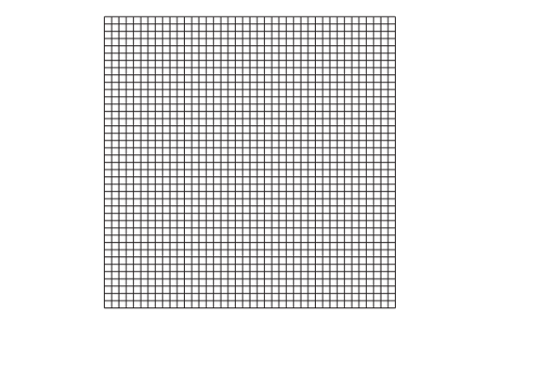

[4]

(ii)

Describe the relationship shown on the graph.

[1]

(iii)

A student found a monarch butterfly with a forewing length of 55 mm. Use the graph to estimate the body mass of this butterfly.

Show **on the graph** how you obtained your answer.

[2]

*Source: 2018 0610/63 Q2C*

## Multiple Choice Questions (28 questions)

### Q1 — easy — 1 marks

**Q1** [1 mark]

The diagram shows an organism.

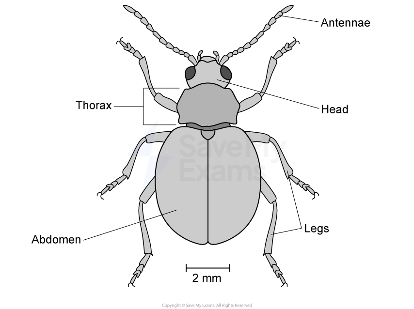

Which arthropod group does the organism belong to?

### Q2 — easy — 1 marks

**Q2** [1 mark]

A scientist observes four events in an organism:

1. It takes in glucose.
2. It releases carbon dioxide produced in cells.
3. It moves away from a harmful chemical.
4. It increases in biomass over time.

Which row correctly matches the events to characteristics?

|   | 1 | 2 | 3 | 4 |
|---|---|---|---|---|
| **A** | respiration | excretion | sensitivity | growth |
| **B** | nutrition | excretion | sensitivity | growth |
| **C** | nutrition | respiration | movement | reproduction |
| **D** | excretion | nutrition | sensitivity | growth |

### Q3 — medium — 1 marks

**Q3** [1 mark]

A hare and a rabbit are unable to reproduce to produce fertile offspring.

Which statement explains why?

### Q4 — easy — 1 marks

**Q4** [1 mark]

Which characteristic allows an organism to detect or sense stimuli in the internal or external environment and to make appropriate responses?

### Q5 — medium — 1 marks

**Q5** [1 mark]

Which diagram shows a flower from a monocotyledon?

*Source: June 2022 Paper 2 Q2*

### Q6 — medium — 1 marks

**Q6** [1 mark]

The table shows a section of DNA taken from four different organisms.

Which two organisms are the most distantly related to each other?

*Source: June 2021 0970/21 Q2*

### Q7 — easy — 1 marks

**Q7** [1 mark]

Scientists discover a new species of animal.

It has a segmented body with two pairs of legs on each segment.

To which group of animals does this new species belong?

*Source: June 2021 0970/11 Q3*

### Q8 — easy — 1 marks

**Q8** [1 mark]

The scientific names of some animals are listed.

1. C*amelus dromedarius *
2. *Camelus ferus *
3. *Equus ferus *
4. *Struthio camelus*

Which animals are in the same genus?

*Source: June 2021 0970/11 Q2*

### Q9 — easy — 1 marks

**Q9** [1 mark]

What is a characteristic of all living organisms?

*Source: June 2021 0970/11 Q1*

### Q10 — hard — 1 marks

**Q10** [1 mark]

The diagram shows an organism.

Which type of arthropod is this organism?

*Source: June 2022 0970/11 Q3*

### Q11 — medium — 1 marks

**Q11** [1 mark]

The horse, Equus ferus, and the donkey, Equus asinus, are able to interbreed. The offspring they produce is called a mule.

Which statement is correct?

*Source: June 2022 0970/11 Q2*

### Q12 — easy — 1 marks

**Q12** [1 mark]

All living organisms release energy from nutrient molecules within their cells.

What is the name of this characteristic?

*Source: June 2022 0970/11 Q1*

### Q13 — medium — 1 marks

**Q13** [1 mark]

Lichens are formed from two different organisms living together.

Organism X and organism Y are found in most lichens.

The table shows some of the characteristics of organism X and organism Y.

| X | Y |
|---|---|
| made of strands called hyphae | single-celled |
| hyphae have cell walls and many nuclei | cell contains a nucleus and chloroplasts |

Which kingdoms do X and Y belong to?

|   | X | Y |
|---|---|---|
| **A** | fungus | prokaryote |
| **B** | fungus | protoctist |
| **C** | protoctist | fungus |
| **D** | protoctist | plant |

*Source: Specimen 2023 0970/02 Q2*

### Q14 — easy — 1 marks

**Q14** [1 mark]

Humans have the scientific name *Homo sapiens*.

What do the two parts of this name refer to?

*Source: Specimen 2023 0970/01 Q2*

### Q15 — easy — 1 marks

**Q15** [1 mark]

The diagram shows a plant.

Which characteristic of living organisms is shown by the plant in the diagram?

*Source: Specimen 2023 0970/01 Q1*

### Q16 — medium — 1 marks

**Q16** [1 mark]

The image below shows what occurs in a seed during and after germination, the seed has been planted in well-watered soil.

Which characteristics of living things are demonstrated by this sequence?

### Q17 — medium — 1 marks

**Q17** [1 mark]

The equation below represents a chemical process that occurs in the cells of living organisms.

**glucose + oxygen → carbon dioxide + water**

Which characteristics of living organisms would this equation be associated with?

|   | nutrition | respiration |
|---|---|---|
| **A** | ✔ | ✔ |
| **B** | **X** | ✔ |
| **C** | **X** | **X** |
| **D** | ✔ | **X** |

### Q18 — medium — 1 marks

**Q18** [1 mark]

#### Extended only

The list below shows the binomial names for eight animals.

*Canis lupus* 
*Cygnus buccinator* 
*Dasypus novemcinctus* 
*Dasyurus maculatus* 
*Equus burchelli* 
*Eumetopias jubatus* 
*Felis chaus* 
*Felis lybica*

Which two animals are most closely related?

### Q19 — medium — 1 marks

**Q19** [1 mark]

Some of the processes carried out by living organisms are illustrated in the diagram below.

Which row of the following table correctly describes the characteristics shown by living organisms in the diagram above?

|   | **W** | **X** | **Y** |
|---|---|---|---|
| **A** | respiration | photosynthesis | respiration |
| **B** | respiration | respiration | nutrition |
| **C** | photosynthesis | respiration | excretion |
| **D** | photosynthesis | excretion | nutrition |

### Q20 — medium — 1 marks

**Q20** [1 mark]

What are the characteristics of birds?

|   | skin covered in feathers | maintain a constant body temperature | jelly-covered eggs | external ears present |
|---|---|---|---|---|
| **A** | ✔ | **✘** | ✔ | **✘** |
| **B** | **✘** | **✘** | **✘** | ✔ |
| **C** | ✔ | ✔ | **✘** | **✘** |
| **D** | **✘** | ✔ | ✔ | ✔ |

### Q21 — easy — 1 marks

**Q21** [1 mark]

The image below shows a house mouse, whose scientific name is *Mus musculus*.

Which genus does it belong to?

### Q22 — hard — 1 marks

**Q22** [1 mark]

Use the key to identify the group to which fish belong.

| 1. | Fur absent...  Fur present... | go to 2  mammals |
|---|---|---|
| 2. | Eggs do not have hard shells...  Eggs have hard shells... | go to 3  group **A** |
| 3. | Reproduction occurs in water...  Reproduction occurs on land... | go to 4  group **B** |
| 4. | Scaly skin...  Smooth skin... | group **C**  group **D** |

### Q23 — hard — 1 marks

**Q23** [1 mark]

#### Extended only

The image below shows a leaf from a plant.

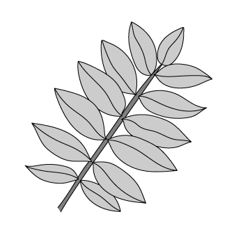

Identify the plant to which the leaf belongs using the dichotomous key below.

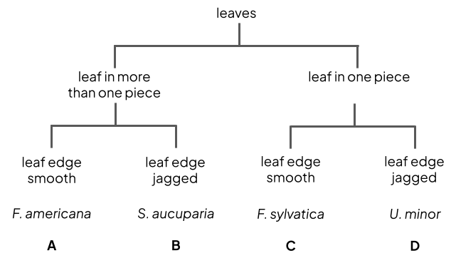

### Q24 — easy — 1 marks

**Q24** [1 mark]

Which of the following would not be a characteristic seen in all living organisms?

### Q25 — hard — 1 marks

**Q25** [1 mark]

#### Extended only

Identify the arthropods shown using the key below.

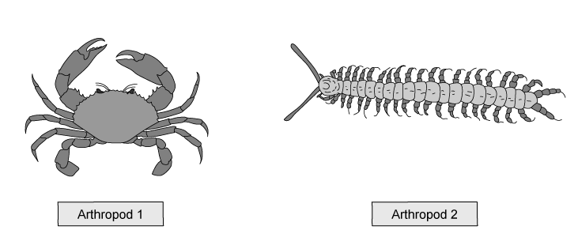

| 1. | Three pairs of legs... | Class W |
|---|---|---|
| Four pairs of legs or more... | Go to 2 |   |
| 2. | Body plan consists of a head and a many-segmented body... | Class X |
| Head and thorax are fused to form a cephalothorax... | Go to 3 |   |
| 3. | No antennae present... | Class Y |
| Antennae present... | Class Z |   |

|   | **Arthropod 1 class** | **Arthropod 2 class** |
|---|---|---|
| **A** | Y | X |
| **B** | X | Z |
| **C** | Z | W |
| **D** | Z | X |

### Q26 — easy — 1 marks

**Q26** [1 mark]

Which name can be given to a group of organisms that have similar morphological features and can reproduce successfully to produce fertile offspring?

### Q27 — easy — 1 marks

**Q27** [1 mark]

A yeast (*Saccharomyces cerevisiae),* glucose and water are mixed in a test tube.

The diagrams show the test tube at the start and after one hour.

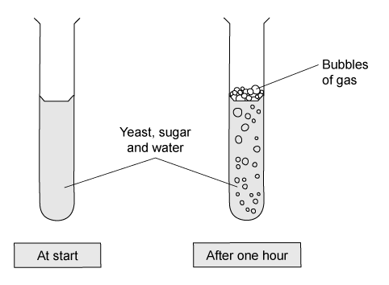

Which process causes this change?

### Q28 — easy — 1 marks

**Q28** [1 mark]

Which class of vertebrate typically gives birth to live young?

## Theory Questions (19 questions)

### Q1 — easy — 14 marks

**Q1** [3 marks]

A student is identifying different plants found in a school garden. They take a small sample from the leaf of a plant to look at under a light microscope.

Fig. 1.1 shows a diagram of one of the cells observed.

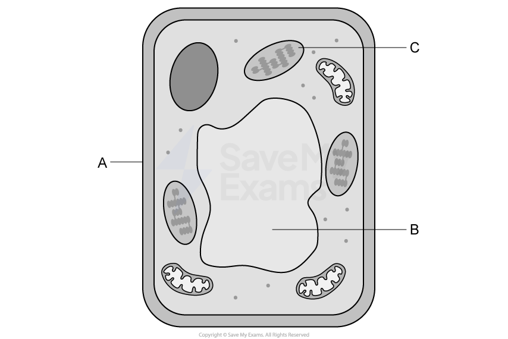

**Fig. 1.1**

State the names of structures A, B and C in Fig. 1.1.

**Q1** [2 marks]

**Extract:**

A student is identifying different plants found in a school garden. They take a small sample from the leaf of a plant to look at under a light microscope. 

Fig. 1.1 shows a diagram of one of the cells observed.

**Fig. 1.1**

The student used a ruler to measure the width of the cell in Fig. 1.1.

The diagram is 60 mm wide. The actual width of the cell under the microscope is 0.03 mm.

Calculate the magnification of Fig. 1.1. Show your working

**Q1** [2 marks]

The student used a dichotomous key to identify different plants found in the school garden.

| **1a** | Leaves are broad and flat | go to 2 |
|---|---|---|
| **1b** | Leaves are narrow and needle-like | *Pinus sylvestris* |
| **2a** | Leaf has a single main vein with smaller veins branching off | go to 3 |
| **2b** | Leaf has many veins all arising from one central point | go to 4 |
| **3a** | Leaf edge is smooth with no serrations | *Hedera helix* |
| **3b** | Leaf edge is serrated | *Quercus robur* |
| **4a** | Leaves are heart-shaped | *Bellis perennis* |
| **4b** | Leaves are oval with a pointed tip | *Plantago major* |

Use the key to identify the plants described below.

(i) Plant A has broad, flat leaves with many veins arising from one central point, and the leaves are heart-shaped.

[1]

(ii) Plant D has broad, flat leaves with many veins from one point and an oval leaf with a pointed tip.

[1]

**Q1** [3 marks]

*Bellis perennis* is the binomial name for the daisy plant.

(i) State what the first word, *Bellis*, represents in the binomial system.

[1]

(ii) State what the second word, *perennis*, represents in this system.

[1]

(iii) Organisms are classified into kingdoms before they are given a binomial name.

State the kingdom to which daisies belong.

[1]

**Q1** [4 marks]

**Extract:**

A student is identifying different plants found in a school garden. They take a small sample from the leaf of a plant to look at under a light microscope.

Fig. 1.1 shows a diagram of one of the cells observed.

**Fig. 1.1**

A student is identifying different plants found in a school garden. They take a small sample from the leaf of a plant to look at under a light microscope.

Fig. 1.1 shows a diagram of one of the cells observed.

**Fig. 1.1**

The cell shown in Fig. 1.1 is taken from a living organism.

(i) Identify the characteristic of living organisms that involves an increase in size or cell number.

[1]

(ii) Identify the characteristic of living organisms that involves the removal of toxic waste products.

[1]

(iii) State **two** features of the kingdom to which the cell belongs, that are visible in Fig. 1.1.

[2]

### Q2 — easy — 6 marks

**Q2** [6 marks]

Describe the similarities **and** differences between the structure of the yeast cell and the structure of the bacterial cell.

*Source: june 2021 paper 4 Q1C*

### Q3 — easy — 5 marks

**Q3** [5 marks]

Fig. 1.1 is a dichotomous key. It can be used to identify different types of tree by using their leaves.

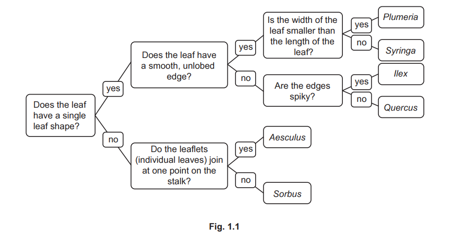

Fig. 1.2 shows leaves from six different trees.

Use the key in Fig. 1.1 to identify the six different types of tree.

Write the name of each tree on the lines in Fig. 1.2.

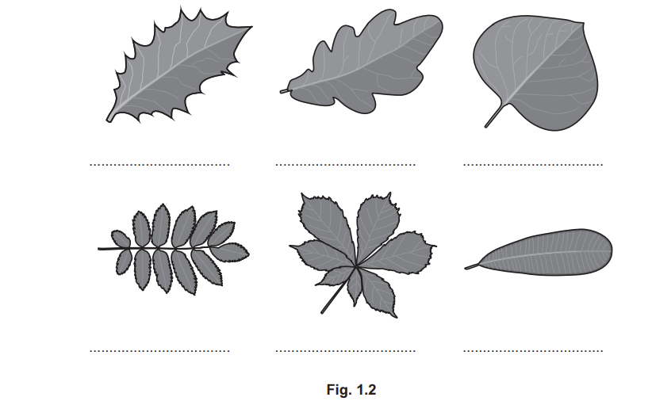

*Source: June 2021 0970/31 Q1*

### Q4 — easy — 4 marks

**Q4** [4 marks]

Fig. 5.1 shows the marine iguana, *Amblyrhynchus cristatus*.

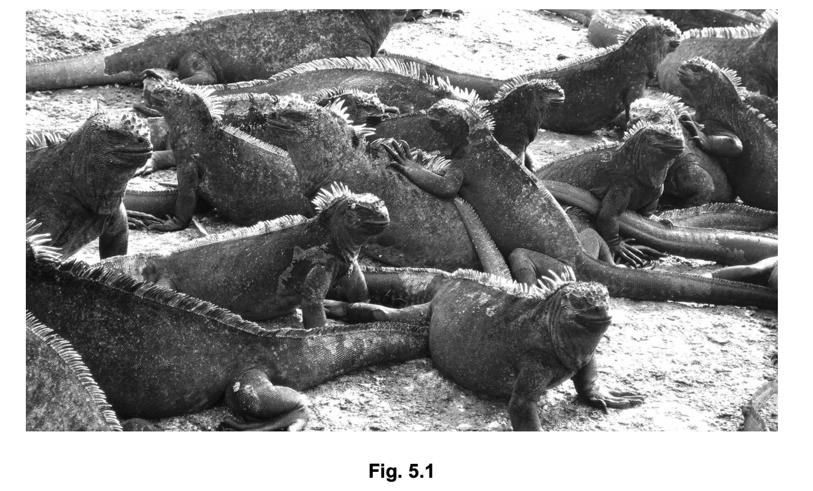

(i)

Marine iguanas are reptiles. State two features that are used to classify animals as reptiles.

1 ........................................................................................................................................ 2 ........................................................................................................................................

[2]

(ii)

State two structures that are present in plant cells that are not present in the cells of reptiles.

1 ........................................................................................................................................ 2 ........................................................................................................................................

[2]

*Source: Specimen 2023 0970/04 Q5A*

### Q5 — easy — 7 marks

**Q5** [1 mark]

Fig. 1 shows six different arthropods labelled **A**, **B**, **C**, **D**, **E** and **F**.

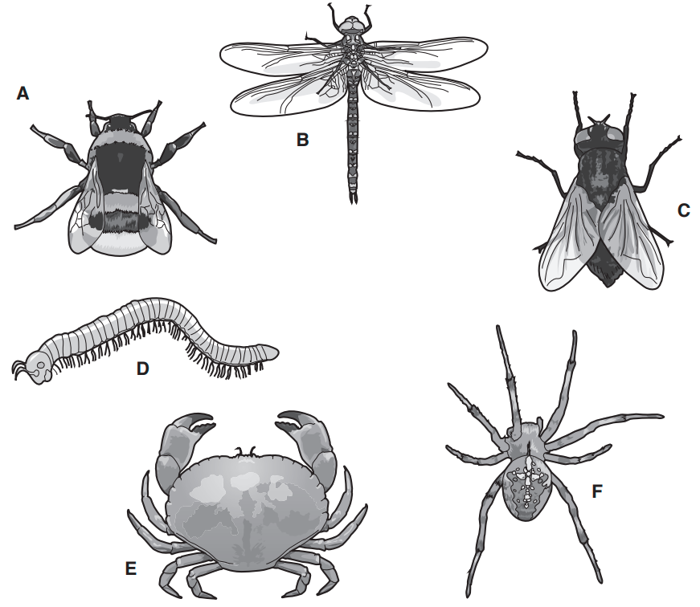

**Fig. 1**

State **one** feature that can be used to classify an animal as an arthropod.

*Source: 2018 0610/33 Q1A*

**Q5** [3 marks]

(i)

State **one** visible feature that arthropods **A**, **B** and **C** have that arthropods **D**, **E** and **F** do not have.

[1]

(ii)

State the letter of the organism in Fig. 1 that is a crustacean.

[2]

Give a reason for your answer.

*Source: 2018 0610/33 Q1B*

**Q5** [2 marks]

One of the drawings shows an arthropod named *Araneus diadematus*.

This arthropod has a body in two segments and it has eight legs.

(i)

State the letter of the organism in Fig. 1 that shows *Araneus diadematus*.

[1]

(ii)

State the name of the group of arthropods that includes *Araneus diadematus*.

[1]

*Source: 2018 0610/33 Q1C*

**Q5** [1 mark]

The arthropod phylum can be classified into different groups.

State how many living groups are present within the phylum arthropod.

### Q6 — easy — 7 marks

**Q6** [6 marks]

All living organisms show the same seven characteristics. These are listed below, along with their definitions. Match the characteristics and definitions by drawing lines between them on the diagram below.

One has been done for you.

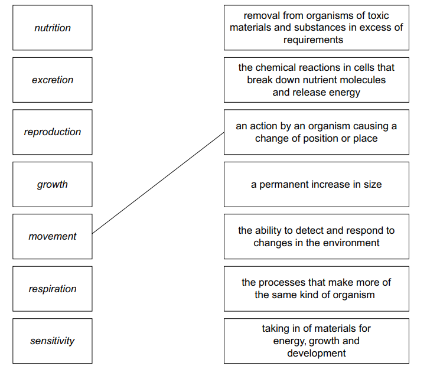

*Source: 2020 0610/03 Q1*

**Q6** [1 mark]

**Extract:**

| light intensity / arbitrary units | growth of plants / cm | mean growth / cm |
| 10 | 3.2 | 3.3 | 3.1 | 3.2 |
| 20 | 4.8 | 4.5 | 4.5 |   |
| 30 | 5.3 | 5.5 | 5.2 | 5.3 |
| 40 | 6.4 | 6.3 | 6.6 | 6.4 |

A student was investigating the growth of plants and their sensitivity to changes in light intensity.

Table 1 shows their results.

Calculate the mean growth of the plants at a light intensity of 20 arbitrary units.

**Table 1**

| light intensity / arbitrary units | growth of plants / cm | mean growth / cm |   |   |
|---|---|---|---|---|
| 10 | 3.2 | 3.3 | 3.1 | 3.2 |
| 20 | 4.8 | 4.5 | 4.5 |   |
| 30 | 5.3 | 5.5 | 5.2 | 5.3 |
| 40 | 6.4 | 6.3 | 6.6 | 6.4 |

### Q7 — hard — 10 marks

**Q7** [4 marks]

Classification systems largely depend on grouping species by the features that they share. All organisms can be classified using a hierarchical system starting with Kingdom and ending with the Genus and Species.

Suggest the benefits of classifying organisms in a hierarchical system.

**Q7** [2 marks]

#### Extended only

Explain why, in evolutionary terms, the more recent a common ancestor between two species, the more closely related those two species are.

**Q7** [2 marks]

**Extract:**

The more recent a common ancestor between two species, the more closely related those two species are because:
- For two species to evolve from it, there would be not much difference in DNA / alleles / genes / characteristics;

#### Extended only

Fig. 1 shows the evolution of a group of primates and their associated DNA sequences.

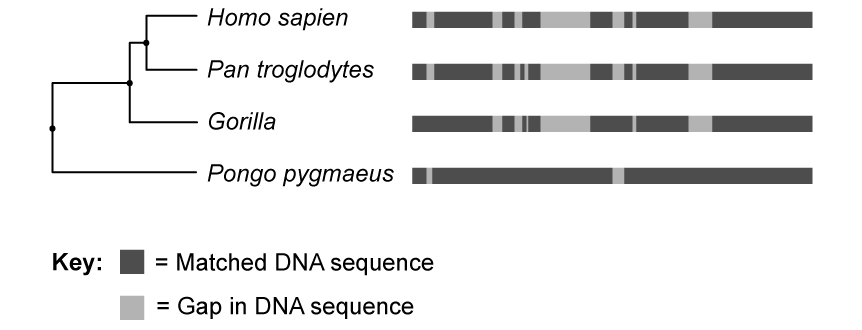

**Fig. 1**

Using the information provided in Fig. 1 and your knowledge of DNA sequencing as a means for classification, determine with an explanation, which two primates are most closely related.

**Q7** [2 marks]

**Extract:**

Fig. 1 shows the evolution of a group of primates and their associated DNA sequences.

Although you do not need to specifically know about phylogenetic trees as part of your course or to answer this question, here you can apply your knowledge of how DNA base sequences are used to classify organisms and how this reflects evolutionary relationships; this can help you interpret the diagram and answer the question.

#### Extended only

Explain what Fig. 1 can tell you about the relationship between ancestors of primates.

### Q8 — medium — 9 marks

**Q8** [1 mark]

A scientist discovered a new organism and observed some cells from the organism. Table 1 below shows some of the features observed during examination.

**Table 1**

| feature | observations |
|---|---|
| cell type | multicellular |
| cell wall | chitin |
| food source | saprophytic or parasitic |
| nucleus | present |
| other organelles | mitochondria, ribosomes |

Suggest which Kingdom the organism belongs to using the observations recorded by the scientist.

**Q8** [2 marks]

#### Extended only

The scientist used DNA sequencing to further study the cells.

Explain why the scientist used DNA sequencing.

**Q8** [2 marks]

**Extract:**

African leopard: A-T-T-C-C-G-G-G-A-T-C-G-G-T-T-A-T-C-A
African lion: A-G-T-G-T-A-G-A-A-A-C-T-T-T-A-C-T-A-C
Cheetah: A-T-T-A-C-G-G-G-A-G-C-C-G-T-T-A-T-G-A
African wildcat: G-T-A-C-G-A-T-G-T-A-G-C-A-T-A-G-T-G-G

#### Extended only

Table 2 shows the DNA base sequence of four species of cat.

**Table 2**

| African leopard | A-T-T-C-C-G-G-G-A-T-C-G-G-T-T-A-T-C-A |
|---|---|
| African lion | A-G-T-G-T-A-G-A-A-A-C-T-T-T-A-C-T-A-C |
| Cheetah | A-T-T-A-C-G-G-G-A-G-C-C-G-T-T-A-T-G-A |
| African wildcat | G-T-A-C-G-A-T-G-T-A-G-C-A-T-A-G-T-G-G |

Explain which two species are most closely related.

**Q8** [4 marks]

#### Extended

Cats are animals that share some similarities and differences with prokaryotes.

Compare the main features of animals and prokaryotes.

### Q9 — easy — 15 marks

**Q9** [2 marks]

Fig. 1 is a photograph of a lion.

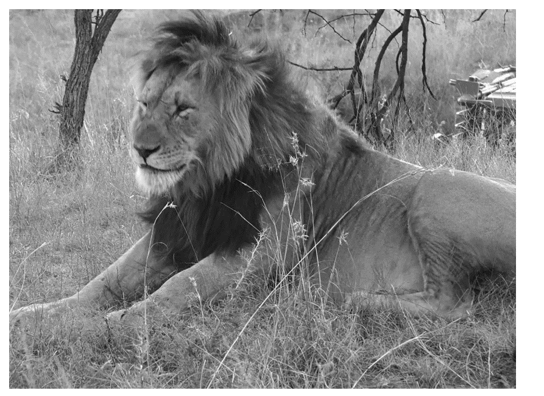

**Fig. 1**

Lions are mammals and have the scientific name *Panthera leo.*

(i)

State **one** feature **visible** in Fig. 1 that identifies the lion as a mammal.

[1]

(ii)

State the genus of this mammal.

[1]

*Source: 2023 0970/03 Q1A*

**Q9** [3 marks]

Mammals are one of the five groups of vertebrates.

Some features of three vertebrate groups are listed. Identify the vertebrate groups.

(i)

Lay soft-shelled eggs

[1]

(ii)

Feathers

[1]

(iii)

Smooth, moist skin

[1]

*Source: 2023 3/1/0970 Q1B*

**Q9** [6 marks]

Fig. 2 is a diagram of an animal cell.

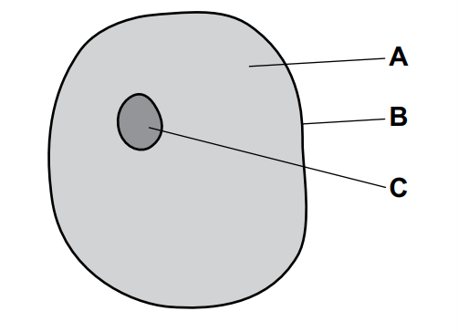

**Fig. 2**

(i)

Identify the parts labelled **A, B** and** C** in Fig. 2

[3]

(ii)

State the names of **two** structures in plant cells that are absent in animal cells.

[2]

(iii)

State the name of **one** structure that is present in bacterial cells and in plant cells but absent in animal cells.

[1]

*Source: 2023 3/1/0970 Q1C*

**Q9** [4 marks]

Some cells are specialised to perform a particular function.

The boxes on the left show the names of some specialised cells.

The functions of some specialised cells are in the boxes on the right.

Draw **four** lines to link each specialised cell with its function.

One line has been drawn for you. Draw four additional lines.

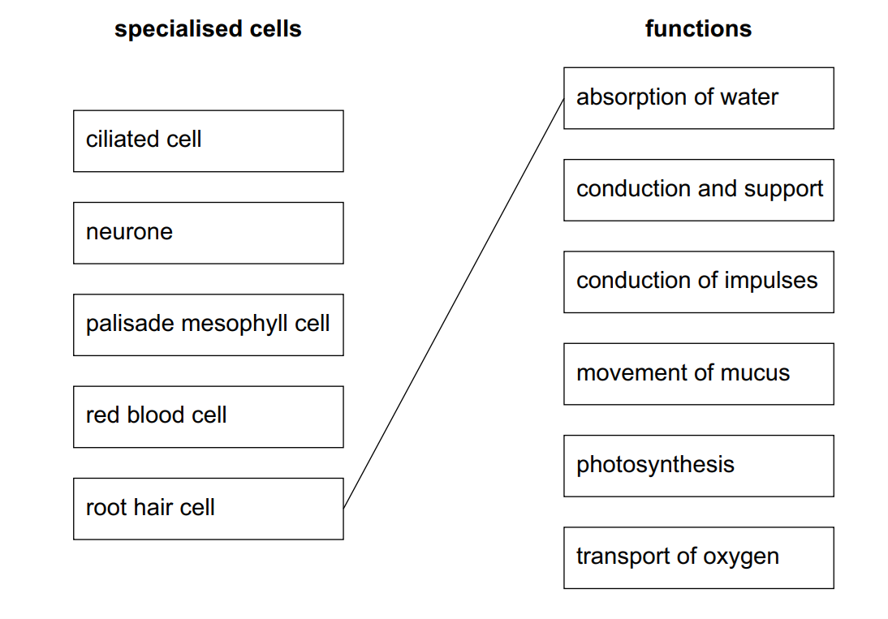

*Source: 2023 3/1/0970 Q1D*

### Q10 — hard — 12 marks

**Q10** [3 marks]

Dichotomous keys can be used to identify organisms based on a series of questions about their features.

Fig. 1 shows a group of leaves.

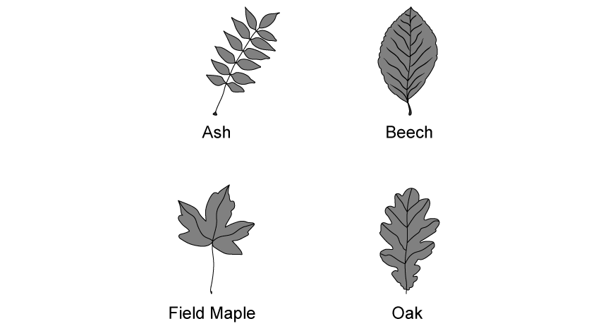

**Fig. 1**

Suggest a dichotomous key for the leaves shown in Fig. 1 by completing Table 1. An example has been done for you.

**Table 1**

|   | **statement** | **answer / instruction** |   |
|---|---|---|---|
| 1 | a | leaf is oval shaped | beech |
|   | b | leaf is not oval shaped | go to 2 |
| 2 | a |   |   |
|   | b |   |   |
| 3 | a |   |   |
|   | b |   |   |

**Q10** [4 marks]

Fig. 2 shows a different type of dichotomous key where invertebrates are classified.

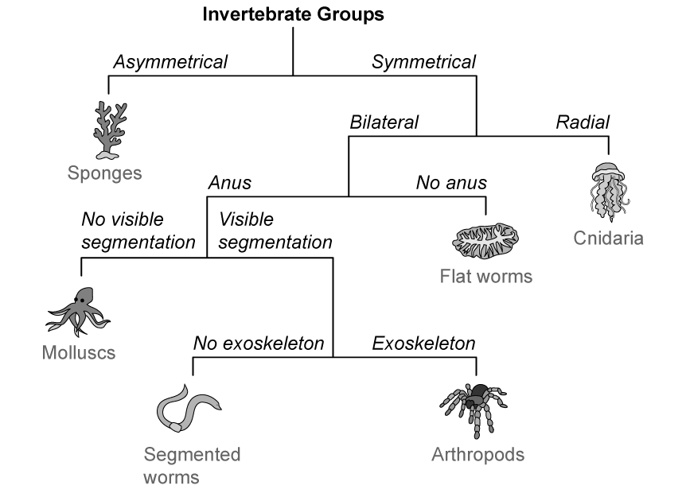

**Fig. 2**

Complete the dichotomous key to show the classification of arthropods into their four sub groups.

**Q10** [5 marks]

#### Extended only

Fig. 3 shows a range of different plants

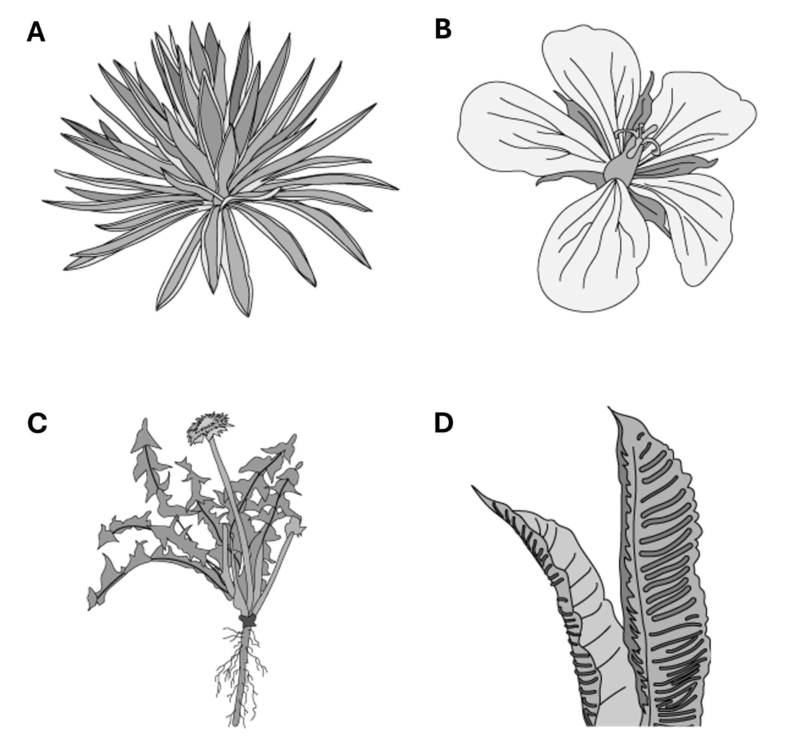

**Fig. 3**

(i)

State whether plants **A**-**C** are monocotyledons or dicotyledons.

[3]

(ii)

Identify the type of plant shown in image **D** and explain your answer.

[2]

### Q11 — medium — 11 marks

**Q11** [4 marks]

#### Extended only

Flowering plants can be divided into two groups.

(i)

State the two groups of flowering plants.

[1]

(ii)

Explain how to distinguish between the two groups.

[3]

**Q11** [2 marks]

#### Extended only

A student found the plant shown in Fig. 1 growing in the school grounds.

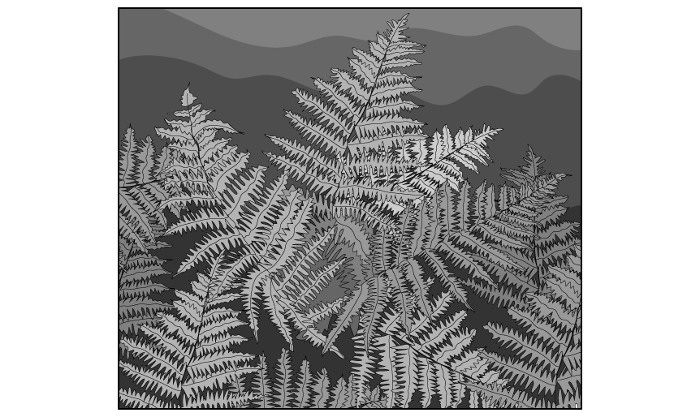

**Fig. 1**

Explain what type of plant this would be classified as.

**Q11** [4 marks]

**Extract:**

Table 1

| school site | number of leaves |
| A | 54 |
| B | 23 |
| C | 47 |

#### Extended only

The student investigated how the number of leaves on the plant varied. The student visited three different sites within the school grounds and counted the leaves found on one plant within each site.

Table 1 shows the results of his experiment.

**Table 1**

| school site | number of leaves |
|---|---|
| A | 54 |
| B | 23 |
| C | 47 |

Use the grid below to draw a graph of these results.

[4]

**Q11** [1 mark]

**Extract:**

The student investigated how the number of leaves on the plant varied. The student visited three different sites within the school grounds and counted the leaves found on one plant within each site.

#### Extended only

Determine how the student could improve the reliability of their data.

### Q12 — easy — 15 marks

**Q12** [6 marks]

#### Extended Only

Fig. 1 is a branching key used to identify different species of bacteria.

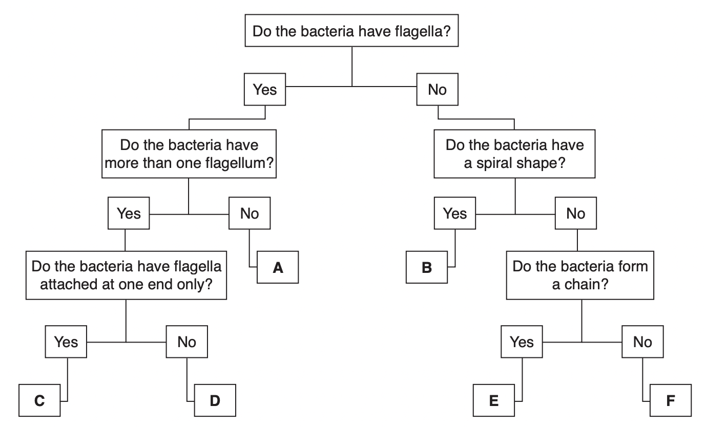

**Fig. 1**

Fig. 2 shows six different species of bacteria.

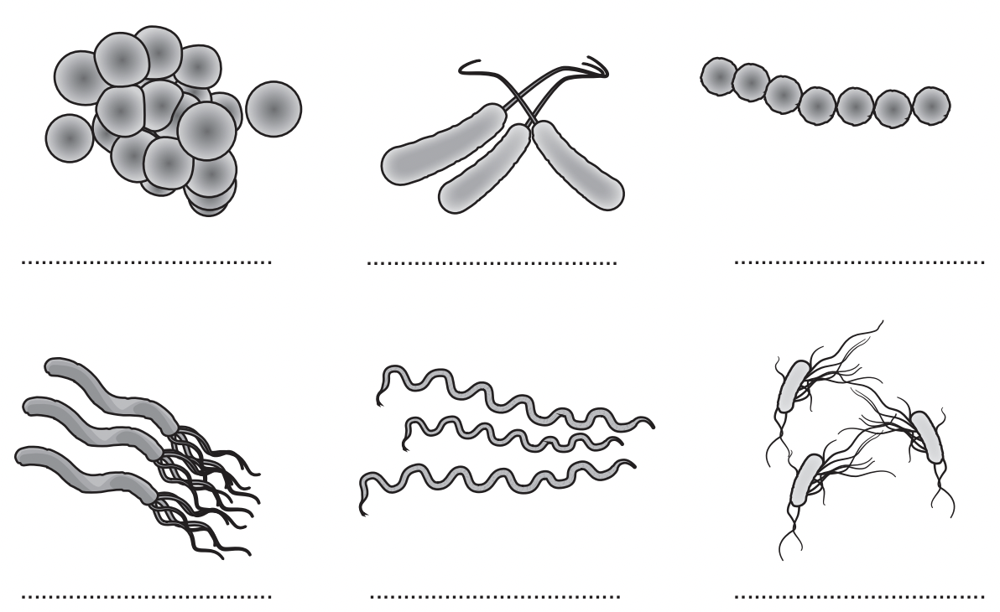

**Fig. 2**

(i)

Use the key to identify the six different species of bacteria.

[5]

(ii)

State the name of the kingdom that bacteria belong to.

[1]

*Source: 2018 Feb/Mar 0610/42 Q1A*

**Q12** [1 mark]

#### Extended Only

State **one** similarity between the structure of bacteria and the structure of viruses.

*Source: 2018 Feb/Mar 0610/42 Q1B*

**Q12** [2 marks]

#### Extended Only

Fig. 3 is a photomicrograph of *Vibrio cholerae*, the bacterium that causes cholera.

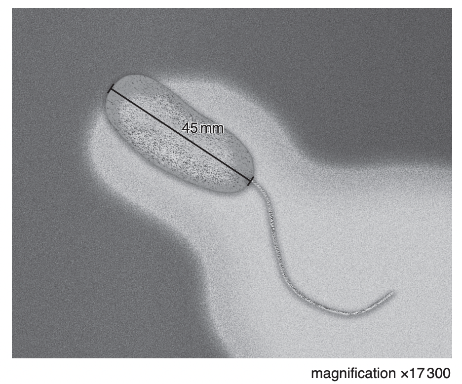

**Fig. 3**

(i)

Write the formula that would be used to calculate the actual length of the bacterium (not including the flagellum) in Fig. 3.

[1]

(ii)

The actual length of the bacterium shown in Fig. 3 is 0.0026 mm.

Convert this value to micrometres (µm).

[1]

*Source: 2018 Feb/Mar 0610/42 Q1C*

**Q12** [6 marks]

#### Extended Only

Fig. 4 shows a bacterial cell.

Identify the structures labelled A - F.

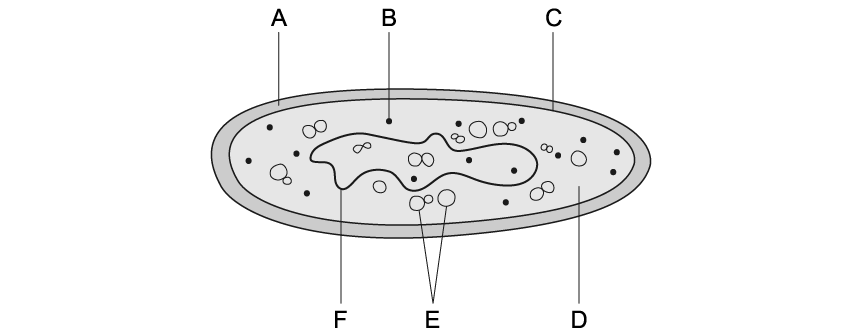

**Fig. 4**

### Q13 — medium — 12 marks

**Q13** [3 marks]

The animal in Fig. 1 is a chimpanzee.

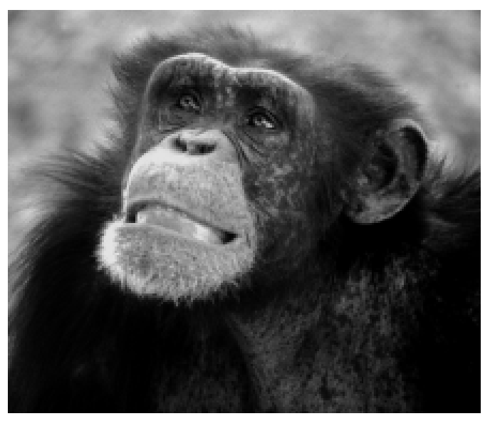

**Fig. 1**

(i)

The chimpanzee is a vertebrate.

State the main group of vertebrates to which the chimpanzee belongs.

[1]

(ii)

State **two** features, visible in Fig. 1, which suggest that it belongs to this group of vertebrates.

[2]

*Source: 2020 0610/03 Q2A*

**Q13** [6 marks]

The chimpanzee lives in forests in central and western Africa. The chimpanzee is classified as an endangered species because its population has decreased greatly.

(i)

Suggest why the chimpanzee population has decreased.

[2]

(ii)

Describe how a captive breeding programme can help to conserve chimpanzees in the wild.

[2]

(iii)

State **two** methods, other than captive breeding, of conserving endangered species.

[2]

*Source: 2020 0610/03 Q2B*

**Q13** [2 marks]

The binomial system of naming species gives chimpanzees the name *Pan troglodytes.*

Describe what is meant by the binomial system of naming species.

**Q13** [1 mark]

Chimpanzees are classified taxonomically as a single species, *Pan troglodytes*.

Define what is meant by the term species.

### Q14 — hard — 6 marks

**Q14** [1 mark]

#### Extended only

When attempting to classify organisms based on their characteristics, several types of differences between organisms can be observed. These are shown in Table 1.

**Table 1**

| differences | description |
|---|---|
| **A** | Differences observable under a microscope |
| **B** | Anatomical differences |
| **C** | Differences in DNA base sequences |
| **D** | Morphological differences |
| **E** | Differences in amino acid sequences |

Reorder differences **A - E** into the order of the amount of detail that can be gained, starting with the least detailed.

| **1st** | **2nd** | **3rd** | **4th** | **5th** |
|---|---|---|---|---|
|   |   |   |   |   |

**Q14** [2 marks]

#### Extended only

When carrying out DNA base sequence comparisons between species, explain why the same gene has to be selected from each species for sequencing.

**Q14** [3 marks]

**Extract:**

Table 2 gives information about the amino acids that go into the chain of haemoglobin protein found in the blood of various animal species. The second column shows how many amino acids are different in the haemoglobin of that species to that of humans.

| animal | number of amino acids different to human haemoglobin |
| Human | 0 |
| Chicken | 45 |
| Dog | 15 |
| Frog | 67 |
| Gibbon | 2 |
| Gorilla | 1 |
| Grey kangaroo | 38 |
| Horse | 25 |
| Mouse | 27 |
Humans and gibbons evolved separately from a common ancestor about 18 million years ago.

#### Extended only

Table 2 gives information about the amino acids that go into the chain of haemoglobin protein found in the blood of various animal species. The second column shows how many amino acids are different in the haemoglobin of that species to that of humans.

**Table 2**

| **animal** | **number of amino acids different to human haemoglobin** |
|---|---|
| Human | 0 |
| Chicken | 45 |
| Dog | 15 |
| Frog | 67 |
| Gibbon | 2 |
| Gorilla | 1 |
| Grey kangaroo | 38 |
| Horse | 25 |
| Mouse | 27 |

Humans and gibbons evolved separately from a common ancestor about 18 million years ago.

Calculate an estimate of how many years ago the evolution of frogs diverged from that of humans.

Give your answer in standard form.

### Q15 — easy — 16 marks

**Q15** [1 mark]

Scientists classify organisms into groups.

State **one** feature that is used to identify vertebrates.

*Source: 2018 (Series 3) 0610/33 Q1A*

**Q15** [7 marks]

Vertebrates are classified into five groups.

Fig. 1 shows three vertebrates found in Australia.

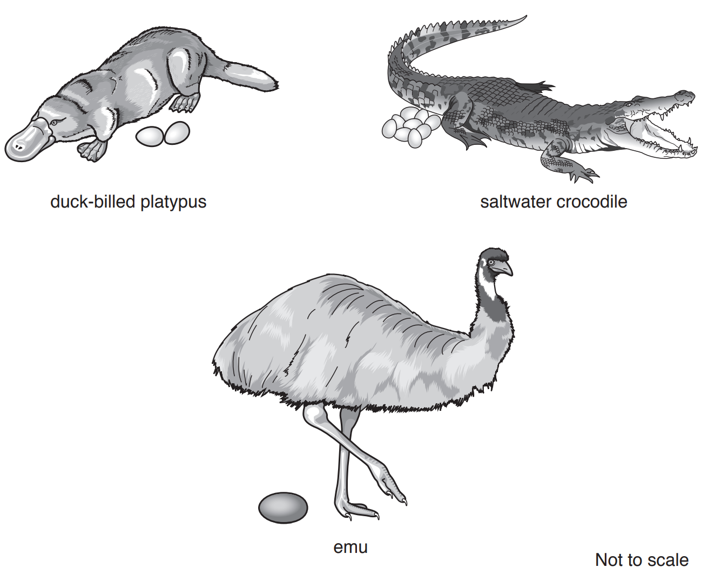

**Fig. 1**

The emu, the saltwater crocodile and the duck-billed platypus each belong to a different vertebrate group.

All three animals lay eggs that develop and hatch on land.

(i)

State the name of the vertebrate group to which emus belong and give **one** feature of this group that is visible in Fig. 1.

[2]

(ii)

State the name of the vertebrate group to which crocodiles belong and give **one** feature of this group that is visible in Fig. 1.

[2]

(iii)

The duck-billed platypus is classified as a mammal.

Give evidence from Fig. 1 **for and against **classifying the duck-billed platypus as a mammal.

[3]

*Source: 2018 (Series 3) 0610/33 Q1B*

**Q15** [2 marks]

There are **two** groups of vertebrates which lay eggs that develop in water.

State the name of these two groups of vertebrates.

*Source: 2018 (Series 3) 0610/33 Q1C*

**Q15** [6 marks]

#### Extended Only

Complete the sentences about kingdoms.

Vertebrates belong the kingdom ____________.  All vertebrates have a ___________. There are _______ classes of vertebrates; one class is mammals.

There are four other kingdoms which include plants, ___________, ____________ and _____________.

### Q16 — hard — 10 marks

**Q16** [1 mark]

#### Extended only

Fig. 1 shows a unicellular organism found in freshwater.

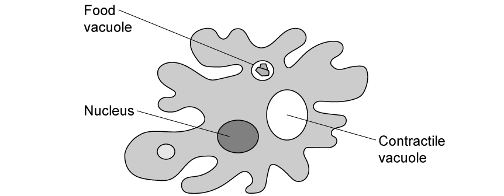

**Fig.1**

Name the Kingdom this organisms belongs to.

[1]

**Q16** [2 marks]

**Extract:**

Fig. 1 shows a unicellular organism found in freshwater.
The organism belongs to the Kingdom Protoctists.
The cell shows an amoeba which is a member of the Kingdom Protoctista.

#### Extended only

Explain the features of the organism in Fig. 1 that distinguish it from other organisms.

**Q16** [4 marks]

The organism shown in Fig. 1 is found in freshwater and must control its internal conditions by balancing the amount of water that moves in and out of the cell across the cell membrane.

(i)

State the process by which water moves in and out of the cell.

[1]

(ii)

As the organism digests its prey, the nutrients released can lower the water potential of the cell.

Suggest how this might affect the movement of water into or out of the cell.

[2]

(iii)

The cell shown contains a structure called a contractile vacuole, which expels excess water from the cell. As well as excess water, they also remove waste materials from the cell.

State the characteristic of living organism that the contractile vacuole carries out.

[1]

**Q16** [3 marks]

**Extract:**

Fig. 1 shows a unicellular organism found in freshwater. The organism belongs to the Kingdom Protoctists. The cell shows an amoeba which is a member of the Kingdom Protoctista.

Fig. 2 shows the same organism from part (a) and it's hunting technique.

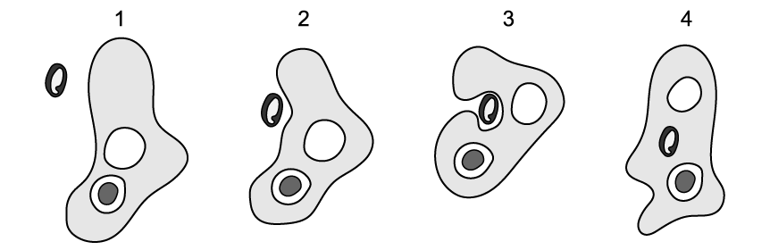

**Fig. 2**

Explain the characteristics of living organisms that would be expressed in this process.

### Q17 — medium — 17 marks

**Q17** [3 marks]

Table 1 shows the names of three groups of arthropods and some of their characteristics.

Place ticks (✓) in the boxes to show the characteristics present in each group.

**Table 1**

| **characteristic** | **arthropod group** |   |   |
|---|---|---|---|
| **arachnids** | **crustaceans** | **myriapods** |   |
| four pairs of legs |   |   |   |
| one pair of antennae |   |   |   |
| body divided into two main parts |   |   |   |

*Source: 2019 0970/31 Q2A*

**Q17** [4 marks]

All living organisms show the same seven characteristics.

State **four** of the characteristics of living organisms.

*Source: 2019 0970/31 Q2B*

**Q17** [6 marks]

Fig. 1 shows the apparatus used by some students during an investigation.

The apparatus is drawn as seen from above.

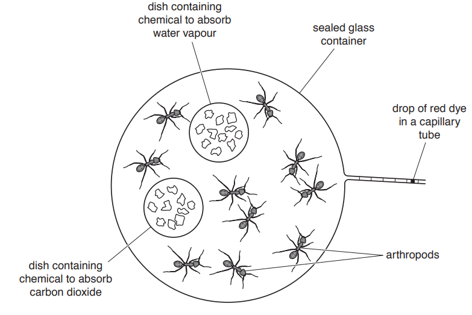

**Fig. 1**

Some arthropods were placed in the container.

A drop of red dye was inserted into the capillary tube.

The drop of red dye in the capillary tube gradually moved towards the arthropods.

(i)

Explain why the drop of red dye moved towards the arthropods.

The investigation shown in Fig. 1 was repeated at different temperatures.

Fig. 2 shows the results.

[3]

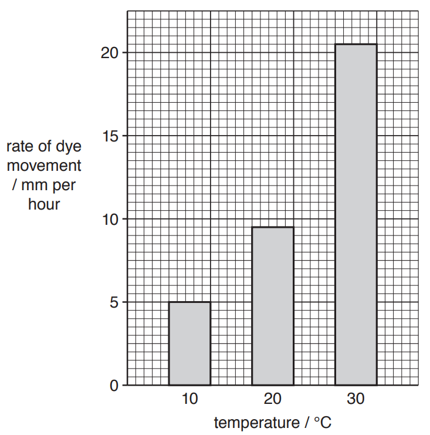

**Fig. 2**

(ii)

State the trend shown in Fig. 2.

[1]

(iii)

Calculate the percentage increase in the rate of dye movement between 10°C and 20°C.

Show your working.

[2]

*Source: 2019 0970/31 Q2C*

**Q17** [4 marks]

**Extract:**

Fig. 1 shows the apparatus used by some students during an investigation. The apparatus is drawn as seen from above. Some arthropods were placed in the container.

(i)

State the group of arthropods the student used in Fig. 1.

[1]

(ii)

Describe the features visible in Fig. 1 that identify this group.

[3]

### Q18 — hard — 14 marks

**Q18** [3 marks]

A student investigated the relationship between the wavelength of a light source and seedling height. The student used strawberry seedlings and grew the plants in an enclosed box with the coloured light as the only available source of light for the plant. The student watered each seedling daily with 30ml of water. He grew the seedlings for 3 weeks before taking the final measurement.

Suggest the characteristics of living organisms reflected in this investigation.

**Q18** [5 marks]

**Extract:**

The student grew the strawberry seedlings under different coloured lights. Their results are shown in Table 1.

Table 1
| colour of light | initial height of seedling / cm | final height of seedling / cm | growth of seedling / cm |
| white | 14 | 38 | 24 |
| blue | 15 | 29 | 14 |
| red | 13 | 32 | 19 |
| green | 15 | 21 | 6 |
| none | 14 | 16 | 2 |

The student grew the strawberry seedlings under different coloured lights. Their results are shown in Table 1.

**Table 1**

| colour of light | initial height of seedling / cm | final height of seedling / cm | growth of seedling / cm |
|---|---|---|---|
| white | 14 | 38 | 24 |
| blue | 15 | 29 | 14 |
| red | 13 | 32 | 19 |
| green | 15 | 21 | 6 |
| none | 14 | 16 | 2 |

(i)

Explain why the student calculated the growth of seedlings rather than using the final height.

[2]

(ii)

Calculate the percentage change in the growth of the control group of seedlings. Round your answer to the nearest whole number.

[2]

(iii)

Explain the need for a control group of seedlings.

[1]

**Q18** [2 marks]

A gardener also investigated the effect of changing wavelengths of light on the height of different types of vegetable seedlings. The gardener used an enclosed box and lamps with different colours of light as the only available light source. The gardener watered the plants daily from a watering can. The gardener grew five seedlings of each vegetable over a period of four weeks, measuring their height daily. At the end of the investigation, these measurements were used to calculate their average height.

Their results are shown in Fig. 1.

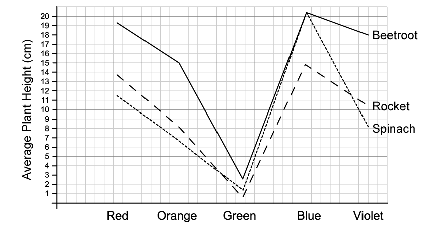

**Fig. 1**

Suggest with a reason, which light source the gardener should use to produce the tallest vegetable plants.

**Q18** [4 marks]

**Extract:**

A student investigated the relationship between the wavelength of a light source and seedling height. The student used strawberry seedlings and grew the plants in an enclosed box with the coloured light as the only available source of light for the plant. The student watered each seedling daily with 30ml of water. He grew the seedlings for 3 weeks before taking the final measurement.

A gardener also investigated the effect of changing wavelengths of light on the height of different types of vegetable seedlings. The gardener used an enclosed box and lamps with different colours of light as the only available light source. The gardener watered the plants daily from a watering can. The gardener grew five seedlings of each vegetable over a period of four weeks, measuring their height daily. At the end of the investigation, these measurements were used to calculate their average height.

Compare the gardener's experimental method with that of the student's.

### Q19 — medium — 8 marks

**Q19** [1 mark]

The organisms shown in Fig. 1 are a group of invertebrates called arachnids.

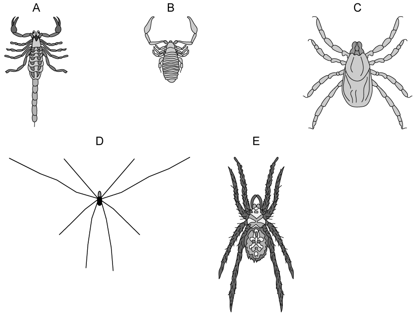

**Fig. 1**

Describe the common features of arachnids visible in Fig. 1.

[1]

**Q19** [5 marks]

Use the key shown below to identify the arachnids shown in Fig. 1

.

| 1 | a | Has a tail structure | *Scorpiones* |
|---|---|---|---|
| b | Does not have a tail structure | go to 2 |   |
| 2 | a | Has large pair of front pincers | *Pseudoscorpiones* |
| b | Does not have large front pincers | go to 3 |   |
| 3 | a | Legs are at least three times as long as body | *Pholcidae* |
| b | Legs are similar or smaller length than body | go to 4 |   |
| 4 | a | Legs have visible spines/hairs | *Lycosidae* |
| b | Legs do not have visible spines/hair | *Ixodida* |   |

**Q19** [2 marks]

#### Extended only

Dichotomous keys can be used to help classify organisms.

Explain the purpose of classification systems.
