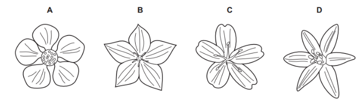
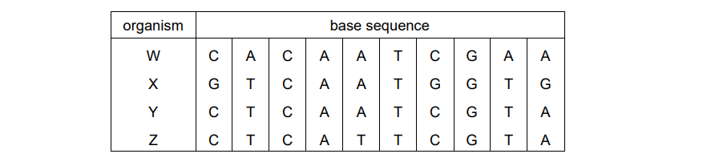
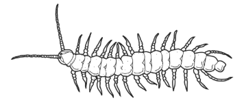
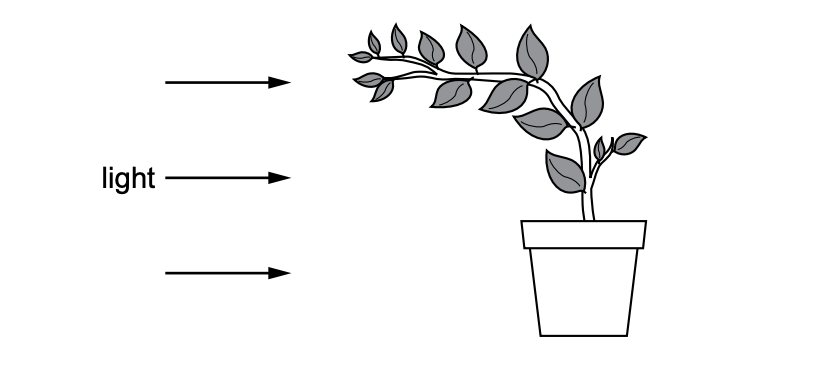
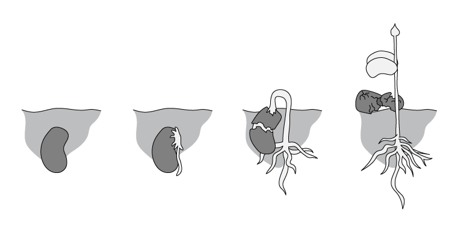
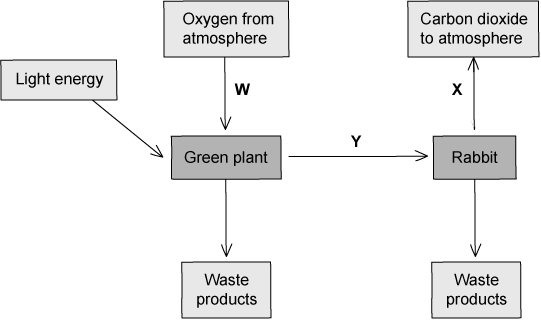
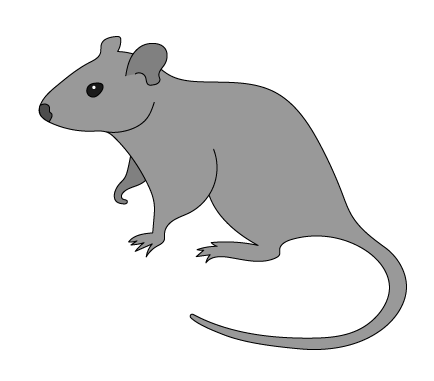

# Exam Questions — Characteristics, Classification & Features of Organisms
**1. Characteristics & Classification of Living Organisms** · Cambridge (CIE) IGCSE biology (0610 & 0970)
> Source: [https://www.savemyexams.com/igcse/biology/cie/23/topic-questions/](https://www.savemyexams.com/igcse/biology/cie/23/topic-questions/) · 28 questions across 1 sets

## Multiple Choice Questions (28 questions)

### Q1 — easy — 1 marks

**Q1** [1 mark]

The diagram shows an organism.

Which arthropod group does the organism belong to?

### Q2 — easy — 1 marks

**Q2** [1 mark]

A scientist observes four events in an organism:

1. It takes in glucose.
2. It releases carbon dioxide produced in cells.
3. It moves away from a harmful chemical.
4. It increases in biomass over time.

Which row correctly matches the events to characteristics?

|   | 1 | 2 | 3 | 4 |
|---|---|---|---|---|
| **A** | respiration | excretion | sensitivity | growth |
| **B** | nutrition | excretion | sensitivity | growth |
| **C** | nutrition | respiration | movement | reproduction |
| **D** | excretion | nutrition | sensitivity | growth |

### Q3 — medium — 1 marks

**Q3** [1 mark]

A hare and a rabbit are unable to reproduce to produce fertile offspring.

Which statement explains why?

### Q4 — easy — 1 marks

**Q4** [1 mark]

Which characteristic allows an organism to detect or sense stimuli in the internal or external environment and to make appropriate responses?

### Q5 — medium — 1 marks

**Q5** [1 mark]

Which diagram shows a flower from a monocotyledon?

*Source: June 2022 Paper 2 Q2*

### Q6 — medium — 1 marks

**Q6** [1 mark]

The table shows a section of DNA taken from four different organisms.

Which two organisms are the most distantly related to each other?

*Source: June 2021 0970/21 Q2*

### Q7 — easy — 1 marks

**Q7** [1 mark]

Scientists discover a new species of animal.

It has a segmented body with two pairs of legs on each segment.

To which group of animals does this new species belong?

*Source: June 2021 0970/11 Q3*

### Q8 — easy — 1 marks

**Q8** [1 mark]

The scientific names of some animals are listed.

1. C*amelus dromedarius *
2. *Camelus ferus *
3. *Equus ferus *
4. *Struthio camelus*

Which animals are in the same genus?

*Source: June 2021 0970/11 Q2*

### Q9 — easy — 1 marks

**Q9** [1 mark]

What is a characteristic of all living organisms?

*Source: June 2021 0970/11 Q1*

### Q10 — hard — 1 marks

**Q10** [1 mark]

The diagram shows an organism.

Which type of arthropod is this organism?

*Source: June 2022 0970/11 Q3*

### Q11 — medium — 1 marks

**Q11** [1 mark]

The horse, Equus ferus, and the donkey, Equus asinus, are able to interbreed. The offspring they produce is called a mule.

Which statement is correct?

*Source: June 2022 0970/11 Q2*

### Q12 — easy — 1 marks

**Q12** [1 mark]

All living organisms release energy from nutrient molecules within their cells.

What is the name of this characteristic?

*Source: June 2022 0970/11 Q1*

### Q13 — medium — 1 marks

**Q13** [1 mark]

Lichens are formed from two different organisms living together.

Organism X and organism Y are found in most lichens.

The table shows some of the characteristics of organism X and organism Y.

| X | Y |
|---|---|
| made of strands called hyphae | single-celled |
| hyphae have cell walls and many nuclei | cell contains a nucleus and chloroplasts |

Which kingdoms do X and Y belong to?

|   | X | Y |
|---|---|---|
| **A** | fungus | prokaryote |
| **B** | fungus | protoctist |
| **C** | protoctist | fungus |
| **D** | protoctist | plant |

*Source: Specimen 2023 0970/02 Q2*

### Q14 — easy — 1 marks

**Q14** [1 mark]

Humans have the scientific name *Homo sapiens*.

What do the two parts of this name refer to?

*Source: Specimen 2023 0970/01 Q2*

### Q15 — easy — 1 marks

**Q15** [1 mark]

The diagram shows a plant.

Which characteristic of living organisms is shown by the plant in the diagram?

*Source: Specimen 2023 0970/01 Q1*

### Q16 — medium — 1 marks

**Q16** [1 mark]

The image below shows what occurs in a seed during and after germination, the seed has been planted in well-watered soil.

Which characteristics of living things are demonstrated by this sequence?

### Q17 — medium — 1 marks

**Q17** [1 mark]

The equation below represents a chemical process that occurs in the cells of living organisms.

**glucose + oxygen → carbon dioxide + water**

Which characteristics of living organisms would this equation be associated with?

|   | nutrition | respiration |
|---|---|---|
| **A** | ✔ | ✔ |
| **B** | **X** | ✔ |
| **C** | **X** | **X** |
| **D** | ✔ | **X** |

### Q18 — medium — 1 marks

**Q18** [1 mark]

#### Extended only

The list below shows the binomial names for eight animals.

*Canis lupus* 
*Cygnus buccinator* 
*Dasypus novemcinctus* 
*Dasyurus maculatus* 
*Equus burchelli* 
*Eumetopias jubatus* 
*Felis chaus* 
*Felis lybica*

Which two animals are most closely related?

### Q19 — medium — 1 marks

**Q19** [1 mark]

Some of the processes carried out by living organisms are illustrated in the diagram below.

Which row of the following table correctly describes the characteristics shown by living organisms in the diagram above?

|   | **W** | **X** | **Y** |
|---|---|---|---|
| **A** | respiration | photosynthesis | respiration |
| **B** | respiration | respiration | nutrition |
| **C** | photosynthesis | respiration | excretion |
| **D** | photosynthesis | excretion | nutrition |

### Q20 — medium — 1 marks

**Q20** [1 mark]

What are the characteristics of birds?

|   | skin covered in feathers | maintain a constant body temperature | jelly-covered eggs | external ears present |
|---|---|---|---|---|
| **A** | ✔ | **✘** | ✔ | **✘** |
| **B** | **✘** | **✘** | **✘** | ✔ |
| **C** | ✔ | ✔ | **✘** | **✘** |
| **D** | **✘** | ✔ | ✔ | ✔ |

### Q21 — easy — 1 marks

**Q21** [1 mark]

The image below shows a house mouse, whose scientific name is *Mus musculus*.

Which genus does it belong to?

### Q22 — hard — 1 marks

**Q22** [1 mark]

Use the key to identify the group to which fish belong.

| 1. | Fur absent...  Fur present... | go to 2  mammals |
|---|---|---|
| 2. | Eggs do not have hard shells...  Eggs have hard shells... | go to 3  group **A** |
| 3. | Reproduction occurs in water...  Reproduction occurs on land... | go to 4  group **B** |
| 4. | Scaly skin...  Smooth skin... | group **C**  group **D** |

### Q23 — hard — 1 marks

**Q23** [1 mark]

#### Extended only

The image below shows a leaf from a plant.

Identify the plant to which the leaf belongs using the dichotomous key below.

### Q24 — easy — 1 marks

**Q24** [1 mark]

Which of the following would not be a characteristic seen in all living organisms?

### Q25 — hard — 1 marks

**Q25** [1 mark]

#### Extended only

Identify the arthropods shown using the key below.

| 1. | Three pairs of legs... | Class W |
|---|---|---|
| Four pairs of legs or more... | Go to 2 |   |
| 2. | Body plan consists of a head and a many-segmented body... | Class X |
| Head and thorax are fused to form a cephalothorax... | Go to 3 |   |
| 3. | No antennae present... | Class Y |
| Antennae present... | Class Z |   |

|   | **Arthropod 1 class** | **Arthropod 2 class** |
|---|---|---|
| **A** | Y | X |
| **B** | X | Z |
| **C** | Z | W |
| **D** | Z | X |

### Q26 — easy — 1 marks

**Q26** [1 mark]

Which name can be given to a group of organisms that have similar morphological features and can reproduce successfully to produce fertile offspring?

### Q27 — easy — 1 marks

**Q27** [1 mark]

A yeast (*Saccharomyces cerevisiae),* glucose and water are mixed in a test tube.

The diagrams show the test tube at the start and after one hour.

Which process causes this change?

### Q28 — easy — 1 marks

**Q28** [1 mark]

Which class of vertebrate typically gives birth to live young?
