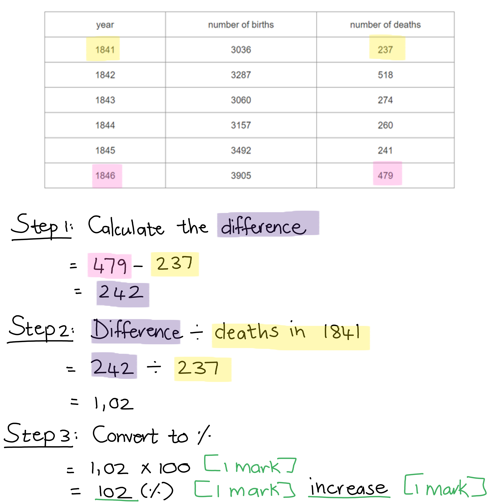
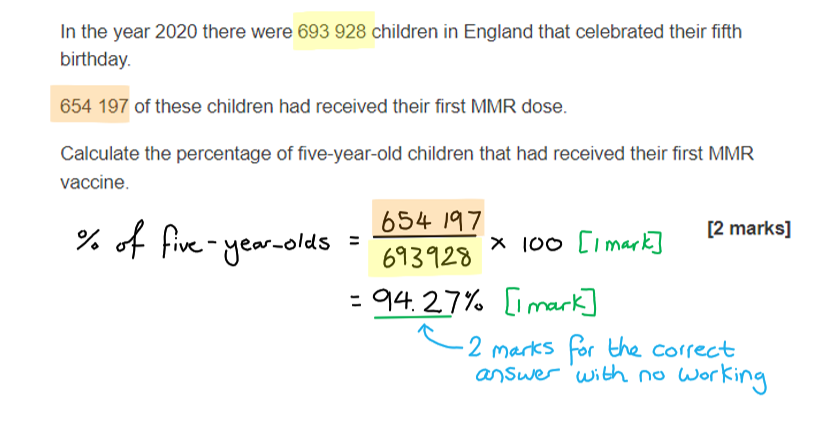
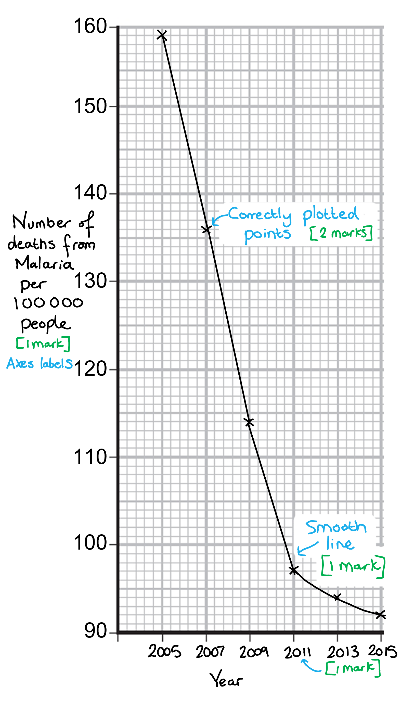
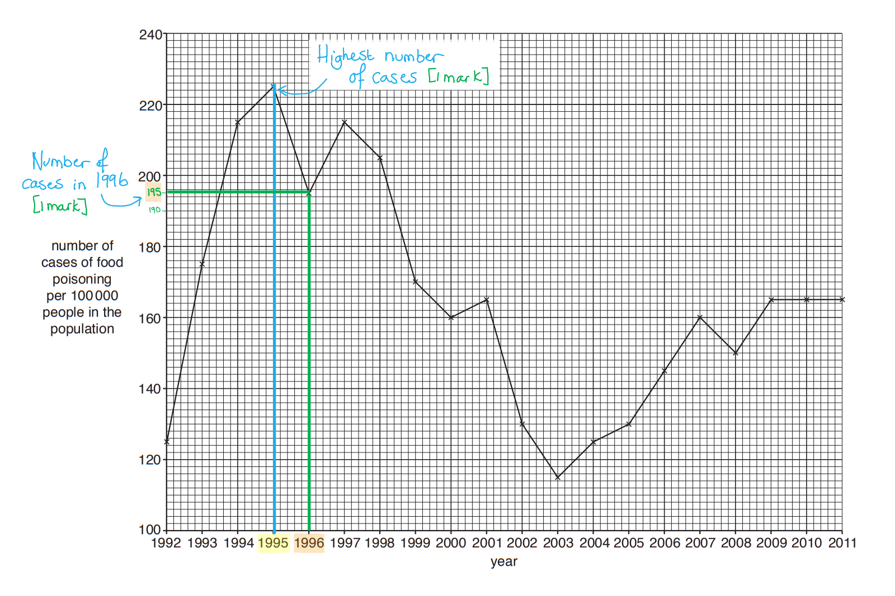
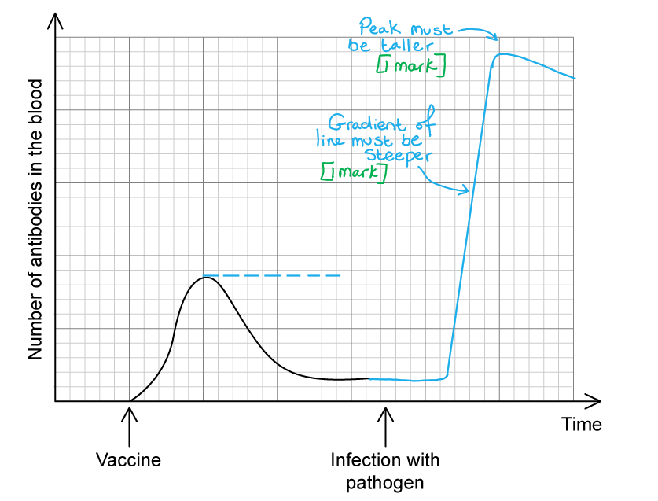
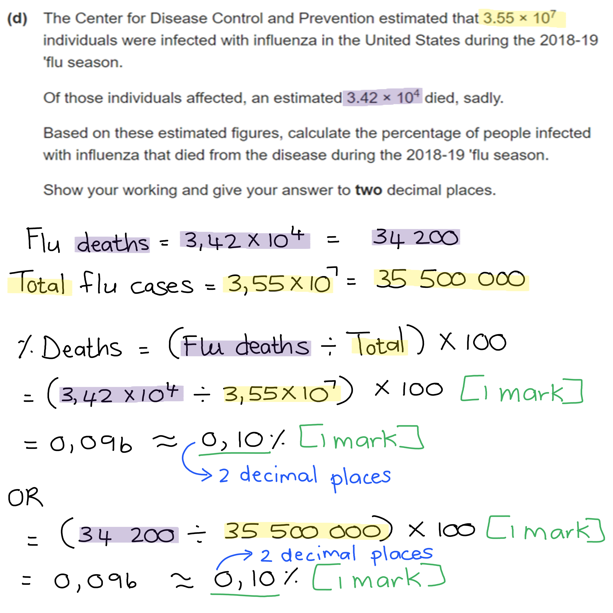

# Mark Schemes — Diseases & Immunity
**10. Diseases & Immunity** · Cambridge (CIE) IGCSE biology (0610 & 0970)

## Multiple Choice Questions (25 questions)

### Q1
**Final answer:** **The correct answer is A.**

- A transmissible disease is one caused by a pathogen that can be passed from one host to another

**B** is incorrect as transmissible diseases can be caused by a range of pathogens including viruses, which cannot be treated with antibiotics. Whether a disease responds to antibiotic treatment is unrelated to whether it is transmissible.

**C** is incorrect as transmissible diseases can be passed between hosts indirectly, for example via contaminated surfaces, food, animals or air — not only through direct contact.

**D** is incorrect as this describes a non-communicable disease. Transmissible diseases are caused by pathogens, not by lifestyle choices.

### Q2
**Final answer:** **The correct answer is B.**

- **Statement 1** is correct: boiling drinking water kills pathogens, reducing the risk of waterborne transmission
- **Statement 3** is correct: collecting food waste in sealed bins prevents animals from accessing waste and spreading pathogens

**Statement 2** is incorrect as disinfecting surfaces reduces *indirect* transmission via contaminated surfaces, not direct transmission between individuals.

**Statement 4** is incorrect as sewage treatment prevents* indirect* transmission via contaminated water, not direct transmission between individuals.

### Q3
**Final answer:** **The correct answer is ****D.**

- The first small rise shows the **primary immune response after vaccination**, when antibodies are produced slowly and **memory cells are formed**
- When the person is **infected with VZV at X**, these memory cells recognise the antigen and respond rapidly, producing **large amounts of antibodies** and causing the large second increase

**A** is incorrect because infection with a different pathogen would trigger a new primary immune response, which would be slower and smaller.

**B** is incorrect because the vaccine already stimulated lymphocytes to produce antibodies, shown by the first peak on the graph.

**C **is incorrect because antibodies are not stored and later released.

### Q4
The correct answer is **A**.

- After the vaccination, the concentration of antibodies never returned to 0 which implies the presence of memory cells in the blood. Also, the second response shows a much bigger, much faster antibody production consistent with the presence of memory cells in the blood.

**B **is incorrect because passive immunity involves receiving antibodies from an external source (e.g., from mother to child via breast milk) rather than through vaccination, which stimulates the body to actively produce its own immune response.

**C** is incorrect because the measles virus contains antigens, not antibodies. Antibodies are produced by the immune system in response to the presence of antigens.

**D** is incorrect because if the child produced memory cells after the vaccination, this suggests that the vaccination was successful in priming the immune system to recognize measles.

### Q5
**Final answer:** **The correct answer is ****C****.**

- C shows a lymphocyte with a large nucleus which allows it to produce antibodies in protein synthesis.

**A **is incorrect because it shows a phagocyte which is characterised by a lobed nucleus which allows the cell flexibility in order to engulf pathogens that it encounters.

**B** is incorrect because this shows plasma which all other blood components are suspended in.

**D** is incorrect because it shows a red blood cell characterised by a lack of nucleus and recognisable due to the pale region in the middle showing a biconcave shape.

### Q6
**Final answer:** **The correct answer is ****C****.**

- Cholera bacteria release toxins which cause the release of chloride ions into the gut. This reduces the water potential of the gut and so water moves by osmosis from a high water potential in the blood, to a low water potential in the gut. Movement of lots of water into the gut results in dehydration of the infected person.

All other options are incorrect because they show the wrong sequence of events for the progression of cholera.

### Q7
**Final answer:** **The correct answer is ****B****.**

- This is because goblet cells produce mucus, for example in the trachea where the mucus is used to trap dust and pathogens and prevent them from entering the lungs

**A** is incorrect because ciliated cells move mucus but do not produce it themselves.

**C** is incorrect because nerve cells send electrical impulses as part of the nervous system but do not produce mucus.

**D** is incorrect because white blood cells help to kill pathogens but do not produce mucus.

### Q8
**Final answer:** **The correct answer is ****A****.**

- This is because the presence of the vaccine in the blood triggers the release of antibodies by white blood cells

**B** is incorrect because antigens are present in the blood from the moment of the vaccination because the vaccine contains antigens for the pathogen being immunised against.

**C** is incorrect because there are no live pathogens used in vaccines and so there should not be any present in the blood during this process. Some vaccines do contain dead pathogens or fragments of pathogens.

**D** is incorrect because platelets are not involved in the immune response, they aid with blood clotting.

### Q9
**Final answer:** **The correct answer is ****B****.**

- This is because mucus is a chemical produced to trap pathogens so they can be destroyed before they are able enter the bloodstream and cause an infection

**A **and** C **are** **incorrect because these are both physical barriers to prevent pathogens from entering the body.

**D** is incorrect because white blood cells are not a barrier to prevent pathogens from entering the body. They provide an immune response after the pathogen has already successfully entered past the barriers.

### Q10
**Final answer:** **The correct answer is A**

- This is because the antigen is the protein shape on the outside of the bacterial cell and the antibody is the human protein that binds to it
- The shape of the antibody must be complementary (opposite) shape of the antigen

**B** is incorrect because the name of the antibody and antigen are the wrong way around

**C **is incorrect because the shape of the antibody is incorrect, it should be a complementary shape, not the same shape

**D **is incorrect because the name of the antibody and antigen are the wrong way around and the shape of the antibody is incorrect

### Q11
**Final answer:** **The correct answer is ****C ****because:**

- Passive immunity is acquired when a person is given **antibodies** that have been **made** by another organism (they haven’t made the antibodies themselves). This could be done by breastfeeding or being injected with antibodies (e.g. in response to a bite from an animal that may have rabies)
- **Passive** immunity is **short-lasting** as the antibodies will eventually break down and the body has not been stimulated to make memory cells

**A** is incorrect because passive immunity doesn’t involve the individual producing antibodies themselves, and the effects of immunity don’t last very long.

**B** is incorrect because passive immunity doesn’t involve the individual producing antibodies or memory cells themselves, and the effects of immunity don’t last very long.

**D** is incorrect because passive immunity doesn’t involve the individual developing memory cells to make antibodies against the pathogen in the future.

### Q12
**Final answer:** **The correct answer is ****C ****because:**

- Active immunity is **acquired** when a person makes their own **antibodies** and **memory** **cells** that protect against a pathogen. Memory cells can last in the body for years. Remember **lymphocytes** are the white blood cells that make antibodies, and some of these develop into memory cells
- You can develop** active immunity** by having a **disease** and getting over it, or by being **vaccinated** with weakened pathogens

**A** and **B** are incorrect because passive immunity only develops when a person is given antibodies from someone else.

**D** is incorrect because memory cells are produced as a result of vaccination meaning that if you’re infected with the pathogen in future, your body can make antibodies against that pathogen before it has a chance to make you sick.

### Q13
**Final answer:** **The correct answer is ****A.**** (1 and 2 only) because:**

- This is because **active** immunity is acquired when a person **makes** their own **antibodies** and memory cells that protect against a pathogen. **Memory** **cells** can last in the body for years
- You can develop **active** **immunity** by being **vaccinated** (1) with a weakened pathogen/antigens from the pathogen, or by being **infected** by a pathogen (2) that causes disease in you which you then get over

**B**, **C** and **D** are incorrect because feeding a baby breast milk (3) passes on **antibodies** from mother to baby, but this is **passive** immunity as it is short-lasting as the antibodies will eventually break down - the baby's body has not yet been stimulated to make memory cells.

### Q14
**Final answer:** **The correct answer is ****B ****because:**

This is because this cell is a **phagocyte**; its function is to engulf and breakdown any **foreign** material in the body, including bacterial cells. Phagocytes can be recognised by their **lobed-nuclei**. They also contain a high number of vesicles storing digestive enzymes to breakdown cells

**A** is incorrect because it is a** red blood cell** (no nucleus); red blood cells contain **haemoglobin** which reversibly binds to oxygen to transport it around the body.

**C** is incorrect because they are **fragments** of cells known as **platelets**; they’re involved in the blood **clotting** process.

**D** is incorrect because it is a **lymphocyte** (enlarged nucleus and relatively little cytoplasm); it’s function is to produce **antibodies**.

### Q15
**Final answer:** **The correct answer is ****A.**** (1 and 3) because:**

The skin and hairs in the nose forms a physical barrier that makes it more difficult for pathogens to enter the body.

**B** and **C** are incorrect because mucus (2) is an example of a chemical barrier while antibodies (4) are produced by lymphocytes in response to foreign antigens entering the body, they do not act as a barrier.

**D** is incorrect because stomach acid (5) is another example of a chemical barrier, not a mechanical one.

### Q16
**Final answer:** **The correct answer is ****B.**** (3 only) because:**

- Both active and passive immunity involve antibodies being present to help the immune system (particularly phagocytes) fight an infectious pathogen causing disease
- In active immunity, the antibodies are acquired by having memory cells present in the body (as a result of prior infection with the pathogen or vaccination) which can make them, whereas in passive immunity the antibodies are acquired directly from another person either through an infusion of blood plasma,  or passed from mother to baby via breast milk

**A** is incorrect because long-term effects and the activity of memory cells only apply in cases of active immunity.

**C** is incorrect because memory cells are not involved in passive immunity.

**D** is incorrect because only active immunity is developed by vaccination.

### Q17
**Final answer:** **The correct answer is ****D.**** (Antibody production) because:**

- Antibodies are produced in response to any foreign cell in the body, regardless of whether that cell is a pathogenic microorganism or a cell from another member of the same or different species
- Don’t be distracted by the fact that the donor tissue is from a female and the recipient is a man – this has nothing to do with causing an immune response

**A** is incorrect because the presence of an X chromosome in the grafted cells is not what provokes an immune response; it is the antigens on the surface of the cells which do that.

**B** is incorrect because platelets are involved in blood clotting, not an immune response.

**C** is incorrect because antibiotics are given to a patient with a bacterial infection, they don’t usually affect other human cells, and are not made by the body so do not form part of the immune response.

### Q18
**Final answer:** **The correct answer is ****B.**** (1, 2 and 4) because:**

Blockage of the small intestine (3) is the only effect listed above not caused by a cholera infection.

### Q19
**Final answer:** **The correct answer is ****B.**** (1 and 4) because:**

Coronary heart disease (**CHD**) and **scurvy** are lifestyle diseases not caused by pathogenic infection.

**A**, **C** and **D** are incorrect because cholera (2) is caused by the bacterium *Vibrio cholerae*, and AIDS (3) is Acquired Immunodeficiency Disease which is caused by late-stage infection of the HIV virus.

### Q20
**Final answer:** **The correct answer is ****D.**** (Salmonella and athletes foot) because:**

Both these diseases are transmitted when a person comes into contact with a surface that contains these pathogens.

**A** is incorrect because malaria is transmitted by the bite of the female *Anopheles* mosquito.

**B** is incorrect because typhoid is transmitted by the consumption of water or food contaminated with the faeces of people infected with typhoid.

**C** is incorrect because influenza spreads by inhaling droplets in the air carrying the virus while dengue fever is spread by the bite of a specific species of mosquito (*Aedes aegypti*).

### Q21
**Final answer:** **The correct answer is ****B.**** (Antigen) because:**

**Antigens** are **chemicals** on the surface of all cells. The antigens of cells that don’t belong to the body are recognised as **foreign**, and can stimulate an immune response.

**A** is incorrect because antibiotics are chemicals produced by bacterial cells or fungi to kill other bacteria or prevent them from replicating.

**C** is incorrect because the active site is part of an enzyme to which a complementary substrate can temporarily bind to.

**D** is incorrect because antibodies are chemicals made by lymphocytes to attach to antigens on foreign cells, restricting their movement and signalling them for destruction.

### Q22
**Final answer:** **The correct answer is ****D.**** (Antibodies) because:**

Lymphocytes will produce antibodies in response to the presence of a foreign antigen in the body.

**A** is incorrect because antigens are chemicals on the surface of all cells that helps the immune system determine if a cell is 'self' or 'non-self' and therefore foreign.

**B** is incorrect because antibiotics are chemical substances made by certain fungi or bacterial cells that affect the working of other bacterial cells either by disrupting their structure or preventing them from reproducing.

**C** is incorrect because pathogens are disease causing organisms, they are not produced during an immune response.

### Q23
**Final answer:** **The correct answer is ****C.**** (Cholera) because:**

A transmissible disease is a disease caused by a pathogen that can be passed from person to person. Cholera is a disease caused by the pathogen *Vibrio cholerae*, a bacterium which can be transmitted via water contaminated with faeces.

**A** is incorrect because obesity is largely a lifestyle disease caused by a poor diet (excess food consumption) and lack of exercise. Genetics may play a role in some cases.

**B** is incorrect because tooth decay is caused by poor dental hygiene.

**D** is incorrect because rickets is a deficiency disease caused by a lack of Vitamin D in the diet, leading to poor absorption of calcium into the bones, leaving them brittle and weak.

### Q24
**Final answer:** **The correct answer is ****C.**** (A disease-causing organism) because:**

A pathogen is a microorganism that infects another organism where it replicates / multiplies and causes disease.

**A** is incorrect because a transmissible disease is caused by a pathogen that can spread from one organism to another (e.g. Covid-19 is a transmissible disease caused by the pathogenic SARS-CoV-2 virus).

**B** is incorrect because phagocytes are part of the immune system responsible for destroying pathogens that have entered the body.

**D** is incorrect because not all bacteria (or microorganisms for that matter) are pathogenic. The human digestive system and skin, contains huge numbers of beneficial bacteria that help prevent infection (by competing with pathogens for resources).

### Q25
**Final answer:** **The correct answer is ****A.**** (Mucus lining the airways) because:**

Barriers are methods by which the body prevents the entry of microorganisms. A chemical barrier is, as the name suggests, a chemical produced by the body as opposed to a physical structure. Examples of chemical barriers include mucus produced by cells in the airways or the enzymes in tears.

**B** is incorrect because although antibodies are chemicals produced by the body, they do not count as a barrier as they do not act to prevent the entry of microorganisms, but are produced by lymphocytes once they have already entered the body.

**C** is incorrect because hairs in the nose are classed as physical barriers.

**D** is incorrect because phagocytosis is a process which involves surrounding, engulfing and digesting of bacteria.

## Theory Questions (16 questions)

### Q1
> **[mark-scheme]**
> (i) A pathogen is:
> 
> - A disease-causing organism **[1 mark]**
> 
> (ii) The type of cell in the blood that produces antibodies is:
> 
> - White blood cells **[1 mark]**
> 
> Accept lymphocytes.
> 
> (iii) Mechanical and chemical barriers include:
> 
> - Mechanical: skin **OR** hairs in the nose **OR** mucus **[1 mark]**
> - Chemical: stomach acid **[1 mark]**
> 
> Accept other correct examples, e.g. cilia (mechanical), enzymes/lysozyme in mucus / tears / saliva (chemical).

> **[exam-tip]**
> You may be aware that mucus can contain enzymes which do provide a chemical defence, but for the purposes of this question mucus alone should be treated as a mechanical barrier. This is because it physically traps pathogens, preventing them from entering the body.

### Q2
(i)

Any two from:

- <u>Passive immunity</u>;** [1 mark]**
- Provides immediate / fast protection / response; **[1 mark]**
- It gives time for immune system to produce its own antibodies / antitoxins; **[1 mark]**

(ii)

Any three from:

- <u>Active immunity</u>;**[1 mark]**
- (More) memory cells are produced; **[1 mark]**
- Long-term immunity / protection; **[1 mark]**
- After second injection higher concentration of antibodies than passive immunity; **[1 mark]**
- Reduces the chance of catching the disease (again);**[1 mark]**
- Response to second injection is faster / greater than first; **[1 mark]**

There is flexibility here to gain extra marks for other valid answers that are not specifically named on the mark scheme.

Remember that when a word is underlined in a mark scheme it means that word is essential to get the mark.

You need to remember your key definitions here and the difference between passive and active immunity. Active immunity is when the immune system is responsible for protecting us from a pathogen e.g. by producing memory cells. Passive immunity occurs when we are protected from a pathogen by immunity gained from someone/something else e.g. breastfeeding or injection.
Any four from:

- Pathogens have antigens; **[1 mark]**
- Antibodies lock on to antigens / pathogens;**[1 mark]**
- Antibody is <u>specific</u> (to antigen / pathogen);**[1 mark]**
- Antibody has a complementary (shape) to antigen;**[1 mark]**
- Antibody marks pathogen for destruction by phagocytes / phagocytosis; **[1 mark]**
- Antibodies destroy pathogens (**or** a description of this process);**[1 mark]**

There is flexibility here to gain extra marks for other valid answers that are not specifically named on the mark scheme.

Remember that when a word is underlined in a mark scheme it means that word is essential to get the mark.

### Q3
Any **four** from:

- (Cholera bacteria) produce a toxin; **[1 mark]**
- Toxin causes secretion of chloride ions; [**1 mark]**
- Into the small intestine;** [1 mark]**
- Lowering the water potential; **[1 mark]**
- Movement of water into the gut…; **[1 mark]**
- …by osmosis;** [1 mark]**
- Results in diarrhoea; **[1 mark]**

**[Total: 4 marks]**

### Q4
The term used to describe a disease-causing organisms is:

- Pathogen; **[1 mark]**

**[Total: 1 mark]**
Virus particles can be transmitted via:

Any **two **from the following:

- Sneeze / cough; *(allow: through blood / body fluids*); **[1 mark]**
- Droplets; **[1 mark]**
- Airborne; **[1 mark]**
- Inhaled; **[1 mark]**
- Contact on skin / surfaces; **[1 mark]**

**[Total: 2 marks]**
The defences of the body which prevent or fight infection are:

Any **three **from the following:

- Mechanical barriers / chemical barriers; **[1 mark]**
- Stomach acid kills pathogens; **[1 mark]**
- Skin keeps out pathogens; **[1 mark]**
- Hairs in the nose trap pathogens; **[1 mark]**
- (Pathogens) stick to / trapped in, mucus (in mouth / nose / lungs); **[1 mark]**
- Cilia; **[1 mark]**
- Phagocytosis (by white blood cells); **[1 mark]**
- Antibodies produced (by white blood cells); **[1 mark]**

**[Total: 3 marks]**

> *It is not enough to just write "white blood cells", you need to name either antibodies or the process phagocytosis. *
Antibiotics are not successful in treating influenza because:

- (Influenza is) a virus / viral / (not bacterial); **[1 mark]**
- Antibiotics don’t destroy (viruses) / only destroy bacteria / *(accept an alternative description of this idea here)*; **[1 mark]**

**[Total: 2 marks]**

> *Viruses, such as influenza, reside inside their host cells where antibiotics cannot get to.  Antibiotics are only effective against bacteria because they live outside of our cells and so can be targeted by these drugs. Also, antibiotics often target proteins in the cell wall or other organelles that are unique to bacteria. Viruses don't have cell walls and so can't be affected by these drugs. *

### Q5
The frequent deaths of women after childbirth due to puerperal fever can be explained as follows...

Any **two** of the following:

- Doctors came into contact with *S. pyogenes* while dissecting dead bodies / *S. pyogenes* were present on the hands of doctors (after dissecting dead bodies); **[1 mark]**
- Doctors did not wash their hands between dissections and deliveries (so *S. pyogenes* remained on their hands); **[1 mark]**
- The bacteria / *S. pyogenes* was transferred to the mothers when doctors delivered their babies / when doctors came into contact with blood/wounds of the mother (during childbirth); **[1 mark]**

**[Total: 2 marks]**

> *Back in the 19th century people had no concept of bacteria or other microorganisms and as a result, poor hygiene practices cost the lives of many.*
The percentage change in the number of deaths between 1841 and 1846 can be calculated as follows...

- (242 ÷ 237) x 100; **[1 mark]**
- 102(%); **[1 mark]**
- There was an <u>increase</u> in the number of deaths; **[1 mark]**

*Maximum ***[2 marks]*** if not stated that there was an increase in the number of deaths* *Maximum ***[2 marks]*** if the answer is not given as a whole number*

**[Total: 3 marks]**

The data between January 1847 and July 1848 can be described and explained as follows...

Any **six** of the following:

- There was a (small) decrease and then a sharp increase in the death rate after January 1847; **[1 mark]**
- (This could be due to) an increase in the infection rate with *S. pyogenes*; **[1 mark]**
- There was a sharp decrease (in death rate) when the handwashing policy was first introduced until July 1847; **[1 mark]**
- This is because the infection rate of women with *S. pyogenes* decreased (as some doctors washed their hands before deliveries); **[1 mark]**
- The death rate fluctuates between July 1847 and January 1848; **[1 mark]**
- (This could be) due to variation in the number of doctors washing their hands (before deliveries); **[1 mark]**
- There was a sharp decrease in the death rate when the handwashing policy was strictly enforced and the death rate remained low until July 1848; **[1 mark]**
- Data point quoted to support marking points e.g. death rate decrease from 13% to 2% between May and July 1847 / death rate decreased from 3.5% to 0% between January and March 1848; **[1 mark]**

**[Total: 6 marks]**

> *Take note that you also need to **explain **the data between the dates mentioned in the question stem in order to obtain full marks for this question.*
Other hygiene practices that doctors in hospitals should follow includes...

Any **two** of the following:

- Disinfecting surgical/medical instruments/equipment; **[1 mark]**
- Wearing face masks/gloves; **[1 mark]**
- Tie back hair / wear a head covering / surgical cap; **[1 mark]**
- Wear a surgical gown / lab coat; **[1 mark]**
- Avoid wearing ties / long sleeves / dangling jewellery; **[1 mark]**

*Award* **[1 mark]** *for any other plausible suggestion*

**[Total: 2 marks]**

> *Hygiene practices in hospitals have come a long way since the 19th century. In modern times we have a better understanding of how pathogens spread in order to implement strategies and practices that will limit the risk of transmission to patients.*

### Q6
(i) The name given to involuntary actions is:

- Reflex (action); **[1 mark]**

(ii) The advantages of breast-feeding compared with bottle-feeding are:

Any **four **from the following:

- (Breast milk) contains antibodies / provides passive immunity / idea of fighting infections; **[1 mark]**
- (Breast -feeding promotes) bonding with the mother; **[1 mark]**
- (Breast milk) is (always) at a suitable body temperature; **[1 mark]**
- (Breast milk is) sterile / (there is) less risk of infection / contamination; **[1 mark]**
- (Breast milk is) convenient / always available / no preparation (required); **[1 mark]**
- (Breast milk is) cheap / free; **[1 mark]**
- (Breast milk is) easy to digest / less risk of colic / less risk of diabetes developing in the child; **[1 mark]**
- (Breast milk contains) no additives / (there is) less risk of allergies; **[1 mark]**
- (The) volume (of milk) is controlled / no over-feeding; **[1 mark]**
- (Breast milk ensures that the child's) nutrient requirements (are) met / (the breast milk composition) changes with age / development (of the child); **[1 mark]**

**[Total: 5 marks]**

> *This question covers core knowledge taken from an extended only paper 4 question.*

### Q7
(i) The type of immunity gained by vaccination is called...

- Active (immunity); **[1 mark]**

(ii) The advantage of this type of immunity is...

Any **two** of the following:

- Memory cells are produced (by lymphocytes); **[1 mark]**
- (This) provides long term immunity; **[1 mark]**
- (It allows for a) quick/rapid response when infected with the same type of pathogen (in the future); **[1 mark]**

**[Total: 3 marks]**
Examples of substances found in vaccines include...

Any **two** of the following:

- Dead pathogens; **[1 mark]**
- Altered/changed/weakened form of the pathogen; **[1 mark]**
- Antigens from the pathogen; **[1 mark]**

**[Total: 2 marks]**

> *Exposure to the antigen of the pathogen, whether this be in the form of a dead or altered pathogen, is the key to success when it comes to vaccinations. This triggers an immune response that results in the production of memory cells that can respond rapidly to the same antigen in the future.*
The percentage of five-year-old that were vaccinated was...

- (654 197 ÷ 693 928) x 100; **[1 mark]**
- = 94.27%; **[1 mark]**

*Full marks awarded for the correct answer only *

**[Total: 2 marks]**

> *Full marks also awarded for 94% or 94.3%. *

Vaccinating a large proportion of the population is important because...

Any **two** of the following:

- (It provides) herd immunity; **[1 mark]**
- If a large percentage (of the population) is vaccinated it provides protection for the entire population; **[1 mark]**
- (This is because) there are few places for the pathogen to breed / less chance of unvaccinated people coming into contact to spread pathogen; **[1 mark]**

**[Total: 2 marks]**

### Q8
The following features are needed on the graph...

- X-axis labelled 'year' **and **y-axis labelled 'number of deaths from malaria per 100 000 people'; **[1 mark]**
- Suitable scale on x-axis; **[1 mark]**
- All points plotted to within ± ½ small square; **[2 marks]**
- Correct curved line of best fit; **[1 mark]**

**[Total: 5 marks]**

The skin acts as a mechanical barrier in the following ways...

Any **two** of the following:

- It covers almost all parts of the body;** [1 mark]**
- It forms a tough/dry/dead outer layer; **[1 mark]**
- It forms scabs over cuts/wounds to prevent the entry of pathogens; **[1 mark]**

**[Total: 2 marks]**

> *The skin is a very effective mechanical barrier. Even so, there are scenarios where the barrier is breached (for example when the piercing mouthparts of a mosquito penetrates the skin) and pathogens can gain entry into the body.*
The defence mechanism that will come into effect once a pathogen enters the blood includes...

Any **four** of the following:

- White blood cells / lymphocytes and phagocytes will be activated (by the presence of the pathogen/antigen; **[1 mark]**
- Phagocytes will engulf and break down the pathogen by phagocytosis; **[1 mark]**
- Lymphocytes will produce antibodies (in response to foreign antigen); **[1 mark]**
- Which clump pathogens together / cause agglutination of pathogens (so they cannot move); **[1 mark]**
- Chemicals are released that signal other cells/phagocytes to engulf pathogens; **[1 mark]**

**[Total: 4 marks]**

> *Utilising the white blood cells during an immune response is very energy intensive for the body, which is the main reason the body's mechanical and chemical barriers are well-designed to prevent pathogens from entering the blood. *
A comparison of active and passive immunity would include...

*Similarities*

- Both involve antibodies
- Both provide protection against pathogens / disease

*Differences*

A **maximum of three** from:

- During active immunity the body produces its own antibodies **WHILE** during passive immunity the antibodies are produced by someone else / another organism
- Active immunity takes time before protection begins / is slow-acting **WHILE** passive immunity provides immediate protection / is fast acting
- Active immunity provides long term protection **WHILE** passive immunity provides only short term protection / fades after the antibodies are lost from the blood
- Active immunity produces memory cells **WHILE** passive immunity does not

**[4 marks]**

> *Remember to discuss both similarities **and **differences between the two types of immunity in order to gain full marks for this question.*

### Q9
Structure **A** and **B** in Fig. 1 represents...

- **A** = antibody; **[1 mark]**
- **B** = antigen; **[1 mark]**

**[Total: 2 marks]**

> *It would be easy to confuse the names with each other since they sound so similar but there is a big difference between the two. Anti**bodies** are produced by lymphocytes in response to the presence of specific anti**gens** found on the surface of pathogens.*
The events that occur after **A** binds to **B** include...

Any **three** of the following:

- (**A**/antibodies will) cause agglutination/clumping (of pathogens); **[1 mark]**
- So that pathogens cannot move easily; **[1 mark]**
- Chemicals are released; **[1 mark]**
- (The chemicals) signal to phagocytes (to engulf pathogens) / (the chemicals) enhance the activity of phagocytes; **[1 mark]**

**[Total: 3 marks]**

> *The action of antibodies, along with the phagocytes that they trigger, will soon destroy and remove the pathogens that have entered the body. Phagocytes act almost like the vacuum cleaners of the body, they clean up the mess after the immune response against a pathogen is done.*
**A** will only bind to **B** because...

- The antibody/**A** is specific to the antigen/**B** **OR** the antibody/**A** is specifically produced in response to the presence of the antigen/**B**; **[1 mark]**
- (This means) the antibody/**A** has a <u>complementary</u> shape to the <u>antigen</u>/**B** (on the pathogen); **[1 mark]**

*Reject mention of ****A**** and ****B**** having similar shapes for marking point 2*

**[Total: 2 marks]**

> *The shape of the antibody is not the same as the shape of the antigen but they are said to be complementary, which means that they fit together like the pieces of a jigsaw puzzle. Always remember this when describing the shape of structures that bind together.*
The cells that are produced by the lymphocytes during an immune response are called...

- Memory (cells); **[1 mark]**

**[Total: 1 mark]**

### Q10
The possible responses of white blood cells to an infection caused by pathogens include...

- Lymphocytes produce (specific) antibodies against a pathogen/antigen; **[1 mark]**
- Phagocytes engulf pathogens / carry out phagocytosis to remove / destroy the pathogen; **[1 mark]**

**[Total: 2 marks]**

> *Avoid saying that phagocytes 'eat' a pathogen - a better word is '**engulf**'.*

> *Also avoid using the word, 'digest'; phagocytes do contain digestive enzymes but when we refer to 'digestion' we are usually talking about the breakdown of food to obtain nutrients. *

> *Any reference to defence mechanisms that do not involve white blood cells (e.g. stomach acid) will be ignored because the question specifically mentions white blood cells. *
Vaccines provide protection against infection by pathogens in the following way...

Any **four** of the following:

- A dead/weakened form of the pathogen is introduced into the body **OR **an antigen (of the pathogen) is introduced into the body; **[1 mark]**
- Antigens (in the vaccine) stimulate lymphocytes; **[1 mark]**
- Lymphocytes produce antibodies (for the antigen); **[1 mark]**
- Antibodies bind to the antigens and destroy them **OR** antibodies mark pathogens for destruction by phagocytes / phagocytosis; **[1 mark]**
- Memory cells are produced that provide long-lasting immunity / enable quick response to the antigen if encountered again; **[1 mark]**

**[Total: 4 marks]**

> *This response is identical to the immune response when you become infected by a pathogen, the only difference with a vaccine is that the pathogen is changed to **not **cause illness and it is **injected **into the body in a deliberate way.*
The measles vaccine will not give a child immunity against the influenza virus because...

Any **one **of the following:

- The pathogens for measles and influenza will be different; **[1 mark]**
- Each pathogen will contain (a) particular/different <u>antigen</u>(s); **[1 mark]**

Plus **one **of the following:

- (The ability to produce) an antibody against one type of pathogen does not confer/lead to immunity against another; **[1 mark]**
- Antibodies are <u>specific</u> (to a particular antigen) **OR **antibodies are <u>complementary</u> to a particular antigen; **[1 mark]**
- White blood cells will not recognise a different pathogen/antigen; **[1 mark]**

**[Total: 2 marks]**

> *This question is testing your understanding of the specificity between an antigen and its corresponding antibody. *
It is difficult to build immunity against certain pathogens, like the influenza virus, because...

Any **two** of the following:

- Certain pathogens / the influenza virus mutate quickly; **[1 mark]**
- This may change the antigens on their cell surfaces; **[1 mark]**
- The memory cells (from the first infection) will not recognise/recall these different antigens; **[1 mark]**

**[Total: 2 marks]**

### Q11
(i) The year with the highest number of cases of food poisoning is:

- 1995; **[1 mark]**

(ii) The number of cases of food poisoning per 100 000 people in the year 1996 is:

- 195 cases per 100 000 people; **[1 mark]**

(iii) The trend in the number of cases of food poisoning between 2003 and 2011 is:

Any **three** from the following:

- (Steady) increase (from 2003); **[1 mark]**
- Fluctuation between 2007 and 2009 / described; **[1 mark]**
- Level off / plateau from 2009; **[1 mark]**
- Data quote with year and number including units; **[1 mark]**

**[Total: 5 marks]**

The genus is:

- *Campylobacter*; **[1 mark]**

**[Total: 1 mark]**

> *The genus is always the first word of the binomial name, the species is the second word. *
The treatment of diarrhoea is:

- Rehydration / oral rehydration therapy / water with sugar and salt / electrolytes; **[1 mark]**

**[Total: 1 mark]**
The completed table is as follows:

| *cellular* | *chemical* | *mechanical* |
|---|---|---|
| **Final answer:** **phagocytosis** | **Final answer:** **stomach acid** | **Final answer:** **nasal hairs** |
| **Final answer:** **antibodies** | **Final answer:** **mucus** | **Final answer:** **skin** |

Award **[1 mark]** for each correct column

**[Total: 3 marks]**

### Q12
(i) A transmissible disease is:

- (Caused by a) pathogen / disease-causing organism; **[1 mark]**
- Passed from one host to another; **[1 mark]**

(ii) The mosquito is adapted for feeding on human blood by:

Any **one **from the following:

- Piercing the skin; **[1 mark]**
- Long mouthparts (to reach blood vessels below the skin); **[1 mark]**
- Hollow mouthparts can suck up blood; **[1 mark]**

**[Total: 3 marks]**
(i) The name of the mechanical barrier which is broken by the mosquito is:

- Skin/epidermis; **[1 mark]**

(ii) The correct way to link the defence mechanisms with the components of the blood is:

| defence mechanism | component of blood |   |   |
|---|---|---|---|
| platelets | red blood cells | white blood cells |   |
| antibody production |   |   | ✓; **[1 mark]** |
| blood clotting | ✓; **[1 mark]** |   |   |
| phagocytosis |   |   | ✓; **[1 mark]** |

**[Total: 4 marks]**

> *Red blood cells do not play any role in defence against pathogens. *
The name of two chemical barriers in the body are:

Any **two **from the following:

- Stomach/hydrochloric acid; **[1 mark]**
- Mucus; **[1 mark]**
- Tears; **[1 mark]**

**[Total: 2 marks]**

### Q13
The immune system of mice would respond in the following ways to the CGRP injection...

- Antigens on CGRP proteins would be recognised as foreign (by mice lymphocytes); **[1 mark]**
- Lymphocytes would produce antibodies against CGRP; **[1 mark]**

**[Total: 2 marks]**

> *Remember that the immune response would occur in response to the presence of any foreign antigen, even if that antigen does not form part of a pathogen. Human CGRP proteins would trigger a similar immune response in mice than an infection with a pathogen would.*
The substances produced by mice after a CGRP injection may act as a treatment for migraines in the following way...

- CGRP will be unable to bind to its receptor (once these substances are bound to them); **[1 mark]**
- This will prevent the dilation of blood vessels in the brain (preventing a migraine / pain associated with a migraine); **[1 mark]**

**[Total: 2 marks]**

> *Use the information in the question stem to formulate your answer. The dilation of blood vessels in the brain triggers a migraine attack and this happens when CGRP binds to its receptor. The modified substances (antibodies) produced by the mice are able to bind to the CGRP proteins, which prevents them from binding to its receptor. This will prevent the series of events that triggers a migraine.*
The complete graph is as follows:

- Peak is higher than the first peak (for the vaccine);** [1 mark]**
- Increasing line is steeper gradient than the first peak (for the vaccine); ** [1 mark]**

**[Total: 2 marks]**

The vaccine would be less effective because...

- Antibodies are specific/complementary to a particular antigen; **[1 mark]**
- If the antigen shape changes, antibodies cannot bind to antigens/virus **OR** memory cells (produced after vaccination) are unable to produce antibodies against the antigens/virus; **[1 mark]**
- Less antibody binding means less viruses killed by white blood cells; **[1 mark]**

**[Total: 3 marks]**

### Q14
Passive immunity only provides short-term immunity against pathogens because...

- No memory cells are produced by the body; **[1 mark]**
- Antibodies are broken down (by the body) after a period of time / do not remain in the blood long-term; **[1 mark]**

**[Total: 2 marks]**

> *Once the antibodies are broken down, they cannot provide protection against pathogens anymore. The memory cells are responsible for retaining the immunological memory of the antigen that it was exposed to, so without them the body is unable to respond rapidly if infection by the same pathogen occurs in the future.*
Ways in which babies that are not breastfed may gain immunity against pathogens include...

Any **one** of the following:

- Antibodies that pass from mother to foetus across the placenta; **[1 mark]**
- Being vaccinated against diseases; **[1 mark]**
- Becoming infected with a pathogen / developing/contracting a disease; **[1 mark]**

**[Total: 1 mark]**
An explanation for the death of the members of the tribe even though the crew members did not show signs of influenza includes...

Any **three **of the following:

- TV crew were immune **WHILE** tribe members were not immune (against influenza); **[1 mark]**
- TV crew had/could produce antibodies / had memory cells for the influenza virus **WHILE** tribe members had no ability to make antibodies rapidly against influenza virus; **[1 mark]**
- TV crew had previous exposure to influenza / had been vaccinated **WHEREAS** tribe members had no previous exposure to influenza / had not been vaccinated/immunised; **[1 mark]**
- TV crew were carriers of the virus / gave the virus to / infected the tribe members; **[1 mark]**

**[Total: 3 marks]**

> *Take care not to confuse the terms 'antibody' and 'antigen'. It is important that the context of this question is properly understood; the TV crew passed the disease to the tribe. It is not because the tribe had a 'weaker immune system' or poor hygiene / less wealth than the TV crew that made the tribe members susceptible to the virus, it is that the tribe had not been exposed to the virus before and so had no historical immunity to it. *
The percentage of people that died from influenza can be calculated as follows...

- [(3.42 x 104) ÷ (3.55 x 107)] x 100; **[1 mark]**
- 0.10 (%); **[1 mark]**

**OR**

- (34 200 ÷ 35 500 000) x 100; **[1 mark]**
- 0.10(%); **[1 mark]**

*Full marks awarded for the correct answer in the absence of other calculations*

**[Total: 2 marks]**

> *As with all calculation questions, you will receive full marks for a correct answer. However it is important to stress that you should **always show your working**. It is surprisingly easy to make a careless mistake, particularly when working quickly. Many students fail to read instructions such as, 'Give your answer to 2 decimal places' as in this question, so will lose a mark for not carrying out that instruction.  Setting out your workings will demonstrate your method and reduce the likelihood of a mistake being made. Even if your final answer is incorrect, clear workings may gain you some of the marks available. *

### Q15
(i) The effects of cholera bacteria on the gut are...

Any **four **of the following:

- (Cholera bacteria) produce a toxin; **[1 mark]**
- The bacteria/toxin attaches to the walls of the small/large intestine; **[1 mark]**
- (Toxin stimulates the release of) <u>chloride</u> ions; **[1 mark]**
- Chloride ions are secreted/lost into the <u>small</u> intestine; **[1 mark]**
- (Chloride ions) lower the water potential of the intestinal lumen / create a water potential gradient between the intestinal lumen and the (surrounding) cells; **[1 mark]**
- Water moves into the intestine by osmosis; **[1 mark]**
- Salts (in the form of chloride ions) are lost from the blood; **[1 mark]**
- Diarrhoea/dehydration can result; **[1 mark]**

(ii) Treatment for cholera could include...

Any **one **of the following:

- Oral rehydration (in the form of therapy/salts/treatment/solution); **[1 mark]**
- Increased intake of water **AND** sugar **AND** salts/ions; **[1 mark]**
- Antibiotics (to kill the cholera bacteria); **[1 mark]**

**[Total: 5 marks]**

> *While some marks can be gained for describing the effects of cholera bacteria, i.e. the release of toxins and the resulting diarrhoea, it is essential that you **explain** the effects of cholera bacteria in terms of **water potential** and **osmosis** to gain full marks. Cholera bacteria cause the release of chloride ions into the lumen of the small intestine, lowering the water potential of the small intestine (lower water potential = lower water concentration = higher solute concentration). This causes water to move from the surrounding cells into the small intestine by osmosis, making the intestine contents more watery than they should be, and leading to water loss in diarrhoea.*

> *Drinking water alone cannot treat the dehydration effects of cholera as this water will just pass straight through the digestive system and be lost again. By consuming oral rehydration treatment (which contains sugars **and** salts) the water balance between the intestine and the surrounding cells can be restored.*

> *This question covers core knowledge but is taken from an extended paper 4 question.*

### Q16
Ways in which pathogens can be passed on between hosts include...

- Direct contact **OR** a named example e.g. transfer of body fluids / blood / semen; **[1 mark]**
- Indirect contact **OR** a named example e.g. droplets in air / contaminated food/water / contact with contaminated surfaces / insect bites; **[1 mark]**

*Ignore reference to specific diseases e.g. HIV, cholera, malaria*

**[Total: 2 marks]**
Examples of hygienic food preparation methods include...

Any **three** of the following:

- Keep food cold/refrigerated to slow down reproduction of bacteria/fungi/pathogens; **[1 mark]**
- Wash hands with soap to avoid contamination of food **OR** clean work surfaces with bleach to kill pathogens; **[1 mark]**
- Cook food at high temperatures / well to kill bacteria/fungi/pathogens; **[1 mark]**
- Cover food to prevent contact with flies; **[1 mark]**
- Use separate chopping boards / utensils when cutting uncooked meat; **[1 mark]**
- Wash hands after using the bathroom before handling food; **[1 mark]**

**[Total: 3 marks]**

> *Contaminated food can spread disease very rapidly, which is why the kitchens in restaurants must adhere to strict hygiene practices when it comes to food preparation. The same rules should apply at home when food is being prepared to avoid the spread of food borne diseases.*

> **[exam-tip]**
> When a question asks you to describe a method, say what is done and why it works, as a bare instruction is often too vague to credit.
> 
> Avoid general phrases such as "personal hygiene" or "clean surfaces" and give the specific action, including what you use and what it does to pathogens.
The name of the bacterium that causes cholera is...

- *Vibrio cholerae*; **[1 mark]**

**[Total: 1 mark]**
Diarrhoea may become life-threatening if left untreated because...

Any **two** of the following:

- (It results in the) loss of large quantities of water/ions from the body; **[1 mark]**
- The blood will contain too little (chloride) ions and water / become more concentrated / its water potential will decrease; **[1 mark]**
- (This may) cause tissues and organs to stop working properly / shut down; **[1 mark]**

**[Total: 2 marks]**

> *Cholera is a very treatable disease with a relatively low mortality rate, but in severe cases the loss of water and ions from the body may become dangerous to a person's health. This is especially true for the elderly and young children, whom are very vulnerable to the effects of dehydration.*
