# Exam Questions — Diseases & Immunity
**10. Diseases & Immunity** · Cambridge (CIE) IGCSE biology (0610 & 0970)
> Source: [https://www.savemyexams.com/igcse/biology/cie/23/topic-questions/](https://www.savemyexams.com/igcse/biology/cie/23/topic-questions/) · 41 questions across 2 sets

## Multiple Choice Questions (25 questions)

### Q1 — medium — 1 marks

**Q1** [1 mark]

Which of the following is a correct definition for the term transmissible disease?

### Q2 — hard — 1 marks

**Q2** [1 mark]

Below are statements about methods of controlling the spread of disease.

1. Boiling drinking water reduces the risk of transmitting waterborne pathogens
2. Disinfecting surfaces reduces the risk of transmitting pathogens via direct contact
3. Collecting food waste in sealed bins reduces the likelihood of animals spreading pathogens
4. Treating sewage before releasing it into rivers prevents the direct transmission of pathogens between individuals

Which statements are correct?

### Q3 — hard — 1 marks

**Q3** [1 mark]

Varicella zoster virus  (VZV) causes chickenpox.

The graph shows the concentration of antibodies in the blood of a patient after vaccination against VZV.

What most likely happened at point X to cause the increase in antibody concentration?

### Q4 — medium — 1 marks

**Q4** [1 mark]

A child is vaccinated against measles. After a period of time the child is infected with the measles virus.

The graph shows the concentration of measles antibodies in the child’s bloodstream during this time.

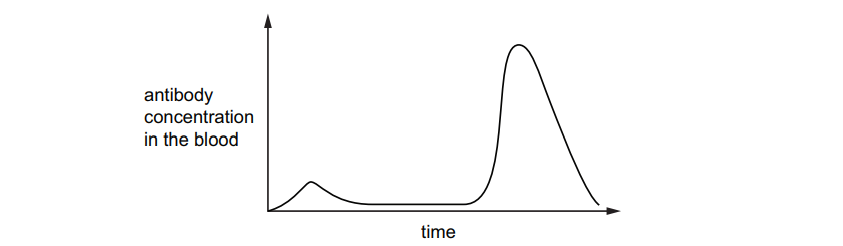

Which statement is consistent with the information in the graph?

*Source: June 2021 0970/21 Q21*

### Q5 — medium — 1 marks

**Q5** [1 mark]

The photomicrograph shows human blood.

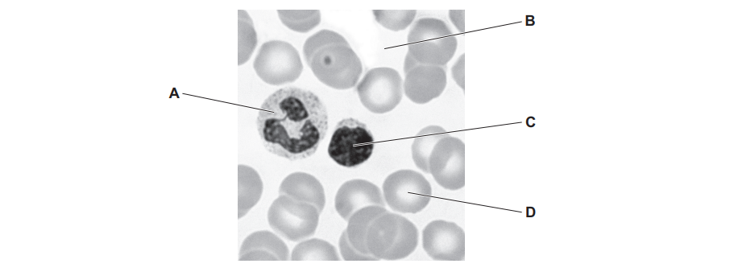

Which blood component makes antibodies?

*Source: June 2021 0970/21 Q20*

### Q6 — medium — 1 marks

**Q6** [1 mark]

Statements 1 to 4 describe stages in the development of cholera.

1. Chloride ions are secreted into the gut.
2. Osmosis causes water to move into the gut.
3. The infected person becomes dehydrated.
4. Toxins are produced by the pathogenic bacteria.

What is the correct sequence of the four stages?

*Source: June 2021 0970/21 Q15*

### Q7 — easy — 1 marks

**Q7** [1 mark]

Which cells produce mucus?

*Source: june 2022 paper 2 Q20*

### Q8 — easy — 1 marks

**Q8** [1 mark]

The graph shows the response of the body to vaccination.

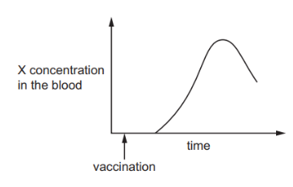

Which word should be used to replace the letter X, to complete the label on the y-axis?

*Source: june 2022 paper 2 Q19*

### Q9 — easy — 1 marks

**Q9** [1 mark]

The body has several defence mechanisms to protect against disease.

Which defence mechanism is a chemical barrier?

*Source: june 2022 paper 1 Q21*

### Q10 — medium — 1 marks

**Q10** [1 mark]

The diagram with the structure labelled X shows a bacterium with proteins on its surface. The diagram labelled Y shows proteins made by the human body

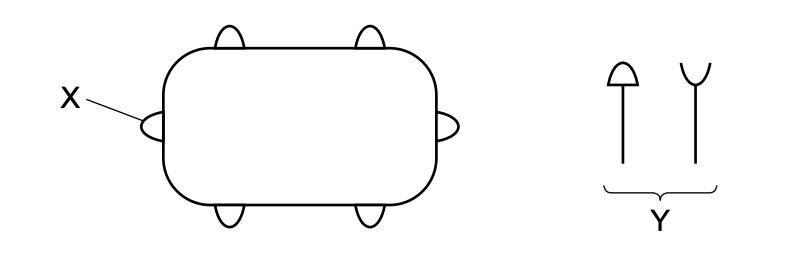

Which row shows the correct combination for destroying the bacterium?

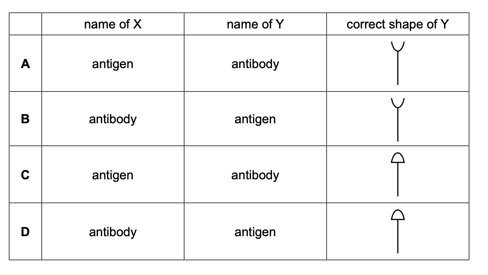

*Source: Specimen 2023 0970/02 Q21*

### Q11 — hard — 1 marks

**Q11** [1 mark]

Which row in the table below correctly describes the attributes of passive immunity?

|   | **effective period** | **antibodies made?** | **involves production of memory cells?** |
|---|---|---|---|
| **A** | long term | yes | no |
| **B** | long term | yes | yes |
| **C** | short term | no | no |
| **D** | short term | no | yes |

### Q12 — hard — 1 marks

**Q12** [1 mark]

#### Extended only

What happens when a person is vaccinated against measles?

|   | **type of immunity** | **production of memory cells?** |
|---|---|---|
| **A** | passive | yes |
| **B** | passive | no |
| **C** | active | yes |
| **D** | active | no |

### Q13 — hard — 1 marks

**Q13** [1 mark]

#### Extended only

There are numerous ways in which a person can acquire antibodies, giving immunity to a disease. Some of these are:

1. Vaccination
2. Infection by disease
3. A baby feeding on breast milk

Which of the options would give a person active immunity?

### Q14 — hard — 1 marks

**Q14** [1 mark]

#### Extended only

Components of the blood from a mammal are shown in the diagram below.

In which component would you expect to find the remains of the breakdown of bacterial cells.

### Q15 — medium — 1 marks

**Q15** [1 mark]

The human body has a number of barriers to prevent infection by pathogens some of which are listed below.

1. Skin
2. Mucus
3. Hairs in the nose
4. Antibodies
5. Stomach acid

Which of these are examples of mechanical barriers?

### Q16 — hard — 1 marks

**Q16** [1 mark]

#### Extended only

Passive and active immunity have which of the following features in common?

1. They are always long-term.
2. They always involve the activity of memory cells.
3. They involve antibodies.
4. They can be acquired by vaccination.

### Q17 — medium — 1 marks

**Q17** [1 mark]

#### Extended only

When a tissue is transplanted from a female donor to a male recipient, it may be rejected.

What is the main cause of this rejection?

### Q18 — medium — 1 marks

**Q18** [1 mark]

Which of the following is an effect of a cholera infection?

1. Loss of salts from the blood
2. Loss of water from the blood
3. Blockage of the small intestine
4. Persistent diarrhoea

### Q19 — medium — 1 marks

**Q19** [1 mark]

Which of the following diseases listed below are **not** caused by infectious pathogens?

1. Coronary Heart Disease
2. Cholera
3. AIDS
4. Scurvy

### Q20 — medium — 1 marks

**Q20** [1 mark]

Which of the following diseases can be transmitted by contact with contaminated surfaces?

### Q21 — easy — 1 marks

**Q21** [1 mark]

#### Extended only

The immune system recognises which part of a pathogen?

### Q22 — easy — 1 marks

**Q22** [1 mark]

#### Extended only

In many multicellular animals, pathogens are recognised as foreign and are attacked by the immune system.

Which of the following may be produced during an immune response?

### Q23 — easy — 1 marks

**Q23** [1 mark]

Which of the options below is an example of a transmissible disease?

### Q24 — easy — 1 marks

**Q24** [1 mark]

What is a pathogen?

### Q25 — easy — 1 marks

**Q25** [1 mark]

Which body defence listed below acts as a chemical barrier?

## Theory Questions (16 questions)

### Q1 — hard — 4 marks

**Q1** [4 marks]

The vaccination that the patient received contained a harmless version of a pathogen.

(i) Define the term pathogen.

[1]

(ii) Identify the type of cell in the blood that produces antibodies to protect against pathogens.

[1]

(iii) In addition to the protection gained from vaccination, the human body has existing protective features.

State one example of a mechanical barrier to pathogens and one example of a chemical barrier to pathogens in the human body.

[2]

### Q2 — hard — 9 marks

**Q2** [5 marks]

Antibodies are proteins that are produced by lymphocytes. Antitoxins are antibodies which neutralise the toxins released by some bacteria.

The transmissible disease diphtheria is caused by a bacterium that releases a toxin that can cause serious damage to the body.

A person is suspected of having caught diphtheria.

At a clinic, the person is given an injection of antitoxin antibodies that provide protection against the diphtheria toxin. She is also given an injection of the vaccine for diphtheria.

A few weeks later she is given a second injection of the diphtheria vaccine.

Fig. 6.1 shows the changes in concentration of the antitoxin antibodies and the antibodies produced in response to the vaccine.

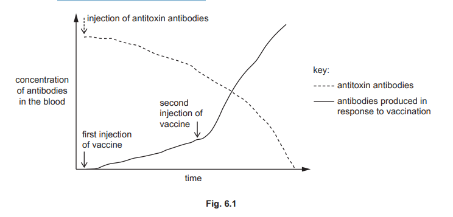

(i)

Explain the advantage of giving the person an injection of antitoxin antibodies.

[2]

(ii)

Explain how the two injections of the vaccine result in better protection against diphtheria than the injection of antitoxin antibodies.

[3]

*Source: June 2021 0610/41 Q6A*

**Q2** [4 marks]

Explain how antibodies protect the body against pathogens.

*Source: June 2021 0610/41 Q6B*

### Q3 — easy — 4 marks

**Q3** [4 marks]

Explain the effect of cholera bacteria on the digestive system

*Source: Specimen 2023 0970/04 Q1C*

### Q4 — medium — 8 marks

**Q4** [1 mark]

What term is used to describe ‘disease-causing organisms’?

*Source: 2020 0610/03 Q6A*

**Q4** [2 marks]

Fig. 1 shows some virus particles that cause the transmissible disease, influenza.

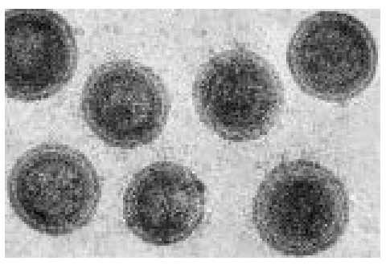

**Fig. 1**

Suggest how the virus particles that cause influenza are transmitted from one person to another.

*Source: 2020 0610/03 Q6B*

**Q4** [3 marks]

Describe the defences of the body which prevent or fight infection.

*Source: 2020 0610/03 Q6C*

**Q4** [2 marks]

Explain why antibiotics are **not** successful in treating influenza.

*Source: 2020 0610/03 Q6D*

### Q5 — hard — 13 marks

**Q5** [2 marks]

*Streptococcus pyogenes* is a pathogenic bacteria that spreads through direct contact with discharges from the nose and throat, as well as through open wounds and sores on the skin of infected people.

In the 19th century, many women died shortly after childbirth due to a disease called puerperal fever, which is caused by an infection of *S. pyogenes*. At the time, it was common practice for doctors to dissect dead bodies in order to study human anatomy and then move straight onto delivering babies immediately after.

Suggest an explanation for the frequent deaths of women after childbirth due to puerperal fever.

**Q5** [3 marks]

**Extract:**

Table 1

year | number of births | number of deaths
1841 | 3036 | 237
1842 | 3287 | 518
1843 | 3060 | 274
1844 | 3157 | 260
1845 | 3492 | 241
1846 | 3905 | 479

Table 1 shows the number of births and deaths at a hospital between 1841 and 1846.

**Table 1**

| year | number of births | number of deaths |
|---|---|---|
| 1841 | 3036 | 237 |
| 1842 | 3287 | 518 |
| 1843 | 3060 | 274 |
| 1844 | 3157 | 260 |
| 1845 | 3492 | 241 |
| 1846 | 3905 | 479 |

Calculate and state the percentage change in the number of deaths between 1841 and 1846.

Show your working and give your answer to the nearest whole number.

**Q5** [6 marks]

In 1847 a handwashing policy was introduced at the hospital from part (b) which stated that doctors should wash their hands before delivering babies in the maternity ward. This policy was strictly enforced in 1848.

Fig. 1 shows the death rate of mothers from puerperal fever between 1846 and 1848.

**Fig. 1**

Describe and explain the data from January 1847 to July 1848.

**Q5** [2 marks]

Other than washing their hands, suggest **two** other hygiene practices that doctors in hospitals should carry out in order to avoid the spread of pathogens to their patients.

### Q6 — easy — 5 marks

**Q6** [5 marks]

Young mammals that are orphaned can be bottle-fed.

Fig. 1 shows a newborn tiger cub sucking on a bottle.

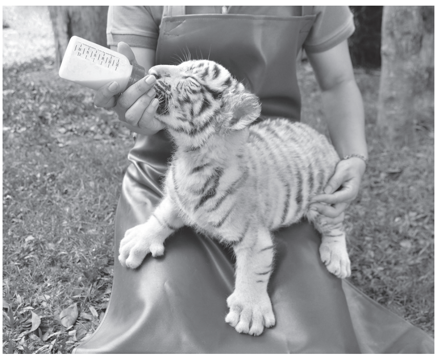

**Fig. 1**

(i)

Sucking is an example of an involuntary action observed in newborn mammals.

State the name given to involuntary actions.

[1]

(ii)

Describe the advantages of breast-feeding compared with bottle-feeding.

[4]

*Source: 2018 (Series 1) 0610/41 Q6A*

### Q7 — easy — 9 marks

**Q7** [3 marks]

#### Extended only

Vaccines provide protection against certain diseases.

(i)

State the type of immunity gained by being vaccinated against a disease.

[1]

(ii)

Describe the advantage of the type of immunity identified at part (i).

[2]

**Q7** [2 marks]

#### Extended only

Vaccines may contain one of several different substances that helps with developing immunity against disease.

Give **two** examples of these substances that could be found in a vaccine.

**Q7** [2 marks]

#### Extended only

The MMR vaccine is administered to children by the age of five and provides protection against mumps, measles and rubella.

In the year 2020 there were 693 928 children in England that celebrated their fifth birthday.

654 197 of these children had received their first MMR dose.

Calculate the percentage of five-year-old children that had received their first MMR vaccine.

**Q7** [2 marks]

#### Extended only

In order to prevent the outbreak of epidemics or pandemics in a population it is very important that a large percentage of the population is vaccinated.

Explain the importance of this.

### Q8 — hard — 15 marks

**Q8** [5 marks]

Table 1 shows information about the number of deaths from malaria in a particular area of Africa.

**Table 1**

| year | number of deaths from malaria per 100 000 people |
|---|---|
| 2005 | 159 |
| 2007 | 136 |
| 2009 | 114 |
| 2011 | 97 |
| 2013 | 94 |
| 2015 | 92 |

Complete Fig. 1 using data from Table 1.

**Fig. 1**

**Q8** [2 marks]

Malaria is spread by the female *Anopheles* mosquito when they break through the skin of an uninfected person during a blood meal.

Explain how the skin acts as a mechanical barrier against disease.

**Q8** [4 marks]

#### Extended only

Once the mechanical barrier formed by the skin is broken, the malaria pathogen enters the blood.

Outline the defence mechanism that will come into effect once a pathogen enters the blood.

**Q8** [4 marks]

#### Extended only

Compare active and passive immunity.

### Q9 — easy — 8 marks

**Q9** [2 marks]

#### Extended only

Fig. 1 shows the response of a lymphocyte to the presence of a pathogen.

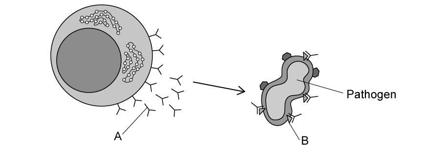

**Fig. 1**

Identify structure **A** and **B** in Fig. 1.

**Q9** [3 marks]

**Extract:**

Structure **A** and **B** in Fig. 1 represents...
- **A** = antibody; 
- **B** = antigen;

#### Extended only

Describe the events that occur after structure **A** binds to structure **B**.

**Q9** [2 marks]

**Extract:**

Structure **A** and **B** in Fig. 1 represents...

- **A** = antibody; [1 mark]
- **B** = antigen; [1 mark]

Antibodies are produced by lymphocytes in response to the presence of specific antigens found on the surface of pathogens.

#### Extended only

Use the information in Fig. 1 to explain why structure **A** will only bind to structure **B** on the pathogen.

**Q9** [1 mark]

#### Extended only

During the response to the presence of the pathogen, the lymphocytes will also form cells that will protect the body against future infections by the same type of pathogen.

State the name of these cells.

### Q10 — medium — 10 marks

**Q10** [2 marks]

#### Extended only

White blood cells form part of the immune system in the human body which provides protection against infection by pathogens.

Outline the possible responses of these white blood cells to an infection by pathogens.

**Q10** [4 marks]

#### Extended only

Being vaccinated is another way to gain protection against infection by pathogens.

Describe how vaccines provide protection against infection by pathogens.

**Q10** [2 marks]

**Extract:**

Vaccines provide protection against infection by pathogens in the following way...

Any four of the following:

- A dead/altered/changed/weakened form of the pathogen is introduced into the body OR an antigen (of the pathogen) is introduced into the body; [1 mark]
- These (dead/altered/changed) pathogens / antigens will not cause illness; [1 mark]
- The antigens (of the pathogen) are encountered by white blood cells / lymphocytes; [1 mark]
- Lymphocytes produce complementary antibodies (for the antigen); [1 mark]
- Antibodies bind to the antigen and cause agglutination (of pathogens) OR chemicals are released to attract phagocytes (to engulf pathogens); [1 mark]
- Memory cells are produced that provide long-lasting immunity OR enables quick response to the antigen if encountered again; [1 mark]

This response is identical to the immune response when you become infected by a pathogen, the only difference with a vaccine is that the pathogen is changed to not cause illness and it is injected into the body in a deliberate way.

#### Extended only

The measles vaccine will **not **give a child immunity against the influenza virus.

Explain the reason for this.

**Q10** [2 marks]

#### Extended only

The flu is an example of a disease against which we typically don't build immunity; this is the main reason why we need to get vaccinated against flu regularly.

Explain why it is difficult to develop immunity against certain pathogens, such as the influenza virus.

### Q11 — medium — 10 marks

**Q11** [5 marks]

Eating food contaminated by bacteria can cause illness.

This type of illness is called food poisoning.

Fig. 1 shows the number of cases of food poisoning per 100 000 people in the population in one country.

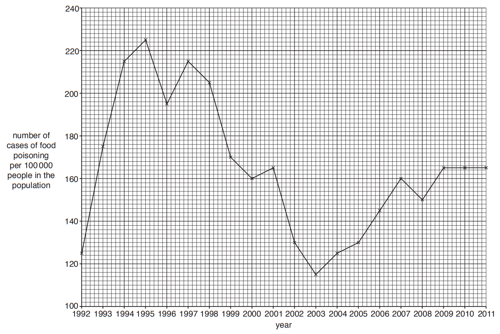

**Fig. 1**

(i)

State the year with the highest number of cases of food poisoning in Fig. 1.

[1]

(ii)

State the number of cases of food poisoning per 100 000 people in the population in the year 1996 in Fig. 1.

[1]

(iii)

Describe the trend in the number of cases of food poisoning between 2003 and 2011 in Fig. 1.

[3]

*Source: 2018 (Series 2) 0610/32 Q3A*

**Q11** [1 mark]

Food poisoning is caused by different types of bacteria.

A common type of bacterium that causes food poisoning is *Campylobacter jejuni*.

State the genus of this species.

*Source: 2018 (Series 2) 0610/32 Q3B*

**Q11** [1 mark]

Food poisoning can result in vomiting and diarrhoea.

Outline the treatment of diarrhoea.

*Source: 2018 (Series 2) 0610/32 Q3C*

**Q11** [3 marks]

The body has several defence mechanisms against bacteria.

Table 1 shows three types of defence mechanism.

The word list gives examples of these defence mechanisms.

In Table 1 write the examples under the correct type of defence.

Use each word once only.

| **antibodies          mucus           nasal hairs       **  ** phagocytosis           skin           stomach acid** |
|---|

**Table 1**

| cellular | chemical | mechanical |
|---|---|---|
|   |   |   |
|   |   |   |

*Source: 2018 (Series 2) 0610/32 Q3D*

### Q12 — easy — 9 marks

**Q12** [3 marks]

Fig. 1 shows a mosquito feeding on human blood.

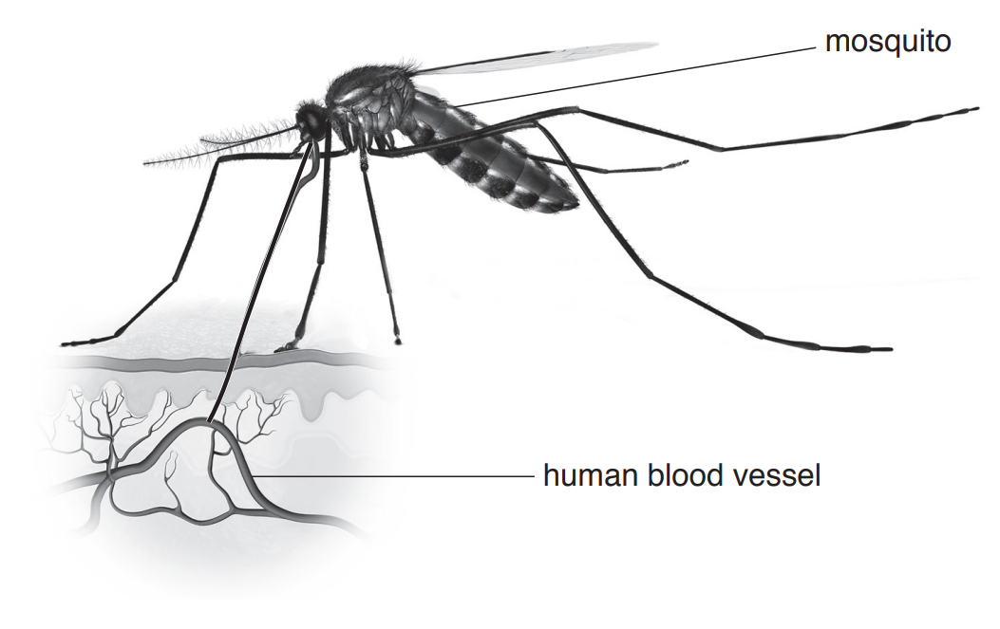

**Fig. 1**

(i)

Mosquitoes can carry transmissible diseases such as malaria.

Define the term *transmissible disease*.

[2]

(ii)

Using information from Fig. 1, suggest how the mosquito is adapted for feeding on human blood.

[1]

*Source: 2018 (Series 3) 0610/33 Q4A*

**Q12** [4 marks]

(i)

The human body has a number of defences against disease.

State the name of the mechanical barrier which is broken by the mosquito.

[1]

(ii)

Some components of blood defend the body against disease.

Table 1 contains the names of three of the components of blood.

It also states three defence mechanisms.

Complete Table 1 by placing a tick (✓) in the box that matches each defence mechanism to the correct component of blood.

**Table 1**

| defence mechanism | component of blood |   |   |
|---|---|---|---|
| platelets | red blood cells | white blood cells |   |
| antibody production |   |   |   |
| blood clotting |   |   |   |
| phagocytosis |   |   |   |

[3]

*Source: 2018 (Series 3) 0610/33 Q4B*

**Q12** [2 marks]

The body also has chemical barriers against disease.

State the name of **two** chemical barriers in the body.

*Source: 2018 (Series 3) 0610/33 Q4C*

### Q13 — hard — 9 marks

**Q13** [2 marks]

#### Extended only

CGRP is a protein found in the human brain. High levels of CGRP has been linked to the occurrence of migraines in sufferers. A possible treatment under investigation involves injecting mice with human CGRP.

Explain how the immune system of mice would respond to the CGRP injection.

**Q13** [2 marks]

#### Extended only

CGRP binds to receptors in the brain that triggers blood vessels to dilate. The dilation of blood vessels is responsible for the intense pain associated with migraines.

The substances produced by the immune system of mice, after the CGRP injection, are extracted and modified before being sold as medication. When administered to migraine sufferers, these substances will bind to CGRP proteins in the brain.

Suggest how this may act as a treatment for migraines.

**Q13** [2 marks]

#### Extended only

Complete the graph in Fig. 1 to show how the number of antibodies changes when a vaccinated person becomes infected with a live pathogen.

**Fig. 1**

**Q13** [3 marks]

#### Extended only

After many people were vaccinated against Covid-19, a new variant of the virus emerged that had different shaped antigens to the first version of the virus.

This caused the vaccine to be less effective against the virus.

Explain why having different shaped antigens caused the vaccine to be less effective against the virus.

### Q14 — medium — 8 marks

**Q14** [2 marks]

Breastfeeding is an example of passive immunity which provides the baby with short-term protection against pathogens.

Explain why passive immunity only provides short-term protection against pathogens.

**Q14** [1 mark]

#### Extended only

Not all babies are breastfed.

Suggest **one** way in which these babies may gain immunity against pathogens.

**Q14** [3 marks]

#### Extended only

An American TV crew visited a remote tribe in the Brazilian rainforest to make a documentary.

Two weeks after the crew's visit, six members of the tribe died of influenza and many more were seriously ill.

The members of the TV crew did not show symptoms of influenza during their visit, but members of the remote tribe died from the disease.

Suggest an explanation for this.

**Q14** [2 marks]

**Extract:**

The Center for Disease Control and Prevention estimated that 3.55 × 10^7^ individuals were infected with influenza in the United States during the 2018-19 'flu season. Of those individuals affected, an estimated 3.42 × 10^4^ died, sadly. Based on these estimated figures, calculate the percentage of people infected with influenza that died from the disease during the 2018-19 'flu season. Show your working and give your answer to two decimal places.

#### Extended only

The Center for Disease Control and Prevention estimated that 3.55 × 107 individuals were infected with influenza in the United States during the 2018-19 'flu season.

Of those individuals affected, an estimated 3.42 × 104 died, sadly.

Based on these estimated figures, calculate the percentage of people infected with influenza that died from the disease during the 2018-19 'flu season.

Show your working and give your answer to **two** decimal places.

### Q15 — medium — 5 marks

**Q15** [5 marks]

(i)

Describe **and **explain the effects of cholera bacteria on the gut.

[4]

(ii)

Suggest **one** treatment for cholera.

[1]

*Source: 2018 Feb/Mar 0610/42 Q1D*

### Q16 — easy — 8 marks

**Q16** [2 marks]

Pathogens can be passed on from one host to another in different ways.

State **two** examples of how this happens.

**Q16** [3 marks]

**Extract:**

- Accept "wear gloves" as a separate valid method worth one mark.
- Accept "tie back hair" / "cover hair" / "wear a hairnet" as a separate valid method worth one mark.
- Accept "keep pets/animals away from food" as a separate valid method worth one mark.

Hygienic food preparation methods are very important in preventing the spread of pathogens and disease.

Describe **three** examples of such methods.

**Q16** [1 mark]

Cholera is a bacterial disease that spreads through the ingestion of contaminated food or water.

State the name of the bacterium that causes cholera.

**Q16** [2 marks]

One of the symptoms of cholera is diarrhoea, which may become life-threatening if left untreated.

Explain the reason for this.
