# Mark Schemes — Gas Exchange in Humans
**11. Gas Exchange in Humans** · Cambridge (CIE) IGCSE biology (0610 & 0970)

## Alternative To Practical Questions (3 questions)

### Q1
(i) The average breathing rate for four minutes of running was:

- 40 (breaths per minute); **[1 mark]**

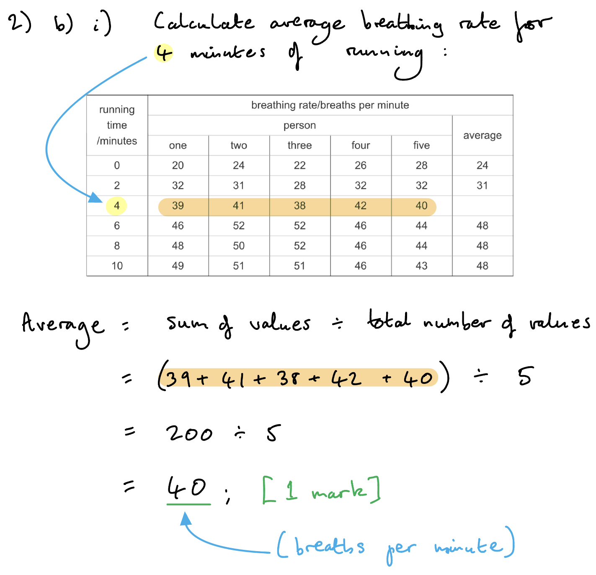

(ii) To determine if the result for person two at six minutes is anomalous, the student should:

Any **one **from the following:

- Repeat the experiment/measurement for person 2; **[1 mark]**
- Compare (result) with the best fit line / compare (result) with other people; **[1 mark]**

(iii) Your graph showing the relationship between running time and the average breathing rate, including a line of best fit, should look similar to that shown below:

- Axes labelled with units; **[1 mark]**
- Linear scale for plotted points covers half or more of the grid / graph paper in one dimension; **[1 mark]**
- All plotted points accurate to ± half a small square; **[1 mark]**
- Suitable best fit line; **[1 mark]**

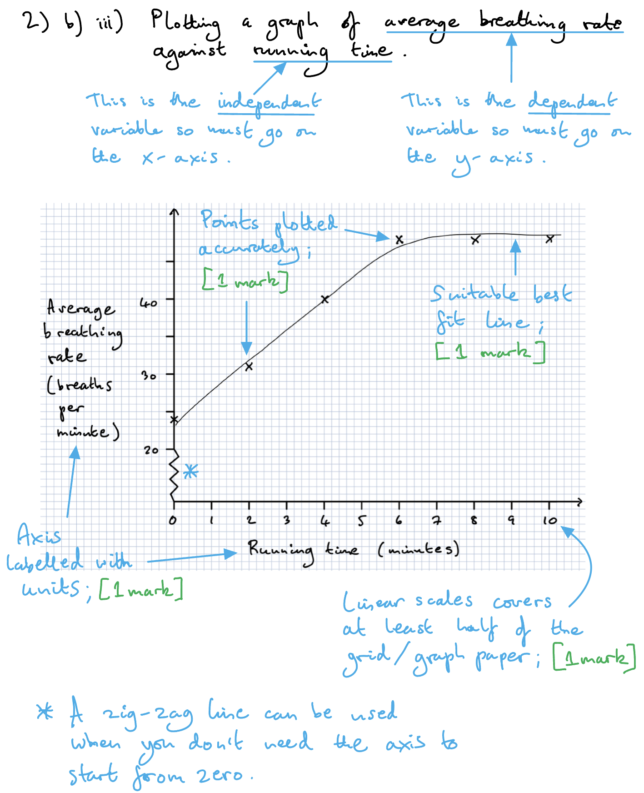

(iv) An estimate of the average breathing rate for one minute of the running would be:

- 28 breaths per minute

The way you obtained your answer should be shown on your graph as shown below:

- Indication on the graph at 1 minute; **[1 mark]**
- Correct reading from the graph at 1 minute; **[1 mark]**

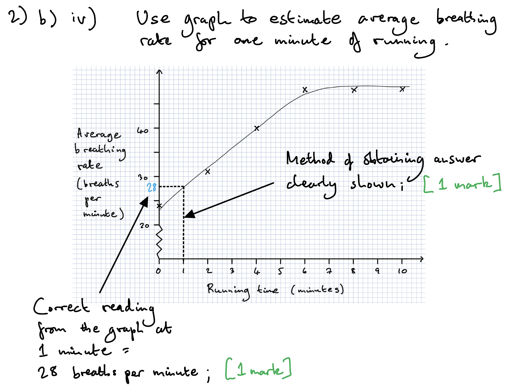

(v) The relationship between running time and the average breathing rate can be described as follows:

- As running time increases, breathing rate increases; **[1 mark]**
- Breathing rate (then) levels off...; **[1 mark]**
- ...from 6 minutes / 48 breaths per minute; **[1 mark]**

**[Total: 11 marks]**
(i) Safety precautions for this investigation could include:

Any **one **from the following:

- Any appropriate health-related comment e.g. check the five people taking part in the investigation are healthy / do not have pre-existing injuries / do not have certain health conditions such as diabetes or heart conditions / have a first aid kit available at all times (during the investigation); **[1 mark]**
- Any appropriate comment about the suitability of the environment for exercise e.g. (presence of) water / level (running) surface / appropriate footwear / avoid extreme weather conditions;** [1 mark]**

(ii) Variables that should be kept constant during this investigation could include:

Any **two **from the following:

- Gender (of subjects); **[1 mark]**
- Fitness / health (of subjects); **[1 mark]**
- Age (of subjects); **[1 mark]**
- Speed of exercise / running; **[1 mark]**
- Running surface; **[1 mark]**
- (Named) environmental condition; **[1 mark]**
- Preparation / resting time (before and / or between runs) / allow breathing rate to return to resting rate;** [1 mark]**
- Time interval / time point after exercise used to determine breathing rate; **[1 mark]**

(iii) The variable that has been changed (the independent variable) in this investigation is:

- Running time; **[1 mark]**

**[Total: 4 marks]**

### Q2
(i) The average diameter of the **image** of capillary A is...

- 7.5 (mm); **[1 mark]**

(ii) The **actual **average diameter of capillary A is...

- Image size ÷ magnification / average diameter of capillary ÷ magnification / 7 500 ÷ 1 200 (i.e. correct rearranging of equation); **[1 mark]**
- 7 500 (i.e. correct conversion of mm to μm); **[1 mark]**
- 6 (μm); **[1 mark]**

*Full marks can be awarded for the correct answer of 6 μm in the absence of other calculations.*

(iii)

- Drawing has a clear continuous outline **AND** no shading; **[1 mark]**
- Drawing occupies at least half the space available; **[1 mark]**
- Drawing shows most of three alveoli **AND** one or more capillaries;** [1 mark]**
- Walls of the alveoli are drawn as double lines / lines that provide a representation of thickness; **[1 mark]**

**[Total: 8 marks]**

> *i) Note that in an exam it is very likely that you could be asked to measure diameter 1 and diameter 2 yourself before calculating the average, so be sure to have a ruler with you and to use it with care!*

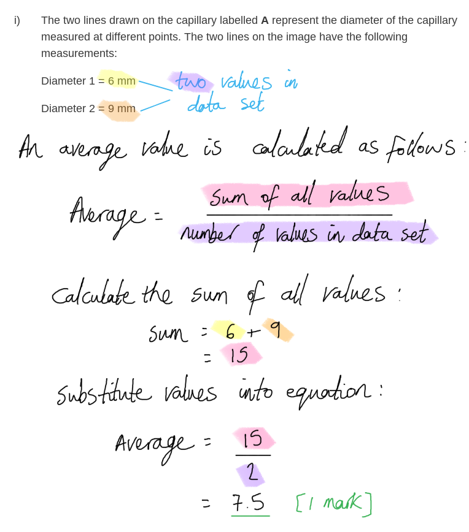

> *ii)*

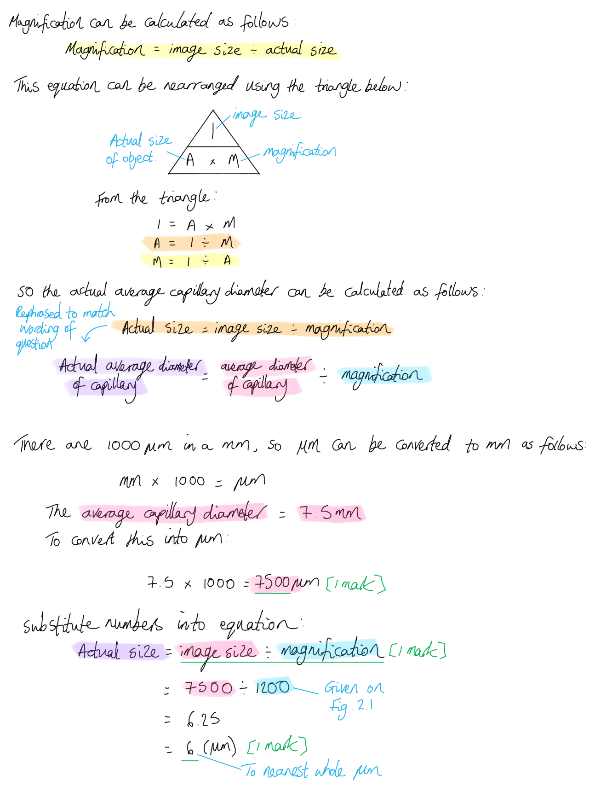

> *iii)*

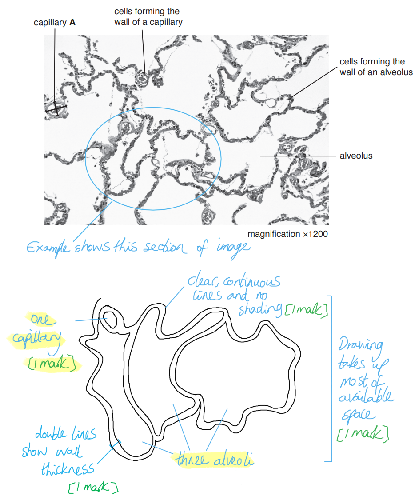
(i) The average increase in chest circumference for females is...

- 31 (mm); **[1 mark]**

(ii) The students could find out the effect of exercise intensity on chest circumference during breathing as follows...

**Independent variable**

- **Varying the type/rate/duration of exercise; [1 mark]**

*Dependent variable*

- Measuring the chest / chest circumference; **[1 mark]**

*Control variable*

A maximum of **two **of the following:

- Equal number of male and female participants **OR **all participants are the same sex; **[1 mark]**
- Participants are all the same age / in the same age group; **[1 mark]**
- Participants have the same/similar body mass; **[1 mark]**
- Participants have the same/similar fitness level; **[1 mark]**
- All participants have had the same amount of time since their last meal / eating/drinking;** [1 mark]**
- Participants have not recently consumed caffeine / medication / alcohol / other named chemical; **[1 mark]**
- Exercise is carried out in the same environment / at the same temperature / at the same altitude;** [1 mark]**
- (If exercise type/intensity is varied then) exercise is carried out for the same length of time;** [1 mark]**
- (If exercise duration is varied then) same type of exercise for all participants; **[1 mark]**

*Experiment method*

- Chest circumference is measured immediately after exercise has ended / before chest circumference returns to normal; **[1 mark]**
- A period of rest is given between exercise periods / before carrying out different exercise intensities; **[1 mark]**
- Detail of the exercise to be carried out, eg. running, exercise bike etc.; **[1 mark]**
- Two or more repeats for each person; **[1 mark]**
- Three or more people doing the test; **[1 mark]**
- Relevant safety precaution is given, eg. all participants are healthy / wearing suitable footwear / warm up their muscles appropriately etc.;** [1 mark]**

**[Total: 6 marks]**

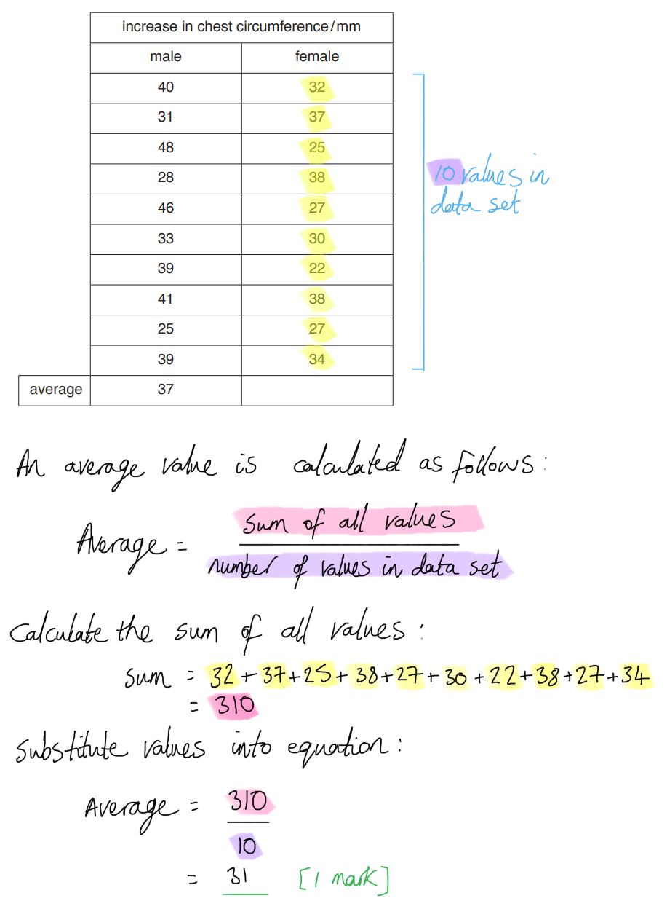

> *When a question asks for a description of an experimental method there are several things that you must be sure to do:*

- *Name the independent variable; the factor that you would change.*
- *Name the dependent variable; the factor that you would measure.*
- *Identify some control variables; the factors that you would need to keep the same.*
- *Give details of the method, e.g. number of repeats, when to take measurements, safety precautions etc.*

> *In this instance, the question has asked you to design an experiment that looks at the effect of exercise **intensity** on chest circumference. Note that in order to measure the effects of intensity there need to be **different levels** of exercise intensity (e.g. running slowly vs fast, or for 1 minute vs 5 minutes); it is not enough to just compare chest circumference after exercise and after resting, as this does not provide any information about the effects of exercise **intensity**.*

### Q3
(i) The actual width of the trachea wall can be calculated as follows...

- Conversion of cm to mm; **[1 mark]**
- 60 ÷ 40; **[1 mark]**
- 1.5 (mm); **[1 mark]**

*Full marks awarded for the correct answer in the absence of other calculations* *Maximum ***[2 marks]*** if answer is not in mm*

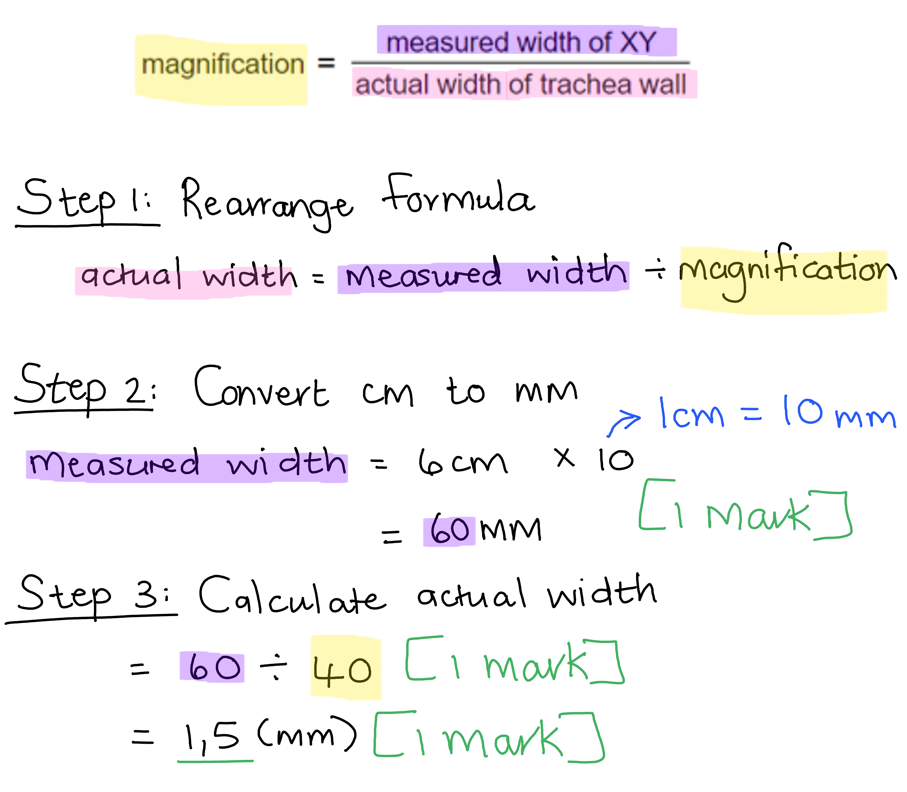

> *In the exam you would most likely be expected to make your own measurements of line XY, so remember to always bring a ruler along to the exam venue.*

(ii) The mark allocation for the drawing would be...

- Clear, continuous lines **AND** no shading; **[1 mark]**
- Drawing occupies at least half the available space; **[1 mark]**
- Drawing shows at least four layers; **[1 mark]**
- Thickness of tissues layers are drawn in correct proportions; **[1 mark]**

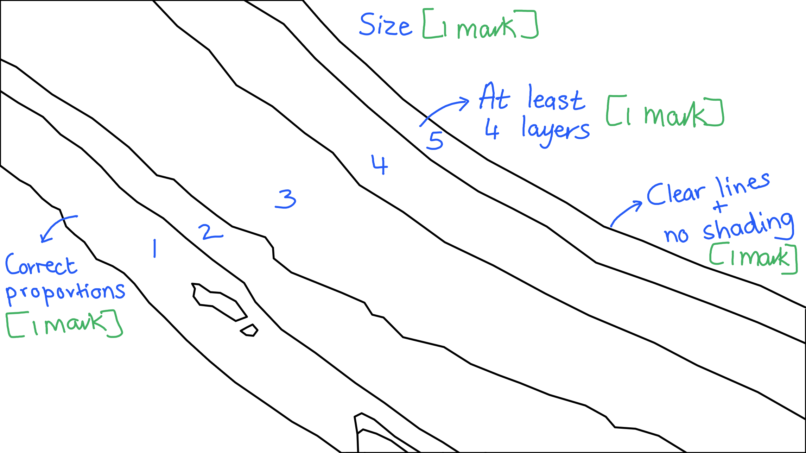

**[Total: 7 marks]**
(i) The running measurement for trial 3 was an anomaly because...

- The breathing rate / measurement is much lower than the other running measurements; **[1 mark]**

To test whether this is an anomaly, the investigator should...

- Repeat the running exercise / take another running measurement (to see if the same results are obtained again); **[1 mark]**

> *Anomalous data points do not fit in with the rest of the data points in the dataset. In this case it is clear that the running measurement for trial 3 is significantly lower than the other two measurements taken for that type of exercise.*

(ii) The mean breathing rate for running can be calculated as follows...

- (18 + 16) ÷ 2; **[1 mark]**
- 17 (breaths min-1); **[1 mark]**

*Full marks awarded for the correct answer in the absence of other calculations* *Maximum ***[1 mark]*** if anomalous measurement was included in the calculation*

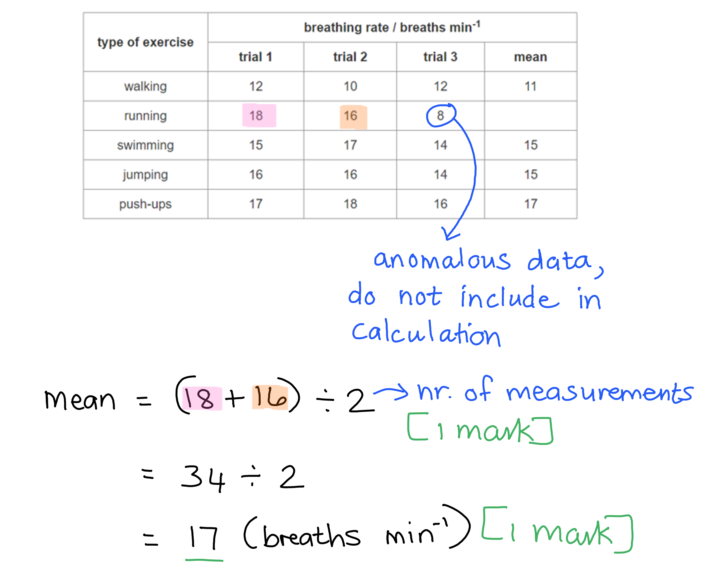
(i) The mark allocation for the bar chart would be as follows...

- Both axes labelled **and** units included (**x** = type of exercise, **y** = breathing rate / breaths min-1); **[1 mark]**
- Even scale and plot area occupying at least half the grid; **[1 mark]**
- Bar heights plotted correctly, bars are same width and not touching; **[1 mark]**

*Error carried forward for running bar based on calculation from (b)(ii) y-axis can start at any figure from 0 -10*

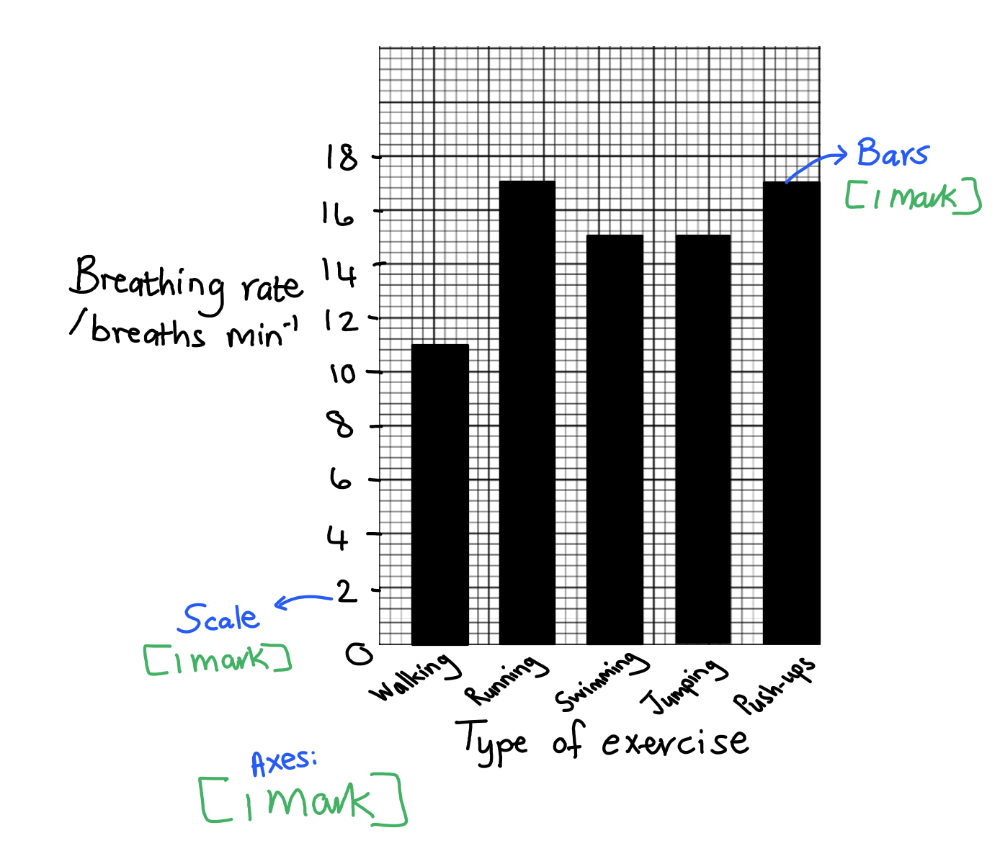

(ii) A description of the data would include...

- Push-ups and running delivered the highest breathing rate / most breaths per minute; **[1 mark]**
- Walking was the type of exercise that led to the lowest breathing rate / least breaths per minute; **[1 mark]**
- Data point correctly quoted to support marking points e.g. push-ups and running had a mean breathing rate of 17 breaths min-1, walking had a mean breathing rate of 11 breaths min-1; **[1 mark]**

**[Total: 6 marks]**
An investigation to test whether breathing rate decreases with age would include...

**Independent variable:**

- Use participants from at least four different age groups; **[1 mark]**

**Dependent variable:**

- Breathing rate / breaths per minute; **[1 mark]**

**Variables that are kept constant:**

A maximum of **two** from the following:

- Same sex of participants / male or female; **[1 mark]**
- Same fitness level of participants; **[1 mark]**
- Participants must be healthy / have no known illness / medical conditions; **[1 mark]**
- Same number of participants per age group; **[1 mark]**
- They must perform the same activity/task/exercise **OR** all be at rest throughout the investigation; **[1 mark]**
- (If doing an activity) the activity must be performed for the same amount of time / to the same intensity; **[1 mark]**
- Breaths counted for the same amount of time; **[1 mark]**

**Detail of method:**

A maximum of **two** from the following:

- Description of apparatus used e.g. use stopwatch to time the length of activity / counting breaths; **[1 mark]**
- Number of breaths counted immediately after activity is finished; **[1 mark]**
- Three or more replicates / repeats (for each age group); **[1 mark]**
- Relevant safety precaution e.g. people with medical conditions should refrain from participating / not form part of investigation **OR** activities should be performed with care to avoid injury; **[1 mark]**

**[Total: 6 marks]**

> *There are many marks up for grabs with this question, so make sure you know the basic steps of writing a method for a scientific investigation. You should aim to include information on the independent and dependent variable, as well as any variables that were kept constant. Also include details of the method, such as the apparatus used and how you would collect data, as well as any relevant safety precautions that would apply to the experiment.*

## Multiple Choice Questions (26 questions)

### Q1
**Final answer:** **The correct answer is C.**

- **Statement 1** is correct: a large surface area increases the rate of diffusion of gases across the gas exchange surface
- **Statement 3** is correct: a good blood supply removes oxygen from the lung capillaries after it has diffused into the blood, maintaining the concentration gradient for further diffusion

**Statement 2** is incorrect as gas exchange surfaces are thin, not thick in order to maximise the rate of diffusion.

**Statement 4** is incorrect as good ventilation maintains a high concentration of oxygen and a low concentration of carbon dioxide in the alveoli, not a high concentration of carbon dioxide.

### Q2
**Final answer:** **The correct answer is B.**

- Oxygen is lower in expired air
- Carbon dioxide is higher in expired air
- Water vapour is higher in expired air

### Q3
**Final answer:** **The correct answer is C.**

- **Structure 1** is the trachea: a wide tube at the top of the diagram leading into the chest
- **Structure 2** is a bronchus (plural bronchi): one of the two branches leading from the trachea into each lung
- **Structure 3** is the diaphragm: the large, dome-shaped muscle at the base of the thorax
- **Structure 4** is an alveolus: the small air sacs visible at the ends of the bronchioles

The oesophagus is part of the digestive system, not the breathing system.

### Q4
**Final answer:** **The correct answer is ****C.**

- During exercise, muscle cells carry out **respiration at a higher rate**, producing **more carbon dioxide as a waste product**
- The increased **carbon dioxide concentration in the blood is detected by the brain**, which stimulates an **increase in breathing rate and depth** to remove the excess carbon dioxide

**A** is incorrect because oxygen concentration does not increase during exercise.

**B** is incorrect because although oxygen concentration in the blood may decrease slightly during exercise, breathing rate is mainly controlled by increases in carbon dioxide concentration detected by the brain.

**D** is incorrect because because carbon dioxide concentration does not decrease during exercise.

### Q5
**Final answer:** **The correct answer is ****B.**

- External intercostal muscles **contract**, moving the ribs **up and out**
- This increases the **volume **of the **thorax**, which decreases the **pressure **inside the lungs and **draws air into the lungs**

**A** is incorrect because downward rib movement occurs during exhalation.

**C** is incorrect because muscles do not directly push air.

**D** is incorrect because mucus is produced by goblet cells, not intercostal muscles.

### Q6
**Final answer:** **The correct answer is ****A****.**

- When we breathe in, the diaphragm contracts and moves down, which increases the volume of the thorax and decreases the pressure in the lungs. A higher atmospheric pressure compared to lung pressure then causes air to flow in.

**B** is incorrect because although the diaphragm contracts and the thorax volume increases, the pressure in the lungs actually decreases during inhalation, not increases.

**C **is incorrect because the diaphragm must contract, not relax, for the volume of the thorax to increase and for inhalation to occur.

**D** is incorrect because a relaxed diaphragm would not cause an increase in thoracic volume, and pressure in the lungs decreases, not increases, when we breathe in.

### Q7
**Final answer:** **The correct answer is ****B****.**

- This is because during expiration (exhaling), the thorax pressure increases as the ribs and diaphragm move in and decrease the volume inside the thorax
- This causes the air to move out of the lungs in order to equalise the pressure with the outside air

**A** is incorrect because during the thorax pressure and volume and air movement describe the events that occur during inspiration, not expiration.

**C** is incorrect because during inspiration air moves into the lungs, not out.

**D** is incorrect because during inspiration the thorax pressure decreases as the ribs move up and out, and diaphragm moves down, as this increases the volume inside the thorax.

### Q8
**Final answer:** **The correct answer is ****B****.**

- This is because if the air is very dry in their climate then the air they breath in will be dry and then evaporated moisture from the lungs will mean that the expired air will contain a higher concentration of water vapour in comparison
- The expired air will have a higher carbon dioxide concentration due to the gas exchange in the lungs. Waste carbon dioxide from respiration will be removed from the body via the expired air

**A** is incorrect because during gas exchange carbon dioxide from the blood around the lungs diffuses into the air to be exhaled and so the carbon dioxide concentration in the expired air is higher than the inspired air. Also oxygen from inspired air diffuses into the blood in the lungs and so the oxygen concentration of inspired air is higher than the expired air.

**C** is incorrect because oxygen from inspired air diffuses into the blood in the lungs and so the oxygen concentration of inspired air is higher than the expired air. 

**D** is incorrect because water vapour is found in exhaled air and so if the climate is dry then more water vapour will be found in expired air than inspired air.

### Q9
**Final answer:** **The correct answer is ****D****.**

- The graph shows that the height of the wave increases between 12:00 and 13:00 giving a bigger volume. The frequency of the fluctuations also increases between 12:00 and 13:00 indicating a faster breathing rate.

**A **is incorrect because the depth and the rate of breathing increase between 12:00 and 13:00.

**B **is incorrect because the depth of breathing increases between 12:00 and 13:00.

**C** is incorrect because the rate of breathing increases between 12:00 and 13:00.

### Q10
**Final answer:** **The correct answer is C because:**

Inspired air contains 21 % oxygen and 0.04 % carbon dioxide

**A** is incorrect because it shows the approximate oxygen and carbon dioxide percentages of expired air, not inspired air.

**B** is incorrect because the percentages of both oxygen and carbon dioxide are incorrect

**D** is incorrect because it shows the approximate carbon dioxide percentage of expired air, not inspired air

### Q11
**Final answer:** **The correct answer is ****C.**** (moving mucus) because:**

The function of ciliated cells is to waft and push mucus that has trapped dust and other particles in it towards the throat.

**A** is incorrect because the cells lining the trachea do not need to have a large surface area. Their role is to move mucus up away from the lungs.

**B** is incorrect because gas exchange happens in the alveoli between the air and the blood, not in the trachea.

**D** is incorrect because bacteria is trapped by mucus which is sticky, not the cilia themselves.

### Q12
**Final answer:** **The correct answer is ****D.**** (The concentration of oxygen in the blood is lower than the air in the alveolus) because:**

Blood is deoxygenated when it enters the lung capillaries, therefore there is an oxygen concentration gradient between P and Q. There is a **higher** **concentration of oxygen in the air in the alveolus than in the** **blood**, leading to **diffusion** of oxygen into the blood.

**A** is incorrect because the movement of oxygen is not affected by the concentration gradient for carbon dioxide

**B** is incorrect because there is no air in the capillary; the air is in the alveolus.

**C** is incorrect because the movement of each gas (carbon dioxide and oxygen) is dependent on the concentration gradient of each individual gas, not on the concentration of the other gas.

### Q13
**Final answer:** **The correct answer is ****B.**** (Jar 1 contains exhaled air which has less oxygen compared to atmospheric air) because:**

- Oxygen is required for flames to burn. As the candles burn they use up the oxygen available in the jar
- Exhaled air contains less oxygen than atmospheric air (around 16% compared to 20-21%), so the candle in the jar containing the expired air will go out more quickly than the one containing atmospheric air

**A** is incorrect because atmospheric air has more oxygen than exhaled air.

**C** is incorrect because atmospheric air has less carbon dioxide than exhaled air, but the concentration of carbon dioxide doesn’t impact how long the candle burns for.

**D** is incorrect because exhaled air has more oxygen than carbon dioxide (around 16% compared to 4%), and again, carbon dioxide doesn’t affect how long the candle burns for.

### Q14
**Final answer:** **The correct answer is ****A ****because:**

- After exercise, the breathing rate changes in two ways
- The rate of breathing increases (shown on a graph by more complete breaths in a given time period)
- The depth of breathing increases (shown on a graph by higher peaks and  lower troughs)

**B** is incorrect because the rate of breathing has slowed down.

**C** is incorrect because the depth of breathing has not increased.

**D** is incorrect because the rate of breathing has not increased; it has stayed the same (8 breaths in 30 seconds).

### Q15
**Final answer:** **The correct answer is ****C ****because:**

- When the **diaphragm** **relaxes** and the **internal** intercostal muscles **contract**, a person is forcibly **exhaling air**
- During **exhalation** the **volume** of the thorax needs to get **smaller** so that **pressure** inside will **increase** relative to the pressure of atmospheric air, forcing air out of the lungs. This means that the ribs must move down, contraction of the internal intercostal muscles aids this process

### Q16
**Final answer:** **The correct answer is ****B.**** (trachea → bronchus → bronchiole → alveolus) because:**

Air containing oxygen is inhaled through the mouth or nose, moving down the **trachea** which branches into the left bronchus and right bronchus (plural **bronchi**), the bronchi then divide into smaller branches (or airways) called **bronchioles** which eventually lead to a cluster of alveoli (singular alveolus).

### Q17
**Final answer:** **The correct answer is ****C ****because:**

- The ribs rise up and out during inhalation
- Raising the ribs upwards and out** increases the volume **inside the chest cavity
- Increasing the volume **decreases the pressure **inside the chest cavity relative to atmospheric pressure. This draws air into the lungs

**A** is incorrect because the pressure in the lungs is beginning to increase, which must be caused by the volume of the lungs beginning to decrease. This is the start of exhalation.

**B** is incorrect because here the pressure in the lungs is at its highest, so the volume is at its lowest, meaning the diaphragm and internal intercostal muscles are completely relaxed.

**D** is incorrect because here the pressure in the lungs is at its lowest, meaning the volume of the lungs is at its highest, which is at the end of inhalation when the diaphragm is fully contracted and flat.

### Q18
**Final answer:** **The correct answer is ****A ****because:**

The larynx sits above the trachea which leads down to the right and left bronchi. Each bronchus leads into a series of smaller tubes called bronchioles. At the end of the bronchioles are clusters of alveoli.

### Q19
**Final answer:** **The correct answer is ****C.**** (1 & 3 only) because:**

- Inhaled air has a lower concentration of carbon dioxide than that in the blood passing through the capillaries in the lungs, creating a diffusion gradient that enables diffusion to happen as quickly as possible
- Thin walls mean that diffusion happens quickly as diffusion distances are short, and a large surface area means more carbon dioxide can diffuse out of the blood into the alveolar surface in the time available

### Q20
**Final answer:** **The correct answer is ****C.**** (4 %) because:**

The normal **carbon dioxide** content of **air** is around **0.04%** and, as carbon dioxide diffuses out of the blood into the alveoli in the lung, the concentration of carbon dioxide in the air increases so that the air we **breathe out** contains around **4%** carbon dioxide.

**A** is incorrect because 16% is the approximate figure for the percentage of oxygen in expired air – we only absorb around 4 to 5% of the oxygen in atmospheric air (which contains around 20 to 21% oxygen).

**B** is incorrect because 0.04% is the approximate percentage of carbon dioxide in inspired atmospheric air.

**D** is incorrect because 21% is the approximate percentage of oxygen in atmospheric air.

### Q21
**Final answer:** **The correct answer is ****D ****because:**

- A **good gas exchange surface** has a **large** surface area for **efficient** exchange of gases
- It also maintains a **high diffusion gradient,** usually by having a good blood supply. This means that diffusion of oxygen into the blood occurs continuously and at a faster rate as blood saturated with oxygen is quickly carried away from the alveoli back towards the heart

### Q22
**Final answer:** **The correct answer is ****A ****because:**

- Atmospheric air contains around 20 – 21% **oxygen**, of which we only **absorb**  **around 4 – 5%**, breathing out air containing around 16% oxygen
- Normal **carbon dioxide** content of air is around** 0.04%** and, as carbon dioxide diffuses into the alveoli from the blood, we breathe out air containing around **4% **carbon dioxide
- The percentage of nitrogen in inspired and expired air is around 79 – 80%  and does not change as nitrogen is not able to be utilized by the body in the form of nitrogen gas

### Q23
**Final answer:** **The correct answer is ****D ****because:**

- This is because blood in the pulmonary artery has travelled to the lungs from the right side of the heart. This blood is **deoxygenated**, having returned to the heart from the body. It, therefore, has a relatively high concentration of carbon dioxide
- This blood has not yet passed through the alveolar capillaries so carbon dioxide has not yet diffused out of the blood down a concentration gradient; so this is where the concentration would be highest

**A** is incorrect because the blood here has passed through half of the alveolar capillaries so a lot of carbon dioxide will already have diffused out of it and into the alveoli.

**B** is incorrect because blood leaving the cluster of alveoli heading for the pulmonary vein has a very low concentration of carbon dioxide in it as most will have diffused out into the alveoli.

**C** is incorrect because the air entering the alveoli has a lower concentration of carbon dioxide than in the blood coming to the alveoli (which ensures that diffusion from blood to alveoli can happen). Remember the concentration of carbon dioxide in inhaled air is about 0.04%.

### Q24
**Final answer:** **The correct answer is ****A.**** (more water vapour, more carbon dioxide) because: **

- **Carbon dioxide **and **water** are products of **respiration** in cells which are transferred to the blood (due to diffusion / osmosis). Both can be **excreted** from the body by the lungs when we breathe out
- This means that air exhaled by a human will contain more water vapour and more carbon dioxide than atmospheric air

### Q25
**Final answer:** **The correct answer is ****B ****because:**

- During inhalation, the **volume** of the **thorax** needs to **increase** so that **pressure** inside will **decrease** (relative to atmospheric pressure) drawing air in
- This means that the **ribs** must move **up** and **out**, pulled by the contraction of the **external** intercostal muscles
- As the **internal** and external intercostal muscles are an antagonistic pair, when one set is contracted the other set is relaxed, so during inhalation, the **internal** intercostal muscles will be **relaxed**
- The **diaphragm** muscle contracts **downwards**, flattening the organs underneath it slightly to further increase the volume inside the thorax to create a pressure gradient

### Q26
**Final answer:** **The correct answer is ****D ****because:**

This is because gas exchange surface have the following requirements:

- A **large surface area** so that as much diffusion as possible can happen in the shortest amount of time
- They are **thin **(normally only one cell thick), so that** diffusion distances are short**

**A**, **B **and **C **are incorrect because thick skin would increase the distance over which gases had to be exchanged, reducing the rate of diffusion. A smaller surface area would provide less area for diffusion to occur.

To maximise diffusion efficiency gas exchange surfaces must also:

- be able to **maintain a diffusion gradient** so that diffusion continually happens
- be able to maintain a good supply of air containing oxygen

## Theory Questions (12 questions)

### Q1
> **[mark-scheme]**
> - Bronchus / bronchi **[1 mark]**
> - Bronchioles **[1 mark]**
> **[mark-scheme]**
> - Breathing depth varies / volume of air per breath is not measured **[1 mark]**
> - Breathing is under conscious control / thinking about breathing can alter the rate **[1 mark]**

> **[exam-tip]**
> Because this is a "suggest" question, you are not expected to recall a specific fact from the specification — you are being asked to apply your understanding to come up with a reasonable scientific explanation.

### Q2
Diagram correctly labelled clockwise from top right:

- Trachea;** [1 mark]**
- Alveolus; **[1 mark]**
- Diaphragm; **[1 mark]**
- Rib; **[1 mark]**
- Bronchus; **[1 mark]**

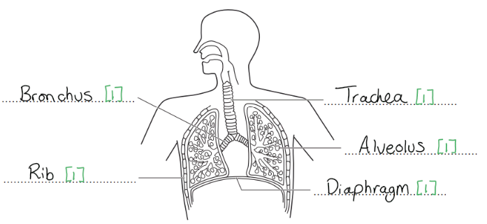

**[Total: 5 marks]**
- Mouth / nose;** [1 mark]**

**[Total: 1 mark]**
- Inspired air contains **more** oxygen than expired air; **[1 mark]**
- Inspired air contains **less** carbon dioxide than expired air; **[1 mark]**
- The concentration of **water vapour **/** molecules** in inspired and expired air varies; **[1 mark]**

**[Total: 3 marks]**
Limewater; **[1 mark]**

**[Total: 1 mark]**

### Q3
- Breathing rate increases; **[1 mark]**
- Breathing depth increases; **[1 mark]**

***Accept**** alternative wording, such as ‘breathing deeper’ or ‘breathing faster’*

You need to make sure you use comparative language and not just ‘breathing deeply’ because that doesn’t compare to how the breathing was before the exercise.

**[Total: 2 marks]**

### Q4
Organ 1 is…

- The <u>diaphragm</u>; **[1 mark]**
- (The diaphragm) relaxes and moves up/becomes dome-shaped;** [1 mark] **
- Which reduces the volume of the thorax / increases the pressure in the thorax **OR **pressure in the thorax becomes **higher **than that outside (air);** [1 mark] **

**[Total: 3 marks]**
An effective oxygen supply is maintained by…

- Description 1: Ventilation/breathing; **[1 mark]**
- Explanation 1: (Ventilation) brings in the air with a high oxygen level **OR **removes air with a low oxygen level ;** [1 mark]**
- Description 2: Circulation/transport/moving of blood; **[1 mark]**
- Explanation 2: Blood with a high oxygen level  is removed (from the lungs) **OR **blood with a low oxygen level is brought in (to the lungs); [**1 mark]**

**[Total: 4 marks]**

> *A large surface area, the maintenance of a good oxygen supply and a short diffusion distance are three of the requirements for an efficient exchange surface. *
The woman was breathing out between W and X because…

- Volume of air in lungs decreases **OR **reaches a minimum (at X); **[1 mark]**

**[Total: 1 mark]   **

> *During breathing out, a substantial amount of air leaves the lungs. However, it is important to note that at no point does all of the air leave the lungs.*
Antagonistic muscle action during ventilation…

Any **one** of the following:

- (During inspiration) diaphragm contracts whereas the abdomen muscles relax; **[1 mark]**
- (During expiration) diaphragm relaxes whereas the abdomen muscles contract; **[1 mark]**
- (During inspiration) external intercostal muscles contract whereas the internal intercostal muscles relax; **[1 mark]**
- (During expiration) external intercostal muscles relax whereas the internal intercostal muscles contract; **[1 mark]**

**[Total: 1 mark]**

> *This is a synoptic question; you will have come across the term antagonistic in Topic 14.2 Sense organs, in relation to the muscles that carry out the pupil reflex in the eye. Antagonistic muscles work in pairs; one of the muscle pairs pulls in one direction and the other pulls in the opposite direction.*

### Q5
The person's breathing rate in breaths per minute is calculated as follows:

- One inhalation + one exhalation = 5 seconds; **[1 mark]**
- 1 minute = 60 seconds ÷ 5 = 12 breaths per minute; **[1 mark]**

**[Total: 2 marks]**

> *Because the question asks for a breathing rate in breaths per minute and the length of the breaths is given in seconds, you have to be able to convert freely between seconds and minutes by applying a factor of 60.*
The missing boxes in Table 1 can be completed as follows:

| event | thoracic pressure (0 / + / -) | thoracic volume (0 / + / ++ / +++) |
|---|---|---|
| beginning of exhalation | +++ | +++ |
| end of exhalation, just before inhalation  begins | **Final answer:** **0** | **Final answer:** **0** |
| 1 second into exhalation | **Final answer:** **+ or ++** | **Final answer:** **+ or ++** |
| 1 second into inhalation | - | + or ++ |

**[1 mark]** for each correctly-completed box

**[Total: 4 marks]**
The term 'passive' in the context of exhalation can be explained as:

Any **two** from the following:

- No energy required / opposite of active; **[1 mark]**
- Diaphragm and intercostal muscles relax / are not using energy/ATP; **[1 mark]**
- Air is pushed out by elastic recoil (of alveoli) and dropping of the ribcage (that both exert pressure); **[1 mark]**

**[Total: 2 marks]**

> *Remember that energy from respiration is required to make the diaphragm and intercostal muscles contract. However, on exhalation, these both **relax** so are not using the energy from respiration.*

> *Note the terms **respiration **and **breathing **mean completely different things, and it is important not to confuse the two terms. *
The muscles of the breathing system that help to facilitate increased removal of carbon dioxide when undergoing vigorous exercise are:

Any **three** from the following:

- <u>Internal</u> intercostal muscles; **[1 mark]**
- (Which) contract to pull the ribs down; **[1 mark]**
- (Leading to) forced expiration/exhalation; **[1 mark]**
- To increase ventilation rate / remove waste CO2 more quickly; **[1 mark]**

**[Total: 3 marks]**

> *The question specifically refers to removal of CO**2** so you need to focus your response on **expiration **here rather than just ventilation only. Relaxed normal expiration is a passive process and happens because of the elastic recoil of the lungs. This question also specifically refers to vigorous exercise, hence the mark awarded for "forced expiration". *

### Q6
The breathing rate of the individual shown in the graph is...

- 60 ÷ 4; **[1 mark]**
- 15 (breaths per minute); **[1 mark]**

*Full marks can be awarded for the correct answer in the absence of other calculations*

**[Total: 2 marks]**

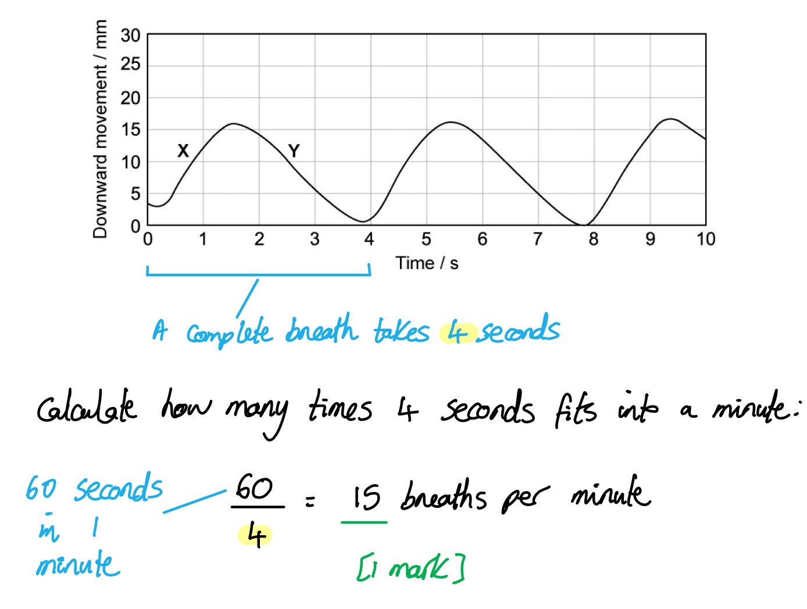
(i) The ventilation processes occurring are...

- **X** = inspiration / inhalation / breathing in **AND Y** = expiration / exhalation / breathing out; **[1 mark]**

(ii) A muscle other than the diaphragm and its state during stage** Y**...

- <u>External</u> intercostal muscles; **[1 mark]**
- Relaxed; **[1 mark]**

**OR**

- <u>Internal</u> intercostal muscles **OR** abdominal muscles (during forced expiration); **[1 mark]**
- Contracted; **[1 mark]**

**[Total: 3 marks]**

> *The graph at stage X shows the diaphragm moving downwards; this happens when it contracts, increasing the volume of the thorax and leading to inspiration. At stage Y the diaphragm is moving back up to its resting position; this happens when it relaxes, reducing the volume of the thorax and leading to expiration. Don't be thrown by the direction of the line on the graph; the line moves upwards to show an increased distance of movement, but the Y axis is labelled to show that this is a downward movement.*

> *During expiration the external intercostal muscles relax, allowing the rib cage to drop down and inwards. If forced expiration is occurring (which it could be as the graph shows that the diaphragm moves slightly further upwards at 4 and 8 s than it did at 0 s) then this could also involve contraction of the internal intercostal muscles and of the abdominal muscles.*
(i) Contrasting features between this graph and the graph in part a) include...

- The diaphragm moves furth<u>er</u> (downwards); **[1 mark]**
- The breathing rate <u>increases</u> / gets fast<u>e</u>r (very slightly); **[1 mark]**

(ii) An explanation for the differences between the graphs could be that...

Any **two** of the following;

- Oxygen intake is reduced / less oxygen is absorbed / less carbon dioxide is excreted/exhaled with each breath (with emphysema); **[1 mark]**
- The body / nervous system detects low blood oxygen / high blood carbon dioxide levels; **[1 mark]**
- Breathing volume/rate increases to compensate / allow more oxygen to enter the lungs; **[1 mark]**

**[Total: 4 marks]**

> *When describing contrasting features of anything you must be sure to use comparative languages such as fast**er**, **increases**, or high**er**, rather than simply making statements such as fast, or high. The increase in breathing rate isn't obvious here, but you should be able to see that it only takes 7 s for two breaths to be completed rather than 8 s in Fig.1, or that almost 3 breaths have been taken after 10 s rather than 2.5 breaths in Fig. 1.*

> *The individual with emphysema will have lower blood oxygen and higher blood carbon dioxide levels due to their reduced lung surface area. This change in gas content will be detected by chemical receptors in the blood and the lungs will attempt to correct this by increasing the volume of air drawn in with each breath and over time, just as they would during a period of exercise.*
The effect of diaphragm weakness or paralysis on ventilation would be...

Any **two** of the following:

- Reduced lung volume / shallow breathing during inspiration; **[1 mark]**
- Higher pressure inside lungs / a reduced pressure gradient (in comparison to healthy lungs); **[1 mark]**
- Fatigue / stronger/more frequent contraction / harder work for the (external) intercostal muscles; **[1 mark]**

**[Total: 2 marks]**

> *The diaphragm plays a major role in increasing the lung volume during ventilation, so without strong contraction from the diaphragm the lung volume would be greatly reduced and breaths would become shallower due to a failure to achieve the required pressure decrease. The external intercostal muscles would be solely responsible for increasing lung volume and may need to contract further or more frequently. In reality, someone with a condition of this kind is likely to need assistance from an artificial ventilator or diaphragm surgery.*

### Q7
The number of people with COPD in cities and villages can be compared as follows...

Any **three** of the following:

- (The number of people with ) COPD is higher in villages than in cities; **[1 mark]**
- (The number of people with) COPD is increasing in both areas / villages and cities; **[1 mark]**
- (COPD levels are) increasing faster in villages; **[1 mark]**
- COPD levels fluctuate in cities / there is a decrease in COPD in cities in 2001; **[1 mark]**
- Year **AND** people per million quoted from Fig. 1 to compare villages and cities (e.g. in 2016 there are 6 people per million in cities with COPD and 16 people per million in villages with COPD); **[1 mark]**

**[Total: 3 marks]**

> *Read the data carefully to ensure that your descriptions are correct.*

> *Remember to consider both similarities **and **differences and to support your descriptions with data points quoted from the graph.*

> *This question does not require extended level knowledge but is taken from an extended paper 4 question.*
(i) The body prevents particles in inspired air from reaching the gas exchange surfaces as follows...

Any **four** of the following:

- <u>Hairs</u> inside the nose trap particles; **[1 mark]**
- Goblet cells secrete mucus; **[1 mark]**
- Particles become trapped in mucus; **[1 mark]**
- Cilia move the mucus (by wafting/beating motion); **[1 mark]**
- Mucus moves away from the gas exchange surfaces towards the throat; **[1 mark]**
- Mucus is swallowed; **[1 mark]**
- Phagocytes (engulf pathogens within the mucus); **[1 mark]**

***Accept**** references to sneezing/coughing as a mechanism of removing mucus/pathogens from the lungs.*

(ii) The composition of inspired air differs from the composition of expired air as follows...

Any **two** of the following:

- (Inspired air contains) more oxygen; **[1 mark]**
- (Inspired air contains) less carbon dioxide; **[1 mark]**
- (Inspired air contains) less water vapour; **[1 mark]**

***Accept**** correctly stated comparative percentages of oxygen and carbon dioxide.*

**[Total: 6 marks]**

> *When describing the composition of inhaled and exhaled air remember that both inhaled and exhaled air contains a mixture of gases. It is the percentages of these gases that vary; inhaled air contains a higher percentage of oxygen and a lower percentage of carbon dioxide than exhaled air.*
(i) The muscles that cause the ribs to move during ventilation are the...

- Intercostal (muscles); **[1 mark]**

(ii) Pressure and volume changes in the thorax during inspiration are...

- Volume increases **AND** pressure decreases; **[1 mark]**

**[Total: 2 marks]**

> *Note that while the diaphragm muscles are involved with ventilation, these muscles do not cause the ribs to move, so 'diaphragm' is not a correct answer to part (i).*

### Q8
Features of the human gas exchange system that enable a fast rate of gas exchange within the lungs are:

Any **three **from the following:

- Large surface area; **[1 mark]**
- Thin walls / short distance for diffusion; **[1 mark]**
- Good ventilation / constant supply of oxygen; **[1 mark]**

*Ignore good blood supply (as stated in the question stem)*

**[Total: 3 marks]**

> *Because the command word is 'Give' you only need to state the features; there is no need to give a detailed explanation of, for example, how the lungs have a large surface area. *

> *This is a common fault of the well-prepared student who has done their revision; if that student is you and you feel the need to demonstrate your wide knowledge of the spec, then resist the urge; this question is not the place to do this! Collect the marks quickly, economically, and move on!*
The term concentration gradient means:

Any **two** from the following:

- A difference in the concentration (of a substance / water / of particles);** [1 mark]**
- Across a surface e.g. alveolar epithelium; **[1 mark]**
- (That leads to) diffusion / osmosis / (active) transport; **[1 mark]**

***Allow ****examples with correctly named substances (water for osmosis, salts, other solutes, gases for diffusion) ****Allow ****'high concentration in one area, low in a neighbouring region'*

**[Total: 2 marks]**

> *If you mention the movement of water you must refer to osmosis, rather than diffusion. *
A good blood supply means:

Any **two** of the following:

- Constant movement blood into and out (of the lung capillaries);** [1 mark]**
- One way direction of blood; **[1 mark]**
- Maintains a high concentration gradient; **[1 mark]**
- So that blood can be oxygenated fully **OR **so that oxygen will diffuse into the blood and carbon dioxide can diffuse out of the blood (into the alveoli) **OR **for efficient gas exchange of oxygen and carbon dioxide; **[1 mark]**

**[Total: 2 marks]**
The surface area of a typical adult's lungs is calculated as follows:

- 4.2 (m2) × 20 **OR** 4.2 (m2) ÷ 1/20 ; **[1 mark]**
- = 84 m2; **[1 mark]**

**[Total: 2 marks]**

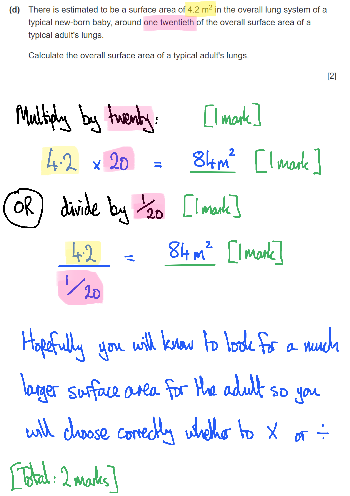

> *This equates to the often-quoted statistic that the adult lungs' surface area is about half the size of a tennis court; a singles tennis court is about 196 m**2** in area. *

### Q9
The correct labels are as follows:

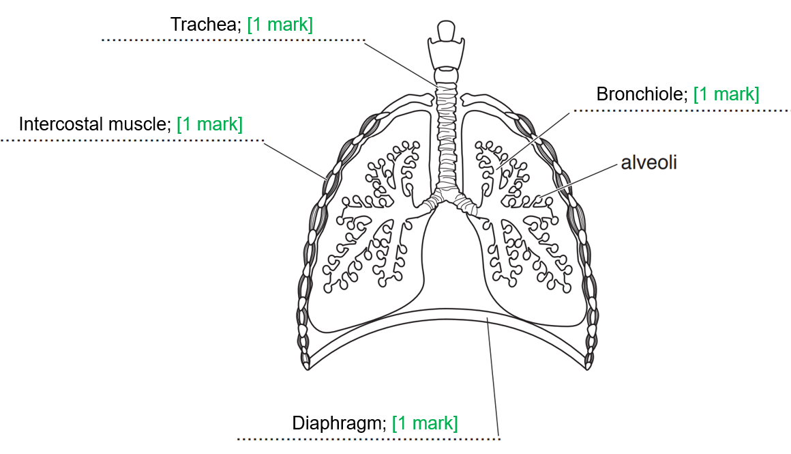

**[Total: 4 marks]**

> *Diaphragm is a very commonly misspelled word so make sure to check how your spelling. *
Two features that make alveoli good gas exchange surfaces are:

Any **two **from the following:

- Good blood supply; **[1 mark]**
- Thin; **[1 mark]**
- Ventilated; **[1 mark]**
- Large surface (area); **[1 mark]**
- Moist / permeable; **[1 mark]**

**[Total: 2 marks]**

> *Remember when stating adaptations you have to go make sure you're being specific enough with your description. For example, saying that there are blood vessels is not the same as saying there are **lots** of blood vessels. *
(i) Two other ways in which expired air is different from inspired air are:

Any **two **from the following:

- More water vapour; **[1 mark]**
- More carbon dioxide; **[1 mark]**
- Higher temperature / warm<u>er</u>; **[1 mark]**

(ii) The name of the process that uses oxygen in cells is:

- (Aerobic) respiration / the removal of lactic acid; **[1 mark]**

**[Total: 3 marks]**

> *Anaerobic respiration is not a correct answer here because it does not require oxygen. Remember that **breathing is not the same as respiration**. *
An example of a cell and an organ from the gas exchange system are:

- Cell: red blood cell / ciliated cell / muscle cell / white blood cell; **[1 mark]**
- Organ: lung / trachea / bronchus / bronchiole / larynx; **[1 mark]**

**[Total: 2 marks]**

> *You could also be awarded marks for naming cells and organs of the gas exchange system in plants, such as guard cells and the leaf. *

### Q10
The tissue affected by this genetic disorder is:

- Cartilage; **[1 mark]**

**Reason**:

- Because rings of cartilage support the trachea; if the rings are weak / malformed then the trachea may collapse under negative pressure / partial vacuum; **[1 mark]**

**[Total: 2 marks]**
The percentage difference in oxygen content of exhaled air compared to inhaled air is calculated as follows:

- Difference = 5 (% units); **[1 mark]**
- (5 ÷ 21) × 100 = 23.8% / 24%; **[1 mark]**

**[Total: 2 marks]**

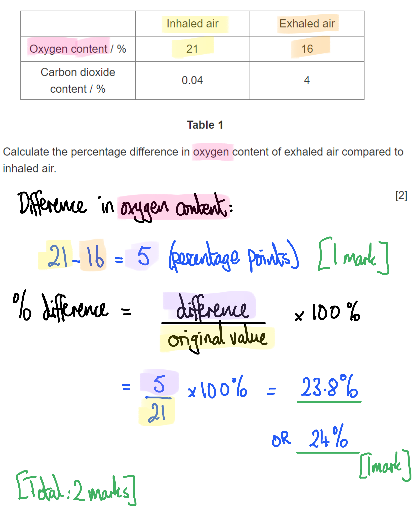

> *A very common error will be to state the answer as 5%. This is because you may assume that because the units are already expressed in %, then the % difference will just be 21% - 16% = 5%. This is not the case.*

*The units must be ignored, once you are satisfied that the same unit is being used in both values. The difference of 5 must be calculated as a proportion of the original value of oxygen concentration, which is 21. This is how 24% is worked out.*
Bronchioles, alveoli and blood capillaries within a lung improve the performance of the lung by...

Any **one **of the following:

- Allowing a greater surface area (despite lower volume); **[1 mark]**
- Good blood supply maintains a high concentration gradient; **[1 mark]**

*Allow 'increases the surface area'*

**Plus:**

- (Thereby) improving the rate of <u>diffusion</u> (hence better gas exchange); **[1 mark]**

**[Total: 2 marks]**

> *It is important to acknowledge the role of **diffusion** in gas exchange, and that all these organs have evolved to maximise the rate of diffusion (as per Fick's Law).*
(d) The roles of the cilia and mucus in protecting the breathing system are:

- The mucus traps bacteria (including pathogens) / dust / other particles; **[1 mark]**
- The cilia beat / move; **[1 mark]**
- (And) push the mucus away from the lungs towards the throat, where it can be swallowed; **[1 mark]**

**[Total: 3 marks]**

### Q11
The sequence in which air passes through the structures during an **exhalation** is:

| structure | order |
|---|---|
| bronchus | **3** |
| facial airways | **5** |
| alveolus | **1** |
| trachea | **4** |
| bronchioles | **2** |

**[Total: 1 mark]**

> *It's crucial that you **read the question right through to the end** here; if you miss the word, 'exhalation' then you may decide to order the steps for an inhalation, meaning that you would not gain the mark.*
The organ which governs the activity of the human breathing system is:

- Diaphragm; **[1 mark]**

| Lungs | Diaphragm | Trachea | Ribs |
|---|---|---|---|
|   | **✓** |   |   |

The reason for this is that...

Any **one** of the following:

- The diaphragm is a muscle / it contracts and starts off the process of inhalation; **[1 mark]**
- Lungs cannot inflate by themselves; **[1 mark]**

**[Total: 2 marks]**

> *The most common error here would be to indicate 'lungs' because the lungs are for breathing, right?! Well, that's true but it is the diaphragm (along with the intercostal muscles) that uses energy to contract, causing a drop in pressure so that air is pushed into the lungs from outside. The lungs cannot inflate or deflate by themselves because they are not made of muscle tissue. *
The reagent used to test for the presence of carbon dioxide (CO2) in a sample of air is:

- Lime water / calcium hydroxide solution; **[1 mark]**

The appearance of a positive result is:

- Cloudy / milky / white suspension;** [1 mark]**

**Final answer:** **[Total: 2 marks]**** **
The number of times more carbon dioxide (CO2) is in exhaled air than in inhaled air is:

- 100 (×); **[1 mark]**

*Allow answers in the range 90 - 110 times*

**[Total: 1 mark]**

> *The CO**2** content of inhaled air is 0.04%. This rises to 4% in exhaled air.*

> $\frac{4 \%}{0.04 \%} = 100$* times*

### Q12
The tissue that supports the trachea is:

- Cartilage; **[1 mark]**

**[Total: 1 mark]**
The parts 1 - 6 in Fig. 1 are as follows:

| Part | Organ / Structure |
|---|---|
| 1 | **Final answer:** **intercostal**** muscle** |
| 2 | **Final answer:** **rib(s)** |
| 3 | **Final answer:** **diaphragm** |
| 4 | **Final answer:** **bronchus** |
| 5 | **Final answer:** **bronchiole** |
| 6 | **Final answer:** **alveolus / alveoli** |

**[1 mark]** for each correct label.

**[Total: 6 marks]**
The measurements being taken in Fig. 2 are:

- Chest circumference expansion / change in chest circumference as he breathes; **[1 mark]**
- Number of breaths per minute / breathing rate; **[1 mark]**

***Do not allow**** simple chest circumference without reference to how this changes with breathing*

**[Total: 2 marks]**
The type of tissue that the meat in this dish comes from is:

- <u>Intercostal</u> muscle(s); **[1 mark]**

*Ignore external or internal*

**[Total: 1 mark]**
