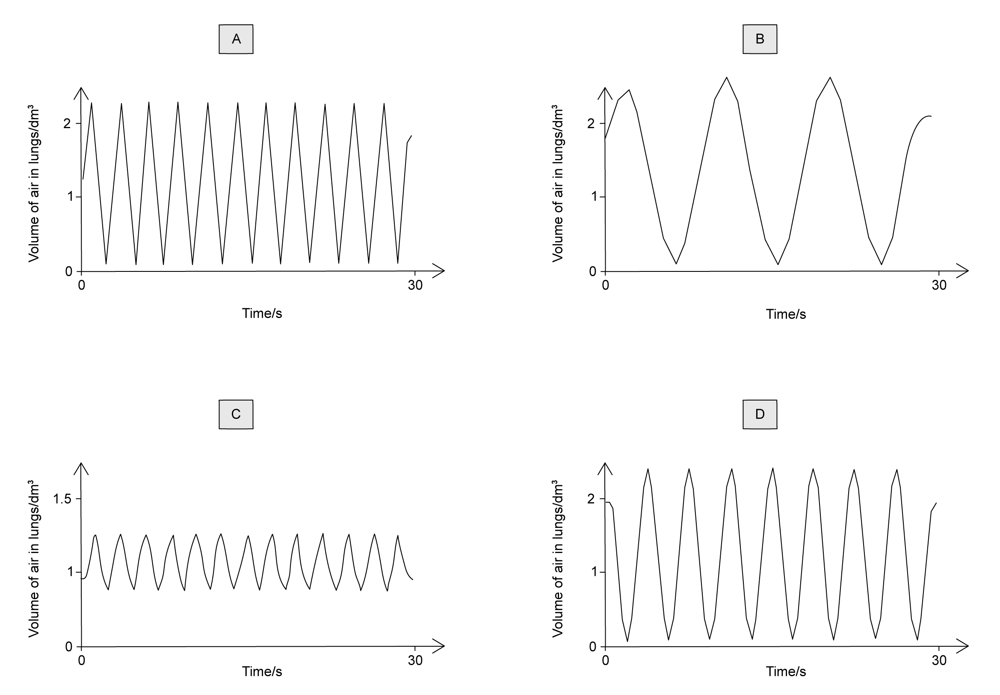
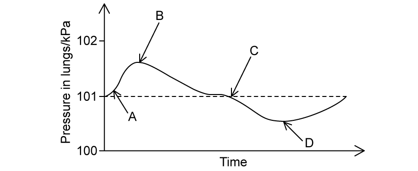
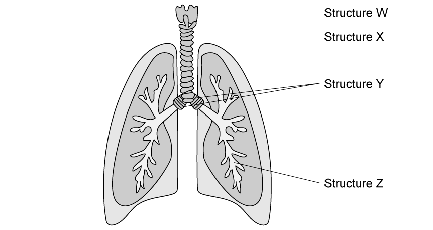
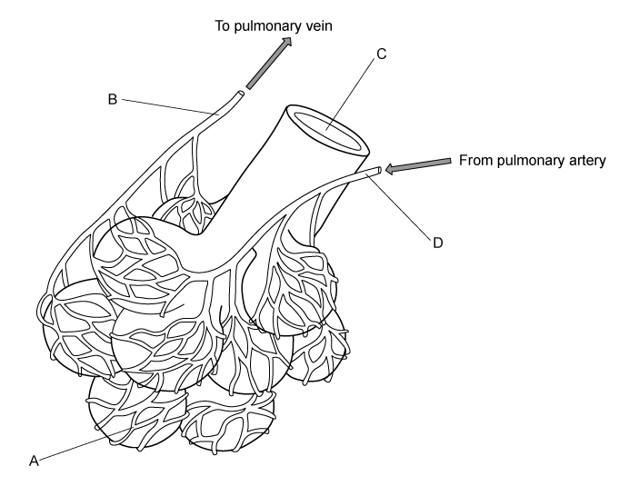

# Exam Questions — Gas Exchange in Humans
**11. Gas Exchange in Humans** · Cambridge (CIE) IGCSE biology (0610 & 0970)
> Source: [https://www.savemyexams.com/igcse/biology/cie/23/topic-questions/](https://www.savemyexams.com/igcse/biology/cie/23/topic-questions/) · 26 questions across 1 sets

## Multiple Choice Questions (26 questions)

### Q1 — hard — 1 marks

**Q1** [1 mark]

Below are statements about the features of gas exchange surfaces in humans.

1. Gas exchange surfaces have a large surface area to maximise the rate of diffusion
2. Gas exchange surfaces have a thick surface to prevent damage from the constant movement of air
3. Gas exchange surfaces have a good blood supply to remove gases that have diffused across the surface
4. Gas exchange surfaces are well ventilated to increase the concentration of carbon dioxide in the alveoli

Which statements are correct?

### Q2 — hard — 1 marks

**Q2** [1 mark]

Which row correctly describes the composition of expired air compared to inspired air?

|   | **Oxygen** | **Carbon dioxide** | **Water vapour** |
|---|---|---|---|
| **A** | higher | higher | higher |
| **B** | lower | higher | higher |
| **C** | lower | lower | higher |
| **D** | higher | lower | lower |

### Q3 — medium — 1 marks

**Q3** [1 mark]

The diagram shows a representation of the human gas exchange system.

Which row correctly identifies the labelled structures?

|   | **Structure 1** | **Structure 2** | **Structure 3** | **Structure 4** |
|---|---|---|---|---|
| **A** | Oesophagus | Bronchus | Diaphragm | Alveolus |
| **B** | Trachea | Bronchiole | Intercostal muscle | Blood vessel |
| **C** | Trachea | Bronchus | Diaphragm | Alveolus |
| **D** | Bronchus | Bronchiole | Abdominal muscle | Capillary |

### Q4 — medium — 1 marks

**Q4** [1 mark]

Why does breathing rate increase during exercise?

### Q5 — medium — 1 marks

**Q5** [1 mark]

What do the external intercostal muscles do during inhalation?

### Q6 — medium — 1 marks

**Q6** [1 mark]

Which sequence of changes takes place when we breathe in?

*Source: June 2021 0970/21 Q22*

### Q7 — medium — 1 marks

**Q7** [1 mark]

Which row shows a change that occurs during ventilation?

|   | process | thorax pressure | thorax volume | air movement |
|---|---|---|---|---|
| **A** | expiration | decreases | increases | in |
| **B** | expiration | increases | decreases | out |
| **C** | inspiration | decreases | increases | out |
| **D** | inspiration | increases | decreases | in |

*Source: june 2022 paper 2 Q21*

### Q8 — medium — 1 marks

**Q8** [1 mark]

A person lives in a climate where the air is very dry.

Which row correctly compares inspired air with expired air for this person?

|   | inspired air | expired air |
|---|---|---|
| **A** | higher carbon dioxide concentration | higher oxygen concentration |
| **B** | lower water vapour concentration | higher carbon dioxide concentration |
| **C** | lower oxygen concentration | higher water vapour concentration |
| **D** | lower carbon dioxide concentration | lower water vapour concentration |

*Source: June 2022 paper 1 Q22*

### Q9 — medium — 1 marks

**Q9** [1 mark]

The diagrams show the depth and rate of breathing in a person at 12:00 and 13:00.

What happens to the person’s breathing between 12:00 and 13:00?

|   | depth of breathing | rate of breathing |
|---|---|---|
| **A** | decreases | decreases |
| **B** | decreases | increases |
| **C** | increases | decreases |
| **D** | increases | increases |

*Source: June 2021 0970/11 Q22*

### Q10 — medium — 1 marks

**Q10** [1 mark]

What are the approximate percentages of oxygen and carbon dioxide in inspired air?

|   | percentage of oxygen | percentage of carbon dioxide |
|---|---|---|
| **A** | 16 | 4.00 |
| **B** | 16 | 8.00 |
| **C** | 21 | 0.04 |
| **D** | 21 | 4.00 |

*Source: Specimen 2023 0970/01 Q20*

### Q11 — easy — 1 marks

**Q11** [1 mark]

#### Extended

The image below shows some cells found in the trachea.

What is the function of the part labelled K?

### Q12 — medium — 1 marks

**Q12** [1 mark]

The diagram below shows a cross-section through an alveolus and a capillary.

Why does oxygen move from P to Q?

### Q13 — hard — 1 marks

**Q13** [1 mark]

#### Extended

A person exhales, and the air from their lungs is collected and placed in a gas jar. A second gas jar contains normal atmospheric air. A candle is set alight and is placed inside each gas jar as shown. The time taken for each flame to go out is measured with a stopwatch.

The table shows the results of this experiment.

| gas jar | time for candle flame to go out /s |
|---|---|
| 1 | 7 |
| 2 | 12 |

Which of the following is a correct explanation for the difference between the results in jars 1 and 2?

### Q14 — hard — 1 marks

**Q14** [1 mark]

#### Extended

The graph shows changes in the volume of air in the lungs of a person at rest, over a period of 30 seconds.

Which graph below shows the changes in the volume of air in the lungs for the same person immediately after they have done a few minutes of vigorous exercise?

### Q15 — medium — 1 marks

**Q15** [1 mark]

#### Extended

When the diaphragm relaxes and internal intercostal muscles contract, how does the volume and pressure inside the thorax change?

| ** ** | pressure | volume |
|---|---|---|
| **A** | decreases | decreases |
| **B** | decreases | increases |
| **C** | increases | decreases |
| **D** | increases | increases |

### Q16 — easy — 1 marks

**Q16** [1 mark]

Which of the following sequences show the correct path of oxygen as it enters the lungs?

### Q17 — hard — 1 marks

**Q17** [1 mark]

#### Extended

The diagram below illustrates the changes in air pressure taking place inside the lungs during a complete cycle of breathing. Atmospheric pressure is 101 kPa.

At which point on the diagram does the process of inhalation start?

### Q18 — easy — 1 marks

**Q18** [1 mark]

Name the structures shown in the diagram.

|   | W | X | Y | Z |
|---|---|---|---|---|
| **A** | larynx | trachea | bronchi | bronchioles |
| **B** | trachea | larynx | bronchioles | bronchi |
| **C** | bronchi | trachea | bronchioles | larynx |
| **D** | larynx | bronchi | larynx | bronchioles |

### Q19 — hard — 1 marks

**Q19** [1 mark]

Which of the following helps carbon dioxide to be excreted rapidly into the alveoli from the blood in the lungs?

1. Inhaled air has a lower concentration of carbon dioxide than the blood constantly pumping through the lungs.
2. Alveoli have thick walls and a large surface area.
3. Alveoli have thin walls and a large surface area.
4. The concentration of carbon dioxide in the blood is lower than in the alveoli.

### Q20 — easy — 1 marks

**Q20** [1 mark]

What is the approximate percentage of carbon dioxide in expired air?

### Q21 — easy — 1 marks

**Q21** [1 mark]

What makes the alveoli suitable as a gas exchange surface in mammals?

| ** ** | a dense capillary network | large total surface area |
|---|---|---|
| **A** | **X** | **X** |
| **B** | **✔** | **X** |
| **C** | **X** | **✔** |
| **D** | ✔ | ✔ |

### Q22 — medium — 1 marks

**Q22** [1 mark]

#### Extended

The diagram shows the composition of four samples of air (O2 = oxygen, CO2 = carbon dioxide, N2 = nitrogen).

Which sample is inspired air and which sample is expired air?

|   | inspired air | expired air |
|---|---|---|
| **A** | R | S |
| **B** | P | R |
| **C** | Q | P |
| **D** | S | R |

### Q23 — hard — 1 marks

**Q23** [1 mark]

The diagram shows part of the structure of a human lung.

Where would the concentration of carbon dioxide be highest?

### Q24 — medium — 1 marks

**Q24** [1 mark]

Compared to the composition of atmospheric air, the air exhaled by a man contains:

### Q25 — hard — 1 marks

**Q25** [1 mark]

#### Extended

Which of the following correctly describes the actions of the intercostal muscles and the diaphragm when we breathe in?

|   | external intercostal muscles | internal intercostal muscles | diaphragm |
|---|---|---|---|
| **A** | contract | relax | domed |
| **B** | contract | relax | flat |
| **C** | relax | contract | domed |
| **D** | relax | contract | flat |

### Q26 — medium — 1 marks

**Q26** [1 mark]

Some amphibians, such as frogs, can use their skin as a gas exchange surface.

What are the most likely characteristics of the surface of the skin in these amphibians?

|   | surface area | type of skin |
|---|---|---|
| **A** | small | thick |
| **B** | large | thick |
| **C** | small | thin |
| **D** | large | thin |
