# Exam Questions — Gas Exchange in Humans
**11. Gas Exchange in Humans** · Cambridge (CIE) IGCSE biology (0610 & 0970)
> Source: [https://www.savemyexams.com/igcse/biology/cie/23/topic-questions/](https://www.savemyexams.com/igcse/biology/cie/23/topic-questions/) · 41 questions across 3 sets

## Alternative To Practical Questions (3 questions)

### Q1 — medium — 15 marks

**Q1** [11 marks]

A student investigated the effect of exercise on breathing rate.

The breathing rates of five people were measured at rest and after running for different periods of time. The people rested between each period of running.

The results are shown in Table 1.

**Table 1**

| Running time /minutes | Breathing rate/breaths per minute |   |   |   |   |   |
|---|---|---|---|---|---|---|
| Person | Average |   |   |   |   |   |
| One | Two | Three | Four | Five |   |   |
| 0 | 20 | 24 | 22 | 26 | 28 | 24 |
| 2 | 32 | 31 | 28 | 32 | 32 | 31 |
| 4 | 39 | 41 | 38 | 42 | 40 |   |
| 6 | 46 | 52 | 52 | 46 | 44 | 48 |
| 8 | 48 | 50 | 52 | 46 | 44 | 48 |
| 10 | 49 | 51 | 51 | 46 | 43 | 48 |

(i)

Complete Table 1 by calculating the average breathing rate for four minutes of running.

[1]

(ii)

The student thought that the result for person two at six minutes was an anomaly.

Suggest what the student should do to determine if the result is anomalous.

[1]

(iii)

Plot a graph to show the relationship between running time and the average breathing rate. Draw a line of best fit.

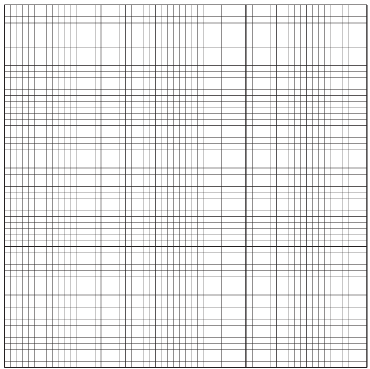

[4]

(iv)

Use your graph to estimate the average breathing rate for one minute of the running.

Show on the graph how you obtained your answer.

[2]

(v)

Use your graph to describe the relationship between running time and the average breathing rate.

[3]

*Source: 2018 0610/62 Q2B*

**Q1** [4 marks]

**Extract:**

A student investigated the effect of exercise on breathing rate.

The breathing rates of five people were measured at rest and after running for different periods of time. The people rested between each period of running.

The results are shown in Table 1.

| Running time /minutes | Breathing rate/breaths per minute |
| Person | Average |
| One | Two | Three | Four | Five |
| 0 | 20 | 24 | 22 | 26 | 28 | 24 |
| 2 | 32 | 31 | 28 | 32 | 32 | 31 |
| 4 | 39 | 41 | 38 | 42 | 40 |   |
| 6 | 46 | 52 | 52 | 46 | 44 | 48 |
| 8 | 48 | 50 | 52 | 46 | 44 | 48 |
| 10 | 49 | 51 | 51 | 46 | 43 | 48 |

(i)

Suggest **one** safety precaution for this investigation.

[1]

(iii)

State **two** variables that should be kept constant during this investigation.

[2]

(iii)

State the variable that has been changed (the independent variable) in this investigation.

[1]

*Source: 2018 0610/62 Q2C*

### Q2 — medium — 14 marks

**Q2** [8 marks]

Fig. 1 shows a photomicrograph of part of the lung of a mammal.

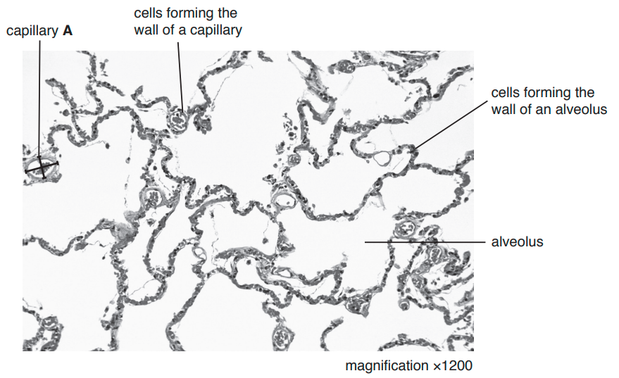

**Fig. 1**

(i)

The two lines drawn on the capillary labelled **A** represents the diameter of the capillary measured at different points. The two lines on the image have the following measurements:

Diameter 1 = 6 mm

Diameter 2 = 9 mm

Calculate the average diameter of the image of capillary **A**.

[1]

(ii)

Calculate the actual average diameter of capillary **A** using your answer to **a) i)** and the formula:

$\mathrm{magnification}=\frac{\mathrm{average} \mathrm{diameter} \mathrm{of} \mathrm{capillary}A\mathrm{on} \mathrm{Fig}.1}{\mathrm{actual} \mathrm{average} \mathrm{diameter} \mathrm{of} \mathrm{capillary}A}$

1mm = 1000 μm

Give your answer to the nearest whole μm.

[3]

(iii)

Make a large drawing of three alveoli and one capillary, that are next to each other in Fig.1. Do not draw individual cells.

[4]

*Source: 2018 0610/61 Q2A*

**Q2** [6 marks]

Some students measured the average increase in chest circumference, during breathing, and when at rest. Each student wrapped a tape measure around their body just below the armpits, as shown in Fig. 2.

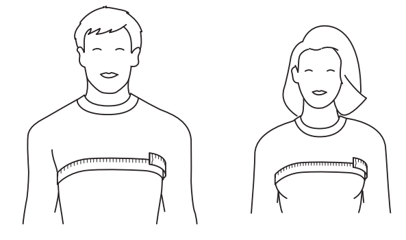

**Fig. 2**

Each student then breathed out and took a measurement of their chest circumference. They then breathed in and took a second measurement. The difference between the two measurements is the increase in chest circumference.

Table 1 shows the results of their measurements.

**Table 1**

|   | Increase in chest circumference / mm |   |
|---|---|---|
|   | male | female |
|   | 40 | 32 |
|   | 31 | 37 |
|   | 48 | 25 |
|   | 28 | 38 |
|   | 46 | 27 |
|   | 33 | 30 |
|   | 39 | 22 |
|   | 41 | 38 |
|   | 25 | 27 |
|   | 39 | 34 |
| average | 37 |   |

** **

(i)

Calculate the average increase in chest circumference for females.

Write your answer in Table 1.

[1]

(ii)

Describe how the students could find out the effect of exercise intensity on chest circumference during breathing.

[5]

*Source: 2018 0610/61 Q2B*

### Q3 — medium — 23 marks

**Q3** [7 marks]

Fig. 1 shows a micrograph of a section of the trachea wall.

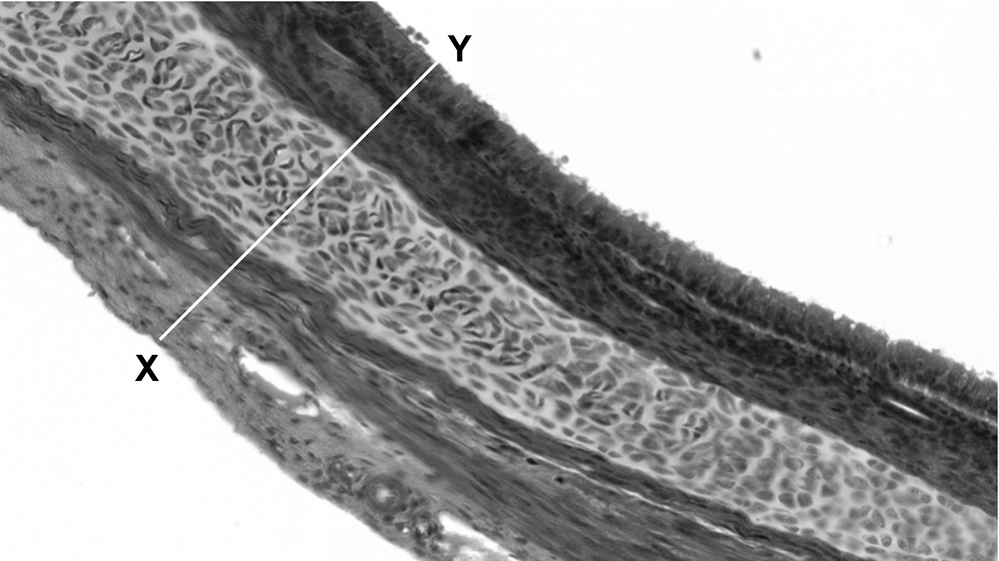

**magnfication: x40**

Image courtesy of Magscope. Licenced under CC BY-SA 4.0 under conditions found at: https://creativecommons.org/licenses/by-sa/4.0/deed.en.

**Fig. 1**

(i)

Line **XY** measures 6 cm and the magnification of the micrograph is x40.

Calculate the actual width of the trachea wall in mm.

Use the following formula:

$\mathrm{magnification}=\frac{\mathrm{measured} \mathrm{width} \mathrm{of} \mathrm{XY}}{\mathrm{actual} \mathrm{width} \mathrm{of} \mathrm{trachea} \mathrm{wall}}$

[3]

(ii)

Make a large drawing of the wall of the trachea to indicate the different tissue layers.

Do not draw individual cells or include line **XY**.

[4]

**Q3** [4 marks]

**Extract:**

An investigation was conducted on the effect of different types of exercise on the breathing rate.

Table 1 shows the results of this investigation.

| type of exercise | breathing rate / breaths min^-1^ |
| trial 1 | trial 2 | trial 3 | mean |
| walking | 12 | 10 | 12 | 11 |
| running | 18 | 16 | 8 |   |
| swimming | 15 | 17 | 14 | 15 |
| jumping | 16 | 16 | 14 | 15 |
| push-ups | 17 | 18 | 16 | 17 |

An investigation was conducted on the effect of different types of exercise on the breathing rate.

Table 1 shows the results of this investigation.

**Table 1**

| **type of exercise** | **breathing rate / breaths min****-1** |   |   |   |
|---|---|---|---|---|
| **trial 1** | **trial 2** | **trial 3** | **mean** |   |
| walking | 12 | 10 | 12 | 11 |
| running | 18 | 16 | 8 |   |
| swimming | 15 | 17 | 14 | 15 |
| jumping | 16 | 16 | 14 | 15 |
| push-ups | 17 | 18 | 16 | 17 |

(i)

The investigator thought that the running measurement taken during trial 3 was anomalous.

Explain why they thought this and suggest how they could test whether this measurement is an anomaly.

[2]

(ii)

Use the data in Table 1 to calculate the mean breathing rate for running.

[2]

**Q3** [6 marks]

**Extract:**

Table 1

type of exercise | breathing rate / breaths min^-1^
trial 1 | trial 2 | trial 3 | mean
walking | 12 | 10 | 12 | 11
running | 18 | 16 | 8 | 17
swimming | 15 | 17 | 14 | 15
jumping | 16 | 16 | 14 | 15
push-ups | 17 | 18 | 16 | 17

(i)

Use the data in Table 1 to plot a bar chart on the grid below.

[3]

(ii)

Describe the data from Table 1 and the bar chart.

[3]

**Q3** [6 marks]

A student stated that:

**'Breathing rate decreases with age'**

Plan an investigation to test this statement.

## Multiple Choice Questions (26 questions)

### Q1 — hard — 1 marks

**Q1** [1 mark]

Below are statements about the features of gas exchange surfaces in humans.

1. Gas exchange surfaces have a large surface area to maximise the rate of diffusion
2. Gas exchange surfaces have a thick surface to prevent damage from the constant movement of air
3. Gas exchange surfaces have a good blood supply to remove gases that have diffused across the surface
4. Gas exchange surfaces are well ventilated to increase the concentration of carbon dioxide in the alveoli

Which statements are correct?

### Q2 — hard — 1 marks

**Q2** [1 mark]

Which row correctly describes the composition of expired air compared to inspired air?

|   | **Oxygen** | **Carbon dioxide** | **Water vapour** |
|---|---|---|---|
| **A** | higher | higher | higher |
| **B** | lower | higher | higher |
| **C** | lower | lower | higher |
| **D** | higher | lower | lower |

### Q3 — medium — 1 marks

**Q3** [1 mark]

The diagram shows a representation of the human gas exchange system.

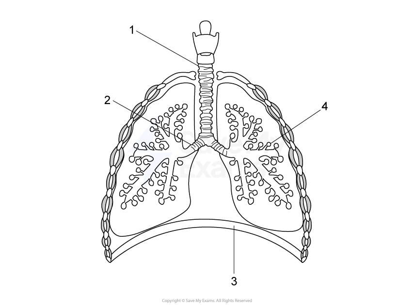

Which row correctly identifies the labelled structures?

|   | **Structure 1** | **Structure 2** | **Structure 3** | **Structure 4** |
|---|---|---|---|---|
| **A** | Oesophagus | Bronchus | Diaphragm | Alveolus |
| **B** | Trachea | Bronchiole | Intercostal muscle | Blood vessel |
| **C** | Trachea | Bronchus | Diaphragm | Alveolus |
| **D** | Bronchus | Bronchiole | Abdominal muscle | Capillary |

### Q4 — medium — 1 marks

**Q4** [1 mark]

Why does breathing rate increase during exercise?

### Q5 — medium — 1 marks

**Q5** [1 mark]

What do the external intercostal muscles do during inhalation?

### Q6 — medium — 1 marks

**Q6** [1 mark]

Which sequence of changes takes place when we breathe in?

*Source: June 2021 0970/21 Q22*

### Q7 — medium — 1 marks

**Q7** [1 mark]

Which row shows a change that occurs during ventilation?

|   | process | thorax pressure | thorax volume | air movement |
|---|---|---|---|---|
| **A** | expiration | decreases | increases | in |
| **B** | expiration | increases | decreases | out |
| **C** | inspiration | decreases | increases | out |
| **D** | inspiration | increases | decreases | in |

*Source: june 2022 paper 2 Q21*

### Q8 — medium — 1 marks

**Q8** [1 mark]

A person lives in a climate where the air is very dry.

Which row correctly compares inspired air with expired air for this person?

|   | inspired air | expired air |
|---|---|---|
| **A** | higher carbon dioxide concentration | higher oxygen concentration |
| **B** | lower water vapour concentration | higher carbon dioxide concentration |
| **C** | lower oxygen concentration | higher water vapour concentration |
| **D** | lower carbon dioxide concentration | lower water vapour concentration |

*Source: June 2022 paper 1 Q22*

### Q9 — medium — 1 marks

**Q9** [1 mark]

The diagrams show the depth and rate of breathing in a person at 12:00 and 13:00.

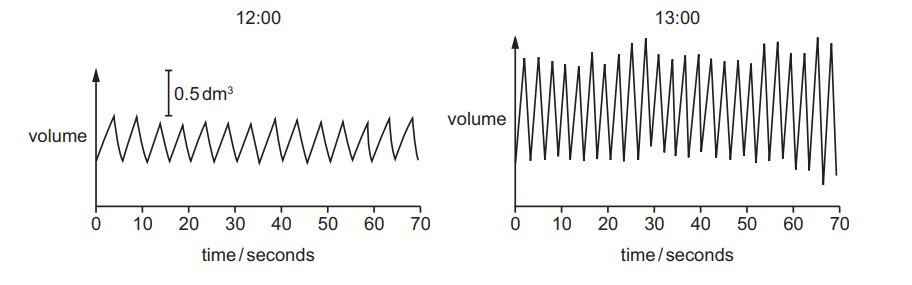

What happens to the person’s breathing between 12:00 and 13:00?

|   | depth of breathing | rate of breathing |
|---|---|---|
| **A** | decreases | decreases |
| **B** | decreases | increases |
| **C** | increases | decreases |
| **D** | increases | increases |

*Source: June 2021 0970/11 Q22*

### Q10 — medium — 1 marks

**Q10** [1 mark]

What are the approximate percentages of oxygen and carbon dioxide in inspired air?

|   | percentage of oxygen | percentage of carbon dioxide |
|---|---|---|
| **A** | 16 | 4.00 |
| **B** | 16 | 8.00 |
| **C** | 21 | 0.04 |
| **D** | 21 | 4.00 |

*Source: Specimen 2023 0970/01 Q20*

### Q11 — easy — 1 marks

**Q11** [1 mark]

#### Extended

The image below shows some cells found in the trachea.

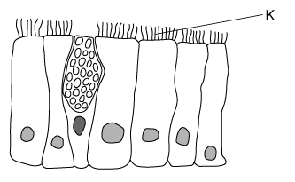

What is the function of the part labelled K?

### Q12 — medium — 1 marks

**Q12** [1 mark]

The diagram below shows a cross-section through an alveolus and a capillary.

Why does oxygen move from P to Q?

### Q13 — hard — 1 marks

**Q13** [1 mark]

#### Extended

A person exhales, and the air from their lungs is collected and placed in a gas jar. A second gas jar contains normal atmospheric air. A candle is set alight and is placed inside each gas jar as shown. The time taken for each flame to go out is measured with a stopwatch.

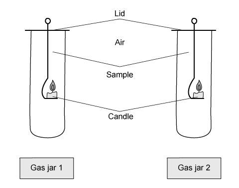

The table shows the results of this experiment.

| gas jar | time for candle flame to go out /s |
|---|---|
| 1 | 7 |
| 2 | 12 |

Which of the following is a correct explanation for the difference between the results in jars 1 and 2?

### Q14 — hard — 1 marks

**Q14** [1 mark]

#### Extended

The graph shows changes in the volume of air in the lungs of a person at rest, over a period of 30 seconds.

Which graph below shows the changes in the volume of air in the lungs for the same person immediately after they have done a few minutes of vigorous exercise?

### Q15 — medium — 1 marks

**Q15** [1 mark]

#### Extended

When the diaphragm relaxes and internal intercostal muscles contract, how does the volume and pressure inside the thorax change?

| ** ** | pressure | volume |
|---|---|---|
| **A** | decreases | decreases |
| **B** | decreases | increases |
| **C** | increases | decreases |
| **D** | increases | increases |

### Q16 — easy — 1 marks

**Q16** [1 mark]

Which of the following sequences show the correct path of oxygen as it enters the lungs?

### Q17 — hard — 1 marks

**Q17** [1 mark]

#### Extended

The diagram below illustrates the changes in air pressure taking place inside the lungs during a complete cycle of breathing. Atmospheric pressure is 101 kPa.

At which point on the diagram does the process of inhalation start?

### Q18 — easy — 1 marks

**Q18** [1 mark]

Name the structures shown in the diagram.

|   | W | X | Y | Z |
|---|---|---|---|---|
| **A** | larynx | trachea | bronchi | bronchioles |
| **B** | trachea | larynx | bronchioles | bronchi |
| **C** | bronchi | trachea | bronchioles | larynx |
| **D** | larynx | bronchi | larynx | bronchioles |

### Q19 — hard — 1 marks

**Q19** [1 mark]

Which of the following helps carbon dioxide to be excreted rapidly into the alveoli from the blood in the lungs?

1. Inhaled air has a lower concentration of carbon dioxide than the blood constantly pumping through the lungs.
2. Alveoli have thick walls and a large surface area.
3. Alveoli have thin walls and a large surface area.
4. The concentration of carbon dioxide in the blood is lower than in the alveoli.

### Q20 — easy — 1 marks

**Q20** [1 mark]

What is the approximate percentage of carbon dioxide in expired air?

### Q21 — easy — 1 marks

**Q21** [1 mark]

What makes the alveoli suitable as a gas exchange surface in mammals?

| ** ** | a dense capillary network | large total surface area |
|---|---|---|
| **A** | **X** | **X** |
| **B** | **✔** | **X** |
| **C** | **X** | **✔** |
| **D** | ✔ | ✔ |

### Q22 — medium — 1 marks

**Q22** [1 mark]

#### Extended

The diagram shows the composition of four samples of air (O2 = oxygen, CO2 = carbon dioxide, N2 = nitrogen).

Which sample is inspired air and which sample is expired air?

|   | inspired air | expired air |
|---|---|---|
| **A** | R | S |
| **B** | P | R |
| **C** | Q | P |
| **D** | S | R |

### Q23 — hard — 1 marks

**Q23** [1 mark]

The diagram shows part of the structure of a human lung.

Where would the concentration of carbon dioxide be highest?

### Q24 — medium — 1 marks

**Q24** [1 mark]

Compared to the composition of atmospheric air, the air exhaled by a man contains:

### Q25 — hard — 1 marks

**Q25** [1 mark]

#### Extended

Which of the following correctly describes the actions of the intercostal muscles and the diaphragm when we breathe in?

|   | external intercostal muscles | internal intercostal muscles | diaphragm |
|---|---|---|---|
| **A** | contract | relax | domed |
| **B** | contract | relax | flat |
| **C** | relax | contract | domed |
| **D** | relax | contract | flat |

### Q26 — medium — 1 marks

**Q26** [1 mark]

Some amphibians, such as frogs, can use their skin as a gas exchange surface.

What are the most likely characteristics of the surface of the skin in these amphibians?

|   | surface area | type of skin |
|---|---|---|
| **A** | small | thick |
| **B** | large | thick |
| **C** | small | thin |
| **D** | large | thin |

## Theory Questions (12 questions)

### Q1 — medium — 4 marks

**Q1** [2 marks]

State the names of two structures in the human breathing system that the air passes through as it travels from the trachea to the alveoli.

**Q1** [2 marks]

A student monitored their breathing rate before, during, and after an exercise period. The exercise period began at minute 1 and ended at minute 7.

The results are shown in Fig. 4.1.

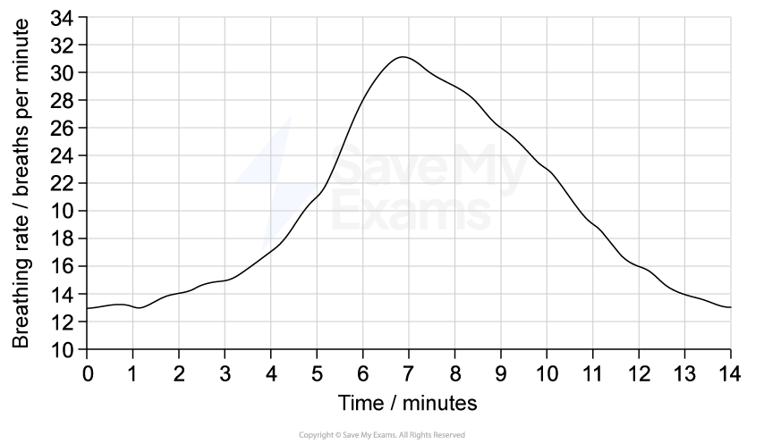

**Fig. 4.1**

The student measured their breathing rate by counting the number of times their chest rose and fell in one minute.

Another student suggested that measuring heart rate would give a more accurate picture of the effect of exercise on the body.

Suggest two limitations of counting breathing rate in this investigation.

### Q2 — easy — 10 marks

**Q2** [5 marks]

Fig. 5.1 is a diagram of the human gas exchange system.

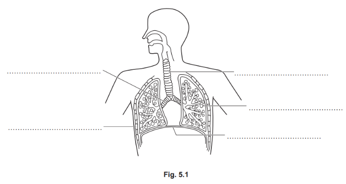

The list shows the names of some of the parts of the human gas exchange system.

**alveolus 	bronchiole	 bronchus 	diaphragm **

**Larynx	 rib	 trachea **

Use the words from the list to label Fig. 5.1.

You do not need to use every word.

Write your answers on the answer lines provided in Fig. 5.1.

*Source: June 2022 paper 3  Q5A*

**Q2** [1 mark]

State the name of the part of the body through which air enters and leaves.

*Source: june 2022 paper 3 Q5B*

**Q2** [3 marks]

Complete the sentences about the differences between inspired and expired air. 

Inspired air contains .......................................... oxygen than expired air. 

Inspired air contains .......................................... carbon dioxide than expired air. 

The concentration of water .......................................... in inspired and expired air varies.

*Source: june 2022 paper 3  Q5C*

**Q2** [1 mark]

Carbon dioxide is one of the components of inspired and expired air.

State the name of the chemical used to test for the presence of carbon dioxide.

*Source: june 2022 paper 3 Q5D*

### Q3 — easy — 2 marks

**Q3** [2 marks]

Breathing is also affected by exercise.

Describe the effects of exercise on breathing.

*Source: Specimen 2023 0970/03 Q2C*

### Q4 — hard — 9 marks

**Q4** [3 marks]

Fig. 1 depicts a section of the human gas exchange system.

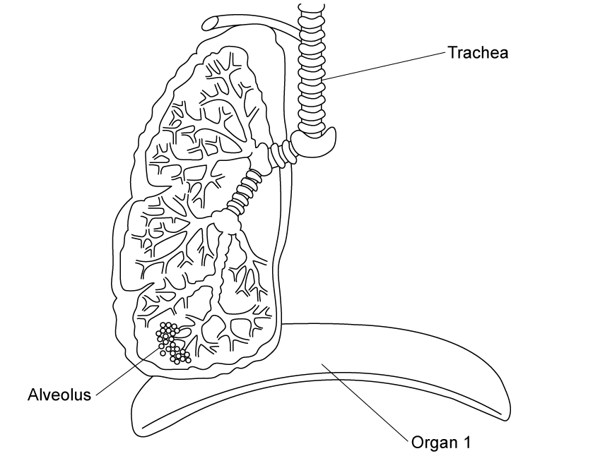

**Fig. 1**

State the name of **Organ 1** and describe its role in breathing out.

**Q4** [4 marks]

In normal and healthy lungs, an effective oxygen supply is maintained between the alveoli and the lung capillaries.

Describe and explain how this is maintained.

**Q4** [1 mark]

**Extract:**

Fig. 2 shows the changes in the volume of air in a woman's lungs while breathing. Explain how Fig. 2 shows that the woman was breathing out between times W and X.

#### Extended only

Fig. 2 shows the changes in the volume of air in a woman’s lungs while breathing.

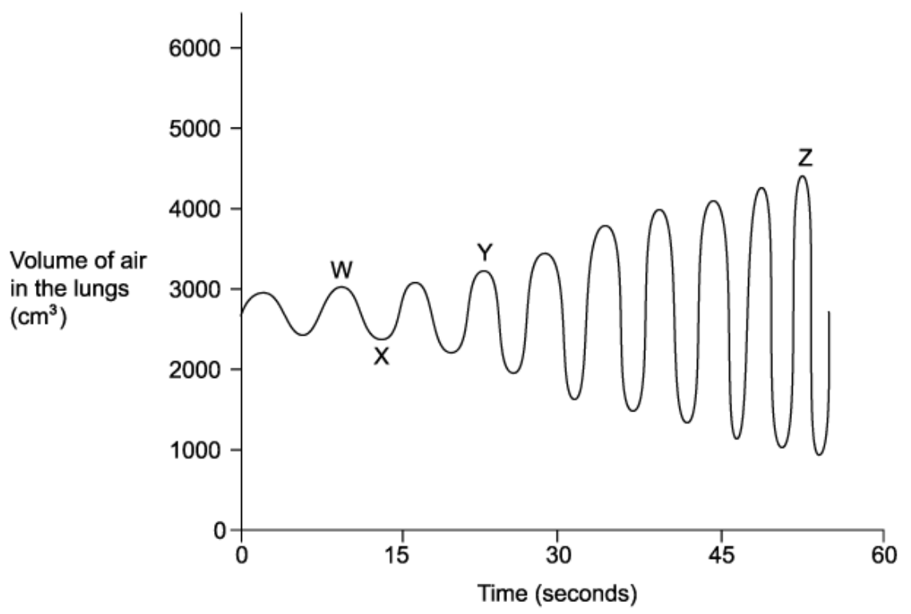

**Fig. 2**

Explain how Fig. 2 shows that the woman was breathing out between times **W **and **X**.

**Q4** [1 mark]

#### Extended only

Muscle action during ventilation is described as antagonistic.

Outline what this means with reference to **one **example during breathing.

### Q5 — hard — 11 marks

**Q5** [2 marks]

#### Extended only

Table 1 shows some data gathered from a person's thorax whilst breathing normally at rest.

Assume that each breath consists of an inhalation lasting 2·5 seconds followed by an exhalation, also lasting 2·5 seconds.

The pressure scale is: **0** means atmospheric pressure **+** means greater than atmospheric pressure **-** means lower than atmospheric pressure

The volume scale is: **0 **means its smallest volume **+++** means its largest volume

**Table 1**

| event | thoracic pressure (0 / + / -) | thoracic volume (0 / + / ++ / +++) |
|---|---|---|
| beginning of exhalation | +++ | +++ |
| end of exhalation, before inhalation  begins |   |   |
| 1 second into exhalation |   |   |
| 1 second into inhalation | - | + or ++ |

Calculate the person's breathing rate in breaths per minute.

**Q5** [4 marks]

**Extract:**

Table 1 shows some data gathered from a person's thorax whilst breathing normally at rest.

Assume that each breath consists of an inhalation lasting 2·5 seconds followed by an exhalation, also lasting 2·5 seconds. 

The pressure scale is: 0 means atmospheric pressure + means greater than atmospheric pressure - means lower than atmospheric pressure

The volume scale is: 0 means its smallest volume +++ means its largest volume

Table 1

| event | thoracic pressure (0 / + / -) | thoracic volume (0 / + / ++ / +++) |
| beginning of exhalation | +++ | +++ |
| end of exhalation, before inhalation  begins |   |   |
| 1 second into exhalation |   |   |
| 1 second into inhalation | - | + or ++ |

Using your knowledge of breathing, complete the missing boxes in** **Table 1, using the same scale as in the partially completed table in part (a).

The scales are repeated below for ease of reference:

The pressure scale is: **0** means atmospheric pressure **+** means greater than atmospheric pressure **-** means lower than atmospheric pressure

The volume scale is: **0 **means its smallest volume **+++** means its largest volume

**Q5** [2 marks]

#### Extended only

Exhalation can be described as a passive event.

Explain the term 'passive' in this context.

**Q5** [3 marks]

**Extract:**

The term 'passive' in the context of exhalation can be explained as:

Any two from the following:

- No energy required / opposite of active; [1 mark]
- Diaphragm and intercostal muscles relax / are not using energy/ATP; [1 mark]
- Air is pushed out by elastic recoil (of alveoli) and dropping of the ribcage (that both exert pressure); [1 mark]

Remember that energy from respiration is required to make the diaphragm and intercostal muscles contract. However, on exhalation, these both relax so are not using the energy from respiration.

Explain how muscles of the breathing system help to facilitate increased removal of carbon dioxide when undergoing vigorous exercise.

### Q6 — hard — 11 marks

**Q6** [2 marks]

#### Extended only

A study was carried out that looked at the movement of the diaphragm during normal breathing.

Fig. 1 shows the diaphragm movement in a healthy 55-year-old male.

**Fig. 1**

Calculate the breathing rate of the individual shown in Fig. 1.

**Q6** [3 marks]

#### Extended only

(i)

Identify the ventilation processes occurring at the stages marked **X** and **Y** in Fig. 1.

[1]

(ii)

For the stage marked **Y** on Fig. 1, name a muscle **other than** the diaphragm involved at this stage **and** identify its state.

[2]

**Q6** [4 marks]

**Extract:**

Fig. 1 shows the diaphragm movement in a healthy 55-year-old male. The breathing rate of the individual shown in the graph is 15 breaths per minute (calculated as 60 ÷ 4).

#### Extended only

Fig. 2 shows the results of another participant in the study.

This individual is a 57-year-old male with emphysema, a lung condition that reduces gas exchange and causes significant illness.

**Fig. 2**

(i)

Contrast the graph shown here with Fig. 1 as shown in part (a).

[2]

(ii)

Suggest an explanation for the differences between the graphs.

[2]

**Q6** [2 marks]

**Extract:**

The graph at stage X shows the diaphragm moving downwards; this happens when it contracts, increasing the volume of the thorax and leading to inspiration. At stage Y the diaphragm is moving back up to its resting position; this happens when it relaxes, reducing the volume of the thorax and leading to expiration.

Events such as surgical trauma or nerve degeneration can lead to weakness or even paralysis of the diaphragm.

Suggest the effect that this would have on ventilation.

### Q7 — medium — 11 marks

**Q7** [3 marks]

A study estimated the number of people with chronic obstructive pulmonary disease (COPD) in India. Data were collected from two groups of people, those who lived in cities and those who lived in villages.

Fig. 1 shows the results.

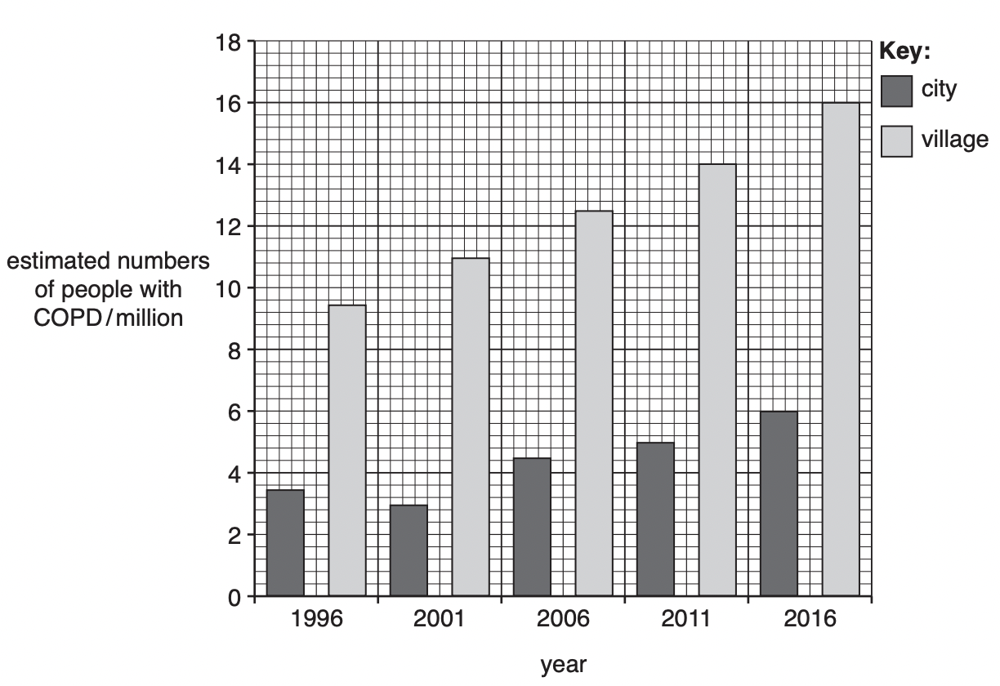

**Fig. 1**

Compare the number of people with COPD in cities with the number of people with COPD in villages.

Use the data in Fig. 1 to support your answer.

*Source: 2018 Feb/Mar 0610/42 Q2A*

**Q7** [6 marks]

#### Extended only

(i)

Explain how the body prevents particles in inspired air from reaching the gas exchange surfaces.

[4]

(ii)

State **two** ways in which the composition of inspired air differs from the composition of expired air.

[2]

*Source: 2018 Feb/Mar 0610/42 Q2B*

**Q7** [2 marks]

#### Extended only

Alveoli are well ventilated to provide efficient gas exchange.

(i)

State the name of the muscles that cause the ribs to move during ventilation.

[1]

(ii)

During inspiration the pressure and volume in the thorax changes.

State these changes.

[1]

*Source: 2018 Feb/Mar 0610/42 Q2C*

### Q8 — easy — 9 marks

**Q8** [3 marks]

A good blood supply is essential to the effective function of the lungs in mammals.

Give **three** other features of the gas exchange system that enable a fast rate of gas exchange within the lung.

**Q8** [2 marks]

State what is meant by the term *concentration gradient* in the context of human gas exchange.

**Q8** [2 marks]

**Extract:**

A good blood supply is essential to the effective function of the lungs in mammals.

Part (a) mentions that a good blood supply is needed in the lungs.

State what is meant by a good blood supply and explain how this improves gas exchange.

**Q8** [2 marks]

**Extract:**

There is estimated to be a surface area of 4.2 m^2 in the overall lung system of a typical new-born baby, around one twentieth of the overall surface area of a typical adult's lungs.

There is estimated to be a surface area of 4.2 m2 in the overall lung system of a typical new-born baby, around one twentieth of the overall surface area of a typical adult's lungs.

Calculate the overall surface area of a typical adult's lungs.

### Q9 — medium — 11 marks

**Q9** [4 marks]

Fig. 1 shows a diagram of the gas exchange system.

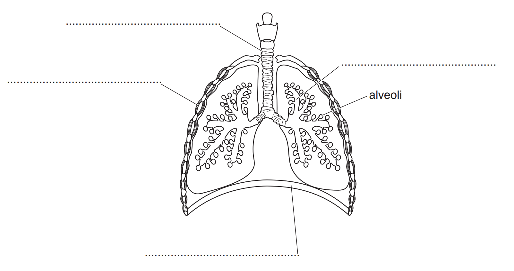

**Fig. 1**

Complete the labelling of Fig. 1 using the words from the list.

**bronchiole         diaphragm         intercostal muscle         trachea**

*Source: 2018 (Series 2) 0610/32 Q6A*

**Q9** [2 marks]

Alveoli are gas exchange surfaces.

State** two** features that make alveoli good gas exchange surfaces.

[2]

*Source: 2018 (Series 2) 0610/32 Q6B*

**Q9** [3 marks]

There is less oxygen in expired air than in inspired air.

(i)

Describe **two other** ways in which expired air is different from inspired air.

[2]

(ii)

State the name of a process that uses oxygen in cells.

[1]

*Source: 2018 (Series 2) 0610/32 Q6C*

**Q9** [2 marks]

State an example of a cell **and** an organ from the gas exchange system.

[2]

*Source: 2018 (Series 2) 0610/32 Q6D*

### Q10 — medium — 9 marks

**Q10** [2 marks]

#### Extended only

A genetic condition called Canine Tracheal Collapse affects certain breeds of domestic dog.

Affected dogs experience difficulty in breathing due to a weakness in the walls of the trachea.

Suggest, with a reason, which type of tissue is affected by this genetic disorder.

**Q10** [2 marks]

#### Extended only

Table 1 shows some differences between inhaled and exhaled air.

**Table 1**

|   | Inhaled air | Exhaled air |
|---|---|---|
| Oxygen content / % | 21 | 16 |
| Carbon dioxide content / % | 0.04 | 4 |

** **

Calculate the percentage difference in oxygen content of exhaled air compared to inhaled air.

**Q10** [2 marks]

The presence of bronchioles, alveoli and blood capillaries within a lung all reduce its overall volume.

Explain how these structures actually *improve *the performance of the lung as a gas exchange organ.

**Q10** [3 marks]

#### Extended only

Explain the roles of the cilia and mucus in protecting the breathing system.

### Q11 — easy — 6 marks

**Q11** [1 mark]

The following list contains structures found within the breathing system.

| structure | order |
|---|---|
| bronchus |   |
| facial airways |   |
| alveolus |   |
| trachea |   |
| bronchioles |   |

Using the numbers 1 - 5, complete the table to indicate the order in which air passes through the different structures during **exhalation**.

**Q11** [2 marks]

Place a tick (**✓**) in the Table 1 below to indicate the name of the organ which governs the activity of the human breathing system.

**Table 1**

| Lungs | Diaphragm | Trachea | Ribs |
|---|---|---|---|
|   |   |   |   |

Explain your choice.

**Q11** [2 marks]

State the reagent used to test for the presence of carbon dioxide (CO2) in a sample of air, and the appearance of a positive result.

**Q11** [1 mark]

State the number of times more carbon dioxide (CO2) is in exhaled air than in inhaled air.

### Q12 — easy — 10 marks

**Q12** [1 mark]

#### Extended only

State the name of the tissue type that supports the trachea and prevents it from collapsing under changes of pressure.

**Q12** [6 marks]

**Fig. 1** shows the human breathing system, with some of its organs labelled.

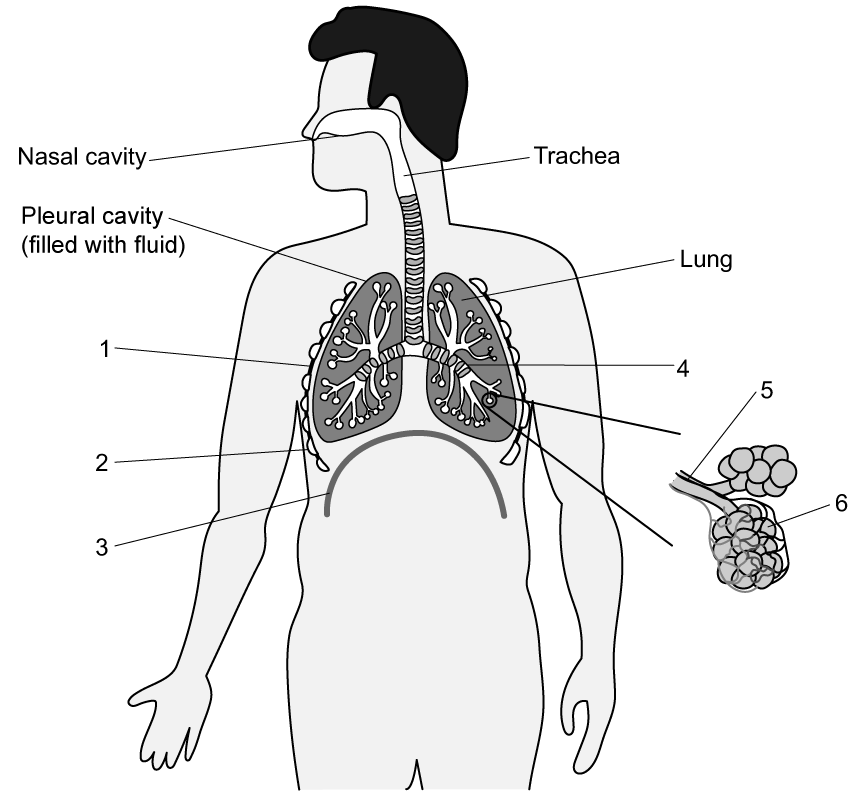

**Fig. 1**

Complete the table below to identify structures 1 - 6 in** **Fig. 1.

| Part | Organ / Structure |
|---|---|
| 1 |   |
| 2 |   |
| 3 |   |
| 4 |   |
| 5 |   |
| 6 |   |

**Q12** [2 marks]

Fig. 2 shows two students working together in an experimental investigation into the human breathing system.

The seated student has just completed a period of 5 minutes of vigorous exercise and is sitting down. His partner is taking measurements.

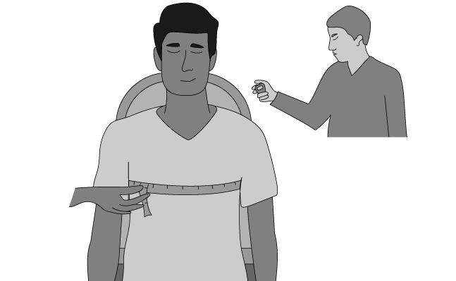

**Fig. 2**

Describe the two measurements being taken as shown in **Fig. 2**.

**Q12** [1 mark]

**Extract:**

The parts 1 - 6 in Fig. 1 are as follows:

| Part | Organ / Structure |
| 1 | intercostal muscle |
| 2 | rib(s) |
| 3 | diaphragm |
| 4 | bronchus |
| 5 | bronchiole |
| 6 | alveolus / alveoli |

[1 mark] for each correct label.

#### Extended only

Fig. 3 shows a serving of boneless pork ribs as served in a restaurant.

The meat comes from the area between the ribs and the bones are removed before serving.

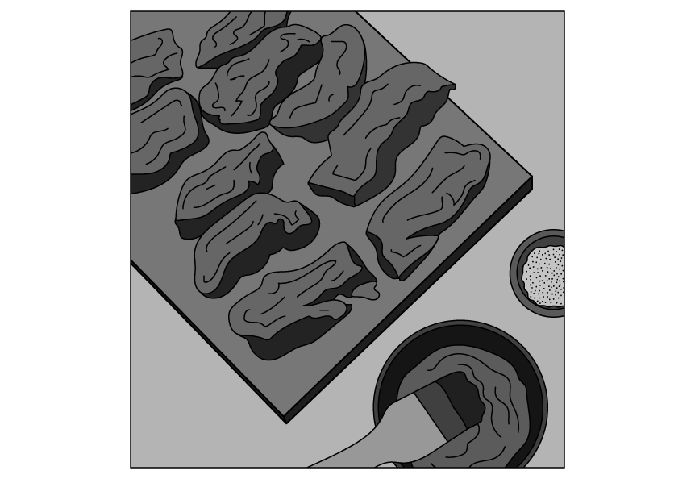

**Fig. 3**

Name the type of tissue that the meat in this dish comes from.
