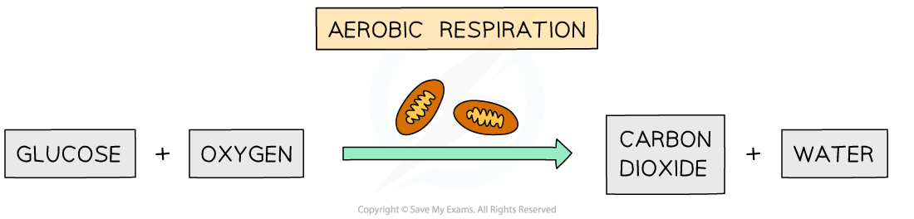

# Mark Schemes — Respiration
**12. Respiration** · Cambridge (CIE) IGCSE biology (0610 & 0970)

## Multiple Choice Questions (28 questions)

### Q1
**Final answer:** **The correct answer is A.**

- Anaerobic respiration in yeast breaks down glucose to produce alcohol and carbon dioxide

**B** is incorrect as glucose → lactic acid is the word equation for anaerobic respiration in humans, not yeast.

**C** is incorrect as glucose + oxygen → carbon dioxide + water is the word equation for aerobic respiration.

**D** is incorrect as this is the word equation for photosynthesis.

### Q2
**Final answer:** **The correct answer is D.**

- Aerobic respiration releases more energy per glucose molecule than anaerobic respiration

**A** is incorrect as anaerobic respiration in humans does not produce carbon dioxide. Carbon dioxide is only produced in anaerobic respiration in yeast.

**B** is incorrect as anaerobic respiration in humans produces lactic acid, not alcohol. This is a products of anaerobic respiration in yeast.

**C** is incorrect as the products of aerobic and anaerobic respiration have been swapped. Aerobic respiration produces carbon dioxide and water, whereas anaerobic respiration in humans produces lactic acid.

### Q3
**Final answer:** **The correct answer is D.**

- Volume of yeast and volume of oil added are both control variables — they are specific, measurable quantities that would need to be kept constant to ensure a fair test

**A** is incorrect as temperature is the independent variable in this experiment, not a control variable. Glucose concentration is a control variable, but pairing it with temperature is incorrect.

**B** is incorrect as the volume of carbon dioxide produced is the dependent variable, not a control variable.

**C** is incorrect as "amount" is an imprecise term. Control variables should be described using specific, measurable quantities such as volume, concentration or mass.

### Q4
**Final answer:** **The correct answer is A.**

- Aerobic respiration is a chemical reaction in cells that uses oxygen to break down nutrient molecules to release energy

**B** is incorrect as this describes anaerobic respiration, which does not require oxygen.

**C** is incorrect as this describes ventilation, not respiration. Respiration is a chemical process occurring in cells, not a mechanical process of breathing.

**D** is incorrect as aerobic respiration *releases* energy rather than producing it. Energy cannot be created; it is released from the breakdown of nutrient molecules.

### Q5
**Final answer:** **The correct answer is ****A.**

- Anaerobic respiration in yeast converts **glucose into ethanol and carbon dioxide**:

C6H12O6 →  2C2H5OH + 2CO₂

> **[exam-tip]**
> You must memorise the **balanced chemical equation **for **aerobic respiration** and **anaerobic respiration in yeast**.
> 
> You should also know the **word equations** for:
> 
> - aerobic respiration
> - anaerobic respiration in yeast
> - anaerobic respiration in muscle cells
> 
> Remember that anaerobic respiration in **muscles **forms **lactic acid**, while anaerobic respiration in **yeast **forms **ethanol and carbon dioxide.**

### Q6
**Final answer:** **The correct answer is ****C.**

- In aerobic respiration, glucose (C6H12O6) and oxygen (6O2) react to produce carbon dioxide (6CO2) and water (6H2O), releasing energy.

**A **is incorrect because it represents photosynthesis, where carbon dioxide and water are converted into glucose and oxygen using light energy.

**B **is incorrect because it incorrectly shows oxygen and carbon dioxide reacting to form water and glucose, which does not represent a biological process.

**D **is incorrect because it represents anaerobic respiration in yeast, where glucose breaks down to form ethanol and carbon dioxide, not aerobic respiration.

### Q7
**Final answer:** **The correct answer is ****C****.**

- This is because the balanced chemical equation for anaerobic respiration in yeast is C6H12O6  →  2C2H5OH + 2CO2
- The word equation for anaerobic respiration in yeast is glucose → ethanol + carbon dioxide

**A**, **B** and **D** are incorrect because they do not show the correct equation for anaerobic respiration in yeast because it does not produce water.

### Q8
**Final answer:** **The correct answer is ****D****.**

- This is because at 20 °C the oxygen uptake is 0.36, which is four times greater than the oxygen uptake at 10 °C, which is 0.09
- 0.09 x 4 = 0.36

**A** is incorrect because at 5 minutes at 20 °C the oxygen uptake is 0.1, which is not four times greater than the oxygen uptake at 10 °C, which is 0.06.

**B** is incorrect because at 10 minutes at 20 °C the oxygen uptake is 0.19, which is not four times greater than the oxygen uptake at 10 °C, which is 0.07.

**C** is incorrect because at 15 minutes at 20 °C the oxygen uptake is 0.255, which is not four times greater than the oxygen uptake at 10 °C, which is 0.085.

### Q9
**Final answer:** **The correct answer is ****C****.**

- This is because glucose and oxygen are both the reactants of aerobic respiration, meaning that they are used during the reaction
- The word equation for aerobic respiration is: glucose + oxygen → carbon dioxide + water

**A** is incorrect because carbon dioxide is a product of aerobic respiration.

**B** is incorrect because carbon dioxide and water are both products of aerobic respiration.

**D** is incorrect because water is a product of aerobic respiration.

### Q10
**Final answer:** **The correct answer is ****C****.**

- Anaerobic respiration occurs in humans during vigorous exercise when oxygen supply is insufficient for aerobic respiration. It is represented by the following equation:

Glucose → Lactic acid

**A **is incorrect because carbon dioxide is a product of aerobic respiration and anaerobic respiration in yeast, but not anaerobic respiration in humans.

**B **is incorrect because alcohol and carbon dioxide are products of anaerobic respiration in yeast but not humans.

**D** is incorrect because alcohol is a product of anaerobic respiration in yeast but not humans.

### Q11
**Final answer:** **The correct answer is ****A.**

- The production of new red blood cells (Process 1) requires energy for cell division and the transmission of nerve impulses (Process 2) requires energy to transmit signals.

**B, C **and** D **are all incorrect because the diffusion of gases (Process 3) is a passive process that doesn’t require energy.

### Q12
**Final answer:** **The correct answer is ****B ****because:**

Lactic acid is produced from the incomplete breakdown of glucose in anaerobic respiration. When lactic acid is oxidised (reacted with oxygen) the remaining energy is released.

Remember ethanol (an alcohol) is produced as a waste product of anaerobic respiration in yeast cells, and neither gas (carbon dioxide or oxygen) is involved as a reactant or product in anaerobic respiration.

### Q13
**Final answer:** **The correct answer is ****D ****because:**

Respiration occurs in **ALL** plant cells **ALL** the time, regardless of where in the plant they are. Light only affects the rate of photosynthesis in plant cells, and obviously being underground root hair cells do not photosynthesise (but that’s irrelevant here).

### Q14
**Final answer:** **The correct answer is ****D**** (all of them) because:**

Humans need energy from respiration for many processes and reactions to thrive.

These include:

- Contraction of muscles
- To synthesise proteins
- Cell division (to make new cells)
- Growth
- Enable active transport to take place
- Allow nerve impulses to be generated
- Maintain a constant internal body temperature

### Q15
**Final answer:** **The correct answer is ****A**** (enzyme activity is higher at 30 °C because more frequent collisions are occurring than at 10 °C) because:**

Increasing the temperature of an enzyme to its optimum increases the rate of the chemical reaction it catalyses as enzymes and substrates will have more kinetic energy and therefore will collide successfully more often.

**B** is incorrect because the graph shows the rate of the enzyme’s activity increasing up to 40°C, so the bonds holding the structure together cannot have been altered.

**C** is incorrect because the optimum for the enzyme is somewhere between 30°C and 50°C.

**D** is incorrect because enzymes are denatured at temperatures above their optimum, not at low temperatures.

### Q16
**Final answer:** **The correct answer is ****B**** (moves to the left) because:**

As the yeast respires anaerobically, it produces carbon dioxide gas which would be released into the tube, increasing the pressure inside the tube and pushing the drop of coloured liquid to the left.

### Q17
**Final answer:** **The correct answer is ****D ****because:**

- The purpose of any form of respiration is to release energy stored in the chemical bonds of molecules like glucose, so all types of respiration release energy
- The overall equation for aerobic respiration is (energy released is not shown)

Lactic acid is not produced as a waste product in aerobic respiration, but in anaerobic respiration (animals only).

### Q18
**Final answer:** **The correct answer is ****C**** (aerobic respiration of lactic acid in the liver) because:**

- Lactic acid builds up in skeletal muscle cells during vigorous exercise
- It is mainly excreted into the blood, and when the blood passes through the liver lactic acid is taken up by liver cells where it reacts with oxygen, forming carbon dioxide and water (and releasing energy)
- As lactic acid is therefore being broken down with oxygen (and energy is being released), this is an example of aerobic respiration

**A** is incorrect because the kidneys can also break down lactic acid (using oxygen to form carbon dioxide and water) but they do not excrete lactic acid.

**B** is incorrect because anaerobic respiration in the muscles produces lactic acid.

**D** is incorrect because lactic acid is not excreted by the lungs (the carbon dioxide produced in aerobic respiration is).

### Q19
**Final answer:** **The correct answer is ****A**** (glucose + oxygen →  carbon dioxide + water) because:**

- Plants, like all living organisms, respire to release energy (not shown in the above equations), therefore the process of aerobic respiration is the same in plants as it is in other organisms
- Plants also photosynthesise, but only when conditions allow it to (such as when light is available and the temperature is appropriate)

**B** is incorrect because this is the equation for photosynthesis in plants. Photosynthesis is not the reverse reaction of respiration, although the reactants and products are the opposite way around in each reaction.

**C** and **D **are incorrect because the reactants and products have been mixed up.

### Q20
**Final answer:** **The correct answer is ****C ****because:**

The independent variable, the temperature of water, is what is changed during an experiment. The dependent variable, the number of bubbles, is what is measured and **depends **on the independent variable.

The other answers are incorrect because the time and the volume of water are **control variables** and are something that needs to be kept the same throughout the experiment.

### Q21
**Final answer:** **The correct answer is ****B ****because:**

- The word equation for anaerobic respiration in yeast is:

glucose $\rightarrow$alcohol + carbon dioxide

- The word equation for anaerobic respiration in animals is:

glucose $\rightarrow$ lactic acid

### Q22
**Final answer:** **The correct answer is ****C**** (1, 2 and 4) because:**

- Enzymes are proteins that act as biological catalysts, speeding up reaction times
- All cellular reactions in living cells are catalyzed by enzymes such as respiration and the breakdown of glucose to lactic acid

Osmosis is not a reaction, it is the diffusion of water from high to lower water potential through a partially permeable membrane, and therefore it does not require the action of an enzyme to occur.

### Q23
**Final answer:** **The correct answer is ****D ****because:**

- Equation 2 represents anaerobic respiration that occurs in animal cells (such as muscle cells)
- Equation 3 represents aerobic respiration which occurs in all living cells (providing oxygen is available)
- Equation 4 represents anaerobic respiration that occurs in yeast cells

Equation 1 is photosynthesis which occurs in green plant and algal cells when light is available.

### Q24
**Final answer:** **The correct answer is ****A**** (C****6****H****12****O****6****   +  6 O****2**** →  6 CO****2**** + 6 H****2****O) because:**

In a balanced equation for aerobic respiration in any cell; one molecule of glucose reacts with 6 molecules of oxygen, forming 6 molecules of carbon dioxide and 6 molecules of water. Energy is also released but this is not shown in an equation.

**B** is incorrect because this equation is the balanced symbol equation for anaerobic respiration in animals (you don’t need to know this).

**C** is incorrect because this equation is the balanced symbol equation for photosynthesis.

**D** is incorrect because this equation is the balanced symbol equation for anaerobic respiration in yeast, not aerobic respiration.

### Q25
**Final answer:** **The correct answer is ****D**** (all of the above) because:**

The process of aerobic respiration is essentially the same in all eukaryotic cells, so the theoretical energy released will be the same when one molecule of glucose is broken down in any of the above cells.

### Q26
**Final answer:** **The correct answer is ****D**** (1 and 4) because:**

- Reaction 1 is the balanced symbol equation for aerobic respiration, which occurs in almost all eukaryotic cells (therefore yeast) when oxygen is available
- Reaction 4 is the balanced symbol equation for anaerobic respiration in yeast, the incomplete breakdown of glucose produces an alcohol (ethanol) and carbon dioxide

**A **is incorrect because reaction 2 is the equation for anaerobic respiration in animals.

**B **&** C** are incorrect because reaction 3 is the balanced symbol equation for photosynthesis in plant and algal cells (which does not release energy), yeast does not photosynthesise.

### Q27
**Final answer:** **The correct answer is ****B ****because:**

The yeast cells would largely be respiring **anaerobically **after oxygen in the flask was used up. The reaction for this is:

glucose $\rightarrow$ alcohol + carbon dioxide

The other answers are incorrect because oxygen is never a gas produced in a respiration reaction. Lactic acid is only produced in animal cells when oxygen is not available.

### Q28
**Final answer:** **The correct answer is ****C ****because:**

- The leaf will **not** **photosynthesise** as there is a black cover around the tube,  meaning no light can get in
- The leaf will **respire** as all living cells must respire to release energy
- Available oxygen in the tube will be absorbed by the plant for aerobic respiration and the waste gas carbon dioxide will be produced. This is absorbed by the substance at the bottom of the tube
- The ink drop in the tube will move to the right as the air pressure in the test tube will decrease as the number of gas molecules decreases (because any carbon dioxide is absorbed)

When answering a question like this, it is important to consider all the information in the diagram before making your choice of answer.
